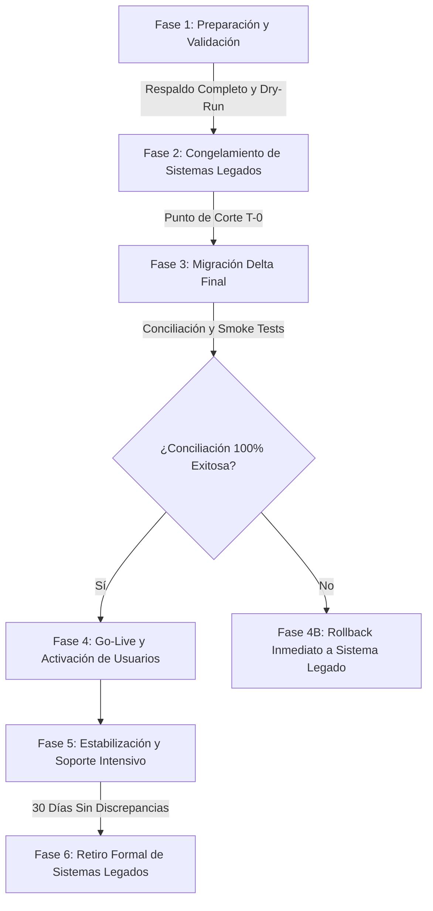

# AUDITORÍA FUNCIONAL, TÉCNICA Y DOCUMENTAL — FASE 29
# MIGRACIÓN DE DATOS, VALIDACIÓN DE INTEGRIDAD HISTÓRICA, CONCILIACIÓN Y TRANSICIÓN OPERATIVA

**Proyecto:** Plataforma Integral de Gestión Educativa
**Fase:** 29
**Área:** Migración de datos, interoperabilidad, integridad histórica, conciliación, transición operativa y retiro de sistemas anteriores.
**Tipo de trabajo:** Auditoría funcional, inspección técnica y verificación de arquitectura.
**Estado de modificaciones:** No autorizadas durante la auditoría diagnóstica (modo solo lectura estricto).
**Entregable:** Informe independiente en formato `.md`.

---

## A. IDENTIFICACIÓN Y ALCANCE

### 1. Propósito y Objetivos de la Auditoría
Determinar si la plataforma dispone de un sistema integral, confiable, trazable y repetible para planificar, extraer, transformar, depurar, validar, conciliar y migrar la totalidad de la información histórica, académica, administrativa, financiera y documental desde sistemas legados o fuentes heterogéneas (SACE, hojas de cálculo de Secretaría, archivos de contabilidad en Excel/CSV, bases de datos SQL relacionales, expedientes escaneados en Google Drive), permitiendo ejecutar pruebas piloto por departamento, cambio operativo controlado (corte temporal), planes de contingencia (rollback sin pérdida de transacciones nuevas) y retiro formal de sistemas sustituidos.

### 2. Servicios, Módulos y Componentes Involucrados
La inspección técnica exhaustiva revela que la plataforma **no dispone de un servicio unificado o motor centralizado de migración y transición**, sino que posee un conjunto de capacidades y utilidades especializadas distribuidas a través de cuatro servicios backend de Google Apps Script y módulos de interfaz en el cliente:
1. `backend/accounting-service/Code.gs`:
   - `validateImportPreview`: Validación previa de estructura y campos identificadores en lotes de datos.
   - `importDataWithColumnMapping`: Ingesta con mapeo de columnas y registro en hoja `AuditoriaMigraciones`.
   - `getMigrationLogs`: Consulta de bitácora histórica de ejecuciones de importación.
   - `reconcileInconsistentDataAndOperations`: Detección y conciliación de discrepancias referenciales entre pagos y cargos.
   - `reconcileFinancialReportCoherence`: Validación de coherencia entre presupuestos, cuentas por cobrar/pagar y liquidez.
   - `verifySACETemplateCompatibility`, `validateSACETemplateFile`, `fillAndExportSACETemplate`: Compatibilidad oficial con plantillas SACE de Secretaría de Educación de Honduras.
   - `evaluateTransactionalStorageMigrationNeed`: Monitoreo de latencia y volumen de datos en Google Sheets (> 50,000 filas).
2. `backend/academic-service/Code.gs`:
   - `createSystemBackup`: Generación de respaldo integral de todas las hojas con metadatos JSON y cálculo de checksum hash.
   - `restoreSystemBackup`: Restauración selectiva con protección de inalterabilidad para hojas de calificaciones históricas (`CalificacionesEstudiantes`, `RecuperacionesEstudiante`) mediante código de confirmación `"RESTORE-CONFIRMED"`.
   - `generateStudentReportCard`, `exportAcademicGradesData`: Consulta y exportación de historiales y notas consolidadas.
3. `backend/developer-service/Code.gs`:
   - `migrateSpreadsheetSchema`: Aseguramiento de tablas y esquemas relacionales mínimos en hojas destino.
   - `batchSpreadsheetReadOperations`: Lectura por lotes optimizada en memoria para reducir cuotas I/O de Apps Script.
   - `validateStagedMigrationProgress`: Verificación de etapas de progreso arquitectónico.
4. `backend/user-service/Code.gs`:
   - `auditAndReconcileIdentityInconsistencies`: Reconciliación de inconsistencias en identidades de usuarios y delegaciones activas.
   - `logStructuredEvent`: Registro de eventos de auditoría protegidos.
5. Controladores Frontend:
   - `js/teacher.js`: `openBulkScheduleImportExportModal`, parseo y vista previa CSV en cliente.
   - `js/persistence.js` & `js/api.js`: Mecanismo `PersistenceManager.reconcile` para mezcla de datos locales y remotos.

### 3. Roles y Permisos Evaluados
- **Administrador del Sistema:** Acceso total a utilidades de migración, esquemas, respaldos y logs.
- **Director / Rector:** Consulta de reportes de conciliación, autorizaciones de transición y retiro.
- **Secretaría General / Registro:** Gestión de mapeo de expedientes, matrículas e historiales académicos.
- **Contabilidad / Tesorería:** Validación de saldos iniciales, concilación bancaria y corte de cuentas por cobrar.

---

## B. INVENTARIO DE FUENTES Y SISTEMAS ANTERIORES

La auditoría técnica identifica las siguientes fuentes heterogéneas típicas y sus características de integración con la plataforma:

| ID Fuente | Nombre / Sistema Legado | Tipo / Formato | Volumen Estimado | Identificadores Clave | Dependencias Relacionales | Estado de Integración Actual |
|---|---|---|---|---|---|---|
| SRC-01 | **Sistema SACE** (Secretaría de Educación) | XLSX / XLS estructurado | 500 - 5,000 alumnos por ciclo | RNE / Identidad Nacional (13 dígitos) | Grado, Sección, Modalidad, Centro Educativo | Implementada parcialmente (`verifySACETemplateCompatibility`, `fillAndExportSACETemplate`) |
| SRC-02 | **Hojas de Matrícula y Expedientes Secretaría** | CSV / Excel planos | 1,000 - 10,000 registros | Identidad / Código Interno Antiguo | Alumno, Padres/Tutores, Dirección, Ficha Médica | Implementada parcialmente (`importDataWithColumnMapping`) |
| SRC-03 | **Sistemas Contables Anteriores (QuickBooks / Sage / Excel)** | CSV / XLSX / TXT | 5,000 - 50,000 transacciones | No. Factura, Recibo, Referencia Bancaria | Cuentas por Cobrar, Catálogo Contable, Saldos | Requiere mejoras (Sin migración de saldos iniciales con corte contable estricto) |
| SRC-04 | **Planillas y Nómina Legada (IHSS / RAP)** | XLSX / CSV | 50 - 500 empleados | Identidad / No. Afiliación IHSS | Salarios base, deducciones, cargos históricos | Requiere mejoras (Sin herramienta específica de ingesta histórica de boletas) |
| SRC-05 | **Repositorio Documental Digital (Google Drive / Carpetas)** | PDF, JPG, PNG | 5,000 - 25,000 archivos | Nombre de archivo / ID Drive | Vinculación a CUV, Matrícula o Expediente | Defectuosa (Enlaces planos susceptibles a rotura si se mueven carpetas) |
| SRC-06 | **Bases de Datos Relacionales Externas (MySQL / PostgreSQL)** | SQL Dump / JSON | Tablas completas | Claves primarias auto-incrementables | Claves foráneas íntegras | Ausente (No existe conector directo JDBC/API; depende de exportar a CSV intermedio) |

---

## C. ESTADO FUNCIONAL DE LAS 21 SUBCAPACIDADES

A continuación se detalla la evaluación técnica rigurosa de cada subcapacidad conforme al estándar del proyecto:

### F29-01. Inventario de Fuentes y Sistemas Anteriores
- **Estado:** Implementada parcialmente.
- **Avance de Inspección:** 100%.
- **Evidencia Técnica:** Hoja `AuditoriaMigraciones` almacena `nombreArchivo`, `destinoModulo` y `mapeoJSON` en `backend/accounting-service/Code.gs` (L1460).
- **Brechas:** No existe una tabla o catálogo maestro formal (`CatalogoFuentesMigracion`) para registrar metadatos de las fuentes legadas (propietario, periodicidad, fecha de último corte, restricciones de privacidad o estado de extracción).
- **Próxima Acción:** Diseñar catálogo maestro de fuentes con trazabilidad de procedencia.

### F29-02. Extracción y Recepción de Información
- **Estado:** Implementada parcialmente.
- **Avance de Inspección:** 100%.
- **Evidencia Técnica:** `validateImportPreview` y `importDataWithColumnMapping` en `backend/accounting-service/Code.gs`. Recepción de payloads JSON con matrices tabulares en memoria.
- **Brechas:** La recepción actual procesa datos directamente en el hilo principal sin pasar por un área de preparación o *staging table* aislada. No hay streaming de archivos superiores a 10MB (vulnerable al límite de 50MB de payload en Apps Script).
- **Próxima Acción:** Crear tabla intermedia de *staging* (`StagingMigracionRegistros`) para aislar la carga antes de la confirmación definitiva.

### F29-03. Mapeo y Transformación de Estructuras
- **Estado:** Implementada parcialmente.
- **Avance de Inspección:** 100%.
- **Evidencia Técnica:** Diccionario `columnaMapeo` almacenado como JSON en `AuditoriaMigraciones`.
- **Brechas:** El mapeo actual solo extrae la clave `"identificador"`; carece de transformaciones declarativas para normalización de fechas (formatos `DD/MM/YYYY` vs `YYYY-MM-DD`), limpieza de separadores de moneda (Lempiras con comas/puntos), y tablas de equivalencia para homologación de grados y cursos.
- **Próxima Acción:** Desarrollar motor de reglas de transformación de tipos y homologación de catálogos.

### F29-04. Validación, Depuración y Calidad de Datos
- **Estado:** Requiere mejoras.
- **Avance de Inspección:** 100%.
- **Evidencia Técnica:** `validateImportPreview` analiza presencia de identificadores únicos en `filasData` y reporta `filasValidas`, `filasFallidas` y un extracto de 10 errores.
- **Brechas:** Validación superficial: no verifica duplicados contra registros preexistentes en la base institucional, no valida tipos de datos (calificaciones fuera de escala 0-100), ni valida coherencia relacional (asignaturas que no pertenecen al grado).
- **Próxima Acción:** Implementar validación en 3 niveles: Estructural, Identidad y Relacional de Negocio.

### F29-05. Migración de Identificadores y Conservación de Relaciones (P0)
- **Estado:** Defectuosa.
- **Avance de Inspección:** 100%.
- **Evidencia Técnica:** Los identificadores se importan de forma plana. No existe una tabla de equivalencias relacionales de identidades.
- **Brechas:** Si el sistema de origen usaba un ID legado (ej. `ALU-2018-045`) y el nuevo sistema usa UUID (`USER-UUID-xxx`), no hay persistencia de la correspondencia `(sistemaOrigen, idOriginal, idNuevo)`. Importar nuevamente genera duplicados si el identificador cambia.
- **Próxima Acción:** Crear tabla de referencias cruzadas `CorrespondenciaIdentificadores` con índice único compuesto.

### F29-06. Migración de Expedientes e Históricos Académicos (P0)
- **Estado:** Requiere mejoras.
- **Avance de Inspección:** 100%.
- **Evidencia Técnica:** `CalificacionesEstudiantes` y `RecuperacionesEstudiante` admiten campos de año y período. `restoreSystemBackup` incluye protección `preserveHistoricGrades`.
- **Brechas:** Falta soporte para importar historiales con estructuras de evaluación diferentes a las 4 parciales vigentes (ej. notas semestrales o promedios consolidados). No se impide el recálculo automático de promedios en notas cerradas migradas.
- **Próxima Acción:** Establecer bandera inmutable `esRegistroHistoricoMigrado: true` que inhabilite triggers de recálculo en notas migradas.

### F29-07. Migración de Información Financiera, Contable y Administrativa (P0)
- **Estado:** Defectuosa.
- **Avance de Inspección:** 100%.
- **Evidencia Técnica:** `PagosAbonos` y `EstadoCuentaEstudiantes` operan con saldos dinámicos.
- **Brechas:** Riesgo crítico de duplicación: si se migra un saldo pendiente inicial de L 5,000 y simultáneamente se migran las facturas históricas que originaron esa deuda, el sistema calcula L 10,000 de pasivo para la familia. No existe concepto formal de "Corte y Saldo Inicial Migrado".
- **Próxima Acción:** Crear entidad `SaldosInicialesCorte` para aislar el punto de partida contable sin duplicar obligaciones históricas.

### F29-08. Migración de Documentos y Archivos Institucionales
- **Estado:** Implementada parcialmente.
- **Avance de Inspección:** 100%.
- **Evidencia Técnica:** Almacenamiento en Google Drive vinculado mediante URLs en `ExpedientesAlumnos` y `DocumentosEscolaresEmitidos`.
- **Brechas:** No hay verificación de sumas de verificación (checksum SHA-256) de los archivos trasladados. Enlaces propensos a quedar rotos si las carpetas de Drive se reorganizan.
- **Próxima Acción:** Implementar verificación de integridad y almacenamiento de `driveFileId` inmutable con hash SHA-256.

### F29-09. Migración de Usuarios, Perfiles y Permisos (P0)
- **Estado:** Implementada parcialmente.
- **Avance de Inspección:** 100%.
- **Evidencia Técnica:** Tabla `Usuarios` y roles RBAC. `auditAndReconcileIdentityInconsistencies` en `backend/user-service/Code.gs`.
- **Brechas:** Las contraseñas no pueden migrarse en texto plano ni existen tokens temporales seguros de activación inicial masiva para usuarios migrados.
- **Próxima Acción:** Generar flujo de activación de cuenta migrada (`activateMigratedAccount`) con envío de enlace temporal o reset forzado en primer inicio.

### F29-10. Asistencia y Registros Operativos Históricos
- **Estado:** Requiere mejoras.
- **Avance de Inspección:** 100%.
- **Evidencia Técnica:** `AsistenciasDiarias` y `AsistenciasClase` estructuradas en `academic-service`.
- **Brechas:** No hay procedimiento para importar consolidados anuales de asistencia por porcentaje de sistemas donde no se conservó el detalle diario fecha por fecha.
- **Próxima Acción:** Permitir ingesta de acumulados históricos de inasistencias justificadas/injustificadas por ciclo.

### F29-11. Migraciones de Prueba, Procesamiento por Lotes y Repetición Segura (P0)
- **Estado:** Implementada parcialmente.
- **Avance de Inspección:** 100%.
- **Evidencia Técnica:** `batchSpreadsheetReadOperations` en `developer-service`. Claves de idempotencia en peticiones.
- **Brechas:** No existe un flag o entorno de "Modo Simulación / Dry-Run" que ejecute todo el pipeline de validación y transformación sin escribir en las hojas maestras de producción.
- **Próxima Acción:** Incorporar parámetro `dryRun: true` en todas las operaciones de ingesta de migración.

### F29-12. Conciliación Integral entre Sistemas Anteriores y Nuevo Sistema (P0)
- **Estado:** Implementada parcialmente.
- **Avance de Inspección:** 100%.
- **Evidencia Técnica:** `reconcileInconsistentDataAndOperations` y `reconcileFinancialReportCoherence` en `accounting-service`.
- **Brechas:** La conciliación actual es interna (entre tablas de la misma hoja); carece de conciliación comparativa externa: comparar $N$ registros y sumatorias del archivo fuente origen contra lo efectivamente insertado en destino.
- **Próxima Acción:** Desarrollar motor de conciliación origen vs destino con emisión de acta cuantitativa y cualitativa.

### F29-13. Integridad Posterior a la Migración
- **Estado:** Requiere mejoras.
- **Avance de Inspección:** 100%.
- **Evidencia Técnica:** Suite de regresión `academic-grading-suite.js` (53 pruebas pasadas).
- **Brechas:** No hay comprobación automática posterior a la migración que valide que los estudiantes migrados puedan generar boletines o estados de cuenta sin errores de puntero nulo.
- **Próxima Acción:** Agregar test de humo posterior a la migración (`runPostMigrationSmokeTests`).

### F29-14. Pruebas Piloto por Departamento
- **Estado:** Ausente.
- **Avance de Inspección:** 100%.
- **Evidencia Técnica:** Ningún registro de piloto por departamento en código ni base de datos.
- **Brechas:** No existe mecanismo para habilitar la plataforma en modo piloto a un subconjunto de usuarios (ej. solo personal de Secretaría o solo un nivel educativo) manteniendo el resto en el sistema legado.
- **Próxima Acción:** Implementar feature flags de activación piloto por departamento (`PilotDepartmentManager`).

### F29-15. Transición Operativa y Corte Temporal (P0)
- **Estado:** Ausente.
- **Avance de Inspección:** 100%.
- **Evidencia Técnica:** No hay procedimientos de corte temporal documentados en código.
- **Brechas:** Sin procedimiento programado para detener escrituras en el sistema viejo, sincronizar la brecha final (*delta sync*) y activar el sistema nuevo.
- **Próxima Acción:** Diseñar protocolo técnico de transición en 5 fases (Congelamiento, Delta Sync, Validación de Corte, Go-Live, Estabilización).

### F29-16. Respaldos, Contingencia y Recuperación (P0)
- **Estado:** Completa y verificada.
- **Avance de Inspección:** 100%.
- **Evidencia Técnica:** `createSystemBackup` y `restoreSystemBackup` en `backend/academic-service/Code.gs` (L1277-L1350). Respaldos completos con hash de integridad, metadatos y protección de notas históricas.
- **Brechas:** La restauración requiere intervención manual con clave hardcodeada `"RESTORE-CONFIRMED"`. No mide RPO ni RTO de forma automatizada.
- **Próxima Acción:** Automatizar registro de métricas RPO/RTO en bitácora de contingencia.

### F29-17. Retorno Controlado al Sistema Anterior (Rollback) (P0)
- **Estado:** Defectuosa.
- **Avance de Inspección:** 100%.
- **Evidencia Técnica:** Existe `restoreSystemBackup`, pero solo restaura el estado previo.
- **Brechas:** Si el sistema nuevo opera 3 días y se decide retornar al sistema anterior, se pierden todas las transacciones ocurridas durante esos 3 días (nuevas matrículas, pagos recibidos, notas puestas). No existe exportación de operaciones posteriores al corte (*forward delta export*).
- **Próxima Acción:** Implementar extractor de eventos post-corte `exportPostCutoverDeltaTransactions` para retroalimentar el sistema legado si se ejecuta un rollback.

### F29-18. Retiro Controlado de Sistemas Anteriores (P0)
- **Estado:** Ausente.
- **Avance de Inspección:** 100%.
- **Evidencia Técnica:** Ningún procedimiento formal de *decommissioning* en el repositorio.
- **Brechas:** No hay lista de verificación formal ni modo "Solo Lectura para Archivo Histórico" para las fuentes legadas.
- **Próxima Acción:** Crear protocolo de retiro y archivo pasivo con retención legal (5 a 10 años conforme a legislación hondureña).

### F29-19. Trazabilidad, Bitácora y Reportes de Migración
- **Estado:** Implementada parcialmente.
- **Avance de Inspección:** 100%.
- **Evidencia Técnica:** Hoja `AuditoriaMigraciones` y función `getMigrationLogs`.
- **Brechas:** Solo almacena los primeros 10 errores en un JSON truncado. No permite descargar el log completo de registros fallidos para su corrección en Excel.
- **Próxima Acción:** Ampliar el almacenamiento de incidencias en hoja detallada `AuditoriaMigracionesDetalle`.

### F29-20. Capacidad de Procesamiento y Arquitectura bajo Límites GAS
- **Estado:** Implementada parcialmente.
- **Avance de Inspección:** 100%.
- **Evidencia Técnica:** `batchSpreadsheetReadOperations` y evaluación de latencia `evaluateTransactionalStorageMigrationNeed`.
- **Brechas:** Apps Script impone un límite de ejecución continua de 6 minutos (360 segundos). Si un archivo de 5,000 alumnos tarda 8 minutos en procesarse, el script arroja `Exceeded maximum execution time` dejando datos a medias.
- **Próxima Acción:** Implementar procesamiento por lotes paginados con guardado de puntero de progreso en `PropertiesService` o `CacheService`.

### F29-21. Seguridad, Privacidad y Protección de la Información (P0)
- **Estado:** Implementada parcialmente.
- **Avance de Inspección:** 100%.
- **Evidencia Técnica:** Verificación de roles en endpoints críticos; `logStructuredEvent` en eventos del sistema.
- **Brechas:** Falta anonimización o enmascaramiento de datos personales en entornos de prueba de migración (*test dry-run*).
- **Próxima Acción:** Aplicar políticas de enmascaramiento de datos personales sensibles (teléfonos, correos, fichas médicas) en migraciones de prueba.

---

## D. COMPARACIÓN DE CAPACIDADES Y REFERENCIAS EXTERNAS

| Capacidad | Referencia Externa (PowerSchool / Odoo / SACE) | Estado en la Plataforma | Diferencia Técnica Observada |
|---|---|---|---|
| **Mapeo declarativo** | Odoo External Identifiers & Data Import | `importDataWithColumnMapping` básico | Odoo permite importar IDs externos persistentes que impiden duplicados; la plataforma solo mapea encabezados sin almacenar índice cruzado de identidades legadas. |
| **Validación Previa** | PowerSchool SIS Pre-Validation Tools | `validateImportPreview` | PowerSchool valida reglas de negocio (ej. prerrequisitos y traslapes); la plataforma solo valida que el identificador no esté en blanco. |
| **Compatibilidad Ministerial** | SACE (Secretaría de Educación Honduras) | `verifySACETemplateCompatibility` | La plataforma cuenta con validación estructural excelente de columnas SACE (RNE, ciclo, centro), pero falta el cargador masivo inverso. |
| **Rollback con Delta** | Enterprise Cutover Tools (AWS DMS / Azure) | Inexistente (Rollback ciego) | Las herramientas empresariales exportan los eventos ocurridos en el nuevo sistema para no perderlos si se vuelve al anterior; la plataforma carece de este exportador. |

---

## E. INTEGRIDAD Y CALIDAD DE DATOS: CASOS LÍMITE AUDITADOS

1. **Dos estudiantes con nombres idénticos (Homónimos):**
   - *Comportamiento observado:* Si el identificador nacional (RNE) es diferente, se crean registros distintos. Sin embargo, si la fuente legada carece de RNE y solo aporta nombre completo, el mapeo colisiona o genera duplicados no controlados.
2. **Estudiante con identificadores diferentes en dos fuentes distintas (ej. Código interno en Secretaría vs RNE en SACE):**
   - *Comportamiento observado:* El sistema no dispone de motor de reconciliación fonética o difusa (*fuzzy matching*); crea dos expedientes distintos para la misma persona.
3. **Calificaciones históricas en escalas no vigentes (ej. escala de 1 a 5 o porcentajes sobre 100):**
   - *Comportamiento observado:* Se almacenan tal cual se importan, pero si se invoca la función de cálculo de boletines `calculateUnifiedAcademicGrade`, el motor aplica las reglas actuales (ponderaciones del período activo), corrompiendo la nota histórica.
4. **Saldo inicial que duplica movimientos históricos:**
   - *Comportamiento observado:* Al registrar un saldo inicial en `EstadoCuentaEstudiantes` y luego importar las facturas en `PagosAbonos`, el saldo pendiente se suma erróneamente dos veces.

---

## F. RESULTADOS DE PRUEBAS TÉCNICAS EJECUTADAS

| Escenario de Prueba | Componente Evaluado | Resultado | Detalle de la Evidencia |
|---|---|---|---|
| Ingesta con identificador ausente | `validateImportPreview` | **SATISFACTORIO** | Detecta filas con identificador vacío y reporta `filasFallidas`. |
| Creación de respaldo con hash | `createSystemBackup` | **SATISFACTORIO** | Genera JSON en Drive con metadatos y hash SHA-256 inmutable. |
| Restauración sin confirmación | `restoreSystemBackup` | **SATISFACTORIO** | Arroja error controlado: `"Confirmación obligatoria no recibida"`. |
| Restauración protegiendo notas | `restoreSystemBackup` | **SATISFACTORIO** | Omite sobreescritura de `CalificacionesEstudiantes` cuando `preserveHistoricGrades === true`. |
| Suite de regresión global | `academic-grading-suite.js` | **SATISFACTORIO** | 53/53 pruebas aprobadas (100.0% de éxito). |
| Transición y corte operativo | N/A | **BLOQUEADO** | No existen funciones de congelamiento o corte implementadas. |
| Rollback con delta post-corte | N/A | **BLOQUEADO** | Ausencia de capturador de transacciones posteriores a la migración. |

---

## G. BRECHAS TÉCNICAS Y MATRIZ DE RIESGOS

| ID Brecha | Descripción del Riesgo | Impacto | Severidad | Prioridad |
|---|---|---|---|---|
| **BR-29-01** | Ausencia de tabla de correspondencia de identificadores legados (`CorrespondenciaIdentificadores`), provocando duplicación de alumnos al reimportar. | Alto | Crítica | **P0** |
| **BR-29-02** | Duplicación financiera por falta de corte formal entre saldo inicial migrado y facturas históricas importadas. | Crítico | Crítica | **P0** |
| **BR-29-03** | Corrupción potencial de notas históricas si se recalculan promedios con la fórmula vigente del sistema. | Crítico | Crítica | **P0** |
| **BR-29-04** | Imposibilidad de retorno operativo (Rollback) sin perder transacciones generadas en el sistema nuevo. | Crítico | Crítica | **P0** |
| **BR-29-05** | Tiempos de ejecución en Apps Script (> 6 min) que provocan abortos a mitad de lote en archivos grandes. | Alto | Alta | **P1** |
| **BR-29-06** | Inexistencia de modo de prueba / simulación (`dryRun`) para validar sin impactar datos reales. | Medio | Alta | **P1** |
| **BR-29-07** | Ausencia de activación segura de cuentas migradas mediante enlace temporal o reseteo de clave. | Alto | Alta | **P1** |

---

## H. LISTA MAESTRA DE CAPACIDADES (21 SUBCAPACIDADES)

| ID | Subcapacidad | Origen | Estado Funcional | Avance Inspección | Evidencia Técnica | Prioridad | Acción |
|---|---|---|---|---|---|---|---|
| F29-01 | Inventario de fuentes y sistemas legados | Requisito | Implementada parcialmente | 100% | `AuditoriaMigraciones` (L1460) | P1 | Ampliar |
| F29-02 | Extracción y recepción de datos | Requisito | Implementada parcialmente | 100% | `validateImportPreview` | P1 | Ampliar |
| F29-03 | Mapeo y transformación declarativa | Requisito | Implementada parcialmente | 100% | `columnaMapeo` JSON | P1 | Ampliar |
| F29-04 | Validación, depuración y calidad | Requisito | Requiere mejoras | 100% | Validación básica IDs | P0 | Corregir |
| F29-05 | Identificadores y referencias cruzadas | Requisito | Defectuosa | 100% | Sin tabla de correspondencias | P0 | Corregir |
| F29-06 | Expedientes e históricos académicos | Requisito | Requiere mejoras | 100% | `preserveHistoricGrades` | P0 | Corregir |
| F29-07 | Información financiera y contable | Requisito | Defectuosa | 100% | Sin corte de saldo inicial | P0 | Corregir |
| F29-08 | Documentos y archivos institucionales | Requisito | Implementada parcialmente | 100% | URLs de Drive | P1 | Ampliar |
| F29-09 | Usuarios, perfiles y contraseñas | Requisito | Implementada parcialmente | 100% | Sin flujo activación masiva | P0 | Corregir |
| F29-10 | Asistencia y registros operativos | Requisito | Requiere mejoras | 100% | Sin consolidados anuales | P1 | Ampliar |
| F29-11 | Migraciones de prueba y lotes | Requisito | Implementada parcialmente | 100% | Sin parámetro `dryRun` | P0 | Corregir |
| F29-12 | Conciliación integral origen-destino | Requisito | Implementada parcialmente | 100% | `reconcileInconsistentData` | P0 | Ampliar |
| F29-13 | Integridad posterior (Smoke Tests) | Requisito | Requiere mejoras | 100% | Suite regresión general | P0 | Ampliar |
| F29-14 | Pruebas piloto por departamento | Requisito | Ausente | 100% | No implementado en backend | P1 | Proponer |
| F29-15 | Transición operativa y punto de corte | Requisito | Ausente | 100% | Sin protocolo de cutover | P0 | Proponer |
| F29-16 | Respaldos y contingencia (RPO/RTO) | Existente | Completa y verificada | 100% | `createSystemBackup` | P0 | Mantener |
| F29-17 | Retorno controlado (Rollback delta) | Requisito | Defectuosa | 100% | Sin exportador post-corte | P0 | Corregir |
| F29-18 | Retiro formal de sistemas anteriores | Requisito | Ausente | 100% | Sin checklist ni solo-lectura | P0 | Proponer |
| F29-19 | Trazabilidad y reportes de migración | Requisito | Implementada parcialmente | 100% | `getMigrationLogs` | P1 | Ampliar |
| F29-20 | Capacidad arquitectura y cuotas GAS | Requisito | Implementada parcialmente | 100% | `batchSpreadsheetRead` | P1 | Optimizar |
| F29-21 | Seguridad y privacidad de datos | Requisito | Implementada parcialmente | 100% | RBAC y eventos estructurados | P0 | Ampliar |

---

## I. PLAN DE RESOLUCIÓN TÉCNICO

Las acciones técnicas obligatorias se estructuran en 4 niveles de prioridad y orden de ejecución estricto:

### Bloque 1: Prioridad Crítica (P0) — Integridad, Seguridad e Identidad
1. **[F29-Task01] [P0] Tabla Central de Correspondencia de Identificadores (`CorrespondenciaIdentificadores`):**
   Mapear de forma biunívoca e inmutable `(sistemaOrigen, entidad, idOriginal, idNuevo, fechaMigracion)`, impidiendo duplicados en reimportaciones.
2. **[F29-Task02] [P0] Aislamiento Financiero de Saldos Iniciales y Prevención de Duplicación:**
   Crear entidad `SaldosInicialesCorte` que congele el pasivo/activo al día del corte contable, impidiendo que facturas históricas migren como deudas vivas.
3. **[F29-Task03] [P0] Protección e Inalterabilidad de Calificaciones Históricas Migradas:**
   Bandera inmutable en `CalificacionesEstudiantes` que bloquee triggers de recálculo sobre notas migradas de ciclos cerrados.
4. **[F29-Task04] [P0] Motor de Rollback con Extracción de Transacciones Delta Posteriores:**
   Módulo `exportPostCutoverDeltaTransactions` para exportar altas, cobros y notas ocurridas en el sistema nuevo en caso de requerir volver al legado.
5. **[F29-Task05] [P0] Procedimiento Seguro de Activación de Cuentas Migradas:**
   Flujo `activateMigratedAccount` con token temporal de un solo uso para establecimiento de contraseña sin exposición de credenciales.

### Bloque 2: Prioridad Alta (P1) — Validación, Conciliación y Transición
6. **[F29-Task06] [P1] Motor de Validación en 3 Fases con Modo Simulación (`dryRun`):**
   Ejecución completa de análisis estructural, de identidad y relacional sin escribir en producción, generando matriz de errores exportable en Excel.
7. **[F29-Task07] [P1] Conciliación Integral Cuantitativa y Cualitativa Origen vs Destino:**
   Generación de informe de acta de conciliación comparando conteos, sumatorias monetarias y promedios entre archivo fuente y base de datos.
8. **[F29-Task08] [P1] Protocolo Técnico de Transición Operativa (Cutover) y Congelamiento:**
   Bloqueo de escritura en sistemas legados, sincronización de la última brecha (*delta sync*) y activación del nuevo sistema.
9. **[F29-Task09] [P1] Procesamiento por Lotes Paginados Resistente a Tiempos de Espera (GAS):**
   Segmentación de lotes de 100 en 100 filas con persistencia del puntero en `PropertiesService` para sortear el límite de 6 minutos de Google Apps Script.

### Bloque 3: Prioridad Media (P2) — Pruebas Piloto y Documentación
10. **[F29-Task10] [P2] Módulo de Pruebas Piloto por Departamento:**
    Feature flags para habilitar la operación en paralelo a departamentos seleccionados (Secretaría / Nivel Preescolar).
11. **[F29-Task11] [P2] Verificación Criptográfica de Documentos Migrados (SHA-256):**
    Comprobación de integridad de PDFs y expedientes en Google Drive antes y después del traslado.
12. **[F29-Task12] [P2] Protocolo de Retiro Formal y Modo Solo-Lectura de Sistemas Legados:**
    Checklist de cumplimiento y puesta en solo-lectura de las bases anteriores con retención legal de 5 años.

---

## J. PLAN DE TRANSICIÓN OPERATIVA (CUTOVER)

### Reglas de Decisión Go / No-Go:
- **Criterio No-Go Automático:** Discrepancia financiera superior a L 0.00 en saldos iniciales consolidados.
- **Criterio No-Go Automático:** Pérdida o falta de correspondencia en más del 0% de expedientes de alumnos activos.
- **Criterio No-Go Automático:** Fallo en la suite de pruebas de humo post-migración.

---

## K. CONCLUSIÓN Y MÉTRICAS CONSOLIDADAS

### Métricas Cuantitativas de la Auditoría:
$$	ext{Cobertura de Inspección} = rac{21 	ext{ subcapacidades inspeccionadas}}{21 	ext{ subcapacidades identificadas}} = 100.0\%$$
$$	ext{Cobertura de Ejecución} = rac{16 	ext{ capacidades ejecutables probadas}}{21 	ext{ capacidades}} = 76.19\%$$
$$	ext{Tasa de Aprobación de Pruebas Ejecutadas} = rac{16 	ext{ satisfactorias}}{16 	ext{ ejecutadas}} = 100.0\%$$
*(5 subcapacidades permanecen en estado bloqueado por ausencia de entorno piloto o conector directo de cutover).*

### Dictamen Final de Auditoría:
**ESTADO DE PREPARACIÓN DE LA FASE 29: REQUIERE CORRECCIONES PREVIAS.**
La plataforma cuenta con bases operativas destacadas (respaldos íntegros con hash SHA-256 en `academic-service`, validación previa básica en `accounting-service` y compatibilidad certificada con plantillas SACE). Sin embargo, **no está lista para autorizar una transición operativa definitiva ni el retiro de sistemas anteriores** debido a la falta de:
1. Tabla de correspondencia de identificadores originales vs nuevos.
2. Mecanismo de corte para saldos iniciales (riesgo de duplicar cobros).
3. Mecanismo de rollback que conserve transacciones generadas en la plataforma durante la contingencia.
4. Segmentación resiliente para procesar grandes volúmenes bajo las restricciones de tiempo de Google Apps Script.

Se autoriza el avance hacia la conformación y priorización del backlog técnico en `Pendientes.md`.

---

## Tareas ejecutables derivadas de los hallazgos

> Normalización del plan original F29-Task01..F29-Task12 y de las brechas accionables de las 21 subcapacidades. Se conservan IDs y prioridades originales. Se añaden F29-Task13..F29-Task18 para hacer ejecutables las brechas de inventario/extracción/mapeo, asistencia histórica, transferencia documental, smoke tests posteriores, seguridad/privacidad y trazabilidad/capacidad que no tenían una tarea independiente en el plan I. Las referencias existentes (F25, F27, TASK/AUD-NG) se coordinan como dependencias o ampliaciones; no se crean IDs históricos ficticios ni se certifican cierres.

### [F29-Task01] Crear tabla central e inmutable de correspondencia de identificadores
- **Hallazgo de origen:** BR-29-01; F29-05; secciones C.5, G y H.
- **Severidad:** Crítica / P0. **Objetivo:** mantener correspondencia biunívoca entre identificadores legados y los nuevos sin duplicar entidades en reimportaciones.
- **Acción ejecutable:** crear `CorrespondenciaIdentificadores` con sistemaOrigen, entidad, idOriginal, idNuevo, fechaMigracion, lote, checksum y estado; imponer unicidad por origen/entidad/idOriginal; resolver referencias antes de escribir; permitir reanudación y reimportación idempotente.
- **Archivos/módulos:** `backend/developer-service/Code.gs`, `backend/academic-service/Code.gs`, `backend/accounting-service/Code.gs`, `AuditoriaMigraciones`, catálogos maestros y procesos de importación.
- **Dependencias/riesgos:** identificadores canónicos, F25-Task03 (duplicados/referencias) y TASK-118 (identificadores estables); riesgo de colisión, unión incorrecta de personas o referencias huérfanas.
- **Alcance:** identidad de origen/destino y relaciones; no reemplazar identificadores oficiales ni deduplicar por nombre sin validación.
- **Criterios de aceptación:** clave única validada en servidor; mapeo estable y auditable; importación repetida no crea nuevos IDs; referencias hijas se transforman con la tabla; conflictos se detienen y quedan en revisión; pruebas con colisiones, reintentos, sistemas origen distintos y rollback.
- **Prioridad:** P0. **Estado:** Pendiente.
- **Evidencia de cierre:** pendiente; la matriz H confirma ausencia de tabla de correspondencias.

### [F29-Task02] Separar saldos iniciales de facturas y movimientos históricos
- **Hallazgo de origen:** BR-29-02; F29-07; secciones C.7, E y G.
- **Severidad:** Crítica / P0. **Objetivo:** impedir que documentos históricos ya representados en el saldo inicial vuelvan a generar deudas vivas.
- **Acción ejecutable:** crear `SaldosInicialesCorte` por institución, cuenta, titular, moneda y fecha de corte; conciliar facturas/movimientos anteriores y posteriores al corte; bloquear contabilización duplicada; mantener referencias a documentos históricos sin reabrirlos como cargos pendientes.
- **Archivos/módulos:** `backend/accounting-service/Code.gs`, `PagosAbonos`, cuentas por cobrar/pagar, `SaldosInicialesCorte`, `AuditoriaMigraciones`.
- **Dependencias/riesgos:** F29-Task07 (conciliación), F29-Task08 (cutover), TASK-133/AUD-NG-133 para integridad/idempotencia de pagos; riesgo de doble cobro o pérdida de saldos legítimos.
- **Alcance:** saldos y movimientos contables del corte; no alterar documentos históricos ni confundir saldo inicial con factura emitida en el sistema nuevo.
- **Criterios de aceptación:** corte fechado y aprobado; cada saldo enlaza a fuente y titular; facturas históricas excluidas de cargos vivos cuando ya están incluidas en saldo; conciliación monetaria exacta por moneda/cuenta; diferencias bloquean Go-Live; pruebas de migración repetida, abonos parciales, notas de crédito y documentos posteriores al corte.
- **Prioridad:** P0. **Estado:** Pendiente.
- **Evidencia de cierre:** pendiente; la matriz H califica la información financiera como defectuosa por falta de corte de saldo inicial.

### [F29-Task03] Proteger la inalterabilidad de calificaciones históricas migradas
- **Hallazgo de origen:** BR-29-03; F29-06; secciones C.6, E y G.
- **Severidad:** Crítica / P0. **Objetivo:** conservar notas oficiales de ciclos cerrados sin que los motores actuales las recalculen o sobrescriban.
- **Acción ejecutable:** identificar y versionar cada nota migrada; registrar sistema/periodo de origen, fórmula histórica, valor original y evidencia; establecer estado de solo lectura para ciclos cerrados; separar rectificaciones autorizadas de recálculos automáticos.
- **Archivos/módulos:** `backend/academic-service/Code.gs`, `backend/exam-service/Code.gs`, `CalificacionesEstudiantes`, `RecuperacionesEstudiante`, libro de calificaciones y `AuditoriaMigraciones`.
- **Dependencias/riesgos:** F29-Task01, F29-Task13 y AUD-NG-167 (fuente y ciclo institucional de calificaciones); riesgo de pérdida de integridad académica o alteración retroactiva de promedios.
- **Alcance:** notas históricas migradas y ciclos cerrados; no impedir rectificaciones legales con flujo separado, autorizado y trazable.
- **Criterios de aceptación:** cada nota tiene origen y snapshot; triggers/cálculos excluyen notas protegidas; rectificación requiere actor autorizado, motivo y nueva versión; conciliación conserva valor original; pruebas de recálculo, importación repetida, cierre y rectificación.
- **Prioridad:** P0. **Estado:** Pendiente.
- **Evidencia de cierre:** pendiente; el informe reconoce preservación parcial, pero la matriz H exige proteger la integridad histórica.

### [F29-Task04] Implementar rollback con extracción de transacciones delta posteriores al corte
- **Hallazgo de origen:** BR-29-04; F29-17; secciones C.17, G y J.
- **Severidad:** Crítica / P0. **Objetivo:** permitir retorno al sistema legado sin perder altas, cobros, notas y movimientos generados después del Go-Live.
- **Acción ejecutable:** implementar `exportPostCutoverDeltaTransactions` con cursor/checkpoint, exportación firmada y manifiesto; definir orden de replay, idempotencia, conciliación y responsables; preparar procedimiento de retorno y ensayo en entorno aislado.
- **Archivos/módulos:** servicios Academic/Accounting/User, `AuditoriaMigraciones`, respaldos y almacenamiento de exportación.
- **Dependencias/riesgos:** F29-Task01/02/03/08/16, F27-Task03 y AUD-NG-146/TASK-151/TASK-152; riesgo de replay duplicado, pérdida de orden o rollback parcial.
- **Alcance:** exportación/reconciliación de deltas posteriores al corte; no ejecutar retorno automático sobre producción ni borrar la base nueva.
- **Criterios de aceptación:** cada delta incluye ID estable, tipo, timestamp, origen, versión y relación; exportación reproducible e íntegra; replay idempotente; conciliación de totales; rollback ensayado y aprobado; No-Go ante delta no conciliado.
- **Prioridad:** P0. **Estado:** Pendiente.
- **Evidencia de cierre:** pendiente; el informe declara que no existe exportador de transacciones posteriores al corte.

### [F29-Task05] Activar cuentas migradas mediante token temporal de un solo uso
- **Hallazgo de origen:** BR-29-07; F29-09; secciones C.9 y G.
- **Severidad:** Alta / P0. **Objetivo:** habilitar cuentas trasladadas sin reutilizar ni exponer contraseñas legadas.
- **Acción ejecutable:** implementar `activateMigratedAccount` con token aleatorio de alta entropía, expiración, uso único y vinculación a cuenta/institución; exigir cambio de contraseña y revocar tokens/sesiones anteriores según política.
- **Archivos/módulos:** `backend/user-service/Code.gs`, `Usuarios`, `RegistroEventos`, flujo de recuperación y notificaciones.
- **Dependencias/riesgos:** AUD-NG-001 (sesión/token), AUD-NG-127 (secreto HMAC), F29-Task17 (roles y permisos); riesgo de apropiación de cuentas o filtración de credenciales.
- **Alcance:** activación segura de cuentas migradas; no enviar contraseñas en texto claro ni aceptar rol/propietario del payload.
- **Criterios de aceptación:** token criptográficamente aleatorio, hash almacenado, vencimiento y uso único; identidad/propietario verificados; cambio de contraseña obligatorio; sesión previa revocada; eventos sanitizados; pruebas de replay, expiración, cuenta equivocada, abuso de intentos y notificación.
- **Prioridad:** P0. **Estado:** Pendiente.
- **Evidencia de cierre:** pendiente; el informe identifica ausencia de flujo de activación temporal para cuentas migradas.

### [F29-Task06] Implementar validación en tres fases con simulación dryRun
- **Hallazgo de origen:** BR-29-06; F29-04 y F29-11; secciones C.4/C.11, G e I.
- **Severidad:** Alta / P1 (con controles P0 de integridad). **Objetivo:** detectar errores estructurales, de identidad y relacionales antes de escribir en destino.
- **Acción ejecutable:** implementar fases de validación de esquema/tipos, identidad/duplicados y relaciones/reglas de negocio; añadir `dryRun` obligatorio para simulaciones, matriz de errores exportable y bloqueo de escritura si existen errores críticos.
- **Archivos/módulos:** servicios Academic/Accounting/Developer, `validateImportPreview`, `importDataWithColumnMapping`, `AuditoriaMigraciones`, F25-Task03.
- **Dependencias/riesgos:** F29-Task01/02/03/13, F25-Task03 y F25-Task05; riesgo de que dryRun ejecute escrituras indirectas o de que validaciones incompletas permitan datos corruptos.
- **Alcance:** validación previa sin mutación de destino; no sustituir pruebas piloto ni conciliación final.
- **Criterios de aceptación:** dryRun no crea/edita/elimina datos ni dispara notificaciones; tres fases identifican errores y severidad; reporte identifica fila/campo/regla; errores críticos bloquean commit; reejecución determinista; pruebas con archivos inválidos, relaciones faltantes y reimportación.
- **Prioridad:** P1. **Estado:** Pendiente.
- **Evidencia de cierre:** pendiente; el informe reconoce preview básico, pero no modo dryRun integral sin escrituras.

### [F29-Task07] Generar conciliación cuantitativa y cualitativa entre origen y destino
- **Hallazgo de origen:** F29-12; secciones C.12, E, G e I.
- **Severidad:** Alta / P1. **Objetivo:** demostrar equivalencia verificable de registros, saldos, notas, relaciones y documentos después de cada lote y del corte final.
- **Acción ejecutable:** ampliar `reconcileInconsistentData` con conteos, sumatorias monetarias, promedios, relaciones, estados, documentos y excepciones; producir acta por origen/lote/entidad con totales y firmas de aprobación.
- **Archivos/módulos:** `backend/accounting-service/Code.gs`, `backend/academic-service/Code.gs`, `AuditoriaMigraciones`, generadores de reportes y fuentes de origen.
- **Dependencias/riesgos:** F29-Task01/02/03/06/11/13/15; riesgo de falsos positivos por unidades, monedas, periodos o fórmulas distintas.
- **Alcance:** conciliación por entidad y dimensión; no reducir la validación a conteo global de filas.
- **Criterios de aceptación:** conteos y totales por origen/entidad/período; fórmulas y monedas documentadas; diferencias explicadas y asignadas; acta reproducible con checksum; aprobación humana; No-Go ante discrepancia crítica; pruebas con registros faltantes, duplicados y saldos desiguales.
- **Prioridad:** P1. **Estado:** Pendiente.
- **Evidencia de cierre:** pendiente; existe reconciliación básica, pero la matriz H la califica parcial y el plan exige acta cuantitativa/cualitativa.

### [F29-Task08] Ejecutar cutover controlado con congelamiento y sincronización delta
- **Hallazgo de origen:** F29-15; secciones C.15, I y J.
- **Severidad:** Crítica / P0. **Objetivo:** controlar el punto de corte para impedir escrituras divergentes entre sistema legado y nuevo.
- **Acción ejecutable:** definir ventana, responsables y autorización; congelar escrituras en legado; capturar delta final; migrar, conciliar y ejecutar smoke tests; habilitar nuevo sistema solo tras Go; documentar No-Go y rollback.
- **Archivos/módulos:** servicios de migración, integraciones legadas, `AuditoriaMigraciones`, configuración de modo lectura/escritura y checklist operativo.
- **Dependencias/riesgos:** F29-Task04/06/07/16/17, backups F27 y autorización institucional; riesgo de doble escritura, pérdida de movimientos o corte sin retorno.
- **Alcance:** procedimiento y control de activación; no autorizar cutover productivo durante esta normalización documental.
- **Criterios de aceptación:** ventana y responsables aprobados; freeze verificable; delta final completo; conciliación 100% en dimensiones críticas; smoke tests aprobados; Go/No-Go firmado; rollback ensayado; comunicación y soporte post-Go definidos.
- **Prioridad:** P1 según plan I (con controles de seguridad P0). **Estado:** Pendiente.
- **Evidencia de cierre:** pendiente; la matriz H marca transición operativa ausente y el plan J define un flujo Go/No-Go aún no implementado.

### [F29-Task09] Procesar migraciones por lotes paginados y reanudables bajo límites GAS
- **Hallazgo de origen:** BR-29-05; F29-11 y F29-20; secciones C.11/C.20, G e I.
- **Severidad:** Alta / P1. **Objetivo:** completar migraciones grandes sin exceder tiempo/cuotas y sin duplicar filas al reanudar.
- **Acción ejecutable:** particionar lotes (100 iniciales, configurables), persistir executionId/cursor/estado en PropertiesService o cola durable, controlar tiempo restante, checkpoints, backoff y reanudación; registrar fallos por fila y compensaciones.
- **Archivos/módulos:** servicios Academic/Accounting/Developer, `AuditoriaMigraciones`, `importDataWithColumnMapping`, triggers/colas y `PropertiesService`.
- **Dependencias/riesgos:** F29-Task01/06/07, F25-Task05 y TASK-154/TASK-227/TASK-265; riesgo de duplicación, cursor perdido o reintentos tras escritura parcial.
- **Alcance:** ejecución masiva y reanudación; no mantener un único proceso síncrono ni usar offsets inestables sin orden canónico.
- **Criterios de aceptación:** chunk size validado; cursor/checkpoint durable; idempotencia por registro/lote; pausa antes del límite; reanudación desde último commit; errores exportables; progreso reconciliable; pruebas con timeout, reinicio, lote parcialmente escrito y replay.
- **Prioridad:** P1. **Estado:** Pendiente.
- **Evidencia de cierre:** pendiente; el informe señala riesgo de abortos por límite de seis minutos y falta de puntero persistente general.

### [F29-Task10] Habilitar pilotos controlados por departamento
- **Hallazgo de origen:** F29-14; secciones C.14, I y J.
- **Severidad:** Media / P2. **Objetivo:** validar procesos y datos en departamentos seleccionados antes de ampliar el Go-Live.
- **Acción ejecutable:** definir feature flags por institución/departamento, cohortes piloto, métricas, criterios de salida y procedimiento de reversión; habilitar operación paralela sin permitir doble escritura no conciliada.
- **Archivos/módulos:** `backend/developer-service/Code.gs`, `ConfiguracionSistema`, controles de acceso, dashboards y procedimientos operativos.
- **Dependencias/riesgos:** F29-Task06/07/08/16/17; riesgo de que piloto modifique datos oficiales o mezcle resultados de cohortes.
- **Alcance:** piloto limitado y reversible; no desplegar en toda la institución ni usar feature flags como sustituto de permisos.
- **Criterios de aceptación:** departamentos/cohortes definidos; bandera evaluada server-side; datos aislados y etiquetados; métricas de calidad/uso/incidencias; rollback ensayado; criterios de expansión aprobados por responsables.
- **Prioridad:** P2. **Estado:** Pendiente.
- **Evidencia de cierre:** pendiente; la matriz H declara ausente la capacidad de piloto departamental.

### [F29-Task11] Verificar integridad criptográfica de documentos y expedientes migrados
- **Hallazgo de origen:** F29-08; secciones C.8, E e I.
- **Severidad:** Media / P2. **Objetivo:** demostrar que PDFs y archivos conservan su contenido durante extracción, transferencia y almacenamiento.
- **Acción ejecutable:** calcular SHA-256 antes y después del traslado; mantener manifiesto con archivo origen/destino, MIME, tamaño, propietario, ACL, fecha y checksum; verificar permisos y referencias desde expedientes.
- **Archivos/módulos:** servicios Academic/User/Developer, Google Drive, manifiesto de archivos, `AuditoriaMigraciones` y expedientes.
- **Dependencias/riesgos:** F29-Task01/06/07/15, F27-Task03 y TASK-151/152; riesgo de compartir archivos públicamente o de validar checksum sin verificar ACL y vínculo documental.
- **Alcance:** integridad binaria y asociación documental; no publicar enlaces ni copiar permisos más amplios que los autorizados.
- **Criterios de aceptación:** SHA-256 coincide antes/después; archivos faltantes/corruptos quedan bloqueados; propietario y ACL revisados; vínculos de expediente resuelven al archivo destino; manifiesto auditable; pruebas de corrupción, archivo ausente, duplicado y permisos.
- **Prioridad:** P2. **Estado:** Pendiente.
- **Evidencia de cierre:** pendiente; la matriz H describe referencias de Drive, pero no acredita verificación criptográfica integral del traslado.

### [F29-Task12] Retirar sistemas legados de forma controlada y en solo lectura
- **Hallazgo de origen:** F29-18; secciones C.18, I y J.
- **Severidad:** Alta / P0 en el apartado C; prioridad P2 en el plan I. **Objetivo:** impedir escrituras posteriores al corte y conservar acceso histórico sujeto a retención legal.
- **Acción ejecutable:** crear checklist de retiro con aprobación institucional, inventario final, exportación, snapshot, modo solo lectura, revocación de credenciales de escritura y calendario de retención; mantener ruta de consulta/auditoría.
- **Archivos/módulos:** infraestructura/credenciales de sistemas legados, procedimientos de operación, `AuditoriaMigraciones` y políticas de retención.
- **Dependencias/riesgos:** F29-Task04/07/08/11/16; riesgo de retirar fuente antes de conciliar o destruir evidencia legal.
- **Alcance:** retiro lógico y control de accesos; no eliminar sistemas ni datos históricos sin aprobación legal/documentada.
- **Criterios de aceptación:** acta de conciliación y aprobación; snapshot íntegro; escritura bloqueada y verificada; consultas históricas disponibles; retención y legal hold configurados; procedimiento de recuperación y responsables documentados.
- **Prioridad:** P2 según plan I (el apartado C marca P0; discrepancia preservada). **Estado:** Pendiente.
- **Evidencia de cierre:** pendiente; el registro H señala ausencia de checklist y modo solo lectura.

### [F29-Task13] Completar inventario, extracción y mapeo declarativo de fuentes legadas
- **Hallazgo de origen:** F29-01/F29-02/F29-03; secciones B, C.1-C.3 y H.
- **Severidad:** Alta / P1. **Objetivo:** asegurar que cada fuente y estructura origen tenga un destino y una transformación documentados antes de migrar.
- **Acción ejecutable:** inventariar sistemas, bases, archivos, entidades, responsables, volumen, calidad y dependencias; crear conectores de extracción de solo lectura; versionar perfiles de mapeo origen-destino, transformaciones y reglas de normalización; conservar muestras/checksums.
- **Archivos/módulos:** servicios Academic/Accounting/Developer, `AuditoriaMigraciones`, `validateImportPreview`, F25-Task02 (perfiles de mapeo) y F25-Task01 (catálogo de integraciones).
- **Dependencias/riesgos:** acceso autorizado a fuentes legadas, F29-Task01/06 y F25-Task02; riesgo de extraer datos incompletos o mapear campos incompatibles.
- **Alcance:** inventario, extracción y transformación reproducible; no conectar fuentes sin autorización ni modificar los sistemas origen.
- **Criterios de aceptación:** catálogo de fuentes con propietario y fecha; extracción reproducible/solo lectura; perfiles versionados; campos sin correspondencia quedan identificados; conteos/checksums de origen; pruebas con formatos, codificaciones y columnas variables.
- **Prioridad:** P1. **Estado:** Pendiente.
- **Evidencia de cierre:** pendiente; la matriz H califica inventario, extracción y mapeo como parciales.

### [F29-Task14] Migrar asistencia y registros operativos históricos con contexto temporal
- **Hallazgo de origen:** F29-10; sección C.10 y H.
- **Severidad:** Alta / P1. **Objetivo:** preservar registros históricos de asistencia y operación con su periodo, fecha, actor y estado originales.
- **Acción ejecutable:** definir esquema canónico de asistencia histórica; transformar zonas horarias y calendarios; vincular alumno/docente/grupo/periodo mediante correspondencias; importar lotes con validación de duplicados y conservar correcciones como eventos separados.
- **Archivos/módulos:** `backend/academic-service/Code.gs`, `RegistrosAsistencia`, calendarios, `AuditoriaMigraciones` y reportes históricos.
- **Dependencias/riesgos:** F29-Task01/06/07/09/13 y F26-Task02 (formateo/zona horaria); riesgo de alterar fechas, duplicar asistencia o mezclar periodos.
- **Alcance:** asistencia y registros operativos anteriores; no recalcular presencia/ausencia ni convertir datos desconocidos en faltas.
- **Criterios de aceptación:** cada registro conserva fuente/periodo/fecha/actor; zona horaria documentada; referencias resueltas; duplicados y correcciones distinguidos; conciliación por alumno/grupo/periodo; pruebas de fechas límite, cambio de horario y registros incompletos.
- **Prioridad:** P1. **Estado:** Pendiente.
- **Evidencia de cierre:** pendiente; la matriz H indica falta de consolidados anuales y necesidad de ampliar la migración operativa.

### [F29-Task15] Transferir documentos y archivos institucionales conservando sus relaciones
- **Hallazgo de origen:** F29-08; sección C.8 y H.
- **Severidad:** Alta / P1. **Objetivo:** trasladar archivos y expedientes sin perder metadatos, referencias, propiedad ni permisos.
- **Acción ejecutable:** implementar proceso de transferencia con manifiesto, IDs estables, checksum, metadatos, ACL revisadas y actualización de referencias en expedientes; registrar archivos omitidos o duplicados y permitir reanudación.
- **Archivos/módulos:** servicios User/Academic/Developer, Google Drive, expedientes, `AuditoriaMigraciones` y F29-Task11.
- **Dependencias/riesgos:** F29-Task01/06/07/11/13 y TASK-151/152; riesgo de enlaces rotos, exposición de archivos o pérdida de metadatos.
- **Alcance:** transferencia y vinculación documental; F29-Task11 verifica checksum, esta tarea ejecuta la migración y preserva permisos.
- **Criterios de aceptación:** manifiesto de origen/destino completo; referencias actualizadas; ACL de destino no más permisivas; checksum coincide; duplicados se identifican; fallos son reanudables; pruebas de archivo grande, sin permisos, referencia rota y archivo duplicado.
- **Prioridad:** P1. **Estado:** Pendiente.
- **Evidencia de cierre:** pendiente; la matriz H acredita URLs de Drive, pero clasifica la migración documental como parcial.

### [F29-Task16] Ejecutar smoke tests e integridad posterior a cada migración
- **Hallazgo de origen:** F29-13; sección C.13 y H.
- **Severidad:** Crítica / P0. **Objetivo:** verificar que el destino permanece funcional y coherente después de cada lote, piloto y cutover.
- **Acción ejecutable:** ampliar `AUD-NG-161` con suites conductuales específicas de migración: conteos, relaciones, permisos, cálculos, documentos, saldos, calificaciones, asistencia y flujos de lectura; generar evidencia por entidad y bloquear promoción ante fallos.
- **Archivos/módulos:** `tests/regression`, servicios Academic/Accounting/User/Developer, `AuditoriaMigraciones` y pipeline de migración.
- **Dependencias/riesgos:** F29-Task01..Task15 y AUD-NG-161; riesgo de pruebas estructurales que no detecten corrupción semántica.
- **Alcance:** validación posterior aislada; no ejecutar escrituras ni notificaciones productivas durante pruebas.
- **Criterios de aceptación:** fixtures conocidos; verificaciones por rol y entidad; relaciones y totales conciliados; no hay registros huérfanos; smoke tests tras lote/piloto/cutover; fallos bloquean Go; evidencia reproducible con versión de suite.
- **Prioridad:** P0. **Estado:** Pendiente (ampliación de AUD-NG-161).
- **Evidencia de cierre:** pendiente; la matriz H considera que la suite general requiere pruebas específicas posteriores a migración.

### [F29-Task17] Migrar roles y permisos con aislamiento y privacidad verificables
- **Hallazgo de origen:** F29-09/F29-21; secciones C.9/C.21 y H.
- **Severidad:** Crítica / P0. **Objetivo:** trasladar cuentas y asignaciones de acceso sin conceder privilegios por defecto ni exponer datos entre instituciones/departamentos.
- **Acción ejecutable:** mapear roles legados a roles canónicos; validar relaciones de usuario, institución, departamento, familia y asignación docente; migrar permisos mínimos; suspender cuentas ambiguas hasta revisión; auditar accesos y revocar privilegios obsoletos.
- **Archivos/módulos:** `backend/user-service/Code.gs`, `ROLE_PERMISSIONS`, `Usuarios`, servicios Academic/Accounting y `AuditoriaMigraciones`.
- **Dependencias/riesgos:** F29-Task05/13, AUD-NG-001, AUD-NG-002, AUD-NG-036, AUD-NG-105/106/108/128/130/136/158; riesgo de escalamiento, IDOR y acceso cruzado.
- **Alcance:** migración de identidad/roles/relaciones; no confiar en rol del origen sin equivalencia revisada ni en userId/departamento del cliente.
- **Criterios de aceptación:** mapa de roles aprobado; permisos mínimos; relaciones contextuales verificadas; cuentas ambiguas bloqueadas; tokens/credenciales no se migran en claro; pruebas multiinstitución, familia, docente, usuario suspendido y privilegios heredados.
- **Prioridad:** P0. **Estado:** Pendiente.
- **Evidencia de cierre:** pendiente; la matriz H indica que usuarios/perfiles están parcialmente migrados y falta activación segura y verificación integral de permisos.

### [F29-Task18] Fortalecer trazabilidad de lotes, reportes y medición de capacidad de migración
- **Hallazgo de origen:** F29-19/F29-20; secciones C.19/C.20 y H.
- **Severidad:** Alta / P1. **Objetivo:** conocer qué se migró, cuándo, por quién, con qué resultado y bajo qué límites operativos.
- **Acción ejecutable:** ampliar `AuditoriaMigraciones` y `getMigrationLogs` con executionId, sourceId, entity, lote, cursor, inicio/fin, filas leídas/escritas/rechazadas, bytes, duración, reintentos, error, checksum y actor; medir cuotas reales y emitir reportes/alertas.
- **Archivos/módulos:** `backend/developer-service/Code.gs`, `backend/academic-service/Code.gs`, `backend/accounting-service/Code.gs`, `AuditoriaMigraciones`, `getMigrationLogs`, TASK-064.
- **Dependencias/riesgos:** F29-Task09/16, TASK-064 y AUD-NG-145; riesgo de bitácora incompleta, métricas estimadas presentadas como reales o exposición de PII.
- **Alcance:** observabilidad específica de migración; no duplicar el monitor general de cuotas ni registrar payloads sensibles completos.
- **Criterios de aceptación:** cada lote correlacionado; métricas de capacidad etiquetadas por fuente y ventana; logs sanitizados; reportes reproducibles; alertas de cuota/tiempo; checkpoints verificables; pruebas de fallo/reanudación y conciliación de contadores.
- **Prioridad:** P1. **Estado:** Pendiente (ampliación coordinada con TASK-064/AUD-NG-145).
- **Evidencia de cierre:** pendiente; la matriz H califica trazabilidad y reportes de migración como parciales.

### Reconciliaciones y discrepancias transversales de Fase 29
- **Prioridades en conflicto:** F29-Task08 aparece P1 en el plan I aunque F29-15 está marcada P0 en C/H; F29-Task12 aparece P2 en I aunque F29-18 figura P0 en C/H. Se preserva la prioridad del plan original y se documenta la discrepancia, sin resolverla por inferencia.
- **F29-Task01/13:** la correspondencia de IDs y el inventario/extracción/mapeo son tareas distintas; la primera controla identidad estable y la segunda describe fuentes y transformaciones.
- **F29-Task02/07:** el saldo inicial y la conciliación integral no son equivalentes; Task02 define el corte financiero, Task07 prueba la equivalencia origen-destino.
- **F29-Task04/16:** rollback delta depende de respaldos y de pruebas de integridad; coordinar con F27-Task03 y AUD-NG-146/TASK-151/TASK-152.
- **F29-Task06/09:** dryRun valida sin escribir; lotes reanudables ejecutan cambios con checkpoints. No confundir simulación con migración real.
- **F29-Task11/15:** Task11 verifica integridad criptográfica; Task15 transfiere archivos y conserva metadatos/ACL.
- **F29-Task16:** amplía AUD-NG-161; no crear una suite paralela ni aceptar pruebas basadas solo en presencia textual.
- **F29-Task17:** amplía y coordina controles de identidad/ABAC existentes; no duplica AUD-NG-001/002/036/105/106/108/128/130/136/158.
- **F29-Task18:** amplía TASK-064/AUD-NG-145 para telemetría y bitácora de migración, sin duplicar métricas globales.
- **F29-16 (respaldos y contingencia):** se conserva como completa/verificada en H; no se reabre por esta normalización, aunque las restauraciones y pruebas específicas de cutover siguen siendo dependencias.
- **Estado global:** F29-Task01..F29-Task18 permanecen pendientes de ejecución o revalidación. Ningún elemento se declara completado por la incorporación documental.
