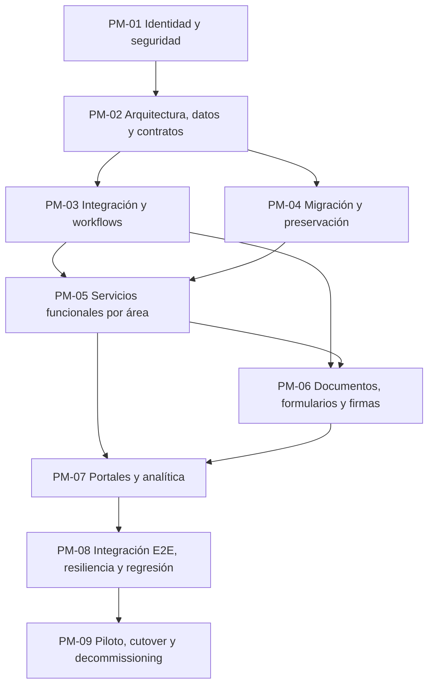

# PLAN MAESTRO DE IMPLEMENTACIÓN — IMA

**Versión:** 1.0 — propuesta inicial basada en el backlog consolidado  
**Fecha:** 2026-11-09  
**Repositorio:** `i-miss-cocaine/IMA`  
**Rama de trabajo:** `NG_beta_0.0.0.1_work`  
**Estado:** plan rector de secuenciación; ninguna tarea se declara implementada por aparecer aquí.  
**Checkpoint de origen:** C1.277 (consolidación del backlog).  
**Checkpoint de planificación:** C1.278.

---

## 1. Propósito y regla de gobierno

Este documento establece el orden maestro para ejecutar las tareas de los siete backlogs departamentales. El orden no es una simple secuencia por departamento ni por prioridad aislada: se determina por dependencias técnicas, capas de arquitectura, integridad de datos, seguridad, contratos entre servicios y relaciones funcionales del portal.

El plan **ordena la ejecución, pero no reemplaza los requisitos originales**. Cada tarea conserva su ID, descripción, criterios, archivos, prioridad, relaciones y fuentes en su archivo departamental. El anexo de este documento es un índice de planificación por ID, no una versión abreviada del requisito.

La asignación de fase es una propuesta inicial basada en el contenido de cada registro, su familia de ID, componentes y dependencias disponibles. La Fase 0 de la metodología debe confirmar el alcance real y actualizar las dependencias antes de implementar cada tarea. Las asignaciones PM-00 quedan expresamente bloqueadas para implementación hasta resolver su clasificación.

## 2. Inventario estudiado

Se analizaron los siete archivos departamentales completos y sus 1.346 bloques de tarea. Los encabezados tienen 1.346 IDs únicos, sin duplicados entre los siete destinos.

| Departamento | Archivo | Tareas |
|---|---|---:|
| Dirección | `pendientes/Dirección/Pendientes.md` | 145 |
| Secretaría | `pendientes/Secretaria/Pendientes.md` | 194 |
| Contabilidad | `pendientes/Contabilidad/Pendientes.md` | 184 |
| Docente | `pendientes/Docente/Pendientes.md` | 129 |
| Estudiante | `pendientes/Estudiante/Pendientes.md` | 7 |
| Padre | `pendientes/Padre/Pendientes.md` | 13 |
| Otros | `pendientes/Otros/Pendientes.md` | 674 |
| **Total** | | **1.346** |

Se identificaron **39 familias/series de identificadores**, **830 registros con una sección de dependencias identificable** y **198 tareas con un campo explícito «Orden de Ejecución»**. Los órdenes explícitos se conservan como secuencias locales de su iniciativa (por ejemplo, una secuencia F29 o F31); no se interpretan como un orden global entre iniciativas distintas.

### 2.1 Inventario por familia de identificador

| Familia/serie de ID | Cantidad |
|---|---:|
| TASK | 627 |
| AUD-NG | 184 |
| TAREA-F6 | 40 |
| F8 | 27 |
| T-UX | 27 |
| TAREA-F7 | 25 |
| TAREA-F4 | 21 |
| TAREA-F5 | 20 |
| TAREA | 20 |
| FASE | 19 |
| F29 | 18 |
| F10 | 18 |
| F11 | 18 |
| F19 | 17 |
| F40 | 16 |
| F21 | 15 |
| F23 | 15 |
| F30 | 15 |
| F31 | 14 |
| F20 | 14 |
| F9 | 14 |
| F16 | 13 |
| F32 | 13 |
| F35 | 12 |
| F18 | 12 |
| F17 | 11 |
| F24 | 11 |
| F39 | 10 |
| F22 | 10 |
| F33 | 10 |
| F25 | 8 |
| F34 | 8 |
| F37 | 8 |
| F38 | 8 |
| F41 | 8 |
| F26 | 6 |
| F27 | 5 |
| F28 | 5 |
| AUDIT-CR | 4 |

### 2.2 Distribución inicial por fase

| Fase | Tareas asignadas |
|---|---:|
| PM-00 — Inventario y triage de dependencias | 35 |
| PM-01 — Identidad, seguridad y gobierno de acceso | 130 |
| PM-02 — Arquitectura, datos, contratos y persistencia | 88 |
| PM-03 — Integración interservicio, eventos y workflows | 89 |
| PM-04 — Migración, importación y preservación de datos | 115 |
| PM-05 — Servicios funcionales por área institucional | 323 |
| PM-06 — Documentos, formularios, firmas y trámites | 286 |
| PM-07 — Portales, experiencia, paneles y analítica | 147 |
| PM-08 — Pruebas integrales, resiliencia y observabilidad | 130 |
| PM-09 — Piloto, cutover y retiro controlado de legado | 3 |

### 2.3 Distribución por departamento y fase

| Departamento | PM-00 | PM-01 | PM-02 | PM-03 | PM-04 | PM-05 | PM-06 | PM-07 | PM-08 | PM-09 | Total |
|---|---:|---:|---:|---:|---:|---:|---:|---:|---:|---:|---:|
| Dirección | 1 | 13 | 7 | 12 | 10 | 32 | 33 | 22 | 13 | 2 | 145 |
| Secretaría | 1 | 12 | 0 | 12 | 23 | 34 | 93 | 10 | 9 | 0 | 194 |
| Contabilidad | 3 | 8 | 8 | 11 | 11 | 86 | 34 | 13 | 10 | 0 | 184 |
| Docente | 2 | 10 | 2 | 3 | 8 | 75 | 14 | 8 | 7 | 0 | 129 |
| Estudiante | 0 | 0 | 0 | 0 | 0 | 1 | 2 | 4 | 0 | 0 | 7 |
| Padre | 0 | 2 | 0 | 2 | 0 | 8 | 1 | 0 | 0 | 0 | 13 |
| Otros | 28 | 85 | 71 | 49 | 63 | 87 | 109 | 90 | 91 | 1 | 674 |

**PM-00:** 35 registros requieren triage manual. Incluye encabezados de agrupación sin requisitos propios, ampliaciones que deben incorporarse a la tarea madre y tareas con dependencia/área insuficientemente definida. No se implementan como unidades independientes hasta resolver su relación.

## 3. Orden global de capas y dependencias

La regla general es avanzar de las capas de menor nivel hacia las superiores:

1. **Identidad y seguridad:** autenticación verificable, claims, sesión, roles, permisos efectivos, ámbitos institucionales/departamentales, propiedad de datos y privacidad.
2. **Arquitectura y modelo de datos:** inventario real del repositorio, catálogo canónico, IDs estables, esquemas, fuente única de verdad, reglas de integridad, configuración y persistencia.
3. **Contratos e integración:** APIs verificables, adaptadores, autorización interservicio, idempotencia, transacciones, eventos, colas, notificaciones y workflows.
4. **Datos y migración:** inventario de fuentes, mapeo, validación, staging, conciliación, carga controlada, pruebas de integridad y aceptación por departamento.
5. **Servicios funcionales:** procesos escolares, recursos humanos, finanzas y servicios complementarios, sobre las capas anteriores.
6. **Documentos y trámites:** plantillas, formularios, generación PDF, almacenamiento protegido, firmas, acuses, conservación y archivo.
7. **Portales y experiencia:** dashboards y vistas por rol, navegación, filtros, preferencias, ayuda y analítica, consumiendo contratos ya estables.
8. **Calidad integral y resiliencia:** pruebas conductuales, integración, E2E, concurrencia, recuperación, rendimiento, observabilidad y regresión.
9. **Transición productiva:** pilotos, aprobaciones, cutover, sincronización final, operación supervisada y retiro controlado de legado.

### 3.1 Grafo maestro de precedencias

Las pruebas de seguridad, unidad y contrato no se posponen hasta PM-08: se ejecutan en cada iteración. PM-08 agrupa la certificación transversal y las tareas cuyo objeto principal es probar o endurecer el sistema.

## 4. Fases del plan maestro

### PM-00 — Inventario, triage y resolución de dependencias

**Objetivo:** cerrar la ambigüedad antes de programar. Confirmar que cada ID representa una tarea ejecutable, una ampliación de otra tarea o un encabezado/agrupador.

**Entregables:** matriz ID → tarea madre → departamento → fase → prerrequisitos; inventario de archivos y dependencias; lista de IDs sin criterio ejecutable; relación de tareas que amplían criterios existentes.

**Regla:** los registros PM-00 no se ejecutan directamente. Se incorporan a su tarea madre o se reclasifican mediante evidencia. TASK-637, TASK-638 y TASK-639 forman el bloque inicial de inventario, mapa de dependencias y revisión manual de símbolos/ciclos.

### PM-01 — Identidad, seguridad y gobierno de acceso

**Objetivo:** disponer de una identidad única y verificable y de una autorización consistente entre todos los servicios.

**Incluye:** autenticación y claims; sesiones y revocación; RBAC/ABAC; permisos por operación; ámbitos institucionales/departamentales; roles simultáneos; propiedad de registros y archivos; aislamiento entre estudiantes, familias, docentes, departamentos e instituciones; protección de datos sensibles; auditoría de accesos.

**Familias y grupos principales:** TAREA-F4; F8 (seguridad/autorización); F16 (roles y responsabilidades como modelo, separando función de permiso); F40 (seguridad documental, en su parte de autorización); TASK-068/153/636/682 y los registros AUD-NG que describen bypasses, IDOR, permisos o exposición de datos.

**Puerta de salida:** todas las rutas sensibles derivan actor, rol y ámbito desde identidad verificada en servidor; ninguna autorización depende de `authRole` o IDs manipulables del payload; permisos positivos y negativos probados en cada servicio; revocación y expiración efectivas.

### PM-02 — Arquitectura, datos, contratos y persistencia

**Objetivo:** establecer las estructuras y reglas compartidas que evitan divergencias entre servicios.

**Incluye:** inventario de código y activos; mapa estático/dinámico de dependencias; modularización con contratos compatibles; IDs canónicos; catálogos maestros; fuente de verdad por entidad; esquemas y relaciones; integridad referencial; transacciones e idempotencia; configuración jerárquica versionada; persistencia; provisión real de recursos; límites y adaptadores entre servicios.

**Familias y grupos principales:** F8 (inventario, rutas, modularización); F26; F35-ID; F37; FASE2; parte de F30; TASK-637/638/639/679/680; AUD-NG y TASK asociados a IDs, esquemas, catálogos, persistencia y fuente única de verdad.

**Puerta de salida:** cada entidad tiene propietario de escritura, ID estable, esquema, relaciones y consumidores documentados; contratos versionados y validados; no existen escrituras cruzadas sin autoridad ni mutaciones parciales; las pruebas de concurrencia/idempotencia son reproducibles.

### PM-03 — Integración interservicio, eventos y workflows

**Objetivo:** coordinar operaciones que atraviesan módulos sin duplicar efectos ni dejar estados parciales.

**Incluye:** contratos API; autenticación HMAC entre servicios; enrutamiento de destinos; eventos persistentes; colas y reintentos; idempotencia de extremo a extremo; Sagas/compensaciones; workflows y transiciones de estado; notificaciones; bandejas de trabajo; SLA; integraciones externas y webhooks.

**Familias y grupos principales:** F23, F25, F30, F34 (integración de justificaciones, bandejas y eventos), parte de F37, TASK-681, AUD-NG-069/071 y las tareas de integración/notificación/aprobación.

**Puerta de salida:** operaciones distribuidas con correlación, deduplicación, estados recuperables y compensación; fallos y reintentos observables; ningún evento se considera entregado sin persistencia/acuse verificable.

### PM-04 — Migración, importación y preservación de datos

**Objetivo:** llevar datos y documentos existentes a los modelos canónicos sin pérdida ni exposición.

**Subetapas obligatorias:**
1. Inventario de fuentes, responsables, sensibilidad y volumen.
2. Correspondencia de IDs, mapeo de columnas/campos y reglas de transformación.
3. Validación previa, detección de duplicados y referencias huérfanas.
4. Staging aislado, anonimización de datos sensibles y respaldo verificable.
5. Importación por lotes reanudables, idempotentes y reversibles.
6. Conciliación cuantitativa/cualitativa y revisión de excepciones.
7. Piloto por departamento y aprobación de propietarios de datos.
8. Sincronización delta y transición, después de la puerta PM-09.

**Familias y grupos principales:** F29, F35, F39, F41; TASK-068, 071, 073, 079, 081, 109, 118, 132–138 y tareas de importación, archivo, OCR, conciliación y respaldo.

**Puerta de salida:** cada lote conserva procedencia, conteos, hashes, errores, relaciones y resultado; las diferencias quedan conciliadas y aprobadas; rollback probado; no se expone información real en pruebas.

### PM-05 — Servicios funcionales por área institucional

Se ejecuta por subflujos, no por una migración masiva de todos los departamentos. Los servicios comunes de PM-01 a PM-03 deben estar aprobados antes de integrar operaciones reales.

**PM-05A — Secretaría, admisiones y expediente del estudiante**
1. Solicitud/admisión, validación, entrevistas, lista de espera y decisión.
2. Alta de estudiante, identidad, expediente, documentos y relaciones familiares.
3. Matrícula, reingreso, traslado, retiro, cambios de sección y ciclo de vida.
4. Servicios de Secretaría y seguimiento de trámites.
5. Integración con facturación, asistencia, docentes y portal familiar.

**PM-05B — Estructura académica y operación docente**
1. Catálogo curricular, planes, áreas, asignaturas, grados, secciones y oferta.
2. Asignaciones docentes y responsabilidades académicas.
3. Calendario, aulas, recursos, carga laboral y horarios sin conflictos.
4. Asistencia, justificaciones, convivencia y seguimiento.
5. Evaluaciones, exámenes, rúbricas, calificaciones, aprobación y publicación.
6. Boletines, certificados, historiales e informes académicos.

**PM-05C — Recursos humanos**
1. Departamentos, cargos, organigrama y roles organizativos.
2. Expediente laboral, contratos, incorporación, adscripciones y vigencias.
3. Asistencia laboral, vacaciones, permisos y sustituciones.
4. Desvinculación/offboarding con revocación coordinada.
5. Nómina, deducciones, beneficios, aportaciones legales y boletas.

**PM-05D — Contabilidad y finanzas**
1. Políticas y tarifas versionadas por período.
2. Cargos, becas, descuentos, morosidad y cuentas por cobrar.
3. Pagos, abonos, pasarelas, webhooks y recibos.
4. Facturación fiscal, CAI, correlativos y comprobantes.
5. Caja, bancos, conciliación y cierres por sesión/cuenta.
6. Compras, proveedores, recepción, cuentas por pagar y presupuesto.
7. Activos, inventario, depreciación, almacenes y reportes financieros.

**PM-05E — Servicios complementarios**
- Biblioteca: catálogo, ejemplares, inventario, préstamos, reservas, devoluciones, multas, OPAC y notificaciones.
- Transporte: rutas, paradas, vehículos, conductores, asignaciones familiares, control de abordaje, incidencias, seguridad y cobros.

**Familias principales:** F5–F7, F9–F11, F16–F21, F18–F19, F20–F21 y tareas TASK/TAREA relacionadas con cada flujo.

**Puerta de salida:** cada módulo persiste en su fuente autorizada, respeta los permisos y relaciones, registra eventos, soporta estados inválidos y ofrece pruebas de negocio positivas/negativas. No se habilita una pantalla antes de validar el servicio que la alimenta.

### PM-06 — Documentos, formularios, firmas y trámites

**Objetivo:** disponer de un ciclo documental institucional seguro, trazable y legalmente controlado.

**Orden recomendado:**
1. Inventario, clasificación, metadatos, propietario y sensibilidad.
2. Almacenamiento privado, acceso autenticado, hash, versionado y custodia.
3. Catálogo de plantillas, campos y formularios; borradores y validaciones.
4. Renderizado, paginación, PDF binario, CUV y verificación.
5. Solicitudes, bandejas, revisiones, subsanación y aprobaciones.
6. Firma, múltiples firmantes, certificados, acuses de entrega/lectura.
7. Retención, bloqueo legal, archivo, búsqueda y OCR asistido.
8. Integración de documentos con expedientes, pagos, RR. HH. y portales.

**Familias principales:** F22, F31, F32, F33, F34 y las partes documentales de F39/F40/F41.

**Puerta de salida:** originales y versiones preservados; acceso privado por expediente/ámbito; integridad criptográfica comprobada; firmas y acuses verificables; ninguna URL pública como sustituto de autorización.

### PM-07 — Portales, experiencia, paneles y analítica

**Objetivo:** exponer procesos ya estables mediante experiencias coherentes para cada perfil.

**Orden:** componentes comunes de navegación y sesión → vistas y formularios por rol → portales de Secretaría/Dirección/Contabilidad/Docente/Estudiante/Padre → filtros, paginación y preferencias → notificaciones y actividad reciente → reportes e indicadores.

**Familias principales:** T-UX, F24, F38 y tareas de dashboards, vistas, ayuda, accesibilidad, reportes y analítica.

**Puerta de salida:** cada vista usa datos reales del servicio autorizado; los filtros respetan ámbito; el estado se reconstruye después de recargar; no hay datos de demostración en resultados institucionales.

### PM-08 — Pruebas integrales, resiliencia y observabilidad

**Objetivo:** certificar el comportamiento del portal como un sistema integrado.

**Incluye:** pruebas unitarias de negocio; contratos API; integración; E2E por rol; concurrencia; idempotencia; persistencia; permisos negativos; aislamiento de datos; regresión visual/funcional; cuotas Apps Script; rendimiento; monitoreo; respaldo/restauración; pruebas de fallo y recuperación.

**Familias y grupos principales:** F27, F28, F41 (calidad/recuperación), tareas de pruebas de F8/F9/F24/F29/F30/F37/F40 y TASK-633/634/635.

**Puerta de salida:** reporte reproducible con PASS/FAIL/BLOCKED, datos aislados, evidencias, métricas y regresiones identificadas. Un test de presencia textual o un mensaje de éxito no acredita comportamiento.

### PM-09 — Piloto, cutover y retiro controlado de legado

**Objetivo:** activar el sistema sin pérdida de datos ni interrupción no controlada.

**Secuencia:** aprobación de criterios → piloto acotado → conciliación → capacitación/soporte → respaldo completo → congelamiento de escrituras legadas → delta sync → cambio de fuente de verdad → monitoreo intensivo → aceptación institucional → archivo de legado en solo lectura → decommissioning autorizado.

**Incluye:** tareas de cutover, pilotos, aprobaciones de migración, RPO/RTO, contingencia y retiro formal. No se ejecuta antes de superar PM-01 a PM-08 y obtener aceptación de cada propietario funcional.

## 5. Dependencias críticas entre áreas

| Área consumidora | Debe existir antes | Razón |
|---|---|---|
| Secretaría / admisiones | Identidad, IDs, catálogos, expedientes, workflows | Alta y seguimiento confiables |
| Matrícula y expediente | Catálogo curricular, oferta, relaciones familiares, integridad | Evitar expedientes y matrículas huérfanas |
| Planificación docente | Estructura académica, asignaciones, calendario, recursos y contratos | Resolver carga y conflictos reales |
| Asistencia y calificaciones | Matrícula, asignaciones vigentes, permisos, períodos y bitácora | Integridad académica y trazabilidad |
| Contabilidad estudiantil | Matrícula/servicios, políticas tarifarias versionadas, identidad | Cargos correctos por período y persona |
| Nómina | Contratos, vigencias, asistencia, novedades y políticas legales | Cálculo salarial individual y auditable |
| Documentos y firmas | Identidad, permisos, almacenamiento, hash, eventos y notificaciones | Custodia y evidencia verificable |
| Portal familiar | Relaciones familiares verificadas, permisos por estudiante y APIs | Evitar exposición cruzada |
| Biblioteca / transporte | Usuarios, expedientes, catálogos, inventario y reglas de cobro | Operación complementaria segura |
| Informes directivos | Fuentes canónicas, proyecciones mínimas y snapshots | Indicadores reales y comparables |

## 6. Reglas para ordenar tareas dentro de cada fase

1. Primero se satisfacen dependencias explícitas de la tarea; después dependencias de arquitectura y de integración.
2. Un P0 de seguridad/datos bloquea los módulos afectados. Una etiqueta P0 no permite saltarse una dependencia técnica.
3. Los 198 órdenes explícitos se mantienen dentro de su iniciativa. No se mezclan números de orden de familias distintas.
4. Si dos tareas comparten un servicio, esquema o contrato, se ordenan por el componente propietario y se evita la edición concurrente.
5. Se pueden ejecutar en paralelo subflujos funcionales independientes únicamente después de aprobar las capas compartidas y sus contratos.
6. Las tareas de prueba acompañan a cada implementación. PM-08 no sustituye las pruebas de las fases anteriores.
7. Las ampliaciones de criterios (por ejemplo, TAREA-10/TAREA-13) se incorporan a su tarea madre; no se implementan como duplicados.
8. Los registros de encabezado/agrupación sin requisitos propios no son tareas ejecutables independientes.
9. Cada tarea pasa por las fases 0–7 de `METODOLOGIA_DESARROLLO.md`; el PM indica el orden de producto, no elimina auditoría, respaldo, autoauditoría, Code Review ni cierre.
10. Cada iteración publica un único commit consolidado con el checkpoint obligatorio.

## 7. Primer orden de trabajo recomendado

La ejecución de producto no comienza por pantallas. El primer bloque es de arquitectura, seguridad y datos:

1. PM-00: resolver los 35 registros sin clasificación ejecutable; completar el inventario y dependencias de TASK-637/638/639 y revisar sus relaciones.
2. PM-01: auditar y cerrar autenticación/autorización transversal, separación RBAC/ABAC, ámbitos, revocación, roles múltiples y bypasses (incluye TAREA-F4-P0-01..04, F8-TASK01, TASK-153, TASK-636 y TASK-682, además de sus dependencias reales).
3. PM-02: fijar IDs canónicos, fuente de verdad, propiedad única de escritura, esquemas y contratos; incluir TASK-068, TASK-679 y TASK-678/676/677 según su grafo.
4. PM-03: asegurar HMAC, eventos persistentes, idempotencia, Saga y workflows; incluir TASK-681 y dependencias de F23/F25/F30/F34.
5. PM-04: preparar la migración y la digitalización con inventario, staging, mapeo, anonimización, conciliación y rollback.
6. PM-05: ejecutar los módulos funcionales en el orden de subflujos descrito.
7. PM-06: completar los ciclos documentales y de trámites integrados con los servicios funcionales.
8. PM-07: conectar los portales y paneles por rol.
9. PM-08: certificar el sistema completo y sus escenarios de fallo.
10. PM-09: piloto, aprobación, cutover y retiro de legado.

La lista anterior es una secuencia de puertas y capas; la selección de la siguiente tarea concreta se realiza desde el anexo y se confirma mediante auditoría manual de sus dependencias y criterios.

## 8. Criterios de avance y control del plan

- Estado operativo permitido: Pendiente, En ejecución, Bloqueada, Completada.
- «Completada» requiere implementación, pruebas de comportamiento, autoauditoría, Code Review aprobado, evidencia y actualización del registro.
- Una tarea bloqueada debe registrar ID del prerrequisito y evidencia del bloqueo; no se sustituye por un workaround.
- El plan se actualiza de forma aditiva al resolver dependencias, descubrir nuevas tareas o cambiar el orden por evidencia. Nunca se borran requisitos originales.
- La trazabilidad del cambio debe llegar desde el ID de tarea y hallazgo de origen hasta archivos, funciones, pruebas, commit y checkpoint.
- Los archivos de backlog departamental son el índice operativo para seleccionar trabajo dentro de esta etapa. Los archivos históricos `Pendientes.md` y `completadas.md` no se reescriben como parte de la ejecución de este plan; se consultan únicamente cuando la trazabilidad histórica de una tarea lo exija.
- El plan no autoriza cambios de alcance, saltos de fase, commits parciales ni cambios a la rama base.

## 9. Registro maestro por tarea

Cada fila conserva el ID original y enlaza al archivo departamental. La fase es una clasificación de planificación inicial, no una certificación técnica. «Orden local» corresponde al campo explícito de la tarea, cuando existe. «Dependencias» reproduce un extracto del campo original; el requisito íntegro permanece en el backlog departamental.

| ID | Departamento | Fase | Subflujo | Prioridad | Orden local | Dependencias registradas (extracto) | Título original |
|---|---|---|---|---|---:|---|---|
| AUD-NG-096 | Contabilidad | PM-00 | Triage manual: metadato incompleto, ampliación o relación por resolver | No explícita | — | Encabezado [ ] de TASK-050, campo Estado [ ] Pendiente, criterios de aceptación y registro histórico de ChangesLogs.txt. | Rectificar de forma aditiva el estado contradictorio de TASK-050 |
| TASK-637 | Contabilidad | PM-00 | Triage manual: metadato incompleto, ampliación o relación por resolver | P1 | — | árbol Git de la rama de trabajo, documentación vigente, punto de entrada `index.html`. | Completar el inventario integral de archivos |
| TASK-638 | Contabilidad | PM-00 | Triage manual: metadato incompleto, ampliación o relación por resolver | P1 | — | TASK-637, catálogo completo de archivos. | Trazar dependencias estáticas y dinámicas de extremo a extremo |
| TASK-279 | Dirección | PM-00 | Triage manual: metadato incompleto, ampliación o relación por resolver | P1 | 9 | modelo de tickets y permisos validados. | [P1] Clasificación Automática de Incidencias y Gestión Paramétrica de SLA |
| TAREA-10 | Docente | PM-00 | Triage manual: metadato incompleto, ampliación o relación por resolver | No explícita | — | No declaradas en el bloque extraído | Ampliación de criterios existentes derivada de TAREA-10 (2026-11-05) |
| TAREA-13 | Docente | PM-00 | Triage manual: metadato incompleto, ampliación o relación por resolver | No explícita | — | No declaradas en el bloque extraído | Ampliación de criterios derivada de TAREA-13 (2026-11-05) |
| AUD-NG-007 | Otros | PM-00 | Triage manual: metadato incompleto, ampliación o relación por resolver | No explícita | — | fetchApi, checkMicroserviceHealth, checkAllMicroservicesHealth | Aplicar el timeout configurado por llamada en fetchApi |
| AUD-NG-069 | Otros | PM-00 | Triage manual: metadato incompleto, ampliación o relación por resolver | No explícita | — | fetchApi, MAX_RETRIES, idempotencyToken, idempotencyKey, checkAndRegisterIdempotencyKey y saveIdempotentResult. | Propagar claves idempotentes en fetchApi y controlar los reintentos de POST |
| AUD-NG-071 | Otros | PM-00 | Triage manual: metadato incompleto, ampliación o relación por resolver | No explícita | — | checkAndRegisterIdempotencyKey, saveIdempotentResult, LockService y doPost. | Reservar claves idempotentes de forma atómica antes de ejecutar operaciones |
| TASK-043 | Otros | PM-00 | Triage manual: metadato incompleto, ampliación o relación por resolver | P0 | — | No declaradas en el bloque extraído | P0 — PRIORIDAD CRÍTICA |
| TASK-055 | Otros | PM-00 | Triage manual: metadato incompleto, ampliación o relación por resolver | P0 | — | No declaradas en el bloque extraído | P0 — PRIORIDAD CRÍTICA |
| TASK-059 | Otros | PM-00 | Triage manual: metadato incompleto, ampliación o relación por resolver | P0 | — | No declaradas en el bloque extraído | P0 — PRIORIDAD CRÍTICA |
| TASK-063 | Otros | PM-00 | Triage manual: metadato incompleto, ampliación o relación por resolver | P0 | — | No declaradas en el bloque extraído | P0 — PRIORIDAD CRÍTICA |
| TASK-066 | Otros | PM-00 | Triage manual: metadato incompleto, ampliación o relación por resolver | P0 | — | No declaradas en el bloque extraído | P0 — PRIORIDAD CRÍTICA |
| TASK-101 | Otros | PM-00 | Triage manual: metadato incompleto, ampliación o relación por resolver | P0 | — | No declaradas en el bloque extraído | BLOQUE 1. CAPTURA INTEGRAL, MODALIDADES Y BORRADORES (P0) |
| TASK-218 | Otros | PM-00 | Triage manual: metadato incompleto, ampliación o relación por resolver | P1 | — | No declaradas en el bloque extraído | P1 — PRIORIDAD ALTA |
| TASK-240 | Otros | PM-00 | Triage manual: metadato incompleto, ampliación o relación por resolver | No explícita | — | No declaradas en el bloque extraído | BLOQUE 4. Gestión institucional, objetivos y alertas |
| TASK-244 | Otros | PM-00 | Triage manual: metadato incompleto, ampliación o relación por resolver | P1 | — | No declaradas en el bloque extraído | P1 — PRIORIDAD ALTA |
| TASK-250 | Otros | PM-00 | Triage manual: metadato incompleto, ampliación o relación por resolver | P1 | — | No declaradas en el bloque extraído | P1 — PRIORIDAD ALTA |
| TASK-254 | Otros | PM-00 | Triage manual: metadato incompleto, ampliación o relación por resolver | P1 | — | No declaradas en el bloque extraído | P1 — PRIORIDAD ALTA |
| TASK-271 | Otros | PM-00 | Triage manual: metadato incompleto, ampliación o relación por resolver | No explícita | — | No declaradas en el bloque extraído | BLOQUE 4. PILOTOS, TRANSICIÓN Y CONTINUIDAD OPERATIVA |
| TASK-274 | Otros | PM-00 | Triage manual: metadato incompleto, ampliación o relación por resolver | No explícita | — | No declaradas en el bloque extraído | BLOQUE 6. CONSOLIDACIÓN Y CONTROL DE CALIDAD DE LA TRANSICIÓN |
| TASK-395 | Otros | PM-00 | Triage manual: metadato incompleto, ampliación o relación por resolver | P2 | — | No declaradas en el bloque extraído | P2 — PRIORIDAD MEDIA |
| TASK-411 | Otros | PM-00 | Triage manual: metadato incompleto, ampliación o relación por resolver | P2 | — | No declaradas en el bloque extraído | P2 — PRIORIDAD MEDIA |
| TASK-420 | Otros | PM-00 | Triage manual: metadato incompleto, ampliación o relación por resolver | P2 | — | No declaradas en el bloque extraído | P2 — PRIORIDAD MEDIA |
| TASK-423 | Otros | PM-00 | Triage manual: metadato incompleto, ampliación o relación por resolver | P2 | — | No declaradas en el bloque extraído | P2 — PRIORIDAD MEDIA |
| TASK-425 | Otros | PM-00 | Triage manual: metadato incompleto, ampliación o relación por resolver | P2 | — | No declaradas en el bloque extraído | P2 — PRIORIDAD MEDIA |
| TASK-439 | Otros | PM-00 | Triage manual: metadato incompleto, ampliación o relación por resolver | P2 | — | No declaradas en el bloque extraído | BLOQUE 3. EXPERIENCIA, VERIFICACIÓN Y CAPACIDADES AVANZADAS — PRIORIDAD P2 |
| TASK-446 | Otros | PM-00 | Triage manual: metadato incompleto, ampliación o relación por resolver | P2 | — | No declaradas en el bloque extraído | BLOQUE 3. RECONOCIMIENTO AUTOMÁTICO Y PROCESAMIENTO INTELIGENTE (P2) |
| TASK-450 | Otros | PM-00 | Triage manual: metadato incompleto, ampliación o relación por resolver | P2 | — | No declaradas en el bloque extraído | BLOQUE 3. AUTOMATIZACIÓN AVANZADA Y AMPLIACIÓN DE CAPACIDADES (P2) |
| TASK-470 | Otros | PM-00 | Triage manual: metadato incompleto, ampliación o relación por resolver | P3 | — | No declaradas en el bloque extraído | P3 — PRIORIDAD BAJA |
| TASK-641 | Otros | PM-00 | Triage manual: metadato incompleto, ampliación o relación por resolver | P1 | — | No declaradas en el bloque extraído | Reparar y verificar el precache del Service Worker |
| TASK-680 | Otros | PM-00 | Triage manual: metadato incompleto, ampliación o relación por resolver | CRÍTICO | — | F8-Task19, F8-Task20, F8-Task22; configuración de Drive y propiedades. - Aceptación: archivo existe y se abre por ID real; registro/historial persistidos; permisos de Drive/hojas comprobados; segunda ejecución no duplica | Implementar aprovisionamiento real y verificable de espacios funcionales |
| TASK-682 | Otros | PM-00 | Triage manual: metadato incompleto, ampliación o relación por resolver | No explícita | — | catálogo de roles/responsabilidades, matriz de permisos, asignaciones de ámbito y auditoría. - Aceptación: un usuario puede tener dos o más roles vigentes en una sesión; cada acción se autoriza con rol/ámbito correcto; a | Soportar múltiples roles simultáneos y ámbitos independientes por rol |
| TASK-639 | Secretaría | PM-00 | Triage manual: metadato incompleto, ampliación o relación por resolver | P2 | — | TASK-637 y TASK-638. | Verificar duplicaciones, símbolos globales y ciclos |
| AUD-NG-033 | Contabilidad | PM-01 | Identidad, seguridad y gobierno de acceso | No explícita | — | recordAccountingJournalEntry, verifyAccountingIntegrity, approvePurchaseOrder, createPurchaseOrder, validateRolePermission, AsientosContables, OrdenesCompra | Validar importes contables y vincular las aprobaciones de compra con la identidad verificada |
| AUD-NG-044 | Contabilidad | PM-01 | Identidad, seguridad y gobierno de acceso | No explícita | — | validateRolePermission, doPost, _verifiedUserId, _verifiedRole, approvePurchaseOrder, OrdenesCompra.AprobadoPor, bitácora de estados | Atribuir aprobaciones y transiciones a la identidad autenticada del usuario |
| AUD-NG-130 | Contabilidad | PM-01 | Identidad, seguridad y gobierno de acceso | No explícita | — | `getStudentEnrollmentHistory`, `getStudentAccountStatement`, `applyApprovedScholarshipsToCharges`, `tienePermisoFinanciero`, `tab-financial`. | Respetar permisos financieros y aplicar beneficios por periodo sin mutar consultas |
| AUD-NG-136 | Contabilidad | PM-01 | Identidad, seguridad y gobierno de acceso | No explícita | — | `validateContextualAccess`, `getStudentAccountStatement`, `getPaymentVouchers`, `generatePaymentReceiptPDF`, `getFiscalInvoices`, `uploadPaymentVoucher`, `getStudentEnrollmentHistory`, `RelacionesFamiliares`. | Restringir estados de cuenta, comprobantes, recibos y facturas a la familia autorizada |
| AUD-NG-138 | Contabilidad | PM-01 | Identidad, seguridad y gobierno de acceso | No explícita | — | `recordCashBankMovement`, `closeCashSession`, `getCashBankSummary`, `performBankReconciliation`, `MovimientosCajaBancos`, `CierresCaja`. | Corregir cierres de caja y conciliación bancaria por sesión/cuenta |
| AUD-NG-139 | Contabilidad | PM-01 | Identidad, seguridad y gobierno de acceso | No explícita | — | `recordAccountsPayableExpense`, `verifyThreeWayMatch`, `recordPurchaseReceipt`, `modifyPurchaseOrderAmount`, `generatePurchaseOrderPDF`. | Impedir bypass de autorización en cuentas por pagar y three-way match |
| F11-TASK02 | Contabilidad | PM-01 | Identidad, seguridad y gobierno de acceso | P0 | — | AsientosContables, OrdenesCompra, ComprobantesEgresos | Asegurar la integridad de los asientos contables y las autorizaciones multinivel |
| F40-TASK24 | Contabilidad | PM-01 | Identidad, seguridad y gobierno de acceso | P1 | — | No declaradas en el bloque extraído | Revisar y revocar permisos heredados u obsoletos automáticamente |
| AUD-NG-140 | Dirección | PM-01 | Identidad, seguridad y gobierno de acceso | No explícita | — | `getEmployeeSelfServicePortal`, `recordStaffCheckIn`, `getStaffAttendanceLogs`, `generatePayrollReceiptPDF`, `_verifiedUserId`, `_verifiedRole`. | Vincular autoservicio, asistencia y recibos de nómina a la identidad verificada |
| F17-TASK02 | Dirección | PM-01 | Identidad, seguridad y gobierno de acceso | P0 | — | No declaradas en el bloque extraído | Integrar novedades de asistencia, horas extras aprobadas y permisos sin goce en el cálculo de nómina |
| F29-TASK17 | Dirección | PM-01 | Identidad, seguridad y gobierno de acceso | P0 | — | No declaradas en el bloque extraído | Migrar roles y permisos con aislamiento y privacidad verificables |
| TASK-006 | Dirección | PM-01 | Identidad, seguridad y gobierno de acceso | P0 | — | `ExpedientesLaborales`, `HistorialAdscripciones`, `Usuarios`, `AsignacionesDocentes`, `CoordinacionesArea`, `AsignacionesAmbitosRoles`, `F16-Task01`, `F16-Task02` | Implementar el flujo de desvinculación laboral con revocación coordinada de accesos y asignaciones |
| TASK-068 | Dirección | PM-01 | Identidad, seguridad y gobierno de acceso | P0 | 1 | Ninguna (Base para las demás tareas). | [P0] Sistema Centralizado de Correspondencia de Identificadores y Resolución de Identidades |
| TASK-153 | Dirección | PM-01 | Identidad, seguridad y gobierno de acceso | P0 | 1 | Sistema de usuarios, departamentos, roles y estructura de propiedad documental. | [P0] Aislamiento departamental estricto y autorización por ámbito institucional |
| TASK-228 | Dirección | PM-01 | Identidad, seguridad y gobierno de acceso | P1 | — | `F23-Task01`, `F23-Task09`. | [P1] [Seguridad y Roles - Delegación Temporal de Aprobaciones Integrada con los Workflows] |
| TASK-295 | Dirección | PM-01 | Identidad, seguridad y gobierno de acceso | P1 | 14 | No declaradas en el bloque extraído | [F31-T14] [P1] Administración Granular de Permisos y Flujos de Aprobación Documental |
| TASK-325 | Dirección | PM-01 | Identidad, seguridad y gobierno de acceso | P1 | 7 | F35-ID-Task02, F35-ID-Task06. | [F35-ID-Task07] [P1] Consola administrativa de gestión de series, versionado y control de permisos |
| TASK-349 | Dirección | PM-01 | Identidad, seguridad y gobierno de acceso | P1 | 19 | F40-Task06, F40-Task08, F40-Task15, F40-Task13. | [P1] Crear un panel de integridad, seguridad y salud documental (F40-17) |
| TASK-430 | Dirección | PM-01 | Identidad, seguridad y gobierno de acceso | P2 | — | TASK-492 (campos), TASK-493 (modal), TASK-494 (overlays), TASK-495 (conectividad). | [F28-T10] [P2] Profesionalización de la Identidad Visual y Unificación del Sistema de Diseño Institucional |
| TASK-438 | Dirección | PM-01 | Identidad, seguridad y gobierno de acceso | P2 | 20 | No declaradas en el bloque extraído | [P2] Protocolo Formal de Autorización de Go-Live y Certificación Departamental |
| TASK-490 | Dirección | PM-01 | Identidad, seguridad y gobierno de acceso | P1 | — | `ROLE_PERMISSIONS.Empleado`, `validateRolePermission`, `validateContextualAccess`, `_verifiedUserId`, `getEmployeeRecords`, `getLeaveVacationRequests`, `getVacationRequests`, `ExpedientesLaborales` y `SolicitudesVacacion | Aislar en servidor los expedientes y solicitudes laborales de cada empleado |
| AUD-NG-105 | Docente | PM-01 | Identidad, seguridad y gobierno de acceso | No explícita | — | ROLE_PERMISSIONS, saveToAcademicHistory, getAcademicHistory, fetchAcademicHistory. | Alinear el contrato de almacenamiento, permisos y lectura del historial académico |
| AUD-NG-107 | Docente | PM-01 | Identidad, seguridad y gobierno de acceso | No explícita | — | SUBJECT_GRADE_MAP, isContentAuthorized, GLOBAL_SCOPE. | Aplicar la validación de grado del estudiante antes de autorizar recursos por tema |
| AUD-NG-121 | Docente | PM-01 | Identidad, seguridad y gobierno de acceso | No explícita | — | `submitAssignment`, `gradeSubmission`, `EntregadaTarde`, `fechaLimite` y cálculo de calificación. | Aplicar en servidor la penalización del 50% por entrega tardía |
| AUD-NG-150 | Docente | PM-01 | Identidad, seguridad y gobierno de acceso | No explícita | — | tipoRecurso, getStudentTasks, getActivityHtml, createTask, submitAssignment, gradeSubmission, archivoUrl, MaterialesEducativos, hoja Tareas, hoja Entregas. | Reforzar la separación entre guías informativas y tareas evaluables en el servidor |
| AUD-NG-158 | Docente | PM-01 | Identidad, seguridad y gobierno de acceso | No explícita | — | validateRolePermission, validateContextualAccess, getDynamicPermissionsForRole, createTask, updateTask, createStudyMaterial, AsignacionesDocentes, _verifiedUserId, fechaLimite, historial de tareas. | Aplicar autorización contextual a escrituras docentes y conservar historial de fechas límite |
| AUD-NG-165 | Docente | PM-01 | Identidad, seguridad y gobierno de acceso | No explícita | — | ROLE_PERMISSIONS, validateContextualAccess, getSubmissionComments, addSubmissionComment, getSubmissionVersions, returnSubmissionForRevision, deleteSubmission, EntregasVersiones, ComentariosEntregas, _verifiedUserId. | Proteger la privacidad y el acceso contextual a comentarios y versiones de entregas |
| F16-TASK03 | Docente | PM-01 | Identidad, seguridad y gobierno de acceso | P0 | — | No declaradas en el bloque extraído | Ejecutar un offboarding atómico con revocación de accesos en cascada |
| F34-TASK03 | Docente | PM-01 | Identidad, seguridad y gobierno de acceso | P0 | — | No declaradas en el bloque extraído | Implementar acceso contextual ABAC docente a justificaciones de sus estudiantes |
| F9-TASK08 | Docente | PM-01 | Identidad, seguridad y gobierno de acceso | P0 | — | Servicios de usuarios, matrícula, asignaciones docentes, expediente académico y operaciones de exportación | Fortalecer el control de permisos y la separación de responsabilidades académicas |
| TASK-107 | Docente | PM-01 | Identidad, seguridad y gobierno de acceso | P0 | 3 | F34-Task01 (unificación de justificaciones), sistema de asignaciones docentes y matrícula. | [P0] Consulta contextual de justificaciones de asistencia para docentes mediante permisos ABAC |
| AUD-NG-001 | Otros | PM-01 | Identidad, seguridad y gobierno de acceso | No explícita | — | loginUser, currentUser, fetchApi, generateSessionToken, verifySessionToken | Corregir la integración del token de sesión entre login y llamadas API |
| AUD-NG-002 | Otros | PM-01 | Identidad, seguridad y gobierno de acceso | No explícita | — | PUBLIC_ACTIONS, validateRolePermission, getStudentTasks, getAllTasks, getAllStudentProjects, getDriveStorageQuotaMetricsReport, getStudentExams, getAllExams, saveAdmissionDraft, getAdmissionDraft | Eliminar operaciones sensibles de las listas de acciones públicas y aplicar autorización contextual |
| AUD-NG-003 | Otros | PM-01 | Identidad, seguridad y gobierno de acceso | No explícita | — | generateSessionToken, verifySessionToken, claims.exp | Exigir expiración válida y obligatoria en todos los tokens de sesión |
| AUD-NG-005 | Otros | PM-01 | Identidad, seguridad y gobierno de acceso | No explícita | — | Usuarios, CacheService, acct_state_*, revoked_user_*, revoked_session_*, revokeUserSession, invalidateUserRoleCache, purgeSecurityCaches, dispatchSecurityEvent, manageInstitutionalDataCache | Garantizar revocación inmediata y coherente del estado de cuenta en todos los servicios |
| AUD-NG-011 | Otros | PM-01 | Identidad, seguridad y gobierno de acceso | No explícita | — | academic-service, developer-service, fuentes de datos, permisos y contratos interservicio | Demostrar o completar el aislamiento de microservicios por área curricular |
| AUD-NG-024 | Otros | PM-01 | Identidad, seguridad y gobierno de acceso | No explícita | — | processWorkflowDecision, validateRolePermission, SolicitudesTramites, RevisionesDecisionesTramite | Vincular las decisiones de workflow con identidad autenticada y asignación de etapa |
| AUD-NG-027 | Otros | PM-01 | Identidad, seguridad y gobierno de acceso | No explícita | — | registerDocumentSignature, FirmasConformidades, _verifiedUserId, _verifiedRole, generateSignatureAuditCertificate | Vincular las conformidades con la identidad verificada y el documento exacto |
| AUD-NG-034 | Otros | PM-01 | Identidad, seguridad y gobierno de acceso | No explícita | — | getInstitutionalConversations, getConversationMessages, sendInstitutionalMessage, archiveInstitutionalConversation, validateRolePermission, _verifiedUserId, _verifiedRole, adjuntosUrls, participantes | Aplicar autorización por participante e identidad verificada al centro de comunicaciones institucionales |
| AUD-NG-036 | Otros | PM-01 | Identidad, seguridad y gobierno de acceso | No explícita | — | getAuthorizationRequests, submitAuthorizationRequest, respondToAuthorizationRequest, submitAnnouncementReceiptConfirmation, RelacionesFamiliares, _verifiedUserId, _verifiedRole | Verificar la relación legal del tutor y la identidad en solicitudes y confirmaciones de lectura |
| AUD-NG-037 | Otros | PM-01 | Identidad, seguridad y gobierno de acceso | No explícita | — | checkCalendarEventOverlap, saveInstitutionalCalendarEvent, getInstitutionalCalendarEvents, persistencia y bloqueo del calendario, reglas de visibilidad | Garantizar autorización de visibilidad y prevención atómica de traslapes en el calendario institucional |
| AUD-NG-055 | Otros | PM-01 | Identidad, seguridad y gobierno de acceso | No explícita | — | validateFileBinaryIntegrity, Magic Bytes, MIME, PDF, JPEG, PNG, WEBP, ZIP/OOXML, uploadPaymentVoucher y submitInstitutionalFormRequest. | Completar la validación binaria y estructural de todos los formatos autorizados |
| AUD-NG-058 | Otros | PM-01 | Identidad, seguridad y gobierno de acceso | No explícita | — | DriveApp.Access.ANYONE_WITH_LINK, DriveApp.Permission.VIEW, ComprobantesPago, SolicitudesTramites y RBAC/ABAC. | Restringir los adjuntos institucionales a acceso privado autorizado |
| AUD-NG-060 | Otros | PM-01 | Identidad, seguridad y gobierno de acceso | No explícita | — | registerDocumentSignature, validateRolePermission, _verifiedUserId, documentoHash, signatureHash y control de versiones. | Vincular cada firma a identidad verificada, documento existente y versión inmutable |
| AUD-NG-066 | Otros | PM-01 | Identidad, seguridad y gobierno de acceso | No explícita | — | processWorkflowDecision, validateRolePermission, _verifiedUserId, _verifiedRole, revisorId, etapaNombre y pasosEtapas. | Autorizar cada decisión según identidad autenticada y etapa activa |
| AUD-NG-076 | Otros | PM-01 | Identidad, seguridad y gobierno de acceso | No explícita | — | resolveSpreadsheetSource, SPREADSHEET_ID, política de fuentes predeterminadas y aislamiento por ciclo lectivo. | Bloquear fallback silencioso a la fuente principal cuando no existe una partición autorizada |
| AUD-NG-077 | Otros | PM-01 | Identidad, seguridad y gobierno de acceso | No explícita | — | registerSpreadsheetSource, resolveSpreadsheetSource, schemaVersion, SpreadsheetApp.openById y bitácora de fuentes. | Validar disponibilidad, permisos, esquema y cambios históricos de las fuentes |
| AUD-NG-078 | Otros | PM-01 | Identidad, seguridad y gobierno de acceso | No explícita | — | registerServiceInstance, cuentaPropietaria, endpointUrl, spreadsheetAsociado, permisosConcedidos y proyecto Apps Script. | Exigir metadatos verificados y permisos de mínimo privilegio al registrar servicios |
| AUD-NG-082 | Otros | PM-01 | Identidad, seguridad y gobierno de acceso | No explícita | — | doPost, ROLE_PERMISSIONS, authRole, verifySessionToken, registerServiceInstance y updateServiceStatus. | Exigir sesión autenticada en el plano de control y rechazar roles declarados por el cliente |
| AUD-NG-084 | Otros | PM-01 | Identidad, seguridad y gobierno de acceso | No explícita | — | getAuthTokenSecret, AUTH_TOKEN_SECRET, SPREADSHEET_ID, customSecret y catálogo de credenciales. | Implementar gestión segura de secretos por servicio con rotación y revocación |
| AUD-NG-086 | Otros | PM-01 | Identidad, seguridad y gobierno de acceso | No explícita | — | verifyInterServiceEnvelope, CatalogoServicios, permisosConcedidos, sourceService, targetService, action y versión del protocolo. | Aplicar autorización por emisor, receptor, acción y versión de contrato |
| AUD-NG-089 | Otros | PM-01 | Identidad, seguridad y gobierno de acceso | No explícita | — | recordWorkflowDecisionCorrection, validateRolePermission, _verifiedUserId, decisionIdOriginal, solicitudId, nuevaAccionDecision y LockService. | Autorizar y serializar las correcciones de decisiones históricas |
| AUD-NG-093 | Otros | PM-01 | Identidad, seguridad y gobierno de acceso | No explícita | — | validateRolePermission, doPost, getAcademicInstitutionalReportCatalog, requesterRole, authRole, _verifiedRole y rolesPermitidos. | Derivar el rol del catálogo académico exclusivamente de la sesión verificada |
| AUD-NG-094 | Otros | PM-01 | Identidad, seguridad y gobierno de acceso | No explícita | — | ROLE_PERMISSIONS, validateRolePermission, getDynamicPermissionsForRole, MatrizPermisosRoles, getInstitutionalReportCatalog, generateInstitutionalReport y rolesPermitidos. | Alinear los permisos de consulta y generación con los perfiles publicados en el catálogo |
| AUD-NG-106 | Otros | PM-01 | Identidad, seguridad y gobierno de acceso | No explícita | — | ROLE_PERMISSIONS, validateContextualAccess, validateRolePermission, getAcademicConfig, doPost. | Vincular el grado y la sección consultados con la identidad estudiantil verificada |
| AUD-NG-128 | Otros | PM-01 | Identidad, seguridad y gobierno de acceso | No explícita | — | `validateRolePermission`, `validateContextualAccess`, `getProblemTickets`, `submitProblemTicket`, `replyProblemTicket`, `getAutomationRules`, `_verifiedUserId`. | Eliminar bypass RBAC y vincular tickets a la identidad verificada |
| AUD-NG-143 | Otros | PM-01 | Identidad, seguridad y gobierno de acceso | No explícita | — | `getNews`, `createNews`, `updateNewsStatus`, `nav-news`, `renderNewsHTML`, `fetchNewsManagement`. | Corregir contrato de noticias, audiencia, vigencia y permisos de Secretaría |
| AUD-NG-149 | Otros | PM-01 | Identidad, seguridad y gobierno de acceso | No explícita | — | create-assignment-form, Quill, createTask, uploadFile, archivoUrl, fechaLimite, tipoRecurso, hoja Tareas. | Completar la creación polimórfica de tareas y validar contenido y fecha límite en servidor |
| AUD-NG-159 | Otros | PM-01 | Identidad, seguridad y gobierno de acceso | No explícita | — | PUBLIC_ACTIONS, validateRolePermission, logoutUser, revokeUserSession, verifySessionToken, generateSessionToken, loginUser, CacheService, handleLogout, handleSessionExpired, fetchApi. | Proteger logoutUser y revocación de sesiones contra revocación arbitraria de cuentas |
| AUD-NG-160 | Otros | PM-01 | Identidad, seguridad y gobierno de acceso | No explícita | — | generateSessionToken, verifySessionToken, claims.role, Usuarios, CacheService, dispatchSecurityEvent, revocación de sesiones. | Revalidar el rol vigente o invalidar tokens después de cambios de privilegios |
| AUD-NG-162 | Otros | PM-01 | Identidad, seguridad y gobierno de acceso | No explícita | — | fetchApi; handleSessionExpired; setupCommonUI; sessionToken; currentUser; usuario_actual; usuario_sesion; getUserVerifiedRole; verifySessionToken; doPost; AUTH_PERMISSION_DENIED; login.html?session_expired=; runUXSuiteTe | Integrar la expiración de sesión con el cliente API y mostrar aviso en login |
| AUD-NG-219 | Otros | PM-01 | Identidad, seguridad y gobierno de acceso | No explícita | — | createSecurityDelegation, getSecurityDelegations, revokeSecurityDelegation, hasActiveDelegationForAction, validateRolePermission, ROLE_PERMISSIONS, dynamic_permissions_matrix, DelegacionesSeguridad, campo ambito y accion | Restringir el alcance, la autoridad y la trazabilidad de las delegaciones de seguridad |
| AUD-NG-222 | Otros | PM-01 | Identidad, seguridad y gobierno de acceso | No explícita | — | validateContextualAccess, validateRolePermission, validateRoleScopeAccess, getGuardianStudents, getAcademicAreaCoordinationScope, AsignacionesAmbitosRoles, AsignacionesDocentes, RelacionesFamiliares. | Establecer autorización contextual ABAC común y fail-closed en los cinco microservicios |
| AUD-NG-227 | Otros | PM-01 | Identidad, seguridad y gobierno de acceso | P1 | — | openSecurityAndComplianceDashboardModal, getSecurityAndComplianceDashboardData, generatePrivilegeAndAccountAuditReport, getPaginatedAuditLogReport, getOperationalCapacityMetrics, getSecurityDelegations, ROLE_PERMISSIONS, | [P1] Corregir la integración, los filtros y la fidelidad de indicadores del panel de seguridad |
| AUD-NG-231 | Otros | PM-01 | Identidad, seguridad y gobierno de acceso | No explícita | — | auditAndReconcileIdentityInconsistencies, Usuarios, DelegacionesSeguridad, HistorialAdscripciones, CacheService, LockService, logStructuredEvent. | Hacer fail-safe y trazable la auto-reconciliación de identidades |
| F19-TASK13 | Otros | PM-01 | Identidad, seguridad y gobierno de acceso | P0 | — | No declaradas en el bloque extraído | Validar autorización, ubicación física y atomicidad en la entrega de requisiciones |
| F21-TASK02 | Otros | PM-01 | Identidad, seguridad y gobierno de acceso | P0 | — | No declaradas en el bloque extraído | Blindar privacidad y aislamiento RBAC/ABAC de asignaciones de transporte |
| F21-TASK04 | Otros | PM-01 | Identidad, seguridad y gobierno de acceso | P0 | — | No declaradas en el bloque extraído | Validar personas autorizadas para la recepción y entrega de menores |
| F21-TASK11 | Otros | PM-01 | Identidad, seguridad y gobierno de acceso | P2 | — | No declaradas en el bloque extraído | Implementar checklist preoperacional de seguridad vehicular |
| F23-TASK01 | Otros | PM-01 | Identidad, seguridad y gobierno de acceso | P0 | — | No declaradas en el bloque extraído | Proteger las decisiones de workflow con autorización contextual y transiciones atómicas |
| F28-TASK01 | Otros | PM-01 | Identidad, seguridad y gobierno de acceso | P0 | — | autenticación/token de sesión; reglas de retención y recuperación de borradores. | Aislamiento de borradores por usuario y sesión |
| F29-TASK05 | Otros | PM-01 | Identidad, seguridad y gobierno de acceso | P0 | — | No declaradas en el bloque extraído | Activar cuentas migradas mediante token temporal de un solo uso |
| F30-TASK15 | Otros | PM-01 | Identidad, seguridad y gobierno de acceso | P2 | — | No declaradas en el bloque extraído | Formalizar autorización de Go-Live y actas de certificación departamental |
| F40-TASK07 | Otros | PM-01 | Identidad, seguridad y gobierno de acceso | P1 | — | No declaradas en el bloque extraído | Exigir doble autorización para destrucción y baja documental |
| F41-TASK03 | Otros | PM-01 | Identidad, seguridad y gobierno de acceso | P0 | — | No declaradas en el bloque extraído | Blindaje del aislamiento departamental en endpoints |
| F41-TASK06 | Otros | PM-01 | Identidad, seguridad y gobierno de acceso | P1 | — | No declaradas en el bloque extraído | Convertidor estructural DOCX a formularios digitales |
| F8-TASK01 | Otros | PM-01 | Identidad, seguridad y gobierno de acceso | P1 | — | Tokens HMAC-SHA256, verificación de roles, validación de ámbito | Centralizar y verificar la autorización efectiva de cada operación |
| F8-TASK23 | Otros | PM-01 | Identidad, seguridad y gobierno de acceso | P1 | — | Contratos entre microservicios, permisos Drive de privilegio mínimo, monitoreo de cuotas | Implementar la independencia de servicios backend, seguridad Drive y límites de Google Sheets |
| FASE2-T01 | Otros | PM-01 | Identidad, seguridad y gobierno de acceso | No explícita | — | Mecanismos actuales de autenticación, `getUserVerifiedRole`, caché de permisos y puntos de entrada de los servicios. | Verificar y reforzar la autorización institucional y la vigencia de los permisos entre servicios |
| TAREA-01 | Otros | PM-01 | Identidad, seguridad y gobierno de acceso | No explícita | — | Sistema de identidad, sesiones, RBAC, configuración de despliegues y todos los servicios que exponen datos privados. | Validar y reforzar la seguridad de los servicios y la separación de permisos |
| TAREA-06 | Otros | PM-01 | Identidad, seguridad y gobierno de acceso | No explícita | — | Configuración institucional, RBAC, Google Drive y servicios que crean documentos. | Completar la gestión institucional de carpetas y permisos documentales |
| TAREA-F4-P0-01 | Otros | PM-01 | Identidad, seguridad y gobierno de acceso | No explícita | — | No declaradas en el bloque extraído | Unificar la autenticación y autorización de los cinco microservicios |
| TAREA-F4-P0-02 | Otros | PM-01 | Identidad, seguridad y gobierno de acceso | No explícita | — | No declaradas en el bloque extraído | Corregir las vulnerabilidades IDOR y garantizar el aislamiento de datos personales |
| TAREA-F4-P0-03 | Otros | PM-01 | Identidad, seguridad y gobierno de acceso | No explícita | — | No declaradas en el bloque extraído | Garantizar la revocación efectiva de sesiones y la actualización inmediata de privilegios |
| TAREA-F4-P1-01 | Otros | PM-01 | Identidad, seguridad y gobierno de acceso | No explícita | — | No declaradas en el bloque extraído | Implementar el motor transversal de delegaciones de seguridad y permisos temporales |
| TAREA-F4-P1-03 | Otros | PM-01 | Identidad, seguridad y gobierno de acceso | No explícita | — | No declaradas en el bloque extraído | Implementar una matriz dinámica de permisos por rol, acción, módulo y ámbito |
| TAREA-F4-P1-04 | Otros | PM-01 | Identidad, seguridad y gobierno de acceso | No explícita | — | No declaradas en el bloque extraído | Implementar una política unificada de autorización contextual RBAC/ABAC |
| TAREA-F4-P1-08 | Otros | PM-01 | Identidad, seguridad y gobierno de acceso | No explícita | — | No declaradas en el bloque extraído | Implementar un mecanismo central de propagación y recuperación de cambios de seguridad |
| TAREA-F4-P1-09 | Otros | PM-01 | Identidad, seguridad y gobierno de acceso | No explícita | — | No declaradas en el bloque extraído | Crear un panel de seguridad, auditoría y cumplimiento institucional |
| TAREA-F4-P2-05 | Otros | PM-01 | Identidad, seguridad y gobierno de acceso | No explícita | — | No declaradas en el bloque extraído | Consolidar la documentación institucional de privacidad y tratamiento de datos |
| TAREA-F5-009 | Otros | PM-01 | Identidad, seguridad y gobierno de acceso | No explícita | — | Hojas `RelacionesFamiliares`, `InvitacionesVinculacion`, `Usuarios`, `validateContextualAccess` | Corregir la vinculación familiar y establecer permisos individuales por relación |
| TAREA-F6-001 | Otros | PM-01 | Identidad, seguridad y gobierno de acceso | P2 | — | `ROLE_PERMISSIONS`, `validateRolePermission`, `getStudentFile`, `findDuplicateStudents`, `mergeStudentFiles` | Restringir los controles de gestión de expedientes duplicados según los permisos efectivos del usuario |
| TAREA-F6-012 | Otros | PM-01 | Identidad, seguridad y gobierno de acceso | P1 | — | `ROLE_PERMISSIONS`, `validateRolePermission`, `validateContextualAccess`, `checkAndRegisterIdempotencyKey` | Establecer seguridad, aislamiento y gestión centralizada de permisos |
| TAREA-F6-018 | Otros | PM-01 | Identidad, seguridad y gobierno de acceso | P2 | — | `RelacionesEstudianteTutor`, `RelacionesFamiliares`, `updateFamilyLinkPermissions`, `revokeFamilyLink`, `validateContextualAccess` | Completar la gestión de autorizaciones, responsables legales y contactos de emergencia |
| TAREA-F6-027 | Otros | PM-01 | Identidad, seguridad y gobierno de acceso | P2 | — | `createSystemBackup`, `verifyBackupIntegrity`, `restoreSystemBackup`, `reconcileRestoredDataIntegrity` | Fortalecer la recuperación y verificación de copias de seguridad del expediente |
| TAREA-F6-037 | Otros | PM-01 | Identidad, seguridad y gobierno de acceso | P1 | — | No declaradas en el bloque extraído | Establecer seguridad, aislamiento y gestión centralizada de permisos |
| TASK-048 | Otros | PM-01 | Identidad, seguridad y gobierno de acceso | P0 | — | `F23-Task04`. | [P0] [Seguridad y Red - Protocolo Universal de Comunicación Interservicio y Gestión de Credenciales] |
| TASK-067 | Otros | PM-01 | Identidad, seguridad y gobierno de acceso | P0 | — | AUD-NG-001 (identidad derivada del token). | [F28-T01] [P0] Aislamiento Multiusuario, Contexto Institucional y Protección Criptográfica de Borradores Locales |
| TASK-070 | Otros | PM-01 | Identidad, seguridad y gobierno de acceso | P0 | 4 | [F29-Task02], [F29-Task03]. | [P0] Área de Preparación de Datos (Staging) y Aislamiento de Importaciones |
| TASK-114 | Otros | PM-01 | Identidad, seguridad y gobierno de acceso | P0 | 6 | F35-Task01 a F35-Task05. | [P0] Vista previa integral, simulación y autorización obligatoria de importación |
| TASK-123 | Otros | PM-01 | Identidad, seguridad y gobierno de acceso | P0 | 1 | Catálogo de fuentes `CatalogoSpreadsheets`, control RBAC de `user-service`. | [P0] Enrutamiento declarativo central de destinos y validación de autorización departamental |
| TASK-260 | Otros | PM-01 | Identidad, seguridad y gobierno de acceso | No explícita | — | No declaradas en el bloque extraído | BLOQUE 1. IDENTIDAD, INTEGRIDAD Y CONSERVACIÓN DE INFORMACIÓN |
| TASK-272 | Otros | PM-01 | Identidad, seguridad y gobierno de acceso | No explícita | — | No declaradas en el bloque extraído | BLOQUE 5. SEGURIDAD, PRIVACIDAD Y ESCALABILIDAD |
| TASK-481 | Otros | PM-01 | Identidad, seguridad y gobierno de acceso | P1 | — | `searchGlobalOmnibox`, `validateRolePermission`, `getUserVerifiedRole`, `validateContextualAccess`, `getNews`, `getAdministrativeRequests`, hojas `ExpedientesEstudiantes`, `Matriculas`, `Usuarios`, `NoticiasPortal` y `So | Aplicar autorización contextual por entidad en la búsqueda Omnibox |
| TASK-497 | Otros | PM-01 | Identidad, seguridad y gobierno de acceso | P0 | — | loginUser, LockService, contador de fallos por cuenta, estado Bloqueada, ALLOWED_ACCOUNT_STATE_TRANSITIONS y AUD-NG-005. | [P0] Aplicar control atómico y límites antiabuso al inicio de sesión |
| TASK-501 | Otros | PM-01 | Identidad, seguridad y gobierno de acceso | No explícita | — | No declaradas en el bloque extraído | Matriz de permisos por módulo y ámbito |
| TASK-502 | Otros | PM-01 | Identidad, seguridad y gobierno de acceso | P1 | — | No declaradas en el bloque extraído | [P1] Centralizar autorización contextual RBAC/ABAC con denegación fail-closed |
| TASK-507 | Otros | PM-01 | Identidad, seguridad y gobierno de acceso | P1 | — | getSecurityAndComplianceDashboardData, generatePrivilegeAndAccountAuditReport, getPaginatedAuditLogReport, getOperationalCapacityMetrics, getSecurityDelegations, AUD-NG-145, AUD-NG-219 y AUD-NG-160. | [P1] Completar el panel institucional de seguridad, auditoría y cumplimiento |
| TASK-516 | Otros | PM-01 | Identidad, seguridad y gobierno de acceso | P0 | — | No declaradas en el bloque extraído | Aplicar identidad/rol verificado al flujo de excepciones |
| TASK-523 | Otros | PM-01 | Identidad, seguridad y gobierno de acceso | P1 | — | No declaradas en el bloque extraído | Aplicar permisos y ámbitos a vistas y acciones de la matriz |
| TASK-541 | Otros | PM-01 | Identidad, seguridad y gobierno de acceso | P1 | — | No declaradas en el bloque extraído | Registrar preferencias docentes autorizadas e integrarlas a la planificación |
| TASK-558 | Otros | PM-01 | Identidad, seguridad y gobierno de acceso | P0 | — | No declaradas en el bloque extraído | Restablecer autenticación y autorización de las acciones privadas de programación EXAM |
| TASK-609 | Otros | PM-01 | Identidad, seguridad y gobierno de acceso | P1 | — | AUD-NG-158, AUD-NG-251, TASK-567, TASK-586. | Proteger autorización, consulta y atribución de sustituciones en backend |
| TASK-611 | Otros | PM-01 | Identidad, seguridad y gobierno de acceso | P1 | — | No declaradas en el bloque extraído | Aplicar autorización contextual y privacidad por evento, grupo y participante |
| TASK-636 | Otros | PM-01 | Identidad, seguridad y gobierno de acceso | P0 | — | No declaradas en el bloque extraído | [P0] Cerrar bypasses de autorización y proteger tareas, proyectos y archivos |
| TASK-646 | Otros | PM-01 | Identidad, seguridad y gobierno de acceso | P1 | — | No declaradas en el bloque extraído | Alinear verificación de sesiones con revocación y estado de cuenta |
| F11-TASK05 | Padre | PM-01 | Identidad, seguridad y gobierno de acceso | P1 | — | ConfirmacionesLectura, SolicitudesAutorizacion | Unificar confirmaciones de lectura y autorizaciones familiares |
| TASK-346 | Padre | PM-01 | Identidad, seguridad y gobierno de acceso | P1 | 16 | F40-Task01, F40-Task03. | [P1] Implementar revisión automática de permisos obsoletos y accesos residuales (F40-14) |
| F10-TASK05 | Secretaría | PM-01 | Identidad, seguridad y gobierno de acceso | P1 | — | JustificacionesAsistencia, SalidasAnticipadas | Ampliar la gestión de justificaciones, permisos y salidas anticipadas |
| F11-TASK01 | Secretaría | PM-01 | Identidad, seguridad y gobierno de acceso | P0 | — | CasosSeguimiento, RegistrosOrientacion, AsignacionesAmbitosRoles | Garantizar el aislamiento y la confidencialidad de los expedientes de bienestar |
| TAREA-F6-023 | Secretaría | PM-01 | Identidad, seguridad y gobierno de acceso | P2 | — | `getStudentFile`, `getStudentEnrollments`, `getStudentDocuments`, `ROLE_PERMISSIONS` | Desarrollar un resumen institucional del expediente orientado a cada perfil autorizado |
| TASK-030 | Secretaría | PM-01 | Identidad, seguridad y gobierno de acceso | P0 | — | `ROLE_PERMISSIONS`, `validateRolePermission`, `ExpedientesFamiliares` | Protección de datos de transporte y aislamiento de consultas por usuario (RBAC/ABAC) |
| TASK-032 | Secretaría | PM-01 | Identidad, seguridad y gobierno de acceso | P0 | — | `ExpedientesFamiliares`, `TransporteAsignaciones`, `F21-Task03` | Gestión de personas autorizadas para recoger y recibir estudiantes en paradas |
| TASK-103 | Secretaría | PM-01 | Identidad, seguridad y gobierno de acceso | P0 | 2 | No declaradas en el bloque extraído | [P0] Persistencia de Borradores en Servidor y Sincronización Multidispositivo |
| TASK-139 | Secretaría | PM-01 | Identidad, seguridad y gobierno de acceso | P0 | 1 | Matriz de roles y autorización existente. | [P0] Completar el control granular de permisos por operación documental (F40-21) |
| TASK-141 | Secretaría | PM-01 | Identidad, seguridad y gobierno de acceso | P0 | 3 | F40-Task01, F40-Task02. | [P0] Reforzar la autorización por expediente, departamento y ámbito institucional (F40-12) |
| TASK-143 | Secretaría | PM-01 | Identidad, seguridad y gobierno de acceso | P0 | 5 | F40-Task04. | [P0] Auditar y remediar los permisos públicos preexistentes en Google Drive (F40-22) |
| TASK-150 | Secretaría | PM-01 | Identidad, seguridad y gobierno de acceso | P0 | 12 | F40-Task11, F40-Task01. | [P0] Implementar doble autorización y disposición documental controlada (F40-07) |
| TASK-208 | Secretaría | PM-01 | Identidad, seguridad y gobierno de acceso | P1 | — | `TransporteVehiculos`, `F21-Task05`, `F21-Task07` | Checklist preoperacional y control de seguridad vehicular diaria |
| TASK-296 | Secretaría | PM-01 | Identidad, seguridad y gobierno de acceso | P1 | 15 | No declaradas en el bloque extraído | [F31-T15] [P1] Seguridad Avanzada y Validación Criptográfica de Archivos Documentales |
| AUD-NG-050 | Contabilidad | PM-02 | Modelo de datos, contratos y persistencia | No explícita | — | doPost, checkAndRegisterIdempotencyKey, saveIdempotentResult, recordSupplierPayment, referenciaBancaria y entidad de pagos de proveedores. | Hacer obligatoria la idempotencia y validar la unicidad de referencias bancarias de pagos |
| AUD-NG-079 | Contabilidad | PM-02 | Modelo de datos, contratos y persistencia | No explícita | — | getCentralServiceRegistry, CatalogoServicios, defaultServices y JSON.parse. | Evitar que el catálogo devuelva servicios de ejemplo o éxito ante errores de lectura |
| AUD-NG-133 | Contabilidad | PM-02 | Modelo de datos, contratos y persistencia | No explícita | — | `recordStudentPayment`, `checkAndRegisterIdempotencyKey`, `saveIdempotentResult`, `CargosEstudiante`, `PagosAbonos`. | Asegurar integridad e idempotencia atómica de pagos y abonos |
| F19-TASK05 | Contabilidad | PM-02 | Modelo de datos, contratos y persistencia | P1 | — | No declaradas en el bloque extraído | Crear catálogo maestro centralizado de artículos e insumos |
| F8-TASK02 | Contabilidad | PM-02 | Arquitectura y contratos de plataforma | P1 | — | Todas las referencias cruzadas de scripts, links, importaciones y endpoints | / TAREA-MOD-01 — Inventario y dependencias (C1.262) |
| TASK-186 | Contabilidad | PM-02 | Modelo de datos, contratos y persistencia | P1 | — | `InventariosKardex`, `MaterialesSolicitudes`, `OrdenesCompra`, `F19-Task01` | Creación de un catálogo maestro institucional de artículos, materiales y suministros |
| TASK-359 | Contabilidad | PM-02 | Modelo de datos, contratos y persistencia | P2 | — | `CacheService`, `LockService`, `checkAndRegisterIdempotencyKey` | Fortalecimiento de idempotencia, concurrencia y consistencia de operaciones financieras |
| TASK-667 | Contabilidad | PM-02 | Modelo de datos, contratos y persistencia | CRÍTICO | — | TASK-663 y TASK-664. | Normalizar el esquema y la clave de las asignaciones de ámbito |
| AUD-NG-226 | Dirección | PM-02 | Modelo de datos, contratos y persistencia | P1 | — | CatalogoDepartamentos, CatalogoCargos, HistorialAdscripciones, DepartamentosAcademicos, Usuarios, manageDepartmentPositions, getUserInstitutionalAffiliations, assignDepartmentHead, generateInstitutionalId, TASK-171, TASK | [P1] Integridad referencial y atomicidad en departamentos, cargos y adscripciones |
| F26-TASK01 | Dirección | PM-02 | Modelo de datos, contratos y persistencia | P0 | — | No declaradas en el bloque extraído | Implementar motor central de precedencia y configuración jerárquica |
| F37-TASK05 | Dirección | PM-02 | Modelo de datos, contratos y persistencia | P1 | — | No declaradas en el bloque extraído | Diagnosticar registros huérfanos y desalineados entre departamentos |
| TAREA-F4-P1-07 | Dirección | PM-02 | Arquitectura y contratos de plataforma | No explícita | — | No declaradas en el bloque extraído | Implementar gestión institucional de roles, cargos, departamentos y asignaciones |
| TASK-060 | Dirección | PM-02 | Modelo de datos, contratos y persistencia | P0 | — | Estructuras de usuarios, roles, departamentos, `ConfiguracionSistema`, permisos server-side y servicios consumidores de configuración. | [P0] [Gobernanza Jerárquica - Motor Central de Configuración Jerárquica y Herencia Departamental] |
| TASK-249 | Dirección | PM-02 | Modelo de datos, contratos y persistencia | P1 | — | Reportes institucionales existentes, permisos, catálogos de campos y almacenamiento de preferencias. | [P1] [Reportes Personalizados - Implementar Persistencia de Vistas y Configuraciones Personalizadas de Reportes] |
| TASK-506 | Dirección | PM-02 | Modelo de datos, contratos y persistencia | P1 | — | CatalogoDepartamentos, CatalogoCargos, HistorialAdscripciones, DepartamentosAcademicos, Usuarios, manageDepartmentPositions, assignDepartmentHead, generateInstitutionalId. | Garantizar integridad referencial y atomicidad en departamentos, cargos y adscripciones institucionales |
| TASK-027 | Docente | PM-02 | Modelo de datos, contratos y persistencia | P0 | — | `LockService`, `BibliotecaPrestamos`, `BibliotecaEjemplares` | Control de concurrencia e idempotencia en circulación bibliotecaria |
| TASK-131 | Docente | PM-02 | Modelo de datos, contratos y persistencia | P0 | 4 | Sistema de autenticación en `user-service`. | [P0] Persistencia server-side de preferencias y progreso de aprendizaje por usuario |
| AUD-NG-025 | Otros | PM-02 | Modelo de datos, contratos y persistencia | No explícita | — | checkAndRegisterIdempotencyKey, saveIdempotentResult, CacheService, doPost | Hacer atómica la reserva de claves de idempotencia |
| AUD-NG-029 | Otros | PM-02 | Modelo de datos, contratos y persistencia | No explícita | — | recordPurchaseReceipt, recordInventoryMovement, getPurchaseReceipts, OrdenesCompra, RecepcionesCompra, InventariosKardex | Reforzar la validación de cantidades, referencias e idempotencia en recepciones de compra |
| AUD-NG-056 | Otros | PM-02 | Arquitectura y contratos de plataforma | No explícita | — | validateFileBinaryIntegrity, uploadPaymentVoucher, submitInstitutionalFormRequest y política institucional de adjuntos. | Unificar la política de validación de adjuntos entre microservicios |
| AUD-NG-073 | Otros | PM-02 | Arquitectura y contratos de plataforma | No explícita | — | resolveSpreadsheetSource, registerSpreadsheetSource, SPREADSHEET_ID y funciones de lectura/escritura. | Integrar el enrutador de fuentes en las operaciones reales de cada microservicio |
| AUD-NG-074 | Otros | PM-02 | Arquitectura y contratos de plataforma | No explícita | — | CatalogoSpreadsheets, registerSpreadsheetSource, resolveSpreadsheetSource y SPREADSHEET_ID. | Centralizar el catálogo de fuentes para todos los microservicios |
| AUD-NG-080 | Otros | PM-02 | Modelo de datos, contratos y persistencia | No explícita | — | registerServiceInstance, updateServiceStatus, updatedBy, _verifiedUserId, LockService y bitácora de cambios. | Completar el historial de cambios de servicios con actor verificado y persistencia consistente |
| AUD-NG-083 | Otros | PM-02 | Arquitectura y contratos de plataforma | No explícita | — | createInterServiceEnvelope, verifyInterServiceEnvelope, doPost, UrlFetchApp/fetch y endpoints interservicio. | Integrar la verificación HMAC en el tráfico real de todos los microservicios |
| AUD-NG-085 | Otros | PM-02 | Modelo de datos, contratos y persistencia | No explícita | — | verifyInterServiceEnvelope, CacheService, requestId y registro persistente de solicitudes. | Corregir el orden y la atomicidad de la protección anti-replay |
| AUD-NG-091 | Otros | PM-02 | Modelo de datos, contratos y persistencia | No explícita | — | catalogMaster, getInstitutionalReportCatalog, generateInstitutionalReport, reportId, service, filters, supportedFormats, renderReportsCenterUI y triggerReportGeneration. | Conectar cada identificador del catálogo con su generador, filtros y servicio real |
| AUD-NG-102 | Otros | PM-02 | Modelo de datos, contratos y persistencia | No explícita | — | updateAcademicConfig, finalConfigMap, oldRow, ConfiguracionAcademica. | Preservar parcial y unidad en la clave de persistencia granular |
| AUD-NG-111 | Otros | PM-02 | Modelo de datos, contratos y persistencia | No explícita | — | `getOrCreateSheet`, `ConfiguracionAcademica`, `HistorialAcademico`, `updateAcademicConfig`, `saveToAcademicHistory` y SpreadsheetApp. | Validar el esquema de las hojas académicas existentes sin pérdida de datos |
| AUD-NG-131 | Otros | PM-02 | Arquitectura y contratos de plataforma | No explícita | — | `SERVICE_URLS.ACCOUNTING`, `SERVICE_REGISTRY.ACCOUNTING.endpointUrl`, `fetchApi`, health check. | Configurar y verificar el endpoint real del microservicio ACCOUNTING |
| AUD-NG-144 | Otros | PM-02 | Arquitectura y contratos de plataforma | No explícita | — | `checkMicroserviceHealth`, `checkAllMicroservicesHealth`, acción `ping`, `getServiceHealthDiagnostics`, `SERVICE_URLS`. | Completar health checks ping-pong para todos los microservicios reales |
| AUD-NG-174 | Otros | PM-02 | Arquitectura y contratos de plataforma | No explícita | — | `fetchApi`, `textResponse`, `validateApiContractsTestSuite`, `ContentService.MimeType.TEXT`, `isFallback`. | Normalizar contratos API y manejo de errores entre cliente y microservicios |
| AUD-NG-218 | Otros | PM-02 | Modelo de datos, contratos y persistencia | No explícita | — | loginUser, Usuarios (columnas 11-13), LockService, contador de intentos fallidos, estado Bloqueada, ALLOWED_ACCOUNT_STATE_TRANSITIONS. | Hacer atómico y limitar por origen el control de intentos de autenticación |
| AUD-NG-220 | Otros | PM-02 | Modelo de datos, contratos y persistencia | No explícita | — | executeDataRetentionPolicyCheck (2238-2253), Usuarios, personaId, lastAccess, failedAttempts, preservacionLegal y relaciones académicas/financieras. | Anonimizar cuentas inactivas sin conservar identificadores ni vulnerar preservación legal |
| AUD-NG-225 | Otros | PM-02 | Modelo de datos, contratos y persistencia | P1 | — | CatalogoRolesInternos, AsignacionesAmbitosRoles, assignRoleScope, getUserScopeConfig, getInternalRoleAssignments, getUserDynamicDashboardConfig, ROLE_PERMISSIONS, MatrizPermisosRoles, TASK-004, AUD-NG-221, AUD-NG-222, AU | [P1] Integridad referencial y vigencia efectiva de responsabilidades institucionales |
| AUD-NG-229 | Otros | PM-02 | Modelo de datos, contratos y persistencia | No explícita | — | updateUserProfile, hoja Usuarios, getDataRange, setValues, recordEntityChangeLog, LockService. | Serializar las actualizaciones concurrentes de perfiles de usuario |
| AUDIT-CR-01 | Otros | PM-02 | Modelo de datos, contratos y persistencia | No explícita | — | No declaradas en el bloque extraído | normalizeString |
| F20-TASK05 | Otros | PM-02 | Modelo de datos, contratos y persistencia | P0 | — | No declaradas en el bloque extraído | Implementar concurrencia e idempotencia en préstamos y reservas |
| F26-TASK02 | Otros | PM-02 | Modelo de datos, contratos y persistencia | P0 | — | No declaradas en el bloque extraído | Centralizar el formateo regional de moneda, fechas, horas y números |
| F26-TASK04 | Otros | PM-02 | Modelo de datos, contratos y persistencia | P1 | — | No declaradas en el bloque extraído | Invalidar de forma reactiva la caché tras cambios de configuración |
| F37-TASK01 | Otros | PM-02 | Modelo de datos, contratos y persistencia | P0 | — | No declaradas en el bloque extraído | Implementar enrutamiento declarativo server-side de destinos de datos |
| F37-TASK04 | Otros | PM-02 | Modelo de datos, contratos y persistencia | P0 | — | No declaradas en el bloque extraído | Prevenir escrituras cruzadas con idempotencia por departamento y entidad |
| F37-TASK09 | Otros | PM-02 | Modelo de datos, contratos y persistencia | P1 | — | No declaradas en el bloque extraído | Implementar reasignación asistida de registros ubicados en destinos incorrectos |
| F8-TASK03 | Otros | PM-02 | Arquitectura y contratos de plataforma | P1 | — | Enlaces, etiquetas script/link, importaciones dinámicas, rutas de assets | / TAREA-MOD-04 — Rutas y dependencias (C1.263) |
| F8-TASK05 | Otros | PM-02 | Arquitectura y contratos de plataforma | P1 | — | Control de versiones, línea base, procedimiento de reversión | / TAREA-MOD-07 — Reorganización por etapas verificables (C1.265) |
| F8-TASK06 | Otros | PM-02 | Arquitectura y contratos de plataforma | P1 | — | Carga de archivos, almacenamiento de materiales, entregas estudiantiles y servicios de supervisión | Implementar el seguimiento preventivo de las cuotas y la disponibilidad de almacenamiento en Google Drive |
| F8-TASK08 | Otros | PM-02 | Arquitectura y contratos de plataforma | P1 | — | Permisos RBAC, módulos institucionales, control de acceso | / TAREA-AD-02 — Catálogo central de responsabilidades, capacidades y módulos (C1.268) |
| F8-TASK09 | Otros | PM-02 | Arquitectura y contratos de plataforma | P1 | — | Unidades académicas, departamentos, grados, secciones y validación de contexto | / TAREA-AD-03 — Gestión del ámbito de actuación de los roles (C1.269) |
| F8-TASK13 | Otros | PM-02 | Arquitectura y contratos de plataforma | P1 | — | Procesos de despliegue, clasp, servidores locales, rutas de importación | / TAREA-MOD-02 — Estructura modular de carpetas (C1.273) |
| F8-TASK14 | Otros | PM-02 | Arquitectura y contratos de plataforma | P1 | — | Contratos de funciones públicas, namespaces, adaptadores de compatibilidad | / TAREA-MOD-03 — Descomposición de archivos monolíticos (C1.274) |
| F8-TASK16 | Otros | PM-02 | Arquitectura y contratos de plataforma | P1 | — | Spreadsheets maestros (`Personas`, `ExpedientesEstudiantes`, `Matriculas`, `HistorialAcademico`), Spreadsheets funcionales por rol y Vistas/Proyecciones | / TAREA-ARQ-01 — Independencia funcional y comunicación entre roles (C1.276) |
| F8-TASK17 | Otros | PM-02 | Modelo de datos, contratos y persistencia | P1 | — | Catálogo estandarizado de identificadores y metadatos de control | Estandarizar convenciones de identificadores estables y columnas comunes de control |
| F8-TASK19 | Otros | PM-02 | Arquitectura y contratos de plataforma | P1 | — | `Roles`, `Responsabilidades`, `Capacidades`, `RolResponsabilidades`, `ResponsabilidadCapacidades`, `AsignacionesRoles`, `RegistroSpreadsheets`, `RegistroModulos`, `ConfiguracionInstitucional`, `PlantillasSpreadsheets`, ` | Implementar el Spreadsheet central de configuración y aprovisionamiento |
| F8-TASK20 | Otros | PM-02 | Arquitectura y contratos de plataforma | P1 | — | Espacios funcionales para Administrador, Dirección, Secretaría, Coordinaciones, Docente, Estudiante, Tutores, Admisiones, Finanzas, Orientación, Biblioteca, Recursos Humanos, Eventos, Soporte y Auditoría | Implementar el catálogo de Spreadsheets funcionales por rol institucional |
| F8-TASK21 | Otros | PM-02 | Arquitectura y contratos de plataforma | P1 | — | `SP_ComunicacionesInstitucionales` (`Solicitudes`, `ParticipantesSolicitud`, `HistorialSolicitudes`, `Notificaciones`, `Conversaciones`, `ParticipantesConversacion`, `Mensajes`) | Implementar el modelo común de comunicaciones institucionales y solicitudes |
| FASE2-T02 | Otros | PM-02 | Modelo de datos, contratos y persistencia | No explícita | — | `fetchApi`, contratos de comunicación y operaciones de escritura de los servicios implicados. | Garantizar la idempotencia de las operaciones y evitar duplicaciones por reintentos HTTP |
| FASE2-T04 | Otros | PM-02 | Modelo de datos, contratos y persistencia | No explícita | — | `js/config.js`, servicios que mantienen catálogos, almacenamiento institucional y consumidores de referencias. | Establecer una fuente de verdad institucional para catálogos, configuraciones y referencias |
| FASE2-T05 | Otros | PM-02 | Modelo de datos, contratos y persistencia | No explícita | — | Almacenamiento de entidades, generación de documentos, registros académicos y servicios que relacionen datos institucionales. | Unificar y validar el sistema de identificadores institucionales |
| FASE2-T06 | Otros | PM-02 | Modelo de datos, contratos y persistencia | No explícita | — | Servicios académico y contable, operaciones críticas de escritura, mecanismos de idempotencia y claves de las entidades. | Corregir y formalizar la concurrencia y la consistencia entre servicios |
| FASE2-T08 | Otros | PM-02 | Modelo de datos, contratos y persistencia | No explícita | — | `BitacoraEventos`, `js/api.js`, contratos de servicios y motor de eventos. | Implementar trazabilidad y correlación de operaciones entre servicios |
| FASE2-T09 | Otros | PM-02 | Modelo de datos, contratos y persistencia | No explícita | — | `OPERATIONAL_HEALTH_METRICS`, `fetchApi`, registros de backend y cuotas oficiales. | Supervisión real de cuotas, errores y capacidad |
| FASE2-T15 | Otros | PM-02 | Modelo de datos, contratos y persistencia | No explícita | — | Identificadores institucionales, trazabilidad, almacenamiento y estrategia de recuperación. | Establecer procedimientos de reconciliación para datos y operaciones inconsistentes |
| FASE2-T16 | Otros | PM-02 | Modelo de datos, contratos y persistencia | No explícita | — | `js/api.js`, contratos API, idempotencia y componentes que muestran resultados de solicitudes. | Optimizar la recuperación de errores y el comportamiento de los servicios degradados |
| FASE2-T18 | Otros | PM-02 | Modelo de datos, contratos y persistencia | No explícita | — | Métricas operativas, trazabilidad y mecanismos de salud de servicios. | Crear un tablero de salud e interoperabilidad institucional |
| FASE2-T19 | Otros | PM-02 | Modelo de datos, contratos y persistencia | No explícita | — | Autorización, resolución de catálogos, configuración y métricas operativas. | Optimizar la gestión de caché de datos institucionales |
| TAREA-05 | Otros | PM-02 | Arquitectura y contratos de plataforma | No explícita | — | Autenticación y autorización, configuración, despliegues, almacenamiento y servicios departamentales. | Consolidar la arquitectura de servicios por departamento y la administración de cuentas |
| TAREA-F4-P0-04 | Otros | PM-02 | Arquitectura y contratos de plataforma | No explícita | — | No declaradas en el bloque extraído | Registrar los intentos fallidos de autenticación y reforzar la protección contra ataques |
| TAREA-F4-P1-02 | Otros | PM-02 | Arquitectura y contratos de plataforma | No explícita | — | No declaradas en el bloque extraído | Implementar el motor automático de retención, archivo y anonimización de datos |
| TAREA-F4-P1-06 | Otros | PM-02 | Arquitectura y contratos de plataforma | No explícita | — | No declaradas en el bloque extraído | Fortalecer la trazabilidad mediante historial de cambios y auditoría de versiones |
| TAREA-F4-P2-01 | Otros | PM-02 | Modelo de datos, contratos y persistencia | No explícita | — | No declaradas en el bloque extraído | Eliminar la generación de identificadores de usuario basada en marcas de tiempo |
| TAREA-F4-P2-02 | Otros | PM-02 | Arquitectura y contratos de plataforma | No explícita | — | No declaradas en el bloque extraído | Implementar una gestión completa del ciclo de vida de cuentas y sesiones |
| TAREA-F4-P2-03 | Otros | PM-02 | Arquitectura y contratos de plataforma | P2 | — | No declaradas en el bloque extraído | C1.87 — Revisión de TAREA-F4-P2-03 |
| TAREA-F4-P2-04 | Otros | PM-02 | Arquitectura y contratos de plataforma | P2 | — | No declaradas en el bloque extraído | C1.88 — Revisión de TAREA-F4-P2-04 |
| TAREA-F4-P3-01 | Otros | PM-02 | Arquitectura y contratos de plataforma | P3 | — | No declaradas en el bloque extraído | C1.90 — Revisión de TAREA-F4-P3-01 |
| TAREA-F4-P3-03 | Otros | PM-02 | Arquitectura y contratos de plataforma | P3 | — | No declaradas en el bloque extraído | C1.92 — Revisión de TAREA-F4-P3-03 |
| TAREA-F5-003 | Otros | PM-02 | Modelo de datos, contratos y persistencia | No explícita | — | Hoja `SecuenciasIDs`, `TablaIdempotencia`, `LockService` | Implementar identificadores únicos, control de concurrencia e idempotencia en admisiones |
| TASK-053 | Otros | PM-02 | Arquitectura y contratos de plataforma | P0 | — | Diccionario semántico (`F24-Task02`), filtros normalizados (`F24-Task03`), catálogo de fuentes existente y servicios de los diferentes módulos. | [P0] [Arquitectura Distribuida - Estandarización de Consultas entre Servicios y Fuentes Distribuidas] |
| TASK-083 | Otros | PM-02 | Modelo de datos, contratos y persistencia | P0 | 1 | No declaradas en el bloque extraído | [P0] Motor de Integridad Referencial Cruzada y Gestión de Registros Huérfanos |
| TASK-120 | Otros | PM-02 | Modelo de datos, contratos y persistencia | P0 | 3 | F35-ID-Task02. | [F35-ID-Task03] [P0] Validador de colisiones potenciales y solapamiento entre formatos |
| TASK-122 | Otros | PM-02 | Modelo de datos, contratos y persistencia | P0 | 5 | F35-ID-Task01. | [F35-ID-Task05] [P0] Conservación relacional de identificadores históricos y externos |
| TASK-231 | Otros | PM-02 | Modelo de datos, contratos y persistencia | No explícita | — | No declaradas en el bloque extraído | BLOQUE 1. Integridad, normalización y acceso a la información |
| TASK-266 | Otros | PM-02 | Modelo de datos, contratos y persistencia | P1 | 12 | [F29-Task03], [F29-Task04]. | [P1] Catálogo Maestro de Fuentes y Sistemas de Origen |
| TASK-280 | Otros | PM-02 | Arquitectura y contratos de plataforma | P1 | 10 | No declaradas en el bloque extraído | [P1] Alertas Tempranas Push ante Degradación y Fallos de Microservicios |
| TASK-413 | Otros | PM-02 | Arquitectura y contratos de plataforma | P2 | — | F25-001, F25-015 y F25-016. | [P2] [Arquitectura de Conectores - Arquitectura Común de Conectores Externos] |
| TASK-518 | Otros | PM-02 | Modelo de datos, contratos y persistencia | P0 | — | No declaradas en el bloque extraído | Corregir semántica y atomicidad de las excepciones de horario |
| TASK-545 | Otros | PM-02 | Modelo de datos, contratos y persistencia | P1 | — | getOrCreateSheet, getClassroomResources, saveClassroomResource, saveClassroomMaintenance y datos existentes. | Normalizar el esquema persistente de espacios y mantenimiento |
| TASK-662 | Otros | PM-02 | Modelo de datos, contratos y persistencia | No explícita | — | TASK-661. | Validar integridad referencial de módulos, capacidades y contratos |
| TASK-678 | Otros | PM-02 | Arquitectura y contratos de plataforma | P1 | — | No declaradas en el bloque extraído | Construir un mapa arquitectónico canónico, completo y verificable |
| TASK-679 | Otros | PM-02 | Modelo de datos, contratos y persistencia | No explícita | — | contratos API, IDs estables, permisos por servicio, estrategia de migración. - Aceptación: cada entidad tiene un único escritor; llamadas cruzadas usan endpoint/contrato; no hay mutaciones directas fuera del propietario; | Definir propiedad de escritura y fuente de verdad por entidad maestra |
| F20-TASK09 | Contabilidad | PM-03 | Integración, procesos y eventos | P1 | — | No declaradas en el bloque extraído | Integrar notificaciones multicanal de vencimientos y disponibilidad de reservas |
| F23-TASK07 | Contabilidad | PM-03 | Integración, procesos y eventos | P0 | — | No declaradas en el bloque extraído | Integrar protocolo HMAC interservicio real con secretos rotables |
| F25-TASK04 | Contabilidad | PM-03 | Integración, procesos y eventos | P1 | — | No declaradas en el bloque extraído | Crear endpoint autenticado de webhooks para confirmaciones de pasarelas de pago |
| F25-TASK05 | Contabilidad | PM-03 | Integración, procesos y eventos | P1 | — | No declaradas en el bloque extraído | Procesar importaciones masivas en lotes reanudables |
| F30-TASK03 | Contabilidad | PM-03 | Integración, procesos y eventos | P0 | — | No declaradas en el bloque extraído | Versionar históricamente políticas y tarifas usadas en cálculos financieros |
| F30-TASK07 | Contabilidad | PM-03 | Integración, procesos y eventos | P1 | — | No declaradas en el bloque extraído | Integrar pasarela alternativa de notificaciones y gestión de cuotas de correo |
| F37-TASK02 | Contabilidad | PM-03 | Integración, procesos y eventos | P0 | — | No declaradas en el bloque extraído | Crear catálogo de proyecciones y máscaras mínimas de atributos interdepartamentales |
| TASK-021 | Contabilidad | PM-03 | Integración, procesos y eventos | P0 | — | `InventariosKardex`, `AlmacenesUbicaciones`, `F19-Task01` | Validación transaccional de transferencias entre almacenes |
| TASK-162 | Contabilidad | PM-03 | Integración, procesos y eventos | P1 | — | `IntegracionesPasarelas`, `handlePaymentGatewayWebhook`, `recordStudentPayment`, HMAC-SHA256 | Integración real de pasarelas de pago y procesamiento de notificaciones externas |
| TASK-245 | Contabilidad | PM-03 | Integración, procesos y eventos | P1 | — | Configuración de pasarelas existente (`configureGatewayIntegration`), seguridad HMAC, contratos API y modelo de cuentas por cobrar. | [P1] [Pasarelas de Pago - Recepción Autenticada de Webhooks de Pasarelas de Pago] |
| TASK-379 | Contabilidad | PM-03 | Integración, procesos y eventos | P2 | — | `sendMultiChannelNotification`, `InventariosKardex`, `MantenimientoOrdenes`, `F19-Task06`, `F19-Task11` | Sistema centralizado de alertas y notificaciones multicanal |
| F23-TASK03 | Dirección | PM-03 | Integración, procesos y eventos | P1 | — | No declaradas en el bloque extraído | Crear bandeja unificada de trabajo con asignación por rol/departamento |
| F23-TASK04 | Dirección | PM-03 | Integración, procesos y eventos | P1 | — | No declaradas en el bloque extraído | Implementar motor de reglas condicionales y compuertas AND/OR |
| F25-TASK03 | Dirección | PM-03 | Integración, procesos y eventos | P0 | — | No declaradas en el bloque extraído | Detectar duplicados avanzados y validar integridad referencial antes de importar |
| F30-TASK10 | Dirección | PM-03 | Integración, procesos y eventos | P1 | — | No declaradas en el bloque extraído | Clasificar tickets automáticamente y calcular SLA de soporte |
| TASK-045 | Dirección | PM-03 | Integración, procesos y eventos | P0 | — | `SolicitudesTramites`, `RevisionesDecisionesTramite`, `F23-Task01`. | [P0] [Motor de Workflows - Idempotencia de Solicitudes, Decisiones y Operaciones Institucionales] |
| TASK-086 | Dirección | PM-03 | Integración, procesos y eventos | P0 | 4 | No declaradas en el bloque extraído | [P0] Orquestador de Transacciones Interdepartamentales y Compensación Automática |
| TASK-219 | Dirección | PM-03 | Integración, procesos y eventos | P1 | — | `FlujosAprobacion`, `F23-Task01`, `F23-Task10`. | [P1] [Motor de Workflows - Reglas Configurables, Condiciones y Enrutamiento de Procesos] |
| TASK-220 | Dirección | PM-03 | Integración, procesos y eventos | P1 | — | `FlujosAprobacion`, `F23-Task07`, `F23-Task10`. | [P1] [Motor de Workflows - Diseñador Configurable de Flujos y Validación de Estructuras] |
| TASK-222 | Dirección | PM-03 | Integración, procesos y eventos | P1 | — | `FlujosAprobacion`, `F23-Task07`, `F23-Task08`. | [P1] [Motor de Workflows - Procesos Paralelos y Compuertas de Convergencia (Fork / Join)] |
| TASK-327 | Dirección | PM-03 | Integración, procesos y eventos | P1 | 7 | F37-Task01, F37-Task03, F37-Task04. | [P1] Consola administrativa de destinos, fuentes y relaciones interdepartamentales |
| TASK-401 | Dirección | PM-03 | Integración, procesos y eventos | P2 | — | `FlujosAprobacion`, `F23-Task08`. | [P2] [Gobernanza - Mejora del Versionamiento y Compatibilidad de Definiciones de Workflow] |
| TASK-631 | Dirección | PM-03 | Integración, procesos y eventos | No explícita | — | TASK-630, AUD-NG-252 y AUD-NG-161. | Aislar preferencias por usuario y proteger eventos críticos |
| AUD-NG-172 | Docente | PM-03 | Integración, procesos y eventos | No explícita | — | No declaradas en el bloque extraído | Implementar migración curricular transaccional con prevalidación y rollback verificable |
| F30-TASK02 | Docente | PM-03 | Integración, procesos y eventos | P0 | — | No declaradas en el bloque extraído | Implementar motor de integridad referencial cruzada y detección de registros huérfanos |
| TAREA-F7-IMP-10 | Docente | PM-03 | Integración, procesos y eventos | P1 | — | `sendMultiChannelNotification`, `HistorialCambiosEntidad`, `BitacoraNotificaciones` | Fortalecer las notificaciones y la trazabilidad de cambios académicos |
| AUD-NG-026 | Otros | PM-03 | Integración, procesos y eventos | No explícita | — | processWorkflowDecision, verifyWorkflowDecisionAuditChain, RevisionesDecisionesTramite, computeDocumentSHA256 | Completar la continuidad y cobertura de datos de la cadena de auditoría de workflows |
| AUD-NG-039 | Otros | PM-03 | Integración, procesos y eventos | No explícita | — | evaluateAndDispatchEarlyWarningAlerts, getEarlyWarningAlerts, calificaciones, tareas, períodos lectivos, configuración de umbrales, notificaciones institucionales, _verifiedUserId, _verifiedRole | Calcular alertas tempranas con datos académicos persistidos y notificaciones verificables |
| AUD-NG-067 | Otros | PM-03 | Integración, procesos y eventos | No explícita | — | processWorkflowDecision, FlujosAprobacion.pasosEtapas, estado actual, accionDecision y siguiente etapa. | Aplicar una máquina de estados estricta basada en la definición persistida del workflow |
| AUD-NG-088 | Otros | PM-03 | Integración, procesos y eventos | No explícita | — | processWorkflowDecision, recordWorkflowDecisionCorrection, verifyWorkflowDecisionAuditChain, observaciones, ipOrigen, motivoCorreccion y decisionIdOriginal. | Incluir todos los datos probatorios y relaciones en el hash de cada evento |
| AUD-NG-142 | Otros | PM-03 | Integración, procesos y eventos | No explícita | — | `recordInventoryMovement`, `transferInventoryStock`, `confirmTransferReceipt`, `deliverMaterialRequisition`, `reconcilePhysicalCount`, `manageMaintenanceOrder`, `registerAssetDisposal`, `manageAssetItem`. | Hacer transaccionales y auditables los movimientos de inventario, requisiciones y mantenimiento |
| F16-TASK13 | Otros | PM-03 | Integración, procesos y eventos | P2 | — | No declaradas en el bloque extraído | Conectar alertas push de RR. HH. al bus institucional de notificaciones |
| F19-TASK03 | Otros | PM-03 | Integración, procesos y eventos | P0 | — | No declaradas en el bloque extraído | Validar transaccionalmente transferencias entre almacenes y recepción de destino |
| F21-TASK13 | Otros | PM-03 | Integración, procesos y eventos | P2 | — | No declaradas en el bloque extraído | Administrar transporte extraordinario, excursiones y eventos deportivos |
| F23-TASK02 | Otros | PM-03 | Integración, procesos y eventos | P0 | — | No declaradas en el bloque extraído | Estandarizar el enrutamiento dinámico y validado de fuentes distribuidas |
| F23-TASK05 | Otros | PM-03 | Integración, procesos y eventos | P2 | — | No declaradas en el bloque extraído | Implementar temporizadores SLA, escalamiento, notificaciones y métricas |
| F23-TASK06 | Otros | PM-03 | Integración, procesos y eventos | P0 | — | No declaradas en el bloque extraído | Garantizar idempotencia durable y reserva atómica de operaciones |
| F23-TASK08 | Otros | PM-03 | Integración, procesos y eventos | P0 | — | No declaradas en el bloque extraído | Proteger la cadena criptográfica de decisiones y correcciones |
| F23-TASK10 | Otros | PM-03 | Integración, procesos y eventos | P0 | — | No declaradas en el bloque extraído | Crear catálogo central de servicios/cuentas y control de plano autenticado |
| F23-TASK12 | Otros | PM-03 | Integración, procesos y eventos | P1 | — | No declaradas en el bloque extraído | Integrar delegaciones temporales con transferencia efectiva de trámites |
| F23-TASK14 | Otros | PM-03 | Integración, procesos y eventos | P1 | — | No declaradas en el bloque extraído | Estandarizar auditoría estructurada de eventos de workflow |
| F25-TASK01 | Otros | PM-03 | Integración, procesos y eventos | P0 | — | No declaradas en el bloque extraído | Crear catálogo unificado de integraciones externas |
| F25-TASK02 | Otros | PM-03 | Integración, procesos y eventos | P0 | — | No declaradas en el bloque extraído | Persistir perfiles reutilizables de mapeo de columnas para importaciones |
| F25-TASK06 | Otros | PM-03 | Integración, procesos y eventos | P2 | — | No declaradas en el bloque extraído | Estandarizar conectores reutilizables bajo un contrato común |
| F25-TASK07 | Otros | PM-03 | Integración, procesos y eventos | P2 | — | No declaradas en el bloque extraído | Sincronizar calendarios institucionales con Google Calendar/iCal |
| F25-TASK08 | Otros | PM-03 | Integración, procesos y eventos | P1 | — | No declaradas en el bloque extraído | Implementar motor de reconciliación bidireccional y consistencia de integraciones |
| F29-TASK04 | Otros | PM-03 | Integración, procesos y eventos | P0 | — | No declaradas en el bloque extraído | Implementar rollback con extracción de transacciones delta posteriores al corte |
| F30-TASK04 | Otros | PM-03 | Integración, procesos y eventos | P0 | — | No declaradas en el bloque extraído | Proteger documentos sensibles mediante enlaces temporales firmados |
| F30-TASK05 | Otros | PM-03 | Integración, procesos y eventos | P0 | — | No declaradas en el bloque extraído | Crear simulador de impacto previo a restauración (dry-run restore) |
| F30-TASK06 | Otros | PM-03 | Integración, procesos y eventos | P1 | — | No declaradas en el bloque extraído | Unificar trazabilidad y correlación de eventos interservicio (Trace ID) |
| F30-TASK08 | Otros | PM-03 | Integración, procesos y eventos | P1 | — | No declaradas en el bloque extraído | Implementar delegación temporal de responsabilidades y aprobaciones |
| F30-TASK09 | Otros | PM-03 | Integración, procesos y eventos | P1 | — | No declaradas en el bloque extraído | Crear tablas de agregación precalculadas para tableros institucionales |
| F30-TASK11 | Otros | PM-03 | Integración, procesos y eventos | P1 | — | No declaradas en el bloque extraído | Implementar alertas push ante degradación de salud de microservicios |
| F30-TASK12 | Otros | PM-03 | Integración, procesos y eventos | P2 | — | No declaradas en el bloque extraído | Elaborar manuales operativos interactivos por departamento |
| F30-TASK13 | Otros | PM-03 | Integración, procesos y eventos | P2 | — | No declaradas en el bloque extraído | Crear módulo de inducción y certificación de competencias del personal |
| F30-TASK14 | Otros | PM-03 | Integración, procesos y eventos | P2 | — | No declaradas en el bloque extraído | Documentar runbooks de contingencia y recuperación operativa |
| F37-TASK03 | Otros | PM-03 | Integración, procesos y eventos | P0 | — | No declaradas en el bloque extraído | Validar estrictamente referencias foráneas interdepartamentales |
| F37-TASK06 | Otros | PM-03 | Integración, procesos y eventos | P1 | — | No declaradas en el bloque extraído | Crear consola administrativa de destinos, fuentes y relaciones interdepartamentales |
| F8-TASK18 | Otros | PM-03 | Integración, procesos y eventos | P1 | — | `EventosSistema`, `ErroresSistema`, `AuditoriaCambios` | Implementar hojas estandarizadas de eventos, errores y auditoría por Spreadsheet funcional |
| FASE2-T07 | Otros | PM-03 | Integración, procesos y eventos | No explícita | — | Servicio de usuarios, preferencias de notificaciones, servicios que producen eventos y mecanismos de registro. | Fortalecer el motor de eventos y la ejecución de procesos automáticos |
| FASE2-T12 | Otros | PM-03 | Integración, procesos y eventos | No explícita | — | Métricas operativas, contratos de comunicación, identificadores institucionales y estrategia de respaldo. | Establecer criterios medibles para evolucionar hacia almacenamiento transaccional |
| TAREA-F5-014 | Otros | PM-03 | Integración, procesos y eventos | No explícita | — | Hojas `BitacoraEventos`, `BitacoraTraceability`, `HistorialCambiosEntidad`, `logStructuredEvent` | Completar la trazabilidad de admisiones y las notificaciones de auditoría |
| TAREA-F7-IMP-17 | Otros | PM-03 | Integración, procesos y eventos | P2 | — | `CalendarioAcademico`, `getAcademicCalendar`, `createCalendarEvent`, `SedesAulas` | Auditoría de eventos, participantes y recursos (C1.249) |
| TASK-078 | Otros | PM-03 | Integración, procesos y eventos | P0 | 22 | [F29-Task01], [F29-Task06], [F29-Task13], [F29-Task21]. | [P0] Rollback Operativo con Conservación y Exportación de Transacciones Posteriores al Corte |
| TASK-082 | Otros | PM-03 | Integración, procesos y eventos | P0 | — | No declaradas en el bloque extraído | BLOQUE 1. INTEGRACIÓN INTERDEPARTAMENTAL, INTEGRIDAD Y ROBUSTEZ TRANSACCIONAL (P0) |
| TASK-126 | Otros | PM-03 | Integración, procesos y eventos | P0 | 4 | F37-Task01, F37-Task03. | [P0] Catálogo declarativo de relaciones interdepartamentales y validación estricta de referencias foráneas |
| TASK-278 | Otros | PM-03 | Integración, procesos y eventos | P1 | 8 | No declaradas en el bloque extraído | [P1] Consola Unificada de Trazabilidad y Correlación de Eventos Interservicios (Trace ID) |
| TASK-281 | Otros | PM-03 | Integración, procesos y eventos | P1 | 11 | No declaradas en el bloque extraído | [P1] Gestión de Cuotas y Pasarela Alternativa para Notificaciones Masivas |
| TASK-308 | Otros | PM-03 | Integración, procesos y eventos | P1 | — | No declaradas en el bloque extraído | BLOQUE 2. BANDEJAS OPERATIVAS, ASIGNACIÓN Y CONTROL DE TIEMPOS (P1) |
| TASK-474 | Otros | PM-03 | Integración, procesos y eventos | P1 | — | doPost, validateRolePermission, ROLE_PERMISSIONS, BitacoraEventos, sendMultiChannelNotification, retryFailedEventsQueue, productores de eventos interdepartamentales, contratos HMAC y AUD-NG-006/AUD-NG-161. | Reconstruir el motor de eventos intermodulares con persistencia durable, despacho y recuperación verificables |
| TASK-475 | Otros | PM-03 | Integración, procesos y eventos | P1 | — | CanalesProveedoresConfig, configureNotificationChannel, getNotificationChannelConfigs, sendMultiChannelNotification, MailApp, ROLE_PERMISSIONS y almacenamiento de secretos. | Proteger secretos de proveedores y sanear el contenido de notificaciones multicanal |
| TASK-610 | Otros | PM-03 | Integración, procesos y eventos | P1 | — | No declaradas en el bloque extraído | Completar ciclo de vida e historial de eventos institucionales |
| TASK-659 | Otros | PM-03 | Integración, procesos y eventos | P0 | — | TASK-656; almacenamiento Drive; modelo de sesiones y versiones. | Hacer transaccional la finalización de cargas y la confirmación de entregas |
| TASK-664 | Otros | PM-03 | Integración, procesos y eventos | No explícita | — | TASK-663 y sistema de eventos/auditoría. | Completar historial auditable de roles, responsabilidades y asignaciones |
| TASK-681 | Otros | PM-03 | Integración, procesos y eventos | CRÍTICO | — | F8-Task21, F8-Task23; catálogo de servicios/contratos y permisos. - Aceptación: solicitudes/transiciones sobreviven a nuevas ejecuciones; historial inmutable; autorización de servidor; evento recibido y confirmado por se | Persistir solicitudes y entregar eventos interservicio con garantías |
| TASK-163 | Padre | PM-03 | Integración, procesos y eventos | P1 | — | `sendMultiChannelNotification`, `BandejaNotificaciones`, `RelacionesFamiliares`, `permisoFinanciero` | Automatización de notificaciones de cargos, vencimientos, pagos y obligaciones familiares |
| TASK-194 | Padre | PM-03 | Integración, procesos y eventos | P1 | — | `sendMultiChannelNotification`, `BibliotecaPrestamos`, `BibliotecaReservas` | Notificaciones multicanal de vencimientos y disponibilidad de reservas |
| AUD-NG-087 | Secretaría | PM-03 | Integración, procesos y eventos | No explícita | — | verifyWorkflowDecisionAuditChain, hashPrevio, hashActual, hash génesis y checkpoints. | Verificar la continuidad real de la cadena y rechazar hashes ausentes |
| F10-TASK12 | Secretaría | PM-03 | Integración, procesos y eventos | P1 | — | BandejaNotificaciones | Optimizar las notificaciones y las comunicaciones escolares |
| F23-TASK15 | Secretaría | PM-03 | Integración, procesos y eventos | P2 | — | No declaradas en el bloque extraído | Habilitar desistimiento del solicitante y archivo gobernado de trámites |
| F30-TASK01 | Secretaría | PM-03 | Integración, procesos y eventos | P0 | — | No declaradas en el bloque extraído | Implementar orquestador de transacciones interdepartamentales y compensación automática |
| F34-TASK06 | Secretaría | PM-03 | Integración, procesos y eventos | P1 | — | No declaradas en el bloque extraído | Enviar notificaciones multicanal reactivas por cambio de estado |
| TAREA-F5-011 | Secretaría | PM-03 | Integración, procesos y eventos | No explícita | — | Endpoint `sendMultiChannelNotification`, Hoja `Notificaciones`, `ColaEventosSeguridad` | Implementar notificaciones automáticas y seguimiento del proceso de admisión |
| TASK-199 | Secretaría | PM-03 | Integración, procesos y eventos | P1 | — | `sendMultiChannelNotification`, `F21-Task03`, `F21-Task11` | Sistema de notificaciones y comunicación de eventos de transporte |
| TASK-221 | Secretaría | PM-03 | Integración, procesos y eventos | P0 | — | `F23-Task02`, `F23-Task07`, `F23-Task15`. | [P1] [Bandeja de Entrada - Bandeja Unificada de Trabajo Institucional] |
| TASK-227 | Secretaría | PM-03 | Integración, procesos y eventos | P1 | — | `F23-Task09`, `F23-Task12`, `F23-Task13`. | [P1] [Notificaciones - Sistema Centralizado de Notificaciones por Eventos del Workflow] |
| TASK-316 | Secretaría | PM-03 | Integración, procesos y eventos | P1 | 7 | F34-Task02 (bandeja de salida), F34-Task05 (asignaciones), centro de notificaciones multicanal. | [P1] Notificaciones multicanal reactivas, preferencias y agrupación de avisos |
| TASK-384 | Secretaría | PM-03 | Integración, procesos y eventos | P2 | — | `TransporteVehiculos`, `TransporteConductores`, `ActividadesExtracurriculares` | Gestión de transporte extraordinario, excursiones y eventos deportivos |
| TASK-412 | Secretaría | PM-03 | Integración, procesos y eventos | P2 | — | F25-001, F25-012, F25-014 y F25-015. | [P2] [Calendarios - Integración Externa con Calendarios Institucionales (Google Calendar / iCal)] |
| F29-TASK02 | Contabilidad | PM-04 | Migración, importación y preservación | P0 | — | No declaradas en el bloque extraído | Separar saldos iniciales de facturas y movimientos históricos |
| F29-TASK09 | Contabilidad | PM-04 | Migración, importación y preservación | P1 | — | No declaradas en el bloque extraído | Procesar migraciones por lotes paginados y reanudables bajo límites GAS |
| F29-TASK13 | Contabilidad | PM-04 | Migración, importación y preservación | P1 | — | No declaradas en el bloque extraído | Completar inventario, extracción y mapeo declarativo de fuentes legadas |
| F35-TASK06 | Contabilidad | PM-04 | Migración, importación y preservación | P1 | — | No declaradas en el bloque extraído | Persistir perfiles de mapeo reutilizables por formato y origen |
| F35-TASK07 | Contabilidad | PM-04 | Migración, importación y preservación | P1 | — | No declaradas en el bloque extraído | Generar CSV descargable de errores y filas observadas |
| F39-TASK20 | Contabilidad | PM-04 | Migración, importación y preservación | P1 | — | No declaradas en el bloque extraído | Detectar documentos similares con revisión humana |
| F41-TASK05 | Contabilidad | PM-04 | Migración, importación y preservación | P1 | — | No declaradas en el bloque extraído | Servicio OCR con corrección humana asistida |
| TASK-072 | Contabilidad | PM-04 | Migración, importación y preservación | P0 | 6 | [F29-Task01], [F29-Task02], [F29-Task03]. | [P0] Modelo de Corte Contable y Migración de Saldos Iniciales sin Duplicación |
| TASK-270 | Contabilidad | PM-04 | Migración, importación y preservación | P1 | 18 | [F29-Task01], [F29-Task02], [F29-Task03], [F29-Task06], [F29-Task13]. | [P1] Migración Histórica de Contabilidad, Cuentas por Cobrar y Obligaciones Administrativas |
| TASK-361 | Contabilidad | PM-04 | Migración, importación y preservación | P2 | — | Generadores de PDF/Excel, Google Drive, `getStudentAccountStatement` | Exportación avanzada de estados de cuenta, recibos y reportes financieros |
| TASK-432 | Contabilidad | PM-04 | Migración, importación y preservación | P2 | 19 | [F29-Task01], [F29-Task02], [F29-Task03], [F29-Task06]. | [P2] Migración Histórica de Nómina, Empleados y Obligaciones Laborales |
| F29-TASK10 | Dirección | PM-04 | Migración, importación y preservación | P2 | — | No declaradas en el bloque extraído | Habilitar pilotos controlados por departamento |
| F39-TASK01 | Dirección | PM-04 | Migración, importación y preservación | P0 | — | No declaradas en el bloque extraído | Crear inventario documental legado y clasificación por departamento |
| F39-TASK07 | Dirección | PM-04 | Migración, importación y preservación | P1 | — | No declaradas en el bloque extraído | Crear tablero directivo de avance de digitalización por departamento |
| F39-TASK19 | Dirección | PM-04 | Migración, importación y preservación | P1 | — | No declaradas en el bloque extraído | Implementar búsqueda documental por metadatos y contenido |
| TASK-073 | Dirección | PM-04 | Migración, importación y preservación | P0 | 8 | [F29-Task01], [F29-Task02], [F29-Task25]. | [P0] Migración Segura de Usuarios, Roles y Flujo de Activación Masiva de Cuentas |
| TASK-282 | Dirección | PM-04 | Migración, importación y preservación | P1 | 12 | No declaradas en el bloque extraído | [P1] Delegación Temporal de Responsabilidades y Sustituciones Administrativas |
| TASK-341 | Dirección | PM-04 | Migración, importación y preservación | P1 | 14 | F39-Task01, F39-Task02, F39-Task03, F39-Task04, F39-Task07, F39-Task08. | [P1] Implementación del tablero directivo de avance de digitalización por departamento |
| TASK-342 | Dirección | PM-04 | Migración, importación y preservación | P1 | 15 | F39-Task01, F39-Task14. | [P1] Implementación de seguimiento operativo y gestión de tareas de digitalización |
| TASK-366 | Dirección | PM-04 | Migración, importación y preservación | P2 | — | Generadores de documentos, Google Drive, `ExpedientesLaborales`, `ContratosLaborales` | Implementar exportación avanzada de expedientes laborales, reportes y documentos de liquidación |
| TASK-421 | Dirección | PM-04 | Migración, importación y preservación | P2 | — | Versionado actual de `ConfiguracionSistema`, `RegistroEventos`, roles y permisos, motor de precedencia (`F26-Task01`) e invalidación reactiva (`F26-Task05`). | [P2] [Historial y Recuperación - Centro de Historial, Comparación y Restauración de Configuraciones Críticas] |
| F29-TASK03 | Docente | PM-04 | Migración, importación y preservación | P0 | — | No declaradas en el bloque extraído | Proteger la inalterabilidad de calificaciones históricas migradas |
| F35-TASK02 | Docente | PM-04 | Migración, importación y preservación | P0 | — | No declaradas en el bloque extraído | Normalizar tipos, formatos regionales y preservar identificadores |
| F35-TASK15 | Docente | PM-04 | Migración, importación y preservación | P0 | — | No declaradas en el bloque extraído | Implementar selección de hoja, detección de encabezados y rangos/columnas de origen |
| F9-TASK13 | Docente | PM-04 | Migración, importación y preservación | P1 | — | F9-Task01, F9-Task02, F9-Task04 y F9-Task10 | Optimizar la exportación académica y los formatos de intercambio |
| TAREA-19 | Docente | PM-04 | Migración, importación y preservación | No explícita | — | Tarea 08, catálogo de asignaturas, historial académico y estructura de almacenamiento. | Implementar configuración y migración curricular sin pérdida de datos |
| TASK-263 | Docente | PM-04 | Migración, importación y preservación | P1 | 9 | [F29-Task01], [F29-Task02], [F29-Task03]. | [P1] Migración de Asistencia y Registros Operativos Históricos Consolidados |
| TASK-269 | Docente | PM-04 | Migración, importación y preservación | P1 | 16 | [F29-Task01] a [F29-Task04], [F29-Task10]. | [P1] Importación y Exportación Integral de Información SACE |
| TASK-521 | Docente | PM-04 | Migración, importación y preservación | P0 | — | No declaradas en el bloque extraído | Normalizar el DTO de horarios y su mapeo de columnas |
| AUD-NG-101 | Otros | PM-04 | Migración, importación y preservación | No explícita | — | Requisitos originales de las 49 tareas; módulos, funciones, variables, permisos, persistencia y pruebas relacionados, que deberán identificarse y verificarse individualmente durante cada lote. | Auditar individualmente las 49 tareas históricas declaradas como completadas |
| AUD-NG-120 | Otros | PM-04 | Migración, importación y preservación | No explícita | — | `closeAcademicYear`, `generateAcademicArchiveZip`, `Examenes`, `PreguntasExamen`, `EntregasExamen`, `Tareas`, `Entregas`, DriveApp y `Log_Cierres`. | Implementar respaldo real y cierre completo de tareas y exámenes |
| AUD-NG-146 | Otros | PM-04 | Migración, importación y preservación | No explícita | — | `createSystemBackup`, `listSystemBackups`, `verifyBackupIntegrity`, `restoreSystemBackup`, `previewBackupRestoreImpact`, `getBackupsList`, `createSpreadsheetBackup`, `restoreSpreadsheetBackup`. | Completar respaldo seguro: SHA-256 real, validación previa, restauración y retención |
| F27-TASK03 | Otros | PM-04 | Migración, importación y preservación | P1 | — | No declaradas en el bloque extraído | Implementar restauración granular selectiva por tabla y entidad |
| F29-TASK01 | Otros | PM-04 | Migración, importación y preservación | P0 | — | No declaradas en el bloque extraído | Crear tabla central e inmutable de correspondencia de identificadores |
| F29-TASK06 | Otros | PM-04 | Migración, importación y preservación | P1 | — | No declaradas en el bloque extraído | Implementar validación en tres fases con simulación dryRun |
| F29-TASK12 | Otros | PM-04 | Migración, importación y preservación | P2 | — | No declaradas en el bloque extraído | Retirar sistemas legados de forma controlada y en solo lectura |
| F29-TASK15 | Otros | PM-04 | Migración, importación y preservación | P1 | — | No declaradas en el bloque extraído | Transferir documentos y archivos institucionales conservando sus relaciones |
| F29-TASK18 | Otros | PM-04 | Migración, importación y preservación | P1 | — | No declaradas en el bloque extraído | Fortalecer trazabilidad de lotes, reportes y medición de capacidad de migración |
| F32-TASK10 | Otros | PM-04 | Migración, importación y preservación | P2 | — | No declaradas en el bloque extraído | Integrar OCR asistido para documentos escaneados |
| F35-TASK04 | Otros | PM-04 | Migración, importación y preservación | P0 | — | No declaradas en el bloque extraído | Exigir simulación previa y ejecutar importación atómica por lotes |
| F35-TASK05 | Otros | PM-04 | Migración, importación y preservación | P0 | — | No declaradas en el bloque extraído | Registrar historial y permitir reversión selectiva de lotes |
| F35-TASK08 | Otros | PM-04 | Migración, importación y preservación | P1 | — | No declaradas en el bloque extraído | Procesar archivos grandes por bloques y conservar copia de trabajo |
| F35-TASK09 | Otros | PM-04 | Migración, importación y preservación | P2 | — | No declaradas en el bloque extraído | Rediseñar el importador como asistente guiado responsivo de cuatro pasos |
| F35-TASK16 | Otros | PM-04 | Migración, importación y preservación | P0 | — | No declaradas en el bloque extraído | Completar validación de campos obligatorios y reglas de negocio por entidad |
| F35-TASK17 | Otros | PM-04 | Migración, importación y preservación | P1 | — | No declaradas en el bloque extraído | Crear catálogo declarativo de esquemas y módulos importables |
| F39-TASK02 | Otros | PM-04 | Migración, importación y preservación | P0 | — | No declaradas en el bloque extraído | Calcular SHA-256 y detectar duplicados exactos/sustituciones |
| F39-TASK03 | Otros | PM-04 | Migración, importación y preservación | P0 | — | No declaradas en el bloque extraído | Mantener custodia protegida e inmutable de originales en Drive |
| F39-TASK04 | Otros | PM-04 | Migración, importación y preservación | P0 | — | No declaradas en el bloque extraído | Validar archivos en varios niveles y detectar PDFs escaneados |
| F39-TASK06 | Otros | PM-04 | Migración, importación y preservación | P1 | — | No declaradas en el bloque extraído | Crear asistente de conversión de documentos a formularios digitales |
| F39-TASK08 | Otros | PM-04 | Migración, importación y preservación | P1 | — | No declaradas en el bloque extraído | Implementar ingesta de ZIP por lotes con asignación y recuperación por archivo |
| F40-TASK09 | Otros | PM-04 | Migración, importación y preservación | P1 | — | No declaradas en el bloque extraído | Extender respaldos para incluir binarios y restauración verificable |
| F41-TASK01 | Otros | PM-04 | Migración, importación y preservación | P0 | — | No declaradas en el bloque extraído | Motor de reversión segura de importaciones masivas |
| F41-TASK02 | Otros | PM-04 | Migración, importación y preservación | P0 | — | No declaradas en el bloque extraído | Reanudación idempotente de importaciones interrumpidas |
| F8-TASK22 | Otros | PM-04 | Migración, importación y preservación | P1 | — | `PlantillasSpreadsheets`, `RegistroSpreadsheets`, `HistorialProvisionamiento`, Google Drive API | Implementar el aprovisionamiento automático, versionado de esquemas y migración de Spreadsheets |
| FASE2-T11 | Otros | PM-04 | Migración, importación y preservación | No explícita | — | Respaldos del servicio académico, fuentes de datos institucionales y mecanismos de identificación. | Definir y comprobar la estrategia de respaldo, restauración y reconciliación de datos |
| TAREA-F6-011 | Otros | PM-04 | Migración, importación y preservación | P1 | — | `createSystemBackup`, `restoreSystemBackup`, `verifyBackupIntegrity`, `reconcileRestoredDataIntegrity` | Implementar respaldos independientes y recuperación por área |
| TAREA-F6-013 | Otros | PM-04 | Migración, importación y preservación | P1 | — | `validateApiContractsTestSuite`, `evaluateTransactionalStorageMigrationNeed`, `reconcileRestoredDataIntegrity` | Implementar despliegues versionados, migraciones y reversión controlada |
| TAREA-F6-036 | Otros | PM-04 | Migración, importación y preservación | P1 | — | No declaradas en el bloque extraído | Implementar respaldos independientes y recuperación por área |
| TAREA-F6-038 | Otros | PM-04 | Migración, importación y preservación | P1 | — | No declaradas en el bloque extraído | Implementar despliegues versionados, migraciones y reversión controlada |
| TAREA-F7-IMP-09 | Otros | PM-04 | Migración, importación y preservación | P2 | — | `HorariosClase`, `publishClassSchedules`, `HistorialCambiosEntidad`, `F7-IMP-01`, `F7-IMP-08` | Desarrollar versiones de horarios, comparación y restauración controlada |
| TAREA-F7-IMP-13 | Otros | PM-04 | Migración, importación y preservación | P2 | — | `createClassSchedule`, `checkScheduleConflict`, `F7-IMP-01`, `F7-IMP-02` | Auditoría de importación/exportación masiva de horarios (C1.245) |
| TASK-046 | Otros | PM-04 | Migración, importación y preservación | P0 | — | `CatalogoSpreadsheets`, `F23-Task04`. | TAREAS DERIVADAS DE AUDITORÍA — TASK-046 Y TASK-047 / FASE 23 (2026-11-04) |
| TASK-057 | Otros | PM-04 | Migración, importación y preservación | P0 | — | F25-002 y F25-005. Reutiliza el importador (`importDataWithColumnMapping`) y la vista previa (`validateImportPreview`). | [P0] [Mapeo de Columnas - Persistencia y Administración de Perfiles de Mapeo de Importación] |
| TASK-058 | Otros | PM-04 | Migración, importación y preservación | P0 | — | F25-002, F25-003 y F25-005. Reutiliza el importador y la vista previa. | [P0] [Validación de Datos - Detección Avanzada de Duplicados e Integridad Referencial] |
| TASK-087 | Otros | PM-04 | Migración, importación y preservación | P0 | 5 | No declaradas en el bloque extraído | [P0] Asistente de Simulación de Impacto Previo a la Restauración de Respaldos (Dry-Run) |
| TASK-112 | Otros | PM-04 | Migración, importación y preservación | P0 | 4 | F35-Task02, F35-Task03. | [P0] Esquemas de importación, validaciones de negocio y comprobación de campos obligatorios |
| TASK-113 | Otros | PM-04 | Migración, importación y preservación | P0 | 5 | F35-Task04. | [P0] Validación relacional, detección de duplicados y resolución de conflictos |
| TASK-115 | Otros | PM-04 | Migración, importación y preservación | P0 | 7 | F35-Task06. | [P0] Ejecución real de importaciones, procesamiento seguro e idempotencia |
| TASK-116 | Otros | PM-04 | Migración, importación y preservación | P0 | 8 | F35-Task07. | [P0] Historial detallado y reversión selectiva de importaciones |
| TASK-121 | Otros | PM-04 | Migración, importación y preservación | P0 | 4 | F35-ID-Task02, F35-Task03 (importador). | [F35-ID-Task04] [P0] Integración del control de numeración en importaciones y gestión de los 5 casos (A-E) |
| TASK-124 | Otros | PM-04 | Migración, importación y preservación | P0 | 2 | F37-Task01. | [P0] Validación semántica de importaciones y correspondencia entre entidad, estructura, departamento y destino |
| TASK-127 | Otros | PM-04 | Migración, importación y preservación | P0 | 5 | F37-Task01, F37-Task02, F37-Task04. | [P0] Idempotencia, integridad y recuperación de importaciones departamentales |
| TASK-154 | Otros | PM-04 | Migración, importación y preservación | P0 | 2 | F41-Task03, `LockService` y `SecuenciasIDs`. | [P0] Reanudación idempotente y procesamiento por lotes de importaciones masivas |
| TASK-155 | Otros | PM-04 | Migración, importación y preservación | P0 | 3 | F41-Task02, `AuditoriaMigraciones`. | [P0] Motor de reversión selectiva de importaciones masivas (Rollback Seguro) |
| TASK-251 | Otros | PM-04 | Migración, importación y preservación | P1 | — | Motor de respaldos, checksum SHA-256 y protección histórica de calificaciones (`preserveHistoricGrades`). | [P1] [Recuperación Granular - Centro de Restauración Granular por Hojas, Entidades y Conjuntos Relacionados] |
| TASK-264 | Otros | PM-04 | Migración, importación y preservación | No explícita | — | No declaradas en el bloque extraído | BLOQUE 2. MOTOR DE MIGRACIÓN, SIMULACIÓN Y PROCESAMIENTO |
| TASK-265 | Otros | PM-04 | Migración, importación y preservación | P1 | 11 | [F29-Task04], [F29-Task10]. | [P1] Motor de Procesamiento por Lotes Paginados y Reanudación de Migraciones |
| TASK-267 | Otros | PM-04 | Migración, importación y preservación | P1 | 15 | [F29-Task04], [F29-Task10], [F29-Task11]. | [P1] Ampliación de la Bitácora y Gestión Detallada de Incidencias de Migración |
| TASK-268 | Otros | PM-04 | Migración, importación y preservación | No explícita | — | No declaradas en el bloque extraído | BLOQUE 3. INTEROPERABILIDAD Y CAPACIDADES DE IMPORTACIÓN |
| TASK-312 | Otros | PM-04 | Migración, importación y preservación | P1 | 7 | No declaradas en el bloque extraído | [P1] Validaciones Cruzadas Institucionales y Detección Inteligente de Trámites Duplicados |
| TASK-321 | Otros | PM-04 | Migración, importación y preservación | P1 | 12 | F35-Task07. | [P1] Conservación del archivo original y evidencia documental de importaciones |
| TASK-333 | Otros | PM-04 | Migración, importación y preservación | P1 | 9 | F38-Task02, F38-Task06. | [P1] Guía especializada para importaciones masivas de Excel y CSV |
| TASK-389 | Otros | PM-04 | Migración, importación y preservación | P2 | — | `TransporteAsignaciones`, `F21-Task01` | Importación y exportación de datos de rutas, paradas y padrón de transporte |
| TASK-410 | Otros | PM-04 | Migración, importación y preservación | P2 | — | Diccionario (`F24-Task02`), catálogo (`F24-Task01`), filtros (`F24-Task03`), fuentes normalizadas (`F24-Task04`), paginación y rendimiento (`F24-Task06`). | [P2] [Interoperabilidad - API de Consulta y Exportación Estructurada de Indicadores Institucionales] |
| TASK-431 | Otros | PM-04 | Migración, importación y preservación | P2 | 17 | [F29-Task01], [F29-Task03], [F29-Task04], [F29-Task10]. | [P2] Interoperabilidad con Bases de Datos Relacionales y Fuentes Externas |
| TASK-459 | Otros | PM-04 | Migración, importación y preservación | P2 | 9 | F41-Task07, F41-Task01, F41-Task02. | [P2] Validación previa avanzada y simulación de impacto de importaciones |
| TASK-460 | Otros | PM-04 | Migración, importación y preservación | P2 | 10 | F41-Task01, F41-Task02, F41-Task07. | [P2] Centro de control y diagnóstico de importaciones masivas |
| TASK-495 | Otros | PM-04 | Migración, importación y preservación | P2 | — | AUD-NG-144 (health checks), AUD-NG-187/TASK-484 (pruebas UX-07), tareas existentes de persistencia/reintentos/idempotencia. | Separar conectividad local, disponibilidad de servicios y sincronización |
| TASK-642 | Otros | PM-04 | Migración, importación y preservación | P1 | — | No declaradas en el bloque extraído | Resolver dependencias JSON del flujo de migración |
| TASK-654 | Otros | PM-04 | Migración, importación y preservación | P0 | — | No declaradas en el bloque extraído | Implementar rollback real y comprobar la integridad restaurada |
| TASK-661 | Otros | PM-04 | Migración, importación y preservación | No explícita | — | autenticación/roles; contratos de módulos; almacenamiento institucional. | Crear fuente única y persistente de capacidades y módulos |
| TASK-673 | Otros | PM-04 | Migración, importación y preservación | P1 | — | No declaradas en el bloque extraído | Completar la migración física del frontend a app/ y reconciliar el punto de entrada |
| F29-TASK07 | Secretaría | PM-04 | Migración, importación y preservación | P1 | — | No declaradas en el bloque extraído | Generar conciliación cuantitativa y cualitativa entre origen y destino |
| F29-TASK11 | Secretaría | PM-04 | Migración, importación y preservación | P2 | — | No declaradas en el bloque extraído | Verificar integridad criptográfica de documentos y expedientes migrados |
| F29-TASK14 | Secretaría | PM-04 | Migración, importación y preservación | P1 | — | No declaradas en el bloque extraído | Migrar asistencia y registros operativos históricos con contexto temporal |
| F33-TASK06 | Secretaría | PM-04 | Migración, importación y preservación | P1 | — | No declaradas en el bloque extraído | Añadir validaciones cruzadas institucionales y detección de trámites duplicados |
| F35-TASK01 | Secretaría | PM-04 | Migración, importación y preservación | P0 | — | No declaradas en el bloque extraído | Implementar reconocimiento semántico de encabezados y mapeo interactivo |
| F35-TASK03 | Secretaría | PM-04 | Migración, importación y preservación | P0 | — | No declaradas en el bloque extraído | Validar referencias relacionales y detectar duplicados/conflictos |
| F39-TASK05 | Secretaría | PM-04 | Migración, importación y preservación | P1 | — | No declaradas en el bloque extraído | Crear bandeja de vinculación asistida de documentos históricos |
| TAREA-F5-017 | Secretaría | PM-04 | Migración, importación y preservación | No explícita | — | Endpoint `findDuplicateStudents`, `normalizeString`, `SolicitudesAdmision` | Mejorar la gestión de duplicados, validación y calidad de los datos de aspirantes |
| TASK-093 | Secretaría | PM-04 | Migración, importación y preservación | P0 | 3 | No declaradas en el bloque extraído | [F31-T03] [P0] Importación Avanzada de Documentos DOCX (Word 2013-2017+) |
| TASK-094 | Secretaría | PM-04 | Migración, importación y preservación | P0 | 4 | No declaradas en el bloque extraído | [F31-T04] [P0] Importación Avanzada de PDF y Reutilización de Documentos Preimpresos |
| TASK-132 | Secretaría | PM-04 | Migración, importación y preservación | P0 | 1 | Estructura de departamentos, roles, permisos y almacenamiento institucional. | [P0] Implementación del inventario documental institucional y clasificación de archivos legados |
| TASK-134 | Secretaría | PM-04 | Migración, importación y preservación | P0 | 3 | F39-Task03. | [P0] Implementación de detección criptográfica de duplicados mediante SHA-256 |
| TASK-136 | Secretaría | PM-04 | Migración, importación y preservación | P0 | 5 | F39-Task01, F39-Task03, F39-Task04, F39-Task05. | [P0] Implementación de importación masiva de documentos mediante ZIP y carpetas |
| TASK-151 | Secretaría | PM-04 | Migración, importación y preservación | P0 | 13 | F40-Task06, F40-Task07. | [P0] Ampliar los respaldos para incluir archivos binarios y relaciones documentales (F40-09) |
| TASK-152 | Secretaría | PM-04 | Migración, importación y preservación | P0 | 14 | F40-Task13. | [P0] Implementar restauración integral y validación posterior a la recuperación (F40-10) |
| TASK-262 | Secretaría | PM-04 | Migración, importación y preservación | P1 | 7 | [F29-Task01], [F29-Task04]. | [P1] Migración e Integridad Criptográfica de Documentos y Archivos Institucionales |
| TASK-335 | Secretaría | PM-04 | Migración, importación y preservación | P1 | 8 | F39-Task03, F39-Task05, F39-Task07. | [P1] Implementación de procesamiento OCR para documentos escaneados |
| TASK-339 | Secretaría | PM-04 | Migración, importación y preservación | P1 | 12 | F39-Task04, F39-Task07, F39-Task08. | [P1] Implementación de detección inteligente de documentos similares y duplicados potenciales |
| TASK-344 | Secretaría | PM-04 | Migración, importación y preservación | P1 | 17 | F39-Task02, F39-Task04, F39-Task05, F39-Task06. | [P1] Implementación de recuperación, reversión y control de importaciones documentales |
| TASK-353 | Secretaría | PM-04 | Migración, importación y preservación | P1 | 6 | F41-Task06, almacenamiento documental y controles de seguridad de Fase 40. | [P1] Motor OCR para documentos escaneados con corrección asistida |
| TASK-393 | Secretaría | PM-04 | Migración, importación y preservación | P2 | — | Repositorio documental, validación de archivos, expedientes y servicio OCR. | OCR y extracción asistida de información documental |
| TASK-394 | Secretaría | PM-04 | Migración, importación y preservación | P2 | — | Repositorio documental, expedientes, permisos y almacenamiento de Drive. | Importación y exportación masiva de documentos y metadatos |
| TASK-448 | Secretaría | PM-04 | Migración, importación y preservación | P2 | 12 | No declaradas en el bloque extraído | [P2] Motor OCR y Reconocimiento Semántico Asistido para Documentos Escaneados |
| AUD-NG-014 | Contabilidad | PM-05 | RR. HH. y finanzas | No explícita | — | createFiscalInvoice, AutorizacionesCAI, FacturasFiscales, LockService | Validar estado, prefijo y rango completo del CAI antes de emitir facturas |
| AUD-NG-017 | Contabilidad | PM-05 | RR. HH. y finanzas | No explícita | — | processEmployeeOffboarding, Usuarios, ExpedientesLaborales, HistorialAdscripciones, AsignacionesAmbitosRoles, DocentesAreasAcademicas, CoordinacionesArea | Corregir la variable de motivo y garantizar la continuidad del offboarding |
| AUD-NG-021 | Contabilidad | PM-05 | RR. HH. y finanzas | No explícita | — | calculatePayrollPeriod, PoliticasFiscales, PlanillasNomenclatura, retenciones ISR históricas | Completar el cálculo anualizado del ISR con saldo pendiente y parámetros por ejercicio |
| AUD-NG-022 | Contabilidad | PM-05 | RR. HH. y finanzas | No explícita | — | calculatePayrollPeriod, PoliticasFiscales, PlanillasNomenclatura, AsientosContables | Parametrizar aportaciones patronales y demostrar su contabilización |
| AUD-NG-043 | Contabilidad | PM-05 | RR. HH. y finanzas | No explícita | — | approvePurchaseOrder, recordPurchaseReceipt, OrdenesCompra.EstadoOrden, RecepcionesCompra, LockService, reglas de transición | Implementar una máquina de estados con transiciones permitidas y bitácora completa |
| AUD-NG-046 | Contabilidad | PM-05 | RR. HH. y finanzas | No explícita | — | doPost, validateRolePermission, recordAccountsPayableExpense, verifyThreeWayMatch, recordSupplierPayment, CuentasPorPagarGastos.EstadoAprobacion y Observaciones. | Exigir conciliación de tres vías satisfactoria antes de habilitar cualquier pago a proveedores |
| AUD-NG-047 | Contabilidad | PM-05 | RR. HH. y finanzas | No explícita | — | CuentasPorPagarGastos, recordSupplierPayment, recordCashBankMovement, MovimientosCajaBancos, cuentaBancariaId, comprobanteUrl y AsientosContables. | Crear un registro estructurado e inmutable del detalle de cada pago parcial a proveedores |
| AUD-NG-048 | Contabilidad | PM-05 | RR. HH. y finanzas | No explícita | — | recordSupplierPayment, applySupplierCreditNote, TotalMonto, SaldoPendiente y TotalAbonado. | Rechazar cualquier pago o nota de crédito que exceda el saldo exacto de la obligación |
| AUD-NG-049 | Contabilidad | PM-05 | RR. HH. y finanzas | No explícita | — | LockService, recordSupplierPayment, applySupplierCreditNote, recordCashBankMovement, recordAccountingJournalEntry, CuentasPorPagarGastos, MovimientosCajaBancos y AsientosContables. | Garantizar consistencia atómica entre pagos, movimientos de caja y asientos contables |
| AUD-NG-051 | Contabilidad | PM-05 | RR. HH. y finanzas | No explícita | — | applySupplierCreditNote, CuentasPorPagarGastos, Observaciones, numeroNotaCredito, proveedorId, factura y AsientosContables. | Implementar registro central de notas de crédito y deduplicación global por proveedor |
| AUD-NG-098 | Contabilidad | PM-05 | RR. HH. y finanzas | No explícita | — | generateInstitutionalReport, ComprobantesPago, PagosAbonos, CalificacionesEstudiantes, rows y summary. | Eliminar datos ficticios de los resultados institucionales |
| AUD-NG-135 | Contabilidad | PM-05 | RR. HH. y finanzas | No explícita | — | `configureSARAuthorizedCAI`, `createFiscalInvoice`, `AutorizacionesCAI`, `FacturasFiscales`, `PagosAbonos`. | Endurecer CAI, rango y correlativo de facturación fiscal hondureña |
| AUD-NG-141 | Contabilidad | PM-05 | RR. HH. y finanzas | No explícita | — | `calculatePayrollPeriod`, deducciones IHSS/RAP/ISR, horas extras y aportaciones patronales. | Actualizar cálculo de nómina a parámetros legales hondureños vigentes y versionados |
| AUD-NG-173 | Contabilidad | PM-05 | RR. HH. y finanzas | No explícita | — | No declaradas en el bloque extraído | Integrar y completar la vista de actividad reciente contextual |
| F11-TASK13 | Contabilidad | PM-05 | Operación escolar | P1 | — | ConciliacionBancaria | Completar conciliación bancaria asistida y pareo de extractos |
| F11-TASK14 | Contabilidad | PM-05 | Operación escolar | P1 | — | PresupuestosInstitucionales | Implementar control presupuestario y alertas de sobregiro por centro de costo |
| F11-TASK15 | Contabilidad | PM-05 | Operación escolar | P1 | — | BecasDescuentos, CuentasPorCobrar | Integrar becas y exoneraciones en los estados de cuenta |
| F11-TASK16 | Contabilidad | PM-05 | Operación escolar | P2 | — | No declaradas en el bloque extraído | Ampliar reportes contables y balance de comprobación |
| F17-TASK03 | Contabilidad | PM-05 | Gestión institucional | P0 | — | No declaradas en el bloque extraído | Calcular aportaciones patronales legales (IHSS, RAP e INFOP) y contabilizarlas |
| F17-TASK04 | Contabilidad | PM-05 | Gestión institucional | P0 | — | No declaradas en el bloque extraído | Implementar la tabla progresiva oficial del ISR para personas naturales |
| F17-TASK07 | Contabilidad | PM-05 | Gestión institucional | P1 | — | No declaradas en el bloque extraído | Crear catálogo dinámico de conceptos salariales, bonificaciones y deducciones voluntarias |
| F17-TASK10 | Contabilidad | PM-05 | RR. HH. y finanzas | P2 | — | No declaradas en el bloque extraído | Exportar nóminas para acreditación bancaria en formato ACH |
| F18-TASK01 | Contabilidad | PM-05 | Gestión institucional | P0 | — | No declaradas en el bloque extraído | Implementar el control de recepciones parciales, entregas escalonadas y saldos pendientes |
| F18-TASK03 | Contabilidad | PM-05 | RR. HH. y finanzas | P0 | — | No declaradas en el bloque extraído | Construir la consola interactiva de compras y proveedores |
| F18-TASK05 | Contabilidad | PM-05 | Gestión institucional | P1 | — | No declaradas en el bloque extraído | Implementar matriz comparativa de cotizaciones y adjudicación por partidas |
| F18-TASK06 | Contabilidad | PM-05 | Gestión institucional | P1 | — | No declaradas en el bloque extraído | Completar gestión de cuentas por pagar |
| F18-TASK07 | Contabilidad | PM-05 | RR. HH. y finanzas | P1 | — | No declaradas en el bloque extraído | Registrar compromisos presupuestarios al emitir órdenes de compra |
| F18-TASK09 | Contabilidad | PM-05 | RR. HH. y finanzas | P2 | — | No declaradas en el bloque extraído | Evaluar y calificar el desempeño de proveedores |
| F18-TASK10 | Contabilidad | PM-05 | Gestión institucional | P2 | — | No declaradas en el bloque extraído | Crear visor consolidado del expediente digital de adquisición |
| F18-TASK11 | Contabilidad | PM-05 | RR. HH. y finanzas | P2 | — | No declaradas en el bloque extraído | Generar alertas de retrasos en entregas de compras |
| F19-TASK04 | Contabilidad | PM-05 | Gestión institucional | P1 | — | No declaradas en el bloque extraído | Implementar depreciación periódica de activos fijos y asientos contables |
| F19-TASK09 | Contabilidad | PM-05 | Gestión institucional | P2 | — | No declaradas en el bloque extraído | Registrar pólizas y controlar vencimiento de garantías de activos |
| F19-TASK10 | Contabilidad | PM-05 | Gestión institucional | P2 | — | No declaradas en el bloque extraído | Controlar lotes y fechas de expiración de insumos |
| F19-TASK11 | Contabilidad | PM-05 | Gestión institucional | P2 | — | No declaradas en el bloque extraído | Integrar alertas multicanal de inventario y mantenimiento |
| F19-TASK14 | Contabilidad | PM-05 | Gestión institucional | P0 | — | No declaradas en el bloque extraído | Hacer atómica e idempotente la conciliación de inventario físico |
| F20-TASK06 | Contabilidad | PM-05 | Operación escolar | P1 | — | No declaradas en el bloque extraído | Implementar devolución con inspección física y derivación a incidencias |
| F20-TASK11 | Contabilidad | PM-05 | Operación escolar | P2 | — | No declaradas en el bloque extraído | Integrar colecciones bibliográficas valiosas con inventario patrimonial |
| F20-TASK13 | Contabilidad | PM-05 | RR. HH. y finanzas | P2 | — | No declaradas en el bloque extraído | Implementar solicitudes de adquisición bibliográfica y sugerencias de compra |
| F21-TASK01 | Contabilidad | PM-05 | Operación escolar | P0 | — | No declaradas en el bloque extraído | Control estricto de cupos y prevención de sobrecupo en rutas |
| F21-TASK06 | Contabilidad | PM-05 | Operación escolar | P1 | — | No declaradas en el bloque extraído | Configurar rutas asimétricas de ida/regreso y días específicos |
| F21-TASK09 | Contabilidad | PM-05 | RR. HH. y finanzas | P1 | — | No declaradas en el bloque extraído | Integrar cobros recurrentes de transporte con cuentas estudiantiles |
| F21-TASK15 | Contabilidad | PM-05 | Servicios complementarios | P1 | — | No declaradas en el bloque extraído | Auditar y migrar datos históricos de transporte al modelo maestro |
| TAREA-F5-013 | Contabilidad | PM-05 | RR. HH. y finanzas | No explícita | — | Hojas `CargosEstudiante`, `ComprobantesPago`, `SolicitudesDescuentoBeca` | Integrar los cobros de admisión, los pagos y las becas con el expediente del aspirante |
| TAREA-F5-018 | Contabilidad | PM-05 | Operación escolar | No explícita | — | `getGuardianStudents`, `getFamilyConsolidatedSummary`, `consolidateStudentDashboardSummary` | Completar la experiencia multiestudiante y el resumen familiar consolidado |
| TAREA-F6-005 | Contabilidad | PM-05 | Operación escolar | P1 | — | `getStudentFile`, `registerStudentEnrollment`, `createAdmissionCharge`, `processPaymentReceipt`, `ROLE_PERMISSIONS` | Crear los microservicios administrativos y financieros con separación por responsabilidades |
| TAREA-F6-030 | Contabilidad | PM-05 | Operación escolar | P1 | — | No declaradas en el bloque extraído | Crear los microservicios administrativos y financieros con separación por responsabilidades |
| TASK-001 | Contabilidad | PM-05 | RR. HH. y finanzas | P0 | — | `ConceptosCobro`, `FacturasFiscales`, `ROLE_PERMISSIONS`, motor de emisión documental CUV | Corrección del motor de facturación fiscal SAR, clasificación tributaria y control de CAI |
| TASK-003 | Contabilidad | PM-05 | RR. HH. y finanzas | P0 | — | `FacturasFiscales`, `PagosAbonos`, `CargosEstudiante`, `MovimientosCajaBancos`, `AsientosContables`, `NotasCreditoFiscales` | Sistema integral de anulaciones, reversión de pagos, notas de crédito y reembolsos |
| TASK-007 | Contabilidad | PM-05 | RR. HH. y finanzas | P0 | — | `ContratosLaborales`, `ExpedientesLaborales`, `PlanillasNomenclatura`, `BoletasPago` | Eliminar el salario fijo y calcular la remuneración según el contrato vigente de cada empleado |
| TASK-008 | Contabilidad | PM-05 | RR. HH. y finanzas | P0 | — | `AprobacionHorasExtras`, `DeduccionesAsistencia`, `SolicitudesVacaciones`, `IncapacidadesMedicas`, `F17-Task01` | Integrar automáticamente las novedades aprobadas en el cálculo de planilla |
| TASK-009 | Contabilidad | PM-05 | RR. HH. y finanzas | P0 | — | `PoliticasFiscales`, `PlanillasNomenclatura`, `AsientosContables`, `F17-Task07`, `F17-Task08` | Implementar las aportaciones patronales y separar los costos institucionales de las deducciones del empleado |
| TASK-010 | Contabilidad | PM-05 | RR. HH. y finanzas | P0 | — | `PoliticasFiscales`, `PlanillasNomenclatura`, `F17-Task07`, `F17-Task08` | Sustituir el cálculo simplificado del ISR por un motor de retención progresiva y anualizada |
| TASK-017 | Contabilidad | PM-05 | RR. HH. y finanzas | P0 | — | `PresupuestosInstitucionales`, `OrdenesCompra`, `checkBudgetAvailability`, `LockService` | Implementar el compromiso presupuestario formal al aprobar órdenes de compra |
| TASK-088 | Contabilidad | PM-05 | Servicios complementarios | P0 | 6 | No declaradas en el bloque extraído | [P0] Integración Financiera de Biblioteca, Transporte, Tienda y Cafetería |
| TASK-160 | Contabilidad | PM-05 | RR. HH. y finanzas | P1 | — | `dashboard-contabilidad.html`, `js/accounting.js`, `ComprobantesPago`, `reviewPaymentVoucher` | Desarrollo de la consola administrativa de cobranza, caja y revisión de comprobantes |
| TASK-164 | Contabilidad | PM-05 | RR. HH. y finanzas | P1 | — | `getAgingAccountsReceivableReport`, `CargosEstudiante`, `PagosAbonos` | Sistema analítico de morosidad, antigüedad de saldos y proyección de recaudación |
| TASK-166 | Contabilidad | PM-05 | RR. HH. y finanzas | P1 | — | `CargosEstudiante`, `Matriculas`, `adjustPendingCharge` | Ajustes administrativos de cargos, modificaciones de obligaciones y control de retiros |
| TASK-167 | Contabilidad | PM-05 | RR. HH. y finanzas | P1 | — | `DescuentosBecas`, `SolicitudesDescuentoBeca`, `applyApprovedScholarshipsToCharges` | Administración de becas, descuentos temporales y vencimiento automático de beneficios |
| TASK-175 | Contabilidad | PM-05 | RR. HH. y finanzas | P1 | — | `PlanillasNomenclatura`, `PoliticasFiscales`, `AsientosContables`, `F17-Task01`, `F17-Task03`, `F17-Task04` | Implementar un catálogo dinámico de conceptos salariales, reglas de cálculo y ajustes |
| TASK-177 | Contabilidad | PM-05 | RR. HH. y finanzas | P1 | — | `generatePayrollReceiptPDF`, `BoletasPago`, `sendMultiChannelNotification`, Google Drive | Implementar la generación masiva y distribución segura de comprobantes de pago |
| TASK-179 | Contabilidad | PM-05 | RR. HH. y finanzas | P1 | — | `recordAccountingJournalEntry`, `AsientosContables`, `PlanillasNomenclatura`, `F17-Task03`, `F17-Task07` | Integrar correctamente las obligaciones patronales con la contabilidad por partida doble |
| TASK-180 | Contabilidad | PM-05 | RR. HH. y finanzas | P1 | — | `calculatePayrollPeriod`, `getPayrollPeriodSummary`, `F17-Task01`, `F17-Task02`, `F17-Task07` | Mejorar el procesamiento de planillas por lotes y la revisión comparativa de resultados |
| TASK-181 | Contabilidad | PM-05 | RR. HH. y finanzas | P1 | — | `CotizacionesCompra`, `SolicitudesCompra`, `OrdenesCompra`, `F18-Task03` | Crear una matriz comparativa de cotizaciones y adjudicación por partidas |
| TASK-182 | Contabilidad | PM-05 | RR. HH. y finanzas | P1 | — | `ActivosPatrimoniales`, `RecepcionesCompra`, `OrdenesCompra`, `F18-Task01` | Integrar la recepción de compras con el registro de activos fijos |
| TASK-183 | Contabilidad | PM-05 | RR. HH. y finanzas | P1 | — | `ProveedoresActivos`, `ContratosProveedores`, `ROLE_PERMISSIONS` | Ampliar el catálogo de proveedores con contactos múltiples y datos comerciales protegidos |
| TASK-185 | Contabilidad | PM-05 | RR. HH. y finanzas | P1 | — | `ActivosPatrimoniales`, `AsientosContables`, `recordAccountingJournalEntry`, Plan de cuentas institucional | Motor integral de depreciación y gestión contable de activos fijos |
| TASK-188 | Contabilidad | PM-05 | RR. HH. y finanzas | P1 | — | `MaterialesSolicitudes`, `AsientosContables`, `recordAccountingJournalEntry`, `F19-Task01`, `F19-Task05` | Integración contable de consumos, entregas y movimientos de inventario |
| TASK-200 | Contabilidad | PM-05 | RR. HH. y finanzas | P1 | — | `TransporteAsignaciones`, `CargosEstudiante`, `ConceptosCobro`, `F21-Task01` | Facturación automática de servicios y cargos recurrentes en estados de cuenta |
| TASK-205 | Contabilidad | PM-05 | RR. HH. y finanzas | P1 | — | `ConceptosCobro`, `CargosEstudiante`, `F21-Task13` | Administración centralizada de tarifas, contratos y condiciones de servicios |
| TASK-332 | Contabilidad | PM-05 | RR. HH. y finanzas | P1 | 8 | F38-Task02, F38-Task06. | [P1] Guía interactiva especializada para conciliación bancaria |
| TASK-356 | Contabilidad | PM-05 | RR. HH. y finanzas | P2 | — | LibroMayor, ReportesFinancieros | Ampliar los reportes contables, balance de comprobación y estado de resultados |
| TASK-363 | Contabilidad | PM-05 | RR. HH. y finanzas | P2 | — | `performBankReconciliation`, `BancosConciliaciones`, `MovimientosCajaBancos` | Ampliación de la conciliación bancaria asistida y gestión de excepciones |
| TASK-370 | Contabilidad | PM-05 | RR. HH. y finanzas | P2 | — | `OrdenesCompra`, `RecepcionesCompra`, `sendMultiChannelNotification`, `F18-Task01` | Implementar seguimiento de entregas y alertas de retrasos |
| TASK-371 | Contabilidad | PM-05 | RR. HH. y finanzas | P2 | — | `ContratosProveedores`, `OrdenesCompra`, `F18-Task07` | Implementar control de consumo y disponibilidad de contratos marco |
| TASK-372 | Contabilidad | PM-05 | RR. HH. y finanzas | P2 | — | `InventariosKardex`, `SolicitudesCompra`, Módulo de Inventario | Implementar sugerencias de compra basadas en existencias y niveles mínimos |
| TASK-373 | Contabilidad | PM-05 | RR. HH. y finanzas | P2 | — | `ProveedoresActivos`, `RecepcionesCompra`, `F18-Task09` | Implementar evaluación histórica del desempeño de proveedores |
| TASK-375 | Contabilidad | PM-05 | RR. HH. y finanzas | P2 | — | `CuentasPorPagarGastos`, `OrdenesCompra`, `PresupuestosInstitucionales` | Desarrollar reportes consolidados de compras, compromisos y cuentas por pagar |
| TASK-376 | Contabilidad | PM-05 | RR. HH. y finanzas | P2 | — | `CatalogoArticulos`, `ActivosPatrimoniales`, `F19-Task05` | Identificación institucional de activos y materiales mediante códigos QR y códigos de barras |
| TASK-381 | Contabilidad | PM-05 | RR. HH. y finanzas | P2 | — | `ActivosPatrimoniales`, `BibliotecaEjemplares`, `F19-Task08` | Integración de colecciones bibliográficas con el inventario patrimonial |
| TASK-383 | Contabilidad | PM-05 | RR. HH. y finanzas | P2 | — | `SolicitudesCompra`, `F18-Task03` | Solicitudes de adquisición bibliográfica y sugerencias de compra escolar |
| TASK-386 | Contabilidad | PM-05 | RR. HH. y finanzas | P2 | — | `ProveedoresActivos`, `TransporteVehiculos`, `F18-Task09` | Gestión de proveedores externos y servicios de transporte contratados |
| TASK-387 | Contabilidad | PM-05 | RR. HH. y finanzas | P2 | — | `TransporteVehiculos`, `MantenimientoOrdenes`, `CuentasPorPagarGastos` | Control de combustible, kilometraje y costos operativos de la flota |
| TASK-462 | Contabilidad | PM-05 | RR. HH. y finanzas | P3 | — | `ProveedoresActivos`, `OrdenesCompra`, Control de acceso externo | Implementar portal de proveedores para operaciones externas |
| TASK-466 | Contabilidad | PM-05 | RR. HH. y finanzas | P3 | — | `PresupuestosInstitucionales`, `MaterialesSolicitudes`, `F19-Task07`, `F19-Task15` | Gestión presupuestaria y análisis de costos de suministros y mantenimiento por departamento |
| TASK-468 | Contabilidad | PM-05 | RR. HH. y finanzas | P3 | — | `InventariosConteosFisicos`, `InventariosKardex`, `F19-Task01`, `F19-Task05`, `F19-Task08`, `F19-Task11` | Optimización del inventario físico y conciliaciones periódicas por ubicación |
| TASK-487 | Contabilidad | PM-05 | RR. HH. y finanzas | P1 | — | `consolidateStudentDashboardSummary`, `consolidateTeacherDashboardSummary`, `consolidateAccountingDashboardSummary`, `renderResumenModule`, datos de actividades/entregas, asignaciones docentes, estudiantes, ingresos, egr | Integrar indicadores operativos reales en los paneles de Estudiante, Docente y Contabilidad |
| AUD-NG-015 | Dirección | PM-05 | RR. HH. y finanzas | No explícita | — | previewBatchMonthlyCharges, generateBatchMonthlyCharges, TarifasPlanPago, ConceptosCobro, CargosEstudiante, applyApprovedScholarshipsToCharges | Corregir tarifas faltantes y deduplicación de generación masiva de cargos |
| AUD-NG-018 | Dirección | PM-05 | Operación escolar | No explícita | — | assignTeacherToAcademicArea, DocentesAreasAcademicas, CoordinacionesArea | Preservar historial inmutable de asignaciones docentes a áreas académicas |
| AUD-NG-019 | Dirección | PM-05 | RR. HH. y finanzas | No explícita | — | calculatePayrollPeriod, ContratosLaborales, ExpedientesLaborales, PlanillasNomenclatura | Calcular nómina por intervalos cuando cambian contratos dentro del período |
| AUD-NG-020 | Dirección | PM-05 | RR. HH. y finanzas | No explícita | — | calculatePayrollPeriod, IncapacidadesMedicas, PlanillasNomenclatura, incUpdates | Integrar el tratamiento remunerativo de incapacidades médicas en nómina |
| AUD-NG-129 | Dirección | PM-05 | Operación escolar | No explícita | — | `convertAdmissionToStudent`, `registerStudentEnrollment`, `createStudentEnrollment`, `renewStudentEnrollment`, `Matriculas`, `CargosEstudiante`. | Unificar matrícula y rematrícula con cargos financieros por periodo |
| AUD-NG-132 | Dirección | PM-05 | RR. HH. y finanzas | No explícita | — | `previewBatchMonthlyCharges`, `generateBatchMonthlyCharges`, `Matriculas`, `CargosEstudiante`, tarifas y conceptos. | Corregir el motor de cargos mensuales y su deduplicación por periodo |
| AUD-NG-164 | Dirección | PM-05 | Operación escolar | No explícita | — | No declaradas en el bloque extraído | Completar catálogo curricular maestro y relaciones de asignaturas/planes/ofertas |
| F10-TASK11 | Dirección | PM-05 | Operación escolar | P1 | — | AsignacionesAmbitosRoles, log de eventos de auditoría | Completar la delegación de responsabilidades para asistentes administrativos y académicos |
| F10-TASK17 | Dirección | PM-05 | RR. HH. y finanzas | P2 | — | AsistenciaPersonal | Optimizar el registro de asistencia laboral del personal |
| F11-TASK10 | Dirección | PM-05 | Operación escolar | P1 | — | RevisionesPlanificacion | Formalizar el flujo de entrega, observaciones y aprobación de planes docentes |
| F11-TASK12 | Dirección | PM-05 | Operación escolar | P1 | — | SustitucionesDocentes | Reconciliar y consolidar el registro de suplencias temporales docentes |
| F16-TASK01 | Dirección | PM-05 | Gestión institucional | P0 | — | No declaradas en el bloque extraído | Implementar el catálogo de roles internos organizativos y asignación de responsabilidades |
| F16-TASK05 | Dirección | PM-05 | Gestión institucional | P1 | — | No declaradas en el bloque extraído | Proyectar saldos de vacaciones futuras y gestionar ausencias fraccionadas |
| F16-TASK06 | Dirección | PM-05 | Gestión institucional | P1 | — | No declaradas en el bloque extraído | Impedir jerarquías circulares y validar la estructura de departamentos |
| F16-TASK07 | Dirección | PM-05 | Gestión institucional | P2 | — | No declaradas en el bloque extraído | Desarrollar el organigrama interactivo y directorio jerárquico |
| F16-TASK08 | Dirección | PM-05 | RR. HH. y finanzas | P2 | — | No declaradas en el bloque extraído | Exportar expedientes laborales y boletas de liquidación con filtros avanzados |
| F16-TASK10 | Dirección | PM-05 | RR. HH. y finanzas | P2 | — | No declaradas en el bloque extraído | Automatizar la conversión de candidatos seleccionados a empleados |
| F17-TASK01 | Dirección | PM-05 | RR. HH. y finanzas | P0 | — | No declaradas en el bloque extraído | Dinamizar el salario base desde los contratos laborales vigentes |
| F17-TASK06 | Dirección | PM-05 | Gestión institucional | P1 | — | No declaradas en el bloque extraído | Vincular y amortizar automáticamente préstamos y anticipos en el ciclo mensual de planilla |
| F19-TASK07 | Dirección | PM-05 | Gestión institucional | P1 | — | No declaradas en el bloque extraído | Contabilizar automáticamente el consumo de materiales por departamento |
| F21-TASK10 | Dirección | PM-05 | Servicios complementarios | P1 | — | No declaradas en el bloque extraído | Registrar y escalar incidencias y emergencias de transporte |
| TASK-004 | Dirección | PM-05 | RR. HH. y finanzas | P0 | — | `AsignacionesAmbitosRoles`, `CatalogoDepartamentos`, `AreasCurricularesExtensiones`, `ROLE_PERMISSIONS` | Crear un catálogo dinámico de roles internos organizativos y administrar sus asignaciones |
| TASK-005 | Dirección | PM-05 | Operación escolar | P0 | — | `AreasCurricularesExtensiones`, `CoordinacionesArea`, `AsignacionesDocentes`, `ExpedientesLaborales`, `F16-Task01` | Implementar la asignación institucional de docentes a áreas académicas, independiente de la carga lectiva |
| TASK-047 | Dirección | PM-05 | RR. HH. y finanzas | No explícita | — | `CatalogoServicios`, `CatalogoSpreadsheets`, `F23-Task03`. | TAREAS DERIVADAS DE AUDITORÍA — TASK-047 (HALLAZGO ADICIONAL), TASK-048 Y TASK-049 / FASE 23 (2026-11-04) |
| TASK-050 | Dirección | PM-05 | RR. HH. y finanzas | No explícita | — | Diccionario de indicadores (`F24-Task02`), control de permisos existente y servicios de generación actuales. | TAREAS DERIVADAS DE AUDITORÍA — TASK-050 / F24-Task01 (2026-11-04) |
| TASK-173 | Dirección | PM-05 | RR. HH. y finanzas | P1 | — | `HorariosLaborales`, `AsignacionesDocentes`, `createTeacherSubstitution`, `HorariosClase` | Validar colisiones entre horarios laborales, asignaciones docentes y sustituciones |
| TASK-365 | Dirección | PM-05 | RR. HH. y finanzas | P2 | — | `CatalogoDepartamentos`, `CatalogoCargos`, `HistorialAdscripciones`, `CoordinacionesArea`, `F16-Task01`, `F16-Task06` | Desarrollar un organigrama institucional interactivo y directorio de personal |
| TASK-367 | Dirección | PM-05 | RR. HH. y finanzas | P2 | — | `CandidatosVacantes`, `ExpedientesLaborales`, `ContratosLaborales`, `ChecklistIncorporacion` | Automatizar la conversión de candidatos seleccionados en expedientes de empleados |
| TASK-391 | Dirección | PM-05 | RR. HH. y finanzas | P2 | — | `TransporteRutas`, `TransporteViajes`, `F21-Task27` | Indicadores de eficiencia operativa y análisis de demanda de transporte |
| TASK-403 | Dirección | PM-05 | RR. HH. y finanzas | P2 | — | Diccionario semántico (`F24-Task02`), series históricas (`F24-Task07`), paneles por rol (`F24-Task13`). | [P2] [Gobierno Institucional - Sistema Institucional de Metas, Objetivos y Cumplimiento de Indicadores] |
| TASK-489 | Dirección | PM-05 | Gestión institucional | P1 | — | `loadHRDashboardData`, acción `getLeaveVacationRequests`, wrapper `getVacationRequests`, campos `solicitudes`, `data`, `tipo`, `tipoSolicitud`, `expedienteId`, `userId` y estados de solicitud. | Corregir el contrato de datos entre el panel de Recursos Humanos y las solicitudes de vacaciones |
| TASK-668 | Dirección | PM-05 | Operación escolar | No explícita | — | TASK-661, TASK-662, TASK-663 y TASK-667. | Resolver jerarquías y vigencia temporal de ámbitos |
| AUD-NG-108 | Docente | PM-05 | Operación escolar | No explícita | — | ROLE_PERMISSIONS, validateContextualAccess, validateRolePermission, getAcademicConfig, updateAcademicConfig, _verifiedUserId. | Aislar la configuración académica por el profesor autenticado |
| AUD-NG-113 | Docente | PM-05 | Operación escolar | No explícita | — | `updateAcademicConfig`, `ConfiguracionAcademica`, `hierarchicalAssignments`, `finalConfigMap`, `saveToAcademicHistory`. | Completar la clave Upsert de configuración académica con el parcial |
| AUD-NG-119 | Docente | PM-05 | Operación escolar | No explícita | — | `closeAcademicYear`, `validateRolePermission`, `validateContextualAccess`, `ROLE_PERMISSIONS`, `Tareas`, `Entregas`, `ConfiguracionAcademica` y DriveApp. | Aislar el cierre de año al docente autenticado y sus entregas |
| AUD-NG-122 | Docente | PM-05 | Operación escolar | No explícita | — | `openAttendanceSession`, `saveClassAttendance`, `bulkApplyAttendanceStatus`, `getClassAttendance`, `saveDailyAttendance`, `getDailyAttendance`, `getBatchAttendanceRecords`, `validateContextualAccess` y `validateAcademicR | Aplicar ámbito docente en todas las operaciones de asistencia |
| AUD-NG-124 | Docente | PM-05 | Operación escolar | No explícita | — | `getTeacherActivity`, `getTeacherExamActivity`, `gradeSubmission`, `gradeExamSubmission`, `EntregasVersiones`, `EntregasExamen` y `_verifiedUserId`. | Validar propiedad y conservar historial de rectificaciones de calificaciones |
| AUD-NG-153 | Docente | PM-05 | Operación escolar | No explícita | — | renderSubjectNavigation, getActivityHtml, getStudentTasks, getStudyMaterials, tipoRecurso, tema, parcial, fechaLimite, archivoUrl. | Completar las tarjetas estudiantiles con tema, recursos y estados coherentes |
| AUD-NG-166 | Docente | PM-05 | Operación escolar | No explícita | — | No declaradas en el bloque extraído | Completar el modelo verificable de reactivos y la integridad del motor de exámenes |
| AUD-NG-167 | Docente | PM-05 | Operación escolar | No explícita | — | No declaradas en el bloque extraído | Unificar la integridad del libro de calificaciones y el ciclo institucional de evaluación |
| AUD-NG-168 | Docente | PM-05 | Operación escolar | No explícita | — | No declaradas en el bloque extraído | Unificar el modelo de asignaciones docentes, carga horaria y planificación de horarios |
| AUD-NG-175 | Docente | PM-05 | Operación escolar | No explícita | — | `fetchInstitutionalCatalog`, `registerNewCurricularAreaServiceConfig`, `getInstitutionalCatalog`, `getSubjectCatalog`, `createSubjectCatalogItem`, `validateCatalogReference`, `CatalogoAsignaturas`, `AreasCurricularesExte | Corregir el contrato, la sincronización y la validación de los catálogos institucionales |
| F10-TASK03 | Docente | PM-05 | Operación escolar | P1 | — | RegistrosAsistencia, SesionesAsistencia y reglas de cómputo | Fortalecer el modelo de asistencia y su configuración institucional |
| F10-TASK04 | Docente | PM-05 | Operación escolar | P1 | — | SesionesAsistencia, RegistrosAsistencia | Optimizar el registro masivo de asistencia y la gestión de sesiones |
| F10-TASK06 | Docente | PM-05 | Operación escolar | P1 | — | BandejaNotificaciones, CasosSeguimiento, RelacionesFamiliares | Desarrollar un sistema avanzado de alertas de asistencia y seguimiento preventivo |
| F10-TASK10 | Docente | PM-05 | Operación escolar | P1 | — | ExpedientesEstudiantes, CasosSeguimiento | Completar el modelo funcional de orientación académica y vocacional |
| F11-TASK08 | Docente | PM-05 | Operación escolar | P1 | — | AlertasTempranas | Alertas tempranas basadas en métricas académicas reales |
| F11-TASK09 | Docente | PM-05 | Operación escolar | P1 | — | PlanificacionesPedagogicas | Completar repositorio de planificación pedagógica, jornalizaciones y guiones docentes |
| F11-TASK17 | Docente | PM-05 | Operación escolar | P2 | — | No declaradas en el bloque extraído | Consolidar indicadores de calidad educativa y cumplimiento pedagógico |
| F16-TASK02 | Docente | PM-05 | Gestión institucional | P0 | — | No declaradas en el bloque extraído | Desarrollar la gestión de docentes por área académica independiente y comités pedagógicos |
| F20-TASK08 | Docente | PM-05 | Operación escolar | P1 | — | No declaradas en el bloque extraído | Desarrollar portal OPAC de consulta y autoservicio |
| F20-TASK10 | Docente | PM-05 | Operación escolar | P1 | — | No declaradas en el bloque extraído | Asociar obras bibliográficas con asignaturas y grados académicos |
| F9-TASK02 | Docente | PM-05 | Operación escolar | P0 | — | F9-Task01, registros de matrícula y estudiantes, estructura de las plantillas disponibles y reglas de validación académica | Fortalecer la validación y el diagnóstico de archivos SACE antes de generar las calificaciones |
| F9-TASK03 | Docente | PM-05 | Operación escolar | P0 | — | Configuración académica institucional, asignaturas, niveles, períodos, competencias y motor de cálculo existente | Consolidar la administración de escalas, ponderaciones y métodos de cálculo académico |
| F9-TASK04 | Docente | PM-05 | Operación escolar | P0 | — | F9-Task03, libro de calificaciones, evaluaciones, recuperaciones e historial académico | Fortalecer la precisión de los cálculos y la detección de inconsistencias académicas |
| F9-TASK05 | Docente | PM-05 | Operación escolar | P0 | — | F9-Task03, F9-Task04, F9-Task05 y sistema de permisos | Completar el ciclo de revisión, aprobación, cierre y publicación de calificaciones |
| F9-TASK06 | Docente | PM-05 | Operación escolar | P0 | — | F9-Task04, F9-Task06, servicio de usuarios, permisos y bitácora institucional | Fortalecer las rectificaciones de notas y la trazabilidad de los cambios |
| F9-TASK07 | Docente | PM-05 | Operación escolar | P0 | — | F9-Task03, F9-Task04, F9-Task06, F9-Task07 y expediente académico | Fortalecer la generación de boletines, certificados e historiales académicos |
| F9-TASK10 | Docente | PM-05 | Operación escolar | P1 | — | F9-Task03, permisos docentes, matrícula, servicio de calificaciones y mecanismos de persistencia | Ampliar el libro de calificaciones para mejorar el registro individual y masivo |
| F9-TASK12 | Docente | PM-05 | Operación escolar | P1 | — | F9-Task03, sistema de rúbricas, catálogo de competencias y permisos | Ampliar la evaluación por competencias, rúbricas e indicadores de logro |
| TAREA-08 | Docente | PM-05 | Operación escolar | No explícita | — | Configuración académica, catálogo de asignaturas, planes de estudio, oferta académica, matrícula, asignaciones docentes y permisos. | Implementar la estructura jerárquica de la malla curricular por áreas, asignaturas y departamentos |
| TAREA-09 | Docente | PM-05 | Operación escolar | No explícita | — | Tarea 08, arquitectura de servicios, autenticación, almacenamiento y modelos de tareas y exámenes. | Crear un servicio de Apps Script especializado para cada área curricular |
| TAREA-11 | Docente | PM-05 | Operación escolar | No explícita | — | No declaradas en el bloque extraído | Ampliación de criterios derivada de TAREA-11 (2026-11-05) |
| TAREA-12 | Docente | PM-05 | Operación escolar | No explícita | — | No declaradas en el bloque extraído | Ampliación de criterios derivada de TAREA-12 (2026-11-05) |
| TAREA-18 | Docente | PM-05 | Operación escolar | No explícita | — | Tarea 08, materiales educativos, almacenamiento y servicios curriculares. | Ampliar la reutilización de recursos educativos y actividades entre áreas |
| TAREA-F7-IMP-01 | Docente | PM-05 | Operación escolar | P1 | — | `checkScheduleConflict`, `createClassSchedule`, `getTeacherTeachingLoad`, `HorariosClase`, `CalendarioAcademico`, `HorariosLaborales`, `SedesAulas` | Ampliar la validación integral de horarios y asignaciones |
| TAREA-F7-IMP-02 | Docente | PM-05 | Operación escolar | P1 | — | `getClassSchedules`, `getClassroomResources`, `getTeacherAssignments`, `HorariosClase`, `SedesAulas` | Implementar una matriz visual de planificación y disponibilidad |
| TAREA-F7-IMP-03 | Docente | PM-05 | Operación escolar | P1 | — | `checkScheduleConflict`, `getClassSchedules`, `getTeacherTeachingLoad`, `getClassroomResources`, `F7-IMP-01`, `F7-IMP-02` | Desarrollar una herramienta de resolución asistida de conflictos |
| TAREA-F7-IMP-05 | Docente | PM-05 | RR. HH. y finanzas | P1 | — | `getTeacherTeachingLoad`, `HorariosLaborales`, `HorariosClase`, `checkScheduleConflict` | Ampliar el control de carga laboral y las preferencias docentes |
| TAREA-F7-IMP-07 | Docente | PM-05 | Operación escolar | P1 | — | `CalendarioAcademico`, `checkScheduleConflict`, `createCalendarEvent`, `Examenes` | Fortalecer la programación de evaluaciones y la prevención de sobrecargas |
| TAREA-F7-IMP-12 | Docente | PM-05 | Operación escolar | P2 | — | `getTeachingHoursSummary`, `getCurricularAnalyticsReport`, `getTeacherTeachingLoad` | Auditoría de reportes de carga docente, ocupación y calidad (C1.244) |
| TAREA-F7-IMP-16 | Docente | PM-05 | Operación escolar | P1 | — | `createTeacherSubstitution`, `AsignacionesDocentes`, `checkScheduleConflict` | Auditoría de sustituciones y reasignación de clases (C1.248) |
| TAREA-F7-IMP-18 | Docente | PM-05 | Operación escolar | P2 | — | `CatalogoAsignaturas`, `MallaCurricular`, `F7-IMP-01`, `F7-IMP-04` | Auditoría de restricciones curriculares y dependencias entre asignaturas (C1.250) |
| TAREA-F7-IMP-23 | Docente | PM-05 | Operación escolar | P3 | — | `getClassSchedules`, `getStudentSchedule`, `F7-IMP-02`, `F7-IMP-12` | Ampliar las herramientas de impresión y distribución de horarios |
| TASK-023 | Docente | PM-05 | Servicios complementarios | P0 | — | `BibliotecaReservas`, `BibliotecaIncidencias`, `RecursosDigitalesBiblioteca`, `ROLE_PERMISSIONS` | Implementación de funciones backend faltantes para biblioteca |
| TASK-025 | Docente | PM-05 | RR. HH. y finanzas | P0 | — | `BibliotecaEjemplares`, `BibliotecaPrestamos`, `F20-Task01` | Normalización relacional del catálogo: separación entre Obras y Ejemplares |
| TASK-026 | Docente | PM-05 | RR. HH. y finanzas | P0 | — | `BibliotecaPrestamos`, `BibliotecaEjemplares`, `ROLE_PERMISSIONS` | Control de políticas de circulación, límites de préstamo y bloqueo por mora |
| TASK-071 | Docente | PM-05 | Operación escolar | P0 | 5 | [F29-Task01], [F29-Task02], [F29-Task03]. | [P0] Protección de Historiales Académicos y Conservación de Calificaciones Históricas |
| TASK-105 | Docente | PM-05 | Operación escolar | P0 | 1 | F34-Task03 (acceso contextual docente a justificaciones resultantes), F34-Task04 (integridad criptográfica de evidencias adjuntas). | [P0] Unificación del ciclo de vida de las justificaciones de asistencia y sincronización con los registros académicos |
| TASK-191 | Docente | PM-05 | RR. HH. y finanzas | P1 | — | `BibliotecaPrestamos`, `BibliotecaEjemplares`, `F20-Task01` | Flujo de devolución con inspección física y derivación a incidencias |
| TASK-192 | Docente | PM-05 | RR. HH. y finanzas | P1 | — | `BibliotecaPrestamos`, `BibliotecaReservas`, `F20-Task01` | Renovaciones de préstamo con bloqueo automático por reservas en lista de espera |
| TASK-195 | Docente | PM-05 | Operación escolar | P1 | — | `BibliotecaCatalogoObras`, Malla curricular académica | Asociación curricular de obras bibliográficas con asignaturas y niveles |
| TASK-357 | Docente | PM-05 | Operación escolar | P2 | — | IndicadoresCalidad | Ampliar los indicadores de calidad educativa y cumplimiento pedagógico |
| TASK-382 | Docente | PM-05 | RR. HH. y finanzas | P2 | — | `BibliotecaEjemplares`, `F20-Task01` | Identificación y escaneo de ejemplares mediante códigos QR y códigos de barras |
| TASK-424 | Docente | PM-05 | Operación escolar | P2 | — | Idempotencia (`getIdempotencyPayloadSignature`), sincronización, validación académica y almacenamiento local. | [P2] [Continuidad Offline - Continuidad Operativa Fuera de Línea y Sincronización Diferida Académica] |
| TASK-517 | Docente | PM-05 | Operación escolar | P1 | — | No declaradas en el bloque extraído | Unificar calendario y contexto temporal de las asignaciones |
| TASK-522 | Docente | PM-05 | Operación escolar | P1 | — | No declaradas en el bloque extraído | Implementar disponibilidad por intervalos y filtros temporales/organizativos |
| TASK-527 | Docente | PM-05 | Operación escolar | P1 | — | No declaradas en el bloque extraído | Ampliar generación de candidatos y agrupación de conflictos |
| TASK-532 | Docente | PM-05 | Operación escolar | P0 | — | No declaradas en el bloque extraído | Aislar escenarios de planificación del horario oficial |
| TASK-533 | Docente | PM-05 | Operación escolar | P1 | — | No declaradas en el bloque extraído | Implementar asignación masiva basada en restricciones y preferencias |
| TASK-534 | Docente | PM-05 | Operación escolar | P1 | — | No declaradas en el bloque extraído | Explicar restricciones imposibles y comparar impacto antes/después |
| TASK-538 | Docente | PM-05 | Operación escolar | P1 | — | No declaradas en el bloque extraído | Definir políticas de carga docente por contrato y jornada |
| TASK-539 | Docente | PM-05 | Operación escolar | P1 | — | No declaradas en el bloque extraído | Corregir el cálculo de carga lectiva por período y estado |
| TASK-540 | Docente | PM-05 | Operación escolar | P1 | — | No declaradas en el bloque extraído | Implementar reglas de jornada, descansos y actividades adicionales |
| TASK-546 | Docente | PM-05 | Operación escolar | P1 | — | checkScheduleConflict, saveClassroomMaintenance, getClassroomResources, HorariosClase y calendario. | Aplicar el ciclo de vida y la vigencia temporal del mantenimiento |
| TASK-547 | Docente | PM-05 | Operación escolar | P1 | — | checkScheduleConflict, getScheduleConflictResolutionAlternatives, HorariosClase y catálogo institucional. | Modelar equipamiento y recursos compartidos o exclusivos |
| TASK-549 | Docente | PM-05 | Operación escolar | P1 | — | HorariosClase, MantenimientoAulas, SedesAulas, checkScheduleConflict y getScheduleConflictResolutionAlternatives. | Consultar ocupación, clases afectadas y alternativas compatibles |
| TASK-552 | Docente | PM-05 | Operación escolar | P1 | — | No declaradas en el bloque extraído | Normalizar el modelo de programación y la configuración institucional de evaluaciones |
| TASK-553 | Docente | PM-05 | Operación escolar | P1 | — | No declaradas en el bloque extraído | Implementar el motor configurable de carga, coincidencia y separación entre evaluaciones |
| TASK-555 | Docente | PM-05 | Operación escolar | P1 | — | No declaradas en el bloque extraído | Integrar conflictos de docentes, aulas y recursos físicos en la programación evaluativa |
| TASK-605 | Docente | PM-05 | Operación escolar | P1 | — | No declaradas en el bloque extraído | Unificar la exclusión mutua de todas las mutaciones de horarios y recursos |
| TASK-607 | Docente | PM-05 | Operación escolar | P1 | — | AUD-NG-168, TASK-585, TASK-591, TASK-587. | Implementar el ciclo de vida temporal y la resolución efectiva de sustituciones |
| TASK-608 | Docente | PM-05 | Operación escolar | P1 | — | TASK-605, TASK-606, TAREA-F7-IMP-15, TASK-173, TASK-598, TASK-585, TASK-607. | Implementar planificación, previsualización y aplicación multibloque de sustituciones |
| TASK-613 | Docente | PM-05 | Operación escolar | P1 | — | No declaradas en el bloque extraído | Definir el modelo canónico y ciclo de vida de las restricciones curriculares |
| TASK-614 | Docente | PM-05 | Operación escolar | P1 | — | No declaradas en el bloque extraído | Integrar el motor de dependencias curriculares en todas las rutas de planificación |
| TASK-617 | Docente | PM-05 | Operación escolar | P2 | — | TASK-234; AUD-NG-168/236/241. No duplicar correcciones de esquema ni índices ya asignadas a esas auditorías. | Optimizar consultas de horarios y recursos con filtros de origen y resultados acotados |
| TASK-626 | Docente | PM-05 | Operación escolar | No explícita | — | AUD-NG-246, AUD-NG-247, TASK-584..TASK-589, AUD-NG-161. | Integrar el flujo de impresión docente con filtros y vista previa |
| TASK-193 | Estudiante | PM-05 | Operación escolar | P1 | — | `getLibraryBooks`, `getLibraryLoans`, `reserveLibraryBook`, `F20-Task01` | Portal OPAC de consulta y autoservicio para estudiantes y docentes |
| AUD-NG-004 | Otros | PM-05 | RR. HH. y finanzas | No explícita | — | AUTH_TOKEN_SECRET, Script Properties, computeHmacSignature, generateSessionToken, verifySessionToken | Sustituir la derivación predecible del secreto HMAC por configuración segura |
| AUD-NG-013 | Otros | PM-05 | Operación escolar | No explícita | — | getAttendanceFollowupCases, validateStudentWelfareAccess, _verifiedRole, CasosSeguimiento | Corregir la suplantación de rol en consultas de expedientes de bienestar |
| AUD-NG-032 | Otros | PM-05 | Operación escolar | No explícita | — | validateRolePermission, getAttendanceFollowupCases, saveAttendanceFollowupCase, addCaseFollowUpNote, ROLE_PERMISSIONS, expedientes de seguimiento estudiantil | Restringir el acceso y las operaciones sobre expedientes sensibles de seguimiento estudiantil |
| AUD-NG-038 | Otros | PM-05 | Operación escolar | No explícita | — | scheduleGuidanceAppointment, getAttendanceFollowupCases, expedientes de seguimiento, userId, casoId, notas públicas y confidenciales | Validar pertenencia del expediente antes de vincular citas de orientación y acompañamiento |
| AUD-NG-092 | Otros | PM-05 | Operación escolar | No explícita | — | doPost, generateInstitutionalReport, getAcademicInstitutionalReportCatalog y reportId. | Implementar el generador académico invocado por el despachador |
| AUD-NG-103 | Otros | PM-05 | Operación escolar | No explícita | — | loadAcademicAdminData, confirmedAssignments, hierarchicalAssignments, getAcademicConfig, updateAcademicConfig. | Preservar parcial, tema y unidad al cargar y guardar el constructor docente |
| AUD-NG-112 | Otros | PM-05 | Operación escolar | No explícita | — | `fetchApi`, `SERVICE_URLS`, `syncAcademicScope`, endpoint `ACADEMIC/getAcademicConfig` y despliegue de Google Apps Script. | Verificar CORS real del endpoint académico vigente |
| AUD-NG-114 | Otros | PM-05 | Operación escolar | No explícita | — | `updateAcademicConfig`, `ConfiguracionAcademica.Fecha`, `ParcialActual`, `currentMonth`, `PeriodosAcademicos`. | Implementar el ciclo de vida de fechas de ConfiguracionAcademica |
| AUD-NG-117 | Otros | PM-05 | Operación escolar | No explícita | — | `ConfiguracionAcademica`, `HistorialAcademico`, `Tareas`, `Entregas`, claves primarias, índices y relaciones entre entidades. | Inspeccionar el libro de referencia y conciliar sus datos con el modelo académico |
| AUD-NG-127 | Otros | PM-05 | RR. HH. y finanzas | No explícita | — | `getAuthTokenSecret`, `SECRET_KEY`, `generateSessionToken`, `verifySessionToken`, `requestPasswordRecovery`, `resetPassword`, `DEBUG_MODE`. | Eliminar secretos HMAC predecibles y exigir configuración segura |
| AUD-NG-145 | Otros | PM-05 | Operación escolar | No explícita | — | `logStructuredEvent`, `sanitizePayloadForLog`, `getStructuredLogs`, `getCentralizedLogs`, `renderStructuredLogsTable`. | Conectar bitácora central real, filtros y sanitización de datos sensibles |
| AUD-NG-148 | Otros | PM-05 | Operación escolar | No explícita | — | PRESENTATION_INDEX, GLOBAL_SCOPE.TemaActual, getAcademicConfig, createStudyMaterial, getStudyMaterials, Google Drive, editor enriquecido, asociación de tareas y recursos complementarios. | Implementar gestión persistente de contenido de clases y presentaciones vinculadas por tema |
| AUD-NG-156 | Otros | PM-05 | Operación escolar | No explícita | — | horaPublicacion, intervaloPostClase, ConfiguracionAcademica, updateAcademicConfig, getAcademicConfig, AUD-NG-152. | Implementar configuración administrativa de hora de publicación e intervalo post-clase |
| AUD-NG-224 | Otros | PM-05 | Operación escolar | No explícita | — | recordEntityChangeLog, getEntityAuditHistory, getAcademicPlanningAuditLogs, HistorialCambiosEntidad, BitacoraEventos, BitacoraTrazabilidad, ROLE_PERMISSIONS. | Unificar el historial de cambios de entidades y garantizar integridad/versionado verificable |
| F10-TASK02 | Otros | PM-05 | Operación escolar | P1 | — | Criterios AT-001 a AT-086 de la Fase 10 | Completar la verificación integral de los 86 criterios de aceptación de la Fase 10 |
| F16-TASK12 | Otros | PM-05 | RR. HH. y finanzas | P1 | — | No declaradas en el bloque extraído | Validar colisiones entre jornadas laborales y horarios académicos |
| F18-TASK08 | Otros | PM-05 | RR. HH. y finanzas | P1 | — | No declaradas en el bloque extraído | Capitalizar activos fijos desde la recepción de compras |
| F19-TASK01 | Otros | PM-05 | Gestión institucional | P0 | — | No declaradas en el bloque extraído | Aislar y controlar existencias multialmacén en el Kardex |
| F19-TASK06 | Otros | PM-05 | Gestión institucional | P1 | — | No declaradas en el bloque extraído | Programar mantenimiento preventivo recurrente y alertas anticipadas |
| F19-TASK08 | Otros | PM-05 | Gestión institucional | P2 | — | No declaradas en el bloque extraído | Identificar activos y artículos mediante códigos QR/Barcode |
| F19-TASK15 | Otros | PM-05 | Gestión institucional | P0 | — | No declaradas en el bloque extraído | Evitar el doble descuento de repuestos al actualizar órdenes de mantenimiento |
| F19-TASK17 | Otros | PM-05 | Gestión institucional | P0 | — | No declaradas en el bloque extraído | Preservar historial de cambios en activos patrimoniales |
| F20-TASK01 | Otros | PM-05 | Operación escolar | P0 | — | No declaradas en el bloque extraído | Implementar las funciones backend de reservas, incidencias y recursos digitales |
| F20-TASK03 | Otros | PM-05 | Operación escolar | P0 | — | No declaradas en el bloque extraído | Normalizar el catálogo bibliográfico separando Obras y Ejemplares (FRBR/RDA) |
| F20-TASK04 | Otros | PM-05 | Operación escolar | P0 | — | No declaradas en el bloque extraído | Configurar políticas de circulación, límites de préstamo y bloqueos por mora |
| F20-TASK07 | Otros | PM-05 | Operación escolar | P1 | — | No declaradas en el bloque extraído | Implementar renovaciones con bloqueo por reservas pendientes |
| F20-TASK12 | Otros | PM-05 | Operación escolar | P2 | — | No declaradas en el bloque extraído | Identificar y escanear ejemplares mediante códigos QR/barcode |
| F21-TASK05 | Otros | PM-05 | Operación escolar | P0 | — | No declaradas en el bloque extraído | Administrar flota y conductores con validación de vigencias y mantenimiento |
| F21-TASK07 | Otros | PM-05 | Servicios complementarios | P1 | — | No declaradas en el bloque extraído | Desarrollar portal operativo y familiar de transporte escolar |
| F21-TASK08 | Otros | PM-05 | Operación escolar | P1 | — | No declaradas en el bloque extraído | Implementar seguimiento GPS, ETA y alertas de retraso/desvío |
| F21-TASK12 | Otros | PM-05 | Operación escolar | P2 | — | No declaradas en el bloque extraído | Gestionar solicitudes familiares de cambio temporal de parada |
| F27-TASK01 | Otros | PM-05 | RR. HH. y finanzas | P0 | — | No declaradas en el bloque extraído | Implementar alertas tempranas de cuotas y límites de Google Apps Script |
| F27-TASK05 | Otros | PM-05 | Operación escolar | P2 | — | No declaradas en el bloque extraído | Fortalecer modo fuera de línea y sincronización diferida |
| F9-TASK11 | Otros | PM-05 | Operación escolar | P1 | — | F9-Task03, F9-Task04, F9-Task07 y matrícula académica | Ampliar las recuperaciones académicas y su integración con los resultados oficiales |
| TAREA-15 | Otros | PM-05 | RR. HH. y finanzas | No explícita | — | Tareas 03 y 05, registros de auditoría y servicios existentes. | Completar la supervisión institucional de servicios, errores y recuperación |
| TAREA-F5-001 | Otros | PM-05 | Operación escolar | No explícita | — | Hojas `SolicitudesAdmision`, `ExpedientesEstudiantes`, `Matriculas`, `RelacionesFamiliares`, `InvitacionesVinculacion`, `CargosEstudiante`, `MovimientosEstudiante`, `SecuenciasIDs` | Corregir la conversión de aspirantes y garantizar la integridad del expediente |
| TAREA-F5-015 | Otros | PM-05 | Operación escolar | No explícita | — | Hoja `BorradoresAdmision`, `localStorage`, `setupUnsavedChangesProtection` | Implementar guardado automático de borradores y recuperación de solicitudes |
| TAREA-F5-020 | Otros | PM-05 | Operación escolar | No explícita | — | `CacheService`, `manageInstitutionalDataCache`, `fetchApi` | Optimizar las consultas, la sincronización y la capacidad de respuesta del proceso de admisión |
| TAREA-F6-004 | Otros | PM-05 | Operación escolar | P1 | — | Registro central de servicios, capas de comunicación `fetchApi`, autenticación y configuración | Reestructurar la arquitectura en microservicios independientes |
| TAREA-F6-007 | Otros | PM-05 | Operación escolar | P1 | — | `prepareNewAcademicYear`, `getAcademicOffers`, `createAcademicOffer`, Registro de Servicios | Implementar el despliegue configurable de nuevos microservicios académicos |
| TAREA-F6-008 | Otros | PM-05 | Operación escolar | P1 | — | `getInstitutionalCatalog`, `validateApiContractsTestSuite`, `recordTraceabilityLog` | Crear el microservicio central del desarrollador y el registro de servicios |
| TAREA-F6-009 | Otros | PM-05 | Operación escolar | P1 | — | `runTechnicalHealthChecks`, `getStructuredLogs`, `recordTraceabilityLog` | Implementar módulos de salud, diagnóstico, tráfico y errores en cada microservicio |
| TAREA-F6-014 | Otros | PM-05 | Operación escolar | P1 | — | Registro de Servicios Central, `getInstitutionalCatalog`, `validateApiContractsTestSuite` | Centralizar la configuración y las dependencias sin centralizar todos los datos |
| TAREA-F6-021 | Otros | PM-05 | Operación escolar | P2 | — | `auditAndReconcileIdentityInconsistencies`, `reconcileRestoredDataIntegrity`, `ExpedientesEstudiantes`, `Matriculas`, `Cobros`, `Asistencia` | Implementar una matriz de integridad y conciliación entre los módulos institucionales |
| TAREA-F6-029 | Otros | PM-05 | Operación escolar | P1 | — | No declaradas en el bloque extraído | Reestructurar la arquitectura en microservicios independientes |
| TAREA-F6-032 | Otros | PM-05 | Operación escolar | P1 | — | No declaradas en el bloque extraído | Implementar el despliegue configurable de nuevos microservicios académicos |
| TAREA-F6-033 | Otros | PM-05 | Operación escolar | P1 | — | No declaradas en el bloque extraído | Crear el microservicio central del desarrollador y el registro de servicios |
| TAREA-F6-034 | Otros | PM-05 | Operación escolar | P1 | — | No declaradas en el bloque extraído | Implementar módulos de salud, diagnóstico, tráfico y errores en cada microservicio |
| TAREA-F6-039 | Otros | PM-05 | Operación escolar | P1 | — | No declaradas en el bloque extraído | Centralizar la configuración y las dependencias sin centralizar todos los datos |
| TAREA-F7-IMP-08 | Otros | PM-05 | Operación escolar | P1 | — | `CalendarioAcademico`, `getAcademicCalendar`, `createCalendarEvent`, `HorariosClase` | Ampliar las excepciones del calendario y la gestión de sesiones |
| TAREA-F7-IMP-11 | Otros | PM-05 | Operación escolar | P1 | — | `getClassSchedules`, `getStudentSchedule`, `fetchAndRenderStudentSchedule` | Fortalecer la coherencia y actualización de los portales relacionados |
| TAREA-F7-IMP-14 | Otros | PM-05 | Operación escolar | P1 | — | `publishClassSchedules`, `checkScheduleConflict`, `HistorialCambiosEntidad` | Auditoría de publicación y control de cambios masivos (C1.246) |
| TAREA-F7-IMP-15 | Otros | PM-05 | Operación escolar | P1 | — | `LockService`, `createClassSchedule`, `publishClassSchedules`, `saveClassroomResource` | Auditoría de concurrencia y operaciones críticas (C1.247) |
| TAREA-F7-IMP-19 | Otros | PM-05 | Operación escolar | P2 | — | `Matriculas`, `OfertaAcademica`, `SedesAulas`, `checkScheduleConflict` | Auditoría de capacidad y distribución de estudiantes por sección (C1.251) |
| TAREA-F7-IMP-21 | Otros | PM-05 | Operación escolar | P2 | — | `HistorialCambiosEntidad`, `BitacoraTraceability`, `getAcademicAuditLogs` | Ampliar la auditoría operativa y la trazabilidad de la planificación |
| TAREA-F7-IMP-24 | Otros | PM-05 | Operación escolar | P3 | — | `getAcademicCalendar`, `F7-IMP-02`, `F7-IMP-10` | Auditoría de preferencias de calendario y personalización de vistas (C1.259) |
| TASK-052 | Otros | PM-05 | RR. HH. y finanzas | P0 | — | Catálogo de informes (`F24-Task01`), diccionario de indicadores (`F24-Task02`), configuración académica e institucional existente. | [P0] [Filtros y Dimensiones - Normalización de Filtros Temporales y Estructura Institucional] |
| TASK-062 | Otros | PM-05 | Operación escolar | P2 | — | `ConfiguracionSistema`, `manageInstitutionalDataCache`, motor de precedencia (`F26-Task01`), sesiones de usuario y componentes frontend consumidores de configuración. | [P0] [Caché y Sincronización - Implementar Invalidación Reactiva y Sincronización de Caché de Configuraciones] |
| TASK-109 | Otros | PM-05 | RR. HH. y finanzas | P0 | 1 | Lectura base de archivos en frontend/backend. | [P0] Reconocimiento de archivos, detección de estructura y configuración de origen |
| TASK-111 | Otros | PM-05 | RR. HH. y finanzas | P0 | 3 | F35-Task01, F35-Task02. | [P0] Normalización regional, interpretación de tipos y conservación de valores originales |
| TASK-119 | Otros | PM-05 | RR. HH. y finanzas | P0 | 2 | F35-ID-Task01. | [F35-ID-Task02] [P0] Catálogo configurable de formatos oficiales y ámbitos institucionales de unicidad |
| TASK-198 | Otros | PM-05 | RR. HH. y finanzas | P1 | — | `TransporteViajes`, Leaflet / Maps API, `F21-Task02` | Seguimiento GPS, visualización de vehículos y estimación de llegada (ETA) |
| TASK-207 | Otros | PM-05 | RR. HH. y finanzas | P1 | — | `F21-Task03`, IndexedDB / LocalStorage | Funcionamiento con conectividad intermitente y sincronización de operaciones móviles |
| TASK-247 | Otros | PM-05 | RR. HH. y finanzas | P1 | — | F25-001, F25-004, F25-007 y F25-015. | [P1] [Sincronización - Sincronización y Reconciliación de Información entre Sistemas] |
| TASK-256 | Otros | PM-05 | Operación escolar | P1 | — | [F28-T01], [F28-T02], IndexedDB, motor de idempotencia en backend. | [F28-T03] [P1] Sincronización en Segundo Plano (Background Sync) y Recuperación Automática de Operaciones Pendientes |
| TASK-259 | Otros | PM-05 | RR. HH. y finanzas | No explícita | — | No declaradas en el bloque extraído | BACKLOG DE DESARROLLO ESTRUCTURADO Y CONVERGENCIA TÉCNICA INTEGRAL |
| TASK-283 | Otros | PM-05 | RR. HH. y finanzas | P1 | 13 | No declaradas en el bloque extraído | [P1] Tablas de Agregación Precalculadas y Optimización de Consultas Consolidadas |
| TASK-322 | Otros | PM-05 | RR. HH. y finanzas | P1 | 13 | F35-Task04, F35-Task05. | [P1] Catálogo dinámico de entidades importables y reglas específicas por módulo |
| TASK-324 | Otros | PM-05 | Operación escolar | P1 | 6 | F35-ID-Task01, F35-ID-Task02. | [F35-ID-Task06] [P1] Motor de reconstrucción, auditoría y corrección de secuencias |
| TASK-414 | Otros | PM-05 | RR. HH. y finanzas | P2 | — | F25-005, F25-007 y F25-019. | [P2] [Optimización de E/S - Optimización de Lectura y Escritura por Lotes en Integraciones] |
| TASK-429 | Otros | PM-05 | RR. HH. y finanzas | P1 | — | TASK-252 (telemetría), AUD-NG-007 (timeout/abort). | [F28-T09] [P2] Optimización Avanzada de Tablas, Listados Masivos y Generación Eficiente de Reportes |
| TASK-498 | Otros | PM-05 | RR. HH. y finanzas | P1 | — | createSecurityDelegation, getSecurityDelegations, revokeSecurityDelegation, hasActiveDelegationForAction, validateRolePermission, ROLE_PERMISSIONS, dynamic_permissions_matrix y AUD-NG-160. | [P1] Aplicar límites de autoridad y ámbito al motor de delegaciones |
| TASK-499 | Otros | PM-05 | RR. HH. y finanzas | P1 | — | getRetentionPolicies, saveRetentionPolicy, executeDataRetentionPolicyCheck, USER_SESSIONS, STUDENT_EXPEDIENTS, FINANCIAL_RECORDS, AUD-NG-145, TASK-456 y TASK-398. | [P1] Implementar ejecución real y programada de políticas de retención y archivo |
| TASK-500 | Otros | PM-05 | RR. HH. y finanzas | P1 | — | executeDataRetentionPolicyCheck, Usuarios, lastAccess, failedAttempts, personaId, preservacionLegal y AUD-NG-145. | [P1] Corregir anonimización de cuentas inactivas y preservar integridad relacional |
| TASK-524 | Otros | PM-05 | Operación escolar | P1 | — | No declaradas en el bloque extraído | Invalidar correctamente la caché tras mutaciones de horarios |
| TASK-526 | Otros | PM-05 | Operación escolar | P0 | — | No declaradas en el bloque extraído | Integrar modal y rutas privadas de resolución asistida |
| TASK-528 | Otros | PM-05 | Operación escolar | P1 | — | No declaradas en el bloque extraído | Implementar vista previa comparativa sin efectos secundarios |
| TASK-530 | Otros | PM-05 | Operación escolar | P0 | — | No declaradas en el bloque extraído | Garantizar aplicación atómica y trazabilidad de la resolución |
| TASK-543 | Otros | PM-05 | Operación escolar | P1 | — | No declaradas en el bloque extraído | Hacer trazables los excesos y actualizar la vista tras cambios |
| TASK-554 | Otros | PM-05 | Operación escolar | P0 | — | No declaradas en el bloque extraído | Corregir el contrato de CalendarioAcademico e integrar días no lectivos al validador EXAM |
| TASK-606 | Otros | PM-05 | Operación escolar | P1 | — | No declaradas en el bloque extraído | Hacer obligatorio el versionado optimista en la edición de horarios y recursos |
| TASK-618 | Otros | PM-05 | Operación escolar | P2 | — | TASK-234; AUD-NG-168/236. No duplicar políticas generales de caché de otros servicios. | Corregir el contrato de caché e invalidación de horarios después de cada escritura |
| TASK-620 | Otros | PM-05 | Operación escolar | P2 | — | TASK-504/AUD-NG-224 para esquema y escritor canónicos; AUD-NG-145 para bitácoras estructuradas y trazabilidad central; AUD-NG-161 para regresión. | Conectar el ciclo de vida de planificación con un historial durable y correlacionado |
| TASK-630 | Otros | PM-05 | Operación escolar | No explícita | — | AUD-NG-236/252/001/243/253; TASK-554/562/567/610/611. | Integrar calendario académico y filtros en los portales docente y estudiante |
| TASK-635 | Otros | PM-05 | Operación escolar | P1 | — | TASK-633 y TASK-634; AUD-NG-161/TASK-612. | Añadir concurrencia, integración y reporte reproducible |
| TASK-640 | Otros | PM-05 | Operación escolar | P2 | — | No declaradas en el bloque extraído | Corregir referencias a recursos estáticos de páginas auxiliares |
| TASK-666 | Otros | PM-05 | Operación escolar | CRÍTICO | — | TASK-501, TASK-636 y TASK-663. | Aplicar enforcement contextual fail-closed a todas las operaciones backend |
| TASK-157 | Padre | PM-05 | RR. HH. y finanzas | P1 | — | `BilleteraSaldoFavor`, `CreditoFamiliarMovimientos`, `CargosEstudiante`, `PagosAbonos`, Portal Familiar | Sistema de billetera familiar, anticipos y créditos a favor |
| TASK-158 | Padre | PM-05 | RR. HH. y finanzas | P1 | — | `DistribucionPagosConjuntos`, `PagosAbonos`, `CargosEstudiante`, `ComprobantesPago`, `MovimientosCajaBancos` | Liquidación atómica y distribución inteligente de pagos conjuntos multihijo |
| TASK-168 | Padre | PM-05 | RR. HH. y finanzas | P1 | — | `reassignPaymentAllocation`, `PagosAbonos`, `CargosEstudiante` | Reasignación administrativa de pagos y corrección de distribuciones |
| TASK-197 | Padre | PM-05 | Servicios complementarios | P1 | — | `getTransportRoutes`, `getTransportAssignments`, `F21-Task01`, `F21-Task02`, `F21-Task05` | Portal administrativo, operativo y familiar de transporte escolar |
| TASK-203 | Padre | PM-05 | Operación escolar | P1 | — | `ActividadesExtracurriculares`, `F21-Task15` | Control de asistencia y participación en servicios complementarios |
| TASK-210 | Padre | PM-05 | RR. HH. y finanzas | P1 | — | `CafeteriaPedidos`, `TiendaOrdenes`, `CargosEstudiante`, `F15-Task01` | Consolidación de cafetería y tienda con estados de cuenta familiares |
| TASK-211 | Padre | PM-05 | Operación escolar | P1 | — | `ActividadesExtracurriculares`, `ServiciosInscripciones`, `CargosEstudiante` | Ampliación del sistema de actividades extracurriculares y sus servicios asociados |
| TASK-392 | Padre | PM-05 | RR. HH. y finanzas | P2 | — | `CafeteriaMenu`, `TiendaProductos`, `ActividadesExtracurriculares` | Configuración centralizada de servicios complementarios institucionales |
| AUD-NG-062 | Secretaría | PM-05 | RR. HH. y finanzas | No explícita | — | createAdvancedSignatureRequest, checkAdvancedSignatureStatus, UrlFetchApp, HMAC/firma del proveedor, certificados X.509 y sellado de tiempo. | Implementar comunicación real y verificación criptográfica de proveedores PSC |
| AUD-NG-123 | Secretaría | PM-05 | Operación escolar | No explícita | — | `getDailyAttendance`, `getClassAttendance`, `getStudentAttendanceSummary`, `ROLE_PERMISSIONS`, `validateContextualAccess` y `RelacionesFamiliares`. | Restringir la consulta de asistencia de padres y tutores a sus representados |
| AUD-NG-125 | Secretaría | PM-05 | Operación escolar | No explícita | — | `saveClassAttendance`, `saveDailyAttendance`, `RegistrosAsistencia`, actor autenticado y registro de auditoría. | Preservar historial inmutable de correcciones de asistencia |
| F10-TASK01 | Secretaría | PM-05 | Operación escolar | P0 | — | Expediente del estudiante, casos de seguimiento y permisos por rol | Fortalecer la confidencialidad y el control de acceso a expedientes sensibles |
| F10-TASK07 | Secretaría | PM-05 | Operación escolar | P1 | — | IncidenciasAsistencia, CasosSeguimiento | Completar el ciclo de vida de las incidencias de convivencia escolar |
| F10-TASK08 | Secretaría | PM-05 | Operación escolar | P1 | — | CasosSeguimiento | Estructurar el seguimiento de compromisos, intervenciones y evidencias |
| F10-TASK09 | Secretaría | PM-05 | Operación escolar | P1 | — | CasosSeguimiento, AsignacionesAmbitosRoles | Completar el modelo funcional de consejería escolar |
| F11-TASK03 | Secretaría | PM-05 | Operación escolar | P1 | — | MensajeriaInstitucional, BandejaNotificaciones | Completar el centro unificado de comunicaciones y mensajes contextuales |
| F11-TASK04 | Secretaría | PM-05 | Operación escolar | P1 | — | ComunicadosInstitucionales | Implementar un gestor de noticias, anuncios y circulares con vigencia |
| F11-TASK07 | Secretaría | PM-05 | Operación escolar | P1 | — | CitasOrientacion, CasosSeguimiento | Consolidar la gestión de citas de orientación y acompañamiento estudiantil |
| F19-TASK16 | Secretaría | PM-05 | Gestión institucional | P0 | — | No declaradas en el bloque extraído | Hacer idempotente el registro de bajas patrimoniales |
| TAREA-F5-002 | Secretaría | PM-05 | Operación escolar | No explícita | — | Hoja `SolicitudesAdmision`, `HistorialCambiosEntidad`, `ALLOWED_ADMISSION_STATE_TRANSITIONS` | Implementar una máquina de estados y reglas de transición para las solicitudes |
| TAREA-F5-005 | Secretaría | PM-05 | Operación escolar | No explícita | — | Endpoints `getAdmissionRequests`, `updateAdmissionStatus`, `convertAdmissionToStudent`, `setupAdvancedTableFilters` | Crear la consola administrativa de revisión y decisión de admisiones |
| TAREA-F5-007 | Secretaría | PM-05 | Operación escolar | No explícita | — | Hojas `EntrevistasAdmision`, `EvaluacionesAdmision`, `SolicitudesAdmision` | Implementar el módulo de entrevistas y evaluaciones de admisión |
| TAREA-F5-008 | Secretaría | PM-05 | Operación escolar | No explícita | — | Hoja `ListaEsperaAdmision`, `OfertaAcademica`, `SolicitudesAdmision` | Implementar listas de espera con orden de prelación y asignación controlada de plazas |
| TAREA-F5-010 | Secretaría | PM-05 | Operación escolar | No explícita | — | Hojas `OfertaAcademica`, `Matriculas`, `SolicitudesAdmision`, `ListaEsperaAdmision` | Integrar las plazas, reservas y matrículas en un control de capacidad consistente |
| TAREA-F5-019 | Secretaría | PM-05 | Operación escolar | No explícita | — | Endpoints `getAdmissionRequests`, `getSecurityAndComplianceDashboardData` | Implementar herramientas de seguimiento operativo y análisis de admisiones |
| TAREA-F6-002 | Secretaría | PM-05 | Operación escolar | P1 | — | `changeStudentSection`, `recordStudentTransfer`, `recordStudentWithdrawal`, `processStudentReentry`, `renewStudentEnrollment`, `Matriculas`, `ExpedientesEstudiantes`, `LockService` | Robustecer las operaciones del ciclo de vida y prevenir estados de matrícula incompatibles |
| TAREA-F6-019 | Secretaría | PM-05 | Operación escolar | P2 | — | `getStudentTimeline`, `MovimientosEstudiante`, `Matriculas`, `HistorialCambiosEntidad`, `getEntityAuditHistory` | Fortalecer la trazabilidad del expediente y la consulta del historial institucional |
| TAREA-F6-025 | Secretaría | PM-05 | Operación escolar | P2 | — | `findDuplicateStudents`, `mergeStudentFiles`, `ExpedientesEstudiantes`, `HistorialCambiosEntidad` | Crear un mecanismo de revisión y recuperación de fusiones de expedientes |
| TAREA-F7-IMP-06 | Secretaría | PM-05 | Operación escolar | P1 | — | `SedesAulas`, `getClassroomResources`, `saveClassroomResource`, `RecursosReutilizables`, `checkScheduleConflict` | Ampliar la gestión de disponibilidad, equipamiento y capacidad de espacios |
| TASK-029 | Secretaría | PM-05 | RR. HH. y finanzas | P0 | — | `TransporteRutas`, `TransporteAsignaciones`, `TransporteVehiculos`, `LockService` | Control estricto de cupos, capacidad vehicular y asignaciones de transporte |
| TASK-031 | Secretaría | PM-05 | Operación escolar | P0 | — | `TransporteAsignaciones`, `TransporteRutas`, `sendMultiChannelNotification` | Control de abordaje, descenso y asistencia de pasajeros mediante QR y registro asistido |
| TASK-035 | Secretaría | PM-05 | RR. HH. y finanzas | P0 | — | `TransporteVehiculos`, `ActivosPatrimoniales`, `MantenimientoOrdenes`, `F19-Task06` | Integración con mantenimiento y bloqueo de vehículos no disponibles |
| TASK-036 | Secretaría | PM-05 | RR. HH. y finanzas | P0 | — | `TransporteRutas`, `TransporteAsignaciones`, `F21-Task01`, `F21-Task05` | Auditoría de integridad de datos y transición de las estructuras actuales de transporte |
| TASK-196 | Secretaría | PM-05 | Operación escolar | P1 | — | `TransporteRutas`, `F21-Task01`, `F21-Task05` | Reestructuración de rutas, paradas, horarios y asignaciones asimétricas |
| TASK-202 | Secretaría | PM-05 | RR. HH. y finanzas | P1 | — | `ActividadesExtracurriculares`, `CargosEstudiante`, `F21-Task13` | Inscripción, contratación, cancelación y lista de espera de servicios complementarios |
| TASK-204 | Secretaría | PM-05 | RR. HH. y finanzas | P1 | — | `TransporteAsignaciones`, `F21-Task10`, `sendMultiChannelNotification` | Solicitudes familiares de cambios temporales o permanentes de transporte |
| TASK-209 | Secretaría | PM-05 | Operación escolar | P1 | — | `TransporteParadas`, Geocodificación / Maps API, `F21-Task09` | Optimización de rutas, orden de paradas y planificación de recorridos |
| TASK-385 | Secretaría | PM-05 | Servicios complementarios | P2 | — | `TransporteRutas`, `TransporteAsignaciones`, Matrícula escolar | Planificación anual de transporte y renovación de asignaciones |
| TASK-390 | Secretaría | PM-05 | Operación escolar | P2 | — | `CalendarioInstitucional`, `F11-Task06`, `sendMultiChannelNotification` | Integración con calendario académico y suspensión en días no lectivos |
| TASK-548 | Secretaría | PM-05 | Operación escolar | P1 | — | getAcademicOfferColumnMap, isAcademicOfferActive, checkScheduleConflict y getSectionCapacityAnalyticsReport. | Corregir la comparación entre capacidad física y matrícula efectiva |
| TASK-616 | Secretaría | PM-05 | Operación escolar | P1 | — | No declaradas en el bloque extraído | Revalidar horarios afectados después de cada mutación de matrícula |
| TASK-627 | Secretaría | PM-05 | Operación escolar | No explícita | — | AUD-NG-246, TASK-567, TASK-584..TASK-589, AUD-NG-161. | Integrar impresión estudiante con alcance de matrícula verificado |
| AUD-NG-016 | Contabilidad | PM-06 | Documentos, formularios y firmas | No explícita | — | reversePayment, processPaymentRefund, PagosAbonos, CargosEstudiante, MovimientosCajaBancos, AsientosContables | Corregir reversión parcial y validación de elegibilidad de reembolsos |
| AUD-NG-028 | Contabilidad | PM-06 | Documentos, formularios y firmas | No explícita | — | calculateExtraordinaryPayroll, updatePayrollPeriodStatus, generatePayrollReceiptPDF, ContratosLaborales, ExpedientesLaborales, PlanillasNomenclatura, AnticiposPrestamosEmpleado, BoletasPago, AsientosContables, recordAcco | Completar el cálculo, cierre, boletas y contabilización de beneficios extraordinarios |
| AUD-NG-041 | Contabilidad | PM-06 | Documentos, formularios y firmas | No explícita | — | createPurchaseOrder, generatePurchaseOrderPDF, ProveedoresActivos, OrdenesCompra, detalleItems, solicitudId, cotizacionId, reglas fiscales ISV | Completar los datos oficiales de la orden y validar partidas, impuestos y total antes de generar el PDF |
| AUD-NG-042 | Contabilidad | PM-06 | Documentos, formularios y firmas | No explícita | — | generatePurchaseOrderPDF, modifyPurchaseOrderAmount, OrdenesCompra.VersionDocumental, OrdenesCompra.ArchivoPdfUrl, historial documental, LockService | Conservar un historial inmutable de versiones documentales de cada orden de compra |
| AUD-NG-045 | Contabilidad | PM-06 | Documentos, formularios y firmas | No explícita | — | modifyPurchaseOrderAmount, approvePurchaseOrder, generatePurchaseOrderPDF, OrdenesCompra.DetalleItemsJSON, MontoTotal, EstadoOrden, VersionDocumental, ArchivoPdfUrl | Exigir revisión, re-aprobación y nueva versión al modificar órdenes ya aprobadas o enviadas |
| AUD-NG-052 | Contabilidad | PM-06 | Documentos, formularios y firmas | No explícita | — | getSupplierAccountsPayableSummary, FechaVencimiento, EstadoPago, EstadoAprobacion y CuentasPorPagarGastos. | Persistir estados de vencimiento y validar fechas de las obligaciones |
| AUD-NG-134 | Contabilidad | PM-06 | Documentos, formularios y firmas | No explícita | — | `tab-financial`, `voucher-modal`, `uploadPaymentVoucher`, `generatePaymentReceiptPDF`, `PagosAbonos`, `ComprobantesPago`. | Conectar el portal financiero estudiantil y generar recibos PDF correlativos |
| AUD-NG-137 | Contabilidad | PM-06 | Documentos, formularios y firmas | No explícita | — | `generatePaymentReceiptPDF`, datos de institución, `manifest.json` y marca New Generation. | Unificar el nombre institucional en recibos y documentos financieros |
| F18-TASK02 | Contabilidad | PM-06 | Documentos, formularios y firmas | P0 | — | No declaradas en el bloque extraído | Desarrollar el motor de validación documental y conciliación de tres vías |
| F18-TASK04 | Contabilidad | PM-06 | Documentos, formularios y firmas | P0 | — | No declaradas en el bloque extraído | Generar órdenes de compra oficiales en PDF y ciclo de estados |
| TASK-002 | Contabilidad | PM-06 | Documentos, formularios y firmas | P0 | — | `TarifasPlanPago`, `CargosEstudiante`, `Matriculas`, `Usuarios`, `DescuentosBecas`, `LockService` | Motor de generación masiva, programada y recurrente de mensualidades escolares |
| TASK-012 | Contabilidad | PM-06 | Documentos, formularios y firmas | P0 | — | `OrdenesCompra`, `RecepcionesCompra`, `InventariosKardex`, `recordInventoryMovement` | Corregir el control de recepciones parciales y entregas escalonadas |
| TASK-013 | Contabilidad | PM-06 | Documentos, formularios y firmas | P0 | — | `OrdenesCompra`, `RecepcionesCompra`, `CuentasPorPagarGastos`, `F18-Task01` | Implementar conciliación documental de tres vías entre orden, recepción y factura |
| TASK-015 | Contabilidad | PM-06 | Documentos, formularios y firmas | P0 | — | `OrdenesCompra`, Google Drive API, `createPurchaseOrder`, `approvePurchaseOrder` | Implementar documentos PDF oficiales para órdenes de compra y ampliar su ciclo de estados |
| TASK-016 | Contabilidad | PM-06 | Documentos, formularios y firmas | P0 | — | `CuentasPorPagarGastos`, `AsientosContables`, `F18-Task02`, `recordAccountingJournalEntry` | TAREAS DERIVADAS DE AUDITORÍA — TASK-016 / F18-Task06 (2026-11-04) |
| TASK-019 | Contabilidad | PM-06 | Documentos, formularios y firmas | P0 | — | `InventariosKardex`, `AlmacenesUbicaciones`, `recordPurchaseReceipt`. Es la base para las tareas posteriores de transferencias, lotes, valorización y consumo de materiales. | Corrección integral del control de existencias multialmacén |
| TASK-020 | Contabilidad | PM-06 | Documentos, formularios y firmas | P0 | — | `ActivosPatrimoniales`, `AsignacionesActivos`, `ROLE_PERMISSIONS`. Requiere el registro de activos y asignaciones de custodia existentes. | Implementación del flujo completo de devolución y recepción de activos bajo custodia |
| TASK-159 | Contabilidad | PM-06 | Documentos, formularios y firmas | P1 | — | `RecargosMoras`, `CargosEstudiante`, `getStudentAccountStatement` | Materialización automática de recargos por mora y administración de morosidad |
| TASK-165 | Contabilidad | PM-06 | Documentos, formularios y firmas | P1 | — | `ComprobantesPago`, `dashboard-contabilidad.html`, Google Drive API | Visor avanzado de comprobantes y documentos financieros |
| TASK-174 | Contabilidad | PM-06 | Documentos, formularios y firmas | P1 | — | `AnticiposPrestamosEmpleado`, `PlanillasNomenclatura`, `F17-Task02`, `F17-Task07` | Automatizar la deducción de anticipos y préstamos y actualizar su amortización al cerrar la planilla |
| TASK-184 | Contabilidad | PM-06 | Documentos, formularios y firmas | P1 | — | Vistas de compras, Google Drive, AsientosContables, `F18-Task01`, `F18-Task02`, `F18-Task04` | Implementar el expediente digital unificado de adquisiciones |
| TASK-187 | Contabilidad | PM-06 | Documentos, formularios y firmas | P1 | — | `MantenimientoOrdenes`, `ActivosPatrimoniales`, `InventariosKardex`, `F19-Task01`, `F19-Task05` | Programación automática y administración del mantenimiento preventivo recurrente |
| TASK-189 | Contabilidad | PM-06 | Documentos, formularios y firmas | P1 | — | `InventariosKardex`, `CatalogoArticulos`, `AsientosContables`, `F19-Task01`, `F19-Task05` | Implementación de un sistema integral de valoración económica del inventario |
| TASK-190 | Contabilidad | PM-06 | Documentos, formularios y firmas | P1 | — | `CatalogoArticulos`, `MaterialesSolicitudes`, `InventariosKardex`, `F19-Task01`, `F19-Task05` | Implementación de reservas, disponibilidad y reposición inteligente de materiales |
| TASK-360 | Contabilidad | PM-06 | Documentos, formularios y firmas | P2 | — | `FacturasFiscales`, `NotasCreditoFiscales`, `createFiscalInvoice` | Correcciones fiscales, notas de corrección y trazabilidad documental |
| TASK-377 | Contabilidad | PM-06 | Documentos, formularios y firmas | P2 | — | `CatalogoArticulos`, `InventariosKardex`, `F19-Task01`, `F19-Task05`, `F19-Task10` | Control de lotes, números de serie y fechas de vencimiento |
| TASK-378 | Contabilidad | PM-06 | Documentos, formularios y firmas | P2 | — | `ActivosPatrimoniales`, `MantenimientoOrdenes`, `ProveedoresActivos`, `F19-Task06` | Gestión de garantías, pólizas y cobertura de activos patrimoniales |
| TASK-380 | Contabilidad | PM-06 | Documentos, formularios y firmas | P2 | — | Google Drive API, `F19-Task02`, `F19-Task04`, `F19-Task06`, `F19-Task12` | Gestión documental, expedientes y actas de inventario y patrimonio |
| TASK-388 | Contabilidad | PM-06 | Documentos, formularios y firmas | P2 | — | `TransporteRutas`, `TransporteAsignaciones`, `F21-Task01`, `F21-Task13` | Reportes operativos, administrativos y financieros de transporte |
| TASK-409 | Contabilidad | PM-06 | Documentos, formularios y firmas | P2 | — | Diccionario (`F24-Task02`), metas (`F24-Task12`), alertas (`F24-Task14`), fuentes normalizadas (`F24-Task04`). | [P2] [Control Presupuestario - Seguimiento de Objetivos Presupuestarios y Desviaciones Financieras] |
| TASK-467 | Contabilidad | PM-06 | Documentos, formularios y firmas | P3 | — | `MaterialesSolicitudes`, `CatalogoArticulos`, `F19-Task05`, `F19-Task09` | Optimización del ciclo de requisiciones internas y distribución de materiales |
| TASK-469 | Contabilidad | PM-06 | Documentos, formularios y firmas | P3 | — | `ActivosPatrimoniales`, `BajasBienes`, `AsientosContables`, `F19-Task04`, `F19-Task14` | Gestión integral de bajas patrimoniales, disposición y recuperación de valor |
| TASK-535 | Contabilidad | PM-06 | Documentos, formularios y firmas | P0 | — | No declaradas en el bloque extraído | Publicar exclusivamente el escenario confirmado |
| TASK-660 | Contabilidad | PM-06 | Documentos, formularios y firmas | P1 | — | TASK-656 y TASK-659. | Inventariar ubicaciones y limpiar temporales huérfanos de forma segura |
| F17-TASK08 | Dirección | PM-06 | Documentos, formularios y firmas | P1 | — | No declaradas en el bloque extraído | Generar y enviar masivamente boletas de pago firmadas por correo |
| F22-TASK05 | Dirección | PM-06 | Documentos, formularios y firmas | P1 | — | No declaradas en el bloque extraído | Crear explorador documental institucional unificado |
| F22-TASK08 | Dirección | PM-06 | Documentos, formularios y firmas | P1 | — | No declaradas en el bloque extraído | Generar documentos oficiales por lotes con CUV y correlativos independientes |
| F32-TASK11 | Dirección | PM-06 | Documentos, formularios y firmas | P2 | — | No declaradas en el bloque extraído | Crear suite de fidelidad PDF y detección de desplazamientos |
| F33-TASK04 | Dirección | PM-06 | Documentos, formularios y firmas | P1 | — | No declaradas en el bloque extraído | Crear consola unificada de trámites y bandejas operativas por SLA |
| F33-TASK05 | Dirección | PM-06 | Documentos, formularios y firmas | P1 | — | No declaradas en el bloque extraído | Implementar distribución dinámica y delegación temporal de responsables |
| F34-TASK02 | Dirección | PM-06 | Documentos, formularios y firmas | P0 | — | No declaradas en el bloque extraído | Crear bandeja de salida departamental y acuses de entrega/lectura |
| F34-TASK05 | Dirección | PM-06 | Documentos, formularios y firmas | P1 | — | No declaradas en el bloque extraído | Registrar historial de asignaciones, reasignaciones y traspasos |
| TASK-044 | Dirección | PM-06 | Documentos, formularios y firmas | No explícita | — | `SolicitudesTramites`, `RevisionesDecisionesTramite`, `FlujosAprobacion`, `LockService`. | TAREAS DERIVADAS DE AUDITORÍA — TASK-044 Y TASK-045 / FASE 23 (2026-11-04) |
| TASK-049 | Dirección | PM-06 | Documentos, formularios y firmas | P0 | — | `RevisionesDecisionesTramite`, `F23-Task01`, `F23-Task13`. | [P0] [Auditoría Criptográfica - Protección de Decisiones Históricas y Auditoría Anti-Manipulación] |
| TASK-051 | Dirección | PM-06 | Documentos, formularios y firmas | P0 | — | Catálogo de informes (`F24-Task01`), servicios académicos, financieros y administrativos existentes. | [P0] [Indicadores Centrales - Diccionario Semántico Centralizado de Indicadores Institucionales] |
| TASK-084 | Dirección | PM-06 | Documentos, formularios y firmas | P0 | 2 | No declaradas en el bloque extraído | [P0] Versionado Histórico de Políticas, Aranceles y Parámetros de Cálculo |
| TASK-125 | Dirección | PM-06 | Documentos, formularios y firmas | P0 | 3 | F37-Task01. | [P0] Catálogo de proyecciones de campos y compartición mínima de información entre departamentos |
| TASK-146 | Dirección | PM-06 | Documentos, formularios y firmas | P0 | 8 | F40-Task04, F40-Task03, F40-Task07. | [P0] Implementar bitácora forense de consultas, accesos y descargas (F40-05) |
| TASK-172 | Dirección | PM-06 | Documentos, formularios y firmas | P1 | — | `getEmployeeContractAlerts`, `ContratosLaborales`, `DocumentosLaborales`, Notificaciones | Integrar alertas de vencimiento documental y contractual en el panel de Recursos Humanos |
| TASK-223 | Dirección | PM-06 | Documentos, formularios y firmas | P1 | — | `SolicitudesTramites`, `F23-Task09`, `F23-Task15`. | [P1] [Operaciones y SLA - Gestión de SLA, Vencimientos y Escalamiento Automático] |
| TASK-241 | Dirección | PM-06 | Documentos, formularios y firmas | P1 | — | Catálogo (`F24-Task01`), diccionario (`F24-Task02`), filtros (`F24-Task03`), series históricas (`F24-Task07`), metas (`F24-Task12`). | [P1] [Cuadros de Mando - Integración y Ampliación de Paneles Institucionales por Rol] |
| TASK-276 | Dirección | PM-06 | Documentos, formularios y firmas | P1 | 28 | [F29-Task13], [F29-Task14], [F29-Task21], [F29-Task27]. | [P1] Gestión Formal de Aprobaciones, Excepciones y Actas de Aceptación Institucional |
| TASK-286 | Dirección | PM-06 | Documentos, formularios y firmas | P1 | 16 | No declaradas en el bloque extraído | [P1] Reconciliación Automatizada de Operaciones y Resultados entre Módulos |
| TASK-311 | Dirección | PM-06 | Documentos, formularios y firmas | P1 | 6 | No declaradas en el bloque extraído | [P1] Motor de Distribución Dinámica, Asignación Automática y Delegación Temporal |
| TASK-314 | Dirección | PM-06 | Documentos, formularios y firmas | P1 | 5 | Motor de flujos de aprobación, sistema de usuarios y departamentos, F34-Task08. | [P1] Historial de asignaciones, reasignaciones y revisión individual o colegiada |
| TASK-317 | Dirección | PM-06 | Documentos, formularios y firmas | P1 | 8 | F34-Task04 (integridad criptográfica de documentos), generación de documentos y CUV. | [P1] Delimitación del alcance de las firmas institucionales y requisitos para mecanismos de firma legal |
| TASK-326 | Dirección | PM-06 | Documentos, formularios y firmas | P1 | 6 | F37-Task01, F37-Task04, F37-Task05. | [P1] Diagnóstico de coherencia departamental y detección de registros desalineados |
| TASK-328 | Dirección | PM-06 | Documentos, formularios y firmas | P1 | 8 | F37-Task01, F37-Task04, F37-Task05, F37-Task06. | [P1] Reasignación asistida y recuperación de registros almacenados en destinos incorrectos |
| TASK-350 | Dirección | PM-06 | Documentos, formularios y firmas | P1 | 20 | F40-Task06, F40-Task09, F40-Task08. | [P1] Generar reportes de auditoría exportables, verificables y protegidos (F40-18) |
| TASK-405 | Dirección | PM-06 | Documentos, formularios y firmas | P2 | — | Diccionario de indicadores (`F24-Task02`), filtros (`F24-Task03`), fuentes administrativas normalizadas (`F24-Task04`). | [P2] [Eficiencia Operativa - Indicadores de Tiempos de Resolución y Eficiencia Administrativa] |
| TASK-415 | Dirección | PM-06 | Documentos, formularios y firmas | P2 | — | F25-001, F25-004, F25-005, F25-006, F25-011 y F25-014. | [P2] [Trazabilidad - Ampliación de la Trazabilidad y Consulta del Historial de Operaciones] |
| TASK-419 | Dirección | PM-06 | Documentos, formularios y firmas | P2 | — | F25-001, F25-015 y F25-018. | [P2] [Supervisión - Mejoras de Administración y Supervisión Centralizada de Integraciones] |
| TASK-427 | Dirección | PM-06 | Documentos, formularios y firmas | P2 | — | Sistema RBAC/ABAC de roles, paneles departamentales existentes. | [F28-T07] [P2] Optimización de Paneles Departamentales, Flujos de Trabajo y Accesos Rápidos Personalizados |
| TASK-445 | Dirección | PM-06 | Documentos, formularios y firmas | P2 | 24 | No declaradas en el bloque extraído | [F31-T22] [P2] Auditoría Documental Ampliada, Trazabilidad y Métricas Operativas |
| TASK-456 | Dirección | PM-06 | Documentos, formularios y firmas | P2 | 18 | F39-Task01, F39-Task05, F39-Task10. | [P2] Implementación de políticas institucionales de conservación y disposición documental |
| TASK-471 | Dirección | PM-06 | Documentos, formularios y firmas | P3 | — | `RevisionesDecisionesTramite`, `F23-Task13`. | [P3] [Consultas y Trazabilidad - Optimización de Consultas y Visualización del Historial de Procesos] |
| TASK-492 | Dirección | PM-06 | Documentos, formularios y firmas | P2 | — | No declaradas en el bloque extraído | Normalizar contrato visual y semántico de campos de formulario |
| AUD-NG-171 | Docente | PM-06 | Documentos, formularios y firmas | No explícita | — | No declaradas en el bloque extraído | Completar catálogo reutilizable, versionado y relaciones de proyectos interdisciplinarios |
| AUD-NG-217 | Docente | PM-06 | Documentos, formularios y firmas | No explícita | — | ROLE_PERMISSIONS["Profesor"], validateContextualAccess, getUserInfo, getGuardianStudents, getAdministrativeRequests, submitAdministrativeRequest, getMyAssignedSections, getMyTeachingAssignments, AsignacionesDocentes, Rel | Restringir perfiles, vínculos familiares y trámites al ámbito docente autenticado |
| F31-TASK04 | Docente | PM-06 | Documentos, formularios y firmas | P0 | — | No declaradas en el bloque extraído | Ampliar catálogo de variables con secciones y tablas repetibles |
| F9-TASK01 | Docente | PM-06 | Documentos, formularios y firmas | P0 | — | Registros oficiales de estudiantes, matrículas, asignaciones docentes, calificaciones consolidadas, período académico y plantillas existentes en el repositorio | Verificar y fortalecer la compatibilidad de las plantillas oficiales de calificaciones de SACE |
| TAREA-F6-006 | Docente | PM-06 | Documentos, formularios y firmas | P1 | — | `getAcademicOffers`, `getTeacherAssignments`, `getAllTasks`, `getAllExams`, `saveQuestion` | Crear una plantilla de microservicio académico reutilizable para múltiples áreas |
| TAREA-F6-031 | Docente | PM-06 | Documentos, formularios y firmas | P1 | — | No declaradas en el bloque extraído | Crear una plantilla de microservicio académico reutilizable para múltiples áreas |
| TAREA-F7-IMP-22 | Docente | PM-06 | Documentos, formularios y firmas | P2 | — | `copyClassSchedules`, `HorariosClase`, `F7-IMP-01`, `F7-IMP-02`, `F7-IMP-09` | Ampliar la planificación mediante plantillas y reutilización controlada de horarios |
| TASK-216 | Docente | PM-06 | Documentos, formularios y firmas | P1 | — | Cuadro de calificaciones docente, registros académicos, matrícula, asignaturas, grados y secciones, repositorio de plantillas SACE y mecanismo de procesamiento de archivos Excel. | Compatibilidad con las plantillas oficiales de cuadros de calificaciones de SACE |
| TASK-217 | Docente | PM-06 | Documentos, formularios y firmas | P1 | — | `F22-Task09`, repositorio de archivos SACE y mecanismo de procesamiento Excel. | Administración de versiones y compatibilidad de plantillas SACE |
| TASK-417 | Docente | PM-06 | Documentos, formularios y firmas | P2 | — | F25-003, F25-004 y F25-017. | [P2] [SACE - Fortalecimiento de la Generación y Validación de Archivos SACE Oficiales] |
| TASK-496 | Docente | PM-06 | Documentos, formularios y firmas | P0 | — | validateContextualAccess, ROLE_PERMISSIONS, getUserInfo, getGuardianStudents, getAdministrativeRequests, submitAdministrativeRequest, asignaciones activas de profesor. | [P0] Restringir perfiles, tutores y trámites al ámbito docente autenticado |
| TASK-556 | Docente | PM-06 | Documentos, formularios y firmas | P0 | — | No declaradas en el bloque extraído | Implementar simulación y confirmación segura de reprogramaciones sin perder historial |
| TASK-623 | Docente | PM-06 | Documentos, formularios y firmas | No explícita | — | AUD-NG-168, AUD-NG-236, AUD-NG-241 y sus tareas de esquema/relaciones canónicas. | Normalizar el contrato de plantillas y la selección de componentes reutilizables |
| TASK-624 | Docente | PM-06 | Documentos, formularios y firmas | No explícita | — | TASK-623, AUD-NG-236, AUD-NG-168, F7-IMP-01/F7-IMP-02. | Implementar validación, previsualización y confirmación segura de plantillas |
| TASK-330 | Estudiante | PM-06 | Documentos, formularios y firmas | P1 | 6 | F38-Task02, F38-Task05. | [P1] Orientación automática de primera visita y aprendizaje progresivo por función |
| TASK-331 | Estudiante | PM-06 | Documentos, formularios y firmas | P1 | 7 | F38-Task05, F38-Task06. | [P1] Administración de preferencias, reconsulta y restablecimiento de guías |
| AUD-NG-010 | Otros | PM-06 | Documentos, formularios y firmas | No explícita | — | Funciones, variables globales, constantes, clases, eventos, imports, consumidores y contratos de API | Completar el inventario técnico de MapaDependencias.md |
| AUD-NG-040 | Otros | PM-06 | Documentos, formularios y firmas | No explícita | — | generatePurchaseOrderPDF, doPost, OrdenesCompra, Google Drive API, servicio de conversión PDF, permisos de archivo | Implementar generación real y almacenamiento verificable del PDF oficial de órdenes de compra |
| AUD-NG-057 | Otros | PM-06 | Documentos, formularios y firmas | No explícita | — | uploadPaymentVoucher, submitInstitutionalFormRequest, DriveApp, ComprobantesPago y SolicitudesTramites. | Impedir adjuntos no validados y evitar respuestas exitosas tras fallos de Drive |
| AUD-NG-059 | Otros | PM-06 | Documentos, formularios y firmas | No explícita | — | generateSchoolDocument, verifySchoolDocumentByCUV, computeDocumentSHA256, DriveApp y DocumentosEscolaresEmitidos. | Calcular y verificar el hash SHA-256 sobre el PDF definitivo almacenado |
| AUD-NG-063 | Otros | PM-06 | Documentos, formularios y firmas | No explícita | — | configureAdvancedSignatureProvider, getAdvancedSignatureProviderConfig, apiKey y permisos de acceso a hojas. | Proteger secretos y credenciales de proveedores de firma |
| AUD-NG-068 | Otros | PM-06 | Documentos, formularios y firmas | No explícita | — | processWorkflowDecision, LockService, appendRow, setValue y getWorkflowHistory. | Hacer consistente la escritura del historial y el estado de cada trámite |
| AUD-NG-070 | Otros | PM-06 | Documentos, formularios y firmas | No explícita | — | CacheService, checkAndRegisterIdempotencyKey, saveIdempotentResult y doPost. | Persistir resultados idempotentes más allá del caché temporal |
| AUD-NG-116 | Otros | PM-06 | Documentos, formularios y firmas | No explícita | — | `saveToAcademicHistory`, `HistorialAcademico.Fecha`, `ConfiguracionAcademica.Fecha`, `PeriodosAcademicos`. | Definir y verificar la semántica temporal de HistorialAcademico |
| AUD-NG-147 | Otros | PM-06 | Documentos, formularios y firmas | No explícita | — | saveStudyGuide, getStudyGuides, toggleStudyGuideStatus, createOrUpdateStudyGuide, getStudyMaterials, createStudyMaterial, deleteStudyMaterial, MaterialesEducativos, PUBLIC_ACTIONS, validateRolePermission. | Completar el módulo de guías de estudio con CRUD real, filtros de audiencia y control de acceso |
| AUD-NG-154 | Otros | PM-06 | Documentos, formularios y firmas | No explícita | — | DRIVE_FOLDER_ID, getOrCreateFolder, uploadFile, initiateResumableUpload, uploadChunk, reconstructFileParts, uploadResumableFile, DriveApp. | Implementar la jerarquía documental docente y normalización canónica de carpetas Drive |
| AUD-NG-155 | Otros | PM-06 | Documentos, formularios y firmas | No explícita | — | MetadatosArchivos, logFileMetadata, uploadFile, initiateResumableUpload, reconstructFileParts, Drive ID, ruta Drive, MIME, tamaño, metadatos académicos. | Completar y asegurar el registro de metadatos para todas las cargas documentales |
| AUD-NG-157 | Otros | PM-06 | Documentos, formularios y firmas | No explícita | — | allActivitiesData, renderStudentProgress, compositeProgress, academicPerformance, deliveryRate, punctualityRate, getStudentAttendanceSummary, ICR, GP, Mastery, proyectos, AUD-NG-121. | Corregir el cálculo integral de desempeño y representar ausencia de datos sin valores ficticios |
| AUD-NG-163 | Otros | PM-06 | Documentos, formularios y firmas | No explícita | — | `getOperationalCapacityMetrics`, `getServiceHealthReport`, `getStorageQuotaMetricsReport`, `getDriveStorageQuotaMetricsReport`, `getGradingPerformanceAndPersistenceMetrics`, `fetchApi`, `LockService`, `CacheService`, `Bi | (DUPLICADO, CONSERVADO PARA TRAZABILIDAD) Instrumentar cuotas, capacidad operativa y reanudación segura de trabajos masivos |
| AUD-NG-221 | Otros | PM-06 | Documentos, formularios y firmas | No explícita | — | MatrizPermisosRoles, getDynamicPermissionsForRole, getPermissionMatrix, savePermissionMatrix, validateRolePermission. | Aplicar módulo/ámbito y proteger la matriz dinámica |
| AUD-NG-228 | Otros | PM-06 | Documentos, formularios y firmas | No explícita | — | window.openUserManagementAdministrationModal, fetchApi(service, action, payload), SERVICE_URLS, getStudents, manageAccountState, Usuarios, estadoCuenta, filtros de directorio. | Corregir el contrato de API y los datos del directorio administrativo de usuarios |
| AUDIT-CR-03 | Otros | PM-06 | Documentos, formularios y firmas | No explícita | — | No declaradas en el bloque extraído | inserción del drawer |
| F21-TASK03 | Otros | PM-06 | Documentos, formularios y firmas | P0 | — | No declaradas en el bloque extraído | Registrar abordaje, descenso y cierre seguro con confirmación de cero pasajeros |
| F22-TASK01 | Otros | PM-06 | Documentos, formularios y firmas | P0 | — | No declaradas en el bloque extraído | Validar binariamente y proteger la recepción y persistencia de archivos adjuntos |
| F22-TASK02 | Otros | PM-06 | Documentos, formularios y firmas | P0 | — | No declaradas en el bloque extraído | Vincular SHA-256 a los bytes y versión exactos del documento firmado |
| F22-TASK07 | Otros | PM-06 | Documentos, formularios y firmas | P1 | — | No declaradas en el bloque extraído | Habilitar formularios imprimibles y carga posterior de escaneos |
| F26-TASK03 | Otros | PM-06 | Documentos, formularios y firmas | P1 | — | No declaradas en el bloque extraído | Implementar motor visual de campos personalizados para formularios institucionales |
| F28-TASK04 | Otros | PM-06 | Documentos, formularios y firmas | P2 | — | sistema de diseño institucional, mapa de accesos directos y pruebas de accesibilidad. | Mejorar foco visible y atajos de teclado accesibles |
| F28-TASK05 | Otros | PM-06 | Documentos, formularios y firmas | P2 | — | límites del backend, validación de archivos, formatos permitidos y métricas de rendimiento. | Optimizar imágenes mediante compresión progresiva y lazy loading |
| F31-TASK01 | Otros | PM-06 | Documentos, formularios y firmas | P0 | — | No declaradas en el bloque extraído | Implementar editor universal WYSIWYG de composición documental |
| F31-TASK03 | Otros | PM-06 | Documentos, formularios y firmas | P0 | — | No declaradas en el bloque extraído | Implementar importador DOCX binario compatible con Word 2013-2017 |
| F31-TASK05 | Otros | PM-06 | Documentos, formularios y firmas | P0 | — | No declaradas en el bloque extraído | Implementar generación masiva por lotes y paquetes de documentos |
| F31-TASK09 | Otros | PM-06 | Documentos, formularios y firmas | P1 | — | No declaradas en el bloque extraído | Validar criptográficamente adjuntos y aislar archivos potencialmente maliciosos |
| F31-TASK11 | Otros | PM-06 | Documentos, formularios y firmas | P2 | — | No declaradas en el bloque extraído | Generar códigos QR dinámicos para verificación CUV |
| F31-TASK12 | Otros | PM-06 | Documentos, formularios y firmas | P2 | — | No declaradas en el bloque extraído | Implementar plantillas multilingües sincronizadas |
| F31-TASK13 | Otros | PM-06 | Documentos, formularios y firmas | P2 | — | No declaradas en el bloque extraído | Implementar revisión colaborativa y comentarios en borradores de plantillas |
| F32-TASK01 | Otros | PM-06 | Documentos, formularios y firmas | P0 | — | No declaradas en el bloque extraído | Implementar motor de estampado binario y aplanado definitivo de PDF |
| F32-TASK02 | Otros | PM-06 | Documentos, formularios y firmas | P0 | — | No declaradas en el bloque extraído | Añadir entradas numéricas de precisión y rejilla magnética |
| F32-TASK03 | Otros | PM-06 | Documentos, formularios y firmas | P0 | — | No declaradas en el bloque extraído | Implementar auto-ajuste tipográfico ante desbordamiento |
| F32-TASK05 | Otros | PM-06 | Documentos, formularios y firmas | P1 | — | No declaradas en el bloque extraído | Ampliar tipos de controles superpuestos |
| F32-TASK07 | Otros | PM-06 | Documentos, formularios y firmas | P1 | — | No declaradas en el bloque extraído | Añadir firma táctil y código QR en el lienzo PDF |
| F32-TASK08 | Otros | PM-06 | Documentos, formularios y firmas | P1 | — | No declaradas en el bloque extraído | Implementar autoguardado de borradores de plantilla y recuperación |
| F32-TASK09 | Otros | PM-06 | Documentos, formularios y firmas | P2 | — | No declaradas en el bloque extraído | Detectar líneas guía y sugerir ubicación de campos |
| F32-TASK12 | Otros | PM-06 | Documentos, formularios y firmas | P2 | — | No declaradas en el bloque extraído | Crear biblioteca de plantillas PDF preimpresas escolares |
| F32-TASK14 | Otros | PM-06 | Documentos, formularios y firmas | P1 | — | No declaradas en el bloque extraído | Completar validación de entradas de campos superpuestos |
| F33-TASK02 | Otros | PM-06 | Documentos, formularios y firmas | P0 | — | No declaradas en el bloque extraído | Persistir borradores de trámites en backend y sincronizar entre dispositivos |
| F34-TASK04 | Otros | PM-06 | Documentos, formularios y firmas | P0 | — | No declaradas en el bloque extraído | Añadir hash SHA-256 a adjuntos y evidencias documentales |
| F34-TASK08 | Otros | PM-06 | Documentos, formularios y firmas | P2 | — | No declaradas en el bloque extraído | Crear consola unificada de bandejas con filtros avanzados y diseño responsivo |
| F40-TASK01 | Otros | PM-06 | Documentos, formularios y firmas | P0 | — | No declaradas en el bloque extraído | Blindar almacenamiento y erradicar enlaces públicos |
| F40-TASK02 | Otros | PM-06 | Documentos, formularios y firmas | P0 | — | No declaradas en el bloque extraído | Implementar integridad criptográfica SHA-256 en binarios |
| F40-TASK03 | Otros | PM-06 | Documentos, formularios y firmas | P0 | — | No declaradas en el bloque extraído | Crear rol segregado de Auditor de solo lectura |
| F40-TASK04 | Otros | PM-06 | Documentos, formularios y firmas | P0 | — | No declaradas en el bloque extraído | Vincular firmas y aprobaciones al hash del documento final |
| F40-TASK05 | Otros | PM-06 | Documentos, formularios y firmas | P0 | — | No declaradas en el bloque extraído | Implementar auditoría forense de consultas, vistas y descargas |
| F40-TASK06 | Otros | PM-06 | Documentos, formularios y firmas | P1 | — | No declaradas en el bloque extraído | Implementar motor de retención, archivo pasivo y Legal Hold |
| F40-TASK08 | Otros | PM-06 | Documentos, formularios y firmas | P1 | — | No declaradas en el bloque extraído | Crear panel de integridad y conciliación de documentos huérfanos |
| F40-TASK25 | Otros | PM-06 | Documentos, formularios y firmas | P1 | — | No declaradas en el bloque extraído | Detectar actividad documental anómala y alertar a responsables |
| F40-TASK26 | Otros | PM-06 | Documentos, formularios y firmas | P1 | — | No declaradas en el bloque extraído | Extender alertas de vencimiento y conservación a todas las categorías |
| F40-TASK28 | Otros | PM-06 | Documentos, formularios y firmas | P2 | — | No declaradas en el bloque extraído | Implementar clasificación asistida de sensibilidad documental |
| F40-TASK29 | Otros | PM-06 | Documentos, formularios y firmas | P2 | — | No declaradas en el bloque extraído | Añadir marcas de agua dinámicas y trazabilidad de copias consultadas |
| F41-TASK04 | Otros | PM-06 | Documentos, formularios y firmas | P0 | — | No declaradas en el bloque extraído | Ciclo de vida y tracking de solicitudes de firma |
| F41-TASK07 | Otros | PM-06 | Documentos, formularios y firmas | P1 | — | No declaradas en el bloque extraído | Normalizador inteligente de encabezados y correspondencia de columnas |
| F41-TASK08 | Otros | PM-06 | Documentos, formularios y firmas | P1 | — | No declaradas en el bloque extraído | Calibración de fidelidad visual e impresión multiformato |
| F8-TASK15 | Otros | PM-06 | Documentos, formularios y firmas | P1 | — | Estructura completa del repositorio, contratos de módulos y orden de inicialización | / TAREA-MOD-05 — Mapa de dependencias y documentación arquitectónica (C1.275) |
| F8-TASK24 | Otros | PM-06 | Documentos, formularios y firmas | P2 | — | Sistema existente de entregas, almacenamiento en Google Drive, controles de acceso RBAC | Implementar la previsualización integrada de documentos PDF en la revisión de entregas |
| FASE2-T13 | Otros | PM-06 | Documentos, formularios y firmas | No explícita | — | Inventario real de servicios, contratos API y pruebas de integración. | Documentar el mapa de dependencias y las responsabilidades de los servicios |
| TAREA-03 | Otros | PM-06 | Documentos, formularios y firmas | No explícita | — | Los cinco servicios de Apps Script, mecanismos de registro, operaciones de Sheets y Drive. | Implementar supervisión operativa y prevención de agotamiento de cuotas |
| TAREA-07 | Otros | PM-06 | Documentos, formularios y firmas | No explícita | — | No declaradas en el bloque extraído | Ampliación de criterios existentes derivada de TAREA-07 (2026-11-05) |
| TAREA-14 | Otros | PM-06 | Documentos, formularios y firmas | No explícita | — | No declaradas en el bloque extraído | Ampliación de criterios derivada de TAREA-14 (2026-11-05) |
| TAREA-F5-004 | Otros | PM-06 | Documentos, formularios y firmas | No explícita | — | Endpoint `createAdmissionRequest`, `PUBLIC_ACTIONS`, `js/ui-common.js` | Construir el formulario público de admisión y conectarlo con el backend |
| TAREA-F5-006 | Otros | PM-06 | Documentos, formularios y firmas | No explícita | — | Hoja `DocumentosEstudiante`, `DriveApp`, `getSecureDocumentStream` | Implementar la gestión documental de aspirantes antes de la matrícula |
| TAREA-F6-016 | Otros | PM-06 | Documentos, formularios y firmas | P2 | — | `uploadStudentDocument`, `DriveApp`, `PropertiesService`, `sendMultiChannelNotification`, `getStructuredLogs` | Supervisar la capacidad de almacenamiento y los fallos del repositorio documental |
| TAREA-F6-022 | Otros | PM-06 | Documentos, formularios y firmas | P2 | — | `DocumentosEstudiante`, `uploadStudentDocument`, `getStudentDocuments`, `DriveApp` | Ampliar la gestión de documentos con versiones, integridad y recuperación controlada |
| TASK-056 | Otros | PM-06 | Documentos, formularios y firmas | P0 | — | Ninguna obligatoria para crear el catálogo. La incorporación de cada conector depende de su registro y configuración existentes. | [P0] [Catálogo de Integraciones - Catálogo Unificado de Integraciones Externas] |
| TASK-061 | Otros | PM-06 | Documentos, formularios y firmas | P0 | — | `ConfiguracionSistema`, motor de precedencia de `F26-Task01`, frontend común, servicios académicos y financieros, exportaciones y calendarios. | [P0] [Localización Regional - Centralizar el Formateo Regional de Moneda, Fechas, Horas y Números] |
| TASK-069 | Otros | PM-06 | Documentos, formularios y firmas | P0 | 2 | [F29-Task01]. | [P0] Motor de Validación Integral y Control de Calidad de Datos |
| TASK-074 | Otros | PM-06 | Documentos, formularios y firmas | P0 | 10 | [F29-Task02], [F29-Task03], [F29-Task04]. | [P0] Modo de Simulación Integral (Dry-Run) sin Escrituras en Producción |
| TASK-075 | Otros | PM-06 | Documentos, formularios y firmas | P0 | 13 | [F29-Task01], [F29-Task02], [F29-Task05], [F29-Task06]. | [P0] Conciliación Integral Cuantitativa y Cualitativa entre Origen y Destino |
| TASK-090 | Otros | PM-06 | Documentos, formularios y firmas | P0 | — | No declaradas en el bloque extraído | BLOQUE 1. EDICIÓN Y COMPOSICIÓN DOCUMENTAL — PRIORIDAD P0 |
| TASK-097 | Otros | PM-06 | Documentos, formularios y firmas | P0 | — | No declaradas en el bloque extraído | BLOQUE 1. INTEGRIDAD DOCUMENTAL Y PRECISIÓN DE GENERACIÓN (P0) |
| TASK-110 | Otros | PM-06 | Documentos, formularios y firmas | P0 | 2 | F35-Task01. | [P0] Motor de reconocimiento semántico y correspondencia interactiva de columnas |
| TASK-118 | Otros | PM-06 | Documentos, formularios y firmas | P0 | 1 | Sistema base de persistencia y LockService. | [F35-ID-Task01] [P0] Consolidación del motor central de numeración y eliminación de generadores ad-hoc |
| TASK-129 | Otros | PM-06 | Documentos, formularios y firmas | P0 | 2 | F38-Task02 (catálogo de metadatos). | [P0] Implementación del motor universal de tooltips contextuales accesibles y adaptativos |
| TASK-137 | Otros | PM-06 | Documentos, formularios y firmas | P0 | 6 | F39-Task03, F39-Task04. | [P0] Optimización del importador Excel y conversión a registros institucionales |
| TASK-253 | Otros | PM-06 | Documentos, formularios y firmas | No explícita | — | No declaradas en el bloque extraído | PLAN DE IMPLEMENTACIÓN Y BACKLOG ESTRUCTURADO DE TAREAS CONVERGENTES |
| TASK-257 | Otros | PM-06 | Documentos, formularios y firmas | P1 | — | [F28-T01], [F28-T02], [F28-T03], StorageManager API (`navigator.storage`). | [F28-T04] [P1] Gestión Inteligente de Almacenamiento Local, Cuotas y Conservación de Datos Pendientes |
| TASK-261 | Otros | PM-06 | Documentos, formularios y firmas | P1 | 3 | [F29-Task01], [F29-Task02]. | [P1] Motor Declarativo de Mapeo, Transformación y Homologación de Datos |
| TASK-287 | Otros | PM-06 | Documentos, formularios y firmas | P1 | — | No declaradas en el bloque extraído | BLOQUE 2. FORMULARIOS DIGITALES Y AUTOMATIZACIÓN — PRIORIDAD P1 |
| TASK-300 | Otros | PM-06 | Documentos, formularios y firmas | P1 | — | No declaradas en el bloque extraído | BLOQUE 2. HERRAMIENTAS DE EDICIÓN Y CAPACIDADES DE FORMULARIOS (P1) |
| TASK-319 | Otros | PM-06 | Documentos, formularios y firmas | P1 | 10 | F35-Task02, F35-Task03. | [P1] Perfiles de mapeo reutilizables y configuraciones por origen de datos |
| TASK-320 | Otros | PM-06 | Documentos, formularios y firmas | P1 | 11 | F35-Task07. | [P1] Procesamiento por bloques, control de volumen y recuperación de ejecuciones |
| TASK-352 | Otros | PM-06 | Documentos, formularios y firmas | P1 | 5 | F41-Task02, validación de esquemas de importación. | [P1] Normalización inteligente de encabezados y correspondencia de columnas |
| TASK-355 | Otros | PM-06 | Documentos, formularios y firmas | P1 | 8 | F41-Task06, motor de generación PDF. | [P1] Calibración del renderizado PDF e impresión multiformato |
| TASK-416 | Otros | PM-06 | Documentos, formularios y firmas | P2 | — | F25-001, F25-002 y F25-003. | [P2] [Versionado - Administración de Versiones y Compatibilidad de Perfiles, Plantillas y Contratos] |
| TASK-418 | Otros | PM-06 | Documentos, formularios y firmas | P2 | — | F25-001, F25-008 y F25-012. | [P2] [Contratos API - Ampliación del Intercambio Estructurado mediante API Institucional] |
| TASK-428 | Otros | PM-06 | Documentos, formularios y firmas | P2 | — | [F28-T04], HTML5 Canvas API, File API. | [F28-T08] [P2] Compresión Inteligente de Imágenes, Optimización Multimedia y Carga Diferida (Lazy Loading) |
| TASK-434 | Otros | PM-06 | Documentos, formularios y firmas | P2 | — | No declaradas en el bloque extraído | BLOQUE 3. DOCUMENTACIÓN, CAPACITACIÓN Y PREPARACIÓN INSTITUCIONAL (P2) |
| TASK-436 | Otros | PM-06 | Documentos, formularios y firmas | P2 | 18 | No declaradas en el bloque extraído | [P2] Runbooks y Procedimientos de Contingencia y Recuperación Operativa |
| TASK-455 | Otros | PM-06 | Documentos, formularios y firmas | P2 | 11 | F38-Task02, F38-Task03. | [P2] Herramienta de diagnóstico y control de calidad del catálogo de ayudas |
| TASK-479 | Otros | PM-06 | Documentos, formularios y firmas | P1 | — | No declaradas en el bloque extraído | Implementar protección conductual y ciclo de vida completo para cambios no guardados |
| TASK-480 | Otros | PM-06 | Documentos, formularios y firmas | P1 | — | AUD-NG-001 (token), AUD-NG-144 (health checks), TASK-484 (pruebas UX). | Ampliación: indicador de frescura y sincronización efectiva |
| TASK-504 | Otros | PM-06 | Documentos, formularios y firmas | P1 | — | No declaradas en el bloque extraído | Unificar y hacer verificable el historial de cambios de entidades |
| TASK-505 | Otros | PM-06 | Documentos, formularios y firmas | P1 | — | CatalogoRolesInternos, AsignacionesAmbitosRoles, assignRoleScope, getUserScopeConfig, getInternalRoleAssignments, getUserDynamicDashboardConfig, ROLE_PERMISSIONS, MatrizPermisosRoles. | Integrar el catálogo de roles internos con asignaciones, vigencias y administración institucional |
| TASK-515 | Otros | PM-06 | Documentos, formularios y firmas | P0 | — | No declaradas en el bloque extraído | Conectar el formulario real de planificación con el controlador de horarios |
| TASK-529 | Otros | PM-06 | Documentos, formularios y firmas | P0 | — | No declaradas en el bloque extraído | Aplicar alternativas sobre los registros originales seleccionados |
| TASK-536 | Otros | PM-06 | Documentos, formularios y firmas | P0 | — | No declaradas en el bloque extraído | Hacer atómica la generación y publicación masiva |
| TASK-622 | Otros | PM-06 | Documentos, formularios y firmas | CRÍTICO | — | sesión institucional, ROLE_PERMISSIONS, validación contextual y actor verificado. | Cerrar el bypass de autenticación de operaciones de plantillas |
| TASK-628 | Otros | PM-06 | Documentos, formularios y firmas | No explícita | — | TASK-626, TASK-627, AUD-NG-246, AUD-NG-247, AUD-NG-248. | Generar documentos con metadatos reales y snapshot de versión |
| TASK-645 | Otros | PM-06 | Documentos, formularios y firmas | P0 | — | No declaradas en el bloque extraído | Eliminar la confianza en roles enviados por el cliente |
| TASK-652 | Otros | PM-06 | Documentos, formularios y firmas | P1 | — | No declaradas en el bloque extraído | Establecer y verificar una línea base reproducible |
| TASK-655 | Otros | PM-06 | Documentos, formularios y firmas | P1 | — | No declaradas en el bloque extraído | Completar la etapa de módulos compartidos y la trazabilidad por hito |
| TASK-656 | Otros | PM-06 | Documentos, formularios y firmas | P1 | — | permisos Drive, servicio avanzado y modelo de almacenamiento de la cuenta. | Implementar medición autoritativa y fail-closed de cuota Drive |
| TASK-657 | Otros | PM-06 | Documentos, formularios y firmas | P1 | — | TASK-656, cuotas de ejecución Apps Script y permisos de almacenamiento. | Programar supervisión periódica y conservar tendencia histórica |
| TASK-658 | Otros | PM-06 | Documentos, formularios y firmas | P1 | — | TASK-656 y TASK-657. | Configurar umbrales y entregar alertas administrativas auditables |
| TASK-675 | Otros | PM-06 | Documentos, formularios y firmas | P2 | — | No declaradas en el bloque extraído | Configurar despliegue reproducible y exclusión de credenciales/archivos sensibles |
| TASK-676 | Otros | PM-06 | Documentos, formularios y firmas | P1 | — | No declaradas en el bloque extraído | Descomponer developer-service Code.gs en módulos funcionales con adaptadores compatibles |
| TASK-085 | Padre | PM-06 | Documentos, formularios y firmas | P0 | 3 | No declaradas en el bloque extraído | [P0] Acceso Seguro y Temporal a Documentos Institucionales Sensibles |
| AUD-NG-061 | Secretaría | PM-06 | Documentos, formularios y firmas | No explícita | — | generateSignatureAuditCertificate, registerDocumentSignature, checkAdvancedSignatureStatus y verifySchoolDocumentByCUV. | Persistir y emitir certificados probatorios solo para procesos de firma completados |
| F10-TASK13 | Secretaría | PM-06 | Documentos, formularios y firmas | P1 | — | Google Drive API, justificaciones y casos de seguimiento | Mejorar la gestión de evidencias y documentos sensibles |
| F10-TASK18 | Secretaría | PM-06 | Documentos, formularios y firmas | P2 | — | Especificaciones operativas | Completar la documentación funcional y operativa de la Fase 10 |
| F19-TASK02 | Secretaría | PM-06 | Documentos, formularios y firmas | P0 | — | No declaradas en el bloque extraído | Implementar devolución y recepción formal de activos bajo custodia |
| F22-TASK03 | Secretaría | PM-06 | Documentos, formularios y firmas | P0 | — | No declaradas en el bloque extraído | Persistir un certificado probatorio inmutable al completar válidamente cada proceso de firma |
| F22-TASK04 | Secretaría | PM-06 | Documentos, formularios y firmas | P0 | — | No declaradas en el bloque extraído | Integrar firma electrónica avanzada con PSC real y proteger credenciales |
| F22-TASK06 | Secretaría | PM-06 | Documentos, formularios y firmas | P1 | — | No declaradas en el bloque extraído | Implementar flujos de firma con múltiples firmantes secuenciales o paralelos |
| F31-TASK02 | Secretaría | PM-06 | Documentos, formularios y firmas | P0 | — | No declaradas en el bloque extraído | Crear diseñador visual de formularios digitales y constructor de campos |
| F31-TASK06 | Secretaría | PM-06 | Documentos, formularios y firmas | P1 | — | No declaradas en el bloque extraído | Implementar motor de lógica condicional y visibilidad dinámica |
| F31-TASK07 | Secretaría | PM-06 | Documentos, formularios y firmas | P1 | — | No declaradas en el bloque extraído | Vincular automáticamente documentos emitidos con expedientes institucionales |
| F31-TASK14 | Secretaría | PM-06 | Documentos, formularios y firmas | P2 | — | No declaradas en el bloque extraído | Ampliar el catálogo de documentos institucionales y trámites |
| F32-TASK06 | Secretaría | PM-06 | Documentos, formularios y firmas | P1 | — | No declaradas en el bloque extraído | Generar formulario web interactivo desde plantilla PDF |
| F33-TASK01 | Secretaría | PM-06 | Documentos, formularios y firmas | P0 | — | No declaradas en el bloque extraído | Implementar modalidades de trámite en línea, descarga e impresión física |
| F33-TASK03 | Secretaría | PM-06 | Documentos, formularios y firmas | P0 | — | No declaradas en el bloque extraído | Implementar subsanación granular y congelamiento de campos aprobados |
| F33-TASK07 | Secretaría | PM-06 | Documentos, formularios y firmas | P1 | — | No declaradas en el bloque extraído | Completar trazabilidad del legajo documental y firma de conformidad |
| F33-TASK08 | Secretaría | PM-06 | Documentos, formularios y firmas | P2 | — | No declaradas en el bloque extraído | Crear paquetes de trámites agrupados y solicitudes recurrentes anuales |
| F33-TASK09 | Secretaría | PM-06 | Documentos, formularios y firmas | P2 | — | No declaradas en el bloque extraído | Generar constancia de recepción física con código QR |
| F33-TASK10 | Secretaría | PM-06 | Documentos, formularios y firmas | P2 | — | No declaradas en el bloque extraído | Implementar suite automatizada del ciclo de vida de trámites |
| F34-TASK01 | Secretaría | PM-06 | Documentos, formularios y firmas | P0 | — | No declaradas en el bloque extraído | Unificar ciclo de vida de justificaciones y sincronización con asistencia |
| F34-TASK07 | Secretaría | PM-06 | Documentos, formularios y firmas | P1 | — | No declaradas en el bloque extraído | Delimitar legalmente las conformidades digitales y firmas avanzadas |
| TAREA-F6-017 | Secretaría | PM-06 | Documentos, formularios y firmas | P2 | — | `getStudentDocuments`, `uploadStudentDocument`, `updateDocumentStatus`, `DocumentosEstudiante`, `SolicitudesAdmision` | Completar el flujo de gestión de documentos pendientes, vencidos y faltantes |
| TASK-033 | Secretaría | PM-06 | Documentos, formularios y firmas | P0 | — | `TransporteRutas`, `MantenimientoOrdenes`, `ROLE_PERMISSIONS` | Administración de flota vehicular, conductores, acompañantes y documentación habilitante |
| TASK-034 | Secretaría | PM-06 | Documentos, formularios y firmas | P0 | — | `F21-Task03`, `TransporteRutas`, `sendMultiChannelNotification` | Cierre obligatorio de recorrido, control de pasajeros y confirmación de unidad vacía |
| TASK-038 | Secretaría | PM-06 | Documentos, formularios y firmas | CRÍTICO | — | Magic Bytes, Utilities.base64Decode, DriveApp, límites configurables. | TAREAS DERIVADAS DE AUDITORÍA — TASK-038 A TASK-042 / FASE 22 (2026-11-04) |
| TASK-039 | Secretaría | PM-06 | Documentos, formularios y firmas | P0 | — | Generación documental, almacenamiento de Drive, registros de firmas, control de versiones y certificados de finalización. | Hash SHA-256 y vinculación criptográfica de las firmas con los documentos |
| TASK-040 | Secretaría | PM-06 | Documentos, formularios y firmas | P0 | — | `F22-Task02`, gestión de firmas, almacenamiento documental y trazabilidad. | Certificado de finalización y expediente probatorio de cada firma |
| TASK-041 | Secretaría | PM-06 | Documentos, formularios y firmas | P0 | — | `F22-Task02`, `F22-Task03`, gestión documental, control de versiones, proveedores de certificación y revisión jurídica. | Integración con firma electrónica avanzada y proveedores de certificación (Decreto 149-2013) |
| TASK-091 | Secretaría | PM-06 | Documentos, formularios y firmas | P0 | 1 | No declaradas en el bloque extraído | [F31-T01] [P0] Editor Universal de Documentos Enriquecidos (WYSIWYG) |
| TASK-095 | Secretaría | PM-06 | Documentos, formularios y firmas | P0 | 5 | No declaradas en el bloque extraído | [F31-T05] [P0] Sistema de Campos Dinámicos, Variables Institucionales y Secciones Repetibles |
| TASK-098 | Secretaría | PM-06 | Documentos, formularios y firmas | P0 | 1 | No declaradas en el bloque extraído | [P0] Motor de Estampado Binario y Aplanado de Campos sobre el PDF Original |
| TASK-099 | Secretaría | PM-06 | Documentos, formularios y firmas | P0 | 2 | No declaradas en el bloque extraído | [P0] Sistema de Coordenadas de Precisión, Entradas Numéricas y Rejilla Magnética |
| TASK-100 | Secretaría | PM-06 | Documentos, formularios y firmas | P0 | 3 | No declaradas en el bloque extraído | [P0] Motor Inteligente de Ajuste Tipográfico y Control de Desbordamiento (Auto-Shrink) |
| TASK-102 | Secretaría | PM-06 | Documentos, formularios y firmas | P0 | 1 | No declaradas en el bloque extraído | [P0] Motor de Modalidades de Trámite: Formulario en Línea, Descarga Vacía e Impresión Física |
| TASK-104 | Secretaría | PM-06 | Documentos, formularios y firmas | P0 | 3 | No declaradas en el bloque extraído | [P0] Subsanación Granular y Congelamiento de Campos Validados |
| TASK-106 | Secretaría | PM-06 | Documentos, formularios y firmas | P0 | 2 | Almacenamiento documental existente, sistema de permisos, F34-Task01. | [P0] Integridad criptográfica, versionado y protección contra sustitución de evidencias documentales |
| TASK-108 | Secretaría | PM-06 | Documentos, formularios y firmas | P0 | 4 | F34-Task04 (integridad criptográfica), F34-Task06 (notificaciones de envío y entrega), historial institucional. | [P0] Bandeja de salida institucional y control de entregas con acuses de recibo |
| TASK-130 | Secretaría | PM-06 | Documentos, formularios y firmas | P0 | 3 | F38-Task01, F38-Task02. | [P0] Integración de ayudas permanentes y descripciones completas en formularios |
| TASK-133 | Secretaría | PM-06 | Documentos, formularios y firmas | P0 | 2 | F39-Task01. | [P0] Implementación de un motor de validación multinivel de archivos y documentos |
| TASK-135 | Secretaría | PM-06 | Documentos, formularios y firmas | CRÍTICO | 4 | TASK-134/TASK-144 para hashes; TASK-118 para IDs; operación compensatoria Drive/Sheets. | [P0] Implementación de custodia protegida de originales y trazabilidad documental |
| TASK-138 | Secretaría | PM-06 | Documentos, formularios y firmas | P0 | 7 | F39-Task01, F39-Task03, F39-Task05. | [P0] Implementación de vinculación asistida de documentos históricos con expedientes actuales |
| TASK-142 | Secretaría | PM-06 | Documentos, formularios y firmas | CRÍTICO | 4 | claims de sesión verificados, relación solicitud-expediente, permisos por operación. | [P0] Streaming autenticado y eliminación total de enlaces públicos (F40-01) |
| TASK-144 | Secretaría | PM-06 | Documentos, formularios y firmas | P0 | 6 | F40-Task04. | [P0] Implementar integridad criptográfica SHA-256 para archivos y versiones (F40-02) |
| TASK-145 | Secretaría | PM-06 | Documentos, formularios y firmas | P0 | 7 | F40-Task06. | [P0] Completar la procedencia documental y el registro de responsables (F40-13) |
| TASK-148 | Secretaría | PM-06 | Documentos, formularios y firmas | P0 | 10 | F40-Task06, F40-Task08. | [P0] Vincular criptográficamente firmas, aprobaciones y documentos finales (F40-04) |
| TASK-149 | Secretaría | PM-06 | Documentos, formularios y firmas | P0 | 11 | F40-Task02, F40-Task07. | [P0] Implementar el motor de conservación, archivo y bloqueo legal (F40-06) |
| TASK-156 | Secretaría | PM-06 | Documentos, formularios y firmas | P0 | 4 | F40-Task04, F40-Task02, sistema de notificaciones y usuarios. | [P0] Gestión integral del ciclo de vida de solicitudes de firma multifirmante |
| TASK-201 | Secretaría | PM-06 | Documentos, formularios y firmas | P1 | — | `TransporteRutas`, `TransporteVehiculos`, `sendMultiChannelNotification`, `F21-Task07` | Gestión integral de incidencias, averías y emergencias durante recorridos |
| TASK-212 | Secretaría | PM-06 | Documentos, formularios y firmas | P1 | — | Persistencia documental existente, Google Drive, expedientes estudiantiles y laborales, permisos RBAC/ABAC y registros de trámites. | Explorador documental institucional unificado |
| TASK-213 | Secretaría | PM-06 | Documentos, formularios y firmas | P1 | — | `F22-Task02`, `F22-Task03`, `F22-Task04`, solicitudes de autorización, notificaciones y expedientes familiares. | Gestión de múltiples firmantes y enrutamiento secuencial o paralelo |
| TASK-214 | Secretaría | PM-06 | Documentos, formularios y firmas | P1 | — | Diseñador de formularios, generación PDF, repositorio documental, solicitudes y validación de archivos (`F22-Task01`). | Formularios descargables, imprimibles y recepción posterior de documentos escaneados |
| TASK-215 | Secretaría | PM-06 | Documentos, formularios y firmas | P1 | — | Motor de plantillas, CUV, correlativos, expedientes estudiantiles y almacenamiento documental (`F22-Task02`, `LockService`). | Generación masiva de documentos oficiales por grado, sección o grupo |
| TASK-229 | Secretaría | PM-06 | Documentos, formularios y firmas | P1 | — | `SolicitudesTramites`, `RevisionesDecisionesTramite`, `F23-Task01`, `F23-Task07`. | [P1] [Ciclo de Vida de Trámites - Devolución, Rechazo y Corrección Controlada de Trámites] |
| TASK-230 | Secretaría | PM-06 | Documentos, formularios y firmas | P1 | — | `SolicitudesTramites`, `F23-Task01`, `F23-Task12`. | [P1] [Ciclo de Vida de Trámites - Cancelación y Desistimiento de Solicitudes por el Solicitante] |
| TASK-248 | Secretaría | PM-06 | Documentos, formularios y firmas | P1 | — | `FormulariosInstitucionales`, almacenamiento de registros, roles y permisos, catálogos existentes y motor de precedencia. | [P1] [Formularios Dinámicos - Ampliar los Formularios Institucionales con un Constructor Visual de Campos Dinámicos] |
| TASK-288 | Secretaría | PM-06 | Documentos, formularios y firmas | P1 | 7 | No declaradas en el bloque extraído | [F31-T07] [P1] Constructor Visual Universal de Formularios Digitales |
| TASK-289 | Secretaría | PM-06 | Documentos, formularios y firmas | P1 | 8 | No declaradas en el bloque extraído | [F31-T08] [P1] Motor Centralizado de Reglas Condicionales y Formularios Dinámicos |
| TASK-290 | Secretaría | PM-06 | Documentos, formularios y firmas | P1 | 9 | No declaradas en el bloque extraído | [F31-T09] [P1] Guardado de Borradores, Continuidad de Formularios y Recuperación de Respuestas |
| TASK-291 | Secretaría | PM-06 | Documentos, formularios y firmas | P1 | 10 | No declaradas en el bloque extraído | [F31-T10] [P1] Sistema de Estilos Institucionales y Componentes Documentales Reutilizables |
| TASK-292 | Secretaría | PM-06 | Documentos, formularios y firmas | P1 | 11 | No declaradas en el bloque extraído | [F31-T11] [P1] Integración Automática de Documentos Emitidos con Expedientes y Procesos |
| TASK-293 | Secretaría | PM-06 | Documentos, formularios y firmas | P1 | 12 | No declaradas en el bloque extraído | [F31-T12] [P1] Ampliación del Catálogo Universal de Documentos y Trámites Departamentales |
| TASK-294 | Secretaría | PM-06 | Documentos, formularios y firmas | P1 | 13 | No declaradas en el bloque extraído | [F31-T13] [P1] Gestión Avanzada de Versiones y Ciclo de Vida Inmutable de Plantillas |
| TASK-297 | Secretaría | PM-06 | Documentos, formularios y firmas | P1 | 16 | No declaradas en el bloque extraído | [F31-T16] [P1] Fortalecimiento de Firmas, Conformidades y Evidencias de Aprobación |
| TASK-301 | Secretaría | PM-06 | Documentos, formularios y firmas | P1 | 4 | No declaradas en el bloque extraído | [P1] Selección Múltiple, Edición Conjunta y Alineación Avanzada de Campos |
| TASK-302 | Secretaría | PM-06 | Documentos, formularios y firmas | P1 | 5 | No declaradas en el bloque extraído | [P1] Ampliación de Tipos de Campos y Controles de Captura Especializados |
| TASK-303 | Secretaría | PM-06 | Documentos, formularios y firmas | P1 | 6 | No declaradas en el bloque extraído | [P1] Generador de Formularios Web Dinámicos Vinculado a Plantillas PDF |
| TASK-304 | Secretaría | PM-06 | Documentos, formularios y firmas | P1 | 7 | No declaradas en el bloque extraído | [P1] Captura Real de Firmas Manuscritas y Generación de Códigos QR de Verificación |
| TASK-305 | Secretaría | PM-06 | Documentos, formularios y firmas | P1 | 8 | No declaradas en el bloque extraído | [P1] Autoguardado, Recuperación de Borradores y Control de Concurrencia del Editor |
| TASK-307 | Secretaría | PM-06 | Documentos, formularios y firmas | P1 | 10 | No declaradas en el bloque extraído | [P1] Motor Unificado de Reglas de Validación y Restricciones de Formularios |
| TASK-310 | Secretaría | PM-06 | Documentos, formularios y firmas | P1 | 5 | No declaradas en el bloque extraído | [P1] Consola Unificada de Gestión de Trámites y Bandejas Operativas por SLA |
| TASK-313 | Secretaría | PM-06 | Documentos, formularios y firmas | P1 | 8 | No declaradas en el bloque extraído | [P1] Fortalecimiento de la Trazabilidad Documental, Integridad Criptográfica y Ciclo de Vida de Firmas |
| TASK-315 | Secretaría | PM-06 | Documentos, formularios y firmas | P1 | 6 | F34-Task04 (integridad criptográfica), F34-Task05, motor de decisiones y formularios. | [P1] Observaciones granulares y subsanación por campo o documento |
| TASK-334 | Secretaría | PM-06 | Documentos, formularios y firmas | P1 | 10 | F38-Task02, F38-Task06. | [P1] Guía especializada para emisión y gestión de documentos oficiales con CUV |
| TASK-336 | Secretaría | PM-06 | Documentos, formularios y firmas | P1 | 9 | F39-Task03, F39-Task05, F39-Task10. | [P1] Implementación de conversión estructural de documentos Word a plantillas institucionales |
| TASK-337 | Secretaría | PM-06 | Documentos, formularios y firmas | P1 | 10 | F39-Task09, componentes existentes de emisión CUV. | [P1] Optimización del catálogo institucional de documentos, plantillas y formatos oficiales |
| TASK-338 | Secretaría | PM-06 | Documentos, formularios y firmas | P1 | 11 | F39-Task08, F39-Task09, F39-Task10. | [P1] Implementación del asistente inteligente para generar formularios desde documentos existentes |
| TASK-340 | Secretaría | PM-06 | Documentos, formularios y firmas | P1 | 13 | F39-Task01, F39-Task05, F39-Task08. | [P1] Implementación de búsqueda documental unificada por metadatos y contenido |
| TASK-343 | Secretaría | PM-06 | Documentos, formularios y firmas | P1 | 16 | F39-Task01, F39-Task05, F39-Task14. | [P1] Desarrollo de mecanismos de convivencia entre documentos tradicionales y registros digitales |
| TASK-345 | Secretaría | PM-06 | Documentos, formularios y firmas | P1 | 15 | F40-Task06, F40-Task13, F40-Task07. | [P1] Crear conciliación documental entre Google Drive y los registros institucionales (F40-08) |
| TASK-348 | Secretaría | PM-06 | Documentos, formularios y firmas | P1 | 18 | F40-Task11. | [P1] Ampliar las alertas de vencimiento documental y conservación (F40-16) |
| TASK-351 | Secretaría | PM-06 | Documentos, formularios y firmas | P1 | 21 | F40-Task06, F40-Task10. | [P1] Fortalecer la verificación de documentos oficiales mediante CUV e integridad del archivo (F40-23) |
| TASK-354 | Secretaría | PM-06 | Documentos, formularios y firmas | P1 | 7 | F41-Task05, F41-Task07, F41-Task08. | [P1] Conversión de PDF y DOCX a formularios digitales |
| TASK-398 | Secretaría | PM-06 | Documentos, formularios y firmas | P2 | — | `F23-Task06`, `F23-Task13`. | [P2] [Gestión Documental - Administración Avanzada del Archivo y Conservación de Trámites] |
| TASK-441 | Secretaría | PM-06 | Documentos, formularios y firmas | P2 | 20 | No declaradas en el bloque extraído | [F31-T18] [P2] Generación de Códigos QR Dinámicos y Verificación Documental CUV Ampliada |
| TASK-442 | Secretaría | PM-06 | Documentos, formularios y firmas | P2 | 21 | No declaradas en el bloque extraído | [F31-T19] [P2] Plantillas Multilingües Sincronizadas y Localización Documental |
| TASK-443 | Secretaría | PM-06 | Documentos, formularios y firmas | P2 | 22 | No declaradas en el bloque extraído | [F31-T20] [P2] Revisión Colaborativa y Comentarios sobre Plantillas |
| TASK-444 | Secretaría | PM-06 | Documentos, formularios y firmas | P2 | 23 | No declaradas en el bloque extraído | [F31-T21] [P2] Búsqueda Avanzada, Clasificación y Administración del Repositorio Documental |
| TASK-447 | Secretaría | PM-06 | Documentos, formularios y firmas | P2 | 11 | No declaradas en el bloque extraído | [P2] Detector Heurístico de Líneas Guía, Casillas y Espacios de Captura |
| TASK-449 | Secretaría | PM-06 | Documentos, formularios y firmas | P2 | 13 | No declaradas en el bloque extraído | [P2] Biblioteca de Plantillas, Duplicación y Reutilización de Formatos Institucionales |
| TASK-451 | Secretaría | PM-06 | Documentos, formularios y firmas | P2 | 9 | No declaradas en el bloque extraído | [P2] Constancias de Recepción Física con Código QR y Verificación Documental |
| TASK-452 | Secretaría | PM-06 | Documentos, formularios y firmas | P2 | 10 | No declaradas en el bloque extraído | [P2] Paquetes de Trámites Agrupados y Solicitudes Recurrentes Anuales |
| TASK-457 | Secretaría | PM-06 | Documentos, formularios y firmas | P2 | 22 | F40-Task02, extracción de texto/OCR. | [P2] Implementar clasificación documental automática asistida (F40-19) |
| TASK-461 | Secretaría | PM-06 | Documentos, formularios y firmas | P2 | 11 | F41-Task06, F41-Task08 y sistema de documentos institucionales. | [P2] Catálogo institucional y administración de plantillas y formularios |
| TASK-472 | Secretaría | PM-06 | Documentos, formularios y firmas | P3 | — | `FirmasConformidades`, `F23-Task06`, `F23-Task24`. | [P3] [Firmas Institucionales - Optimización de Firmas y Conformidades dentro de los Procesos] |
| AUD-NG-053 | Contabilidad | PM-07 | Experiencia, portales y analítica | No explícita | — | fetchApi, recordAccountsPayableExpense, recordSupplierPayment, applySupplierCreditNote y getSupplierAccountsPayableSummary. | Implementar la interfaz operativa de cuentas por pagar, pagos y notas de crédito |
| F17-TASK09 | Contabilidad | PM-07 | Experiencia, portales y analítica | P2 | — | No declaradas en el bloque extraído | Crear interfaz gráfica de administración de políticas fiscales y techos salariales |
| F20-TASK02 | Contabilidad | PM-07 | Experiencia, portales y analítica | P0 | — | No declaradas en el bloque extraído | Conectar y activar el módulo de Biblioteca en la navegación institucional |
| F38-TASK07 | Contabilidad | PM-07 | Experiencia, portales y analítica | P1 | — | No declaradas en el bloque extraído | Ampliar guías especializadas para procesos administrativos y financieros |
| T-UX-11 | Contabilidad | PM-07 | Experiencia, portales y analítica | No explícita | — | Encabezados institucionales, menú principal, menú lateral de sección, rutas de navegación, listas, vistas de detalle y manejo de sesión. | Unificar la navegación contextual y conservar el estado de las vistas |
| T-UX-16 | Contabilidad | PM-07 | Experiencia, portales y analítica | No explícita | — | Centro de notificaciones, tareas pendientes, aprobaciones, actividad reciente y servicios de origen. | Unificar los estados de notificaciones, tareas pendientes y aprobaciones |
| T-UX-17 | Contabilidad | PM-07 | Experiencia, portales y analítica | No explícita | — | `window.setupUnsavedChangesProtection`, formularios y navegación compartida. | Corregir y completar la protección de cambios no guardados |
| T-UX-26 | Contabilidad | PM-07 | Experiencia, portales y analítica | No explícita | — | Paneles de control, centro de notificaciones y registros de actividad disponibles. | Incorporar una vista de actividad reciente contextual |
| TASK-014 | Contabilidad | PM-07 | Experiencia, portales y analítica | P0 | — | `dashboard-contabilidad.html`, `js/accounting.js`, Servicios de compras del backend, `F18-Task01`, `F18-Task02` | Desarrollar la interfaz operativa completa del módulo de compras |
| TASK-161 | Contabilidad | PM-07 | Experiencia, portales y analítica | P1 | — | `ConceptosCobro`, `TarifasPlanPago`, `configurePaymentConcept`, `configurePaymentTariff` | Interfaz de configuración de conceptos, tarifas, aranceles y planes de pago |
| TASK-465 | Contabilidad | PM-07 | Experiencia, portales y analítica | P3 | — | `F19-Task04`, `F19-Task07`, `F19-Task08`, `F19-Task13` | Panel de control gerencial de inventarios, activos y mantenimiento |
| TASK-485 | Contabilidad | PM-07 | Experiencia, portales y analítica | P1 | — | `switchActiveView`, `initNoLoopHistoryManager`, `handlePopState`, `window.navigateTo`, `pushNav`, `popNav`, `syncNavWithState`, `history.pushState`, `history.replaceState`, `popstate`, URL/hash, sesión y permisos efectiv | Activar un enrutador contextual único con soporte de historial y rutas directas |
| TASK-486 | Contabilidad | PM-07 | Experiencia, portales y analítica | P1 | — | `VIEW_STATES_CACHE`, `switchActiveView`, `stateParams`, `history.state`, filtros, búsqueda, ordenamiento, paginación, selección, scroll, vistas de detalle y `navStack`. | Preservar y restaurar el estado real de listas y vistas de detalle al navegar |
| F10-TASK16 | Dirección | PM-07 | Experiencia, portales y analítica | P2 | — | RegistrosAsistencia, CasosSeguimiento | Ampliar los informes de asistencia, convivencia y seguimiento |
| F24-TASK06 | Dirección | PM-07 | Experiencia, portales y analítica | P1 | — | No declaradas en el bloque extraído | Validar filtros temporales, fiscales y estructura institucional en todos los informes |
| F24-TASK07 | Dirección | PM-07 | Experiencia, portales y analítica | P1 | — | No declaradas en el bloque extraído | Unificar dashboards por rol e informes personalizados |
| F26-TASK06 | Dirección | PM-07 | Experiencia, portales y analítica | P1 | — | No declaradas en el bloque extraído | Persistir y recuperar vistas personalizadas de informes por usuario y ámbito |
| F8-TASK10 | Dirección | PM-07 | Experiencia, portales y analítica | P1 | — | Asignaciones docentes, jornalizaciones, sílabos, eventos, horarios y reportes | / TAREA-AD-04 — Dashboard de coordinador académico (C1.270) |
| T-UX-12 | Dirección | PM-07 | Experiencia, portales y analítica | No explícita | — | Paneles de estudiantes, docentes, dirección, recursos humanos y contabilidad; servicios de datos y permisos asociados. | Consolidar los paneles de control por rol y departamento |
| T-UX-15 | Dirección | PM-07 | Experiencia, portales y analítica | No explícita | — | Tablas, listas, filtros, ordenamiento, paginación y preferencias de usuario. | Implementar filtros avanzados, vistas guardadas y paginación coherente |
| T-UX-25 | Dirección | PM-07 | Experiencia, portales y analítica | No explícita | — | Paneles de control, vistas guardadas, menús, preferencias y almacenamiento de configuración por usuario. | Incorporar preferencias de usuario y personalización controlada de vistas |
| TASK-171 | Dirección | PM-07 | Experiencia, portales y analítica | P1 | — | `manageDepartmentPositions`, `CatalogoDepartamentos`, `CatalogoCargos` | Implementar validación de jerarquías organizativas y prevención de ciclos |
| TASK-176 | Dirección | PM-07 | Experiencia, portales y analítica | P1 | — | `PoliticasFiscales`, `configureFiscalPolicy`, `F17-Task03`, `F17-Task04`, `F17-Task07` | Incorporar una interfaz completa de administración de políticas fiscales, laborales y parámetros de cálculo |
| TASK-235 | Dirección | PM-07 | Experiencia, portales y analítica | P1 | — | Diccionario de indicadores (`F24-Task02`), DataMart (`F24-Task05`), comparación financiera existente. | [P1] [Analítica Histórica - Motor de Tendencias y Series Históricas Académicas y Administrativas] |
| TASK-236 | Dirección | PM-07 | Experiencia, portales y analítica | No explícita | — | No declaradas en el bloque extraído | BLOQUE 3. Informes exportables, personalizados y programados |
| TASK-238 | Dirección | PM-07 | Experiencia, portales y analítica | P1 | — | Catálogo (`F24-Task01`), permisos, exportador (`F24-Task08`), distribución (`F24-Task11`). | [P1] [Automatización - Programador Automático de Generación de Informes Calendarizados] |
| TASK-275 | Dirección | PM-07 | Experiencia, portales y analítica | P1 | 27 | [F29-Task12], [F29-Task13], [F29-Task14], [F29-Task15], [F29-Task20], [F29-Task21]. | [P1] Panel de Control y Seguimiento Integral de Migraciones |
| TASK-285 | Dirección | PM-07 | Experiencia, portales y analítica | P1 | 15 | No declaradas en el bloque extraído | [P1] Actualización Controlada de Dashboards Ejecutivos e Indicadores Institucionales |
| TASK-397 | Dirección | PM-07 | Experiencia, portales y analítica | P2 | — | `F23-Task11`, `F23-Task13`. | [P2] [Analítica - Métricas, Analítica y Supervisión del Rendimiento de Procesos] |
| TASK-402 | Dirección | PM-07 | Experiencia, portales y analítica | P2 | — | Catálogo de informes (`F24-Task01`), diccionario semántico (`F24-Task02`), filtros normalizados (`F24-Task03`), exportador (`F24-Task08`). | [P2] [Informes Personalizados - Constructor de Informes Personalizados y Plantillas Reutilizables] |
| TASK-407 | Dirección | PM-07 | Experiencia, portales y analítica | P2 | — | Indicadores centralizados (`F24-Task02`), DataMart (`F24-Task05`), tendencias (`F24-Task07`), alertas (`F24-Task14`). | [P2] [Analítica de Riesgos - Detección de Anomalías en Indicadores Financieros y Operativos] |
| TASK-408 | Dirección | PM-07 | Experiencia, portales y analítica | P2 | — | Catálogo (`F24-Task01`), diccionario (`F24-Task02`), fuentes normalizadas (`F24-Task04`), DataMart (`F24-Task05`), exportador (`F24-Task08`). | [P2] [Informes Consolidados - Informes Institucionales Consolidados y Análisis Multidimensional] |
| TASK-437 | Dirección | PM-07 | Experiencia, portales y analítica | P2 | 19 | No declaradas en el bloque extraído | [P2] Módulo de Inducción, Capacitación y Certificación de Competencias del Personal |
| TASK-488 | Dirección | PM-07 | Experiencia, portales y analítica | P1 | — | `#pending-approvals-count`, `#approvals-list-container`, `getDiscountScholarshipRequests`, `initCoordinatorDashboard`, `loadCoordinatorDashboardData`, `getCoordinatorOverview`, estados de jornalizaciones/sílabos, `loadDy | Completar los indicadores y accesos operativos de Dirección, Coordinación y dashboards dinámicos por rol |
| TASK-670 | Dirección | PM-07 | Experiencia, portales y analítica | P1 | — | No declaradas en el bloque extraído | Completar el dashboard de coordinación académica como referencia funcional |
| AUD-NG-115 | Docente | PM-07 | Experiencia, portales y analítica | No explícita | — | `renderGrados`, `renderSecciones`, `renderAsignaturas`, `window.GLOBAL_SCOPE`, `GranularConfig`, `getAcademicConfig`. | Aplicar el parcial vigente en todos los niveles de navegación docente |
| AUD-NG-118 | Docente | PM-07 | Experiencia, portales y analítica | No explícita | — | `initAssignmentBuilder`, `window.GLOBAL_SCOPE`, `GranularConfig`, `renderGrados`, `renderSecciones`, `renderAsignaturas`, `pushNav` y `renderCurrentLevel`. | Completar navegación jerárquica con secciones dinámicas y salto automático |
| AUD-NG-151 | Docente | PM-07 | Experiencia, portales y analítica | No explícita | — | create-task-class-date, create-task-due-date, fechaClase, fechaLimite, createTask, updateTask, hoja Tareas. | Calcular y validar la fecha límite a partir de la fecha impartida |
| T-UX-02 | Docente | PM-07 | Experiencia, portales y analítica | No explícita | — | Modales activos en la interfaz. | Soporte Universal Tecla Escape para Cierre de Modales y Restauración de Foco |
| TAREA-17 | Docente | PM-07 | Experiencia, portales y analítica | No explícita | — | Tareas 08, 12 y 13, además de las estructuras de calificaciones. | Incorporar analítica académica por área, asignatura y programa |
| TASK-024 | Docente | PM-07 | Experiencia, portales y analítica | P0 | — | `js/accounting.js`, `dashboard-contabilidad.html`, `F20-Task01` | Conexión y activación del módulo de Biblioteca en la interfaz institucional |
| TASK-406 | Docente | PM-07 | Experiencia, portales y analítica | P2 | — | Protección histórica existente, DataMart (`F24-Task05`), series históricas (`F24-Task07`), filtros (`F24-Task03`). | [P2] [Analítica Académica Avanzada - Análisis de Cohortes y Seguimiento Longitudinal de Estudiantes] |
| TASK-557 | Docente | PM-07 | Experiencia, portales y analítica | P0 | — | No declaradas en el bloque extraído | Conectar la interfaz docente de programación y simulación de evaluaciones |
| TASK-255 | Estudiante | PM-07 | Experiencia, portales y analítica | P1 | — | [F28-T01], arquitectura de recursos estáticos, IndexedDB, contexto HTTPS seguro. | [F28-T02] [P1] Implementación Integral de PWA: Manifiesto, Instalación y Ciclo de Vida del Service Worker |
| TASK-258 | Estudiante | PM-07 | Experiencia, portales y analítica | P1 | — | [F28-T01], estructura del DOM, modales y diálogos interactivos. | [F28-T05] [P1] Sistema Integral de Accesibilidad Visual, Foco Universal y Navegación por Teclado (WCAG 2.2 AA/AAA) |
| TASK-422 | Estudiante | PM-07 | Experiencia, portales y analítica | P2 | — | AUD-NG-001 (token), AUD-NG-202/TASK-429 (vistas guardadas), TASK-430 (sistema visual). | [P2] [Preferencias de Usuario - Ampliar la Administración de Preferencias Personales sin Permitir Conflictos Institucionales] |
| TASK-426 | Estudiante | PM-07 | Experiencia, portales y analítica | P2 | — | [F28-T05], perfil de usuario y almacenamiento local. | [F28-T06] [P2] Sistema de Preferencias Individuales de Visualización y Personalización de Accesibilidad |
| AUD-NG-008 | Otros | PM-07 | Experiencia, portales y analítica | No explícita | — | fetchApi, isFallback, PersistenceManager, dashboards | Diferenciar fallos de red de respuestas legítimas vacías |
| AUD-NG-100 | Otros | PM-07 | Experiencia, portales y analítica | No explícita | — | renderReportsCenterUI, sendApiRequest, query, categoria, area y catalogMaster. | Implementar búsqueda y filtros visibles en el centro de informes |
| AUD-NG-104 | Otros | PM-07 | Experiencia, portales y analítica | No explícita | — | PersistenceManager.STORES/get/set/delete, fetchAllActivities, academic-scope-updated. | Corregir el uso del almacén IndexedDB del dashboard estudiantil |
| AUD-NG-126 | Otros | PM-07 | Experiencia, portales y analítica | No explícita | — | `renderSubjectNavigation`, `expandSubject`, `pendingActivities` y `renderActivitiesIntoContainer`. | Unificar el orden de actividades por fecha límite en la vista expandida |
| AUD-NG-152 | Otros | PM-07 | Experiencia, portales y analítica | No explícita | — | horaDisponible, fechaDisponible, createTask, getStudentTasks, getActivityHtml, submitAssignment, saveSubmissionDraft, estado de tarea, fechaLimite. | Corregir el contrato de disponibilidad y bloquear entregas antes de la hora habilitada |
| AUD-NG-169 | Otros | PM-07 | Experiencia, portales y analítica | No explícita | — | No declaradas en el bloque extraído | Integrar la bandeja docente y asegurar accesibilidad funcional en los paneles académicos |
| AUD-NG-223 | Otros | PM-07 | Experiencia, portales y analítica | No explícita | — | submitPrivacyRightsRequest, getPrivacyRightsRequests, updatePrivacyRightsRequestStatus, SolicitudesDerechosPrivacidad, identidad verificada, representación legal, legal hold y operaciones de datos. | Implementar panel ARCO y ejecución efectiva de derechos sobre datos personales |
| AUD-NG-230 | Otros | PM-07 | Experiencia, portales y analítica | No explícita | — | generatePrivilegeAndAccountAuditReport, ScriptApp.newTrigger, getSecurityDelegations, ROLE_PERMISSIONS, LogsSistema, reportes de privilegios. | Automatizar, persistir y verificar la revisión periódica de privilegios y cuentas |
| AUDIT-CR-02 | Otros | PM-07 | Experiencia, portales y analítica | No explícita | — | No declaradas en el bloque extraído | toggleRoleMenuAccordionSection |
| AUDIT-CR-04 | Otros | PM-07 | Experiencia, portales y analítica | No explícita | — | No declaradas en el bloque extraído | selección del Omnibox |
| F16-TASK11 | Otros | PM-07 | Experiencia, portales y analítica | P1 | — | No declaradas en el bloque extraído | Integrar alertas de vencimiento de documentos y contratos en la interfaz de RR. HH. |
| F23-TASK11 | Otros | PM-07 | Experiencia, portales y analítica | P2 | — | No declaradas en el bloque extraído | Diseñar interfaz visual de flujos con validación de etapas |
| F24-TASK01 | Otros | PM-07 | Experiencia, portales y analítica | P0 | — | No declaradas en el bloque extraído | Crear catálogo central de informes con permisos efectivos por informe |
| F24-TASK02 | Otros | PM-07 | Experiencia, portales y analítica | P0 | — | No declaradas en el bloque extraído | Crear diccionario semántico centralizado de indicadores institucionales |
| F24-TASK03 | Otros | PM-07 | Experiencia, portales y analítica | P1 | — | No declaradas en el bloque extraído | Implementar DataMart y agregaciones históricas periódicas para informes |
| F24-TASK04 | Otros | PM-07 | Experiencia, portales y analítica | P1 | — | No declaradas en el bloque extraído | Implementar exportador server-side de informes en CSV y XLSX |
| F24-TASK05 | Otros | PM-07 | Experiencia, portales y analítica | P2 | — | No declaradas en el bloque extraído | Programar y distribuir automáticamente informes institucionales |
| F24-TASK08 | Otros | PM-07 | Experiencia, portales y analítica | P1 | — | No declaradas en el bloque extraído | Implementar series temporales y análisis longitudinal por cohortes |
| F24-TASK09 | Otros | PM-07 | Experiencia, portales y analítica | P2 | — | No declaradas en el bloque extraído | Desarrollar metas, analítica predictiva y detección de anomalías |
| F24-TASK10 | Otros | PM-07 | Experiencia, portales y analítica | P2 | — | No declaradas en el bloque extraído | Ampliar alertas tempranas a riesgo financiero y operativo con datos reales |
| F24-TASK11 | Otros | PM-07 | Experiencia, portales y analítica | P0 | — | No declaradas en el bloque extraído | Implementar suite conductual integral de informes y analítica |
| F28-TASK02 | Otros | PM-07 | Experiencia, portales y analítica | P1 | — | estrategia de despliegue y versionado de activos; política de caché y seguridad de datos. | Registrar Service Worker y manifiesto PWA para activos estáticos offline |
| F28-TASK03 | Otros | PM-07 | Experiencia, portales y analítica | P1 | — | F28-Task02 (Service Worker), IndexedDB, tokens de idempotencia y resolución de conflictos. | Integrar sincronización periódica mediante Background Sync cuando esté disponible |
| F31-TASK10 | Otros | PM-07 | Experiencia, portales y analítica | P1 | — | No declaradas en el bloque extraído | Optimizar formularios móviles y accesibilidad WCAG |
| F38-TASK01 | Otros | PM-07 | Experiencia, portales y analítica | P0 | — | No declaradas en el bloque extraído | Implementar tooltip universal, adaptativo y accesible (WCAG 2.2 AA) |
| F38-TASK02 | Otros | PM-07 | Experiencia, portales y analítica | P0 | — | No declaradas en el bloque extraído | Crear catálogo central de metadatos y descripciones de campos |
| F38-TASK03 | Otros | PM-07 | Experiencia, portales y analítica | P0 | — | No declaradas en el bloque extraído | Persistir preferencias y progreso de ayuda en servidor por usuario |
| F38-TASK04 | Otros | PM-07 | Experiencia, portales y analítica | P0 | — | No declaradas en el bloque extraído | Añadir instrucciones permanentes y advertencias de riesgo junto a campos críticos |
| F38-TASK05 | Otros | PM-07 | Experiencia, portales y analítica | P1 | — | No declaradas en el bloque extraído | Implementar onboarding de primera visita no invasivo |
| F38-TASK06 | Otros | PM-07 | Experiencia, portales y analítica | P1 | — | No declaradas en el bloque extraído | Crear panel de consulta y restablecimiento de guías desde preferencias |
| F38-TASK12 | Otros | PM-07 | Experiencia, portales y analítica | P1 | — | No declaradas en el bloque extraído | Implementar versionado semántico e internacionalización del catálogo de ayuda |
| F40-TASK27 | Otros | PM-07 | Experiencia, portales y analítica | P1 | — | No declaradas en el bloque extraído | Exportar evidencias de auditoría en informe sellado e inmutable |
| F8-TASK04 | Otros | PM-07 | Experiencia, portales y analítica | P1 | — | Flujos de autenticación, dashboards, seguridad, operaciones académicas | Crear pruebas de regresión para la modularización y los dashboards dinámicos |
| F8-TASK07 | Otros | PM-07 | Experiencia, portales y analítica | P1 | — | Autenticación, asignación de roles, contratos de integración y RBAC | / TAREA-AD-01 — Arquitectura de dashboards dinámicos (C1.267) |
| F8-TASK11 | Otros | PM-07 | Experiencia, portales y analítica | P1 | — | Descubrimiento de servicios, contratos API, adaptadores frontend | / TAREA-AD-05 — Integración de dashboards dinámicos (C1.271) |
| F8-TASK12 | Otros | PM-07 | Experiencia, portales y analítica | P1 | — | Gestión de usuarios, catálogo de capacidades, vista previa de interfaz | / TAREA-AD-07 — Consola administrativa de roles, responsabilidades y dashboards (C1.272) |
| F8-TASK26 | Otros | PM-07 | Experiencia, portales y analítica | P2 | — | Normativa WCAG 2.2 AA, diseño responsivo, navegación por teclado | Garantizar accesibilidad, usabilidad y adaptación de los dashboards |
| FASE2-T10 | Otros | PM-07 | Experiencia, portales y analítica | No explícita | — | `window.renderPaginatedTable`, servicios de consulta y contratos API. | Implementar paginación eficiente y consultas escalables de datos |
| T-UX-01 | Otros | PM-07 | Experiencia, portales y analítica | No explícita | — | `js/api.js`, `window.handleSessionExpired`, flujo de login. | Manejo Centralizado de Expiración de Sesión y Excepciones de Autorización |
| T-UX-03 | Otros | PM-07 | Experiencia, portales y analítica | No explícita | — | Formularios de edición en la app. | Módulo de Protección contra Pérdida de Cambios No Guardados en Formularios |
| T-UX-04 | Otros | PM-07 | Experiencia, portales y analítica | No explícita | — | Vistas de lista y datos dinámicos. | Indicador e Badge de Frescura de Datos Sincronizados con Trigger Manual |
| T-UX-05 | Otros | PM-07 | Experiencia, portales y analítica | No explícita | — | Búsquedas y filtros en frontend. | Normalización Diacrítica Insensible a Tildes para Búsquedas y Filtros |
| T-UX-06 | Otros | PM-07 | Experiencia, portales y analítica | No explícita | — | `#modal-global-omnibox`, `searchGlobalOmnibox`. | Omnibox Unificado Multi-Entidad con Atajo Global `Ctrl + K` |
| T-UX-07 | Otros | PM-07 | Experiencia, portales y analítica | No explícita | — | `#online-status-badge`. | Indicador Discreto de Estado de Conexión En Línea / Offline |
| T-UX-08 | Otros | PM-07 | Experiencia, portales y analítica | No explícita | — | `#btn-global-report-issue`, `#modal-report-issue`. | Botón y Flujo Discreto de Reporte de Problemas Técnicos |
| T-UX-09 | Otros | PM-07 | Experiencia, portales y analítica | No explícita | — | Paneles laterales de navegación. | Menú Lateral Responsivo Específico por Rol con Colapso Móvil Suave |
| T-UX-10 | Otros | PM-07 | Experiencia, portales y analítica | No explícita | — | Navegación global, paneles de control, búsqueda omnibox, menús laterales, notificaciones, formularios, protección de cambios no guardados, estado de conexión, reporte de problemas y estilos compartidos. | Completar la verificación funcional y automatizar las pruebas de experiencia de usuario |
| T-UX-13 | Otros | PM-07 | Experiencia, portales y analítica | No explícita | — | Menú lateral de sección, encabezados institucionales y paneles de control. | Completar el menú lateral específico de cada panel |
| T-UX-14 | Otros | PM-07 | Experiencia, portales y analítica | No explícita | — | Omnibox, modal de búsqueda global, normalizador de texto y servicio de búsqueda global. | Completar la búsqueda global y optimizar sus resultados |
| T-UX-18 | Otros | PM-07 | Experiencia, portales y analítica | No explícita | — | Formularios, tablas, listas, ventanas de detalle, mensajes de estado y estilos compartidos. | Completar los componentes compartidos de formularios, tablas y vistas de detalle |
| T-UX-19 | Otros | PM-07 | Experiencia, portales y analítica | No explícita | — | Hojas de estilos, menús, formularios, tablas, modales, omnibox, notificaciones y botones con iconos. | Verificar la accesibilidad y corregir las barreras detectadas |
| T-UX-20 | Otros | PM-07 | Experiencia, portales y analítica | No explícita | — | Paneles, encabezados, menús laterales, formularios, tablas, calendarios, modales y controles flotantes. | Completar la adaptación móvil y el comportamiento responsivo |
| T-UX-21 | Otros | PM-07 | Experiencia, portales y analítica | No explícita | — | `window.renderDataFreshnessBadge`, listas, paneles y operaciones de actualización de datos. | Completar el indicador de frescura de datos y los estados de sincronización |
| T-UX-22 | Otros | PM-07 | Experiencia, portales y analítica | No explícita | — | `#online-status-badge` y la lógica de conectividad utilizada por la interfaz. | Corregir el significado y el comportamiento del indicador de estado en línea |
| T-UX-23 | Otros | PM-07 | Experiencia, portales y analítica | No explícita | — | `#btn-global-report-issue`, `#modal-report-issue` y el servicio de recepción de reportes. | Completar el flujo de reporte de problemas y soporte |
| T-UX-24 | Otros | PM-07 | Experiencia, portales y analítica | No explícita | — | `css/style.css`, encabezados, botones, formularios, tablas, tarjetas, modales, mensajes y menús. | Normalizar las acciones, los estados y la jerarquía visual institucional |
| T-UX-27 | Otros | PM-07 | Experiencia, portales y analítica | No explícita | — | Paneles, omnibox, tablas, filtros, modales, servicios de datos y estados de carga. | Optimizar el rendimiento percibido y la respuesta de las interfaces |
| TAREA-04 | Otros | PM-07 | Experiencia, portales y analítica | No explícita | — | Frontend, controladores JavaScript, consultas de los servicios y estructuras de almacenamiento. | Optimizar las tablas extensas y los paneles analíticos |
| TAREA-F4-P3-02 | Otros | PM-07 | Experiencia, portales y analítica | No explícita | — | No declaradas en el bloque extraído | Optimizar los informes de auditoría y el diagnóstico de incidencias |
| TAREA-F5-016 | Otros | PM-07 | Experiencia, portales y analítica | No explícita | — | `auditAndFixAccessibility`, `setupUnsavedChangesProtection`, WCAG 2.2 AA | Mejorar la experiencia de uso, accesibilidad y adaptación móvil del proceso de admisión |
| TAREA-F6-028 | Otros | PM-07 | Experiencia, portales y analítica | P3 | — | `auditAndFixAccessibility`, `#modal-student-file` | Mejorar la accesibilidad y la eficiencia de uso del expediente en dispositivos móviles |
| TASK-054 | Otros | PM-07 | Experiencia, portales y analítica | P0 | — | Todas las tareas anteriores de la Fase 24 (`F24-Task01` a `F24-Task20`). | [P0] [Validación y Regresión - Validación Integral y Pruebas de Regresión de Informes e Indicadores] |
| TASK-117 | Otros | PM-07 | Experiencia, portales y analítica | P0 | 9 | F35-Task06, F35-Task07. | [P0] Informe descargable de errores, advertencias y resultados de importación |
| TASK-128 | Otros | PM-07 | Experiencia, portales y analítica | P0 | 1 | Infraestructura de backend en `user-service` y catálogo en Google Sheets. | [P0] Creación del catálogo central de metadatos de interfaz y descripciones |
| TASK-234 | Otros | PM-07 | Experiencia, portales y analítica | P1 | — | DataMart (`F24-Task05`), catálogo de indicadores (`F24-Task02`), consultas de fuentes normalizadas (`F24-Task04`). | [P1] [Rendimiento y Cuotas - Optimización de Consultas, Paginación y Control de Cuotas GAS] |
| TASK-237 | Otros | PM-07 | Experiencia, portales y analítica | P1 | — | Catálogo de informes (`F24-Task01`), permisos existentes, consultas optimizadas (`F24-Task06`). | [P1] [Exportación Universal - Exportador Universal de Informes CSV y XLSX con Seguridad Anti-Inyección] |
| TASK-242 | Otros | PM-07 | Experiencia, portales y analítica | No explícita | — | No declaradas en el bloque extraído | BLOQUE 5. Analítica institucional avanzada |
| TASK-323 | Otros | PM-07 | Experiencia, portales y analítica | P1 | 14 | Integración completa de las etapas anteriores (F35-Task01 a F35-Task13). | [P1] Asistente guiado de importación y mejora integral de la experiencia de usuario |
| TASK-329 | Otros | PM-07 | Experiencia, portales y analítica | P1 | 5 | F38-Task02. | [P1] Versionado, traducciones y compatibilidad de metadatos |
| TASK-482 | Otros | PM-07 | Experiencia, portales y analítica | P1 | — | `executeOmniboxSearch`, `handleOmniboxResultClick`, `#omnibox-results-container`, respuesta `searchGlobalOmnibox`, campos title/category/subtitle/icon/type/id y descripciones persistidas en `SolicitudesTramites`. | Renderizar resultados del Omnibox mediante salida segura por contexto |
| TASK-483 | Otros | PM-07 | Experiencia, portales y analítica | P2 | — | `initRoleNavigationMenu`, `openMobileHamburgerDrawer`, `toggleRoleMenuAccordionSection`, `#main-header`, navegación desktop, `#desktop-sidebar-container`, `#btn-desktop-sidebar-toggle`, roles institucionales y rutas de d | Completar el menú lateral responsivo y específico por rol en todos los dashboards |
| TASK-491 | Otros | PM-07 | Experiencia, portales y analítica | P1 | — | `openGlobalOmniboxModal`, `closeGlobalOmniboxModal`, `executeOmniboxSearch`, `handleOmniboxResultClick`, listener global `keydown`, `fetchApi`, `searchGlobalOmnibox`, tipos `student_file`, `user`, `news`, `request`, ruta | Completar la navegación y la resiliencia funcional del Omnibox |
| TASK-493 | Otros | PM-07 | Experiencia, portales y analítica | P1 | — | No declaradas en el bloque extraído | Completar y asegurar el modal compartido de detalle |
| TASK-494 | Otros | PM-07 | Experiencia, portales y analítica | P2 | — | TASK-483 (drawer), TASK-493 (modal compartido), TASK-258 (foco/accesibilidad), TASK-484 (pruebas UX). | Corregir jerarquía de overlays, navegación inferior y scroll de modales móviles |
| TASK-503 | Otros | PM-07 | Experiencia, portales y analítica | P1 | — | No declaradas en el bloque extraído | [P1] Implementar panel y flujo end-to-end de derechos ARCO |
| TASK-520 | Otros | PM-07 | Experiencia, portales y analítica | P0 | — | No declaradas en el bloque extraído | Integrar la matriz visual en el dashboard real |
| TASK-542 | Otros | PM-07 | Experiencia, portales y analítica | P0 | — | No declaradas en el bloque extraído | Conectar interfaz de carga laboral con API y permisos |
| TASK-550 | Otros | PM-07 | Experiencia, portales y analítica | P0 | — | AUD-NG-001, ROLE_PERMISSIONS, PUBLIC_ACTIONS, getClassroomResources, saveClassroomResource y saveClassroomMaintenance. | Conectar la interfaz de espacios con API autenticada y renderizado seguro |
| TASK-615 | Otros | PM-07 | Experiencia, portales y analítica | P1 | — | No declaradas en el bloque extraído | Conectar la administración de restricciones curriculares en la interfaz |
| TASK-629 | Otros | PM-07 | Experiencia, portales y analítica | No explícita | — | TASK-626, TASK-627, TASK-628, AUD-NG-161. | Completar paginación y legibilidad multipágina de horarios |
| TASK-643 | Otros | PM-07 | Experiencia, portales y analítica | P2 | — | No declaradas en el bloque extraído | Completar la trazabilidad de rutas y navegación |
| TASK-644 | Otros | PM-07 | Experiencia, portales y analítica | P1 | — | No declaradas en el bloque extraído | Verificar manualmente las rutas en el entorno de producción |
| TASK-649 | Otros | PM-07 | Experiencia, portales y analítica | P1 | — | No declaradas en el bloque extraído | Probar dashboards, navegación, recursos y endpoints |
| TASK-650 | Otros | PM-07 | Experiencia, portales y analítica | P1 | — | No declaradas en el bloque extraído | Corregir y fortalecer la suite Node |
| TASK-651 | Otros | PM-07 | Experiencia, portales y analítica | P2 | — | No declaradas en el bloque extraído | Propagar correctamente el resultado global de la suite backend |
| TASK-653 | Otros | PM-07 | Experiencia, portales y analítica | P1 | — | No declaradas en el bloque extraído | Implementar verificación real y secuencial de cada etapa |
| TASK-663 | Otros | PM-07 | Experiencia, portales y analítica | CRÍTICO | — | TASK-661, TASK-662, TASK-501, TASK-505 y TASK-488. | Persistir relaciones reutilizables rol-responsabilidad-capacidad-módulo-ámbito |
| TASK-669 | Otros | PM-07 | Experiencia, portales y analítica | No explícita | — | TASK-636, TASK-666 y TASK-668. | Corregir filtros frontend para fallar cerrados y reflejar ámbitos efectivos |
| TASK-671 | Otros | PM-07 | Experiencia, portales y analítica | P1 | — | TASK-488, TASK-501, TASK-636, TASK-662, TASK-663 y TASK-670. | Implementar adaptadores ejecutables y contratos completos para módulos dinámicos |
| TASK-672 | Otros | PM-07 | Experiencia, portales y analítica | P1 | — | TASK-488, TASK-665, TASK-662, TASK-664 y TASK-671. | Aislar fallos de módulos y registrar errores de integración con contexto |
| TAREA-F6-020 | Secretaría | PM-07 | Experiencia, portales y analítica | P2 | — | `searchGlobalOmnibox`, `findDuplicateStudents`, `ExpedientesEstudiantes`, `Matriculas` | Mejorar la búsqueda global y la navegación operativa del expediente |
| TAREA-F6-026 | Secretaría | PM-07 | Experiencia, portales y analítica | P2 | — | `getStudentEnrollments`, `getStudentDocuments`, `ExpedientesEstudiantes`, `Matriculas` | Incorporar informes administrativos y exportación controlada del expediente |
| TASK-092 | Secretaría | PM-07 | Experiencia, portales y analítica | P0 | 2 | No declaradas en el bloque extraído | [F31-T02] [P0] Motor de Maquetación, Paginación y Fidelidad de Impresión |
| TASK-206 | Secretaría | PM-07 | Experiencia, portales y analítica | P1 | — | `TransporteVehiculos`, `TransporteAsignaciones`, `F21-Task02` | Gestión de necesidades especiales de movilidad y accesibilidad en transporte |
| TASK-239 | Secretaría | PM-07 | Experiencia, portales y analítica | P1 | — | Programador (`F24-Task10`), exportador (`F24-Task08`), catálogo y permisos (`F24-Task01`). | [P1] [Distribución y Seguridad - Distribución Segura y Compartición de Informes Institucionales] |
| TASK-318 | Secretaría | PM-07 | Experiencia, portales y analítica | P1 | 9 | F34-Task05 (asignaciones estructuradas), sistema de notificaciones y permisos. | [P1] Bandeja personal unificada, indicadores de atención y control de SLA |
| TASK-435 | Secretaría | PM-07 | Experiencia, portales y analítica | P2 | 17 | No declaradas en el bloque extraído | [P2] Manuales Operativos y Guías de Usuario por Departamento con Ayuda Contextual |
| TASK-440 | Secretaría | PM-07 | Experiencia, portales y analítica | P2 | 19 | No declaradas en el bloque extraído | [F31-T17] [P2] Optimización de Experiencia Móvil, Accesibilidad y Usabilidad del Diseñador |
| TASK-453 | Secretaría | PM-07 | Experiencia, portales y analítica | P2 | 10 | F34-Task08, servicios de consulta de bandejas. | [P2] Filtros multicriterio, búsqueda avanzada, paginación y ordenamiento reactivo |
| TASK-454 | Secretaría | PM-07 | Experiencia, portales y analítica | P2 | 11 | F34-Task10, componentes visuales de bandejas. | [P2] Interfaz responsiva y experiencia móvil para bandejas documentales |
| AUD-NG-023 | Contabilidad | PM-08 | Calidad y resiliencia | No explícita | — | runPhase18PurchasingAndSuppliersRegressionSuite, runPhase19InventoryAndAssetsRegressionSuite, persistencia, Kardex, compras y activos | Sustituir pruebas simuladas de compras e inventario por pruebas de comportamiento |
| AUD-NG-054 | Contabilidad | PM-08 | Calidad y resiliencia | No explícita | — | runPhase18PurchasingAndSuppliersRegressionSuite, recordAccountsPayableExpense, recordSupplierPayment, applySupplierCreditNote, getSupplierAccountsPayableSummary, SpreadsheetApp y AsientosContables. | Sustituir pruebas simuladas de cuentas por pagar por pruebas funcionales sobre operaciones reales |
| F17-TASK05 | Contabilidad | PM-08 | Calidad y resiliencia | P0 | — | No declaradas en el bloque extraído | Desarrollar el motor de liquidación del Décimo Tercer Mes y Décimo Cuarto Mes |
| F18-TASK12 | Contabilidad | PM-08 | Calidad y resiliencia | P2 | — | No declaradas en el bloque extraído | Implementar suite automatizada de pruebas y regresión de compras |
| TASK-011 | Contabilidad | PM-08 | Calidad y resiliencia | P0 | — | `ContratosLaborales`, `PlanillasNomenclatura`, `BoletasPago`, `AsientosContables`, `F17-Task01`, `F17-Task03` | Crear el cálculo y procesamiento independiente del décimo tercer y décimo cuarto mes |
| TASK-178 | Contabilidad | PM-08 | Calidad y resiliencia | P1 | — | `PlanillasNomenclatura`, `ExpedientesLaborales`, Datos bancarios de empleados | Incorporar exportación bancaria para dispersión masiva de salarios |
| TASK-362 | Contabilidad | PM-08 | Calidad y resiliencia | P2 | — | `MovimientosCajaBancos`, `AsientosContables`, `IntegracionesPasarelas` | Incorporación de comisiones bancarias y liquidación neta de pasarelas en contabilidad |
| TASK-374 | Contabilidad | PM-08 | Calidad y resiliencia | P2 | — | `SolicitudesCompra`, `OrdenesCompra`, Flujos de aprobación directiva | Incorporar un procedimiento formal para compras urgentes y excepcionales |
| TASK-463 | Contabilidad | PM-08 | Calidad y resiliencia | P3 | — | `SolicitudesCompra`, `CotizacionesCompra`, `F18-Task05` | Incorporar procesos competitivos y licitaciones para adquisiciones de mayor cuantía |
| TASK-464 | Contabilidad | PM-08 | Calidad y resiliencia | P3 | — | `CuentasPorPagarGastos`, `F18-Task02` | Incorporar captura asistida de datos de facturas mediante OCR |
| AUD-NG-075 | Dirección | PM-08 | Calidad y resiliencia | No explícita | — | dominioArea, anoLectivo, departamento, servicio, cuenta propietaria, tipo de información y área de responsabilidad. | Incorporar todas las dimensiones de partición en el catálogo y en su clave de resolución |
| F11-TASK11 | Dirección | PM-08 | Calidad y resiliencia | P1 | — | SupervisiónPedagógica | Incorporar rúbricas configurables para observación y evaluación docente |
| F16-TASK04 | Dirección | PM-08 | Calidad y resiliencia | P1 | — | No declaradas en el bloque extraído | Implementar el checklist y proceso de incorporación de nuevos empleados |
| F31-TASK08 | Dirección | PM-08 | Calidad y resiliencia | P1 | — | No declaradas en el bloque extraído | Gestionar estilos corporativos globales y encabezados diferenciados |
| F37-TASK10 | Dirección | PM-08 | Calidad y resiliencia | P1 | — | No declaradas en el bloque extraído | Automatizar pruebas de aislamiento y enrutamiento interdepartamental |
| TASK-081 | Dirección | PM-08 | Calidad y resiliencia | P0 | 25 | [F29-Task04], [F29-Task08], [F29-Task10]. | [P0] Protección de Datos Personales, Anonimización y Enmascaramiento en Pruebas |
| TASK-147 | Dirección | PM-08 | Calidad y resiliencia | P0 | 9 | F40-Task01, F40-Task08. | [P0] Incorporar un rol independiente de auditoría de solo lectura (F40-03) |
| TASK-169 | Dirección | PM-08 | Calidad y resiliencia | P1 | — | `ExpedientesLaborales`, `ContratosLaborales`, `CandidatosVacantes`, Google Drive | Implementar el checklist configurable de incorporación de empleados (Onboarding) |
| TASK-170 | Dirección | PM-08 | Calidad y resiliencia | P1 | — | `SolicitudesVacaciones`, `calculateVacationBalances`, `HorariosLaborales`, Portal de Autoservicio | Incorporar proyección de vacaciones futuras y mejorar la gestión de permisos por horas y fracciones de jornada |
| TASK-347 | Dirección | PM-08 | Calidad y resiliencia | P1 | 17 | F40-Task08. | [P1] Incorporar detección de actividad documental anómala y alertas de seguridad (F40-15) |
| TASK-396 | Dirección | PM-08 | Calidad y resiliencia | P2 | — | `F23-Task09`, `F23-Task11`. | [P2] [Distribución de Carga - Asignación Automática y Reparto Equilibrado de Trabajo] |
| TASK-404 | Dirección | PM-08 | Calidad y resiliencia | P1 | — | Diccionario de indicadores (`F24-Task02`), metas (`F24-Task12`), paneles (`F24-Task13`). | [P2] [Alertas y Monitoreo - Ampliación de Alertas Tempranas a Indicadores Financieros y Operativos] |
| TASK-433 | Dirección | PM-08 | Calidad y resiliencia | P2 | 20 | [F29-Task08], [F29-Task13], [F29-Task14], [F29-Task25]. | [P2] Gestión de Pruebas Piloto por Departamento y Grupo de Usuarios |
| F29-TASK16 | Docente | PM-08 | Calidad y resiliencia | P0 | — | No declaradas en el bloque extraído | Ejecutar smoke tests e integridad posterior a cada migración |
| F32-TASK04 | Docente | PM-08 | Calidad y resiliencia | P1 | — | No declaradas en el bloque extraído | Incorporar selección múltiple y alineación en bloque |
| F8-TASK25 | Docente | PM-08 | Calidad y resiliencia | P2 | — | Cuestionarios, resultados de exámenes, libro de calificaciones y permisos docentes | Incorporar estadísticas descriptivas y una visualización de la distribución de calificaciones de exámenes |
| F9-TASK09 | Docente | PM-08 | Calidad y resiliencia | P0 | — | F9-Task01 a F9-Task13, según las capacidades cubiertas por cada prueba | Completar las pruebas automatizadas de regresión de la Fase 9 |
| TAREA-20 | Docente | PM-08 | Calidad y resiliencia | No explícita | — | Tareas 05, 08 y 09, contratos de servicios y configuración institucional. | Formalizar la incorporación de nuevas áreas y servicios curriculares |
| TAREA-F7-IMP-04 | Docente | PM-08 | Calidad y resiliencia | P2 | — | `publishClassSchedules`, `checkScheduleConflict`, `F7-IMP-01`, `F7-IMP-02`, `F7-IMP-03` | Incorporar planificación masiva y optimización de horarios |
| TASK-648 | Docente | PM-08 | Calidad y resiliencia | P1 | — | No declaradas en el bloque extraído | Incorporar regresión funcional de procesos académicos |
| AUD-NG-006 | Otros | PM-08 | Calidad y resiliencia | No explícita | — | fetchApi, contratos de acciones, claves de idempotencia, persistencia | Incorporar idempotencia por operación en reintentos del cliente API |
| AUD-NG-009 | Otros | PM-08 | Calidad y resiliencia | No explícita | — | Persistencia, RBAC/ABAC, concurrencia, idempotencia, servicios académicos y dashboards | Sustituir pruebas de presencia textual por pruebas funcionales reproducibles |
| AUD-NG-065 | Otros | PM-08 | Calidad y resiliencia | No explícita | — | runPhase22DocumentManagementAndSACERegressionSuite, configureSchoolDocumentTemplate, generateSchoolDocument, PlantillasEscolares y DocumentosEscolaresEmitidos. | Aislar los datos de prueba y corregir la referencia de plantilla de PT22-02 |
| AUD-NG-072 | Otros | PM-08 | Calidad y resiliencia | No explícita | — | processWorkflowDecision, fetchApi, checkAndRegisterIdempotencyKey, saveIdempotentResult, SolicitudesTramites y RevisionesDecisionesTramite. | Implementar pruebas funcionales de concurrencia, autorización e idempotencia |
| AUD-NG-081 | Otros | PM-08 | Calidad y resiliencia | No explícita | — | resolveSpreadsheetSource, registerSpreadsheetSource, registerServiceInstance, getCentralServiceRegistry, updateServiceStatus y CatalogoServicios. | Implementar pruebas funcionales de enrutamiento y registro multicuenta |
| AUD-NG-090 | Otros | PM-08 | Calidad y resiliencia | No explícita | — | createInterServiceEnvelope, verifyInterServiceEnvelope, getAuthTokenSecret, verifyWorkflowDecisionAuditChain y recordWorkflowDecisionCorrection. | Implementar pruebas funcionales de HMAC, anti-replay y auditoría histórica |
| AUD-NG-095 | Otros | PM-08 | Calidad y resiliencia | No explícita | — | getInstitutionalReportCatalog, getAcademicInstitutionalReportCatalog, generateInstitutionalReport, validateRolePermission y triggerReportGeneration. | Sustituir las pruebas de presencia textual por pruebas funcionales del catálogo |
| AUD-NG-109 | Otros | PM-08 | Calidad y resiliencia | No explícita | — | Persistencia granular, RBAC/ABAC, historial, IndexedDB y navegación. | Añadir pruebas funcionales de regresión para el lote académico histórico |
| AUD-NG-161 | Otros | PM-08 | Calidad y resiliencia | No explícita | — | runCriticalProcessConcurrencySuite; fetchApi; checkAndRegisterIdempotencyKey; saveIdempotentResult; LockService; CacheService; PagosAbonos; TransaccionesCobro; DocumentosEscolaresEmitidos; Matriculas; procesos de planill | Sustituir la suite de concurrencia por pruebas reales de idempotencia y recuperación de reintentos |
| F10-TASK14 | Otros | PM-08 | Calidad y resiliencia | P1 | — | Lotes de datos e idempotencia | Optimizar el rendimiento, la recuperación y la consistencia de los servicios |
| F10-TASK15 | Otros | PM-08 | Calidad y resiliencia | P1 | — | Suites de pruebas de la plataforma | Ampliar las pruebas automatizadas y la cobertura de regresión de la Fase 10 |
| F11-TASK18 | Otros | PM-08 | Calidad y resiliencia | P2 | — | No declaradas en el bloque extraído | Ejecutar y mantener la suite de regresión e integración de la Fase 11 |
| F16-TASK09 | Otros | PM-08 | Calidad y resiliencia | P2 | — | No declaradas en el bloque extraído | Implementar la suite integral de regresión y concurrencia de la Fase 16 |
| F17-TASK11 | Otros | PM-08 | Calidad y resiliencia | P2 | — | No declaradas en el bloque extraído | Implementar suite automatizada de pruebas y regresión de la Fase 17 |
| F19-TASK12 | Otros | PM-08 | Calidad y resiliencia | P3 | — | No declaradas en el bloque extraído | Implementar suite automatizada de regresión integral de inventario y activos |
| F20-TASK14 | Otros | PM-08 | Calidad y resiliencia | P0 | — | No declaradas en el bloque extraído | Implementar suite automatizada de pruebas y regresión integral de Biblioteca |
| F21-TASK14 | Otros | PM-08 | Calidad y resiliencia | P0 | — | No declaradas en el bloque extraído | Implementar suite automatizada de pruebas y regresión integral de transporte |
| F22-TASK10 | Otros | PM-08 | Calidad y resiliencia | P0 | — | No declaradas en el bloque extraído | Implementar suite conductual, aislada y reproducible de regresión documental |
| F23-TASK09 | Otros | PM-08 | Calidad y resiliencia | P0 | — | No declaradas en el bloque extraído | Implementar suite conductual e integración de regresión de workflows |
| F23-TASK13 | Otros | PM-08 | Calidad y resiliencia | P1 | — | No declaradas en el bloque extraído | Implementar colas asíncronas, control de cuotas, backoff y circuit breaker |
| F26-TASK05 | Otros | PM-08 | Calidad y resiliencia | P2 | — | No declaradas en el bloque extraído | Incorporar reversión verificable de parámetros críticos |
| F27-TASK02 | Otros | PM-08 | Calidad y resiliencia | P0 | — | No declaradas en el bloque extraído | Desacoplar reintentos asíncronos y aplicar circuit breaker |
| F27-TASK04 | Otros | PM-08 | Calidad y resiliencia | P1 | — | No declaradas en el bloque extraído | Crear panel unificado de rendimiento y detección de operaciones lentas |
| F40-TASK30 | Otros | PM-08 | Calidad y resiliencia | P0 | — | No declaradas en el bloque extraído | Automatizar los seis escenarios E2E de seguridad y conservación documental |
| F8-TASK27 | Otros | PM-08 | Calidad y resiliencia | P2 | — | Carga bajo demanda, almacenamiento en caché, optimización de peticiones HTTP | Garantizar rendimiento y mantenimiento del sistema modular |
| F9-TASK14 | Otros | PM-08 | Calidad y resiliencia | P1 | — | F9-Task04, F9-Task05, servicios de persistencia y mecanismos de auditoría | Mejorar el rendimiento, la persistencia y la recuperación de operaciones de calificación |
| FASE2-T03 | Otros | PM-08 | Calidad y resiliencia | No explícita | — | `js/api.js`, puntos de entrada de los microservicios y consumidores identificados. | Establecer contratos API verificables y pruebas automáticas de compatibilidad |
| FASE2-T14 | Otros | PM-08 | Calidad y resiliencia | No explícita | — | Contratos API, identificadores, idempotencia, concurrencia y eventos. | Incorporar pruebas de integración y regresión para las operaciones interdepartamentales |
| FASE2-T17 | Otros | PM-08 | Calidad y resiliencia | No explícita | — | Contratos API, fuente de verdad de catálogos y configuración central. | Incorporar una política de versionado y evolución de configuraciones compartidas |
| TAREA-02 | Otros | PM-08 | Calidad y resiliencia | No explícita | — | Inventario técnico y documentación de las fases existentes. | Consolidar la matriz maestra de requisitos, dependencias y pruebas |
| TAREA-16 | Otros | PM-08 | Calidad y resiliencia | No explícita | — | Servicios académicos, contables, documentales y mecanismos de pruebas. | Establecer pruebas de carga, concurrencia e integridad para los procesos críticos |
| TAREA-F4-P1-05 | Otros | PM-08 | Calidad y resiliencia | No explícita | — | No declaradas en el bloque extraído | Incorporar un panel de gobierno de privacidad y gestión de derechos sobre datos |
| TAREA-F6-003 | Otros | PM-08 | Calidad y resiliencia | P1 | — | `runConcurrencyAndConsistencySuite`, `validateApiContractsTestSuite`, `runCurricularAreaServiceTests`, `getStudentFile`, `mergeStudentFiles` | Establecer una batería automatizada de regresión para el ciclo de vida del estudiante |
| TAREA-F6-010 | Otros | PM-08 | Calidad y resiliencia | P1 | — | `getStructuredLogs`, `recordTraceabilityLog`, `BitacoraTraceability` | Incorporar administración segura de logs y comandos operativos |
| TAREA-F6-015 | Otros | PM-08 | Calidad y resiliencia | P1 | — | `runConcurrencyAndConsistencySuite`, `validateApiContractsTestSuite`, `getOperationalCapacityMetrics` | Validar el rendimiento, la capacidad y la recuperación de la arquitectura completa |
| TAREA-F6-035 | Otros | PM-08 | Calidad y resiliencia | P1 | — | No declaradas en el bloque extraído | Incorporar administración segura de logs y comandos operativos |
| TAREA-F6-040 | Otros | PM-08 | Calidad y resiliencia | P1 | — | No declaradas en el bloque extraído | Validar el rendimiento, la capacidad y la recuperación de la arquitectura completa |
| TAREA-F7-IMP-20 | Otros | PM-08 | Calidad y resiliencia | P2 | — | `getClassSchedules`, `getStudentSchedule`, `getClassroomResources` | Optimizar el rendimiento y la escalabilidad de las consultas de planificación |
| TAREA-F7-IMP-25 | Otros | PM-08 | Calidad y resiliencia | P1 | — | `runConcurrencyAndConsistencySuite`, `checkScheduleConflict`, `getTeacherTeachingLoad` | Ampliar la verificación de calidad mediante pruebas automatizadas de planificación |
| TASK-018 | Otros | PM-08 | Calidad y resiliencia | P0 | — | Suites de pruebas del ecosistema, contratos de API de compras, inventario y cuentas por pagar | Implementar suite automatizada de pruebas y regresión integral de compras |
| TASK-022 | Otros | PM-08 | Calidad y resiliencia | P0 | — | Todas las tareas de la Fase 19 (`F19-Task01` a `F19-Task19`), suites de pruebas del ecosistema institucional | Implementar suite automatizada de pruebas y regresión integral de inventario y activos |
| TASK-028 | Otros | PM-08 | Calidad y resiliencia | P0 | — | Todas las tareas de la Fase 20 (`F20-Task01` a `F20-Task13`), suites de pruebas del ecosistema institucional | Implementar suite automatizada de pruebas y regresión integral de biblioteca |
| TASK-037 | Otros | PM-08 | Calidad y resiliencia | P0 | — | Todas las tareas de la Fase 21 (`F21-Task01` a `F21-Task33`), suites de pruebas del ecosistema institucional | Suite automatizada de pruebas y regresión integral de transporte y servicios complementarios |
| TASK-042 | Otros | PM-08 | Calidad y resiliencia | P0 | — | Todas las tareas de la Fase 22 (`F22-Task01` a `F22-Task12`), suites de pruebas del ecosistema institucional. | Suite de pruebas automatizadas y regresión integral de la Fase 22 |
| TASK-064 | Otros | PM-08 | Calidad y resiliencia | P0 | — | Observabilidad existente (`getServiceHealthDiagnostics`, `logStructuredEvent`). | [P0] [Observabilidad Preventiva - Monitor Preventivo de Cuotas, Límites de Ejecución y Capacidad de Servicios GAS] |
| TASK-065 | Otros | PM-08 | Calidad y resiliencia | P0 | — | Idempotencia, registro estructurado, concurrencia (`LockService`) y supervisión de servicios. | [P0] [Resiliencia y Concurrencia - Cola Persistente de Procesamiento Asíncrono, Reintentos Controlados y Circuit Breaker] |
| TASK-076 | Otros | PM-08 | Calidad y resiliencia | P0 | 14 | [F29-Task05], [F29-Task06], [F29-Task07], [F29-Task08], [F29-Task13]. | [P0] Pruebas Automáticas de Integridad y Funcionamiento Posterior a la Migración (Smoke Tests) |
| TASK-079 | Otros | PM-08 | Calidad y resiliencia | P0 | 23 | [F29-Task21], [F29-Task22]. | [P0] Fortalecimiento de Respaldos, Recuperación y Medición de Métricas RPO/RTO |
| TASK-089 | Otros | PM-08 | Calidad y resiliencia | P0 | 7 | No declaradas en el bloque extraído | [P0] Ampliación de Pruebas Automatizadas End-to-End y Cobertura de Fallos Interdepartamentales |
| TASK-224 | Otros | PM-08 | Calidad y resiliencia | P1 | — | `F23-Task02`, `F23-Task05`, `F23-Task14`. | [P1] [Resiliencia - Sistema de Reintentos, Colas y Recuperación de Operaciones Interservicio] |
| TASK-225 | Otros | PM-08 | Calidad y resiliencia | P1 | — | `F23-Task05`. | [P1] [Observabilidad - Registro Estructurado y Trazabilidad Universal de Eventos con Correlation ID] |
| TASK-226 | Otros | PM-08 | Calidad y resiliencia | P1 | — | `F23-Task12`, `F23-Task13`. | [P1] [Rendimiento - Procesamiento Asíncrono y Ejecución por Lotes de Operaciones Pesadas] |
| TASK-232 | Otros | PM-08 | Calidad y resiliencia | No explícita | — | No declaradas en el bloque extraído | BLOQUE 2. Rendimiento, agregación y explotación histórica |
| TASK-233 | Otros | PM-08 | Calidad y resiliencia | P1 | — | Diccionario semántico (`F24-Task02`), estandarización de fuentes (`F24-Task04`), límites y rendimiento (`F24-Task06`). | [P1] [Rendimiento y Almacenamiento - DataMart Institucional y Motor de Agregaciones Históricas] |
| TASK-243 | Otros | PM-08 | Calidad y resiliencia | No explícita | — | No declaradas en el bloque extraído | BLOQUE 6. Validación, regresión y conservación de capacidades existentes |
| TASK-246 | Otros | PM-08 | Calidad y resiliencia | P1 | — | F25-002, F25-003, F25-004, F25-005 y F25-015. | [P1] [Rendimiento y Volumen - Procesamiento Fraccionado de Importaciones Masivas] |
| TASK-252 | Otros | PM-08 | Calidad y resiliencia | P1 | — | política de privacidad/retención y observabilidad. | [P1] [Telemetría y Rendimiento - Telemetría Continua y Panel Unificado de Rendimiento por Servicio y Endpoint] |
| TASK-273 | Otros | PM-08 | Calidad y resiliencia | P1 | 26 | [F29-Task01], [F29-Task04], [F29-Task11], [F29-Task13]. | [P1] Optimización de Almacenamiento, Métricas de Rendimiento y Escalabilidad |
| TASK-277 | Otros | PM-08 | Calidad y resiliencia | P1 | — | No declaradas en el bloque extraído | BLOQUE 2. OBSERVABILIDAD, COMUNICACIÓN Y GESTIÓN OPERATIVA (P1) |
| TASK-284 | Otros | PM-08 | Calidad y resiliencia | P1 | 14 | No declaradas en el bloque extraído | [P1] Telemetría Sistemática de Rendimiento, Estabilidad y Capacidad Institucional |
| TASK-298 | Otros | PM-08 | Calidad y resiliencia | P1 | 17 | No declaradas en el bloque extraído | [F31-T23] [P1] Banco de Pruebas Documentales y Validación de Fidelidad Multi-Formato |
| TASK-299 | Otros | PM-08 | Calidad y resiliencia | P1 | 18 | No declaradas en el bloque extraído | [F31-T24] [P1] Optimización del Rendimiento y Resiliencia del Procesamiento Documental |
| TASK-306 | Otros | PM-08 | Calidad y resiliencia | P1 | 9 | No declaradas en el bloque extraído | [P1] Suite Automatizada de Pruebas de Fidelidad Geométrica, Compatibilidad y Regresión PDF |
| TASK-309 | Otros | PM-08 | Calidad y resiliencia | P1 | 4 | No declaradas en el bloque extraído | [P1] Suite Automatizada de Pruebas del Ciclo de Vida de Trámites y Regresión |
| TASK-358 | Otros | PM-08 | Calidad y resiliencia | P2 | — | Suites de pruebas del desarrollador | Desarrollar la suite de pruebas de regresión e integración de la Fase 11 |
| TASK-364 | Otros | PM-08 | Calidad y resiliencia | P2 | — | Suites de pruebas del ecosistema, contratos de API de todos los servicios | Suite integral de pruebas financieras, fiscales y de regresión de la Fase 15 |
| TASK-368 | Otros | PM-08 | Calidad y resiliencia | P2 | — | Suites de pruebas del sistema, endpoints de personal, contratos y permisos | Desarrollar una suite automatizada de pruebas funcionales, integridad, seguridad y concurrencia de la Fase 16 |
| TASK-369 | Otros | PM-08 | Calidad y resiliencia | P2 | — | Suites de pruebas del sistema, endpoints de nómina, horas extras y contabilidad | Implementar una suite automatizada de pruebas de cálculo, integración y regresión de planillas |
| TASK-399 | Otros | PM-08 | Calidad y resiliencia | P2 | — | `CatalogoServicios`, `F23-Task04`, `F23-Task05`. | [P2] [Monitoreo y Salud - Supervisión de Disponibilidad y Salud de Servicios Distribuidos] |
| TASK-400 | Otros | PM-08 | Calidad y resiliencia | P2 | — | `F23-Task03`, `F23-Task12`, `F23-Task14`. | [P2] [Rendimiento y Cuotas - Optimización del Motor de Flujos y Consumo de Cuotas de Google Apps Script] |
| TASK-473 | Otros | PM-08 | Calidad y resiliencia | P3 | — | Todas las tareas implementadas de la Fase 23 (`F23-Task01` a `F23-Task26`). | [P3] [Calidad y Testing - Ampliación de Pruebas Automatizadas de Integración y Regresión] |
| TASK-484 | Otros | PM-08 | Calidad y resiliencia | P1 | — | AUD-NG-001 y AUD-NG-128. | Implementar pruebas conductuales automatizadas para las nueve capacidades UX |
| TASK-519 | Otros | PM-08 | Calidad y resiliencia | P1 | — | No declaradas en el bloque extraído | Implementar regresión conductual para CA-F7-01..CA-F7-08 |
| TASK-525 | Otros | PM-08 | Calidad y resiliencia | P1 | — | No declaradas en el bloque extraído | Crear pruebas de matriz, permisos, rendimiento y exportación |
| TASK-531 | Otros | PM-08 | Calidad y resiliencia | P1 | — | No declaradas en el bloque extraído | Crear regresión conductual para CA-F7-17..CA-F7-23 |
| TASK-537 | Otros | PM-08 | Calidad y resiliencia | P1 | — | No declaradas en el bloque extraído | Conectar UI, autenticación y regresión del ciclo de escenarios |
| TASK-544 | Otros | PM-08 | Calidad y resiliencia | P1 | — | No declaradas en el bloque extraído | Crear regresión conductual para CA-F7-32..CA-F7-38 |
| TASK-551 | Otros | PM-08 | Calidad y resiliencia | P1 | — | TASK-545..TASK-550; APIs Apps Script y fixtures de hojas. | Crear regresión conductual para CA-F7-39..CA-F7-44 |
| TASK-559 | Otros | PM-08 | Calidad y resiliencia | P1 | — | No declaradas en el bloque extraído | Añadir regresión conductual integral para CA-F7-45..CA-F7-50 |
| TASK-612 | Otros | PM-08 | Calidad y resiliencia | P1 | — | No declaradas en el bloque extraído | Añadir regresión conductual integral para CA-F7-106..111 |
| TASK-619 | Otros | PM-08 | Calidad y resiliencia | P2 | — | TASK-234 y TASK-252; coordinar TASK-429 para progreso/paginación UI. | Incorporar pruebas comparativas y telemetría de rendimiento para planificación |
| TASK-621 | Otros | PM-08 | Calidad y resiliencia | P2 | — | TASK-620; TASK-504/AUD-NG-224; AUD-NG-145; AUD-NG-161. | Completar la consola de auditoría de planificación, autorización y pruebas conductuales |
| TASK-625 | Otros | PM-08 | Calidad y resiliencia | No explícita | — | TASK-622, TASK-623, TASK-624 y AUD-NG-161. | Conectar la UI de plantillas y añadir pruebas conductuales |
| TASK-632 | Otros | PM-08 | Calidad y resiliencia | No explícita | — | TASK-630/631; TASK-554/562/567/611/612. | Añadir regresión conductual para CA-F7-143..147 |
| TASK-633 | Otros | PM-08 | Calidad y resiliencia | P1 | — | AUD-NG-161/TASK-612. | Aislar el entorno de pruebas de planificación |
| TASK-634 | Otros | PM-08 | Calidad y resiliencia | P1 | — | TASK-633; AUD-NG-236/TASK-554; AUD-NG-252/TASK-611; AUD-NG-253/TASK-610. | Implementar pruebas conductuales trazadas a CA-F7-148..153 |
| TASK-647 | Otros | PM-08 | Calidad y resiliencia | P0 | — | No declaradas en el bloque extraído | Implementar pruebas efectivas de RBAC, IDOR y ámbitos |
| TASK-665 | Otros | PM-08 | Calidad y resiliencia | No explícita | — | TASK-661 a TASK-664. | Añadir regresión funcional para el catálogo y las relaciones |
| TASK-674 | Otros | PM-08 | Calidad y resiliencia | P1 | — | No declaradas en el bloque extraído | Sustituir el validador declarativo por verificación real del árbol Git y pruebas de estructura |
| TASK-677 | Otros | PM-08 | Calidad y resiliencia | P1 | — | No declaradas en el bloque extraído | Implementar verificación real de contratos y colisiones globales con pruebas conductuales |
| AUD-NG-035 | Secretaría | PM-08 | Calidad y resiliencia | No explícita | — | createInstitutionalAnnouncement, getInstitutionalAnnouncements, ComunicadosInstitucionales, validateRolePermission, _verifiedUserId, _verifiedRole | Incorporar vigencia, programación y segmentación autenticada en comunicados institucionales |
| AUD-NG-064 | Secretaría | PM-08 | Calidad y resiliencia | No explícita | — | PT22-01 a PT22-12, PT22-DEV-01 a PT22-DEV-03, generateSchoolDocument, validateFileBinaryIntegrity, registerDocumentSignature, generateSignatureAuditCertificate y checkAdvancedSignatureStatus. | Sustituir pruebas superficiales de Fase 22 por pruebas funcionales verificables |
| F11-TASK06 | Secretaría | PM-08 | Calidad y resiliencia | P1 | — | EventosCalendario | Incorporar control de traslapes en calendarios y citas institucionales |
| F22-TASK09 | Secretaría | PM-08 | Calidad y resiliencia | P2 | — | No declaradas en el bloque extraído | Incorporar OCR asistido con revisión humana obligatoria |
| TAREA-F5-012 | Secretaría | PM-08 | Calidad y resiliencia | No explícita | — | Endpoints `getGuardianStudents`, `getAdmissionRequests`, `initFamilyStudentSwitcher` | Incorporar seguimiento de aspirantes en el portal familiar |
| TAREA-F6-024 | Secretaría | PM-08 | Calidad y resiliencia | P2 | — | `sendMultiChannelNotification`, `SolicitudesAdmision`, `DocumentosEstudiante`, `Matriculas` | Incorporar notificaciones y seguimiento de trámites del expediente |
| TASK-096 | Secretaría | PM-08 | Calidad y resiliencia | P0 | 6 | No declaradas en el bloque extraído | [F31-T06] [P0] Generación Masiva de Documentos y Procesamiento Resiliente por Lotes |
| TASK-140 | Secretaría | PM-08 | Calidad y resiliencia | P0 | 2 | F40-Task01. | [P0] Incorporar clasificación de sensibilidad y protección por categoría documental (F40-11) |
| TASK-458 | Secretaría | PM-08 | Calidad y resiliencia | P2 | 23 | F40-Task04, F40-Task06, F40-Task02. | [P2] Incorporar marcas de agua dinámicas y control de copias visualizadas (F40-20) |
| TASK-077 | Dirección | PM-09 | Corte, piloto y liberación | P0 | 21 | [F29-Task06], [F29-Task10], [F29-Task11], [F29-Task13], [F29-Task14], [F29-Task22]. | [P0] Protocolo Técnico de Corte Temporal y Transición Operativa (Cutover) |
| TASK-080 | Dirección | PM-09 | Corte, piloto y liberación | P0 | 24 | [F29-Task07], [F29-Task13], [F29-Task21], [F29-Task22], [F29-Task23]. | [P0] Protocolo de Retiro Formal (Decommissioning) y Archivo Histórico de Sistemas Legados |
| AUD-NG-110 | Otros | PM-08 | Calidad y resiliencia | No explícita | — | `fetchAllActivities`, `isFetchingActivities`, `PersistenceManager.get`, `PersistenceManager.init`, IndexedDB y evento `academic-scope-updated`. | Garantizar la liberación del bloqueo de carga ante fallos de caché |
| F29-TASK08 | Otros | PM-09 | Corte, piloto y liberación | P1 | — | No declaradas en el bloque extraído | Ejecutar cutover controlado con congelamiento y sincronización delta |

## 10. Historial de versiones

- **1.0 (2026-11-09):** inventario de 1.346 IDs únicos; clasificación inicial por fase y subflujo; grafo de capas; orden de trabajo por dependencias e integración; anexo de trazabilidad de cada ID. Se mantienen 35 registros en PM-00 para triage manual antes de ejecución.
- **Ajuste de control de calidad 1.0.1:** AUD-NG-110 se reclasifica de PM-09 a PM-08 porque su título trata de recuperación de bloqueo de carga/caché y no de cutover. Los conteos se actualizan manteniendo los 1.346 IDs.
