# Organigrama institucional y normativa operativa propuesta para IMA

**Documento:** propuesta de diseño institucional y reglas de gobierno  
**Versión:** 0.1 · **Fecha:** 2026-11-10  
**Naturaleza:** propuesta funcional para validación institucional; no constituye organigrama oficial, reglamento aprobado ni dictamen jurídico.  
**Contexto de diseño:** New Generation Bilingual School and Institute; arquitectura IMA multiinstitucional P-20W.  
**Relación documental:** TASK-694, TASK-695/PLAN-IMA-001, TASK-153/T153-S01, Plan Maestro §10.81 y evidencias C1.403/C1.410.  
**Rama autorizada:** `NG_beta_0.0.0.1_work`.

---

## 1. Propósito y alcance

Definir una estructura de referencia para distribuir autoridad, responsabilidades, custodia de información y permisos dentro de IMA. El organigrama se inspira en patrones de organizaciones educativas y plataformas SIS/LMS/ERP investigados: jerarquías institucionales, unidades tipadas, membresías por contexto, separación de estructuras académicas y administrativas, y autorización basada en atributos.

La propuesta cubre:
- Gobierno y dirección institucional.
- Gestión académica y de enseñanza.
- Secretaría, admisiones y registro escolar.
- Administración, finanzas y recursos humanos.
- Bienestar, protección y servicios al estudiante.
- Tecnología, seguridad, datos y soporte.
- Operaciones, infraestructura, biblioteca y transporte.
- Familias, estudiantes y órganos de participación.
- Propiedad, custodia, intercambio, retención y auditoría de expedientes.

**Límite:** no se afirma que todas estas áreas existan hoy, que tengan esos nombres, ni que la institución haya aprobado esta cadena de mando. Son funciones recomendadas; en una institución pequeña pueden acumularse en una misma persona, pero sus facultades incompatibles deben seguir separadas.

## 2. Principios organizativos obligatorios

1. **Una institución, una autoridad de gobierno identificada.** La institución debe designar por escrito quién aprueba estructura, políticas, delegaciones y responsables de datos.
2. **Funciones antes que nombres de cargos.** La plataforma registra funciones/competencias; el nombre del puesto puede variar por institución.
3. **Separación de estructuras.** Gobierno administrativo, estructura académica, estructura de enseñanza y estructura física son modelos relacionados, no un único árbol.
4. **Una persona puede tener varias adscripciones.** Cada membresía tiene unidad, función, rol, alcance, vigencia, estado y aprobador propios.
5. **La jerarquía no equivale a autorización universal.** La herencia de permisos solo existe si una política explícita la autoriza, con dirección y operaciones concretas.
6. **La propiedad no se infiere.** Creador, docente, departamento que consulta, carpeta, grado, sección o ubicación física no determinan por sí solos quién es propietario de un expediente.
7. **Propietario y custodio son distintos.** El propietario institucional responde por finalidad y autoridad; el custodio administra el expediente según mandato.
8. **Mínimo privilegio y denegación por defecto.** Toda petición se valida en servidor, en el contexto exacto y para la operación solicitada.
9. **Trazabilidad y vigencia.** Altas, cambios, delegaciones, consultas sensibles, exportaciones, aprobaciones y revocaciones dejan evidencia.
10. **Configurabilidad multiinstitucional.** Los perfiles EarlyYears, K12, TVET, HigherEducation y AdultLearning activan capacidades; no crean permisos por sí mismos.

## 3. Organigrama institucional de referencia

El siguiente organigrama es una propuesta para una institución educativa privada con oferta escolar bilingüe y posible expansión a otros niveles. Los cargos se deben sustituir por los títulos reales aprobados.

```mermaid
flowchart TD
    A["Órgano de Gobierno / Propietario institucional"]
    A --> B["Dirección General / Dirección Institucional"]
    B --> C["Dirección Académica"]
    B --> D["Administración y Finanzas"]
    B --> E["Secretaría General / Registro Escolar"]
    B --> F["Bienestar y Protección del Educando"]
    B --> G["Tecnología, Datos y Seguridad"]
    B --> H["Operaciones y Servicios Generales"]
    B --> I["Gestión de Personas / RR. HH."]
    C --> C1["Coordinaciones por nivel o programa"]
    C1 --> C2["Docentes e instructores"]
    C --> C3["Currículo, evaluación y calidad académica"]
    C --> C4["Desarrollo docente"]
    E --> E1["Admisiones y matrícula"]
    E --> E2["Expedientes, certificaciones y archivo"]
    E --> E3["Calendario y registro académico"]
    D --> D1["Contabilidad y tesorería"]
    D --> D2["Cobros, becas y cuentas por cobrar"]
    D --> D3["Compras, presupuesto y activos"]
    F --> F1["Orientación y consejería"]
    F --> F2["Inclusión y apoyos educativos"]
    F --> F3["Salvaguarda y atención de incidentes"]
    G --> G1["Administración de plataforma e identidad"]
    G --> G2["Seguridad, privacidad y continuidad"]
    G --> G3["Gobierno de datos e integraciones"]
    H --> H1["Infraestructura y mantenimiento"]
    H --> H2["Biblioteca y recursos"]
    H --> H3["Transporte y logística"]
    I --> I1["Contratación y expedientes laborales"]
    I --> I2["Asistencia, nómina y desarrollo"]
```

### 3.1 Órganos de participación y relación funcional

No se representan como jefaturas automáticas:
- **Consejo académico:** órgano consultivo o decisorio según mandato, integrado por Dirección Académica y coordinaciones; recomienda currículo, evaluación y calendario.
- **Comité de convivencia y protección:** atiende protocolos de protección y bienestar; sus miembros acceden solo a expedientes de casos asignados.
- **Consejo/representación de familias:** canal de participación; no obtiene acceso a expedientes individuales por el solo hecho de participar.
- **Representación estudiantil:** participación y consulta; no obtiene privilegios administrativos.
- **Comité de tecnología, datos y seguridad:** coordina riesgos, cambios, incidentes, integraciones y continuidad; no sustituye al dueño funcional de cada dato.

La existencia, composición y facultades de estos órganos requiere aprobación institucional. Si no existen, la plataforma no debe inventar membresías ni asignar usuarios.

## 4. Responsabilidades, límites y segregación de funciones

| Función | Responsabilidad principal | Puede aprobar | No debe hacer por sí sola |
|---|---|---|---|
| Órgano de Gobierno | Mandato institucional, estructura, apetito de riesgo y delegaciones | Organigrama, políticas marco, nombramiento de Dirección | Operar expedientes cotidianos o alterar registros |
| Dirección General | Ejecución institucional, coordinación y rendición de cuentas | Delegaciones y decisiones dentro de su mandato | Autoconcederse acceso técnico irrestricto ni borrar auditoría |
| Dirección Académica | Política académica, currículo, evaluación y calidad | Oferta, calendario y decisiones académicas autorizadas | Modificar asientos contables o nómina |
| Coordinación académica | Supervisión del nivel/programa asignado | Asignaciones y revisiones dentro de su ámbito | Acceder a todos los niveles por jerarquía nominal |
| Docente/instructor | Enseñanza, asistencia, evaluación y seguimiento de grupos asignados | Calificaciones preliminares y recursos de sus cursos | Alterar matrícula, notas cerradas o expedientes ajenos |
| Secretaría/Registro | Identidad escolar, admisión, matrícula, expediente y certificación | Cambios registrales según procedimiento y evidencia | Aprobar sus propias excepciones de auditoría o cobros |
| Administración/Finanzas | Presupuesto, cobros, pagos, contabilidad y activos | Operaciones financieras según límites monetarios | Cambiar notas, asistencia o expedientes pedagógicos |
| RR. HH. | Contratos, expediente laboral, novedades y nómina | Movimientos de personal dentro de delegación | Autorizar y ejecutar en solitario pagos propios |
| Bienestar/Protección | Casos de orientación, inclusión, protección e incidentes | Planes de apoyo/casos conforme protocolo | Compartir casos sensibles con docentes no asignados |
| Tecnología/Seguridad | Identidad técnica, disponibilidad, controles, incidentes y registros | Cambios técnicos aprobados y accesos temporales de soporte | Definir propiedad funcional de datos o leer contenido sin justificación |
| Dueño del dato | Calidad, finalidad, clasificación, acceso funcional y retención | Reglas del dominio y autorizaciones delegadas | Cambiar políticas globales de seguridad |
| Custodio del dato | Operación, conservación y calidad diaria | Correcciones dentro de procedimiento | Cambiar la finalidad o conceder acceso a terceros |
| Auditor/revisor | Verificación independiente y evidencia | Hallazgos y recomendaciones | Modificar los registros auditados |

**Regla de incompatibilidad:** quien crea una transacción sensible no debe ser su único aprobador y ejecutor final. Si el tamaño de la institución impide separar personas, exigir aprobación secundaria, evidencia reforzada y revisión posterior independiente.

## 5. Modelo de organización que IMA debe representar

### 5.1 Cuatro estructuras separadas

**A. Gobierno/administración**
- Órgano de Gobierno, Dirección General, departamentos administrativos, servicios y unidades de apoyo.
- Relaciones de dependencia administrativa y delegación formal.

**B. Estructura académica**
- Oferta educativa, niveles, grados, programas, facultades (si aplica), carreras, planes, asignaturas, periodos y currículo versionado.
- No todos los perfiles necesitan facultades, semestres, créditos o grados.

**C. Estructura de enseñanza**
- Grupos, secciones, cohortes, aulas, sesiones, horarios, cursos impartidos y asignaciones docente-estudiante.
- La asignación docente a una sección es temporal y no equivale a ser dueño del expediente completo de cada estudiante.

**D. Estructura física**
- Campus, sedes, edificios, aulas, laboratorios, biblioteca, áreas deportivas y ubicaciones.
- La ubicación de un recurso no determina su propiedad ni el permiso de lectura.

### 5.2 Tipos de unidades organizativas configurables

| Tipo | Ejemplos | Regla |
|---|---|---|
| Gobierno | Órgano de Gobierno, Dirección General | Autoridad solo por mandato vigente |
| Académica | Dirección Académica, coordinación, departamento de asignatura | Ámbito académico específico |
| Administrativa | Secretaría, Contabilidad, RR. HH., Compras | Acceso por función y dominio |
| Servicio | Biblioteca, transporte, orientación, soporte | Acceso limitado a sus procesos |
| Protección | Salvaguarda, consejería, inclusión | Acceso reforzado y expedientes segregados |
| Física | Campus, edificio, aula, laboratorio | Localización; no implica rol administrativo |
| Proyecto/comité | Comité curricular, comisión temporal | Membresía temporal; sin herencia automática |

Las relaciones matriciales (por ejemplo, un docente que reporta académicamente a una coordinación y administrativamente a Dirección) se registran como relaciones distintas. No se convierten automáticamente en jerarquía de permisos.

## 6. Normativa institucional propuesta para IMA

Las reglas siguientes constituyen un borrador normativo interno. Para su vigencia deben aprobarse por la autoridad institucional, asignar responsables, definir excepciones y armonizarse con la normativa hondureña y los contratos aplicables.

### N-01. Autoridad y publicación del organigrama
- Cada institución tendrá un organigrama versionado, fecha de aprobación, autoridad aprobadora, vigencia y documento soporte.
- Ningún administrador técnico puede crear una unidad que se presente como oficial sin autorización del dueño institucional.
- Los cambios conservan versiones anteriores y no reescriben la historia.

### N-02. Catálogo organizativo y fuente de verdad
- Cada dominio declara su fuente lógica autoritativa, propietario, steward, sistema emisor y consumidores.
- Se prohíben catálogos paralelos sin contrato y crosswalk.
- No se fusionan departamentos académicos y administrativos por coincidencia de nombre.
- Las claves internas son estables; nombre y código visible pueden cambiar conservando alias y vigencia.
- Un estándar de intercambio (OneRoster, Ed-Fi u otro) no se convierte por sí solo en fuente de verdad.

### N-03. Alta, cambio, suspensión y cierre de unidades
- Alta requiere solicitud, justificación, tipo, padre (si aplica), código, responsable, aprobador y fecha de vigencia.
- Renombrar no cambia la identidad. Trasladar una unidad conserva su historial y requiere aprobación.
- Suspender impide nuevas asignaciones, pero no elimina expedientes ni auditoría.
- Fusión/división requiere mapeo histórico, responsable y aprobación; no se ejecuta una reasignación masiva automática.

### N-04. Identidad, membresía y asignaciones
- Identidad de persona, cuenta de usuario, cargo, rol y membresía son conceptos separados.
- Toda membresía registra institución, unidad, función, rol/capacidad, ámbito, fecha de inicio/fin, estado, aprobador y motivo.
- Una persona puede tener varias membresías; el sistema no suma privilegios de forma indiscriminada.
- Contrato terminado, traslado o licencia desencadena revisión/revocación conforme a política, sin borrar historial.

### N-05. Roles y autorización contextual
- RBAC define capacidades del rol; ABAC evalúa atributos de usuario, recurso, operación, contexto y condiciones.
- Toda petición protegida se autoriza en backend, incluso si proviene de URL directa, búsqueda, exportación, API o enlace compartido.
- Denegar por defecto cuando falte identidad, membresía, propietario, clasificación, vigencia o política.
- La interfaz solo presenta opciones; nunca constituye el control de seguridad.
- Un rol de una unidad no autoriza unidades hermanas, superiores o instituciones diferentes salvo delegación expresa.

### N-06. Propiedad y custodia de recursos
- Cada clase de recurso define propietario institucional/de negocio, custodio operativo, ámbito, clasificación y política de retención.
- Para expedientes del estudiante se presume como propuesta la responsabilidad institucional, con custodia repartida por función; esta presunción debe aprobarse y no se codifica como decisión vigente.
- La custodia no concede por sí sola acceso a todos los campos.
- El creador no se convierte automáticamente en propietario.

### N-07. Clasificación y tratamiento de información
Clasificación mínima propuesta:
1. **Pública institucional:** información aprobada para publicación.
2. **Interna:** operación institucional sin datos sensibles.
3. **Confidencial:** expedientes académicos, financieros, laborales y comunicaciones privadas.
4. **Restringida/sensible:** datos de menores, salud, orientación, protección, incidentes, identificadores oficiales, credenciales y secretos.

Cada categoría debe tener campos, audiencia, propósito, base de acceso, retención, exportabilidad y controles definidos. La clasificación más alta prevalece en un conjunto combinado. Los entornos de prueba usan datos sintéticos o anonimizados.

### N-08. Protección de menores y salvaguarda
- El interés superior del niño y la confidencialidad de expedientes de niñez guían el tratamiento.
- Solo personal directamente involucrado y autorizado consulta casos de protección, salud, orientación o incidentes.
- Contacto familiar, tutor legal, contacto de emergencia, persona autorizada para recoger y responsable financiero son relaciones distintas; no se infieren unas de otras.
- Fotografías, videos, publicaciones y datos identificativos de menores requieren el procedimiento institucional y las autorizaciones aplicables.
- No incluir datos sensibles de menores en notificaciones generales, URLs, logs de depuración o reportes agregados identificables.

### N-09. Expediente académico y calificaciones
- El expediente oficial tiene un custodio designado y una fuente oficial por dato.
- Docentes registran información solo para cursos/grupos y periodos asignados.
- Cambios después del cierre requieren solicitud, motivo, aprobador distinto del solicitante y evento de corrección; nunca sobrescritura silenciosa.
- Notas, asistencia, matrícula, promoción y certificados conservan autor, fecha, periodo, versión y procedencia.
- Los reportes agregados aplican minimización y evitan identificar estudiantes cuando no es necesario.

### N-10. Secretaría, admisión y registro
- Secretaría valida identidad, documentos, tutoría/representación y estado de matrícula según procedimiento.
- La matrícula y sus cambios tienen estados, fechas efectivas y evidencia.
- No se elimina un expediente por retiro, traslado o egreso; se conserva conforme a retención aprobada.
- Las certificaciones se emiten desde el registro oficial y dejan constancia de emisor, fecha, versión y destinatario.

### N-11. Finanzas y becas
- La información financiera se separa del expediente académico y del expediente laboral.
- Docentes y coordinadores no consultan saldos ni medios de pago salvo función específica y autorizada.
- Quien registra un cobro no puede aprobar su reversión sin segunda autorización.
- Becas/descuentos se aplican con política, periodo, aprobador y evidencia; la información socioeconómica tiene acceso restringido.
- Las exportaciones financieras se limitan por periodo, finalidad y rol.

### N-12. Recursos humanos y nómina
- El expediente laboral es independiente del expediente académico.
- Salarios, deducciones, cuentas bancarias, documentos de identidad y evaluaciones laborales son restringidos.
- RR. HH. mantiene el dato contractual; Finanzas/Nómina procesa pagos con segregación de aprobación.
- La baja de personal inicia revocación de sesiones, credenciales, tokens y membresías según un flujo verificable.

### N-13. Documentos, firmas y archivos
- Todo documento tiene propietario, custodio, clasificación, versión, hash/integridad, origen, expediente relacionado y retención.
- Los enlaces a archivos no sustituyen la autorización del backend.
- La descarga, impresión, exportación y firma se autorizan por separado cuando el riesgo lo exige.
- Las firmas y aprobaciones guardan identidad autenticada, alcance, fecha, versión del documento y evidencia de consentimiento/decisión.

### N-14. Intercambio entre departamentos
- Compartir información requiere finalidad, solicitante, destinatario, recurso/campos, operación, aprobador y vigencia.
- Se comparte el mínimo conjunto de datos necesario, no el expediente completo por comodidad.
- Las relaciones funcionales o comités no crean permisos implícitos.
- El acceso temporal expira automáticamente y puede revocarse antes de su vencimiento.
- Toda transferencia externa exige revisión de base jurídica/contractual, destinatario, seguridad y registro.

### N-15. Auditoría y monitoreo
- Registrar autenticación relevante, concesión/revocación de permisos, cambios de propiedad, consultas sensibles, exportaciones, firmas, aprobaciones y acciones administrativas.
- La bitácora debe ser resistente a modificación por usuarios operativos; el administrador técnico no debe poder borrar huellas sin generar evidencia.
- Registrar actor, actor efectivo, acción, recurso, contexto, resultado, motivo, timestamp, correlación y origen técnico.
- No guardar contraseñas, tokens, secretos ni contenido sensible innecesario en logs.
- Revisiones periódicas detectan membresías huérfanas, privilegios excesivos y accesos anómalos.

### N-16. Retención, archivo y eliminación
- Cada dominio define periodo de conservación, evento de inicio, bloqueo legal, archivo y método de eliminación.
- No eliminar por defecto registros académicos, contables, laborales, consentimientos o eventos de auditoría.
- La eliminación requiere autorización, verificación de retención y evidencia; debe contemplar copias, índices, adjuntos y réplicas.
- Los respaldos tienen acceso restringido, cifrado, retención y pruebas de restauración.

### N-17. Calidad e integridad de datos
- IDs y relaciones se validan en servidor.
- No se permiten duplicados, referencias huérfanas, jerarquías cíclicas ni vigencias contradictorias.
- Las correcciones preservan valor anterior, nuevo valor, motivo, actor y aprobación cuando corresponda.
- La sincronización es idempotente, versionada, trazable y con conciliación de errores; no se aceptan fallbacks silenciosos entre instituciones o dominios.

### N-18. Configuración y herencia
- La configuración puede heredarse desde plataforma → tenant → institución → unidad → contexto académico, pero cada clave declara si admite herencia y override.
- Seguridad mínima, aislamiento, privacidad, retención y auditoría no pueden relajarse desde niveles inferiores.
- Las excepciones tienen propietario, motivo, aprobador, alcance, fecha de caducidad y revisión.
- Una plantilla de perfil educativo no concede privilegios.

### N-19. Cambios y despliegues
- Los cambios de roles, permisos, catálogos, políticas o estructura requieren solicitud, revisión de impacto, pruebas negativas/positivas, aprobación y rollback.
- Los cambios de emergencia son temporales, justificados y revisados posteriormente.
- No se cambia producción directamente desde una cuenta personal o compartida.
- La aprobación funcional y la ejecución técnica deben quedar diferenciadas.

### N-20. Incidentes y continuidad
- Definir severidad, responsable, escalamiento, contención, preservación de evidencia, comunicación y recuperación.
- Ante sospecha de exposición de datos, suspender el acceso comprometido, preservar logs y notificar a la autoridad interna competente según el protocolo.
- RPO/RTO, copias y restauración se definen por criticidad del dominio.
- La restauración no debe reactivar usuarios, permisos o integraciones revocadas sin reconciliación.

### N-21. Uso de analítica, automatización e IA
- Las recomendaciones automatizadas no sustituyen decisiones humanas sobre admisión, sanciones, promoción, becas, contratación o protección.
- Cada modelo/automatización declara finalidad, datos usados, responsable, limitaciones, retención y mecanismo de revisión.
- No usar datos de salud, orientación, protección o menores para perfilado no aprobado.
- Las métricas deben ser explicables, versionadas y distinguibles de datos oficiales.

### N-22. Derechos, consultas y correcciones
- Definir canal de solicitudes de acceso, rectificación, aclaración y revisión por estudiante, representante legal o personal según corresponda.
- Verificar identidad y representación antes de revelar o corregir información.
- La solicitud no autoriza divulgar información de terceros que figure en el mismo expediente.
- Las decisiones y denegaciones se documentan con fundamento y vía de revisión.

## 7. Matriz de acceso inicial por función (orientativa)

Leyenda: **A** administrar dentro del ámbito; **E** editar; **L** lectura limitada; **—** sin acceso ordinario; **R** requiere autorización específica/temporal. No es matriz de permisos implementable hasta validación de propietarios y tareas reales.

| Dominio/recurso | Dirección | Académica | Docente asignado | Secretaría | Finanzas | RR. HH. | Bienestar | Tecnología |
|---|---:|---:|---:|---:|---:|---:|---:|---:|
| Organigrama y unidades | A | L | — | L | L | E/L | L | soporte técnico |
| Expediente académico | L por función | L por ámbito | E/L curso asignado | A/L registral | — | — | R | — |
| Asistencia y calificaciones | L | A/L | E curso asignado | L registral | — | — | R | — |
| Expediente de protección/salud | R | R por caso | R por caso | L mínimo si trámite | — | — | A/E caso asignado | — |
| Matrícula y documentos de identidad | L | L | — | A/E | — | — | R | — |
| Saldos, cobros y pagos | L agregado | — | — | L mínimo | A/E | — | — | — |
| Nómina y expediente laboral | L según mandato | — | — | — | L/ejecución acotada | A/E | — | — |
| Configuración de seguridad | aprobación de política | — | — | — | — | — | — | ejecución técnica limitada |
| Logs de seguridad | L/resumen | — | — | — | — | — | — | operación técnica; auditoría independiente |

**Advertencias:** Dirección no recibe automáticamente lectura de todos los documentos sensibles; Tecnología no recibe acceso al contenido por tener administración técnica; el rol docente se restringe a sus asignaciones; Finanzas no recibe notas; Secretaría no recibe nómina. Toda excepción debe ser explícita, temporal y auditable.

## 8. Contrato mínimo de una política de acceso

Cada decisión de autorización debe evaluar, como mínimo:

- Sujeto: identidad autenticada, estado de cuenta, membresía y rol/capacidad.
- Institución/tenant: contexto derivado de sesión y membresía verificada, nunca confiado al cliente.
- Recurso: ID, tipo, propietario, custodio, clasificación, estado y procedencia.
- Operación: consultar, listar, crear, editar, aprobar, firmar, descargar, exportar, compartir o eliminar.
- Contexto: relación académica/administrativa, periodo, asignación vigente, finalidad y condiciones temporales.
- Delegación: autoridad que concede, destinatario, alcance, fecha de expiración y revocación.
- Resultado: permitir/denegar, razón codificada, política/version y evento de auditoría.

**Regla formal:** permitir únicamente cuando identidad, tenant, membresía, capacidad, ámbito, propiedad/compartición y operación satisfagan la política. Si falta un atributo requerido o existe conflicto, denegar y registrar.

## 9. RACI institucional inicial

R = ejecuta; A = responde/aprueba; C = consultado; I = informado. Debe ratificarse con nombres y cargos reales.

| Proceso | Órgano de Gobierno | Dirección General | Dueño funcional | Custodio | Tecnología/Seguridad | Auditoría |
|---|---|---|---|---|---|---|
| Aprobar organigrama | A | R | C | I | C | I |
| Crear/modificar unidad | I | A | R | C | C | I |
| Declarar fuente de verdad | I | A | R | C | C | C |
| Clasificar expediente | I | A | R | R | C | C |
| Conceder acceso ordinario | I | A* | R/A* | C | C | I |
| Compartir entre áreas | I | A* | R/A* | C | C | I |
| Corregir registro académico | I | I | A (Registro/Académica según dato) | R | C | I |
| Incidente de seguridad | I | A | C | C | R | C |
| Retención/eliminación | A* | A* | R | R | C | C |

`A*` significa que el órgano aprobador debe fijarse por clase de recurso y umbral; no debe dejarse una aprobación genérica. La misma persona no debe ser R y A para una operación de alto riesgo sin control compensatorio.

## 10. Reglas para convertir la propuesta en configuración de IMA

Antes de crear permisos o catálogos:
1. Obtener organigrama real aprobado, reglamento/manual de funciones, acta de nombramiento y delegaciones vigentes.
2. Designar autoridad de aprobación, dueño del dato y steward por dominio.
3. Confirmar cuáles funciones existen y qué puestos pueden acumularse.
4. Resolver T153-S01: fuente canónica por dominio, semántica de departamentos, claves, vigencias, jerarquía y crosswalk.
5. Reutilizar las tareas de seguridad, propiedad y aislamiento ya existentes; no crear tareas duplicadas ni saltar dependencias PM-00/PM-01.
6. Inventariar usuarios, roles, membresías, consumidores y recursos en modo de solo lectura con autorización.
7. Aprobar una matriz de permisos por operación y clase de dato, no solo por nombre de rol.
8. Especificar pruebas positivas y negativas por endpoint, búsqueda, descarga, exportación, importación, archivo y proceso asíncrono.
9. Pilotar con datos sintéticos; no migrar o modificar expedientes productivos hasta aprobación y plan de reversión.
10. Versionar políticas, registrar cambios y revisar trimestralmente (o al producirse cambios de personal/estructura).

### Pruebas de aceptación que deberán diseñarse

- Docente de Sección A no puede leer/editar Sección B manipulando IDs.
- Coordinador de nivel no hereda acceso a otro nivel ni a la institución completa.
- Una membresía expirada o revocada deniega nuevas solicitudes y sesiones/token antiguos.
- Un miembro de comité no puede consultar casos fuera de su asignación.
- Tecnología puede diagnosticar disponibilidad sin acceder por defecto al contenido de expedientes.
- Finanzas no puede consultar notas; docentes no pueden consultar cuentas de cobro.
- Dirección ve indicadores agregados; detalle sensible requiere finalidad y autorización.
- Compartición entre unidades expira y se revoca; el enlace directo no evita autorización.
- Una unidad inactiva no acepta nuevas membresías; el historial sigue consultable por custodios autorizados.
- Exportación respeta tenant, institución, unidad, clasificación y finalidad.
- Una cuenta con dos roles en unidades distintas obtiene únicamente la unión contextual permitida, no un privilegio global.
- Toda denegación sensible deja evidencia sin filtrar datos confidenciales en el mensaje de error.

Estas pruebas son criterios propuestos; no se ejecutaron en esta entrega.

## 11. Referencias normativas y técnicas

### 11.1 Honduras — referencias para revisión jurídica

- **Ley Fundamental de Educación, Decreto 262-2011** y reglamentación derivada: marco educativo nacional. Fuente institucional: https://www.se.gob.hn/se-leyes/ y TSC: https://www.tsc.gob.hn/biblioteca/index.php/leyes/438-ley-fundamental-de-educacion
- **Reglamento General de la Ley Fundamental de Educación, Acuerdo 1358-SE-2014:** https://www.se.gob.hn/media/files/leyes/REGLAMENTO_GENERAL_DE_LA_LEY_FUNDAMENTAL_DE_EDUCACION_1.pdf
- **Código de la Niñez y la Adolescencia**, texto consultado en CEDIJ/Poder Judicial; revisar reformas vigentes antes de aprobar políticas. El artículo 5 recoge el interés superior de la niñez y el artículo 85 establece confidencialidad de asuntos relacionados con niñez: https://www.poderjudicial.gob.hn/Cedij/Cdigos/C%C3%B3digo%20de%20la%20Ni%C3%B1ez%20y%20la%20Adolescencia%20%28Actualizado%20al%20Nuevo%20Codigo%20Penal%29.pdf
- **Ley de Transparencia y Acceso a la Información Pública** y reformas, en particular las disposiciones sobre datos personales/confidenciales cuando resulten aplicables al sujeto obligado y tratamiento concreto: https://portalunico.iaip.gob.hn/1/63/ y https://api.iaip.gob.hn/ver_archivo/OTkwMTMx
- **Constitución de la República:** derechos a intimidad y garantía de hábeas data, según la interpretación y aplicación que corresponda. La política de privacidad de SEFIN resume el marco citado: https://www.sefin.gob.hn/politica-de-privacidad/

**Precaución jurídica:** la aplicabilidad de cada norma depende de la naturaleza jurídica de la institución, el tipo de servicio, el dato tratado, contratos y reformas vigentes. Este documento no afirma que toda ley dirigida a instituciones públicas aplique automáticamente a una institución privada. Solicitar revisión de asesoría legal hondureña antes de aprobar el reglamento. Verificar además el estado vigente de cualquier proyecto de ley de protección de datos personales antes de emitir una afirmación jurídica.

### 11.2 Estándares y guías técnicas

- Ed-Fi Education Organization Domain: https://docs.ed-fi.org/reference/data-exchange/data-standard/model-reference/education-organization-domain/
- Canvas account/subaccount hierarchy: https://community.instructure.com/en/kb/articles/661404-what-is-the-hierarchical-structure-for-canvas-accounts
- Moodle Role contexts: https://docs.moodle.org/403/en/Role_contexts
- 1EdTech OneRoster: https://www.1edtech.org/standards/oneroster
- NIST SP 800-162, Attribute Based Access Control: https://csrc.nist.gov/pubs/sp/800/162/upd2/final
- NIST SP 800-205, Attribute Considerations: https://csrc.nist.gov/pubs/sp/800/205/final
- OWASP Authorization Cheat Sheet: https://cheatsheetseries.owasp.org/cheatsheets/Authorization_Cheat_Sheet.html
- WCAG 2.2: https://www.w3.org/TR/WCAG22/

Los estándares técnicos guían diseño e interoperabilidad; no reemplazan la aprobación institucional ni una revisión legal local.

## 12. Decisiones institucionales pendientes

| Decisión | Responsable que debe designarse | Evidencia requerida | Estado |
|---|---|---|---|
| Organigrama oficial y cadena de mando | Órgano de Gobierno | Organigrama/acta vigente | Pendiente |
| Funciones reales y cargos acumulables | Dirección General / RR. HH. | Manual de puestos y delegaciones | Pendiente |
| Fuente canónica de unidades | Autoridad institucional + dueño del dato | Resolución y catálogo validado | Bloqueado por T153-S01 |
| Propietario/custodio por clase de expediente | Dueño funcional de cada dominio | Matriz aprobada | Pendiente |
| Política de clasificación/retención | Dirección + asesoría legal + dueños de datos | Reglamento y tabla de retención | Pendiente |
| RACI y umbrales de aprobación | Dirección General | Delegaciones y matriz firmada | Pendiente |
| Marco jurídico aplicable a institución concreta | Asesoría legal | Dictamen actualizado | Pendiente |

## 13. Estado y límites de esta versión

- Es una propuesta documental de organigrama, responsabilidades y normativa interna.
- No prueba que la estructura propuesta coincida con la organización real de New Generation Bilingual School and Institute.
- No aprueba una fuente canónica de departamentos; T153-S01 permanece Bloqueada hasta decisión institucional verificable.
- No crea roles, usuarios, unidades, permisos, políticas runtime, tablas, migraciones ni cambios de datos.
- No cambia código, esquemas, integraciones, configuración, registros productivos o backlogs fuente.
- No ejecuta pruebas de producto, autorización, Apps Script, Sheets/Drive ni E2E.
- La matriz de acceso es orientativa y no debe copiarse a producción sin resolver propietarios, autoridad y contratos.
- La siguiente etapa correcta es validar el organigrama y manual de funciones con la autoridad institucional; después, completar T153-S01 y sus dependencias conforme al Plan Maestro.

**Aprobación requerida:** órgano de gobierno/representante legal de la institución, Dirección General, responsables funcionales y asesoría legal.  
**Fin del documento.**
