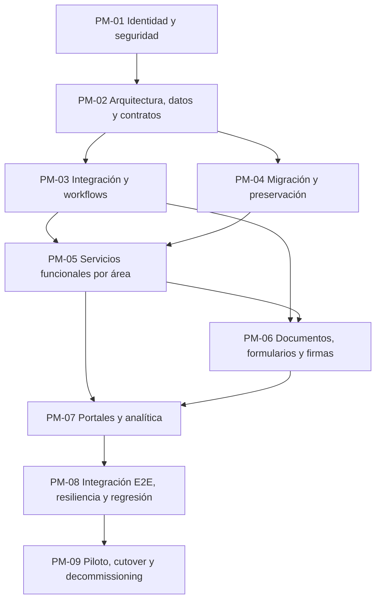

# PLAN MAESTRO DE IMPLEMENTACIÓN — IMA

> **Referencia normativa obligatoria:** antes de modificar este plan o cualquier archivo del repositorio, leer `Normas_Desarollo.md`. Este plan organiza tareas, dependencias y estados; no define una normativa operativa paralela. Las reglas de desarrollo y gobierno se consultan exclusivamente en el archivo maestro.

**Versión:** 1.2 — secuencia flexible y dependencias proporcionales (NDASC v1.0)  
**Fecha:** 2026-11-10  
**Repositorio:** `i-miss-cocaine/IMA`  
**Rama de trabajo:** `NG_beta_0.0.0.1_work`  
**Estado:** plan rector de secuenciación; ninguna tarea se declara implementada por aparecer aquí.  
**Línea base operativa C1.285:** las 1.346 tareas de los siete backlogs están en `Pendiente`; no existe ninguna tarea del Plan Maestro con estado operativo `Completada`. Los registros históricos de la sección 10 se conservan como evidencia histórica y quedan subordinados al reinicio de estados de la sección 10.1.  
**Checkpoint de origen:** C1.277 (consolidación del backlog).  
**Checkpoint de planificación:** C1.278.

---

## 1. Propósito y regla de gobierno

Este documento establece el orden maestro para ejecutar las tareas de los siete backlogs departamentales. El orden no es una simple secuencia por departamento ni por prioridad aislada: se determina por dependencias técnicas, capas de arquitectura, integridad de datos, seguridad, contratos entre servicios y relaciones funcionales del portal.

El plan **ordena la ejecución, pero no reemplaza los requisitos originales**. Cada tarea conserva su ID, descripción, criterios, archivos, prioridad, relaciones y fuentes en su archivo departamental. El anexo de este documento es un índice de planificación por ID, no una versión abreviada del requisito.

La asignación de fase es una propuesta inicial basada en el contenido de cada registro, su familia de ID, componentes y dependencias disponibles. Antes de implementar se confirma únicamente el alcance y las dependencias que afecten al cambio. PM-00 es una fase de inventario y triage, no una puerta universal: las tareas independientes pueden implementarse mientras se resuelven clasificaciones pendientes.

## 2. Inventario estudiado

Se analizaron los siete archivos departamentales completos y sus 1.346 bloques de tarea. Los encabezados tienen 1.346 IDs únicos, sin duplicados entre los siete destinos.

| Departamento | Archivo | Tareas |
|---|---|---:|
| Dirección | `pendientes/Dirección/Pendientes.md` | 145 |
| Secretaría | `pendientes/Secretaria/Pendientes.md` | 194 |
| Contabilidad | `pendientes/Contabilidad/Pendientes.md` | 184 |
| Docente | `pendientes/Docente/Pendientes.md` | 129 |
| Estudiante | `pendientes/Estudiante/Pendientes.md` | 7 |
| Padre | `pendientes/Padre/Pendientes.md` | 13 |
| Otros | `pendientes/Otros/Pendientes.md` | 674 |
| **Total** | | **1.346** |

Se identificaron **39 familias/series de identificadores**, **830 registros con una sección de dependencias identificable** y **198 tareas con un campo explícito «Orden de Ejecución»**. Los órdenes explícitos se conservan como secuencias locales de su iniciativa (por ejemplo, una secuencia F29 o F31); no se interpretan como un orden global entre iniciativas distintas.

### 2.1 Inventario por familia de identificador

| Familia/serie de ID | Cantidad |
|---|---:|
| TASK | 627 |
| AUD-NG | 184 |
| TAREA-F6 | 40 |
| F8 | 27 |
| T-UX | 27 |
| TAREA-F7 | 25 |
| TAREA-F4 | 21 |
| TAREA-F5 | 20 |
| TAREA | 20 |
| FASE | 19 |
| F29 | 18 |
| F10 | 18 |
| F11 | 18 |
| F19 | 17 |
| F40 | 16 |
| F21 | 15 |
| F23 | 15 |
| F30 | 15 |
| F31 | 14 |
| F20 | 14 |
| F9 | 14 |
| F16 | 13 |
| F32 | 13 |
| F35 | 12 |
| F18 | 12 |
| F17 | 11 |
| F24 | 11 |
| F39 | 10 |
| F22 | 10 |
| F33 | 10 |
| F25 | 8 |
| F34 | 8 |
| F37 | 8 |
| F38 | 8 |
| F41 | 8 |
| F26 | 6 |
| F27 | 5 |
| F28 | 5 |
| AUDIT-CR | 4 |

### 2.2 Distribución inicial por fase

| Fase | Tareas asignadas |
|---|---:|
| PM-00 — Inventario y triage de dependencias | 35 |
| PM-01 — Identidad, seguridad y gobierno de acceso | 130 |
| PM-02 — Arquitectura, datos, contratos y persistencia | 88 |
| PM-03 — Integración interservicio, eventos y workflows | 89 |
| PM-04 — Migración, importación y preservación de datos | 115 |
| PM-05 — Servicios funcionales por área institucional | 323 |
| PM-06 — Documentos, formularios, firmas y trámites | 286 |
| PM-07 — Portales, experiencia, paneles y analítica | 147 |
| PM-08 — Pruebas integrales, resiliencia y observabilidad | 130 |
| PM-09 — Piloto, cutover y retiro controlado de legado | 3 |

### 2.3 Distribución por departamento y fase

| Departamento | PM-00 | PM-01 | PM-02 | PM-03 | PM-04 | PM-05 | PM-06 | PM-07 | PM-08 | PM-09 | Total |
|---|---:|---:|---:|---:|---:|---:|---:|---:|---:|---:|---:|
| Dirección | 1 | 13 | 7 | 12 | 10 | 32 | 33 | 22 | 13 | 2 | 145 |
| Secretaría | 1 | 12 | 0 | 12 | 23 | 34 | 93 | 10 | 9 | 0 | 194 |
| Contabilidad | 3 | 8 | 8 | 11 | 11 | 86 | 34 | 13 | 10 | 0 | 184 |
| Docente | 2 | 10 | 2 | 3 | 8 | 75 | 14 | 8 | 7 | 0 | 129 |
| Estudiante | 0 | 0 | 0 | 0 | 0 | 1 | 2 | 4 | 0 | 0 | 7 |
| Padre | 0 | 2 | 0 | 2 | 0 | 8 | 1 | 0 | 0 | 0 | 13 |
| Otros | 28 | 85 | 71 | 49 | 63 | 87 | 109 | 90 | 91 | 1 | 674 |

**PM-00:** 35 registros requieren triage manual. Incluye encabezados de agrupación sin requisitos propios, ampliaciones que deben incorporarse a la tarea madre y tareas con dependencia/área insuficientemente definida. No se implementan como unidades independientes hasta resolver su relación.

## 3. Orden global de capas y dependencias

La regla general es avanzar de las capas de menor nivel hacia las superiores:

1. **Identidad y seguridad:** autenticación verificable, claims, sesión, roles, permisos efectivos, ámbitos institucionales/departamentales, propiedad de datos y privacidad.
2. **Arquitectura y modelo de datos:** inventario real del repositorio, catálogo canónico, IDs estables, esquemas, fuente única de verdad, reglas de integridad, configuración y persistencia.
3. **Contratos e integración:** APIs verificables, adaptadores, autorización interservicio, idempotencia, transacciones, eventos, colas, notificaciones y workflows.
4. **Datos y migración:** inventario de fuentes, mapeo, validación, staging, conciliación, carga controlada, pruebas de integridad y aceptación por departamento.
5. **Servicios funcionales:** procesos escolares, recursos humanos, finanzas y servicios complementarios, sobre las capas anteriores.
6. **Documentos y trámites:** plantillas, formularios, generación PDF, almacenamiento protegido, firmas, acuses, conservación y archivo.
7. **Portales y experiencia:** dashboards y vistas por rol, navegación, filtros, preferencias, ayuda y analítica, consumiendo contratos ya estables.
8. **Calidad integral y resiliencia:** pruebas conductuales, integración, E2E, concurrencia, recuperación, rendimiento, observabilidad y regresión.
9. **Transición productiva:** pilotos, aprobaciones, cutover, sincronización final, operación supervisada y retiro controlado de legado.

### 3.1 Grafo maestro de precedencias

Las pruebas de seguridad, unidad y contrato no se posponen hasta PM-08: se ejecutan en cada iteración. PM-08 agrupa la certificación transversal y las tareas cuyo objeto principal es probar o endurecer el sistema.

## 4. Fases del plan maestro

### PM-00 — Inventario, triage y resolución de dependencias

**Objetivo:** cerrar la ambigüedad antes de programar. Confirmar que cada ID representa una tarea ejecutable, una ampliación de otra tarea o un encabezado/agrupador.

**Entregables:** matriz ID → tarea madre → departamento → fase → prerrequisitos; inventario de archivos y dependencias; lista de IDs sin criterio ejecutable; relación de tareas que amplían criterios existentes.

**Regla:** los registros PM-00 no se ejecutan directamente. Se incorporan a su tarea madre o se reclasifican mediante evidencia. TASK-637, TASK-638 y TASK-639 forman el bloque inicial de inventario, mapa de dependencias y revisión manual de símbolos/ciclos.

### PM-01 — Identidad, seguridad y gobierno de acceso

**Objetivo:** disponer de una identidad única y verificable y de una autorización consistente entre todos los servicios.

**Incluye:** autenticación y claims; sesiones y revocación; RBAC/ABAC; permisos por operación; ámbitos institucionales/departamentales; roles simultáneos; propiedad de registros y archivos; aislamiento entre estudiantes, familias, docentes, departamentos e instituciones; protección de datos sensibles; auditoría de accesos.

**Familias y grupos principales:** TAREA-F4; F8 (seguridad/autorización); F16 (roles y responsabilidades como modelo, separando función de permiso); F40 (seguridad documental, en su parte de autorización); TASK-068/153/636/682 y los registros AUD-NG que describen bypasses, IDOR, permisos o exposición de datos.

**Puerta de salida:** todas las rutas sensibles derivan actor, rol y ámbito desde identidad verificada en servidor; ninguna autorización depende de `authRole` o IDs manipulables del payload; permisos positivos y negativos probados en cada servicio; revocación y expiración efectivas.

### PM-02 — Arquitectura, datos, contratos y persistencia

**Objetivo:** establecer las estructuras y reglas compartidas que evitan divergencias entre servicios.

**Incluye:** inventario de código y activos; mapa estático/dinámico de dependencias; modularización con contratos compatibles; IDs canónicos; catálogos maestros; fuente de verdad por entidad; esquemas y relaciones; integridad referencial; transacciones e idempotencia; configuración jerárquica versionada; persistencia; provisión real de recursos; límites y adaptadores entre servicios.

**Familias y grupos principales:** F8 (inventario, rutas, modularización); F26; F35-ID; F37; FASE2; parte de F30; TASK-637/638/639/679/680; AUD-NG y TASK asociados a IDs, esquemas, catálogos, persistencia y fuente única de verdad.

**Puerta de salida:** cada entidad tiene propietario de escritura, ID estable, esquema, relaciones y consumidores documentados; contratos versionados y validados; no existen escrituras cruzadas sin autoridad ni mutaciones parciales; las pruebas de concurrencia/idempotencia son reproducibles.

### PM-03 — Integración interservicio, eventos y workflows

**Objetivo:** coordinar operaciones que atraviesan módulos sin duplicar efectos ni dejar estados parciales.

**Incluye:** contratos API; autenticación HMAC entre servicios; enrutamiento de destinos; eventos persistentes; colas y reintentos; idempotencia de extremo a extremo; Sagas/compensaciones; workflows y transiciones de estado; notificaciones; bandejas de trabajo; SLA; integraciones externas y webhooks.

**Familias y grupos principales:** F23, F25, F30, F34 (integración de justificaciones, bandejas y eventos), parte de F37, TASK-681, AUD-NG-069/071 y las tareas de integración/notificación/aprobación.

**Puerta de salida:** operaciones distribuidas con correlación, deduplicación, estados recuperables y compensación; fallos y reintentos observables; ningún evento se considera entregado sin persistencia/acuse verificable.

### PM-04 — Migración, importación y preservación de datos

**Objetivo:** llevar datos y documentos existentes a los modelos canónicos sin pérdida ni exposición.

**Subetapas obligatorias:**
1. Inventario de fuentes, responsables, sensibilidad y volumen.
2. Correspondencia de IDs, mapeo de columnas/campos y reglas de transformación.
3. Validación previa, detección de duplicados y referencias huérfanas.
4. Staging aislado, anonimización de datos sensibles y respaldo verificable.
5. Importación por lotes reanudables, idempotentes y reversibles.
6. Conciliación cuantitativa/cualitativa y revisión de excepciones.
7. Piloto por departamento y aprobación de propietarios de datos.
8. Sincronización delta y transición, después de la puerta PM-09.

**Familias y grupos principales:** F29, F35, F39, F41; TASK-068, 071, 073, 079, 081, 109, 118, 132–138 y tareas de importación, archivo, OCR, conciliación y respaldo.

**Puerta de salida:** cada lote conserva procedencia, conteos, hashes, errores, relaciones y resultado; las diferencias quedan conciliadas y aprobadas; rollback probado; no se expone información real en pruebas.

### PM-05 — Servicios funcionales por área institucional

Se ejecuta por subflujos, no por una migración masiva de todos los departamentos. Los servicios comunes de PM-01 a PM-03 deben estar aprobados antes de integrar operaciones reales.

**PM-05A — Secretaría, admisiones y expediente del estudiante**
1. Solicitud/admisión, validación, entrevistas, lista de espera y decisión.
2. Alta de estudiante, identidad, expediente, documentos y relaciones familiares.
3. Matrícula, reingreso, traslado, retiro, cambios de sección y ciclo de vida.
4. Servicios de Secretaría y seguimiento de trámites.
5. Integración con facturación, asistencia, docentes y portal familiar.

**PM-05B — Estructura académica y operación docente**
1. Catálogo curricular, planes, áreas, asignaturas, grados, secciones y oferta.
2. Asignaciones docentes y responsabilidades académicas.
3. Calendario, aulas, recursos, carga laboral y horarios sin conflictos.
4. Asistencia, justificaciones, convivencia y seguimiento.
5. Evaluaciones, exámenes, rúbricas, calificaciones, aprobación y publicación.
6. Boletines, certificados, historiales e informes académicos.

**PM-05C — Recursos humanos**
1. Departamentos, cargos, organigrama y roles organizativos.
2. Expediente laboral, contratos, incorporación, adscripciones y vigencias.
3. Asistencia laboral, vacaciones, permisos y sustituciones.
4. Desvinculación/offboarding con revocación coordinada.
5. Nómina, deducciones, beneficios, aportaciones legales y boletas.

**PM-05D — Contabilidad y finanzas**
1. Políticas y tarifas versionadas por período.
2. Cargos, becas, descuentos, morosidad y cuentas por cobrar.
3. Pagos, abonos, pasarelas, webhooks y recibos.
4. Facturación fiscal, CAI, correlativos y comprobantes.
5. Caja, bancos, conciliación y cierres por sesión/cuenta.
6. Compras, proveedores, recepción, cuentas por pagar y presupuesto.
7. Activos, inventario, depreciación, almacenes y reportes financieros.

**PM-05E — Servicios complementarios**
- Biblioteca: catálogo, ejemplares, inventario, préstamos, reservas, devoluciones, multas, OPAC y notificaciones.
- Transporte: rutas, paradas, vehículos, conductores, asignaciones familiares, control de abordaje, incidencias, seguridad y cobros.

**Familias principales:** F5–F7, F9–F11, F16–F21, F18–F19, F20–F21 y tareas TASK/TAREA relacionadas con cada flujo.

**Puerta de salida:** cada módulo persiste en su fuente autorizada, respeta los permisos y relaciones, registra eventos, soporta estados inválidos y ofrece pruebas de negocio positivas/negativas. No se habilita una pantalla antes de validar el servicio que la alimenta.

### PM-06 — Documentos, formularios, firmas y trámites

**Objetivo:** disponer de un ciclo documental institucional seguro, trazable y legalmente controlado.

**Orden recomendado:**
1. Inventario, clasificación, metadatos, propietario y sensibilidad.
2. Almacenamiento privado, acceso autenticado, hash, versionado y custodia.
3. Catálogo de plantillas, campos y formularios; borradores y validaciones.
4. Renderizado, paginación, PDF binario, CUV y verificación.
5. Solicitudes, bandejas, revisiones, subsanación y aprobaciones.
6. Firma, múltiples firmantes, certificados, acuses de entrega/lectura.
7. Retención, bloqueo legal, archivo, búsqueda y OCR asistido.
8. Integración de documentos con expedientes, pagos, RR. HH. y portales.

**Familias principales:** F22, F31, F32, F33, F34 y las partes documentales de F39/F40/F41.

**Puerta de salida:** originales y versiones preservados; acceso privado por expediente/ámbito; integridad criptográfica comprobada; firmas y acuses verificables; ninguna URL pública como sustituto de autorización.

### PM-07 — Portales, experiencia, paneles y analítica

**Objetivo:** exponer procesos ya estables mediante experiencias coherentes para cada perfil.

**Orden:** componentes comunes de navegación y sesión → vistas y formularios por rol → portales de Secretaría/Dirección/Contabilidad/Docente/Estudiante/Padre → filtros, paginación y preferencias → notificaciones y actividad reciente → reportes e indicadores.

**Familias principales:** T-UX, F24, F38 y tareas de dashboards, vistas, ayuda, accesibilidad, reportes y analítica.

**Puerta de salida:** cada vista usa datos reales del servicio autorizado; los filtros respetan ámbito; el estado se reconstruye después de recargar; no hay datos de demostración en resultados institucionales.

### PM-08 — Pruebas integrales, resiliencia y observabilidad

**Objetivo:** certificar el comportamiento del portal como un sistema integrado.

**Incluye:** pruebas unitarias de negocio; contratos API; integración; E2E por rol; concurrencia; idempotencia; persistencia; permisos negativos; aislamiento de datos; regresión visual/funcional; cuotas Apps Script; rendimiento; monitoreo; respaldo/restauración; pruebas de fallo y recuperación.

**Familias y grupos principales:** F27, F28, F41 (calidad/recuperación), tareas de pruebas de F8/F9/F24/F29/F30/F37/F40 y TASK-633/634/635.

**Puerta de salida:** reporte reproducible con PASS/FAIL/BLOCKED, datos aislados, evidencias, métricas y regresiones identificadas. Un test de presencia textual o un mensaje de éxito no acredita comportamiento.

### PM-09 — Piloto, cutover y retiro controlado de legado

**Objetivo:** activar el sistema sin pérdida de datos ni interrupción no controlada.

**Secuencia:** aprobación de criterios → piloto acotado → conciliación → capacitación/soporte → respaldo completo → congelamiento de escrituras legadas → delta sync → cambio de fuente de verdad → monitoreo intensivo → aceptación institucional → archivo de legado en solo lectura → decommissioning autorizado.

**Incluye:** tareas de cutover, pilotos, aprobaciones de migración, RPO/RTO, contingencia y retiro formal. No se ejecuta antes de superar PM-01 a PM-08 y obtener aceptación de cada propietario funcional.

## 5. Dependencias críticas entre áreas

| Área consumidora | Debe existir antes | Razón |
|---|---|---|
| Secretaría / admisiones | Identidad, IDs, catálogos, expedientes, workflows | Alta y seguimiento confiables |
| Matrícula y expediente | Catálogo curricular, oferta, relaciones familiares, integridad | Evitar expedientes y matrículas huérfanas |
| Planificación docente | Estructura académica, asignaciones, calendario, recursos y contratos | Resolver carga y conflictos reales |
| Asistencia y calificaciones | Matrícula, asignaciones vigentes, permisos, períodos y bitácora | Integridad académica y trazabilidad |
| Contabilidad estudiantil | Matrícula/servicios, políticas tarifarias versionadas, identidad | Cargos correctos por período y persona |
| Nómina | Contratos, vigencias, asistencia, novedades y políticas legales | Cálculo salarial individual y auditable |
| Documentos y firmas | Identidad, permisos, almacenamiento, hash, eventos y notificaciones | Custodia y evidencia verificable |
| Portal familiar | Relaciones familiares verificadas, permisos por estudiante y APIs | Evitar exposición cruzada |
| Biblioteca / transporte | Usuarios, expedientes, catálogos, inventario y reglas de cobro | Operación complementaria segura |
| Informes directivos | Fuentes canónicas, proyecciones mínimas y snapshots | Indicadores reales y comparables |

## 6. Reglas para ordenar tareas dentro de cada fase

1. Primero se satisfacen dependencias explícitas de la tarea; después dependencias de arquitectura y de integración.
2. Un P0 de seguridad/datos bloquea los módulos afectados. Una etiqueta P0 no permite saltarse una dependencia técnica.
3. Los 198 órdenes explícitos se mantienen dentro de su iniciativa. No se mezclan números de orden de familias distintas.
4. Si dos tareas comparten un servicio, esquema o contrato, se ordenan por el componente propietario y se evita la edición concurrente.
5. Se pueden ejecutar en paralelo subflujos funcionales independientes únicamente después de aprobar las capas compartidas y sus contratos.
6. Las tareas de prueba acompañan a cada implementación. PM-08 no sustituye las pruebas de las fases anteriores.
7. Las ampliaciones de criterios (por ejemplo, TAREA-10/TAREA-13) se incorporan a su tarea madre; no se implementan como duplicados.
8. Los registros de encabezado/agrupación sin requisitos propios no son tareas ejecutables independientes.
9. Cada tarea sigue el ciclo continuo de `Normas_Desarollo.md`; inspección, implementación, pruebas y correcciones se dimensionan según el riesgo. No se exige repetir fases completas.
10. Publicar commits por unidades coherentes y recuperables; los checkpoints se registran en hitos, pausas, transferencias o antes de operaciones de riesgo.

### 6.1 Algoritmo obligatorio para seleccionar la siguiente tarea

La secuencia PM-00 → PM-09 es el orden recomendado de capas y dependencias, no una barrera administrativa absoluta. Se puede avanzar en cualquier tarea cuyo alcance sea técnicamente independiente y seguro, aunque existan tareas o documentos pendientes en fases anteriores. No se omiten prerrequisitos técnicos reales ni controles de seguridad/integridad.

Dentro de la fase PM activa, el agente debe construir y respetar una cola de ejecución con este procedimiento, antes de escoger una tarea:

1. **Filtrar por fase y estado:** considerar únicamente IDs de la fase activa cuyo estado esté Pendiente o Bloqueado por una causa ya resuelta. Excluir encabezados, ampliaciones sin requisitos independientes y tareas reclasificadas como no ejecutables.
2. **Resolver prerrequisitos:** leer todas las dependencias del requisito original en la ruta exacta indicada en la última columna del registro maestro. Contrastar el estado real de cada dependencia con el código, las pruebas, el backlog y sus evidencias; no confiar solo en etiquetas de estado.
3. **Orden topológico proporcional:** una tarea solo espera las dependencias obligatorias que sean prerrequisitos técnicos demostrables para su alcance. Clasificar cada relación como obligatoria, condicional o informativa. Si hay ciclos, referencias ambiguas o dependencias sin ID, aislar el subflujo seguro y continuar con trabajo independiente; bloquear únicamente la operación que realmente necesite la relación no resuelta. Registrar el triage sin paralizar el resto del plan.
4. **Desempate entre tareas elegibles:** aplicar, en este orden: (a) riesgo de seguridad/integridad y severidad; (b) prioridad P0, P1, P2, P3; (c) orden local explícito dentro de la misma iniciativa; (d) menor número de dependencias consumidoras desbloqueadas; (e) ID alfanumérico únicamente como último desempate estable. Ningún desempate permite violar una dependencia.
5. **Trazabilidad:** registrar el ID/requisito, fase, alcance y dependencias relevantes en el expediente o checkpoint del hito. No exigir checkpoint antes de cada tarea o subpaso.
6. **Cambio de orden:** si la auditoría demuestra que otra tarea debe precederla, actualizar el plan de forma aditiva con IDs afectados, dependencias antes/después y evidencia. No reordenar solo por conveniencia.
7. **Paralelismo:** solo se permite entre tareas sin dependencias entre sí y que no compartan archivos, servicio, esquema, catálogo, contrato ni fuente de verdad susceptible de edición concurrente. Debe existir aislamiento de pruebas y un responsable por recurso compartido.

La tabla de la sección 9 se agrupa estrictamente por fase PM y añade una ruta exacta por cada ID. La posición de la fila facilita la consulta, pero no sustituye el análisis topológico de dependencias ni convierte una tarea bloqueada en elegible.

## 7. Primer orden de trabajo recomendado

La ejecución de producto no comienza por pantallas. El primer bloque es de arquitectura, seguridad y datos:

1. PM-00: resolver los 35 registros sin clasificación ejecutable; completar el inventario y dependencias de TASK-637/638/639 y revisar sus relaciones.
2. PM-01: auditar y cerrar autenticación/autorización transversal, separación RBAC/ABAC, ámbitos, revocación, roles múltiples y bypasses (incluye TAREA-F4-P0-01..04, F8-TASK01, TASK-153, TASK-636 y TASK-682, además de sus dependencias reales).
3. PM-02: fijar IDs canónicos, fuente de verdad, propiedad única de escritura, esquemas y contratos; incluir TASK-068, TASK-679 y TASK-678/676/677 según su grafo.
4. PM-03: asegurar HMAC, eventos persistentes, idempotencia, Saga y workflows; incluir TASK-681 y dependencias de F23/F25/F30/F34.
5. PM-04: preparar la migración y la digitalización con inventario, staging, mapeo, anonimización, conciliación y rollback.
6. PM-05: ejecutar los módulos funcionales en el orden de subflujos descrito.
7. PM-06: completar los ciclos documentales y de trámites integrados con los servicios funcionales.
8. PM-07: conectar los portales y paneles por rol.
9. PM-08: certificar el sistema completo y sus escenarios de fallo.
10. PM-09: piloto, aprobación, cutover y retiro de legado.

La lista anterior expresa una secuencia recomendada de capas. La selección de trabajo puede desviarse cuando exista independencia técnica demostrable; basta una verificación focalizada de los requisitos y dependencias relevantes.

## 8. Criterios de avance y control del plan

- Estado operativo permitido: Pendiente, En ejecución, Bloqueada, Completada.
- «Completada» significa implementación de todos los requisitos de la tarea, verificaciones técnicas internas aplicables, autoauditoría, Code Review interno aprobado, evidencia y actualización del registro. No requiere aprobación del usuario ni certificación funcional beta. Las pruebas integrales beta se controlan separadamente en `docs/testing/PRUEBAS_FUNCIONALES_BETA.md`.
- Una tarea solo se marca Bloqueada si existe un prerrequisito técnico, dato real o autorización externa imprescindible para su alcance. Registrar la causa y el subalcance afectado; continuar cualquier trabajo independiente. No convertir una dependencia informativa o documental en bloqueo.
- El plan se actualiza de forma aditiva al resolver dependencias, descubrir nuevas tareas o cambiar el orden por evidencia. Nunca se borran requisitos originales.
- La trazabilidad del cambio debe llegar desde el ID de tarea y hallazgo de origen hasta archivos, funciones, pruebas, commit y checkpoint.
- Los archivos de backlog departamental son el índice operativo para seleccionar trabajo dentro de esta etapa. Los archivos históricos `Pendientes.md` y `completadas.md` no se reescriben como parte de la ejecución de este plan; se consultan únicamente cuando la trazabilidad histórica de una tarea lo exija.
- El plan no autoriza cambios funcionales no solicitados, omitir prerrequisitos técnicos reales ni escribir en la rama base. La secuencia de fases es orientativa y los commits siguen NDASC v1.0.

## 9. Registro maestro por tarea

Cada fila conserva el ID original, la fase/orden PM y la **ruta exacta donde se encuentran los requisitos completos**. El campo «Orden PM» hace explícita la secuencia de fases (PM-00 → PM-09); no debe confundirse con un ordinal global de ejecución. Dentro de cada fase, la tarea siguiente se determina aplicando el algoritmo de precedencias de la sección 6.1, no por orden alfabético ni por posición visual de la fila. «Orden local» conserva el orden explícito original de la iniciativa, cuando existe. «Dependencias» reproduce un extracto; el requisito íntegro permanece en el archivo de la última columna.

| ID | Departamento | Orden PM | Fase | Subflujo | Prioridad | Orden local | Dependencias registradas (extracto) | Título original | Ruta exacta de requisitos |
|---|---|---|---|---|---|---:|---|---|---|
| AUD-NG-096 | Contabilidad | 00 | PM-00 | Triage manual: metadato incompleto, ampliación o relación por resolver | No explícita | — | Contradicción histórica [X]/[ ] Pendiente en commit 40c9e15; estado canónico actual [ ]/Pendiente; ocho criterios TASK-050 abiertos; AUD-NG-091–096 vinculadas. | Rectificar de forma aditiva el estado contradictorio de TASK-050 | `pendientes/Contabilidad/Pendientes.md` |
| TASK-637 | Contabilidad | 00 | PM-00 | Triage manual: metadato incompleto, ampliación o relación por resolver | P1 | — | árbol Git de la rama de trabajo, documentación vigente, punto de entrada `index.html`. | Completar el inventario integral de archivos | `pendientes/Contabilidad/Pendientes.md` |
| TASK-638 | Contabilidad | 00 | PM-00 | Triage manual: metadato incompleto, ampliación o relación por resolver | P1 | — | TASK-637, catálogo completo de archivos. | Trazar dependencias estáticas y dinámicas de extremo a extremo | `pendientes/Contabilidad/Pendientes.md` |
| TASK-279 | Dirección | 03 | PM-03 | Integración, procesos y eventos | P1 | 9 | AUD-NG-128 (PM-01; autorización/identidad en tickets) y modelo existente de tickets; validar ambos antes de iniciar | [P1] Clasificación Automática de Incidencias y Gestión Paramétrica de SLA | `pendientes/Dirección/Pendientes.md` |
| TAREA-10 | Docente | — | No ejecutable (agregado) | Índice de ampliaciones; hallazgos independientes ya clasificados | No aplica | — | AUD-NG-165 PM-01; AUD-NG-149 y demás ampliaciones ligadas a tareas existentes; sin entrega separada | Ampliación de criterios existentes derivada de TAREA-10 (2026-11-05) | `pendientes/Docente/Pendientes.md` |
| TAREA-13 | Docente | — | No ejecutable (agregado) | Índice de ampliaciones; hallazgos independientes ya clasificados | No aplica | — | AUD-NG-168 PM-05; AUD-NG-164/AUD-NG-158 conservan sus registros propios; sin entrega separada | Ampliación de criterios existentes derivada de TAREA-13 (2026-11-05) | `pendientes/Docente/Pendientes.md` |
| AUD-NG-007 | Otros | 03 | PM-03 | Integración, procesos y eventos | No explícita | — | fetchApi, checkMicroserviceHealth, checkAllMicroservicesHealth; debe preceder a TASK-429 (PM-05) | Aplicar el timeout configurado por llamada en fetchApi | `pendientes/Otros/Pendientes.md` |
| AUD-NG-069 | Otros | 03 | PM-03 | Integración, procesos y eventos | No explícita | — | AUD-NG-071; fetchApi, MAX_RETRIES, idempotencyToken, idempotencyKey, checkAndRegisterIdempotencyKey y saveIdempotentResult. | Propagar claves idempotentes en fetchApi y controlar los reintentos de POST | `pendientes/Otros/Pendientes.md` |
| AUD-NG-071 | Otros | 03 | PM-03 | Integración, procesos y eventos | No explícita | — | checkAndRegisterIdempotencyKey, saveIdempotentResult, LockService y doPost; reserva server-side atómica antes de reintentos automáticos | Reservar claves idempotentes de forma atómica antes de ejecutar operaciones | `pendientes/Otros/Pendientes.md` |
| TASK-043 | Otros | 00 | Encabezado sin requisitos independientes; excluido de cola por §6.1 | Triage manual: metadato incompleto, ampliación o relación por resolver | P0 | Sin objetivo, dependencias ni criterios en el bloque fuente; requiere requisitos completos | No declaradas en el bloque extraído | P0 — PRIORIDAD CRÍTICA | `pendientes/Otros/Pendientes.md` |
| TASK-055 | Otros | 00 | Encabezado sin requisitos independientes; excluido de cola por §6.1 | Triage manual: metadato incompleto, ampliación o relación por resolver | P0 | Sin objetivo, dependencias ni criterios en el bloque fuente; requiere requisitos completos | No declaradas en el bloque extraído | P0 — PRIORIDAD CRÍTICA | `pendientes/Otros/Pendientes.md` |
| TASK-059 | Otros | 00 | Encabezado sin requisitos independientes; excluido de cola por §6.1 | Triage manual: metadato incompleto, ampliación o relación por resolver | P0 | Sin objetivo, dependencias ni criterios en el bloque fuente; requiere requisitos completos | No declaradas en el bloque extraído | P0 — PRIORIDAD CRÍTICA | `pendientes/Otros/Pendientes.md` |
| TASK-063 | Otros | 00 | Encabezado sin requisitos independientes; excluido de cola por §6.1 | Triage manual: metadato incompleto, ampliación o relación por resolver | P0 | Sin objetivo, dependencias ni criterios en el bloque fuente; requiere requisitos completos | No declaradas en el bloque extraído | P0 — PRIORIDAD CRÍTICA | `pendientes/Otros/Pendientes.md` |
| TASK-066 | Otros | 00 | Encabezado sin requisitos independientes; excluido de cola por §6.1 | Triage manual: metadato incompleto, ampliación o relación por resolver | P0 | Sin objetivo, dependencias ni criterios en el bloque fuente; requiere requisitos completos | No declaradas en el bloque extraído | P0 — PRIORIDAD CRÍTICA | `pendientes/Otros/Pendientes.md` |
| TASK-101 | Otros | 00 | Encabezado sin requisitos independientes; excluido de cola por §6.1 | Triage manual: metadato incompleto, ampliación o relación por resolver | P0 | Sin objetivo, dependencias ni criterios en el bloque fuente; requiere requisitos completos | No declaradas en el bloque extraído | BLOQUE 1. CAPTURA INTEGRAL, MODALIDADES Y BORRADORES (P0) | `pendientes/Otros/Pendientes.md` |
| TASK-218 | Otros | 00 | Encabezado sin requisitos independientes; excluido de cola por §6.1 | Triage manual: metadato incompleto, ampliación o relación por resolver | P1 | Sin objetivo, dependencias ni criterios en el bloque fuente; requiere requisitos completos | No declaradas en el bloque extraído | P1 — PRIORIDAD ALTA | `pendientes/Otros/Pendientes.md` |
| TASK-240 | Otros | 00 | Encabezado sin requisitos independientes; excluido de cola por §6.1 | Triage manual: metadato incompleto, ampliación o relación por resolver | No explícita | Sin objetivo, dependencias ni criterios en el bloque fuente; requiere requisitos completos | No declaradas en el bloque extraído | BLOQUE 4. Gestión institucional, objetivos y alertas | `pendientes/Otros/Pendientes.md` |
| TASK-244 | Otros | 00 | Encabezado sin requisitos independientes; excluido de cola por §6.1 | Triage manual: metadato incompleto, ampliación o relación por resolver | P1 | Sin objetivo, dependencias ni criterios en el bloque fuente; requiere requisitos completos | No declaradas en el bloque extraído | P1 — PRIORIDAD ALTA | `pendientes/Otros/Pendientes.md` |
| TASK-250 | Otros | 00 | Encabezado sin requisitos independientes; excluido de cola por §6.1 | Triage manual: metadato incompleto, ampliación o relación por resolver | P1 | Sin objetivo, dependencias ni criterios en el bloque fuente; requiere requisitos completos | No declaradas en el bloque extraído | P1 — PRIORIDAD ALTA | `pendientes/Otros/Pendientes.md` |
| TASK-254 | Otros | 00 | Encabezado sin requisitos independientes; excluido de cola por §6.1 | Triage manual: metadato incompleto, ampliación o relación por resolver | P1 | Sin objetivo, dependencias ni criterios en el bloque fuente; requiere requisitos completos | No declaradas en el bloque extraído | P1 — PRIORIDAD ALTA | `pendientes/Otros/Pendientes.md` |
| TASK-271 | Otros | 00 | Encabezado sin requisitos independientes; excluido de cola por §6.1 | Triage manual: metadato incompleto, ampliación o relación por resolver | No explícita | Sin objetivo, dependencias ni criterios en el bloque fuente; requiere requisitos completos | No declaradas en el bloque extraído | BLOQUE 4. PILOTOS, TRANSICIÓN Y CONTINUIDAD OPERATIVA | `pendientes/Otros/Pendientes.md` |
| TASK-274 | Otros | 00 | Encabezado sin requisitos independientes; excluido de cola por §6.1 | Triage manual: metadato incompleto, ampliación o relación por resolver | No explícita | Sin objetivo, dependencias ni criterios en el bloque fuente; requiere requisitos completos | No declaradas en el bloque extraído | BLOQUE 6. CONSOLIDACIÓN Y CONTROL DE CALIDAD DE LA TRANSICIÓN | `pendientes/Otros/Pendientes.md` |
| TASK-395 | Otros | 00 | Encabezado sin requisitos independientes; excluido de cola por §6.1 | Triage manual: metadato incompleto, ampliación o relación por resolver | P2 | Sin objetivo, dependencias ni criterios en el bloque fuente; requiere requisitos completos | No declaradas en el bloque extraído | P2 — PRIORIDAD MEDIA | `pendientes/Otros/Pendientes.md` |
| TASK-411 | Otros | 00 | Encabezado sin requisitos independientes; excluido de cola por §6.1 | Triage manual: metadato incompleto, ampliación o relación por resolver | P2 | Sin objetivo, dependencias ni criterios en el bloque fuente; requiere requisitos completos | No declaradas en el bloque extraído | P2 — PRIORIDAD MEDIA | `pendientes/Otros/Pendientes.md` |
| TASK-420 | Otros | 00 | Encabezado sin requisitos independientes; excluido de cola por §6.1 | Triage manual: metadato incompleto, ampliación o relación por resolver | P2 | Sin objetivo, dependencias ni criterios en el bloque fuente; requiere requisitos completos | No declaradas en el bloque extraído | P2 — PRIORIDAD MEDIA | `pendientes/Otros/Pendientes.md` |
| TASK-423 | Otros | 00 | Encabezado sin requisitos independientes; excluido de cola por §6.1 | Triage manual: metadato incompleto, ampliación o relación por resolver | P2 | Sin objetivo, dependencias ni criterios en el bloque fuente; requiere requisitos completos | No declaradas en el bloque extraído | P2 — PRIORIDAD MEDIA | `pendientes/Otros/Pendientes.md` |
| TASK-425 | Otros | 00 | Encabezado sin requisitos independientes; excluido de cola por §6.1 | Triage manual: metadato incompleto, ampliación o relación por resolver | P2 | Sin objetivo, dependencias ni criterios en el bloque fuente; requiere requisitos completos | No declaradas en el bloque extraído | P2 — PRIORIDAD MEDIA | `pendientes/Otros/Pendientes.md` |
| TASK-439 | Otros | 00 | Encabezado sin requisitos independientes; excluido de cola por §6.1 | Triage manual: metadato incompleto, ampliación o relación por resolver | P2 | Sin objetivo, dependencias ni criterios en el bloque fuente; requiere requisitos completos | No declaradas en el bloque extraído | BLOQUE 3. EXPERIENCIA, VERIFICACIÓN Y CAPACIDADES AVANZADAS — PRIORIDAD P2 | `pendientes/Otros/Pendientes.md` |
| TASK-446 | Otros | 00 | Encabezado sin requisitos independientes; excluido de cola por §6.1 | Triage manual: metadato incompleto, ampliación o relación por resolver | P2 | Sin objetivo, dependencias ni criterios en el bloque fuente; requiere requisitos completos | No declaradas en el bloque extraído | BLOQUE 3. RECONOCIMIENTO AUTOMÁTICO Y PROCESAMIENTO INTELIGENTE (P2) | `pendientes/Otros/Pendientes.md` |
| TASK-450 | Otros | 00 | Encabezado sin requisitos independientes; excluido de cola por §6.1 | Triage manual: metadato incompleto, ampliación o relación por resolver | P2 | Sin objetivo, dependencias ni criterios en el bloque fuente; requiere requisitos completos | No declaradas en el bloque extraído | BLOQUE 3. AUTOMATIZACIÓN AVANZADA Y AMPLIACIÓN DE CAPACIDADES (P2) | `pendientes/Otros/Pendientes.md` |
| TASK-470 | Otros | 00 | Encabezado sin requisitos independientes; excluido de cola por §6.1 | Triage manual: metadato incompleto, ampliación o relación por resolver | P3 | Sin objetivo, dependencias ni criterios en el bloque fuente; requiere requisitos completos | No declaradas en el bloque extraído | P3 — PRIORIDAD BAJA | `pendientes/Otros/Pendientes.md` |
| TASK-641 | Otros | 08 | PM-08 | Calidad y resiliencia | P1 | — | ASSETS del Service Worker, cache.addAll, ciclo install/activate/offline y recursos versionados; sin dependencia de tarea declarada | Reparar y verificar el precache del Service Worker | `pendientes/Otros/Pendientes.md` |
| TASK-680 | Otros | 04 | PM-04 | Migración, importación y preservación | CRÍTICO | — | F8-TASK19 (PM-02), F8-TASK20 (PM-02), F8-TASK22 (PM-04); configuración real de Drive/Script Properties para pruebas productivas | Implementar aprovisionamiento real y verificable de espacios funcionales | `pendientes/Otros/Pendientes.md` |
| TASK-682 | Otros | 01 | PM-01 | Identidad, seguridad y gobierno de acceso | P1 | — | catálogo de roles/responsabilidades, matriz de permisos, asignaciones de ámbito y auditoría. - Aceptación: un usuario puede tener dos o más roles vigentes en una sesión; cada acción se autoriza con rol/ámbito correcto; a | Soportar múltiples roles simultáneos y ámbitos independientes por rol | `pendientes/Otros/Pendientes.md` |
| TASK-639 | Secretaría | 00 | PM-00 | Triage manual: metadato incompleto, ampliación o relación por resolver | P2 | — | TASK-637 y TASK-638. | Verificar duplicaciones, símbolos globales y ciclos | `pendientes/Secretaria/Pendientes.md` |
| AUD-NG-033 | Contabilidad | 01 | PM-01 | Identidad, seguridad y gobierno de acceso | No explícita | — | recordAccountingJournalEntry, verifyAccountingIntegrity, approvePurchaseOrder, createPurchaseOrder, validateRolePermission, AsientosContables, OrdenesCompra | Validar importes contables y vincular las aprobaciones de compra con la identidad verificada | `pendientes/Contabilidad/Pendientes.md` |
| AUD-NG-044 | Contabilidad | 01 | PM-01 | Identidad, seguridad y gobierno de acceso | No explícita | — | validateRolePermission, doPost, _verifiedUserId, _verifiedRole, approvePurchaseOrder, OrdenesCompra.AprobadoPor, bitácora de estados | Atribuir aprobaciones y transiciones a la identidad autenticada del usuario | `pendientes/Contabilidad/Pendientes.md` |
| AUD-NG-130 | Contabilidad | 01 | PM-01 | Identidad, seguridad y gobierno de acceso | No explícita | — | `getStudentEnrollmentHistory`, `getStudentAccountStatement`, `applyApprovedScholarshipsToCharges`, `tienePermisoFinanciero`, `tab-financial`. | Respetar permisos financieros y aplicar beneficios por periodo sin mutar consultas | `pendientes/Contabilidad/Pendientes.md` |
| AUD-NG-136 | Contabilidad | 01 | PM-01 | Identidad, seguridad y gobierno de acceso | No explícita | — | `validateContextualAccess`, `getStudentAccountStatement`, `getPaymentVouchers`, `generatePaymentReceiptPDF`, `getFiscalInvoices`, `uploadPaymentVoucher`, `getStudentEnrollmentHistory`, `RelacionesFamiliares`. | Restringir estados de cuenta, comprobantes, recibos y facturas a la familia autorizada | `pendientes/Contabilidad/Pendientes.md` |
| AUD-NG-138 | Contabilidad | 01 | PM-01 | Identidad, seguridad y gobierno de acceso | No explícita | — | `recordCashBankMovement`, `closeCashSession`, `getCashBankSummary`, `performBankReconciliation`, `MovimientosCajaBancos`, `CierresCaja`. | Corregir cierres de caja y conciliación bancaria por sesión/cuenta | `pendientes/Contabilidad/Pendientes.md` |
| AUD-NG-139 | Contabilidad | 01 | PM-01 | Identidad, seguridad y gobierno de acceso | No explícita | — | `recordAccountsPayableExpense`, `verifyThreeWayMatch`, `recordPurchaseReceipt`, `modifyPurchaseOrderAmount`, `generatePurchaseOrderPDF`. | Impedir bypass de autorización en cuentas por pagar y three-way match | `pendientes/Contabilidad/Pendientes.md` |
| F11-TASK02 | Contabilidad | 01 | PM-01 | Identidad, seguridad y gobierno de acceso | P0 | — | AsientosContables, OrdenesCompra, ComprobantesEgresos | Asegurar la integridad de los asientos contables y las autorizaciones multinivel | `pendientes/Contabilidad/Pendientes.md` |
| F40-TASK24 | Contabilidad | 01 | PM-01 | Identidad, seguridad y gobierno de acceso | P1 | — | No declaradas en el bloque extraído | Revisar y revocar permisos heredados u obsoletos automáticamente | `pendientes/Contabilidad/Pendientes.md` |
| AUD-NG-140 | Dirección | 01 | PM-01 | Identidad, seguridad y gobierno de acceso | No explícita | — | `getEmployeeSelfServicePortal`, `recordStaffCheckIn`, `getStaffAttendanceLogs`, `generatePayrollReceiptPDF`, `_verifiedUserId`, `_verifiedRole`. | Vincular autoservicio, asistencia y recibos de nómina a la identidad verificada | `pendientes/Dirección/Pendientes.md` |
| F17-TASK02 | Dirección | 01 | PM-01 | Identidad, seguridad y gobierno de acceso | P0 | — | No declaradas en el bloque extraído | Integrar novedades de asistencia, horas extras aprobadas y permisos sin goce en el cálculo de nómina | `pendientes/Dirección/Pendientes.md` |
| F29-TASK17 | Dirección | 01 | PM-01 | Identidad, seguridad y gobierno de acceso | P0 | — | F29-TASK05, F29-Task13, AUD-NG-001/002/036/105/106/108/128/130/136/158 (ciclo con F29-TASK05) | Migrar roles y permisos con aislamiento y privacidad verificables | `pendientes/Dirección/Pendientes.md` |
| TASK-006 | Dirección | 01 | PM-01 | Identidad, seguridad y gobierno de acceso | P0 | — | `ExpedientesLaborales`, `HistorialAdscripciones`, `Usuarios`, `AsignacionesDocentes`, `CoordinacionesArea`, `AsignacionesAmbitosRoles`, `F16-Task01`, `F16-Task02` | Implementar el flujo de desvinculación laboral con revocación coordinada de accesos y asignaciones | `pendientes/Dirección/Pendientes.md` |
| TASK-068 | Dirección | 01 | PM-01 | Identidad, seguridad y gobierno de acceso | P0 | 1 | Ninguna (Base para las demás tareas). | [P0] Sistema Centralizado de Correspondencia de Identificadores y Resolución de Identidades | `pendientes/Dirección/Pendientes.md` |
| TASK-153 | Dirección | 01 | PM-01 | Identidad, seguridad y gobierno de acceso | P0 | 1 | Sistema de usuarios, departamentos, roles y estructura de propiedad documental. | [P0] Aislamiento departamental estricto y autorización por ámbito institucional | `pendientes/Dirección/Pendientes.md` |
| TASK-228 | Dirección | 01 | PM-01 | Identidad, seguridad y gobierno de acceso | P1 | — | `F23-Task01`, `F23-Task09`. | [P1] [Seguridad y Roles - Delegación Temporal de Aprobaciones Integrada con los Workflows] | `pendientes/Dirección/Pendientes.md` |
| TASK-295 | Dirección | 01 | PM-01 | Identidad, seguridad y gobierno de acceso | P1 | 14 | No declaradas en el bloque extraído | [F31-T14] [P1] Administración Granular de Permisos y Flujos de Aprobación Documental | `pendientes/Dirección/Pendientes.md` |
| TASK-325 | Dirección | 01 | PM-01 | Identidad, seguridad y gobierno de acceso | P1 | 7 | F35-ID-Task02, F35-ID-Task06. | [F35-ID-Task07] [P1] Consola administrativa de gestión de series, versionado y control de permisos | `pendientes/Dirección/Pendientes.md` |
| TASK-349 | Dirección | 01 | PM-01 | Identidad, seguridad y gobierno de acceso | P1 | 19 | F40-Task06, F40-Task08, F40-Task15, F40-Task13. | [P1] Crear un panel de integridad, seguridad y salud documental (F40-17) | `pendientes/Dirección/Pendientes.md` |
| TASK-430 | Dirección | 01 | PM-01 | Identidad, seguridad y gobierno de acceso | P2 | — | TASK-492 (campos), TASK-493 (modal), TASK-494 (overlays), TASK-495 (conectividad). | [F28-T10] [P2] Profesionalización de la Identidad Visual y Unificación del Sistema de Diseño Institucional | `pendientes/Dirección/Pendientes.md` |
| TASK-438 | Dirección | 01 | PM-01 | Identidad, seguridad y gobierno de acceso | P2 | 20 | No declaradas en el bloque extraído | [P2] Protocolo Formal de Autorización de Go-Live y Certificación Departamental | `pendientes/Dirección/Pendientes.md` |
| TASK-490 | Dirección | 01 | PM-01 | Identidad, seguridad y gobierno de acceso | P1 | — | `ROLE_PERMISSIONS.Empleado`, `validateRolePermission`, `validateContextualAccess`, `_verifiedUserId`, `getEmployeeRecords`, `getLeaveVacationRequests`, `getVacationRequests`, `ExpedientesLaborales` y `SolicitudesVacacion | Aislar en servidor los expedientes y solicitudes laborales de cada empleado | `pendientes/Dirección/Pendientes.md` |
| AUD-NG-105 | Docente | 01 | PM-01 | Identidad, seguridad y gobierno de acceso | No explícita | — | ROLE_PERMISSIONS, saveToAcademicHistory, getAcademicHistory, fetchAcademicHistory. | Alinear el contrato de almacenamiento, permisos y lectura del historial académico | `pendientes/Docente/Pendientes.md` |
| AUD-NG-107 | Docente | 01 | PM-01 | Identidad, seguridad y gobierno de acceso | No explícita | — | SUBJECT_GRADE_MAP, isContentAuthorized, GLOBAL_SCOPE. | Aplicar la validación de grado del estudiante antes de autorizar recursos por tema | `pendientes/Docente/Pendientes.md` |
| AUD-NG-121 | Docente | 01 | PM-01 | Identidad, seguridad y gobierno de acceso | No explícita | — | `submitAssignment`, `gradeSubmission`, `EntregadaTarde`, `fechaLimite` y cálculo de calificación. | Aplicar en servidor la penalización del 50% por entrega tardía | `pendientes/Docente/Pendientes.md` |
| AUD-NG-150 | Docente | 01 | PM-01 | Identidad, seguridad y gobierno de acceso | No explícita | — | tipoRecurso, getStudentTasks, getActivityHtml, createTask, submitAssignment, gradeSubmission, archivoUrl, MaterialesEducativos, hoja Tareas, hoja Entregas. | Reforzar la separación entre guías informativas y tareas evaluables en el servidor | `pendientes/Docente/Pendientes.md` |
| AUD-NG-158 | Docente | 01 | PM-01 | Identidad, seguridad y gobierno de acceso | No explícita | — | validateRolePermission, validateContextualAccess, getDynamicPermissionsForRole, createTask, updateTask, createStudyMaterial, AsignacionesDocentes, _verifiedUserId, fechaLimite, historial de tareas. | Aplicar autorización contextual a escrituras docentes y conservar historial de fechas límite | `pendientes/Docente/Pendientes.md` |
| AUD-NG-165 | Docente | 01 | PM-01 | Identidad, seguridad y gobierno de acceso | No explícita | — | ROLE_PERMISSIONS, validateContextualAccess, getSubmissionComments, addSubmissionComment, getSubmissionVersions, returnSubmissionForRevision, deleteSubmission, EntregasVersiones, ComentariosEntregas, _verifiedUserId. | Proteger la privacidad y el acceso contextual a comentarios y versiones de entregas | `pendientes/Docente/Pendientes.md` |
| F16-TASK03 | Docente | 01 | PM-01 | Identidad, seguridad y gobierno de acceso | P0 | — | No declaradas en el bloque extraído | Ejecutar un offboarding atómico con revocación de accesos en cascada | `pendientes/Docente/Pendientes.md` |
| F34-TASK03 | Docente | 01 | PM-01 | Identidad, seguridad y gobierno de acceso | P0 | — | No declaradas en el bloque extraído | Implementar acceso contextual ABAC docente a justificaciones de sus estudiantes | `pendientes/Docente/Pendientes.md` |
| F9-TASK08 | Docente | 01 | PM-01 | Identidad, seguridad y gobierno de acceso | P0 | — | Servicios de usuarios, matrícula, asignaciones docentes, expediente académico y operaciones de exportación | Fortalecer el control de permisos y la separación de responsabilidades académicas | `pendientes/Docente/Pendientes.md` |
| TASK-107 | Docente | 01 | PM-01 | Identidad, seguridad y gobierno de acceso | P0 | 3 | F34-Task01 (unificación de justificaciones), sistema de asignaciones docentes y matrícula. | [P0] Consulta contextual de justificaciones de asistencia para docentes mediante permisos ABAC | `pendientes/Docente/Pendientes.md` |
| AUD-NG-001 | Otros | 01 | PM-01 | Identidad, seguridad y gobierno de acceso | No explícita | — | loginUser, currentUser, fetchApi, generateSessionToken, verifySessionToken | Corregir la integración del token de sesión entre login y llamadas API | `pendientes/Otros/Pendientes.md` |
| AUD-NG-002 | Otros | 01 | PM-01 | Identidad, seguridad y gobierno de acceso | No explícita | — | PUBLIC_ACTIONS, validateRolePermission, getStudentTasks, getAllTasks, getAllStudentProjects, getDriveStorageQuotaMetricsReport, getStudentExams, getAllExams, saveAdmissionDraft, getAdmissionDraft | Eliminar operaciones sensibles de las listas de acciones públicas y aplicar autorización contextual | `pendientes/Otros/Pendientes.md` |
| AUD-NG-003 | Otros | 01 | PM-01 | Identidad, seguridad y gobierno de acceso | No explícita | — | generateSessionToken, verifySessionToken, claims.exp | Exigir expiración válida y obligatoria en todos los tokens de sesión | `pendientes/Otros/Pendientes.md` |
| AUD-NG-005 | Otros | 01 | PM-01 | Identidad, seguridad y gobierno de acceso | No explícita | — | Usuarios, CacheService, acct_state_*, revoked_user_*, revoked_session_*, revokeUserSession, invalidateUserRoleCache, purgeSecurityCaches, dispatchSecurityEvent, manageInstitutionalDataCache | Garantizar revocación inmediata y coherente del estado de cuenta en todos los servicios | `pendientes/Otros/Pendientes.md` |
| AUD-NG-011 | Otros | 01 | PM-01 | Identidad, seguridad y gobierno de acceso | No explícita | — | academic-service, developer-service, fuentes de datos, permisos y contratos interservicio | Demostrar o completar el aislamiento de microservicios por área curricular | `pendientes/Otros/Pendientes.md` |
| AUD-NG-024 | Otros | 01 | PM-01 | Identidad, seguridad y gobierno de acceso | No explícita | — | processWorkflowDecision, validateRolePermission, SolicitudesTramites, RevisionesDecisionesTramite | Vincular las decisiones de workflow con identidad autenticada y asignación de etapa | `pendientes/Otros/Pendientes.md` |
| AUD-NG-027 | Otros | 01 | PM-01 | Identidad, seguridad y gobierno de acceso | No explícita | — | registerDocumentSignature, FirmasConformidades, _verifiedUserId, _verifiedRole, generateSignatureAuditCertificate | Vincular las conformidades con la identidad verificada y el documento exacto | `pendientes/Otros/Pendientes.md` |
| AUD-NG-034 | Otros | 01 | PM-01 | Identidad, seguridad y gobierno de acceso | No explícita | — | getInstitutionalConversations, getConversationMessages, sendInstitutionalMessage, archiveInstitutionalConversation, validateRolePermission, _verifiedUserId, _verifiedRole, adjuntosUrls, participantes | Aplicar autorización por participante e identidad verificada al centro de comunicaciones institucionales | `pendientes/Otros/Pendientes.md` |
| AUD-NG-036 | Otros | 01 | PM-01 | Identidad, seguridad y gobierno de acceso | No explícita | — | getAuthorizationRequests, submitAuthorizationRequest, respondToAuthorizationRequest, submitAnnouncementReceiptConfirmation, RelacionesFamiliares, _verifiedUserId, _verifiedRole | Verificar la relación legal del tutor y la identidad en solicitudes y confirmaciones de lectura | `pendientes/Otros/Pendientes.md` |
| AUD-NG-037 | Otros | 01 | PM-01 | Identidad, seguridad y gobierno de acceso | No explícita | — | checkCalendarEventOverlap, saveInstitutionalCalendarEvent, getInstitutionalCalendarEvents, persistencia y bloqueo del calendario, reglas de visibilidad | Garantizar autorización de visibilidad y prevención atómica de traslapes en el calendario institucional | `pendientes/Otros/Pendientes.md` |
| AUD-NG-055 | Otros | 01 | PM-01 | Identidad, seguridad y gobierno de acceso | No explícita | — | validateFileBinaryIntegrity, Magic Bytes, MIME, PDF, JPEG, PNG, WEBP, ZIP/OOXML, uploadPaymentVoucher y submitInstitutionalFormRequest. | Completar la validación binaria y estructural de todos los formatos autorizados | `pendientes/Otros/Pendientes.md` |
| AUD-NG-058 | Otros | 01 | PM-01 | Identidad, seguridad y gobierno de acceso | No explícita | — | DriveApp.Access.ANYONE_WITH_LINK, DriveApp.Permission.VIEW, ComprobantesPago, SolicitudesTramites y RBAC/ABAC. | Restringir los adjuntos institucionales a acceso privado autorizado | `pendientes/Otros/Pendientes.md` |
| AUD-NG-060 | Otros | 01 | PM-01 | Identidad, seguridad y gobierno de acceso | No explícita | — | registerDocumentSignature, validateRolePermission, _verifiedUserId, documentoHash, signatureHash y control de versiones. | Vincular cada firma a identidad verificada, documento existente y versión inmutable | `pendientes/Otros/Pendientes.md` |
| AUD-NG-066 | Otros | 01 | PM-01 | Identidad, seguridad y gobierno de acceso | No explícita | — | processWorkflowDecision, validateRolePermission, _verifiedUserId, _verifiedRole, revisorId, etapaNombre y pasosEtapas. | Autorizar cada decisión según identidad autenticada y etapa activa | `pendientes/Otros/Pendientes.md` |
| AUD-NG-076 | Otros | 01 | PM-01 | Identidad, seguridad y gobierno de acceso | No explícita | — | resolveSpreadsheetSource, SPREADSHEET_ID, política de fuentes predeterminadas y aislamiento por ciclo lectivo. | Bloquear fallback silencioso a la fuente principal cuando no existe una partición autorizada | `pendientes/Otros/Pendientes.md` |
| AUD-NG-077 | Otros | 01 | PM-01 | Identidad, seguridad y gobierno de acceso | No explícita | — | registerSpreadsheetSource, resolveSpreadsheetSource, schemaVersion, SpreadsheetApp.openById y bitácora de fuentes. | Validar disponibilidad, permisos, esquema y cambios históricos de las fuentes | `pendientes/Otros/Pendientes.md` |
| AUD-NG-078 | Otros | 01 | PM-01 | Identidad, seguridad y gobierno de acceso | No explícita | — | registerServiceInstance, cuentaPropietaria, endpointUrl, spreadsheetAsociado, permisosConcedidos y proyecto Apps Script. | Exigir metadatos verificados y permisos de mínimo privilegio al registrar servicios | `pendientes/Otros/Pendientes.md` |
| AUD-NG-082 | Otros | 01 | PM-01 | Identidad, seguridad y gobierno de acceso | No explícita | — | doPost, ROLE_PERMISSIONS, authRole, verifySessionToken, registerServiceInstance y updateServiceStatus. | Exigir sesión autenticada en el plano de control y rechazar roles declarados por el cliente | `pendientes/Otros/Pendientes.md` |
| AUD-NG-084 | Otros | 01 | PM-01 | Identidad, seguridad y gobierno de acceso | No explícita | — | getAuthTokenSecret, AUTH_TOKEN_SECRET, SPREADSHEET_ID, customSecret y catálogo de credenciales. | Implementar gestión segura de secretos por servicio con rotación y revocación | `pendientes/Otros/Pendientes.md` |
| AUD-NG-086 | Otros | 01 | PM-01 | Identidad, seguridad y gobierno de acceso | No explícita | — | verifyInterServiceEnvelope, CatalogoServicios, permisosConcedidos, sourceService, targetService, action y versión del protocolo. | Aplicar autorización por emisor, receptor, acción y versión de contrato | `pendientes/Otros/Pendientes.md` |
| AUD-NG-089 | Otros | 01 | PM-01 | Identidad, seguridad y gobierno de acceso | No explícita | — | recordWorkflowDecisionCorrection, validateRolePermission, _verifiedUserId, decisionIdOriginal, solicitudId, nuevaAccionDecision y LockService. | Autorizar y serializar las correcciones de decisiones históricas | `pendientes/Otros/Pendientes.md` |
| AUD-NG-093 | Otros | 01 | PM-01 | Identidad, seguridad y gobierno de acceso | No explícita | — | validateRolePermission, doPost, getAcademicInstitutionalReportCatalog, requesterRole, authRole, _verifiedRole y rolesPermitidos. | Derivar el rol del catálogo académico exclusivamente de la sesión verificada | `pendientes/Otros/Pendientes.md` |
| AUD-NG-094 | Otros | 01 | PM-01 | Identidad, seguridad y gobierno de acceso | No explícita | — | ROLE_PERMISSIONS, validateRolePermission, getDynamicPermissionsForRole, MatrizPermisosRoles, getInstitutionalReportCatalog, generateInstitutionalReport y rolesPermitidos. | Alinear los permisos de consulta y generación con los perfiles publicados en el catálogo | `pendientes/Otros/Pendientes.md` |
| AUD-NG-106 | Otros | 01 | PM-01 | Identidad, seguridad y gobierno de acceso | No explícita | — | ROLE_PERMISSIONS, validateContextualAccess, validateRolePermission, getAcademicConfig, doPost. | Vincular el grado y la sección consultados con la identidad estudiantil verificada | `pendientes/Otros/Pendientes.md` |
| AUD-NG-128 | Otros | 01 | PM-01 | Identidad, seguridad y gobierno de acceso | No explícita | — | `validateRolePermission`, `validateContextualAccess`, `getProblemTickets`, `submitProblemTicket`, `replyProblemTicket`, `getAutomationRules`, `_verifiedUserId`. | Eliminar bypass RBAC y vincular tickets a la identidad verificada | `pendientes/Otros/Pendientes.md` |
| AUD-NG-143 | Otros | 01 | PM-01 | Identidad, seguridad y gobierno de acceso | No explícita | — | `getNews`, `createNews`, `updateNewsStatus`, `nav-news`, `renderNewsHTML`, `fetchNewsManagement`. | Corregir contrato de noticias, audiencia, vigencia y permisos de Secretaría | `pendientes/Otros/Pendientes.md` |
| AUD-NG-149 | Otros | 01 | PM-01 | Identidad, seguridad y gobierno de acceso | No explícita | — | create-assignment-form, Quill, createTask, uploadFile, archivoUrl, fechaLimite, tipoRecurso, hoja Tareas. | Completar la creación polimórfica de tareas y validar contenido y fecha límite en servidor | `pendientes/Otros/Pendientes.md` |
| AUD-NG-159 | Otros | 01 | PM-01 | Identidad, seguridad y gobierno de acceso | No explícita | — | PUBLIC_ACTIONS, validateRolePermission, logoutUser, revokeUserSession, verifySessionToken, generateSessionToken, loginUser, CacheService, handleLogout, handleSessionExpired, fetchApi. | Proteger logoutUser y revocación de sesiones contra revocación arbitraria de cuentas | `pendientes/Otros/Pendientes.md` |
| AUD-NG-160 | Otros | 01 | PM-01 | Identidad, seguridad y gobierno de acceso | No explícita | — | generateSessionToken, verifySessionToken, claims.role, Usuarios, CacheService, dispatchSecurityEvent, revocación de sesiones. | Revalidar el rol vigente o invalidar tokens después de cambios de privilegios | `pendientes/Otros/Pendientes.md` |
| AUD-NG-162 | Otros | 01 | PM-01 | Identidad, seguridad y gobierno de acceso | No explícita | — | fetchApi; handleSessionExpired; setupCommonUI; sessionToken; currentUser; usuario_actual; usuario_sesion; getUserVerifiedRole; verifySessionToken; doPost; AUTH_PERMISSION_DENIED; login.html?session_expired=; runUXSuiteTe | Integrar la expiración de sesión con el cliente API y mostrar aviso en login | `pendientes/Otros/Pendientes.md` |
| AUD-NG-219 | Otros | 01 | PM-01 | Identidad, seguridad y gobierno de acceso | No explícita | — | createSecurityDelegation, getSecurityDelegations, revokeSecurityDelegation, hasActiveDelegationForAction, validateRolePermission, ROLE_PERMISSIONS, dynamic_permissions_matrix, DelegacionesSeguridad, campo ambito y accion | Restringir el alcance, la autoridad y la trazabilidad de las delegaciones de seguridad | `pendientes/Otros/Pendientes.md` |
| AUD-NG-222 | Otros | 01 | PM-01 | Identidad, seguridad y gobierno de acceso | No explícita | — | validateContextualAccess, validateRolePermission, validateRoleScopeAccess, getGuardianStudents, getAcademicAreaCoordinationScope, AsignacionesAmbitosRoles, AsignacionesDocentes, RelacionesFamiliares. | Establecer autorización contextual ABAC común y fail-closed en los cinco microservicios | `pendientes/Otros/Pendientes.md` |
| AUD-NG-227 | Otros | 01 | PM-01 | Identidad, seguridad y gobierno de acceso | P1 | — | openSecurityAndComplianceDashboardModal, getSecurityAndComplianceDashboardData, generatePrivilegeAndAccountAuditReport, getPaginatedAuditLogReport, getOperationalCapacityMetrics, getSecurityDelegations, ROLE_PERMISSIONS, | [P1] Corregir la integración, los filtros y la fidelidad de indicadores del panel de seguridad | `pendientes/Otros/Pendientes.md` |
| AUD-NG-231 | Otros | 01 | PM-01 | Identidad, seguridad y gobierno de acceso | No explícita | — | auditAndReconcileIdentityInconsistencies, Usuarios, DelegacionesSeguridad, HistorialAdscripciones, CacheService, LockService, logStructuredEvent. | Hacer fail-safe y trazable la auto-reconciliación de identidades | `pendientes/Otros/Pendientes.md` |
| F19-TASK13 | Otros | 01 | PM-01 | Identidad, seguridad y gobierno de acceso | P0 | — | No declaradas en el bloque extraído | Validar autorización, ubicación física y atomicidad en la entrega de requisiciones | `pendientes/Otros/Pendientes.md` |
| F21-TASK02 | Otros | 01 | PM-01 | Identidad, seguridad y gobierno de acceso | P0 | — | No declaradas en el bloque extraído | Blindar privacidad y aislamiento RBAC/ABAC de asignaciones de transporte | `pendientes/Otros/Pendientes.md` |
| F21-TASK04 | Otros | 01 | PM-01 | Identidad, seguridad y gobierno de acceso | P0 | — | No declaradas en el bloque extraído | Validar personas autorizadas para la recepción y entrega de menores | `pendientes/Otros/Pendientes.md` |
| F21-TASK11 | Otros | 01 | PM-01 | Identidad, seguridad y gobierno de acceso | P2 | — | No declaradas en el bloque extraído | Implementar checklist preoperacional de seguridad vehicular | `pendientes/Otros/Pendientes.md` |
| F23-TASK01 | Otros | 01 | PM-01 | Identidad, seguridad y gobierno de acceso | P0 | — | No declaradas en el bloque extraído | Proteger las decisiones de workflow con autorización contextual y transiciones atómicas | `pendientes/Otros/Pendientes.md` |
| F28-TASK01 | Otros | 01 | PM-01 | Identidad, seguridad y gobierno de acceso | P0 | — | autenticación/token de sesión; reglas de retención y recuperación de borradores. | Aislamiento de borradores por usuario y sesión | `pendientes/Otros/Pendientes.md` |
| F29-TASK05 | Otros | 01 | PM-01 | Identidad, seguridad y gobierno de acceso | P0 | — | AUD-NG-001, AUD-NG-127, F29-TASK17 (ciclo con F29-TASK17) | Activar cuentas migradas mediante token temporal de un solo uso | `pendientes/Otros/Pendientes.md` |
| F30-TASK15 | Otros | 01 | PM-01 | Identidad, seguridad y gobierno de acceso | P2 | — | No declaradas en el bloque extraído | Formalizar autorización de Go-Live y actas de certificación departamental | `pendientes/Otros/Pendientes.md` |
| F40-TASK07 | Otros | 01 | PM-01 | Identidad, seguridad y gobierno de acceso | P1 | — | No declaradas en el bloque extraído | Exigir doble autorización para destrucción y baja documental | `pendientes/Otros/Pendientes.md` |
| F41-TASK03 | Otros | 01 | PM-01 | Identidad, seguridad y gobierno de acceso | P0 | — | No declaradas en el bloque extraído | Blindaje del aislamiento departamental en endpoints | `pendientes/Otros/Pendientes.md` |
| F41-TASK06 | Otros | 01 | PM-01 | Identidad, seguridad y gobierno de acceso | P1 | — | No declaradas en el bloque extraído | Convertidor estructural DOCX a formularios digitales | `pendientes/Otros/Pendientes.md` |
| F8-TASK01 | Otros | 01 | PM-01 | Identidad, seguridad y gobierno de acceso | P1 | — | Tokens HMAC-SHA256, verificación de roles, validación de ámbito | Centralizar y verificar la autorización efectiva de cada operación | `pendientes/Otros/Pendientes.md` |
| F8-TASK23 | Otros | 01 | PM-01 | Identidad, seguridad y gobierno de acceso | P1 | — | Contratos entre microservicios, permisos Drive de privilegio mínimo, monitoreo de cuotas | Implementar la independencia de servicios backend, seguridad Drive y límites de Google Sheets | `pendientes/Otros/Pendientes.md` |
| FASE2-T01 | Otros | 01 | PM-01 | Identidad, seguridad y gobierno de acceso | No explícita | — | Mecanismos actuales de autenticación, `getUserVerifiedRole`, caché de permisos y puntos de entrada de los servicios. | Verificar y reforzar la autorización institucional y la vigencia de los permisos entre servicios | `pendientes/Otros/Pendientes.md` |
| TAREA-01 | Otros | 01 | PM-01 | Identidad, seguridad y gobierno de acceso | No explícita | — | Sistema de identidad, sesiones, RBAC, configuración de despliegues y todos los servicios que exponen datos privados. | Validar y reforzar la seguridad de los servicios y la separación de permisos | `pendientes/Otros/Pendientes.md` |
| TAREA-06 | Otros | 01 | PM-01 | Identidad, seguridad y gobierno de acceso | No explícita | — | Configuración institucional, RBAC, Google Drive y servicios que crean documentos. | Completar la gestión institucional de carpetas y permisos documentales | `pendientes/Otros/Pendientes.md` |
| TAREA-F4-P0-01 | Otros | 01 | PM-01 | Identidad, seguridad y gobierno de acceso | No explícita | — | No declaradas en el bloque extraído | Unificar la autenticación y autorización de los cinco microservicios | `pendientes/Otros/Pendientes.md` |
| TAREA-F4-P0-02 | Otros | 01 | PM-01 | Identidad, seguridad y gobierno de acceso | No explícita | — | No declaradas en el bloque extraído | Corregir las vulnerabilidades IDOR y garantizar el aislamiento de datos personales | `pendientes/Otros/Pendientes.md` |
| TAREA-F4-P0-03 | Otros | 01 | PM-01 | Identidad, seguridad y gobierno de acceso | No explícita | — | No declaradas en el bloque extraído | Garantizar la revocación efectiva de sesiones y la actualización inmediata de privilegios | `pendientes/Otros/Pendientes.md` |
| TAREA-F4-P1-01 | Otros | 01 | PM-01 | Identidad, seguridad y gobierno de acceso | No explícita | — | No declaradas en el bloque extraído | Implementar el motor transversal de delegaciones de seguridad y permisos temporales | `pendientes/Otros/Pendientes.md` |
| TAREA-F4-P1-03 | Otros | 01 | PM-01 | Identidad, seguridad y gobierno de acceso | No explícita | — | No declaradas en el bloque extraído | Implementar una matriz dinámica de permisos por rol, acción, módulo y ámbito | `pendientes/Otros/Pendientes.md` |
| TAREA-F4-P1-04 | Otros | 01 | PM-01 | Identidad, seguridad y gobierno de acceso | No explícita | — | No declaradas en el bloque extraído | Implementar una política unificada de autorización contextual RBAC/ABAC | `pendientes/Otros/Pendientes.md` |
| TAREA-F4-P1-08 | Otros | 01 | PM-01 | Identidad, seguridad y gobierno de acceso | No explícita | — | No declaradas en el bloque extraído | Implementar un mecanismo central de propagación y recuperación de cambios de seguridad | `pendientes/Otros/Pendientes.md` |
| TAREA-F4-P1-09 | Otros | 01 | PM-01 | Identidad, seguridad y gobierno de acceso | No explícita | — | No declaradas en el bloque extraído | Crear un panel de seguridad, auditoría y cumplimiento institucional | `pendientes/Otros/Pendientes.md` |
| TAREA-F4-P2-05 | Otros | 01 | PM-01 | Identidad, seguridad y gobierno de acceso | No explícita | — | No declaradas en el bloque extraído | Consolidar la documentación institucional de privacidad y tratamiento de datos | `pendientes/Otros/Pendientes.md` |
| TAREA-F5-009 | Otros | 01 | PM-01 | Identidad, seguridad y gobierno de acceso | No explícita | — | Hojas `RelacionesFamiliares`, `InvitacionesVinculacion`, `Usuarios`, `validateContextualAccess` | Corregir la vinculación familiar y establecer permisos individuales por relación | `pendientes/Otros/Pendientes.md` |
| TAREA-F6-001 | Otros | 01 | PM-01 | Identidad, seguridad y gobierno de acceso | P2 | — | `ROLE_PERMISSIONS`, `validateRolePermission`, `getStudentFile`, `findDuplicateStudents`, `mergeStudentFiles` | Restringir los controles de gestión de expedientes duplicados según los permisos efectivos del usuario | `pendientes/Otros/Pendientes.md` |
| TAREA-F6-012 | Otros | 01 | PM-01 | Identidad, seguridad y gobierno de acceso | P1 | — | `ROLE_PERMISSIONS`, `validateRolePermission`, `validateContextualAccess`, `checkAndRegisterIdempotencyKey` | Establecer seguridad, aislamiento y gestión centralizada de permisos | `pendientes/Otros/Pendientes.md` |
| TAREA-F6-018 | Otros | 01 | PM-01 | Identidad, seguridad y gobierno de acceso | P2 | — | `RelacionesEstudianteTutor`, `RelacionesFamiliares`, `updateFamilyLinkPermissions`, `revokeFamilyLink`, `validateContextualAccess` | Completar la gestión de autorizaciones, responsables legales y contactos de emergencia | `pendientes/Otros/Pendientes.md` |
| TAREA-F6-027 | Otros | 01 | PM-01 | Identidad, seguridad y gobierno de acceso | P2 | — | `createSystemBackup`, `verifyBackupIntegrity`, `restoreSystemBackup`, `reconcileRestoredDataIntegrity` | Fortalecer la recuperación y verificación de copias de seguridad del expediente | `pendientes/Otros/Pendientes.md` |
| TAREA-F6-037 | Otros | 01 | PM-01 | Identidad, seguridad y gobierno de acceso | P1 | — | No declaradas en el bloque extraído | Establecer seguridad, aislamiento y gestión centralizada de permisos | `pendientes/Otros/Pendientes.md` |
| TASK-048 | Otros | 01 | PM-01 | Identidad, seguridad y gobierno de acceso | P0 | — | `F23-Task04`. | [P0] [Seguridad y Red - Protocolo Universal de Comunicación Interservicio y Gestión de Credenciales] | `pendientes/Otros/Pendientes.md` |
| TASK-067 | Otros | 01 | PM-01 | Identidad, seguridad y gobierno de acceso | P0 | — | AUD-NG-001 (identidad derivada del token). | [F28-T01] [P0] Aislamiento Multiusuario, Contexto Institucional y Protección Criptográfica de Borradores Locales | `pendientes/Otros/Pendientes.md` |
| TASK-070 | Otros | 01 | PM-01 | Identidad, seguridad y gobierno de acceso | P0 | 4 | [F29-Task02], [F29-Task03]. | [P0] Área de Preparación de Datos (Staging) y Aislamiento de Importaciones | `pendientes/Otros/Pendientes.md` |
| TASK-114 | Otros | 01 | PM-01 | Identidad, seguridad y gobierno de acceso | P0 | 6 | F35-Task01 a F35-Task05. | [P0] Vista previa integral, simulación y autorización obligatoria de importación | `pendientes/Otros/Pendientes.md` |
| TASK-123 | Otros | 01 | PM-01 | Identidad, seguridad y gobierno de acceso | P0 | 1 | Catálogo de fuentes `CatalogoSpreadsheets`, control RBAC de `user-service`; TASK-153 (propietario departamental verificable). | [P0] Enrutamiento declarativo central de destinos y validación de autorización departamental | `pendientes/Otros/Pendientes.md` |
| TASK-260 | Otros | 01 | PM-01 | Identidad, seguridad y gobierno de acceso | No explícita | — | No declaradas en el bloque extraído | BLOQUE 1. IDENTIDAD, INTEGRIDAD Y CONSERVACIÓN DE INFORMACIÓN | `pendientes/Otros/Pendientes.md` |
| TASK-272 | Otros | 01 | PM-01 | Identidad, seguridad y gobierno de acceso | No explícita | — | No declaradas en el bloque extraído | BLOQUE 5. SEGURIDAD, PRIVACIDAD Y ESCALABILIDAD | `pendientes/Otros/Pendientes.md` |
| TASK-481 | Otros | 01 | PM-01 | Identidad, seguridad y gobierno de acceso | P1 | — | `searchGlobalOmnibox`, `validateRolePermission`, `getUserVerifiedRole`, `validateContextualAccess`, `getNews`, `getAdministrativeRequests`, hojas `ExpedientesEstudiantes`, `Matriculas`, `Usuarios`, `NoticiasPortal` y `So | Aplicar autorización contextual por entidad en la búsqueda Omnibox | `pendientes/Otros/Pendientes.md` |
| TASK-497 | Otros | 01 | PM-01 | Identidad, seguridad y gobierno de acceso | P0 | — | loginUser, LockService, contador de fallos por cuenta, estado Bloqueada, ALLOWED_ACCOUNT_STATE_TRANSITIONS y AUD-NG-005. | [P0] Aplicar control atómico y límites antiabuso al inicio de sesión | `pendientes/Otros/Pendientes.md` |
| TASK-501 | Otros | 01 | PM-01 | Identidad, seguridad y gobierno de acceso | No explícita | — | No declaradas en el bloque extraído | Matriz de permisos por módulo y ámbito | `pendientes/Otros/Pendientes.md` |
| TASK-502 | Otros | 01 | PM-01 | Identidad, seguridad y gobierno de acceso | P1 | — | No declaradas en el bloque extraído | [P1] Centralizar autorización contextual RBAC/ABAC con denegación fail-closed | `pendientes/Otros/Pendientes.md` |
| TASK-507 | Otros | 01 | PM-01 | Identidad, seguridad y gobierno de acceso | P1 | — | getSecurityAndComplianceDashboardData, generatePrivilegeAndAccountAuditReport, getPaginatedAuditLogReport, getOperationalCapacityMetrics, getSecurityDelegations, AUD-NG-145, AUD-NG-219 y AUD-NG-160. | [P1] Completar el panel institucional de seguridad, auditoría y cumplimiento | `pendientes/Otros/Pendientes.md` |
| TASK-516 | Otros | 01 | PM-01 | Identidad, seguridad y gobierno de acceso | P0 | — | No declaradas en el bloque extraído | Aplicar identidad/rol verificado al flujo de excepciones | `pendientes/Otros/Pendientes.md` |
| TASK-523 | Otros | 01 | PM-01 | Identidad, seguridad y gobierno de acceso | P1 | — | No declaradas en el bloque extraído | Aplicar permisos y ámbitos a vistas y acciones de la matriz | `pendientes/Otros/Pendientes.md` |
| TASK-541 | Otros | 01 | PM-01 | Identidad, seguridad y gobierno de acceso | P1 | — | No declaradas en el bloque extraído | Registrar preferencias docentes autorizadas e integrarlas a la planificación | `pendientes/Otros/Pendientes.md` |
| TASK-558 | Otros | 01 | PM-01 | Identidad, seguridad y gobierno de acceso | P0 | — | No declaradas en el bloque extraído | Restablecer autenticación y autorización de las acciones privadas de programación EXAM | `pendientes/Otros/Pendientes.md` |
| TASK-609 | Otros | 01 | PM-01 | Identidad, seguridad y gobierno de acceso | P1 | — | AUD-NG-158, AUD-NG-251, TASK-567, TASK-586. | Proteger autorización, consulta y atribución de sustituciones en backend | `pendientes/Otros/Pendientes.md` |
| TASK-611 | Otros | 01 | PM-01 | Identidad, seguridad y gobierno de acceso | P1 | — | No declaradas en el bloque extraído | Aplicar autorización contextual y privacidad por evento, grupo y participante | `pendientes/Otros/Pendientes.md` |
| TASK-636 | Otros | 01 | PM-01 | Identidad, seguridad y gobierno de acceso | P0 | — | No declaradas en el bloque extraído | [P0] Cerrar bypasses de autorización y proteger tareas, proyectos y archivos | `pendientes/Otros/Pendientes.md` |
| TASK-646 | Otros | 01 | PM-01 | Identidad, seguridad y gobierno de acceso | P1 | — | No declaradas en el bloque extraído | Alinear verificación de sesiones con revocación y estado de cuenta | `pendientes/Otros/Pendientes.md` |
| F11-TASK05 | Padre | 01 | PM-01 | Identidad, seguridad y gobierno de acceso | P1 | — | ConfirmacionesLectura, SolicitudesAutorizacion | Unificar confirmaciones de lectura y autorizaciones familiares | `pendientes/Padre/Pendientes.md` |
| TASK-346 | Padre | 01 | PM-01 | Identidad, seguridad y gobierno de acceso | P1 | 16 | F40-Task01, F40-Task03. | [P1] Implementar revisión automática de permisos obsoletos y accesos residuales (F40-14) | `pendientes/Padre/Pendientes.md` |
| F10-TASK05 | Secretaría | 01 | PM-01 | Identidad, seguridad y gobierno de acceso | P1 | — | JustificacionesAsistencia, SalidasAnticipadas | Ampliar la gestión de justificaciones, permisos y salidas anticipadas | `pendientes/Secretaria/Pendientes.md` |
| F11-TASK01 | Secretaría | 01 | PM-01 | Identidad, seguridad y gobierno de acceso | P0 | — | CasosSeguimiento, RegistrosOrientacion, AsignacionesAmbitosRoles | Garantizar el aislamiento y la confidencialidad de los expedientes de bienestar | `pendientes/Secretaria/Pendientes.md` |
| TAREA-F6-023 | Secretaría | 01 | PM-01 | Identidad, seguridad y gobierno de acceso | P2 | — | `getStudentFile`, `getStudentEnrollments`, `getStudentDocuments`, `ROLE_PERMISSIONS` | Desarrollar un resumen institucional del expediente orientado a cada perfil autorizado | `pendientes/Secretaria/Pendientes.md` |
| TASK-030 | Secretaría | 01 | PM-01 | Identidad, seguridad y gobierno de acceso | P0 | — | `ROLE_PERMISSIONS`, `validateRolePermission`, `ExpedientesFamiliares` | Protección de datos de transporte y aislamiento de consultas por usuario (RBAC/ABAC) | `pendientes/Secretaria/Pendientes.md` |
| TASK-032 | Secretaría | 01 | PM-01 | Identidad, seguridad y gobierno de acceso | P0 | — | `ExpedientesFamiliares`, `TransporteAsignaciones`, `F21-Task03` | Gestión de personas autorizadas para recoger y recibir estudiantes en paradas | `pendientes/Secretaria/Pendientes.md` |
| TASK-103 | Secretaría | 01 | PM-01 | Identidad, seguridad y gobierno de acceso | P0 | 2 | No declaradas en el bloque extraído | [P0] Persistencia de Borradores en Servidor y Sincronización Multidispositivo | `pendientes/Secretaria/Pendientes.md` |
| TASK-139 | Secretaría | 01 | PM-01 | Identidad, seguridad y gobierno de acceso | P0 | 1 | Matriz de roles y autorización existente; TASK-153 (propiedad departamental verificable para la dimensión departamental). | [P0] Completar el control granular de permisos por operación documental (F40-21) | `pendientes/Secretaria/Pendientes.md` |
| TASK-141 | Secretaría | 01 | PM-01 | Identidad, seguridad y gobierno de acceso | P0 | 3 | F40-Task01, F40-Task02. | [P0] Reforzar la autorización por expediente, departamento y ámbito institucional (F40-12) | `pendientes/Secretaria/Pendientes.md` |
| TASK-143 | Secretaría | 01 | PM-01 | Identidad, seguridad y gobierno de acceso | P0 | 5 | F40-Task04. | [P0] Auditar y remediar los permisos públicos preexistentes en Google Drive (F40-22) | `pendientes/Secretaria/Pendientes.md` |
| TASK-150 | Secretaría | 01 | PM-01 | Identidad, seguridad y gobierno de acceso | P0 | 12 | F40-Task11, F40-Task01. | [P0] Implementar doble autorización y disposición documental controlada (F40-07) | `pendientes/Secretaria/Pendientes.md` |
| TASK-208 | Secretaría | 01 | PM-01 | Identidad, seguridad y gobierno de acceso | P1 | — | `TransporteVehiculos`, `F21-Task05`, `F21-Task07` | Checklist preoperacional y control de seguridad vehicular diaria | `pendientes/Secretaria/Pendientes.md` |
| TASK-296 | Secretaría | 01 | PM-01 | Identidad, seguridad y gobierno de acceso | P1 | 15 | No declaradas en el bloque extraído | [F31-T15] [P1] Seguridad Avanzada y Validación Criptográfica de Archivos Documentales | `pendientes/Secretaria/Pendientes.md` |
| AUD-NG-050 | Contabilidad | 02 | PM-02 | Modelo de datos, contratos y persistencia | No explícita | — | doPost, checkAndRegisterIdempotencyKey, saveIdempotentResult, recordSupplierPayment, referenciaBancaria y entidad de pagos de proveedores. | Hacer obligatoria la idempotencia y validar la unicidad de referencias bancarias de pagos | `pendientes/Contabilidad/Pendientes.md` |
| AUD-NG-079 | Contabilidad | 02 | PM-02 | Modelo de datos, contratos y persistencia | No explícita | — | getCentralServiceRegistry, CatalogoServicios, defaultServices y JSON.parse. | Evitar que el catálogo devuelva servicios de ejemplo o éxito ante errores de lectura | `pendientes/Contabilidad/Pendientes.md` |
| AUD-NG-133 | Contabilidad | 02 | PM-02 | Modelo de datos, contratos y persistencia | No explícita | — | `recordStudentPayment`, `checkAndRegisterIdempotencyKey`, `saveIdempotentResult`, `CargosEstudiante`, `PagosAbonos`. | Asegurar integridad e idempotencia atómica de pagos y abonos | `pendientes/Contabilidad/Pendientes.md` |
| F19-TASK05 | Contabilidad | 02 | PM-02 | Modelo de datos, contratos y persistencia | P1 | — | No declaradas en el bloque extraído | Crear catálogo maestro centralizado de artículos e insumos | `pendientes/Contabilidad/Pendientes.md` |
| F8-TASK02 | Contabilidad | 02 | PM-02 | Arquitectura y contratos de plataforma | P1 | — | Todas las referencias cruzadas de scripts, links, importaciones y endpoints | / TAREA-MOD-01 — Inventario y dependencias (C1.262) | `pendientes/Contabilidad/Pendientes.md` |
| TASK-186 | Contabilidad | 02 | PM-02 | Modelo de datos, contratos y persistencia | P1 | — | `InventariosKardex`, `MaterialesSolicitudes`, `OrdenesCompra`, `F19-Task01` | Creación de un catálogo maestro institucional de artículos, materiales y suministros | `pendientes/Contabilidad/Pendientes.md` |
| TASK-359 | Contabilidad | 02 | PM-02 | Modelo de datos, contratos y persistencia | P2 | — | `CacheService`, `LockService`, `checkAndRegisterIdempotencyKey` | Fortalecimiento de idempotencia, concurrencia y consistencia de operaciones financieras | `pendientes/Contabilidad/Pendientes.md` |
| TASK-667 | Contabilidad | 02 | PM-02 | Modelo de datos, contratos y persistencia | CRÍTICO | — | TASK-663 y TASK-664. | Normalizar el esquema y la clave de las asignaciones de ámbito | `pendientes/Contabilidad/Pendientes.md` |
| AUD-NG-226 | Dirección | 02 | PM-02 | Modelo de datos, contratos y persistencia | P1 | — | CatalogoDepartamentos, CatalogoCargos, HistorialAdscripciones, DepartamentosAcademicos, Usuarios, manageDepartmentPositions, getUserInstitutionalAffiliations, assignDepartmentHead, generateInstitutionalId, TASK-171, TASK | [P1] Integridad referencial y atomicidad en departamentos, cargos y adscripciones | `pendientes/Dirección/Pendientes.md` |
| F26-TASK01 | Dirección | 02 | PM-02 | Modelo de datos, contratos y persistencia | P0 | — | No declaradas en el bloque extraído | Implementar motor central de precedencia y configuración jerárquica | `pendientes/Dirección/Pendientes.md` |
| F37-TASK05 | Dirección | 02 | PM-02 | Modelo de datos, contratos y persistencia | P1 | — | No declaradas en el bloque extraído | Diagnosticar registros huérfanos y desalineados entre departamentos | `pendientes/Dirección/Pendientes.md` |
| TAREA-F4-P1-07 | Dirección | 02 | PM-02 | Arquitectura y contratos de plataforma | No explícita | — | No declaradas en el bloque extraído | Implementar gestión institucional de roles, cargos, departamentos y asignaciones | `pendientes/Dirección/Pendientes.md` |
| TASK-060 | Dirección | 02 | PM-02 | Modelo de datos, contratos y persistencia | P0 | — | Estructuras de usuarios, roles, departamentos, `ConfiguracionSistema`, permisos server-side y servicios consumidores de configuración. | [P0] [Gobernanza Jerárquica - Motor Central de Configuración Jerárquica y Herencia Departamental] | `pendientes/Dirección/Pendientes.md` |
| TASK-694 | Dirección | 02 | PM-02 | Arquitectura universal multiinstitucional y modelo educativo P-20W | P0 | 0 | Contraste con TASK-153/PM-01, TASK-060/F26-TASK01, TASK-506/TASK-171/TASK-668, AUD-NG-164/TASK-005, FASE2-T04 y F29-TASK17. | Especificar arquitectura universal multiinstitucional y modelo educativo P-20W | `pendientes/Dirección/Pendientes.md` |
| TASK-695 | Dirección | 02 | PM-02 | Arquitectura y contratos de plataforma | P0 | 1 | TASK-694; tareas UNI-U01…U24; PM-01/TASK-153 como puerta de seguridad. | Descomponer 24 unidades funcionales universales con requisitos, aceptación y reconciliación de backlog | `pendientes/Dirección/Pendientes.md` |
| TASK-696 | Dirección | 02 | PM-02 | Arquitectura y contratos de plataforma | P0 | 2 | TASK-694/TASK-695; TASK-153; F29-TASK17; F37-TASK10. | Implementar registro y aislamiento runtime de tenants (UNI-U01) | `pendientes/Dirección/Pendientes.md` |
| TASK-249 | Dirección | 02 | PM-02 | Modelo de datos, contratos y persistencia | P1 | — | Reportes institucionales existentes, permisos, catálogos de campos y almacenamiento de preferencias. | [P1] [Reportes Personalizados - Implementar Persistencia de Vistas y Configuraciones Personalizadas de Reportes] | `pendientes/Dirección/Pendientes.md` |
| TASK-506 | Dirección | 02 | PM-02 | Modelo de datos, contratos y persistencia | P1 | — | CatalogoDepartamentos, CatalogoCargos, HistorialAdscripciones, DepartamentosAcademicos, Usuarios, manageDepartmentPositions, assignDepartmentHead, generateInstitutionalId. | Garantizar integridad referencial y atomicidad en departamentos, cargos y adscripciones institucionales | `pendientes/Dirección/Pendientes.md` |
| TASK-027 | Docente | 02 | PM-02 | Modelo de datos, contratos y persistencia | P0 | — | `LockService`, `BibliotecaPrestamos`, `BibliotecaEjemplares` | Control de concurrencia e idempotencia en circulación bibliotecaria | `pendientes/Docente/Pendientes.md` |
| TASK-131 | Docente | 02 | PM-02 | Modelo de datos, contratos y persistencia | P0 | 4 | Sistema de autenticación en `user-service`. | [P0] Persistencia server-side de preferencias y progreso de aprendizaje por usuario | `pendientes/Docente/Pendientes.md` |
| AUD-NG-025 | Otros | 02 | PM-02 | Modelo de datos, contratos y persistencia | No explícita | — | checkAndRegisterIdempotencyKey, saveIdempotentResult, CacheService, doPost | Hacer atómica la reserva de claves de idempotencia | `pendientes/Otros/Pendientes.md` |
| AUD-NG-029 | Otros | 02 | PM-02 | Modelo de datos, contratos y persistencia | No explícita | — | recordPurchaseReceipt, recordInventoryMovement, getPurchaseReceipts, OrdenesCompra, RecepcionesCompra, InventariosKardex | Reforzar la validación de cantidades, referencias e idempotencia en recepciones de compra | `pendientes/Otros/Pendientes.md` |
| AUD-NG-056 | Otros | 02 | PM-02 | Arquitectura y contratos de plataforma | No explícita | — | validateFileBinaryIntegrity, uploadPaymentVoucher, submitInstitutionalFormRequest y política institucional de adjuntos. | Unificar la política de validación de adjuntos entre microservicios | `pendientes/Otros/Pendientes.md` |
| AUD-NG-073 | Otros | 02 | PM-02 | Arquitectura y contratos de plataforma | No explícita | — | resolveSpreadsheetSource, registerSpreadsheetSource, SPREADSHEET_ID y funciones de lectura/escritura. | Integrar el enrutador de fuentes en las operaciones reales de cada microservicio | `pendientes/Otros/Pendientes.md` |
| AUD-NG-074 | Otros | 02 | PM-02 | Arquitectura y contratos de plataforma | No explícita | — | CatalogoSpreadsheets, registerSpreadsheetSource, resolveSpreadsheetSource y SPREADSHEET_ID. | Centralizar el catálogo de fuentes para todos los microservicios | `pendientes/Otros/Pendientes.md` |
| AUD-NG-080 | Otros | 02 | PM-02 | Modelo de datos, contratos y persistencia | No explícita | — | registerServiceInstance, updateServiceStatus, updatedBy, _verifiedUserId, LockService y bitácora de cambios. | Completar el historial de cambios de servicios con actor verificado y persistencia consistente | `pendientes/Otros/Pendientes.md` |
| AUD-NG-083 | Otros | 02 | PM-02 | Arquitectura y contratos de plataforma | No explícita | — | createInterServiceEnvelope, verifyInterServiceEnvelope, doPost, UrlFetchApp/fetch y endpoints interservicio. | Integrar la verificación HMAC en el tráfico real de todos los microservicios | `pendientes/Otros/Pendientes.md` |
| AUD-NG-085 | Otros | 02 | PM-02 | Modelo de datos, contratos y persistencia | No explícita | — | verifyInterServiceEnvelope, CacheService, requestId y registro persistente de solicitudes. | Corregir el orden y la atomicidad de la protección anti-replay | `pendientes/Otros/Pendientes.md` |
| AUD-NG-091 | Otros | 02 | PM-02 | Modelo de datos, contratos y persistencia | No explícita | — | catalogMaster, getInstitutionalReportCatalog, generateInstitutionalReport, reportId, service, filters, supportedFormats, renderReportsCenterUI y triggerReportGeneration. | Conectar cada identificador del catálogo con su generador, filtros y servicio real | `pendientes/Otros/Pendientes.md` |
| AUD-NG-102 | Otros | 02 | PM-02 | Modelo de datos, contratos y persistencia | No explícita | — | updateAcademicConfig, finalConfigMap, oldRow, ConfiguracionAcademica. | Preservar parcial y unidad en la clave de persistencia granular | `pendientes/Otros/Pendientes.md` |
| AUD-NG-111 | Otros | 02 | PM-02 | Modelo de datos, contratos y persistencia | No explícita | — | `getOrCreateSheet`, `ConfiguracionAcademica`, `HistorialAcademico`, `updateAcademicConfig`, `saveToAcademicHistory` y SpreadsheetApp. | Validar el esquema de las hojas académicas existentes sin pérdida de datos | `pendientes/Otros/Pendientes.md` |
| AUD-NG-131 | Otros | 02 | PM-02 | Arquitectura y contratos de plataforma | No explícita | — | `SERVICE_URLS.ACCOUNTING`, `SERVICE_REGISTRY.ACCOUNTING.endpointUrl`, `fetchApi`, health check. | Configurar y verificar el endpoint real del microservicio ACCOUNTING | `pendientes/Otros/Pendientes.md` |
| AUD-NG-144 | Otros | 02 | PM-02 | Arquitectura y contratos de plataforma | No explícita | — | `checkMicroserviceHealth`, `checkAllMicroservicesHealth`, acción `ping`, `getServiceHealthDiagnostics`, `SERVICE_URLS`. | Completar health checks ping-pong para todos los microservicios reales | `pendientes/Otros/Pendientes.md` |
| AUD-NG-174 | Otros | 02 | PM-02 | Arquitectura y contratos de plataforma | No explícita | — | `fetchApi`, `textResponse`, `validateApiContractsTestSuite`, `ContentService.MimeType.TEXT`, `isFallback`. | Normalizar contratos API y manejo de errores entre cliente y microservicios | `pendientes/Otros/Pendientes.md` |
| AUD-NG-218 | Otros | 02 | PM-02 | Modelo de datos, contratos y persistencia | No explícita | — | loginUser, Usuarios (columnas 11-13), LockService, contador de intentos fallidos, estado Bloqueada, ALLOWED_ACCOUNT_STATE_TRANSITIONS. | Hacer atómico y limitar por origen el control de intentos de autenticación | `pendientes/Otros/Pendientes.md` |
| AUD-NG-220 | Otros | 02 | PM-02 | Modelo de datos, contratos y persistencia | No explícita | — | executeDataRetentionPolicyCheck (2238-2253), Usuarios, personaId, lastAccess, failedAttempts, preservacionLegal y relaciones académicas/financieras. | Anonimizar cuentas inactivas sin conservar identificadores ni vulnerar preservación legal | `pendientes/Otros/Pendientes.md` |
| AUD-NG-225 | Otros | 02 | PM-02 | Modelo de datos, contratos y persistencia | P1 | — | CatalogoRolesInternos, AsignacionesAmbitosRoles, assignRoleScope, getUserScopeConfig, getInternalRoleAssignments, getUserDynamicDashboardConfig, ROLE_PERMISSIONS, MatrizPermisosRoles, TASK-004, AUD-NG-221, AUD-NG-222, AU | [P1] Integridad referencial y vigencia efectiva de responsabilidades institucionales | `pendientes/Otros/Pendientes.md` |
| AUD-NG-229 | Otros | 02 | PM-02 | Modelo de datos, contratos y persistencia | No explícita | — | updateUserProfile, hoja Usuarios, getDataRange, setValues, recordEntityChangeLog, LockService. | Serializar las actualizaciones concurrentes de perfiles de usuario | `pendientes/Otros/Pendientes.md` |
| AUDIT-CR-01 | Otros | 02 | PM-02 | Modelo de datos, contratos y persistencia | No explícita | — | No declaradas en el bloque extraído | normalizeString | `pendientes/Otros/Pendientes.md` |
| F20-TASK05 | Otros | 02 | PM-02 | Modelo de datos, contratos y persistencia | P0 | — | No declaradas en el bloque extraído | Implementar concurrencia e idempotencia en préstamos y reservas | `pendientes/Otros/Pendientes.md` |
| F26-TASK02 | Otros | 02 | PM-02 | Modelo de datos, contratos y persistencia | P0 | — | No declaradas en el bloque extraído | Centralizar el formateo regional de moneda, fechas, horas y números | `pendientes/Otros/Pendientes.md` |
| F26-TASK04 | Otros | 02 | PM-02 | Modelo de datos, contratos y persistencia | P1 | — | No declaradas en el bloque extraído | Invalidar de forma reactiva la caché tras cambios de configuración | `pendientes/Otros/Pendientes.md` |
| F37-TASK01 | Otros | 02 | PM-02 | Modelo de datos, contratos y persistencia | P0 | — | No declaradas en el bloque extraído | Implementar enrutamiento declarativo server-side de destinos de datos | `pendientes/Otros/Pendientes.md` |
| F37-TASK04 | Otros | 02 | PM-02 | Modelo de datos, contratos y persistencia | P0 | — | No declaradas en el bloque extraído | Prevenir escrituras cruzadas con idempotencia por departamento y entidad | `pendientes/Otros/Pendientes.md` |
| F37-TASK09 | Otros | 02 | PM-02 | Modelo de datos, contratos y persistencia | P1 | — | No declaradas en el bloque extraído | Implementar reasignación asistida de registros ubicados en destinos incorrectos | `pendientes/Otros/Pendientes.md` |
| F8-TASK03 | Otros | 02 | PM-02 | Arquitectura y contratos de plataforma | P1 | — | Enlaces, etiquetas script/link, importaciones dinámicas, rutas de assets | / TAREA-MOD-04 — Rutas y dependencias (C1.263) | `pendientes/Otros/Pendientes.md` |
| F8-TASK05 | Otros | 02 | PM-02 | Arquitectura y contratos de plataforma | P1 | — | Control de versiones, línea base, procedimiento de reversión | / TAREA-MOD-07 — Reorganización por etapas verificables (C1.265) | `pendientes/Otros/Pendientes.md` |
| F8-TASK06 | Otros | 02 | PM-02 | Arquitectura y contratos de plataforma | P1 | — | Carga de archivos, almacenamiento de materiales, entregas estudiantiles y servicios de supervisión | Implementar el seguimiento preventivo de las cuotas y la disponibilidad de almacenamiento en Google Drive | `pendientes/Otros/Pendientes.md` |
| F8-TASK08 | Otros | 02 | PM-02 | Arquitectura y contratos de plataforma | P1 | — | Permisos RBAC, módulos institucionales, control de acceso | / TAREA-AD-02 — Catálogo central de responsabilidades, capacidades y módulos (C1.268) | `pendientes/Otros/Pendientes.md` |
| F8-TASK09 | Otros | 02 | PM-02 | Arquitectura y contratos de plataforma | P1 | — | Unidades académicas, departamentos, grados, secciones y validación de contexto | / TAREA-AD-03 — Gestión del ámbito de actuación de los roles (C1.269) | `pendientes/Otros/Pendientes.md` |
| F8-TASK13 | Otros | 02 | PM-02 | Arquitectura y contratos de plataforma | P1 | — | Procesos de despliegue, clasp, servidores locales, rutas de importación | / TAREA-MOD-02 — Estructura modular de carpetas (C1.273) | `pendientes/Otros/Pendientes.md` |
| F8-TASK14 | Otros | 02 | PM-02 | Arquitectura y contratos de plataforma | P1 | — | Contratos de funciones públicas, namespaces, adaptadores de compatibilidad | / TAREA-MOD-03 — Descomposición de archivos monolíticos (C1.274) | `pendientes/Otros/Pendientes.md` |
| F8-TASK16 | Otros | 02 | PM-02 | Arquitectura y contratos de plataforma | P1 | — | Spreadsheets maestros (`Personas`, `ExpedientesEstudiantes`, `Matriculas`, `HistorialAcademico`), Spreadsheets funcionales por rol y Vistas/Proyecciones | / TAREA-ARQ-01 — Independencia funcional y comunicación entre roles (C1.276) | `pendientes/Otros/Pendientes.md` |
| F8-TASK17 | Otros | 02 | PM-02 | Modelo de datos, contratos y persistencia | P1 | — | Catálogo estandarizado de identificadores y metadatos de control | Estandarizar convenciones de identificadores estables y columnas comunes de control | `pendientes/Otros/Pendientes.md` |
| F8-TASK19 | Otros | 02 | PM-02 | Arquitectura y contratos de plataforma | P1 | — | `Roles`, `Responsabilidades`, `Capacidades`, `RolResponsabilidades`, `ResponsabilidadCapacidades`, `AsignacionesRoles`, `RegistroSpreadsheets`, `RegistroModulos`, `ConfiguracionInstitucional`, `PlantillasSpreadsheets`, ` | Implementar el Spreadsheet central de configuración y aprovisionamiento | `pendientes/Otros/Pendientes.md` |
| F8-TASK20 | Otros | 02 | PM-02 | Arquitectura y contratos de plataforma | P1 | — | Espacios funcionales para Administrador, Dirección, Secretaría, Coordinaciones, Docente, Estudiante, Tutores, Admisiones, Finanzas, Orientación, Biblioteca, Recursos Humanos, Eventos, Soporte y Auditoría | Implementar el catálogo de Spreadsheets funcionales por rol institucional | `pendientes/Otros/Pendientes.md` |
| F8-TASK21 | Otros | 02 | PM-02 | Arquitectura y contratos de plataforma | P1 | — | `SP_ComunicacionesInstitucionales` (`Solicitudes`, `ParticipantesSolicitud`, `HistorialSolicitudes`, `Notificaciones`, `Conversaciones`, `ParticipantesConversacion`, `Mensajes`) | Implementar el modelo común de comunicaciones institucionales y solicitudes | `pendientes/Otros/Pendientes.md` |
| FASE2-T02 | Otros | 02 | PM-02 | Modelo de datos, contratos y persistencia | No explícita | — | `fetchApi`, contratos de comunicación y operaciones de escritura de los servicios implicados. | Garantizar la idempotencia de las operaciones y evitar duplicaciones por reintentos HTTP | `pendientes/Otros/Pendientes.md` |
| FASE2-T04 | Otros | 02 | PM-02 | Modelo de datos, contratos y persistencia | No explícita | — | `js/config.js`, servicios que mantienen catálogos, almacenamiento institucional y consumidores de referencias. | Establecer una fuente de verdad institucional para catálogos, configuraciones y referencias | `pendientes/Otros/Pendientes.md` |
| FASE2-T05 | Otros | 02 | PM-02 | Modelo de datos, contratos y persistencia | No explícita | — | Almacenamiento de entidades, generación de documentos, registros académicos y servicios que relacionen datos institucionales. | Unificar y validar el sistema de identificadores institucionales | `pendientes/Otros/Pendientes.md` |
| FASE2-T06 | Otros | 02 | PM-02 | Modelo de datos, contratos y persistencia | No explícita | — | Servicios académico y contable, operaciones críticas de escritura, mecanismos de idempotencia y claves de las entidades. | Corregir y formalizar la concurrencia y la consistencia entre servicios | `pendientes/Otros/Pendientes.md` |
| FASE2-T08 | Otros | 02 | PM-02 | Modelo de datos, contratos y persistencia | No explícita | — | `BitacoraEventos`, `js/api.js`, contratos de servicios y motor de eventos. | Implementar trazabilidad y correlación de operaciones entre servicios | `pendientes/Otros/Pendientes.md` |
| FASE2-T09 | Otros | 02 | PM-02 | Modelo de datos, contratos y persistencia | No explícita | — | `OPERATIONAL_HEALTH_METRICS`, `fetchApi`, registros de backend y cuotas oficiales. | Supervisión real de cuotas, errores y capacidad | `pendientes/Otros/Pendientes.md` |
| FASE2-T15 | Otros | 02 | PM-02 | Modelo de datos, contratos y persistencia | No explícita | — | Identificadores institucionales, trazabilidad, almacenamiento y estrategia de recuperación. | Establecer procedimientos de reconciliación para datos y operaciones inconsistentes | `pendientes/Otros/Pendientes.md` |
| FASE2-T16 | Otros | 02 | PM-02 | Modelo de datos, contratos y persistencia | No explícita | — | `js/api.js`, contratos API, idempotencia y componentes que muestran resultados de solicitudes. | Optimizar la recuperación de errores y el comportamiento de los servicios degradados | `pendientes/Otros/Pendientes.md` |
| FASE2-T18 | Otros | 02 | PM-02 | Modelo de datos, contratos y persistencia | No explícita | — | Métricas operativas, trazabilidad y mecanismos de salud de servicios. | Crear un tablero de salud e interoperabilidad institucional | `pendientes/Otros/Pendientes.md` |
| FASE2-T19 | Otros | 02 | PM-02 | Modelo de datos, contratos y persistencia | No explícita | — | Autorización, resolución de catálogos, configuración y métricas operativas. | Optimizar la gestión de caché de datos institucionales | `pendientes/Otros/Pendientes.md` |
| TAREA-05 | Otros | 02 | PM-02 | Arquitectura y contratos de plataforma | No explícita | — | Autenticación y autorización, configuración, despliegues, almacenamiento y servicios departamentales. | Consolidar la arquitectura de servicios por departamento y la administración de cuentas | `pendientes/Otros/Pendientes.md` |
| TAREA-F4-P0-04 | Otros | 02 | PM-02 | Arquitectura y contratos de plataforma | No explícita | — | No declaradas en el bloque extraído | Registrar los intentos fallidos de autenticación y reforzar la protección contra ataques | `pendientes/Otros/Pendientes.md` |
| TAREA-F4-P1-02 | Otros | 02 | PM-02 | Arquitectura y contratos de plataforma | No explícita | — | No declaradas en el bloque extraído | Implementar el motor automático de retención, archivo y anonimización de datos | `pendientes/Otros/Pendientes.md` |
| TAREA-F4-P1-06 | Otros | 02 | PM-02 | Arquitectura y contratos de plataforma | No explícita | — | No declaradas en el bloque extraído | Fortalecer la trazabilidad mediante historial de cambios y auditoría de versiones | `pendientes/Otros/Pendientes.md` |
| TAREA-F4-P2-01 | Otros | 02 | PM-02 | Modelo de datos, contratos y persistencia | No explícita | — | No declaradas en el bloque extraído | Eliminar la generación de identificadores de usuario basada en marcas de tiempo | `pendientes/Otros/Pendientes.md` |
| TAREA-F4-P2-02 | Otros | 02 | PM-02 | Arquitectura y contratos de plataforma | No explícita | — | No declaradas en el bloque extraído | Implementar una gestión completa del ciclo de vida de cuentas y sesiones | `pendientes/Otros/Pendientes.md` |
| TAREA-F4-P2-03 | Otros | 02 | PM-02 | Arquitectura y contratos de plataforma | P2 | — | No declaradas en el bloque extraído | C1.87 — Revisión de TAREA-F4-P2-03 | `pendientes/Otros/Pendientes.md` |
| TAREA-F4-P2-04 | Otros | 02 | PM-02 | Arquitectura y contratos de plataforma | P2 | — | No declaradas en el bloque extraído | C1.88 — Revisión de TAREA-F4-P2-04 | `pendientes/Otros/Pendientes.md` |
| TAREA-F4-P3-01 | Otros | 02 | PM-02 | Arquitectura y contratos de plataforma | P3 | — | No declaradas en el bloque extraído | C1.90 — Revisión de TAREA-F4-P3-01 | `pendientes/Otros/Pendientes.md` |
| TAREA-F4-P3-03 | Otros | 02 | PM-02 | Arquitectura y contratos de plataforma | P3 | — | No declaradas en el bloque extraído | C1.92 — Revisión de TAREA-F4-P3-03 | `pendientes/Otros/Pendientes.md` |
| TAREA-F5-003 | Otros | 02 | PM-02 | Modelo de datos, contratos y persistencia | No explícita | — | Hoja `SecuenciasIDs`, `TablaIdempotencia`, `LockService` | Implementar identificadores únicos, control de concurrencia e idempotencia en admisiones | `pendientes/Otros/Pendientes.md` |
| TASK-053 | Otros | 02 | PM-02 | Arquitectura y contratos de plataforma | P0 | — | Diccionario semántico (`F24-Task02`), filtros normalizados (`F24-Task03`), catálogo de fuentes existente y servicios de los diferentes módulos. | [P0] [Arquitectura Distribuida - Estandarización de Consultas entre Servicios y Fuentes Distribuidas] | `pendientes/Otros/Pendientes.md` |
| TASK-083 | Otros | 02 | PM-02 | Modelo de datos, contratos y persistencia | P0 | 1 | No declaradas en el bloque extraído | [P0] Motor de Integridad Referencial Cruzada y Gestión de Registros Huérfanos | `pendientes/Otros/Pendientes.md` |
| TASK-120 | Otros | 02 | PM-02 | Modelo de datos, contratos y persistencia | P0 | 3 | F35-ID-Task02. | [F35-ID-Task03] [P0] Validador de colisiones potenciales y solapamiento entre formatos | `pendientes/Otros/Pendientes.md` |
| TASK-122 | Otros | 02 | PM-02 | Modelo de datos, contratos y persistencia | P0 | 5 | F35-ID-Task01. | [F35-ID-Task05] [P0] Conservación relacional de identificadores históricos y externos | `pendientes/Otros/Pendientes.md` |
| TASK-231 | Otros | 02 | PM-02 | Modelo de datos, contratos y persistencia | No explícita | — | No declaradas en el bloque extraído | BLOQUE 1. Integridad, normalización y acceso a la información | `pendientes/Otros/Pendientes.md` |
| TASK-266 | Otros | 02 | PM-02 | Modelo de datos, contratos y persistencia | P1 | 12 | [F29-Task03], [F29-Task04]. | [P1] Catálogo Maestro de Fuentes y Sistemas de Origen | `pendientes/Otros/Pendientes.md` |
| TASK-280 | Otros | 02 | PM-02 | Arquitectura y contratos de plataforma | P1 | 10 | No declaradas en el bloque extraído | [P1] Alertas Tempranas Push ante Degradación y Fallos de Microservicios | `pendientes/Otros/Pendientes.md` |
| TASK-413 | Otros | 02 | PM-02 | Arquitectura y contratos de plataforma | P2 | — | F25-001, F25-015 y F25-016. | [P2] [Arquitectura de Conectores - Arquitectura Común de Conectores Externos] | `pendientes/Otros/Pendientes.md` |
| TASK-518 | Otros | 02 | PM-02 | Modelo de datos, contratos y persistencia | P0 | — | No declaradas en el bloque extraído | Corregir semántica y atomicidad de las excepciones de horario | `pendientes/Otros/Pendientes.md` |
| TASK-545 | Otros | 02 | PM-02 | Modelo de datos, contratos y persistencia | P1 | — | getOrCreateSheet, getClassroomResources, saveClassroomResource, saveClassroomMaintenance y datos existentes. | Normalizar el esquema persistente de espacios y mantenimiento | `pendientes/Otros/Pendientes.md` |
| TASK-662 | Otros | 02 | PM-02 | Modelo de datos, contratos y persistencia | No explícita | — | TASK-661. | Validar integridad referencial de módulos, capacidades y contratos | `pendientes/Otros/Pendientes.md` |
| TASK-678 | Otros | 02 | PM-02 | Arquitectura y contratos de plataforma | P1 | — | No declaradas en el bloque extraído | Construir un mapa arquitectónico canónico, completo y verificable | `pendientes/Otros/Pendientes.md` |
| TASK-679 | Otros | 02 | PM-02 | Modelo de datos, contratos y persistencia | No explícita | — | contratos API, IDs estables, permisos por servicio, estrategia de migración. - Aceptación: cada entidad tiene un único escritor; llamadas cruzadas usan endpoint/contrato; no hay mutaciones directas fuera del propietario; | Definir propiedad de escritura y fuente de verdad por entidad maestra | `pendientes/Otros/Pendientes.md` |
| F20-TASK09 | Contabilidad | 03 | PM-03 | Integración, procesos y eventos | P1 | — | No declaradas en el bloque extraído | Integrar notificaciones multicanal de vencimientos y disponibilidad de reservas | `pendientes/Contabilidad/Pendientes.md` |
| F23-TASK07 | Contabilidad | 03 | PM-03 | Integración, procesos y eventos | P0 | — | No declaradas en el bloque extraído | Integrar protocolo HMAC interservicio real con secretos rotables | `pendientes/Contabilidad/Pendientes.md` |
| F25-TASK04 | Contabilidad | 03 | PM-03 | Integración, procesos y eventos | P1 | — | No declaradas en el bloque extraído | Crear endpoint autenticado de webhooks para confirmaciones de pasarelas de pago | `pendientes/Contabilidad/Pendientes.md` |
| F25-TASK05 | Contabilidad | 03 | PM-03 | Integración, procesos y eventos | P1 | — | No declaradas en el bloque extraído | Procesar importaciones masivas en lotes reanudables | `pendientes/Contabilidad/Pendientes.md` |
| F30-TASK03 | Contabilidad | 03 | PM-03 | Integración, procesos y eventos | P0 | — | No declaradas en el bloque extraído | Versionar históricamente políticas y tarifas usadas en cálculos financieros | `pendientes/Contabilidad/Pendientes.md` |
| F30-TASK07 | Contabilidad | 03 | PM-03 | Integración, procesos y eventos | P1 | — | No declaradas en el bloque extraído | Integrar pasarela alternativa de notificaciones y gestión de cuotas de correo | `pendientes/Contabilidad/Pendientes.md` |
| F37-TASK02 | Contabilidad | 03 | PM-03 | Integración, procesos y eventos | P0 | — | No declaradas en el bloque extraído | Crear catálogo de proyecciones y máscaras mínimas de atributos interdepartamentales | `pendientes/Contabilidad/Pendientes.md` |
| TASK-021 | Contabilidad | 03 | PM-03 | Integración, procesos y eventos | P0 | — | `InventariosKardex`, `AlmacenesUbicaciones`, `F19-Task01` | Validación transaccional de transferencias entre almacenes | `pendientes/Contabilidad/Pendientes.md` |
| TASK-162 | Contabilidad | 03 | PM-03 | Integración, procesos y eventos | P1 | — | `IntegracionesPasarelas`, `handlePaymentGatewayWebhook`, `recordStudentPayment`, HMAC-SHA256 | Integración real de pasarelas de pago y procesamiento de notificaciones externas | `pendientes/Contabilidad/Pendientes.md` |
| TASK-245 | Contabilidad | 03 | PM-03 | Integración, procesos y eventos | P1 | — | Configuración de pasarelas existente (`configureGatewayIntegration`), seguridad HMAC, contratos API y modelo de cuentas por cobrar. | [P1] [Pasarelas de Pago - Recepción Autenticada de Webhooks de Pasarelas de Pago] | `pendientes/Contabilidad/Pendientes.md` |
| TASK-379 | Contabilidad | 03 | PM-03 | Integración, procesos y eventos | P2 | — | `sendMultiChannelNotification`, `InventariosKardex`, `MantenimientoOrdenes`, `F19-Task06`, `F19-Task11` | Sistema centralizado de alertas y notificaciones multicanal | `pendientes/Contabilidad/Pendientes.md` |
| F23-TASK03 | Dirección | 03 | PM-03 | Integración, procesos y eventos | P1 | — | No declaradas en el bloque extraído | Crear bandeja unificada de trabajo con asignación por rol/departamento | `pendientes/Dirección/Pendientes.md` |
| F23-TASK04 | Dirección | 03 | PM-03 | Integración, procesos y eventos | P1 | — | No declaradas en el bloque extraído | Implementar motor de reglas condicionales y compuertas AND/OR | `pendientes/Dirección/Pendientes.md` |
| F25-TASK03 | Dirección | 03 | PM-03 | Integración, procesos y eventos | P0 | — | No declaradas en el bloque extraído | Detectar duplicados avanzados y validar integridad referencial antes de importar | `pendientes/Dirección/Pendientes.md` |
| F30-TASK10 | Dirección | 03 | PM-03 | Integración, procesos y eventos | P1 | — | No declaradas en el bloque extraído | Clasificar tickets automáticamente y calcular SLA de soporte | `pendientes/Dirección/Pendientes.md` |
| TASK-045 | Dirección | 03 | PM-03 | Integración, procesos y eventos | P0 | — | `SolicitudesTramites`, `RevisionesDecisionesTramite`, `F23-Task01`. | [P0] [Motor de Workflows - Idempotencia de Solicitudes, Decisiones y Operaciones Institucionales] | `pendientes/Dirección/Pendientes.md` |
| TASK-086 | Dirección | 03 | PM-03 | Integración, procesos y eventos | P0 | 4 | No declaradas en el bloque extraído | [P0] Orquestador de Transacciones Interdepartamentales y Compensación Automática | `pendientes/Dirección/Pendientes.md` |
| TASK-219 | Dirección | 03 | PM-03 | Integración, procesos y eventos | P1 | — | `FlujosAprobacion`, `F23-Task01`, `F23-Task10`. | [P1] [Motor de Workflows - Reglas Configurables, Condiciones y Enrutamiento de Procesos] | `pendientes/Dirección/Pendientes.md` |
| TASK-220 | Dirección | 03 | PM-03 | Integración, procesos y eventos | P1 | — | `FlujosAprobacion`, `F23-Task07`, `F23-Task10`. | [P1] [Motor de Workflows - Diseñador Configurable de Flujos y Validación de Estructuras] | `pendientes/Dirección/Pendientes.md` |
| TASK-222 | Dirección | 03 | PM-03 | Integración, procesos y eventos | P1 | — | `FlujosAprobacion`, `F23-Task07`, `F23-Task08`. | [P1] [Motor de Workflows - Procesos Paralelos y Compuertas de Convergencia (Fork / Join)] | `pendientes/Dirección/Pendientes.md` |
| TASK-327 | Dirección | 03 | PM-03 | Integración, procesos y eventos | P1 | 7 | F37-Task01, F37-Task03, F37-Task04. | [P1] Consola administrativa de destinos, fuentes y relaciones interdepartamentales | `pendientes/Dirección/Pendientes.md` |
| TASK-401 | Dirección | 03 | PM-03 | Integración, procesos y eventos | P2 | — | `FlujosAprobacion`, `F23-Task08`. | [P2] [Gobernanza - Mejora del Versionamiento y Compatibilidad de Definiciones de Workflow] | `pendientes/Dirección/Pendientes.md` |
| TASK-631 | Dirección | 03 | PM-03 | Integración, procesos y eventos | No explícita | — | TASK-630, AUD-NG-252 y AUD-NG-161. | Aislar preferencias por usuario y proteger eventos críticos | `pendientes/Dirección/Pendientes.md` |
| AUD-NG-172 | Docente | 03 | PM-03 | Integración, procesos y eventos | No explícita | — | No declaradas en el bloque extraído | Implementar migración curricular transaccional con prevalidación y rollback verificable | `pendientes/Docente/Pendientes.md` |
| F30-TASK02 | Docente | 03 | PM-03 | Integración, procesos y eventos | P0 | — | No declaradas en el bloque extraído | Implementar motor de integridad referencial cruzada y detección de registros huérfanos | `pendientes/Docente/Pendientes.md` |
| TAREA-F7-IMP-10 | Docente | 03 | PM-03 | Integración, procesos y eventos | P1 | — | `sendMultiChannelNotification`, `HistorialCambiosEntidad`, `BitacoraNotificaciones` | Fortalecer las notificaciones y la trazabilidad de cambios académicos | `pendientes/Docente/Pendientes.md` |
| AUD-NG-026 | Otros | 03 | PM-03 | Integración, procesos y eventos | No explícita | — | processWorkflowDecision, verifyWorkflowDecisionAuditChain, RevisionesDecisionesTramite, computeDocumentSHA256 | Completar la continuidad y cobertura de datos de la cadena de auditoría de workflows | `pendientes/Otros/Pendientes.md` |
| AUD-NG-039 | Otros | 03 | PM-03 | Integración, procesos y eventos | No explícita | — | evaluateAndDispatchEarlyWarningAlerts, getEarlyWarningAlerts, calificaciones, tareas, períodos lectivos, configuración de umbrales, notificaciones institucionales, _verifiedUserId, _verifiedRole | Calcular alertas tempranas con datos académicos persistidos y notificaciones verificables | `pendientes/Otros/Pendientes.md` |
| AUD-NG-067 | Otros | 03 | PM-03 | Integración, procesos y eventos | No explícita | — | processWorkflowDecision, FlujosAprobacion.pasosEtapas, estado actual, accionDecision y siguiente etapa. | Aplicar una máquina de estados estricta basada en la definición persistida del workflow | `pendientes/Otros/Pendientes.md` |
| AUD-NG-088 | Otros | 03 | PM-03 | Integración, procesos y eventos | No explícita | — | processWorkflowDecision, recordWorkflowDecisionCorrection, verifyWorkflowDecisionAuditChain, observaciones, ipOrigen, motivoCorreccion y decisionIdOriginal. | Incluir todos los datos probatorios y relaciones en el hash de cada evento | `pendientes/Otros/Pendientes.md` |
| AUD-NG-142 | Otros | 03 | PM-03 | Integración, procesos y eventos | No explícita | — | `recordInventoryMovement`, `transferInventoryStock`, `confirmTransferReceipt`, `deliverMaterialRequisition`, `reconcilePhysicalCount`, `manageMaintenanceOrder`, `registerAssetDisposal`, `manageAssetItem`. | Hacer transaccionales y auditables los movimientos de inventario, requisiciones y mantenimiento | `pendientes/Otros/Pendientes.md` |
| F16-TASK13 | Otros | 03 | PM-03 | Integración, procesos y eventos | P2 | — | No declaradas en el bloque extraído | Conectar alertas push de RR. HH. al bus institucional de notificaciones | `pendientes/Otros/Pendientes.md` |
| F19-TASK03 | Otros | 03 | PM-03 | Integración, procesos y eventos | P0 | — | No declaradas en el bloque extraído | Validar transaccionalmente transferencias entre almacenes y recepción de destino | `pendientes/Otros/Pendientes.md` |
| F21-TASK13 | Otros | 03 | PM-03 | Integración, procesos y eventos | P2 | — | No declaradas en el bloque extraído | Administrar transporte extraordinario, excursiones y eventos deportivos | `pendientes/Otros/Pendientes.md` |
| F23-TASK02 | Otros | 03 | PM-03 | Integración, procesos y eventos | P0 | — | No declaradas en el bloque extraído | Estandarizar el enrutamiento dinámico y validado de fuentes distribuidas | `pendientes/Otros/Pendientes.md` |
| F23-TASK05 | Otros | 03 | PM-03 | Integración, procesos y eventos | P2 | — | No declaradas en el bloque extraído | Implementar temporizadores SLA, escalamiento, notificaciones y métricas | `pendientes/Otros/Pendientes.md` |
| F23-TASK06 | Otros | 03 | PM-03 | Integración, procesos y eventos | P0 | — | No declaradas en el bloque extraído | Garantizar idempotencia durable y reserva atómica de operaciones | `pendientes/Otros/Pendientes.md` |
| F23-TASK08 | Otros | 03 | PM-03 | Integración, procesos y eventos | P0 | — | No declaradas en el bloque extraído | Proteger la cadena criptográfica de decisiones y correcciones | `pendientes/Otros/Pendientes.md` |
| F23-TASK10 | Otros | 03 | PM-03 | Integración, procesos y eventos | P0 | — | No declaradas en el bloque extraído | Crear catálogo central de servicios/cuentas y control de plano autenticado | `pendientes/Otros/Pendientes.md` |
| F23-TASK12 | Otros | 03 | PM-03 | Integración, procesos y eventos | P1 | — | No declaradas en el bloque extraído | Integrar delegaciones temporales con transferencia efectiva de trámites | `pendientes/Otros/Pendientes.md` |
| F23-TASK14 | Otros | 03 | PM-03 | Integración, procesos y eventos | P1 | — | No declaradas en el bloque extraído | Estandarizar auditoría estructurada de eventos de workflow | `pendientes/Otros/Pendientes.md` |
| F25-TASK01 | Otros | 03 | PM-03 | Integración, procesos y eventos | P0 | — | No declaradas en el bloque extraído | Crear catálogo unificado de integraciones externas | `pendientes/Otros/Pendientes.md` |
| F25-TASK02 | Otros | 03 | PM-03 | Integración, procesos y eventos | P0 | — | No declaradas en el bloque extraído | Persistir perfiles reutilizables de mapeo de columnas para importaciones | `pendientes/Otros/Pendientes.md` |
| F25-TASK06 | Otros | 03 | PM-03 | Integración, procesos y eventos | P2 | — | No declaradas en el bloque extraído | Estandarizar conectores reutilizables bajo un contrato común | `pendientes/Otros/Pendientes.md` |
| F25-TASK07 | Otros | 03 | PM-03 | Integración, procesos y eventos | P2 | — | No declaradas en el bloque extraído | Sincronizar calendarios institucionales con Google Calendar/iCal | `pendientes/Otros/Pendientes.md` |
| F25-TASK08 | Otros | 03 | PM-03 | Integración, procesos y eventos | P1 | — | No declaradas en el bloque extraído | Implementar motor de reconciliación bidireccional y consistencia de integraciones | `pendientes/Otros/Pendientes.md` |
| F29-TASK04 | Otros | 03 | PM-03 | Integración, procesos y eventos | P0 | — | No declaradas en el bloque extraído | Implementar rollback con extracción de transacciones delta posteriores al corte | `pendientes/Otros/Pendientes.md` |
| F30-TASK04 | Otros | 03 | PM-03 | Integración, procesos y eventos | P0 | — | No declaradas en el bloque extraído | Proteger documentos sensibles mediante enlaces temporales firmados | `pendientes/Otros/Pendientes.md` |
| F30-TASK05 | Otros | 03 | PM-03 | Integración, procesos y eventos | P0 | — | No declaradas en el bloque extraído | Crear simulador de impacto previo a restauración (dry-run restore) | `pendientes/Otros/Pendientes.md` |
| F30-TASK06 | Otros | 03 | PM-03 | Integración, procesos y eventos | P1 | — | No declaradas en el bloque extraído | Unificar trazabilidad y correlación de eventos interservicio (Trace ID) | `pendientes/Otros/Pendientes.md` |
| F30-TASK08 | Otros | 03 | PM-03 | Integración, procesos y eventos | P1 | — | No declaradas en el bloque extraído | Implementar delegación temporal de responsabilidades y aprobaciones | `pendientes/Otros/Pendientes.md` |
| F30-TASK09 | Otros | 03 | PM-03 | Integración, procesos y eventos | P1 | — | No declaradas en el bloque extraído | Crear tablas de agregación precalculadas para tableros institucionales | `pendientes/Otros/Pendientes.md` |
| F30-TASK11 | Otros | 03 | PM-03 | Integración, procesos y eventos | P1 | — | No declaradas en el bloque extraído | Implementar alertas push ante degradación de salud de microservicios | `pendientes/Otros/Pendientes.md` |
| F30-TASK12 | Otros | 03 | PM-03 | Integración, procesos y eventos | P2 | — | No declaradas en el bloque extraído | Elaborar manuales operativos interactivos por departamento | `pendientes/Otros/Pendientes.md` |
| F30-TASK13 | Otros | 03 | PM-03 | Integración, procesos y eventos | P2 | — | No declaradas en el bloque extraído | Crear módulo de inducción y certificación de competencias del personal | `pendientes/Otros/Pendientes.md` |
| F30-TASK14 | Otros | 03 | PM-03 | Integración, procesos y eventos | P2 | — | No declaradas en el bloque extraído | Documentar runbooks de contingencia y recuperación operativa | `pendientes/Otros/Pendientes.md` |
| F37-TASK03 | Otros | 03 | PM-03 | Integración, procesos y eventos | P0 | — | No declaradas en el bloque extraído | Validar estrictamente referencias foráneas interdepartamentales | `pendientes/Otros/Pendientes.md` |
| F37-TASK06 | Otros | 03 | PM-03 | Integración, procesos y eventos | P1 | — | No declaradas en el bloque extraído | Crear consola administrativa de destinos, fuentes y relaciones interdepartamentales | `pendientes/Otros/Pendientes.md` |
| F8-TASK18 | Otros | 03 | PM-03 | Integración, procesos y eventos | P1 | — | `EventosSistema`, `ErroresSistema`, `AuditoriaCambios` | Implementar hojas estandarizadas de eventos, errores y auditoría por Spreadsheet funcional | `pendientes/Otros/Pendientes.md` |
| FASE2-T07 | Otros | 03 | PM-03 | Integración, procesos y eventos | No explícita | — | Servicio de usuarios, preferencias de notificaciones, servicios que producen eventos y mecanismos de registro. | Fortalecer el motor de eventos y la ejecución de procesos automáticos | `pendientes/Otros/Pendientes.md` |
| FASE2-T12 | Otros | 03 | PM-03 | Integración, procesos y eventos | No explícita | — | Métricas operativas, contratos de comunicación, identificadores institucionales y estrategia de respaldo. | Establecer criterios medibles para evolucionar hacia almacenamiento transaccional | `pendientes/Otros/Pendientes.md` |
| TAREA-F5-014 | Otros | 03 | PM-03 | Integración, procesos y eventos | No explícita | — | Hojas `BitacoraEventos`, `BitacoraTraceability`, `HistorialCambiosEntidad`, `logStructuredEvent` | Completar la trazabilidad de admisiones y las notificaciones de auditoría | `pendientes/Otros/Pendientes.md` |
| TAREA-F7-IMP-17 | Otros | 03 | PM-03 | Integración, procesos y eventos | P2 | — | `CalendarioAcademico`, `getAcademicCalendar`, `createCalendarEvent`, `SedesAulas` | Auditoría de eventos, participantes y recursos (C1.249) | `pendientes/Otros/Pendientes.md` |
| TASK-078 | Otros | 03 | PM-03 | Integración, procesos y eventos | P0 | 22 | [F29-Task01], [F29-Task06], [F29-Task13], [F29-Task21]. | [P0] Rollback Operativo con Conservación y Exportación de Transacciones Posteriores al Corte | `pendientes/Otros/Pendientes.md` |
| TASK-082 | Otros | 03 | PM-03 | Integración, procesos y eventos | P0 | — | No declaradas en el bloque extraído | BLOQUE 1. INTEGRACIÓN INTERDEPARTAMENTAL, INTEGRIDAD Y ROBUSTEZ TRANSACCIONAL (P0) | `pendientes/Otros/Pendientes.md` |
| TASK-126 | Otros | 03 | PM-03 | Integración, procesos y eventos | P0 | 4 | F37-Task01, F37-Task03. | [P0] Catálogo declarativo de relaciones interdepartamentales y validación estricta de referencias foráneas | `pendientes/Otros/Pendientes.md` |
| TASK-278 | Otros | 03 | PM-03 | Integración, procesos y eventos | P1 | 8 | No declaradas en el bloque extraído | [P1] Consola Unificada de Trazabilidad y Correlación de Eventos Interservicios (Trace ID) | `pendientes/Otros/Pendientes.md` |
| TASK-281 | Otros | 03 | PM-03 | Integración, procesos y eventos | P1 | 11 | No declaradas en el bloque extraído | [P1] Gestión de Cuotas y Pasarela Alternativa para Notificaciones Masivas | `pendientes/Otros/Pendientes.md` |
| TASK-308 | Otros | 03 | PM-03 | Integración, procesos y eventos | P1 | — | No declaradas en el bloque extraído | BLOQUE 2. BANDEJAS OPERATIVAS, ASIGNACIÓN Y CONTROL DE TIEMPOS (P1) | `pendientes/Otros/Pendientes.md` |
| TASK-474 | Otros | 03 | PM-03 | Integración, procesos y eventos | P1 | — | doPost, validateRolePermission, ROLE_PERMISSIONS, BitacoraEventos, sendMultiChannelNotification, retryFailedEventsQueue, productores de eventos interdepartamentales, contratos HMAC y AUD-NG-006/AUD-NG-161. | Reconstruir el motor de eventos intermodulares con persistencia durable, despacho y recuperación verificables | `pendientes/Otros/Pendientes.md` |
| TASK-475 | Otros | 03 | PM-03 | Integración, procesos y eventos | P1 | — | CanalesProveedoresConfig, configureNotificationChannel, getNotificationChannelConfigs, sendMultiChannelNotification, MailApp, ROLE_PERMISSIONS y almacenamiento de secretos. | Proteger secretos de proveedores y sanear el contenido de notificaciones multicanal | `pendientes/Otros/Pendientes.md` |
| TASK-610 | Otros | 03 | PM-03 | Integración, procesos y eventos | P1 | — | No declaradas en el bloque extraído | Completar ciclo de vida e historial de eventos institucionales | `pendientes/Otros/Pendientes.md` |
| TASK-659 | Otros | 03 | PM-03 | Integración, procesos y eventos | P0 | — | TASK-656; almacenamiento Drive; modelo de sesiones y versiones. | Hacer transaccional la finalización de cargas y la confirmación de entregas | `pendientes/Otros/Pendientes.md` |
| TASK-664 | Otros | 03 | PM-03 | Integración, procesos y eventos | No explícita | — | TASK-663 y sistema de eventos/auditoría. | Completar historial auditable de roles, responsabilidades y asignaciones | `pendientes/Otros/Pendientes.md` |
| TASK-681 | Otros | 03 | PM-03 | Integración, procesos y eventos | CRÍTICO | — | F8-Task21, F8-Task23; catálogo de servicios/contratos y permisos. - Aceptación: solicitudes/transiciones sobreviven a nuevas ejecuciones; historial inmutable; autorización de servidor; evento recibido y confirmado por se | Persistir solicitudes y entregar eventos interservicio con garantías | `pendientes/Otros/Pendientes.md` |
| TASK-163 | Padre | 03 | PM-03 | Integración, procesos y eventos | P1 | — | `sendMultiChannelNotification`, `BandejaNotificaciones`, `RelacionesFamiliares`, `permisoFinanciero` | Automatización de notificaciones de cargos, vencimientos, pagos y obligaciones familiares | `pendientes/Padre/Pendientes.md` |
| TASK-194 | Padre | 03 | PM-03 | Integración, procesos y eventos | P1 | — | `sendMultiChannelNotification`, `BibliotecaPrestamos`, `BibliotecaReservas` | Notificaciones multicanal de vencimientos y disponibilidad de reservas | `pendientes/Padre/Pendientes.md` |
| AUD-NG-087 | Secretaría | 03 | PM-03 | Integración, procesos y eventos | No explícita | — | verifyWorkflowDecisionAuditChain, hashPrevio, hashActual, hash génesis y checkpoints. | Verificar la continuidad real de la cadena y rechazar hashes ausentes | `pendientes/Secretaria/Pendientes.md` |
| F10-TASK12 | Secretaría | 03 | PM-03 | Integración, procesos y eventos | P1 | — | BandejaNotificaciones | Optimizar las notificaciones y las comunicaciones escolares | `pendientes/Secretaria/Pendientes.md` |
| F23-TASK15 | Secretaría | 03 | PM-03 | Integración, procesos y eventos | P2 | — | No declaradas en el bloque extraído | Habilitar desistimiento del solicitante y archivo gobernado de trámites | `pendientes/Secretaria/Pendientes.md` |
| F30-TASK01 | Secretaría | 03 | PM-03 | Integración, procesos y eventos | P0 | — | No declaradas en el bloque extraído | Implementar orquestador de transacciones interdepartamentales y compensación automática | `pendientes/Secretaria/Pendientes.md` |
| F34-TASK06 | Secretaría | 03 | PM-03 | Integración, procesos y eventos | P1 | — | No declaradas en el bloque extraído | Enviar notificaciones multicanal reactivas por cambio de estado | `pendientes/Secretaria/Pendientes.md` |
| TAREA-F5-011 | Secretaría | 03 | PM-03 | Integración, procesos y eventos | No explícita | — | Endpoint `sendMultiChannelNotification`, Hoja `Notificaciones`, `ColaEventosSeguridad` | Implementar notificaciones automáticas y seguimiento del proceso de admisión | `pendientes/Secretaria/Pendientes.md` |
| TASK-199 | Secretaría | 03 | PM-03 | Integración, procesos y eventos | P1 | — | `sendMultiChannelNotification`, `F21-Task03`, `F21-Task11` | Sistema de notificaciones y comunicación de eventos de transporte | `pendientes/Secretaria/Pendientes.md` |
| TASK-221 | Secretaría | 03 | PM-03 | Integración, procesos y eventos | P0 | — | `F23-Task02`, `F23-Task07`, `F23-Task15`. | [P1] [Bandeja de Entrada - Bandeja Unificada de Trabajo Institucional] | `pendientes/Secretaria/Pendientes.md` |
| TASK-227 | Secretaría | 03 | PM-03 | Integración, procesos y eventos | P1 | — | `F23-Task09`, `F23-Task12`, `F23-Task13`. | [P1] [Notificaciones - Sistema Centralizado de Notificaciones por Eventos del Workflow] | `pendientes/Secretaria/Pendientes.md` |
| TASK-316 | Secretaría | 03 | PM-03 | Integración, procesos y eventos | P1 | 7 | F34-Task02 (bandeja de salida), F34-Task05 (asignaciones), centro de notificaciones multicanal. | [P1] Notificaciones multicanal reactivas, preferencias y agrupación de avisos | `pendientes/Secretaria/Pendientes.md` |
| TASK-384 | Secretaría | 03 | PM-03 | Integración, procesos y eventos | P2 | — | `TransporteVehiculos`, `TransporteConductores`, `ActividadesExtracurriculares` | Gestión de transporte extraordinario, excursiones y eventos deportivos | `pendientes/Secretaria/Pendientes.md` |
| TASK-412 | Secretaría | 03 | PM-03 | Integración, procesos y eventos | P2 | — | F25-001, F25-012, F25-014 y F25-015. | [P2] [Calendarios - Integración Externa con Calendarios Institucionales (Google Calendar / iCal)] | `pendientes/Secretaria/Pendientes.md` |
| F29-TASK02 | Contabilidad | 04 | PM-04 | Migración, importación y preservación | P0 | — | No declaradas en el bloque extraído | Separar saldos iniciales de facturas y movimientos históricos | `pendientes/Contabilidad/Pendientes.md` |
| F29-TASK09 | Contabilidad | 04 | PM-04 | Migración, importación y preservación | P1 | — | No declaradas en el bloque extraído | Procesar migraciones por lotes paginados y reanudables bajo límites GAS | `pendientes/Contabilidad/Pendientes.md` |
| F29-TASK13 | Contabilidad | 04 | PM-04 | Migración, importación y preservación | P1 | — | No declaradas en el bloque extraído | Completar inventario, extracción y mapeo declarativo de fuentes legadas | `pendientes/Contabilidad/Pendientes.md` |
| F35-TASK06 | Contabilidad | 04 | PM-04 | Migración, importación y preservación | P1 | — | No declaradas en el bloque extraído | Persistir perfiles de mapeo reutilizables por formato y origen | `pendientes/Contabilidad/Pendientes.md` |
| F35-TASK07 | Contabilidad | 04 | PM-04 | Migración, importación y preservación | P1 | — | No declaradas en el bloque extraído | Generar CSV descargable de errores y filas observadas | `pendientes/Contabilidad/Pendientes.md` |
| F39-TASK20 | Contabilidad | 04 | PM-04 | Migración, importación y preservación | P1 | — | No declaradas en el bloque extraído | Detectar documentos similares con revisión humana | `pendientes/Contabilidad/Pendientes.md` |
| F41-TASK05 | Contabilidad | 04 | PM-04 | Migración, importación y preservación | P1 | — | No declaradas en el bloque extraído | Servicio OCR con corrección humana asistida | `pendientes/Contabilidad/Pendientes.md` |
| TASK-072 | Contabilidad | 04 | PM-04 | Migración, importación y preservación | P0 | 6 | [F29-Task01], [F29-Task02], [F29-Task03]. | [P0] Modelo de Corte Contable y Migración de Saldos Iniciales sin Duplicación | `pendientes/Contabilidad/Pendientes.md` |
| TASK-270 | Contabilidad | 04 | PM-04 | Migración, importación y preservación | P1 | 18 | [F29-Task01], [F29-Task02], [F29-Task03], [F29-Task06], [F29-Task13]. | [P1] Migración Histórica de Contabilidad, Cuentas por Cobrar y Obligaciones Administrativas | `pendientes/Contabilidad/Pendientes.md` |
| TASK-361 | Contabilidad | 04 | PM-04 | Migración, importación y preservación | P2 | — | Generadores de PDF/Excel, Google Drive, `getStudentAccountStatement` | Exportación avanzada de estados de cuenta, recibos y reportes financieros | `pendientes/Contabilidad/Pendientes.md` |
| TASK-432 | Contabilidad | 04 | PM-04 | Migración, importación y preservación | P2 | 19 | [F29-Task01], [F29-Task02], [F29-Task03], [F29-Task06]. | [P2] Migración Histórica de Nómina, Empleados y Obligaciones Laborales | `pendientes/Contabilidad/Pendientes.md` |
| F29-TASK10 | Dirección | 04 | PM-04 | Migración, importación y preservación | P2 | — | No declaradas en el bloque extraído | Habilitar pilotos controlados por departamento | `pendientes/Dirección/Pendientes.md` |
| F39-TASK01 | Dirección | 04 | PM-04 | Migración, importación y preservación | P0 | — | No declaradas en el bloque extraído | Crear inventario documental legado y clasificación por departamento | `pendientes/Dirección/Pendientes.md` |
| F39-TASK07 | Dirección | 04 | PM-04 | Migración, importación y preservación | P1 | — | No declaradas en el bloque extraído | Crear tablero directivo de avance de digitalización por departamento | `pendientes/Dirección/Pendientes.md` |
| F39-TASK19 | Dirección | 04 | PM-04 | Migración, importación y preservación | P1 | — | No declaradas en el bloque extraído | Implementar búsqueda documental por metadatos y contenido | `pendientes/Dirección/Pendientes.md` |
| TASK-073 | Dirección | 04 | PM-04 | Migración, importación y preservación | P0 | 8 | [F29-Task01], [F29-Task02], [F29-Task25]. | [P0] Migración Segura de Usuarios, Roles y Flujo de Activación Masiva de Cuentas | `pendientes/Dirección/Pendientes.md` |
| TASK-282 | Dirección | 04 | PM-04 | Migración, importación y preservación | P1 | 12 | No declaradas en el bloque extraído | [P1] Delegación Temporal de Responsabilidades y Sustituciones Administrativas | `pendientes/Dirección/Pendientes.md` |
| TASK-341 | Dirección | 04 | PM-04 | Migración, importación y preservación | P1 | 14 | F39-Task01, F39-Task02, F39-Task03, F39-Task04, F39-Task07, F39-Task08. | [P1] Implementación del tablero directivo de avance de digitalización por departamento | `pendientes/Dirección/Pendientes.md` |
| TASK-342 | Dirección | 04 | PM-04 | Migración, importación y preservación | P1 | 15 | F39-Task01, F39-Task14. | [P1] Implementación de seguimiento operativo y gestión de tareas de digitalización | `pendientes/Dirección/Pendientes.md` |
| TASK-366 | Dirección | 04 | PM-04 | Migración, importación y preservación | P2 | — | Generadores de documentos, Google Drive, `ExpedientesLaborales`, `ContratosLaborales` | Implementar exportación avanzada de expedientes laborales, reportes y documentos de liquidación | `pendientes/Dirección/Pendientes.md` |
| TASK-421 | Dirección | 04 | PM-04 | Migración, importación y preservación | P2 | — | Versionado actual de `ConfiguracionSistema`, `RegistroEventos`, roles y permisos, motor de precedencia (`F26-Task01`) e invalidación reactiva (`F26-Task05`). | [P2] [Historial y Recuperación - Centro de Historial, Comparación y Restauración de Configuraciones Críticas] | `pendientes/Dirección/Pendientes.md` |
| F29-TASK03 | Docente | 04 | PM-04 | Migración, importación y preservación | P0 | — | No declaradas en el bloque extraído | Proteger la inalterabilidad de calificaciones históricas migradas | `pendientes/Docente/Pendientes.md` |
| F35-TASK02 | Docente | 04 | PM-04 | Migración, importación y preservación | P0 | — | No declaradas en el bloque extraído | Normalizar tipos, formatos regionales y preservar identificadores | `pendientes/Docente/Pendientes.md` |
| F35-TASK15 | Docente | 04 | PM-04 | Migración, importación y preservación | P0 | — | No declaradas en el bloque extraído | Implementar selección de hoja, detección de encabezados y rangos/columnas de origen | `pendientes/Docente/Pendientes.md` |
| F9-TASK13 | Docente | 04 | PM-04 | Migración, importación y preservación | P1 | — | F9-Task01, F9-Task02, F9-Task04 y F9-Task10 | Optimizar la exportación académica y los formatos de intercambio | `pendientes/Docente/Pendientes.md` |
| TAREA-19 | Docente | 04 | PM-04 | Migración, importación y preservación | No explícita | — | Tarea 08, catálogo de asignaturas, historial académico y estructura de almacenamiento. | Implementar configuración y migración curricular sin pérdida de datos | `pendientes/Docente/Pendientes.md` |
| TASK-263 | Docente | 04 | PM-04 | Migración, importación y preservación | P1 | 9 | [F29-Task01], [F29-Task02], [F29-Task03]. | [P1] Migración de Asistencia y Registros Operativos Históricos Consolidados | `pendientes/Docente/Pendientes.md` |
| TASK-269 | Docente | 04 | PM-04 | Migración, importación y preservación | P1 | 16 | [F29-Task01] a [F29-Task04], [F29-Task10]. | [P1] Importación y Exportación Integral de Información SACE | `pendientes/Docente/Pendientes.md` |
| TASK-521 | Docente | 04 | PM-04 | Migración, importación y preservación | P0 | — | No declaradas en el bloque extraído | Normalizar el DTO de horarios y su mapeo de columnas | `pendientes/Docente/Pendientes.md` |
| AUD-NG-101 | Otros | 04 | PM-04 | Migración, importación y preservación | No explícita | — | Requisitos originales de las 49 tareas; módulos, funciones, variables, permisos, persistencia y pruebas relacionados, que deberán identificarse y verificarse individualmente durante cada lote. | Auditar individualmente las 49 tareas históricas declaradas como completadas | `pendientes/Otros/Pendientes.md` |
| AUD-NG-120 | Otros | 04 | PM-04 | Migración, importación y preservación | No explícita | — | `closeAcademicYear`, `generateAcademicArchiveZip`, `Examenes`, `PreguntasExamen`, `EntregasExamen`, `Tareas`, `Entregas`, DriveApp y `Log_Cierres`. | Implementar respaldo real y cierre completo de tareas y exámenes | `pendientes/Otros/Pendientes.md` |
| AUD-NG-146 | Otros | 04 | PM-04 | Migración, importación y preservación | No explícita | — | `createSystemBackup`, `listSystemBackups`, `verifyBackupIntegrity`, `restoreSystemBackup`, `previewBackupRestoreImpact`, `getBackupsList`, `createSpreadsheetBackup`, `restoreSpreadsheetBackup`. | Completar respaldo seguro: SHA-256 real, validación previa, restauración y retención | `pendientes/Otros/Pendientes.md` |
| F27-TASK03 | Otros | 04 | PM-04 | Migración, importación y preservación | P1 | — | No declaradas en el bloque extraído | Implementar restauración granular selectiva por tabla y entidad | `pendientes/Otros/Pendientes.md` |
| F29-TASK01 | Otros | 04 | PM-04 | Migración, importación y preservación | P0 | — | No declaradas en el bloque extraído | Crear tabla central e inmutable de correspondencia de identificadores | `pendientes/Otros/Pendientes.md` |
| F29-TASK06 | Otros | 04 | PM-04 | Migración, importación y preservación | P1 | — | No declaradas en el bloque extraído | Implementar validación en tres fases con simulación dryRun | `pendientes/Otros/Pendientes.md` |
| F29-TASK12 | Otros | 04 | PM-04 | Migración, importación y preservación | P2 | — | No declaradas en el bloque extraído | Retirar sistemas legados de forma controlada y en solo lectura | `pendientes/Otros/Pendientes.md` |
| F29-TASK15 | Otros | 04 | PM-04 | Migración, importación y preservación | P1 | — | No declaradas en el bloque extraído | Transferir documentos y archivos institucionales conservando sus relaciones | `pendientes/Otros/Pendientes.md` |
| F29-TASK18 | Otros | 04 | PM-04 | Migración, importación y preservación | P1 | — | No declaradas en el bloque extraído | Fortalecer trazabilidad de lotes, reportes y medición de capacidad de migración | `pendientes/Otros/Pendientes.md` |
| F32-TASK10 | Otros | 04 | PM-04 | Migración, importación y preservación | P2 | — | No declaradas en el bloque extraído | Integrar OCR asistido para documentos escaneados | `pendientes/Otros/Pendientes.md` |
| F35-TASK04 | Otros | 04 | PM-04 | Migración, importación y preservación | P0 | — | No declaradas en el bloque extraído | Exigir simulación previa y ejecutar importación atómica por lotes | `pendientes/Otros/Pendientes.md` |
| F35-TASK05 | Otros | 04 | PM-04 | Migración, importación y preservación | P0 | — | No declaradas en el bloque extraído | Registrar historial y permitir reversión selectiva de lotes | `pendientes/Otros/Pendientes.md` |
| F35-TASK08 | Otros | 04 | PM-04 | Migración, importación y preservación | P1 | — | No declaradas en el bloque extraído | Procesar archivos grandes por bloques y conservar copia de trabajo | `pendientes/Otros/Pendientes.md` |
| F35-TASK09 | Otros | 04 | PM-04 | Migración, importación y preservación | P2 | — | No declaradas en el bloque extraído | Rediseñar el importador como asistente guiado responsivo de cuatro pasos | `pendientes/Otros/Pendientes.md` |
| F35-TASK16 | Otros | 04 | PM-04 | Migración, importación y preservación | P0 | — | No declaradas en el bloque extraído | Completar validación de campos obligatorios y reglas de negocio por entidad | `pendientes/Otros/Pendientes.md` |
| F35-TASK17 | Otros | 04 | PM-04 | Migración, importación y preservación | P1 | — | No declaradas en el bloque extraído | Crear catálogo declarativo de esquemas y módulos importables | `pendientes/Otros/Pendientes.md` |
| F39-TASK02 | Otros | 04 | PM-04 | Migración, importación y preservación | P0 | — | No declaradas en el bloque extraído | Calcular SHA-256 y detectar duplicados exactos/sustituciones | `pendientes/Otros/Pendientes.md` |
| F39-TASK03 | Otros | 04 | PM-04 | Migración, importación y preservación | P0 | — | No declaradas en el bloque extraído | Mantener custodia protegida e inmutable de originales en Drive | `pendientes/Otros/Pendientes.md` |
| F39-TASK04 | Otros | 04 | PM-04 | Migración, importación y preservación | P0 | — | No declaradas en el bloque extraído | Validar archivos en varios niveles y detectar PDFs escaneados | `pendientes/Otros/Pendientes.md` |
| F39-TASK06 | Otros | 04 | PM-04 | Migración, importación y preservación | P1 | — | No declaradas en el bloque extraído | Crear asistente de conversión de documentos a formularios digitales | `pendientes/Otros/Pendientes.md` |
| F39-TASK08 | Otros | 04 | PM-04 | Migración, importación y preservación | P1 | — | No declaradas en el bloque extraído | Implementar ingesta de ZIP por lotes con asignación y recuperación por archivo | `pendientes/Otros/Pendientes.md` |
| F40-TASK09 | Otros | 04 | PM-04 | Migración, importación y preservación | P1 | — | No declaradas en el bloque extraído | Extender respaldos para incluir binarios y restauración verificable | `pendientes/Otros/Pendientes.md` |
| F41-TASK01 | Otros | 04 | PM-04 | Migración, importación y preservación | P0 | — | No declaradas en el bloque extraído | Motor de reversión segura de importaciones masivas | `pendientes/Otros/Pendientes.md` |
| F41-TASK02 | Otros | 04 | PM-04 | Migración, importación y preservación | P0 | — | No declaradas en el bloque extraído | Reanudación idempotente de importaciones interrumpidas | `pendientes/Otros/Pendientes.md` |
| F8-TASK22 | Otros | 04 | PM-04 | Migración, importación y preservación | P1 | — | `PlantillasSpreadsheets`, `RegistroSpreadsheets`, `HistorialProvisionamiento`, Google Drive API | Implementar el aprovisionamiento automático, versionado de esquemas y migración de Spreadsheets | `pendientes/Otros/Pendientes.md` |
| FASE2-T11 | Otros | 04 | PM-04 | Migración, importación y preservación | No explícita | — | Respaldos del servicio académico, fuentes de datos institucionales y mecanismos de identificación. | Definir y comprobar la estrategia de respaldo, restauración y reconciliación de datos | `pendientes/Otros/Pendientes.md` |
| TAREA-F6-011 | Otros | 04 | PM-04 | Migración, importación y preservación | P1 | — | `createSystemBackup`, `restoreSystemBackup`, `verifyBackupIntegrity`, `reconcileRestoredDataIntegrity` | Implementar respaldos independientes y recuperación por área | `pendientes/Otros/Pendientes.md` |
| TAREA-F6-013 | Otros | 04 | PM-04 | Migración, importación y preservación | P1 | — | `validateApiContractsTestSuite`, `evaluateTransactionalStorageMigrationNeed`, `reconcileRestoredDataIntegrity` | Implementar despliegues versionados, migraciones y reversión controlada | `pendientes/Otros/Pendientes.md` |
| TAREA-F6-036 | Otros | 04 | PM-04 | Migración, importación y preservación | P1 | — | No declaradas en el bloque extraído | Implementar respaldos independientes y recuperación por área | `pendientes/Otros/Pendientes.md` |
| TAREA-F6-038 | Otros | 04 | PM-04 | Migración, importación y preservación | P1 | — | No declaradas en el bloque extraído | Implementar despliegues versionados, migraciones y reversión controlada | `pendientes/Otros/Pendientes.md` |
| TAREA-F7-IMP-09 | Otros | 04 | PM-04 | Migración, importación y preservación | P2 | — | `HorariosClase`, `publishClassSchedules`, `HistorialCambiosEntidad`, `F7-IMP-01`, `F7-IMP-08` | Desarrollar versiones de horarios, comparación y restauración controlada | `pendientes/Otros/Pendientes.md` |
| TAREA-F7-IMP-13 | Otros | 04 | PM-04 | Migración, importación y preservación | P2 | — | `createClassSchedule`, `checkScheduleConflict`, `F7-IMP-01`, `F7-IMP-02` | Auditoría de importación/exportación masiva de horarios (C1.245) | `pendientes/Otros/Pendientes.md` |
| TASK-046 | Otros | 04 | PM-04 | Migración, importación y preservación | P0 | — | `CatalogoSpreadsheets`, `F23-Task04`. | TAREAS DERIVADAS DE AUDITORÍA — TASK-046 Y TASK-047 / FASE 23 (2026-11-04) | `pendientes/Otros/Pendientes.md` |
| TASK-057 | Otros | 04 | PM-04 | Migración, importación y preservación | P0 | — | F25-002 y F25-005. Reutiliza el importador (`importDataWithColumnMapping`) y la vista previa (`validateImportPreview`). | [P0] [Mapeo de Columnas - Persistencia y Administración de Perfiles de Mapeo de Importación] | `pendientes/Otros/Pendientes.md` |
| TASK-058 | Otros | 04 | PM-04 | Migración, importación y preservación | P0 | — | F25-002, F25-003 y F25-005. Reutiliza el importador y la vista previa. | [P0] [Validación de Datos - Detección Avanzada de Duplicados e Integridad Referencial] | `pendientes/Otros/Pendientes.md` |
| TASK-087 | Otros | 04 | PM-04 | Migración, importación y preservación | P0 | 5 | No declaradas en el bloque extraído | [P0] Asistente de Simulación de Impacto Previo a la Restauración de Respaldos (Dry-Run) | `pendientes/Otros/Pendientes.md` |
| TASK-112 | Otros | 04 | PM-04 | Migración, importación y preservación | P0 | 4 | F35-Task02, F35-Task03. | [P0] Esquemas de importación, validaciones de negocio y comprobación de campos obligatorios | `pendientes/Otros/Pendientes.md` |
| TASK-113 | Otros | 04 | PM-04 | Migración, importación y preservación | P0 | 5 | F35-Task04. | [P0] Validación relacional, detección de duplicados y resolución de conflictos | `pendientes/Otros/Pendientes.md` |
| TASK-115 | Otros | 04 | PM-04 | Migración, importación y preservación | P0 | 7 | F35-Task06. | [P0] Ejecución real de importaciones, procesamiento seguro e idempotencia | `pendientes/Otros/Pendientes.md` |
| TASK-116 | Otros | 04 | PM-04 | Migración, importación y preservación | P0 | 8 | F35-Task07. | [P0] Historial detallado y reversión selectiva de importaciones | `pendientes/Otros/Pendientes.md` |
| TASK-121 | Otros | 04 | PM-04 | Migración, importación y preservación | P0 | 4 | F35-ID-Task02, F35-Task03 (importador). | [F35-ID-Task04] [P0] Integración del control de numeración en importaciones y gestión de los 5 casos (A-E) | `pendientes/Otros/Pendientes.md` |
| TASK-124 | Otros | 04 | PM-04 | Migración, importación y preservación | P0 | 2 | F37-Task01. | [P0] Validación semántica de importaciones y correspondencia entre entidad, estructura, departamento y destino | `pendientes/Otros/Pendientes.md` |
| TASK-127 | Otros | 04 | PM-04 | Migración, importación y preservación | P0 | 5 | F37-Task01, F37-Task02, F37-Task04. | [P0] Idempotencia, integridad y recuperación de importaciones departamentales | `pendientes/Otros/Pendientes.md` |
| TASK-154 | Otros | 04 | PM-04 | Migración, importación y preservación | P0 | 2 | F41-Task03, `LockService` y `SecuenciasIDs`. | [P0] Reanudación idempotente y procesamiento por lotes de importaciones masivas | `pendientes/Otros/Pendientes.md` |
| TASK-155 | Otros | 04 | PM-04 | Migración, importación y preservación | P0 | 3 | F41-Task02, `AuditoriaMigraciones`. | [P0] Motor de reversión selectiva de importaciones masivas (Rollback Seguro) | `pendientes/Otros/Pendientes.md` |
| TASK-251 | Otros | 04 | PM-04 | Migración, importación y preservación | P1 | — | Motor de respaldos, checksum SHA-256 y protección histórica de calificaciones (`preserveHistoricGrades`). | [P1] [Recuperación Granular - Centro de Restauración Granular por Hojas, Entidades y Conjuntos Relacionados] | `pendientes/Otros/Pendientes.md` |
| TASK-264 | Otros | 04 | PM-04 | Migración, importación y preservación | No explícita | — | No declaradas en el bloque extraído | BLOQUE 2. MOTOR DE MIGRACIÓN, SIMULACIÓN Y PROCESAMIENTO | `pendientes/Otros/Pendientes.md` |
| TASK-265 | Otros | 04 | PM-04 | Migración, importación y preservación | P1 | 11 | [F29-Task04], [F29-Task10]. | [P1] Motor de Procesamiento por Lotes Paginados y Reanudación de Migraciones | `pendientes/Otros/Pendientes.md` |
| TASK-267 | Otros | 04 | PM-04 | Migración, importación y preservación | P1 | 15 | [F29-Task04], [F29-Task10], [F29-Task11]. | [P1] Ampliación de la Bitácora y Gestión Detallada de Incidencias de Migración | `pendientes/Otros/Pendientes.md` |
| TASK-268 | Otros | 04 | PM-04 | Migración, importación y preservación | No explícita | — | No declaradas en el bloque extraído | BLOQUE 3. INTEROPERABILIDAD Y CAPACIDADES DE IMPORTACIÓN | `pendientes/Otros/Pendientes.md` |
| TASK-312 | Otros | 04 | PM-04 | Migración, importación y preservación | P1 | 7 | No declaradas en el bloque extraído | [P1] Validaciones Cruzadas Institucionales y Detección Inteligente de Trámites Duplicados | `pendientes/Otros/Pendientes.md` |
| TASK-321 | Otros | 04 | PM-04 | Migración, importación y preservación | P1 | 12 | F35-Task07. | [P1] Conservación del archivo original y evidencia documental de importaciones | `pendientes/Otros/Pendientes.md` |
| TASK-333 | Otros | 04 | PM-04 | Migración, importación y preservación | P1 | 9 | F38-Task02, F38-Task06. | [P1] Guía especializada para importaciones masivas de Excel y CSV | `pendientes/Otros/Pendientes.md` |
| TASK-389 | Otros | 04 | PM-04 | Migración, importación y preservación | P2 | — | `TransporteAsignaciones`, `F21-Task01` | Importación y exportación de datos de rutas, paradas y padrón de transporte | `pendientes/Otros/Pendientes.md` |
| TASK-410 | Otros | 04 | PM-04 | Migración, importación y preservación | P2 | — | Diccionario (`F24-Task02`), catálogo (`F24-Task01`), filtros (`F24-Task03`), fuentes normalizadas (`F24-Task04`), paginación y rendimiento (`F24-Task06`). | [P2] [Interoperabilidad - API de Consulta y Exportación Estructurada de Indicadores Institucionales] | `pendientes/Otros/Pendientes.md` |
| TASK-431 | Otros | 04 | PM-04 | Migración, importación y preservación | P2 | 17 | [F29-Task01], [F29-Task03], [F29-Task04], [F29-Task10]. | [P2] Interoperabilidad con Bases de Datos Relacionales y Fuentes Externas | `pendientes/Otros/Pendientes.md` |
| TASK-459 | Otros | 04 | PM-04 | Migración, importación y preservación | P2 | 9 | F41-Task07, F41-Task01, F41-Task02. | [P2] Validación previa avanzada y simulación de impacto de importaciones | `pendientes/Otros/Pendientes.md` |
| TASK-460 | Otros | 04 | PM-04 | Migración, importación y preservación | P2 | 10 | F41-Task01, F41-Task02, F41-Task07. | [P2] Centro de control y diagnóstico de importaciones masivas | `pendientes/Otros/Pendientes.md` |
| TASK-495 | Otros | 04 | PM-04 | Migración, importación y preservación | P2 | — | AUD-NG-144 (health checks), AUD-NG-187/TASK-484 (pruebas UX-07), tareas existentes de persistencia/reintentos/idempotencia. | Separar conectividad local, disponibilidad de servicios y sincronización | `pendientes/Otros/Pendientes.md` |
| TASK-642 | Otros | 04 | PM-04 | Migración, importación y preservación | P1 | — | No declaradas en el bloque extraído | Resolver dependencias JSON del flujo de migración | `pendientes/Otros/Pendientes.md` |
| TASK-654 | Otros | 04 | PM-04 | Migración, importación y preservación | P0 | — | No declaradas en el bloque extraído | Implementar rollback real y comprobar la integridad restaurada | `pendientes/Otros/Pendientes.md` |
| TASK-661 | Otros | 04 | PM-04 | Migración, importación y preservación | No explícita | — | autenticación/roles; contratos de módulos; almacenamiento institucional. | Crear fuente única y persistente de capacidades y módulos | `pendientes/Otros/Pendientes.md` |
| TASK-673 | Otros | 04 | PM-04 | Migración, importación y preservación | P1 | — | No declaradas en el bloque extraído | Completar la migración física del frontend a app/ y reconciliar el punto de entrada | `pendientes/Otros/Pendientes.md` |
| F29-TASK07 | Secretaría | 04 | PM-04 | Migración, importación y preservación | P1 | — | No declaradas en el bloque extraído | Generar conciliación cuantitativa y cualitativa entre origen y destino | `pendientes/Secretaria/Pendientes.md` |
| F29-TASK11 | Secretaría | 04 | PM-04 | Migración, importación y preservación | P2 | — | No declaradas en el bloque extraído | Verificar integridad criptográfica de documentos y expedientes migrados | `pendientes/Secretaria/Pendientes.md` |
| F29-TASK14 | Secretaría | 04 | PM-04 | Migración, importación y preservación | P1 | — | No declaradas en el bloque extraído | Migrar asistencia y registros operativos históricos con contexto temporal | `pendientes/Secretaria/Pendientes.md` |
| F33-TASK06 | Secretaría | 04 | PM-04 | Migración, importación y preservación | P1 | — | No declaradas en el bloque extraído | Añadir validaciones cruzadas institucionales y detección de trámites duplicados | `pendientes/Secretaria/Pendientes.md` |
| F35-TASK01 | Secretaría | 04 | PM-04 | Migración, importación y preservación | P0 | — | No declaradas en el bloque extraído | Implementar reconocimiento semántico de encabezados y mapeo interactivo | `pendientes/Secretaria/Pendientes.md` |
| F35-TASK03 | Secretaría | 04 | PM-04 | Migración, importación y preservación | P0 | — | No declaradas en el bloque extraído | Validar referencias relacionales y detectar duplicados/conflictos | `pendientes/Secretaria/Pendientes.md` |
| F39-TASK05 | Secretaría | 04 | PM-04 | Migración, importación y preservación | P1 | — | No declaradas en el bloque extraído | Crear bandeja de vinculación asistida de documentos históricos | `pendientes/Secretaria/Pendientes.md` |
| TAREA-F5-017 | Secretaría | 04 | PM-04 | Migración, importación y preservación | No explícita | — | Endpoint `findDuplicateStudents`, `normalizeString`, `SolicitudesAdmision` | Mejorar la gestión de duplicados, validación y calidad de los datos de aspirantes | `pendientes/Secretaria/Pendientes.md` |
| TASK-093 | Secretaría | 04 | PM-04 | Migración, importación y preservación | P0 | 3 | No declaradas en el bloque extraído | [F31-T03] [P0] Importación Avanzada de Documentos DOCX (Word 2013-2017+) | `pendientes/Secretaria/Pendientes.md` |
| TASK-094 | Secretaría | 04 | PM-04 | Migración, importación y preservación | P0 | 4 | No declaradas en el bloque extraído | [F31-T04] [P0] Importación Avanzada de PDF y Reutilización de Documentos Preimpresos | `pendientes/Secretaria/Pendientes.md` |
| TASK-132 | Secretaría | 04 | PM-04 | Migración, importación y preservación | P0 | 1 | Estructura de departamentos, roles, permisos y almacenamiento institucional. | [P0] Implementación del inventario documental institucional y clasificación de archivos legados | `pendientes/Secretaria/Pendientes.md` |
| TASK-134 | Secretaría | 04 | PM-04 | Migración, importación y preservación | P0 | 3 | F39-Task03. | [P0] Implementación de detección criptográfica de duplicados mediante SHA-256 | `pendientes/Secretaria/Pendientes.md` |
| TASK-136 | Secretaría | 04 | PM-04 | Migración, importación y preservación | P0 | 5 | F39-Task01, F39-Task03, F39-Task04, F39-Task05. | [P0] Implementación de importación masiva de documentos mediante ZIP y carpetas | `pendientes/Secretaria/Pendientes.md` |
| TASK-151 | Secretaría | 04 | PM-04 | Migración, importación y preservación | P0 | 13 | F40-Task06, F40-Task07. | [P0] Ampliar los respaldos para incluir archivos binarios y relaciones documentales (F40-09) | `pendientes/Secretaria/Pendientes.md` |
| TASK-152 | Secretaría | 04 | PM-04 | Migración, importación y preservación | P0 | 14 | F40-Task13. | [P0] Implementar restauración integral y validación posterior a la recuperación (F40-10) | `pendientes/Secretaria/Pendientes.md` |
| TASK-262 | Secretaría | 04 | PM-04 | Migración, importación y preservación | P1 | 7 | [F29-Task01], [F29-Task04]. | [P1] Migración e Integridad Criptográfica de Documentos y Archivos Institucionales | `pendientes/Secretaria/Pendientes.md` |
| TASK-335 | Secretaría | 04 | PM-04 | Migración, importación y preservación | P1 | 8 | F39-Task03, F39-Task05, F39-Task07. | [P1] Implementación de procesamiento OCR para documentos escaneados | `pendientes/Secretaria/Pendientes.md` |
| TASK-339 | Secretaría | 04 | PM-04 | Migración, importación y preservación | P1 | 12 | F39-Task04, F39-Task07, F39-Task08. | [P1] Implementación de detección inteligente de documentos similares y duplicados potenciales | `pendientes/Secretaria/Pendientes.md` |
| TASK-344 | Secretaría | 04 | PM-04 | Migración, importación y preservación | P1 | 17 | F39-Task02, F39-Task04, F39-Task05, F39-Task06. | [P1] Implementación de recuperación, reversión y control de importaciones documentales | `pendientes/Secretaria/Pendientes.md` |
| TASK-353 | Secretaría | 04 | PM-04 | Migración, importación y preservación | P1 | 6 | F41-Task06, almacenamiento documental y controles de seguridad de Fase 40. | [P1] Motor OCR para documentos escaneados con corrección asistida | `pendientes/Secretaria/Pendientes.md` |
| TASK-393 | Secretaría | 04 | PM-04 | Migración, importación y preservación | P2 | — | Repositorio documental, validación de archivos, expedientes y servicio OCR. | OCR y extracción asistida de información documental | `pendientes/Secretaria/Pendientes.md` |
| TASK-394 | Secretaría | 04 | PM-04 | Migración, importación y preservación | P2 | — | Repositorio documental, expedientes, permisos y almacenamiento de Drive. | Importación y exportación masiva de documentos y metadatos | `pendientes/Secretaria/Pendientes.md` |
| TASK-448 | Secretaría | 04 | PM-04 | Migración, importación y preservación | P2 | 12 | No declaradas en el bloque extraído | [P2] Motor OCR y Reconocimiento Semántico Asistido para Documentos Escaneados | `pendientes/Secretaria/Pendientes.md` |
| AUD-NG-014 | Contabilidad | 05 | PM-05 | RR. HH. y finanzas | No explícita | — | createFiscalInvoice, AutorizacionesCAI, FacturasFiscales, LockService | Validar estado, prefijo y rango completo del CAI antes de emitir facturas | `pendientes/Contabilidad/Pendientes.md` |
| AUD-NG-017 | Contabilidad | 05 | PM-05 | RR. HH. y finanzas | No explícita | — | processEmployeeOffboarding, Usuarios, ExpedientesLaborales, HistorialAdscripciones, AsignacionesAmbitosRoles, DocentesAreasAcademicas, CoordinacionesArea | Corregir la variable de motivo y garantizar la continuidad del offboarding | `pendientes/Contabilidad/Pendientes.md` |
| AUD-NG-021 | Contabilidad | 05 | PM-05 | RR. HH. y finanzas | No explícita | — | calculatePayrollPeriod, PoliticasFiscales, PlanillasNomenclatura, retenciones ISR históricas | Completar el cálculo anualizado del ISR con saldo pendiente y parámetros por ejercicio | `pendientes/Contabilidad/Pendientes.md` |
| AUD-NG-022 | Contabilidad | 05 | PM-05 | RR. HH. y finanzas | No explícita | — | calculatePayrollPeriod, PoliticasFiscales, PlanillasNomenclatura, AsientosContables | Parametrizar aportaciones patronales y demostrar su contabilización | `pendientes/Contabilidad/Pendientes.md` |
| AUD-NG-043 | Contabilidad | 05 | PM-05 | RR. HH. y finanzas | No explícita | — | approvePurchaseOrder, recordPurchaseReceipt, OrdenesCompra.EstadoOrden, RecepcionesCompra, LockService, reglas de transición | Implementar una máquina de estados con transiciones permitidas y bitácora completa | `pendientes/Contabilidad/Pendientes.md` |
| AUD-NG-046 | Contabilidad | 05 | PM-05 | RR. HH. y finanzas | No explícita | — | doPost, validateRolePermission, recordAccountsPayableExpense, verifyThreeWayMatch, recordSupplierPayment, CuentasPorPagarGastos.EstadoAprobacion y Observaciones. | Exigir conciliación de tres vías satisfactoria antes de habilitar cualquier pago a proveedores | `pendientes/Contabilidad/Pendientes.md` |
| AUD-NG-047 | Contabilidad | 05 | PM-05 | RR. HH. y finanzas | No explícita | — | CuentasPorPagarGastos, recordSupplierPayment, recordCashBankMovement, MovimientosCajaBancos, cuentaBancariaId, comprobanteUrl y AsientosContables. | Crear un registro estructurado e inmutable del detalle de cada pago parcial a proveedores | `pendientes/Contabilidad/Pendientes.md` |
| AUD-NG-048 | Contabilidad | 05 | PM-05 | RR. HH. y finanzas | No explícita | — | recordSupplierPayment, applySupplierCreditNote, TotalMonto, SaldoPendiente y TotalAbonado. | Rechazar cualquier pago o nota de crédito que exceda el saldo exacto de la obligación | `pendientes/Contabilidad/Pendientes.md` |
| AUD-NG-049 | Contabilidad | 05 | PM-05 | RR. HH. y finanzas | No explícita | — | LockService, recordSupplierPayment, applySupplierCreditNote, recordCashBankMovement, recordAccountingJournalEntry, CuentasPorPagarGastos, MovimientosCajaBancos y AsientosContables. | Garantizar consistencia atómica entre pagos, movimientos de caja y asientos contables | `pendientes/Contabilidad/Pendientes.md` |
| AUD-NG-051 | Contabilidad | 05 | PM-05 | RR. HH. y finanzas | No explícita | — | applySupplierCreditNote, CuentasPorPagarGastos, Observaciones, numeroNotaCredito, proveedorId, factura y AsientosContables. | Implementar registro central de notas de crédito y deduplicación global por proveedor | `pendientes/Contabilidad/Pendientes.md` |
| AUD-NG-098 | Contabilidad | 05 | PM-05 | RR. HH. y finanzas | No explícita | — | generateInstitutionalReport, ComprobantesPago, PagosAbonos, CalificacionesEstudiantes, rows y summary. | Eliminar datos ficticios de los resultados institucionales | `pendientes/Contabilidad/Pendientes.md` |
| AUD-NG-135 | Contabilidad | 05 | PM-05 | RR. HH. y finanzas | No explícita | — | `configureSARAuthorizedCAI`, `createFiscalInvoice`, `AutorizacionesCAI`, `FacturasFiscales`, `PagosAbonos`. | Endurecer CAI, rango y correlativo de facturación fiscal hondureña | `pendientes/Contabilidad/Pendientes.md` |
| AUD-NG-141 | Contabilidad | 05 | PM-05 | RR. HH. y finanzas | No explícita | — | `calculatePayrollPeriod`, deducciones IHSS/RAP/ISR, horas extras y aportaciones patronales. | Actualizar cálculo de nómina a parámetros legales hondureños vigentes y versionados | `pendientes/Contabilidad/Pendientes.md` |
| AUD-NG-173 | Contabilidad | 05 | PM-05 | RR. HH. y finanzas | No explícita | — | No declaradas en el bloque extraído | Integrar y completar la vista de actividad reciente contextual | `pendientes/Contabilidad/Pendientes.md` |
| F11-TASK13 | Contabilidad | 05 | PM-05 | Operación escolar | P1 | — | ConciliacionBancaria | Completar conciliación bancaria asistida y pareo de extractos | `pendientes/Contabilidad/Pendientes.md` |
| F11-TASK14 | Contabilidad | 05 | PM-05 | Operación escolar | P1 | — | PresupuestosInstitucionales | Implementar control presupuestario y alertas de sobregiro por centro de costo | `pendientes/Contabilidad/Pendientes.md` |
| F11-TASK15 | Contabilidad | 05 | PM-05 | Operación escolar | P1 | — | BecasDescuentos, CuentasPorCobrar | Integrar becas y exoneraciones en los estados de cuenta | `pendientes/Contabilidad/Pendientes.md` |
| F11-TASK16 | Contabilidad | 05 | PM-05 | Operación escolar | P2 | — | No declaradas en el bloque extraído | Ampliar reportes contables y balance de comprobación | `pendientes/Contabilidad/Pendientes.md` |
| F17-TASK03 | Contabilidad | 05 | PM-05 | Gestión institucional | P0 | — | No declaradas en el bloque extraído | Calcular aportaciones patronales legales (IHSS, RAP e INFOP) y contabilizarlas | `pendientes/Contabilidad/Pendientes.md` |
| F17-TASK04 | Contabilidad | 05 | PM-05 | Gestión institucional | P0 | — | No declaradas en el bloque extraído | Implementar la tabla progresiva oficial del ISR para personas naturales | `pendientes/Contabilidad/Pendientes.md` |
| F17-TASK07 | Contabilidad | 05 | PM-05 | Gestión institucional | P1 | — | No declaradas en el bloque extraído | Crear catálogo dinámico de conceptos salariales, bonificaciones y deducciones voluntarias | `pendientes/Contabilidad/Pendientes.md` |
| F17-TASK10 | Contabilidad | 05 | PM-05 | RR. HH. y finanzas | P2 | — | No declaradas en el bloque extraído | Exportar nóminas para acreditación bancaria en formato ACH | `pendientes/Contabilidad/Pendientes.md` |
| F18-TASK01 | Contabilidad | 05 | PM-05 | Gestión institucional | P0 | — | No declaradas en el bloque extraído | Implementar el control de recepciones parciales, entregas escalonadas y saldos pendientes | `pendientes/Contabilidad/Pendientes.md` |
| F18-TASK03 | Contabilidad | 05 | PM-05 | RR. HH. y finanzas | P0 | — | No declaradas en el bloque extraído | Construir la consola interactiva de compras y proveedores | `pendientes/Contabilidad/Pendientes.md` |
| F18-TASK05 | Contabilidad | 05 | PM-05 | Gestión institucional | P1 | — | No declaradas en el bloque extraído | Implementar matriz comparativa de cotizaciones y adjudicación por partidas | `pendientes/Contabilidad/Pendientes.md` |
| F18-TASK06 | Contabilidad | 05 | PM-05 | Gestión institucional | P1 | — | No declaradas en el bloque extraído | Completar gestión de cuentas por pagar | `pendientes/Contabilidad/Pendientes.md` |
| F18-TASK07 | Contabilidad | 05 | PM-05 | RR. HH. y finanzas | P1 | — | No declaradas en el bloque extraído | Registrar compromisos presupuestarios al emitir órdenes de compra | `pendientes/Contabilidad/Pendientes.md` |
| F18-TASK09 | Contabilidad | 05 | PM-05 | RR. HH. y finanzas | P2 | — | No declaradas en el bloque extraído | Evaluar y calificar el desempeño de proveedores | `pendientes/Contabilidad/Pendientes.md` |
| F18-TASK10 | Contabilidad | 05 | PM-05 | Gestión institucional | P2 | — | No declaradas en el bloque extraído | Crear visor consolidado del expediente digital de adquisición | `pendientes/Contabilidad/Pendientes.md` |
| F18-TASK11 | Contabilidad | 05 | PM-05 | RR. HH. y finanzas | P2 | — | No declaradas en el bloque extraído | Generar alertas de retrasos en entregas de compras | `pendientes/Contabilidad/Pendientes.md` |
| F19-TASK04 | Contabilidad | 05 | PM-05 | Gestión institucional | P1 | — | No declaradas en el bloque extraído | Implementar depreciación periódica de activos fijos y asientos contables | `pendientes/Contabilidad/Pendientes.md` |
| F19-TASK09 | Contabilidad | 05 | PM-05 | Gestión institucional | P2 | — | No declaradas en el bloque extraído | Registrar pólizas y controlar vencimiento de garantías de activos | `pendientes/Contabilidad/Pendientes.md` |
| F19-TASK10 | Contabilidad | 05 | PM-05 | Gestión institucional | P2 | — | No declaradas en el bloque extraído | Controlar lotes y fechas de expiración de insumos | `pendientes/Contabilidad/Pendientes.md` |
| F19-TASK11 | Contabilidad | 05 | PM-05 | Gestión institucional | P2 | — | No declaradas en el bloque extraído | Integrar alertas multicanal de inventario y mantenimiento | `pendientes/Contabilidad/Pendientes.md` |
| F19-TASK14 | Contabilidad | 05 | PM-05 | Gestión institucional | P0 | — | No declaradas en el bloque extraído | Hacer atómica e idempotente la conciliación de inventario físico | `pendientes/Contabilidad/Pendientes.md` |
| F20-TASK06 | Contabilidad | 05 | PM-05 | Operación escolar | P1 | — | No declaradas en el bloque extraído | Implementar devolución con inspección física y derivación a incidencias | `pendientes/Contabilidad/Pendientes.md` |
| F20-TASK11 | Contabilidad | 05 | PM-05 | Operación escolar | P2 | — | No declaradas en el bloque extraído | Integrar colecciones bibliográficas valiosas con inventario patrimonial | `pendientes/Contabilidad/Pendientes.md` |
| F20-TASK13 | Contabilidad | 05 | PM-05 | RR. HH. y finanzas | P2 | — | No declaradas en el bloque extraído | Implementar solicitudes de adquisición bibliográfica y sugerencias de compra | `pendientes/Contabilidad/Pendientes.md` |
| F21-TASK01 | Contabilidad | 05 | PM-05 | Operación escolar | P0 | — | No declaradas en el bloque extraído | Control estricto de cupos y prevención de sobrecupo en rutas | `pendientes/Contabilidad/Pendientes.md` |
| F21-TASK06 | Contabilidad | 05 | PM-05 | Operación escolar | P1 | — | No declaradas en el bloque extraído | Configurar rutas asimétricas de ida/regreso y días específicos | `pendientes/Contabilidad/Pendientes.md` |
| F21-TASK09 | Contabilidad | 05 | PM-05 | RR. HH. y finanzas | P1 | — | No declaradas en el bloque extraído | Integrar cobros recurrentes de transporte con cuentas estudiantiles | `pendientes/Contabilidad/Pendientes.md` |
| F21-TASK15 | Contabilidad | 05 | PM-05 | Servicios complementarios | P1 | — | No declaradas en el bloque extraído | Auditar y migrar datos históricos de transporte al modelo maestro | `pendientes/Contabilidad/Pendientes.md` |
| TAREA-F5-013 | Contabilidad | 05 | PM-05 | RR. HH. y finanzas | No explícita | — | Hojas `CargosEstudiante`, `ComprobantesPago`, `SolicitudesDescuentoBeca` | Integrar los cobros de admisión, los pagos y las becas con el expediente del aspirante | `pendientes/Contabilidad/Pendientes.md` |
| TAREA-F5-018 | Contabilidad | 05 | PM-05 | Operación escolar | No explícita | — | `getGuardianStudents`, `getFamilyConsolidatedSummary`, `consolidateStudentDashboardSummary` | Completar la experiencia multiestudiante y el resumen familiar consolidado | `pendientes/Contabilidad/Pendientes.md` |
| TAREA-F6-005 | Contabilidad | 05 | PM-05 | Operación escolar | P1 | — | `getStudentFile`, `registerStudentEnrollment`, `createAdmissionCharge`, `processPaymentReceipt`, `ROLE_PERMISSIONS` | Crear los microservicios administrativos y financieros con separación por responsabilidades | `pendientes/Contabilidad/Pendientes.md` |
| TAREA-F6-030 | Contabilidad | 05 | PM-05 | Operación escolar | P1 | — | No declaradas en el bloque extraído | Crear los microservicios administrativos y financieros con separación por responsabilidades | `pendientes/Contabilidad/Pendientes.md` |
| TASK-001 | Contabilidad | 05 | PM-05 | RR. HH. y finanzas | P0 | — | `ConceptosCobro`, `FacturasFiscales`, `ROLE_PERMISSIONS`, motor de emisión documental CUV | Corrección del motor de facturación fiscal SAR, clasificación tributaria y control de CAI | `pendientes/Contabilidad/Pendientes.md` |
| TASK-003 | Contabilidad | 05 | PM-05 | RR. HH. y finanzas | P0 | — | `FacturasFiscales`, `PagosAbonos`, `CargosEstudiante`, `MovimientosCajaBancos`, `AsientosContables`, `NotasCreditoFiscales` | Sistema integral de anulaciones, reversión de pagos, notas de crédito y reembolsos | `pendientes/Contabilidad/Pendientes.md` |
| TASK-007 | Contabilidad | 05 | PM-05 | RR. HH. y finanzas | P0 | — | `ContratosLaborales`, `ExpedientesLaborales`, `PlanillasNomenclatura`, `BoletasPago` | Eliminar el salario fijo y calcular la remuneración según el contrato vigente de cada empleado | `pendientes/Contabilidad/Pendientes.md` |
| TASK-008 | Contabilidad | 05 | PM-05 | RR. HH. y finanzas | P0 | — | `AprobacionHorasExtras`, `DeduccionesAsistencia`, `SolicitudesVacaciones`, `IncapacidadesMedicas`, `F17-Task01` | Integrar automáticamente las novedades aprobadas en el cálculo de planilla | `pendientes/Contabilidad/Pendientes.md` |
| TASK-009 | Contabilidad | 05 | PM-05 | RR. HH. y finanzas | P0 | — | `PoliticasFiscales`, `PlanillasNomenclatura`, `AsientosContables`, `F17-Task07`, `F17-Task08` | Implementar las aportaciones patronales y separar los costos institucionales de las deducciones del empleado | `pendientes/Contabilidad/Pendientes.md` |
| TASK-010 | Contabilidad | 05 | PM-05 | RR. HH. y finanzas | P0 | — | `PoliticasFiscales`, `PlanillasNomenclatura`, `F17-Task07`, `F17-Task08` | Sustituir el cálculo simplificado del ISR por un motor de retención progresiva y anualizada | `pendientes/Contabilidad/Pendientes.md` |
| TASK-017 | Contabilidad | 05 | PM-05 | RR. HH. y finanzas | P0 | — | `PresupuestosInstitucionales`, `OrdenesCompra`, `checkBudgetAvailability`, `LockService` | Implementar el compromiso presupuestario formal al aprobar órdenes de compra | `pendientes/Contabilidad/Pendientes.md` |
| TASK-088 | Contabilidad | 05 | PM-05 | Servicios complementarios | P0 | 6 | No declaradas en el bloque extraído | [P0] Integración Financiera de Biblioteca, Transporte, Tienda y Cafetería | `pendientes/Contabilidad/Pendientes.md` |
| TASK-160 | Contabilidad | 05 | PM-05 | RR. HH. y finanzas | P1 | — | `dashboard-contabilidad.html`, `js/accounting.js`, `ComprobantesPago`, `reviewPaymentVoucher` | Desarrollo de la consola administrativa de cobranza, caja y revisión de comprobantes | `pendientes/Contabilidad/Pendientes.md` |
| TASK-164 | Contabilidad | 05 | PM-05 | RR. HH. y finanzas | P1 | — | `getAgingAccountsReceivableReport`, `CargosEstudiante`, `PagosAbonos` | Sistema analítico de morosidad, antigüedad de saldos y proyección de recaudación | `pendientes/Contabilidad/Pendientes.md` |
| TASK-166 | Contabilidad | 05 | PM-05 | RR. HH. y finanzas | P1 | — | `CargosEstudiante`, `Matriculas`, `adjustPendingCharge` | Ajustes administrativos de cargos, modificaciones de obligaciones y control de retiros | `pendientes/Contabilidad/Pendientes.md` |
| TASK-167 | Contabilidad | 05 | PM-05 | RR. HH. y finanzas | P1 | — | `DescuentosBecas`, `SolicitudesDescuentoBeca`, `applyApprovedScholarshipsToCharges` | Administración de becas, descuentos temporales y vencimiento automático de beneficios | `pendientes/Contabilidad/Pendientes.md` |
| TASK-175 | Contabilidad | 05 | PM-05 | RR. HH. y finanzas | P1 | — | `PlanillasNomenclatura`, `PoliticasFiscales`, `AsientosContables`, `F17-Task01`, `F17-Task03`, `F17-Task04` | Implementar un catálogo dinámico de conceptos salariales, reglas de cálculo y ajustes | `pendientes/Contabilidad/Pendientes.md` |
| TASK-177 | Contabilidad | 05 | PM-05 | RR. HH. y finanzas | P1 | — | `generatePayrollReceiptPDF`, `BoletasPago`, `sendMultiChannelNotification`, Google Drive | Implementar la generación masiva y distribución segura de comprobantes de pago | `pendientes/Contabilidad/Pendientes.md` |
| TASK-179 | Contabilidad | 05 | PM-05 | RR. HH. y finanzas | P1 | — | `recordAccountingJournalEntry`, `AsientosContables`, `PlanillasNomenclatura`, `F17-Task03`, `F17-Task07` | Integrar correctamente las obligaciones patronales con la contabilidad por partida doble | `pendientes/Contabilidad/Pendientes.md` |
| TASK-180 | Contabilidad | 05 | PM-05 | RR. HH. y finanzas | P1 | — | `calculatePayrollPeriod`, `getPayrollPeriodSummary`, `F17-Task01`, `F17-Task02`, `F17-Task07` | Mejorar el procesamiento de planillas por lotes y la revisión comparativa de resultados | `pendientes/Contabilidad/Pendientes.md` |
| TASK-181 | Contabilidad | 05 | PM-05 | RR. HH. y finanzas | P1 | — | `CotizacionesCompra`, `SolicitudesCompra`, `OrdenesCompra`, `F18-Task03` | Crear una matriz comparativa de cotizaciones y adjudicación por partidas | `pendientes/Contabilidad/Pendientes.md` |
| TASK-182 | Contabilidad | 05 | PM-05 | RR. HH. y finanzas | P1 | — | `ActivosPatrimoniales`, `RecepcionesCompra`, `OrdenesCompra`, `F18-Task01` | Integrar la recepción de compras con el registro de activos fijos | `pendientes/Contabilidad/Pendientes.md` |
| TASK-183 | Contabilidad | 05 | PM-05 | RR. HH. y finanzas | P1 | — | `ProveedoresActivos`, `ContratosProveedores`, `ROLE_PERMISSIONS` | Ampliar el catálogo de proveedores con contactos múltiples y datos comerciales protegidos | `pendientes/Contabilidad/Pendientes.md` |
| TASK-185 | Contabilidad | 05 | PM-05 | RR. HH. y finanzas | P1 | — | `ActivosPatrimoniales`, `AsientosContables`, `recordAccountingJournalEntry`, Plan de cuentas institucional | Motor integral de depreciación y gestión contable de activos fijos | `pendientes/Contabilidad/Pendientes.md` |
| TASK-188 | Contabilidad | 05 | PM-05 | RR. HH. y finanzas | P1 | — | `MaterialesSolicitudes`, `AsientosContables`, `recordAccountingJournalEntry`, `F19-Task01`, `F19-Task05` | Integración contable de consumos, entregas y movimientos de inventario | `pendientes/Contabilidad/Pendientes.md` |
| TASK-200 | Contabilidad | 05 | PM-05 | RR. HH. y finanzas | P1 | — | `TransporteAsignaciones`, `CargosEstudiante`, `ConceptosCobro`, `F21-Task01` | Facturación automática de servicios y cargos recurrentes en estados de cuenta | `pendientes/Contabilidad/Pendientes.md` |
| TASK-205 | Contabilidad | 05 | PM-05 | RR. HH. y finanzas | P1 | — | `ConceptosCobro`, `CargosEstudiante`, `F21-Task13` | Administración centralizada de tarifas, contratos y condiciones de servicios | `pendientes/Contabilidad/Pendientes.md` |
| TASK-332 | Contabilidad | 05 | PM-05 | RR. HH. y finanzas | P1 | 8 | F38-Task02, F38-Task06. | [P1] Guía interactiva especializada para conciliación bancaria | `pendientes/Contabilidad/Pendientes.md` |
| TASK-356 | Contabilidad | 05 | PM-05 | RR. HH. y finanzas | P2 | — | LibroMayor, ReportesFinancieros | Ampliar los reportes contables, balance de comprobación y estado de resultados | `pendientes/Contabilidad/Pendientes.md` |
| TASK-363 | Contabilidad | 05 | PM-05 | RR. HH. y finanzas | P2 | — | `performBankReconciliation`, `BancosConciliaciones`, `MovimientosCajaBancos` | Ampliación de la conciliación bancaria asistida y gestión de excepciones | `pendientes/Contabilidad/Pendientes.md` |
| TASK-370 | Contabilidad | 05 | PM-05 | RR. HH. y finanzas | P2 | — | `OrdenesCompra`, `RecepcionesCompra`, `sendMultiChannelNotification`, `F18-Task01` | Implementar seguimiento de entregas y alertas de retrasos | `pendientes/Contabilidad/Pendientes.md` |
| TASK-371 | Contabilidad | 05 | PM-05 | RR. HH. y finanzas | P2 | — | `ContratosProveedores`, `OrdenesCompra`, `F18-Task07` | Implementar control de consumo y disponibilidad de contratos marco | `pendientes/Contabilidad/Pendientes.md` |
| TASK-372 | Contabilidad | 05 | PM-05 | RR. HH. y finanzas | P2 | — | `InventariosKardex`, `SolicitudesCompra`, Módulo de Inventario | Implementar sugerencias de compra basadas en existencias y niveles mínimos | `pendientes/Contabilidad/Pendientes.md` |
| TASK-373 | Contabilidad | 05 | PM-05 | RR. HH. y finanzas | P2 | — | `ProveedoresActivos`, `RecepcionesCompra`, `F18-Task09` | Implementar evaluación histórica del desempeño de proveedores | `pendientes/Contabilidad/Pendientes.md` |
| TASK-375 | Contabilidad | 05 | PM-05 | RR. HH. y finanzas | P2 | — | `CuentasPorPagarGastos`, `OrdenesCompra`, `PresupuestosInstitucionales` | Desarrollar reportes consolidados de compras, compromisos y cuentas por pagar | `pendientes/Contabilidad/Pendientes.md` |
| TASK-376 | Contabilidad | 05 | PM-05 | RR. HH. y finanzas | P2 | — | `CatalogoArticulos`, `ActivosPatrimoniales`, `F19-Task05` | Identificación institucional de activos y materiales mediante códigos QR y códigos de barras | `pendientes/Contabilidad/Pendientes.md` |
| TASK-381 | Contabilidad | 05 | PM-05 | RR. HH. y finanzas | P2 | — | `ActivosPatrimoniales`, `BibliotecaEjemplares`, `F19-Task08` | Integración de colecciones bibliográficas con el inventario patrimonial | `pendientes/Contabilidad/Pendientes.md` |
| TASK-383 | Contabilidad | 05 | PM-05 | RR. HH. y finanzas | P2 | — | `SolicitudesCompra`, `F18-Task03` | Solicitudes de adquisición bibliográfica y sugerencias de compra escolar | `pendientes/Contabilidad/Pendientes.md` |
| TASK-386 | Contabilidad | 05 | PM-05 | RR. HH. y finanzas | P2 | — | `ProveedoresActivos`, `TransporteVehiculos`, `F18-Task09` | Gestión de proveedores externos y servicios de transporte contratados | `pendientes/Contabilidad/Pendientes.md` |
| TASK-387 | Contabilidad | 05 | PM-05 | RR. HH. y finanzas | P2 | — | `TransporteVehiculos`, `MantenimientoOrdenes`, `CuentasPorPagarGastos` | Control de combustible, kilometraje y costos operativos de la flota | `pendientes/Contabilidad/Pendientes.md` |
| TASK-462 | Contabilidad | 05 | PM-05 | RR. HH. y finanzas | P3 | — | `ProveedoresActivos`, `OrdenesCompra`, Control de acceso externo | Implementar portal de proveedores para operaciones externas | `pendientes/Contabilidad/Pendientes.md` |
| TASK-466 | Contabilidad | 05 | PM-05 | RR. HH. y finanzas | P3 | — | `PresupuestosInstitucionales`, `MaterialesSolicitudes`, `F19-Task07`, `F19-Task15` | Gestión presupuestaria y análisis de costos de suministros y mantenimiento por departamento | `pendientes/Contabilidad/Pendientes.md` |
| TASK-468 | Contabilidad | 05 | PM-05 | RR. HH. y finanzas | P3 | — | `InventariosConteosFisicos`, `InventariosKardex`, `F19-Task01`, `F19-Task05`, `F19-Task08`, `F19-Task11` | Optimización del inventario físico y conciliaciones periódicas por ubicación | `pendientes/Contabilidad/Pendientes.md` |
| TASK-487 | Contabilidad | 05 | PM-05 | RR. HH. y finanzas | P1 | — | `consolidateStudentDashboardSummary`, `consolidateTeacherDashboardSummary`, `consolidateAccountingDashboardSummary`, `renderResumenModule`, datos de actividades/entregas, asignaciones docentes, estudiantes, ingresos, egr | Integrar indicadores operativos reales en los paneles de Estudiante, Docente y Contabilidad | `pendientes/Contabilidad/Pendientes.md` |
| AUD-NG-015 | Dirección | 05 | PM-05 | RR. HH. y finanzas | No explícita | — | previewBatchMonthlyCharges, generateBatchMonthlyCharges, TarifasPlanPago, ConceptosCobro, CargosEstudiante, applyApprovedScholarshipsToCharges | Corregir tarifas faltantes y deduplicación de generación masiva de cargos | `pendientes/Dirección/Pendientes.md` |
| AUD-NG-018 | Dirección | 05 | PM-05 | Operación escolar | No explícita | — | assignTeacherToAcademicArea, DocentesAreasAcademicas, CoordinacionesArea | Preservar historial inmutable de asignaciones docentes a áreas académicas | `pendientes/Dirección/Pendientes.md` |
| AUD-NG-019 | Dirección | 05 | PM-05 | RR. HH. y finanzas | No explícita | — | calculatePayrollPeriod, ContratosLaborales, ExpedientesLaborales, PlanillasNomenclatura | Calcular nómina por intervalos cuando cambian contratos dentro del período | `pendientes/Dirección/Pendientes.md` |
| AUD-NG-020 | Dirección | 05 | PM-05 | RR. HH. y finanzas | No explícita | — | calculatePayrollPeriod, IncapacidadesMedicas, PlanillasNomenclatura, incUpdates | Integrar el tratamiento remunerativo de incapacidades médicas en nómina | `pendientes/Dirección/Pendientes.md` |
| AUD-NG-129 | Dirección | 05 | PM-05 | Operación escolar | No explícita | — | `convertAdmissionToStudent`, `registerStudentEnrollment`, `createStudentEnrollment`, `renewStudentEnrollment`, `Matriculas`, `CargosEstudiante`. | Unificar matrícula y rematrícula con cargos financieros por periodo | `pendientes/Dirección/Pendientes.md` |
| AUD-NG-132 | Dirección | 05 | PM-05 | RR. HH. y finanzas | No explícita | — | `previewBatchMonthlyCharges`, `generateBatchMonthlyCharges`, `Matriculas`, `CargosEstudiante`, tarifas y conceptos. | Corregir el motor de cargos mensuales y su deduplicación por periodo | `pendientes/Dirección/Pendientes.md` |
| AUD-NG-164 | Dirección | 05 | PM-05 | Operación escolar | No explícita | — | No declaradas en el bloque extraído | Completar catálogo curricular maestro y relaciones de asignaturas/planes/ofertas | `pendientes/Dirección/Pendientes.md` |
| F10-TASK11 | Dirección | 05 | PM-05 | Operación escolar | P1 | — | AsignacionesAmbitosRoles, log de eventos de auditoría | Completar la delegación de responsabilidades para asistentes administrativos y académicos | `pendientes/Dirección/Pendientes.md` |
| F10-TASK17 | Dirección | 05 | PM-05 | RR. HH. y finanzas | P2 | — | AsistenciaPersonal | Optimizar el registro de asistencia laboral del personal | `pendientes/Dirección/Pendientes.md` |
| F11-TASK10 | Dirección | 05 | PM-05 | Operación escolar | P1 | — | RevisionesPlanificacion | Formalizar el flujo de entrega, observaciones y aprobación de planes docentes | `pendientes/Dirección/Pendientes.md` |
| F11-TASK12 | Dirección | 05 | PM-05 | Operación escolar | P1 | — | SustitucionesDocentes | Reconciliar y consolidar el registro de suplencias temporales docentes | `pendientes/Dirección/Pendientes.md` |
| F16-TASK01 | Dirección | 05 | PM-05 | Gestión institucional | P0 | — | No declaradas en el bloque extraído | Implementar el catálogo de roles internos organizativos y asignación de responsabilidades | `pendientes/Dirección/Pendientes.md` |
| F16-TASK05 | Dirección | 05 | PM-05 | Gestión institucional | P1 | — | No declaradas en el bloque extraído | Proyectar saldos de vacaciones futuras y gestionar ausencias fraccionadas | `pendientes/Dirección/Pendientes.md` |
| F16-TASK06 | Dirección | 05 | PM-05 | Gestión institucional | P1 | — | No declaradas en el bloque extraído | Impedir jerarquías circulares y validar la estructura de departamentos | `pendientes/Dirección/Pendientes.md` |
| F16-TASK07 | Dirección | 05 | PM-05 | Gestión institucional | P2 | — | No declaradas en el bloque extraído | Desarrollar el organigrama interactivo y directorio jerárquico | `pendientes/Dirección/Pendientes.md` |
| F16-TASK08 | Dirección | 05 | PM-05 | RR. HH. y finanzas | P2 | — | No declaradas en el bloque extraído | Exportar expedientes laborales y boletas de liquidación con filtros avanzados | `pendientes/Dirección/Pendientes.md` |
| F16-TASK10 | Dirección | 05 | PM-05 | RR. HH. y finanzas | P2 | — | No declaradas en el bloque extraído | Automatizar la conversión de candidatos seleccionados a empleados | `pendientes/Dirección/Pendientes.md` |
| F17-TASK01 | Dirección | 05 | PM-05 | RR. HH. y finanzas | P0 | — | No declaradas en el bloque extraído | Dinamizar el salario base desde los contratos laborales vigentes | `pendientes/Dirección/Pendientes.md` |
| F17-TASK06 | Dirección | 05 | PM-05 | Gestión institucional | P1 | — | No declaradas en el bloque extraído | Vincular y amortizar automáticamente préstamos y anticipos en el ciclo mensual de planilla | `pendientes/Dirección/Pendientes.md` |
| F19-TASK07 | Dirección | 05 | PM-05 | Gestión institucional | P1 | — | No declaradas en el bloque extraído | Contabilizar automáticamente el consumo de materiales por departamento | `pendientes/Dirección/Pendientes.md` |
| F21-TASK10 | Dirección | 05 | PM-05 | Servicios complementarios | P1 | — | No declaradas en el bloque extraído | Registrar y escalar incidencias y emergencias de transporte | `pendientes/Dirección/Pendientes.md` |
| TASK-004 | Dirección | 05 | PM-05 | RR. HH. y finanzas | P0 | — | `AsignacionesAmbitosRoles`, `CatalogoDepartamentos`, `AreasCurricularesExtensiones`, `ROLE_PERMISSIONS` | Crear un catálogo dinámico de roles internos organizativos y administrar sus asignaciones | `pendientes/Dirección/Pendientes.md` |
| TASK-005 | Dirección | 05 | PM-05 | Operación escolar | P0 | — | `AreasCurricularesExtensiones`, `CoordinacionesArea`, `AsignacionesDocentes`, `ExpedientesLaborales`, `F16-Task01` | Implementar la asignación institucional de docentes a áreas académicas, independiente de la carga lectiva | `pendientes/Dirección/Pendientes.md` |
| TASK-047 | Dirección | 05 | PM-05 | RR. HH. y finanzas | No explícita | — | `CatalogoServicios`, `CatalogoSpreadsheets`, `F23-Task03`. | TAREAS DERIVADAS DE AUDITORÍA — TASK-047 (HALLAZGO ADICIONAL), TASK-048 Y TASK-049 / FASE 23 (2026-11-04) | `pendientes/Dirección/Pendientes.md` |
| TASK-050 | Dirección | 05 | PM-05 | RR. HH. y finanzas | No explícita | — | Diccionario de indicadores (`F24-Task02`), control de permisos existente y servicios de generación actuales. | TAREAS DERIVADAS DE AUDITORÍA — TASK-050 / F24-Task01 (2026-11-04) | `pendientes/Dirección/Pendientes.md` |
| TASK-173 | Dirección | 05 | PM-05 | RR. HH. y finanzas | P1 | — | `HorariosLaborales`, `AsignacionesDocentes`, `createTeacherSubstitution`, `HorariosClase` | Validar colisiones entre horarios laborales, asignaciones docentes y sustituciones | `pendientes/Dirección/Pendientes.md` |
| TASK-365 | Dirección | 05 | PM-05 | RR. HH. y finanzas | P2 | — | `CatalogoDepartamentos`, `CatalogoCargos`, `HistorialAdscripciones`, `CoordinacionesArea`, `F16-Task01`, `F16-Task06` | Desarrollar un organigrama institucional interactivo y directorio de personal | `pendientes/Dirección/Pendientes.md` |
| TASK-367 | Dirección | 05 | PM-05 | RR. HH. y finanzas | P2 | — | `CandidatosVacantes`, `ExpedientesLaborales`, `ContratosLaborales`, `ChecklistIncorporacion` | Automatizar la conversión de candidatos seleccionados en expedientes de empleados | `pendientes/Dirección/Pendientes.md` |
| TASK-391 | Dirección | 05 | PM-05 | RR. HH. y finanzas | P2 | — | `TransporteRutas`, `TransporteViajes`, `F21-Task27` | Indicadores de eficiencia operativa y análisis de demanda de transporte | `pendientes/Dirección/Pendientes.md` |
| TASK-403 | Dirección | 05 | PM-05 | RR. HH. y finanzas | P2 | — | Diccionario semántico (`F24-Task02`), series históricas (`F24-Task07`), paneles por rol (`F24-Task13`). | [P2] [Gobierno Institucional - Sistema Institucional de Metas, Objetivos y Cumplimiento de Indicadores] | `pendientes/Dirección/Pendientes.md` |
| TASK-489 | Dirección | 05 | PM-05 | Gestión institucional | P1 | — | `loadHRDashboardData`, acción `getLeaveVacationRequests`, wrapper `getVacationRequests`, campos `solicitudes`, `data`, `tipo`, `tipoSolicitud`, `expedienteId`, `userId` y estados de solicitud. | Corregir el contrato de datos entre el panel de Recursos Humanos y las solicitudes de vacaciones | `pendientes/Dirección/Pendientes.md` |
| TASK-668 | Dirección | 05 | PM-05 | Operación escolar | No explícita | — | TASK-661, TASK-662, TASK-663 y TASK-667. | Resolver jerarquías y vigencia temporal de ámbitos | `pendientes/Dirección/Pendientes.md` |
| AUD-NG-108 | Docente | 05 | PM-05 | Operación escolar | No explícita | — | ROLE_PERMISSIONS, validateContextualAccess, validateRolePermission, getAcademicConfig, updateAcademicConfig, _verifiedUserId. | Aislar la configuración académica por el profesor autenticado | `pendientes/Docente/Pendientes.md` |
| AUD-NG-113 | Docente | 05 | PM-05 | Operación escolar | No explícita | — | `updateAcademicConfig`, `ConfiguracionAcademica`, `hierarchicalAssignments`, `finalConfigMap`, `saveToAcademicHistory`. | Completar la clave Upsert de configuración académica con el parcial | `pendientes/Docente/Pendientes.md` |
| AUD-NG-119 | Docente | 05 | PM-05 | Operación escolar | No explícita | — | `closeAcademicYear`, `validateRolePermission`, `validateContextualAccess`, `ROLE_PERMISSIONS`, `Tareas`, `Entregas`, `ConfiguracionAcademica` y DriveApp. | Aislar el cierre de año al docente autenticado y sus entregas | `pendientes/Docente/Pendientes.md` |
| AUD-NG-122 | Docente | 05 | PM-05 | Operación escolar | No explícita | — | `openAttendanceSession`, `saveClassAttendance`, `bulkApplyAttendanceStatus`, `getClassAttendance`, `saveDailyAttendance`, `getDailyAttendance`, `getBatchAttendanceRecords`, `validateContextualAccess` y `validateAcademicR | Aplicar ámbito docente en todas las operaciones de asistencia | `pendientes/Docente/Pendientes.md` |
| AUD-NG-124 | Docente | 05 | PM-05 | Operación escolar | No explícita | — | `getTeacherActivity`, `getTeacherExamActivity`, `gradeSubmission`, `gradeExamSubmission`, `EntregasVersiones`, `EntregasExamen` y `_verifiedUserId`. | Validar propiedad y conservar historial de rectificaciones de calificaciones | `pendientes/Docente/Pendientes.md` |
| AUD-NG-153 | Docente | 05 | PM-05 | Operación escolar | No explícita | — | renderSubjectNavigation, getActivityHtml, getStudentTasks, getStudyMaterials, tipoRecurso, tema, parcial, fechaLimite, archivoUrl. | Completar las tarjetas estudiantiles con tema, recursos y estados coherentes | `pendientes/Docente/Pendientes.md` |
| AUD-NG-166 | Docente | 05 | PM-05 | Operación escolar | No explícita | — | No declaradas en el bloque extraído | Completar el modelo verificable de reactivos y la integridad del motor de exámenes | `pendientes/Docente/Pendientes.md` |
| AUD-NG-167 | Docente | 05 | PM-05 | Operación escolar | No explícita | — | No declaradas en el bloque extraído | Unificar la integridad del libro de calificaciones y el ciclo institucional de evaluación | `pendientes/Docente/Pendientes.md` |
| AUD-NG-168 | Docente | 05 | PM-05 | Operación escolar | No explícita | — | No declaradas en el bloque extraído | Unificar el modelo de asignaciones docentes, carga horaria y planificación de horarios | `pendientes/Docente/Pendientes.md` |
| AUD-NG-175 | Docente | 05 | PM-05 | Operación escolar | No explícita | — | `fetchInstitutionalCatalog`, `registerNewCurricularAreaServiceConfig`, `getInstitutionalCatalog`, `getSubjectCatalog`, `createSubjectCatalogItem`, `validateCatalogReference`, `CatalogoAsignaturas`, `AreasCurricularesExte | Corregir el contrato, la sincronización y la validación de los catálogos institucionales | `pendientes/Docente/Pendientes.md` |
| F10-TASK03 | Docente | 05 | PM-05 | Operación escolar | P1 | — | RegistrosAsistencia, SesionesAsistencia y reglas de cómputo | Fortalecer el modelo de asistencia y su configuración institucional | `pendientes/Docente/Pendientes.md` |
| F10-TASK04 | Docente | 05 | PM-05 | Operación escolar | P1 | — | SesionesAsistencia, RegistrosAsistencia | Optimizar el registro masivo de asistencia y la gestión de sesiones | `pendientes/Docente/Pendientes.md` |
| F10-TASK06 | Docente | 05 | PM-05 | Operación escolar | P1 | — | BandejaNotificaciones, CasosSeguimiento, RelacionesFamiliares | Desarrollar un sistema avanzado de alertas de asistencia y seguimiento preventivo | `pendientes/Docente/Pendientes.md` |
| F10-TASK10 | Docente | 05 | PM-05 | Operación escolar | P1 | — | ExpedientesEstudiantes, CasosSeguimiento | Completar el modelo funcional de orientación académica y vocacional | `pendientes/Docente/Pendientes.md` |
| F11-TASK08 | Docente | 05 | PM-05 | Operación escolar | P1 | — | AlertasTempranas | Alertas tempranas basadas en métricas académicas reales | `pendientes/Docente/Pendientes.md` |
| F11-TASK09 | Docente | 05 | PM-05 | Operación escolar | P1 | — | PlanificacionesPedagogicas | Completar repositorio de planificación pedagógica, jornalizaciones y guiones docentes | `pendientes/Docente/Pendientes.md` |
| F11-TASK17 | Docente | 05 | PM-05 | Operación escolar | P2 | — | No declaradas en el bloque extraído | Consolidar indicadores de calidad educativa y cumplimiento pedagógico | `pendientes/Docente/Pendientes.md` |
| F16-TASK02 | Docente | 05 | PM-05 | Gestión institucional | P0 | — | No declaradas en el bloque extraído | Desarrollar la gestión de docentes por área académica independiente y comités pedagógicos | `pendientes/Docente/Pendientes.md` |
| F20-TASK08 | Docente | 05 | PM-05 | Operación escolar | P1 | — | No declaradas en el bloque extraído | Desarrollar portal OPAC de consulta y autoservicio | `pendientes/Docente/Pendientes.md` |
| F20-TASK10 | Docente | 05 | PM-05 | Operación escolar | P1 | — | No declaradas en el bloque extraído | Asociar obras bibliográficas con asignaturas y grados académicos | `pendientes/Docente/Pendientes.md` |
| F9-TASK02 | Docente | 05 | PM-05 | Operación escolar | P0 | — | F9-Task01, registros de matrícula y estudiantes, estructura de las plantillas disponibles y reglas de validación académica | Fortalecer la validación y el diagnóstico de archivos SACE antes de generar las calificaciones | `pendientes/Docente/Pendientes.md` |
| F9-TASK03 | Docente | 05 | PM-05 | Operación escolar | P0 | — | Configuración académica institucional, asignaturas, niveles, períodos, competencias y motor de cálculo existente | Consolidar la administración de escalas, ponderaciones y métodos de cálculo académico | `pendientes/Docente/Pendientes.md` |
| F9-TASK04 | Docente | 05 | PM-05 | Operación escolar | P0 | — | F9-Task03, libro de calificaciones, evaluaciones, recuperaciones e historial académico | Fortalecer la precisión de los cálculos y la detección de inconsistencias académicas | `pendientes/Docente/Pendientes.md` |
| F9-TASK05 | Docente | 05 | PM-05 | Operación escolar | P0 | — | F9-Task03, F9-Task04, F9-Task05 y sistema de permisos | Completar el ciclo de revisión, aprobación, cierre y publicación de calificaciones | `pendientes/Docente/Pendientes.md` |
| F9-TASK06 | Docente | 05 | PM-05 | Operación escolar | P0 | — | F9-Task04, F9-Task06, servicio de usuarios, permisos y bitácora institucional | Fortalecer las rectificaciones de notas y la trazabilidad de los cambios | `pendientes/Docente/Pendientes.md` |
| F9-TASK07 | Docente | 05 | PM-05 | Operación escolar | P0 | — | F9-Task03, F9-Task04, F9-Task06, F9-Task07 y expediente académico | Fortalecer la generación de boletines, certificados e historiales académicos | `pendientes/Docente/Pendientes.md` |
| F9-TASK10 | Docente | 05 | PM-05 | Operación escolar | P1 | — | F9-Task03, permisos docentes, matrícula, servicio de calificaciones y mecanismos de persistencia | Ampliar el libro de calificaciones para mejorar el registro individual y masivo | `pendientes/Docente/Pendientes.md` |
| F9-TASK12 | Docente | 05 | PM-05 | Operación escolar | P1 | — | F9-Task03, sistema de rúbricas, catálogo de competencias y permisos | Ampliar la evaluación por competencias, rúbricas e indicadores de logro | `pendientes/Docente/Pendientes.md` |
| TAREA-08 | Docente | 05 | PM-05 | Operación escolar | No explícita | — | Configuración académica, catálogo de asignaturas, planes de estudio, oferta académica, matrícula, asignaciones docentes y permisos. | Implementar la estructura jerárquica de la malla curricular por áreas, asignaturas y departamentos | `pendientes/Docente/Pendientes.md` |
| TAREA-09 | Docente | 05 | PM-05 | Operación escolar | No explícita | — | Tarea 08, arquitectura de servicios, autenticación, almacenamiento y modelos de tareas y exámenes. | Crear un servicio de Apps Script especializado para cada área curricular | `pendientes/Docente/Pendientes.md` |
| TAREA-11 | Docente | 05 | PM-05 | Operación escolar | No explícita | — | No declaradas en el bloque extraído | Ampliación de criterios derivada de TAREA-11 (2026-11-05) | `pendientes/Docente/Pendientes.md` |
| TAREA-12 | Docente | 05 | PM-05 | Operación escolar | No explícita | — | No declaradas en el bloque extraído | Ampliación de criterios derivada de TAREA-12 (2026-11-05) | `pendientes/Docente/Pendientes.md` |
| TAREA-18 | Docente | 05 | PM-05 | Operación escolar | No explícita | — | Tarea 08, materiales educativos, almacenamiento y servicios curriculares. | Ampliar la reutilización de recursos educativos y actividades entre áreas | `pendientes/Docente/Pendientes.md` |
| TAREA-F7-IMP-01 | Docente | 05 | PM-05 | Operación escolar | P1 | — | `checkScheduleConflict`, `createClassSchedule`, `getTeacherTeachingLoad`, `HorariosClase`, `CalendarioAcademico`, `HorariosLaborales`, `SedesAulas` | Ampliar la validación integral de horarios y asignaciones | `pendientes/Docente/Pendientes.md` |
| TAREA-F7-IMP-02 | Docente | 05 | PM-05 | Operación escolar | P1 | — | `getClassSchedules`, `getClassroomResources`, `getTeacherAssignments`, `HorariosClase`, `SedesAulas` | Implementar una matriz visual de planificación y disponibilidad | `pendientes/Docente/Pendientes.md` |
| TAREA-F7-IMP-03 | Docente | 05 | PM-05 | Operación escolar | P1 | — | `checkScheduleConflict`, `getClassSchedules`, `getTeacherTeachingLoad`, `getClassroomResources`, `F7-IMP-01`, `F7-IMP-02` | Desarrollar una herramienta de resolución asistida de conflictos | `pendientes/Docente/Pendientes.md` |
| TAREA-F7-IMP-05 | Docente | 05 | PM-05 | RR. HH. y finanzas | P1 | — | `getTeacherTeachingLoad`, `HorariosLaborales`, `HorariosClase`, `checkScheduleConflict` | Ampliar el control de carga laboral y las preferencias docentes | `pendientes/Docente/Pendientes.md` |
| TAREA-F7-IMP-07 | Docente | 05 | PM-05 | Operación escolar | P1 | — | `CalendarioAcademico`, `checkScheduleConflict`, `createCalendarEvent`, `Examenes` | Fortalecer la programación de evaluaciones y la prevención de sobrecargas | `pendientes/Docente/Pendientes.md` |
| TAREA-F7-IMP-12 | Docente | 05 | PM-05 | Operación escolar | P2 | — | `getTeachingHoursSummary`, `getCurricularAnalyticsReport`, `getTeacherTeachingLoad` | Auditoría de reportes de carga docente, ocupación y calidad (C1.244) | `pendientes/Docente/Pendientes.md` |
| TAREA-F7-IMP-16 | Docente | 05 | PM-05 | Operación escolar | P1 | — | `createTeacherSubstitution`, `AsignacionesDocentes`, `checkScheduleConflict` | Auditoría de sustituciones y reasignación de clases (C1.248) | `pendientes/Docente/Pendientes.md` |
| TAREA-F7-IMP-18 | Docente | 05 | PM-05 | Operación escolar | P2 | — | `CatalogoAsignaturas`, `MallaCurricular`, `F7-IMP-01`, `F7-IMP-04` | Auditoría de restricciones curriculares y dependencias entre asignaturas (C1.250) | `pendientes/Docente/Pendientes.md` |
| TAREA-F7-IMP-23 | Docente | 05 | PM-05 | Operación escolar | P3 | — | `getClassSchedules`, `getStudentSchedule`, `F7-IMP-02`, `F7-IMP-12` | Ampliar las herramientas de impresión y distribución de horarios | `pendientes/Docente/Pendientes.md` |
| TASK-023 | Docente | 05 | PM-05 | Servicios complementarios | P0 | — | `BibliotecaReservas`, `BibliotecaIncidencias`, `RecursosDigitalesBiblioteca`, `ROLE_PERMISSIONS` | Implementación de funciones backend faltantes para biblioteca | `pendientes/Docente/Pendientes.md` |
| TASK-025 | Docente | 05 | PM-05 | RR. HH. y finanzas | P0 | — | `BibliotecaEjemplares`, `BibliotecaPrestamos`, `F20-Task01` | Normalización relacional del catálogo: separación entre Obras y Ejemplares | `pendientes/Docente/Pendientes.md` |
| TASK-026 | Docente | 05 | PM-05 | RR. HH. y finanzas | P0 | — | `BibliotecaPrestamos`, `BibliotecaEjemplares`, `ROLE_PERMISSIONS` | Control de políticas de circulación, límites de préstamo y bloqueo por mora | `pendientes/Docente/Pendientes.md` |
| TASK-071 | Docente | 05 | PM-05 | Operación escolar | P0 | 5 | [F29-Task01], [F29-Task02], [F29-Task03]. | [P0] Protección de Historiales Académicos y Conservación de Calificaciones Históricas | `pendientes/Docente/Pendientes.md` |
| TASK-105 | Docente | 05 | PM-05 | Operación escolar | P0 | 1 | F34-Task03 (acceso contextual docente a justificaciones resultantes), F34-Task04 (integridad criptográfica de evidencias adjuntas). | [P0] Unificación del ciclo de vida de las justificaciones de asistencia y sincronización con los registros académicos | `pendientes/Docente/Pendientes.md` |
| TASK-191 | Docente | 05 | PM-05 | RR. HH. y finanzas | P1 | — | `BibliotecaPrestamos`, `BibliotecaEjemplares`, `F20-Task01` | Flujo de devolución con inspección física y derivación a incidencias | `pendientes/Docente/Pendientes.md` |
| TASK-192 | Docente | 05 | PM-05 | RR. HH. y finanzas | P1 | — | `BibliotecaPrestamos`, `BibliotecaReservas`, `F20-Task01` | Renovaciones de préstamo con bloqueo automático por reservas en lista de espera | `pendientes/Docente/Pendientes.md` |
| TASK-195 | Docente | 05 | PM-05 | Operación escolar | P1 | — | `BibliotecaCatalogoObras`, Malla curricular académica | Asociación curricular de obras bibliográficas con asignaturas y niveles | `pendientes/Docente/Pendientes.md` |
| TASK-357 | Docente | 05 | PM-05 | Operación escolar | P2 | — | IndicadoresCalidad | Ampliar los indicadores de calidad educativa y cumplimiento pedagógico | `pendientes/Docente/Pendientes.md` |
| TASK-382 | Docente | 05 | PM-05 | RR. HH. y finanzas | P2 | — | `BibliotecaEjemplares`, `F20-Task01` | Identificación y escaneo de ejemplares mediante códigos QR y códigos de barras | `pendientes/Docente/Pendientes.md` |
| TASK-424 | Docente | 05 | PM-05 | Operación escolar | P2 | — | Idempotencia (`getIdempotencyPayloadSignature`), sincronización, validación académica y almacenamiento local. | [P2] [Continuidad Offline - Continuidad Operativa Fuera de Línea y Sincronización Diferida Académica] | `pendientes/Docente/Pendientes.md` |
| TASK-517 | Docente | 05 | PM-05 | Operación escolar | P1 | — | No declaradas en el bloque extraído | Unificar calendario y contexto temporal de las asignaciones | `pendientes/Docente/Pendientes.md` |
| TASK-522 | Docente | 05 | PM-05 | Operación escolar | P1 | — | No declaradas en el bloque extraído | Implementar disponibilidad por intervalos y filtros temporales/organizativos | `pendientes/Docente/Pendientes.md` |
| TASK-527 | Docente | 05 | PM-05 | Operación escolar | P1 | — | No declaradas en el bloque extraído | Ampliar generación de candidatos y agrupación de conflictos | `pendientes/Docente/Pendientes.md` |
| TASK-532 | Docente | 05 | PM-05 | Operación escolar | P0 | — | No declaradas en el bloque extraído | Aislar escenarios de planificación del horario oficial | `pendientes/Docente/Pendientes.md` |
| TASK-533 | Docente | 05 | PM-05 | Operación escolar | P1 | — | No declaradas en el bloque extraído | Implementar asignación masiva basada en restricciones y preferencias | `pendientes/Docente/Pendientes.md` |
| TASK-534 | Docente | 05 | PM-05 | Operación escolar | P1 | — | No declaradas en el bloque extraído | Explicar restricciones imposibles y comparar impacto antes/después | `pendientes/Docente/Pendientes.md` |
| TASK-538 | Docente | 05 | PM-05 | Operación escolar | P1 | — | No declaradas en el bloque extraído | Definir políticas de carga docente por contrato y jornada | `pendientes/Docente/Pendientes.md` |
| TASK-539 | Docente | 05 | PM-05 | Operación escolar | P1 | — | No declaradas en el bloque extraído | Corregir el cálculo de carga lectiva por período y estado | `pendientes/Docente/Pendientes.md` |
| TASK-540 | Docente | 05 | PM-05 | Operación escolar | P1 | — | No declaradas en el bloque extraído | Implementar reglas de jornada, descansos y actividades adicionales | `pendientes/Docente/Pendientes.md` |
| TASK-546 | Docente | 05 | PM-05 | Operación escolar | P1 | — | checkScheduleConflict, saveClassroomMaintenance, getClassroomResources, HorariosClase y calendario. | Aplicar el ciclo de vida y la vigencia temporal del mantenimiento | `pendientes/Docente/Pendientes.md` |
| TASK-547 | Docente | 05 | PM-05 | Operación escolar | P1 | — | checkScheduleConflict, getScheduleConflictResolutionAlternatives, HorariosClase y catálogo institucional. | Modelar equipamiento y recursos compartidos o exclusivos | `pendientes/Docente/Pendientes.md` |
| TASK-549 | Docente | 05 | PM-05 | Operación escolar | P1 | — | HorariosClase, MantenimientoAulas, SedesAulas, checkScheduleConflict y getScheduleConflictResolutionAlternatives. | Consultar ocupación, clases afectadas y alternativas compatibles | `pendientes/Docente/Pendientes.md` |
| TASK-552 | Docente | 05 | PM-05 | Operación escolar | P1 | — | No declaradas en el bloque extraído | Normalizar el modelo de programación y la configuración institucional de evaluaciones | `pendientes/Docente/Pendientes.md` |
| TASK-553 | Docente | 05 | PM-05 | Operación escolar | P1 | — | No declaradas en el bloque extraído | Implementar el motor configurable de carga, coincidencia y separación entre evaluaciones | `pendientes/Docente/Pendientes.md` |
| TASK-555 | Docente | 05 | PM-05 | Operación escolar | P1 | — | No declaradas en el bloque extraído | Integrar conflictos de docentes, aulas y recursos físicos en la programación evaluativa | `pendientes/Docente/Pendientes.md` |
| TASK-605 | Docente | 05 | PM-05 | Operación escolar | P1 | — | No declaradas en el bloque extraído | Unificar la exclusión mutua de todas las mutaciones de horarios y recursos | `pendientes/Docente/Pendientes.md` |
| TASK-607 | Docente | 05 | PM-05 | Operación escolar | P1 | — | AUD-NG-168, TASK-585, TASK-591, TASK-587. | Implementar el ciclo de vida temporal y la resolución efectiva de sustituciones | `pendientes/Docente/Pendientes.md` |
| TASK-608 | Docente | 05 | PM-05 | Operación escolar | P1 | — | TASK-605, TASK-606, TAREA-F7-IMP-15, TASK-173, TASK-598, TASK-585, TASK-607. | Implementar planificación, previsualización y aplicación multibloque de sustituciones | `pendientes/Docente/Pendientes.md` |
| TASK-613 | Docente | 05 | PM-05 | Operación escolar | P1 | — | No declaradas en el bloque extraído | Definir el modelo canónico y ciclo de vida de las restricciones curriculares | `pendientes/Docente/Pendientes.md` |
| TASK-614 | Docente | 05 | PM-05 | Operación escolar | P1 | — | No declaradas en el bloque extraído | Integrar el motor de dependencias curriculares en todas las rutas de planificación | `pendientes/Docente/Pendientes.md` |
| TASK-617 | Docente | 05 | PM-05 | Operación escolar | P2 | — | TASK-234; AUD-NG-168/236/241. No duplicar correcciones de esquema ni índices ya asignadas a esas auditorías. | Optimizar consultas de horarios y recursos con filtros de origen y resultados acotados | `pendientes/Docente/Pendientes.md` |
| TASK-626 | Docente | 05 | PM-05 | Operación escolar | No explícita | — | AUD-NG-246, AUD-NG-247, TASK-584..TASK-589, AUD-NG-161. | Integrar el flujo de impresión docente con filtros y vista previa | `pendientes/Docente/Pendientes.md` |
| TASK-193 | Estudiante | 05 | PM-05 | Operación escolar | P1 | — | `getLibraryBooks`, `getLibraryLoans`, `reserveLibraryBook`, `F20-Task01` | Portal OPAC de consulta y autoservicio para estudiantes y docentes | `pendientes/Estudiante/Pendientes.md` |
| AUD-NG-004 | Otros | 05 | PM-05 | RR. HH. y finanzas | No explícita | — | AUTH_TOKEN_SECRET, Script Properties, computeHmacSignature, generateSessionToken, verifySessionToken | Sustituir la derivación predecible del secreto HMAC por configuración segura | `pendientes/Otros/Pendientes.md` |
| AUD-NG-013 | Otros | 05 | PM-05 | Operación escolar | No explícita | — | getAttendanceFollowupCases, validateStudentWelfareAccess, _verifiedRole, CasosSeguimiento | Corregir la suplantación de rol en consultas de expedientes de bienestar | `pendientes/Otros/Pendientes.md` |
| AUD-NG-032 | Otros | 05 | PM-05 | Operación escolar | No explícita | — | validateRolePermission, getAttendanceFollowupCases, saveAttendanceFollowupCase, addCaseFollowUpNote, ROLE_PERMISSIONS, expedientes de seguimiento estudiantil | Restringir el acceso y las operaciones sobre expedientes sensibles de seguimiento estudiantil | `pendientes/Otros/Pendientes.md` |
| AUD-NG-038 | Otros | 05 | PM-05 | Operación escolar | No explícita | — | scheduleGuidanceAppointment, getAttendanceFollowupCases, expedientes de seguimiento, userId, casoId, notas públicas y confidenciales | Validar pertenencia del expediente antes de vincular citas de orientación y acompañamiento | `pendientes/Otros/Pendientes.md` |
| AUD-NG-092 | Otros | 05 | PM-05 | Operación escolar | No explícita | — | doPost, generateInstitutionalReport, getAcademicInstitutionalReportCatalog y reportId. | Implementar el generador académico invocado por el despachador | `pendientes/Otros/Pendientes.md` |
| AUD-NG-103 | Otros | 05 | PM-05 | Operación escolar | No explícita | — | loadAcademicAdminData, confirmedAssignments, hierarchicalAssignments, getAcademicConfig, updateAcademicConfig. | Preservar parcial, tema y unidad al cargar y guardar el constructor docente | `pendientes/Otros/Pendientes.md` |
| AUD-NG-112 | Otros | 05 | PM-05 | Operación escolar | No explícita | — | `fetchApi`, `SERVICE_URLS`, `syncAcademicScope`, endpoint `ACADEMIC/getAcademicConfig` y despliegue de Google Apps Script. | Verificar CORS real del endpoint académico vigente | `pendientes/Otros/Pendientes.md` |
| AUD-NG-114 | Otros | 05 | PM-05 | Operación escolar | No explícita | — | `updateAcademicConfig`, `ConfiguracionAcademica.Fecha`, `ParcialActual`, `currentMonth`, `PeriodosAcademicos`. | Implementar el ciclo de vida de fechas de ConfiguracionAcademica | `pendientes/Otros/Pendientes.md` |
| AUD-NG-117 | Otros | 05 | PM-05 | Operación escolar | No explícita | — | `ConfiguracionAcademica`, `HistorialAcademico`, `Tareas`, `Entregas`, claves primarias, índices y relaciones entre entidades. | Inspeccionar el libro de referencia y conciliar sus datos con el modelo académico | `pendientes/Otros/Pendientes.md` |
| AUD-NG-127 | Otros | 05 | PM-05 | RR. HH. y finanzas | No explícita | — | `getAuthTokenSecret`, `SECRET_KEY`, `generateSessionToken`, `verifySessionToken`, `requestPasswordRecovery`, `resetPassword`, `DEBUG_MODE`. | Eliminar secretos HMAC predecibles y exigir configuración segura | `pendientes/Otros/Pendientes.md` |
| AUD-NG-145 | Otros | 05 | PM-05 | Operación escolar | No explícita | — | `logStructuredEvent`, `sanitizePayloadForLog`, `getStructuredLogs`, `getCentralizedLogs`, `renderStructuredLogsTable`. | Conectar bitácora central real, filtros y sanitización de datos sensibles | `pendientes/Otros/Pendientes.md` |
| AUD-NG-148 | Otros | 05 | PM-05 | Operación escolar | No explícita | — | PRESENTATION_INDEX, GLOBAL_SCOPE.TemaActual, getAcademicConfig, createStudyMaterial, getStudyMaterials, Google Drive, editor enriquecido, asociación de tareas y recursos complementarios. | Implementar gestión persistente de contenido de clases y presentaciones vinculadas por tema | `pendientes/Otros/Pendientes.md` |
| AUD-NG-156 | Otros | 05 | PM-05 | Operación escolar | No explícita | — | horaPublicacion, intervaloPostClase, ConfiguracionAcademica, updateAcademicConfig, getAcademicConfig, AUD-NG-152. | Implementar configuración administrativa de hora de publicación e intervalo post-clase | `pendientes/Otros/Pendientes.md` |
| AUD-NG-224 | Otros | 05 | PM-05 | Operación escolar | No explícita | — | recordEntityChangeLog, getEntityAuditHistory, getAcademicPlanningAuditLogs, HistorialCambiosEntidad, BitacoraEventos, BitacoraTrazabilidad, ROLE_PERMISSIONS. | Unificar el historial de cambios de entidades y garantizar integridad/versionado verificable | `pendientes/Otros/Pendientes.md` |
| F10-TASK02 | Otros | 05 | PM-05 | Operación escolar | P1 | — | Criterios AT-001 a AT-086 de la Fase 10 | Completar la verificación integral de los 86 criterios de aceptación de la Fase 10 | `pendientes/Otros/Pendientes.md` |
| F16-TASK12 | Otros | 05 | PM-05 | RR. HH. y finanzas | P1 | — | No declaradas en el bloque extraído | Validar colisiones entre jornadas laborales y horarios académicos | `pendientes/Otros/Pendientes.md` |
| F18-TASK08 | Otros | 05 | PM-05 | RR. HH. y finanzas | P1 | — | No declaradas en el bloque extraído | Capitalizar activos fijos desde la recepción de compras | `pendientes/Otros/Pendientes.md` |
| F19-TASK01 | Otros | 05 | PM-05 | Gestión institucional | P0 | — | No declaradas en el bloque extraído | Aislar y controlar existencias multialmacén en el Kardex | `pendientes/Otros/Pendientes.md` |
| F19-TASK06 | Otros | 05 | PM-05 | Gestión institucional | P1 | — | No declaradas en el bloque extraído | Programar mantenimiento preventivo recurrente y alertas anticipadas | `pendientes/Otros/Pendientes.md` |
| F19-TASK08 | Otros | 05 | PM-05 | Gestión institucional | P2 | — | No declaradas en el bloque extraído | Identificar activos y artículos mediante códigos QR/Barcode | `pendientes/Otros/Pendientes.md` |
| F19-TASK15 | Otros | 05 | PM-05 | Gestión institucional | P0 | — | No declaradas en el bloque extraído | Evitar el doble descuento de repuestos al actualizar órdenes de mantenimiento | `pendientes/Otros/Pendientes.md` |
| F19-TASK17 | Otros | 05 | PM-05 | Gestión institucional | P0 | — | No declaradas en el bloque extraído | Preservar historial de cambios en activos patrimoniales | `pendientes/Otros/Pendientes.md` |
| F20-TASK01 | Otros | 05 | PM-05 | Operación escolar | P0 | — | No declaradas en el bloque extraído | Implementar las funciones backend de reservas, incidencias y recursos digitales | `pendientes/Otros/Pendientes.md` |
| F20-TASK03 | Otros | 05 | PM-05 | Operación escolar | P0 | — | No declaradas en el bloque extraído | Normalizar el catálogo bibliográfico separando Obras y Ejemplares (FRBR/RDA) | `pendientes/Otros/Pendientes.md` |
| F20-TASK04 | Otros | 05 | PM-05 | Operación escolar | P0 | — | No declaradas en el bloque extraído | Configurar políticas de circulación, límites de préstamo y bloqueos por mora | `pendientes/Otros/Pendientes.md` |
| F20-TASK07 | Otros | 05 | PM-05 | Operación escolar | P1 | — | No declaradas en el bloque extraído | Implementar renovaciones con bloqueo por reservas pendientes | `pendientes/Otros/Pendientes.md` |
| F20-TASK12 | Otros | 05 | PM-05 | Operación escolar | P2 | — | No declaradas en el bloque extraído | Identificar y escanear ejemplares mediante códigos QR/barcode | `pendientes/Otros/Pendientes.md` |
| F21-TASK05 | Otros | 05 | PM-05 | Operación escolar | P0 | — | No declaradas en el bloque extraído | Administrar flota y conductores con validación de vigencias y mantenimiento | `pendientes/Otros/Pendientes.md` |
| F21-TASK07 | Otros | 05 | PM-05 | Servicios complementarios | P1 | — | No declaradas en el bloque extraído | Desarrollar portal operativo y familiar de transporte escolar | `pendientes/Otros/Pendientes.md` |
| F21-TASK08 | Otros | 05 | PM-05 | Operación escolar | P1 | — | No declaradas en el bloque extraído | Implementar seguimiento GPS, ETA y alertas de retraso/desvío | `pendientes/Otros/Pendientes.md` |
| F21-TASK12 | Otros | 05 | PM-05 | Operación escolar | P2 | — | No declaradas en el bloque extraído | Gestionar solicitudes familiares de cambio temporal de parada | `pendientes/Otros/Pendientes.md` |
| F27-TASK01 | Otros | 05 | PM-05 | RR. HH. y finanzas | P0 | — | No declaradas en el bloque extraído | Implementar alertas tempranas de cuotas y límites de Google Apps Script | `pendientes/Otros/Pendientes.md` |
| F27-TASK05 | Otros | 05 | PM-05 | Operación escolar | P2 | — | No declaradas en el bloque extraído | Fortalecer modo fuera de línea y sincronización diferida | `pendientes/Otros/Pendientes.md` |
| F9-TASK11 | Otros | 05 | PM-05 | Operación escolar | P1 | — | F9-Task03, F9-Task04, F9-Task07 y matrícula académica | Ampliar las recuperaciones académicas y su integración con los resultados oficiales | `pendientes/Otros/Pendientes.md` |
| TAREA-15 | Otros | 05 | PM-05 | RR. HH. y finanzas | No explícita | — | Tareas 03 y 05, registros de auditoría y servicios existentes. | Completar la supervisión institucional de servicios, errores y recuperación | `pendientes/Otros/Pendientes.md` |
| TAREA-F5-001 | Otros | 05 | PM-05 | Operación escolar | No explícita | — | Hojas `SolicitudesAdmision`, `ExpedientesEstudiantes`, `Matriculas`, `RelacionesFamiliares`, `InvitacionesVinculacion`, `CargosEstudiante`, `MovimientosEstudiante`, `SecuenciasIDs` | Corregir la conversión de aspirantes y garantizar la integridad del expediente | `pendientes/Otros/Pendientes.md` |
| TAREA-F5-015 | Otros | 05 | PM-05 | Operación escolar | No explícita | — | Hoja `BorradoresAdmision`, `localStorage`, `setupUnsavedChangesProtection` | Implementar guardado automático de borradores y recuperación de solicitudes | `pendientes/Otros/Pendientes.md` |
| TAREA-F5-020 | Otros | 05 | PM-05 | Operación escolar | No explícita | — | `CacheService`, `manageInstitutionalDataCache`, `fetchApi` | Optimizar las consultas, la sincronización y la capacidad de respuesta del proceso de admisión | `pendientes/Otros/Pendientes.md` |
| TAREA-F6-004 | Otros | 05 | PM-05 | Operación escolar | P1 | — | Registro central de servicios, capas de comunicación `fetchApi`, autenticación y configuración | Reestructurar la arquitectura en microservicios independientes | `pendientes/Otros/Pendientes.md` |
| TAREA-F6-007 | Otros | 05 | PM-05 | Operación escolar | P1 | — | `prepareNewAcademicYear`, `getAcademicOffers`, `createAcademicOffer`, Registro de Servicios | Implementar el despliegue configurable de nuevos microservicios académicos | `pendientes/Otros/Pendientes.md` |
| TAREA-F6-008 | Otros | 05 | PM-05 | Operación escolar | P1 | — | `getInstitutionalCatalog`, `validateApiContractsTestSuite`, `recordTraceabilityLog` | Crear el microservicio central del desarrollador y el registro de servicios | `pendientes/Otros/Pendientes.md` |
| TAREA-F6-009 | Otros | 05 | PM-05 | Operación escolar | P1 | — | `runTechnicalHealthChecks`, `getStructuredLogs`, `recordTraceabilityLog` | Implementar módulos de salud, diagnóstico, tráfico y errores en cada microservicio | `pendientes/Otros/Pendientes.md` |
| TAREA-F6-014 | Otros | 05 | PM-05 | Operación escolar | P1 | — | Registro de Servicios Central, `getInstitutionalCatalog`, `validateApiContractsTestSuite` | Centralizar la configuración y las dependencias sin centralizar todos los datos | `pendientes/Otros/Pendientes.md` |
| TAREA-F6-021 | Otros | 05 | PM-05 | Operación escolar | P2 | — | `auditAndReconcileIdentityInconsistencies`, `reconcileRestoredDataIntegrity`, `ExpedientesEstudiantes`, `Matriculas`, `Cobros`, `Asistencia` | Implementar una matriz de integridad y conciliación entre los módulos institucionales | `pendientes/Otros/Pendientes.md` |
| TAREA-F6-029 | Otros | 05 | PM-05 | Operación escolar | P1 | — | No declaradas en el bloque extraído | Reestructurar la arquitectura en microservicios independientes | `pendientes/Otros/Pendientes.md` |
| TAREA-F6-032 | Otros | 05 | PM-05 | Operación escolar | P1 | — | No declaradas en el bloque extraído | Implementar el despliegue configurable de nuevos microservicios académicos | `pendientes/Otros/Pendientes.md` |
| TAREA-F6-033 | Otros | 05 | PM-05 | Operación escolar | P1 | — | No declaradas en el bloque extraído | Crear el microservicio central del desarrollador y el registro de servicios | `pendientes/Otros/Pendientes.md` |
| TAREA-F6-034 | Otros | 05 | PM-05 | Operación escolar | P1 | — | No declaradas en el bloque extraído | Implementar módulos de salud, diagnóstico, tráfico y errores en cada microservicio | `pendientes/Otros/Pendientes.md` |
| TAREA-F6-039 | Otros | 05 | PM-05 | Operación escolar | P1 | — | No declaradas en el bloque extraído | Centralizar la configuración y las dependencias sin centralizar todos los datos | `pendientes/Otros/Pendientes.md` |
| TAREA-F7-IMP-08 | Otros | 05 | PM-05 | Operación escolar | P1 | — | `CalendarioAcademico`, `getAcademicCalendar`, `createCalendarEvent`, `HorariosClase` | Ampliar las excepciones del calendario y la gestión de sesiones | `pendientes/Otros/Pendientes.md` |
| TAREA-F7-IMP-11 | Otros | 05 | PM-05 | Operación escolar | P1 | — | `getClassSchedules`, `getStudentSchedule`, `fetchAndRenderStudentSchedule` | Fortalecer la coherencia y actualización de los portales relacionados | `pendientes/Otros/Pendientes.md` |
| TAREA-F7-IMP-14 | Otros | 05 | PM-05 | Operación escolar | P1 | — | `publishClassSchedules`, `checkScheduleConflict`, `HistorialCambiosEntidad` | Auditoría de publicación y control de cambios masivos (C1.246) | `pendientes/Otros/Pendientes.md` |
| TAREA-F7-IMP-15 | Otros | 05 | PM-05 | Operación escolar | P1 | — | `LockService`, `createClassSchedule`, `publishClassSchedules`, `saveClassroomResource` | Auditoría de concurrencia y operaciones críticas (C1.247) | `pendientes/Otros/Pendientes.md` |
| TAREA-F7-IMP-19 | Otros | 05 | PM-05 | Operación escolar | P2 | — | `Matriculas`, `OfertaAcademica`, `SedesAulas`, `checkScheduleConflict` | Auditoría de capacidad y distribución de estudiantes por sección (C1.251) | `pendientes/Otros/Pendientes.md` |
| TAREA-F7-IMP-21 | Otros | 05 | PM-05 | Operación escolar | P2 | — | `HistorialCambiosEntidad`, `BitacoraTraceability`, `getAcademicAuditLogs` | Ampliar la auditoría operativa y la trazabilidad de la planificación | `pendientes/Otros/Pendientes.md` |
| TAREA-F7-IMP-24 | Otros | 05 | PM-05 | Operación escolar | P3 | — | `getAcademicCalendar`, `F7-IMP-02`, `F7-IMP-10` | Auditoría de preferencias de calendario y personalización de vistas (C1.259) | `pendientes/Otros/Pendientes.md` |
| TASK-052 | Otros | 05 | PM-05 | RR. HH. y finanzas | P0 | — | Catálogo de informes (`F24-Task01`), diccionario de indicadores (`F24-Task02`), configuración académica e institucional existente. | [P0] [Filtros y Dimensiones - Normalización de Filtros Temporales y Estructura Institucional] | `pendientes/Otros/Pendientes.md` |
| TASK-062 | Otros | 05 | PM-05 | Operación escolar | P2 | — | `ConfiguracionSistema`, `manageInstitutionalDataCache`, motor de precedencia (`F26-Task01`), sesiones de usuario y componentes frontend consumidores de configuración. | [P0] [Caché y Sincronización - Implementar Invalidación Reactiva y Sincronización de Caché de Configuraciones] | `pendientes/Otros/Pendientes.md` |
| TASK-109 | Otros | 05 | PM-05 | RR. HH. y finanzas | P0 | 1 | Lectura base de archivos en frontend/backend. | [P0] Reconocimiento de archivos, detección de estructura y configuración de origen | `pendientes/Otros/Pendientes.md` |
| TASK-111 | Otros | 05 | PM-05 | RR. HH. y finanzas | P0 | 3 | F35-Task01, F35-Task02. | [P0] Normalización regional, interpretación de tipos y conservación de valores originales | `pendientes/Otros/Pendientes.md` |
| TASK-119 | Otros | 05 | PM-05 | RR. HH. y finanzas | P0 | 2 | F35-ID-Task01. | [F35-ID-Task02] [P0] Catálogo configurable de formatos oficiales y ámbitos institucionales de unicidad | `pendientes/Otros/Pendientes.md` |
| TASK-198 | Otros | 05 | PM-05 | RR. HH. y finanzas | P1 | — | `TransporteViajes`, Leaflet / Maps API, `F21-Task02` | Seguimiento GPS, visualización de vehículos y estimación de llegada (ETA) | `pendientes/Otros/Pendientes.md` |
| TASK-207 | Otros | 05 | PM-05 | RR. HH. y finanzas | P1 | — | `F21-Task03`, IndexedDB / LocalStorage | Funcionamiento con conectividad intermitente y sincronización de operaciones móviles | `pendientes/Otros/Pendientes.md` |
| TASK-247 | Otros | 05 | PM-05 | RR. HH. y finanzas | P1 | — | F25-001, F25-004, F25-007 y F25-015. | [P1] [Sincronización - Sincronización y Reconciliación de Información entre Sistemas] | `pendientes/Otros/Pendientes.md` |
| TASK-256 | Otros | 05 | PM-05 | Operación escolar | P1 | — | [F28-T01], [F28-T02], IndexedDB, motor de idempotencia en backend. | [F28-T03] [P1] Sincronización en Segundo Plano (Background Sync) y Recuperación Automática de Operaciones Pendientes | `pendientes/Otros/Pendientes.md` |
| TASK-259 | Otros | 05 | PM-05 | RR. HH. y finanzas | No explícita | — | No declaradas en el bloque extraído | BACKLOG DE DESARROLLO ESTRUCTURADO Y CONVERGENCIA TÉCNICA INTEGRAL | `pendientes/Otros/Pendientes.md` |
| TASK-283 | Otros | 05 | PM-05 | RR. HH. y finanzas | P1 | 13 | No declaradas en el bloque extraído | [P1] Tablas de Agregación Precalculadas y Optimización de Consultas Consolidadas | `pendientes/Otros/Pendientes.md` |
| TASK-322 | Otros | 05 | PM-05 | RR. HH. y finanzas | P1 | 13 | F35-Task04, F35-Task05. | [P1] Catálogo dinámico de entidades importables y reglas específicas por módulo | `pendientes/Otros/Pendientes.md` |
| TASK-324 | Otros | 05 | PM-05 | Operación escolar | P1 | 6 | F35-ID-Task01, F35-ID-Task02. | [F35-ID-Task06] [P1] Motor de reconstrucción, auditoría y corrección de secuencias | `pendientes/Otros/Pendientes.md` |
| TASK-414 | Otros | 05 | PM-05 | RR. HH. y finanzas | P2 | — | F25-005, F25-007 y F25-019. | [P2] [Optimización de E/S - Optimización de Lectura y Escritura por Lotes en Integraciones] | `pendientes/Otros/Pendientes.md` |
| TASK-429 | Otros | 05 | PM-05 | RR. HH. y finanzas | P1 | — | TASK-252 (telemetría), AUD-NG-007 (timeout/abort). | [F28-T09] [P2] Optimización Avanzada de Tablas, Listados Masivos y Generación Eficiente de Reportes | `pendientes/Otros/Pendientes.md` |
| TASK-498 | Otros | 05 | PM-05 | RR. HH. y finanzas | P1 | — | createSecurityDelegation, getSecurityDelegations, revokeSecurityDelegation, hasActiveDelegationForAction, validateRolePermission, ROLE_PERMISSIONS, dynamic_permissions_matrix y AUD-NG-160. | [P1] Aplicar límites de autoridad y ámbito al motor de delegaciones | `pendientes/Otros/Pendientes.md` |
| TASK-499 | Otros | 05 | PM-05 | RR. HH. y finanzas | P1 | — | getRetentionPolicies, saveRetentionPolicy, executeDataRetentionPolicyCheck, USER_SESSIONS, STUDENT_EXPEDIENTS, FINANCIAL_RECORDS, AUD-NG-145, TASK-456 y TASK-398. | [P1] Implementar ejecución real y programada de políticas de retención y archivo | `pendientes/Otros/Pendientes.md` |
| TASK-500 | Otros | 05 | PM-05 | RR. HH. y finanzas | P1 | — | executeDataRetentionPolicyCheck, Usuarios, lastAccess, failedAttempts, personaId, preservacionLegal y AUD-NG-145. | [P1] Corregir anonimización de cuentas inactivas y preservar integridad relacional | `pendientes/Otros/Pendientes.md` |
| TASK-524 | Otros | 05 | PM-05 | Operación escolar | P1 | — | No declaradas en el bloque extraído | Invalidar correctamente la caché tras mutaciones de horarios | `pendientes/Otros/Pendientes.md` |
| TASK-526 | Otros | 05 | PM-05 | Operación escolar | P0 | — | No declaradas en el bloque extraído | Integrar modal y rutas privadas de resolución asistida | `pendientes/Otros/Pendientes.md` |
| TASK-528 | Otros | 05 | PM-05 | Operación escolar | P1 | — | No declaradas en el bloque extraído | Implementar vista previa comparativa sin efectos secundarios | `pendientes/Otros/Pendientes.md` |
| TASK-530 | Otros | 05 | PM-05 | Operación escolar | P0 | — | No declaradas en el bloque extraído | Garantizar aplicación atómica y trazabilidad de la resolución | `pendientes/Otros/Pendientes.md` |
| TASK-543 | Otros | 05 | PM-05 | Operación escolar | P1 | — | No declaradas en el bloque extraído | Hacer trazables los excesos y actualizar la vista tras cambios | `pendientes/Otros/Pendientes.md` |
| TASK-554 | Otros | 05 | PM-05 | Operación escolar | P0 | — | No declaradas en el bloque extraído | Corregir el contrato de CalendarioAcademico e integrar días no lectivos al validador EXAM | `pendientes/Otros/Pendientes.md` |
| TASK-606 | Otros | 05 | PM-05 | Operación escolar | P1 | — | No declaradas en el bloque extraído | Hacer obligatorio el versionado optimista en la edición de horarios y recursos | `pendientes/Otros/Pendientes.md` |
| TASK-618 | Otros | 05 | PM-05 | Operación escolar | P2 | — | TASK-234; AUD-NG-168/236. No duplicar políticas generales de caché de otros servicios. | Corregir el contrato de caché e invalidación de horarios después de cada escritura | `pendientes/Otros/Pendientes.md` |
| TASK-620 | Otros | 05 | PM-05 | Operación escolar | P2 | — | TASK-504/AUD-NG-224 para esquema y escritor canónicos; AUD-NG-145 para bitácoras estructuradas y trazabilidad central; AUD-NG-161 para regresión. | Conectar el ciclo de vida de planificación con un historial durable y correlacionado | `pendientes/Otros/Pendientes.md` |
| TASK-630 | Otros | 05 | PM-05 | Operación escolar | No explícita | — | AUD-NG-236/252/001/243/253; TASK-554/562/567/610/611. | Integrar calendario académico y filtros en los portales docente y estudiante | `pendientes/Otros/Pendientes.md` |
| TASK-635 | Otros | 05 | PM-05 | Operación escolar | P1 | — | TASK-633 y TASK-634; AUD-NG-161/TASK-612. | Añadir concurrencia, integración y reporte reproducible | `pendientes/Otros/Pendientes.md` |
| TASK-640 | Otros | 05 | PM-05 | Operación escolar | P2 | — | No declaradas en el bloque extraído | Corregir referencias a recursos estáticos de páginas auxiliares | `pendientes/Otros/Pendientes.md` |
| TASK-666 | Otros | 05 | PM-05 | Operación escolar | CRÍTICO | — | TASK-501, TASK-636 y TASK-663. | Aplicar enforcement contextual fail-closed a todas las operaciones backend | `pendientes/Otros/Pendientes.md` |
| TASK-157 | Padre | 05 | PM-05 | RR. HH. y finanzas | P1 | — | `BilleteraSaldoFavor`, `CreditoFamiliarMovimientos`, `CargosEstudiante`, `PagosAbonos`, Portal Familiar | Sistema de billetera familiar, anticipos y créditos a favor | `pendientes/Padre/Pendientes.md` |
| TASK-158 | Padre | 05 | PM-05 | RR. HH. y finanzas | P1 | — | `DistribucionPagosConjuntos`, `PagosAbonos`, `CargosEstudiante`, `ComprobantesPago`, `MovimientosCajaBancos` | Liquidación atómica y distribución inteligente de pagos conjuntos multihijo | `pendientes/Padre/Pendientes.md` |
| TASK-168 | Padre | 05 | PM-05 | RR. HH. y finanzas | P1 | — | `reassignPaymentAllocation`, `PagosAbonos`, `CargosEstudiante` | Reasignación administrativa de pagos y corrección de distribuciones | `pendientes/Padre/Pendientes.md` |
| TASK-197 | Padre | 05 | PM-05 | Servicios complementarios | P1 | — | `getTransportRoutes`, `getTransportAssignments`, `F21-Task01`, `F21-Task02`, `F21-Task05` | Portal administrativo, operativo y familiar de transporte escolar | `pendientes/Padre/Pendientes.md` |
| TASK-203 | Padre | 05 | PM-05 | Operación escolar | P1 | — | `ActividadesExtracurriculares`, `F21-Task15` | Control de asistencia y participación en servicios complementarios | `pendientes/Padre/Pendientes.md` |
| TASK-210 | Padre | 05 | PM-05 | RR. HH. y finanzas | P1 | — | `CafeteriaPedidos`, `TiendaOrdenes`, `CargosEstudiante`, `F15-Task01` | Consolidación de cafetería y tienda con estados de cuenta familiares | `pendientes/Padre/Pendientes.md` |
| TASK-211 | Padre | 05 | PM-05 | Operación escolar | P1 | — | `ActividadesExtracurriculares`, `ServiciosInscripciones`, `CargosEstudiante` | Ampliación del sistema de actividades extracurriculares y sus servicios asociados | `pendientes/Padre/Pendientes.md` |
| TASK-392 | Padre | 05 | PM-05 | RR. HH. y finanzas | P2 | — | `CafeteriaMenu`, `TiendaProductos`, `ActividadesExtracurriculares` | Configuración centralizada de servicios complementarios institucionales | `pendientes/Padre/Pendientes.md` |
| AUD-NG-062 | Secretaría | 05 | PM-05 | RR. HH. y finanzas | No explícita | — | createAdvancedSignatureRequest, checkAdvancedSignatureStatus, UrlFetchApp, HMAC/firma del proveedor, certificados X.509 y sellado de tiempo. | Implementar comunicación real y verificación criptográfica de proveedores PSC | `pendientes/Secretaria/Pendientes.md` |
| AUD-NG-123 | Secretaría | 05 | PM-05 | Operación escolar | No explícita | — | `getDailyAttendance`, `getClassAttendance`, `getStudentAttendanceSummary`, `ROLE_PERMISSIONS`, `validateContextualAccess` y `RelacionesFamiliares`. | Restringir la consulta de asistencia de padres y tutores a sus representados | `pendientes/Secretaria/Pendientes.md` |
| AUD-NG-125 | Secretaría | 05 | PM-05 | Operación escolar | No explícita | — | `saveClassAttendance`, `saveDailyAttendance`, `RegistrosAsistencia`, actor autenticado y registro de auditoría. | Preservar historial inmutable de correcciones de asistencia | `pendientes/Secretaria/Pendientes.md` |
| F10-TASK01 | Secretaría | 05 | PM-05 | Operación escolar | P0 | — | Expediente del estudiante, casos de seguimiento y permisos por rol | Fortalecer la confidencialidad y el control de acceso a expedientes sensibles | `pendientes/Secretaria/Pendientes.md` |
| F10-TASK07 | Secretaría | 05 | PM-05 | Operación escolar | P1 | — | IncidenciasAsistencia, CasosSeguimiento | Completar el ciclo de vida de las incidencias de convivencia escolar | `pendientes/Secretaria/Pendientes.md` |
| F10-TASK08 | Secretaría | 05 | PM-05 | Operación escolar | P1 | — | CasosSeguimiento | Estructurar el seguimiento de compromisos, intervenciones y evidencias | `pendientes/Secretaria/Pendientes.md` |
| F10-TASK09 | Secretaría | 05 | PM-05 | Operación escolar | P1 | — | CasosSeguimiento, AsignacionesAmbitosRoles | Completar el modelo funcional de consejería escolar | `pendientes/Secretaria/Pendientes.md` |
| F11-TASK03 | Secretaría | 05 | PM-05 | Operación escolar | P1 | — | MensajeriaInstitucional, BandejaNotificaciones | Completar el centro unificado de comunicaciones y mensajes contextuales | `pendientes/Secretaria/Pendientes.md` |
| F11-TASK04 | Secretaría | 05 | PM-05 | Operación escolar | P1 | — | ComunicadosInstitucionales | Implementar un gestor de noticias, anuncios y circulares con vigencia | `pendientes/Secretaria/Pendientes.md` |
| F11-TASK07 | Secretaría | 05 | PM-05 | Operación escolar | P1 | — | CitasOrientacion, CasosSeguimiento | Consolidar la gestión de citas de orientación y acompañamiento estudiantil | `pendientes/Secretaria/Pendientes.md` |
| F19-TASK16 | Secretaría | 05 | PM-05 | Gestión institucional | P0 | — | No declaradas en el bloque extraído | Hacer idempotente el registro de bajas patrimoniales | `pendientes/Secretaria/Pendientes.md` |
| TAREA-F5-002 | Secretaría | 05 | PM-05 | Operación escolar | No explícita | — | Hoja `SolicitudesAdmision`, `HistorialCambiosEntidad`, `ALLOWED_ADMISSION_STATE_TRANSITIONS` | Implementar una máquina de estados y reglas de transición para las solicitudes | `pendientes/Secretaria/Pendientes.md` |
| TAREA-F5-005 | Secretaría | 05 | PM-05 | Operación escolar | No explícita | — | Endpoints `getAdmissionRequests`, `updateAdmissionStatus`, `convertAdmissionToStudent`, `setupAdvancedTableFilters` | Crear la consola administrativa de revisión y decisión de admisiones | `pendientes/Secretaria/Pendientes.md` |
| TAREA-F5-007 | Secretaría | 05 | PM-05 | Operación escolar | No explícita | — | Hojas `EntrevistasAdmision`, `EvaluacionesAdmision`, `SolicitudesAdmision` | Implementar el módulo de entrevistas y evaluaciones de admisión | `pendientes/Secretaria/Pendientes.md` |
| TAREA-F5-008 | Secretaría | 05 | PM-05 | Operación escolar | No explícita | — | Hoja `ListaEsperaAdmision`, `OfertaAcademica`, `SolicitudesAdmision` | Implementar listas de espera con orden de prelación y asignación controlada de plazas | `pendientes/Secretaria/Pendientes.md` |
| TAREA-F5-010 | Secretaría | 05 | PM-05 | Operación escolar | No explícita | — | Hojas `OfertaAcademica`, `Matriculas`, `SolicitudesAdmision`, `ListaEsperaAdmision` | Integrar las plazas, reservas y matrículas en un control de capacidad consistente | `pendientes/Secretaria/Pendientes.md` |
| TAREA-F5-019 | Secretaría | 05 | PM-05 | Operación escolar | No explícita | — | Endpoints `getAdmissionRequests`, `getSecurityAndComplianceDashboardData` | Implementar herramientas de seguimiento operativo y análisis de admisiones | `pendientes/Secretaria/Pendientes.md` |
| TAREA-F6-002 | Secretaría | 05 | PM-05 | Operación escolar | P1 | — | `changeStudentSection`, `recordStudentTransfer`, `recordStudentWithdrawal`, `processStudentReentry`, `renewStudentEnrollment`, `Matriculas`, `ExpedientesEstudiantes`, `LockService` | Robustecer las operaciones del ciclo de vida y prevenir estados de matrícula incompatibles | `pendientes/Secretaria/Pendientes.md` |
| TAREA-F6-019 | Secretaría | 05 | PM-05 | Operación escolar | P2 | — | `getStudentTimeline`, `MovimientosEstudiante`, `Matriculas`, `HistorialCambiosEntidad`, `getEntityAuditHistory` | Fortalecer la trazabilidad del expediente y la consulta del historial institucional | `pendientes/Secretaria/Pendientes.md` |
| TAREA-F6-025 | Secretaría | 05 | PM-05 | Operación escolar | P2 | — | `findDuplicateStudents`, `mergeStudentFiles`, `ExpedientesEstudiantes`, `HistorialCambiosEntidad` | Crear un mecanismo de revisión y recuperación de fusiones de expedientes | `pendientes/Secretaria/Pendientes.md` |
| TAREA-F7-IMP-06 | Secretaría | 05 | PM-05 | Operación escolar | P1 | — | `SedesAulas`, `getClassroomResources`, `saveClassroomResource`, `RecursosReutilizables`, `checkScheduleConflict` | Ampliar la gestión de disponibilidad, equipamiento y capacidad de espacios | `pendientes/Secretaria/Pendientes.md` |
| TASK-029 | Secretaría | 05 | PM-05 | RR. HH. y finanzas | P0 | — | `TransporteRutas`, `TransporteAsignaciones`, `TransporteVehiculos`, `LockService` | Control estricto de cupos, capacidad vehicular y asignaciones de transporte | `pendientes/Secretaria/Pendientes.md` |
| TASK-031 | Secretaría | 05 | PM-05 | Operación escolar | P0 | — | `TransporteAsignaciones`, `TransporteRutas`, `sendMultiChannelNotification` | Control de abordaje, descenso y asistencia de pasajeros mediante QR y registro asistido | `pendientes/Secretaria/Pendientes.md` |
| TASK-035 | Secretaría | 05 | PM-05 | RR. HH. y finanzas | P0 | — | `TransporteVehiculos`, `ActivosPatrimoniales`, `MantenimientoOrdenes`, `F19-Task06` | Integración con mantenimiento y bloqueo de vehículos no disponibles | `pendientes/Secretaria/Pendientes.md` |
| TASK-036 | Secretaría | 05 | PM-05 | RR. HH. y finanzas | P0 | — | `TransporteRutas`, `TransporteAsignaciones`, `F21-Task01`, `F21-Task05` | Auditoría de integridad de datos y transición de las estructuras actuales de transporte | `pendientes/Secretaria/Pendientes.md` |
| TASK-196 | Secretaría | 05 | PM-05 | Operación escolar | P1 | — | `TransporteRutas`, `F21-Task01`, `F21-Task05` | Reestructuración de rutas, paradas, horarios y asignaciones asimétricas | `pendientes/Secretaria/Pendientes.md` |
| TASK-202 | Secretaría | 05 | PM-05 | RR. HH. y finanzas | P1 | — | `ActividadesExtracurriculares`, `CargosEstudiante`, `F21-Task13` | Inscripción, contratación, cancelación y lista de espera de servicios complementarios | `pendientes/Secretaria/Pendientes.md` |
| TASK-204 | Secretaría | 05 | PM-05 | RR. HH. y finanzas | P1 | — | `TransporteAsignaciones`, `F21-Task10`, `sendMultiChannelNotification` | Solicitudes familiares de cambios temporales o permanentes de transporte | `pendientes/Secretaria/Pendientes.md` |
| TASK-209 | Secretaría | 05 | PM-05 | Operación escolar | P1 | — | `TransporteParadas`, Geocodificación / Maps API, `F21-Task09` | Optimización de rutas, orden de paradas y planificación de recorridos | `pendientes/Secretaria/Pendientes.md` |
| TASK-385 | Secretaría | 05 | PM-05 | Servicios complementarios | P2 | — | `TransporteRutas`, `TransporteAsignaciones`, Matrícula escolar | Planificación anual de transporte y renovación de asignaciones | `pendientes/Secretaria/Pendientes.md` |
| TASK-390 | Secretaría | 05 | PM-05 | Operación escolar | P2 | — | `CalendarioInstitucional`, `F11-Task06`, `sendMultiChannelNotification` | Integración con calendario académico y suspensión en días no lectivos | `pendientes/Secretaria/Pendientes.md` |
| TASK-548 | Secretaría | 05 | PM-05 | Operación escolar | P1 | — | getAcademicOfferColumnMap, isAcademicOfferActive, checkScheduleConflict y getSectionCapacityAnalyticsReport. | Corregir la comparación entre capacidad física y matrícula efectiva | `pendientes/Secretaria/Pendientes.md` |
| TASK-616 | Secretaría | 05 | PM-05 | Operación escolar | P1 | — | No declaradas en el bloque extraído | Revalidar horarios afectados después de cada mutación de matrícula | `pendientes/Secretaria/Pendientes.md` |
| TASK-627 | Secretaría | 05 | PM-05 | Operación escolar | No explícita | — | AUD-NG-246, TASK-567, TASK-584..TASK-589, AUD-NG-161. | Integrar impresión estudiante con alcance de matrícula verificado | `pendientes/Secretaria/Pendientes.md` |
| AUD-NG-016 | Contabilidad | 06 | PM-06 | Documentos, formularios y firmas | No explícita | — | reversePayment, processPaymentRefund, PagosAbonos, CargosEstudiante, MovimientosCajaBancos, AsientosContables | Corregir reversión parcial y validación de elegibilidad de reembolsos | `pendientes/Contabilidad/Pendientes.md` |
| AUD-NG-028 | Contabilidad | 06 | PM-06 | Documentos, formularios y firmas | No explícita | — | calculateExtraordinaryPayroll, updatePayrollPeriodStatus, generatePayrollReceiptPDF, ContratosLaborales, ExpedientesLaborales, PlanillasNomenclatura, AnticiposPrestamosEmpleado, BoletasPago, AsientosContables, recordAcco | Completar el cálculo, cierre, boletas y contabilización de beneficios extraordinarios | `pendientes/Contabilidad/Pendientes.md` |
| AUD-NG-041 | Contabilidad | 06 | PM-06 | Documentos, formularios y firmas | No explícita | — | createPurchaseOrder, generatePurchaseOrderPDF, ProveedoresActivos, OrdenesCompra, detalleItems, solicitudId, cotizacionId, reglas fiscales ISV | Completar los datos oficiales de la orden y validar partidas, impuestos y total antes de generar el PDF | `pendientes/Contabilidad/Pendientes.md` |
| AUD-NG-042 | Contabilidad | 06 | PM-06 | Documentos, formularios y firmas | No explícita | — | generatePurchaseOrderPDF, modifyPurchaseOrderAmount, OrdenesCompra.VersionDocumental, OrdenesCompra.ArchivoPdfUrl, historial documental, LockService | Conservar un historial inmutable de versiones documentales de cada orden de compra | `pendientes/Contabilidad/Pendientes.md` |
| AUD-NG-045 | Contabilidad | 06 | PM-06 | Documentos, formularios y firmas | No explícita | — | modifyPurchaseOrderAmount, approvePurchaseOrder, generatePurchaseOrderPDF, OrdenesCompra.DetalleItemsJSON, MontoTotal, EstadoOrden, VersionDocumental, ArchivoPdfUrl | Exigir revisión, re-aprobación y nueva versión al modificar órdenes ya aprobadas o enviadas | `pendientes/Contabilidad/Pendientes.md` |
| AUD-NG-052 | Contabilidad | 06 | PM-06 | Documentos, formularios y firmas | No explícita | — | getSupplierAccountsPayableSummary, FechaVencimiento, EstadoPago, EstadoAprobacion y CuentasPorPagarGastos. | Persistir estados de vencimiento y validar fechas de las obligaciones | `pendientes/Contabilidad/Pendientes.md` |
| AUD-NG-134 | Contabilidad | 06 | PM-06 | Documentos, formularios y firmas | No explícita | — | `tab-financial`, `voucher-modal`, `uploadPaymentVoucher`, `generatePaymentReceiptPDF`, `PagosAbonos`, `ComprobantesPago`. | Conectar el portal financiero estudiantil y generar recibos PDF correlativos | `pendientes/Contabilidad/Pendientes.md` |
| AUD-NG-137 | Contabilidad | 06 | PM-06 | Documentos, formularios y firmas | No explícita | — | `generatePaymentReceiptPDF`, datos de institución, `manifest.json` y marca New Generation. | Unificar el nombre institucional en recibos y documentos financieros | `pendientes/Contabilidad/Pendientes.md` |
| F18-TASK02 | Contabilidad | 06 | PM-06 | Documentos, formularios y firmas | P0 | — | No declaradas en el bloque extraído | Desarrollar el motor de validación documental y conciliación de tres vías | `pendientes/Contabilidad/Pendientes.md` |
| F18-TASK04 | Contabilidad | 06 | PM-06 | Documentos, formularios y firmas | P0 | — | No declaradas en el bloque extraído | Generar órdenes de compra oficiales en PDF y ciclo de estados | `pendientes/Contabilidad/Pendientes.md` |
| TASK-002 | Contabilidad | 06 | PM-06 | Documentos, formularios y firmas | P0 | — | `TarifasPlanPago`, `CargosEstudiante`, `Matriculas`, `Usuarios`, `DescuentosBecas`, `LockService` | Motor de generación masiva, programada y recurrente de mensualidades escolares | `pendientes/Contabilidad/Pendientes.md` |
| TASK-012 | Contabilidad | 06 | PM-06 | Documentos, formularios y firmas | P0 | — | `OrdenesCompra`, `RecepcionesCompra`, `InventariosKardex`, `recordInventoryMovement` | Corregir el control de recepciones parciales y entregas escalonadas | `pendientes/Contabilidad/Pendientes.md` |
| TASK-013 | Contabilidad | 06 | PM-06 | Documentos, formularios y firmas | P0 | — | `OrdenesCompra`, `RecepcionesCompra`, `CuentasPorPagarGastos`, `F18-Task01` | Implementar conciliación documental de tres vías entre orden, recepción y factura | `pendientes/Contabilidad/Pendientes.md` |
| TASK-015 | Contabilidad | 06 | PM-06 | Documentos, formularios y firmas | P0 | — | `OrdenesCompra`, Google Drive API, `createPurchaseOrder`, `approvePurchaseOrder` | Implementar documentos PDF oficiales para órdenes de compra y ampliar su ciclo de estados | `pendientes/Contabilidad/Pendientes.md` |
| TASK-016 | Contabilidad | 06 | PM-06 | Documentos, formularios y firmas | P0 | — | `CuentasPorPagarGastos`, `AsientosContables`, `F18-Task02`, `recordAccountingJournalEntry` | TAREAS DERIVADAS DE AUDITORÍA — TASK-016 / F18-Task06 (2026-11-04) | `pendientes/Contabilidad/Pendientes.md` |
| TASK-019 | Contabilidad | 06 | PM-06 | Documentos, formularios y firmas | P0 | — | `InventariosKardex`, `AlmacenesUbicaciones`, `recordPurchaseReceipt`. Es la base para las tareas posteriores de transferencias, lotes, valorización y consumo de materiales. | Corrección integral del control de existencias multialmacén | `pendientes/Contabilidad/Pendientes.md` |
| TASK-020 | Contabilidad | 06 | PM-06 | Documentos, formularios y firmas | P0 | — | `ActivosPatrimoniales`, `AsignacionesActivos`, `ROLE_PERMISSIONS`. Requiere el registro de activos y asignaciones de custodia existentes. | Implementación del flujo completo de devolución y recepción de activos bajo custodia | `pendientes/Contabilidad/Pendientes.md` |
| TASK-159 | Contabilidad | 06 | PM-06 | Documentos, formularios y firmas | P1 | — | `RecargosMoras`, `CargosEstudiante`, `getStudentAccountStatement` | Materialización automática de recargos por mora y administración de morosidad | `pendientes/Contabilidad/Pendientes.md` |
| TASK-165 | Contabilidad | 06 | PM-06 | Documentos, formularios y firmas | P1 | — | `ComprobantesPago`, `dashboard-contabilidad.html`, Google Drive API | Visor avanzado de comprobantes y documentos financieros | `pendientes/Contabilidad/Pendientes.md` |
| TASK-174 | Contabilidad | 06 | PM-06 | Documentos, formularios y firmas | P1 | — | `AnticiposPrestamosEmpleado`, `PlanillasNomenclatura`, `F17-Task02`, `F17-Task07` | Automatizar la deducción de anticipos y préstamos y actualizar su amortización al cerrar la planilla | `pendientes/Contabilidad/Pendientes.md` |
| TASK-184 | Contabilidad | 06 | PM-06 | Documentos, formularios y firmas | P1 | — | Vistas de compras, Google Drive, AsientosContables, `F18-Task01`, `F18-Task02`, `F18-Task04` | Implementar el expediente digital unificado de adquisiciones | `pendientes/Contabilidad/Pendientes.md` |
| TASK-187 | Contabilidad | 06 | PM-06 | Documentos, formularios y firmas | P1 | — | `MantenimientoOrdenes`, `ActivosPatrimoniales`, `InventariosKardex`, `F19-Task01`, `F19-Task05` | Programación automática y administración del mantenimiento preventivo recurrente | `pendientes/Contabilidad/Pendientes.md` |
| TASK-189 | Contabilidad | 06 | PM-06 | Documentos, formularios y firmas | P1 | — | `InventariosKardex`, `CatalogoArticulos`, `AsientosContables`, `F19-Task01`, `F19-Task05` | Implementación de un sistema integral de valoración económica del inventario | `pendientes/Contabilidad/Pendientes.md` |
| TASK-190 | Contabilidad | 06 | PM-06 | Documentos, formularios y firmas | P1 | — | `CatalogoArticulos`, `MaterialesSolicitudes`, `InventariosKardex`, `F19-Task01`, `F19-Task05` | Implementación de reservas, disponibilidad y reposición inteligente de materiales | `pendientes/Contabilidad/Pendientes.md` |
| TASK-360 | Contabilidad | 06 | PM-06 | Documentos, formularios y firmas | P2 | — | `FacturasFiscales`, `NotasCreditoFiscales`, `createFiscalInvoice` | Correcciones fiscales, notas de corrección y trazabilidad documental | `pendientes/Contabilidad/Pendientes.md` |
| TASK-377 | Contabilidad | 06 | PM-06 | Documentos, formularios y firmas | P2 | — | `CatalogoArticulos`, `InventariosKardex`, `F19-Task01`, `F19-Task05`, `F19-Task10` | Control de lotes, números de serie y fechas de vencimiento | `pendientes/Contabilidad/Pendientes.md` |
| TASK-378 | Contabilidad | 06 | PM-06 | Documentos, formularios y firmas | P2 | — | `ActivosPatrimoniales`, `MantenimientoOrdenes`, `ProveedoresActivos`, `F19-Task06` | Gestión de garantías, pólizas y cobertura de activos patrimoniales | `pendientes/Contabilidad/Pendientes.md` |
| TASK-380 | Contabilidad | 06 | PM-06 | Documentos, formularios y firmas | P2 | — | Google Drive API, `F19-Task02`, `F19-Task04`, `F19-Task06`, `F19-Task12` | Gestión documental, expedientes y actas de inventario y patrimonio | `pendientes/Contabilidad/Pendientes.md` |
| TASK-388 | Contabilidad | 06 | PM-06 | Documentos, formularios y firmas | P2 | — | `TransporteRutas`, `TransporteAsignaciones`, `F21-Task01`, `F21-Task13` | Reportes operativos, administrativos y financieros de transporte | `pendientes/Contabilidad/Pendientes.md` |
| TASK-409 | Contabilidad | 06 | PM-06 | Documentos, formularios y firmas | P2 | — | Diccionario (`F24-Task02`), metas (`F24-Task12`), alertas (`F24-Task14`), fuentes normalizadas (`F24-Task04`). | [P2] [Control Presupuestario - Seguimiento de Objetivos Presupuestarios y Desviaciones Financieras] | `pendientes/Contabilidad/Pendientes.md` |
| TASK-467 | Contabilidad | 06 | PM-06 | Documentos, formularios y firmas | P3 | — | `MaterialesSolicitudes`, `CatalogoArticulos`, `F19-Task05`, `F19-Task09` | Optimización del ciclo de requisiciones internas y distribución de materiales | `pendientes/Contabilidad/Pendientes.md` |
| TASK-469 | Contabilidad | 06 | PM-06 | Documentos, formularios y firmas | P3 | — | `ActivosPatrimoniales`, `BajasBienes`, `AsientosContables`, `F19-Task04`, `F19-Task14` | Gestión integral de bajas patrimoniales, disposición y recuperación de valor | `pendientes/Contabilidad/Pendientes.md` |
| TASK-535 | Contabilidad | 06 | PM-06 | Documentos, formularios y firmas | P0 | — | No declaradas en el bloque extraído | Publicar exclusivamente el escenario confirmado | `pendientes/Contabilidad/Pendientes.md` |
| TASK-660 | Contabilidad | 06 | PM-06 | Documentos, formularios y firmas | P1 | — | TASK-656 y TASK-659. | Inventariar ubicaciones y limpiar temporales huérfanos de forma segura | `pendientes/Contabilidad/Pendientes.md` |
| F17-TASK08 | Dirección | 06 | PM-06 | Documentos, formularios y firmas | P1 | — | No declaradas en el bloque extraído | Generar y enviar masivamente boletas de pago firmadas por correo | `pendientes/Dirección/Pendientes.md` |
| F22-TASK05 | Dirección | 06 | PM-06 | Documentos, formularios y firmas | P1 | — | No declaradas en el bloque extraído | Crear explorador documental institucional unificado | `pendientes/Dirección/Pendientes.md` |
| F22-TASK08 | Dirección | 06 | PM-06 | Documentos, formularios y firmas | P1 | — | No declaradas en el bloque extraído | Generar documentos oficiales por lotes con CUV y correlativos independientes | `pendientes/Dirección/Pendientes.md` |
| F32-TASK11 | Dirección | 06 | PM-06 | Documentos, formularios y firmas | P2 | — | No declaradas en el bloque extraído | Crear suite de fidelidad PDF y detección de desplazamientos | `pendientes/Dirección/Pendientes.md` |
| F33-TASK04 | Dirección | 06 | PM-06 | Documentos, formularios y firmas | P1 | — | No declaradas en el bloque extraído | Crear consola unificada de trámites y bandejas operativas por SLA | `pendientes/Dirección/Pendientes.md` |
| F33-TASK05 | Dirección | 06 | PM-06 | Documentos, formularios y firmas | P1 | — | No declaradas en el bloque extraído | Implementar distribución dinámica y delegación temporal de responsables | `pendientes/Dirección/Pendientes.md` |
| F34-TASK02 | Dirección | 06 | PM-06 | Documentos, formularios y firmas | P0 | — | No declaradas en el bloque extraído | Crear bandeja de salida departamental y acuses de entrega/lectura | `pendientes/Dirección/Pendientes.md` |
| F34-TASK05 | Dirección | 06 | PM-06 | Documentos, formularios y firmas | P1 | — | No declaradas en el bloque extraído | Registrar historial de asignaciones, reasignaciones y traspasos | `pendientes/Dirección/Pendientes.md` |
| TASK-044 | Dirección | 06 | PM-06 | Documentos, formularios y firmas | No explícita | — | `SolicitudesTramites`, `RevisionesDecisionesTramite`, `FlujosAprobacion`, `LockService`. | TAREAS DERIVADAS DE AUDITORÍA — TASK-044 Y TASK-045 / FASE 23 (2026-11-04) | `pendientes/Dirección/Pendientes.md` |
| TASK-049 | Dirección | 06 | PM-06 | Documentos, formularios y firmas | P0 | — | `RevisionesDecisionesTramite`, `F23-Task01`, `F23-Task13`. | [P0] [Auditoría Criptográfica - Protección de Decisiones Históricas y Auditoría Anti-Manipulación] | `pendientes/Dirección/Pendientes.md` |
| TASK-051 | Dirección | 06 | PM-06 | Documentos, formularios y firmas | P0 | — | Catálogo de informes (`F24-Task01`), servicios académicos, financieros y administrativos existentes. | [P0] [Indicadores Centrales - Diccionario Semántico Centralizado de Indicadores Institucionales] | `pendientes/Dirección/Pendientes.md` |
| TASK-084 | Dirección | 06 | PM-06 | Documentos, formularios y firmas | P0 | 2 | No declaradas en el bloque extraído | [P0] Versionado Histórico de Políticas, Aranceles y Parámetros de Cálculo | `pendientes/Dirección/Pendientes.md` |
| TASK-125 | Dirección | 06 | PM-06 | Documentos, formularios y firmas | P0 | 3 | F37-Task01. | [P0] Catálogo de proyecciones de campos y compartición mínima de información entre departamentos | `pendientes/Dirección/Pendientes.md` |
| TASK-146 | Dirección | 06 | PM-06 | Documentos, formularios y firmas | P0 | 8 | F40-Task04, F40-Task03, F40-Task07. | [P0] Implementar bitácora forense de consultas, accesos y descargas (F40-05) | `pendientes/Dirección/Pendientes.md` |
| TASK-172 | Dirección | 06 | PM-06 | Documentos, formularios y firmas | P1 | — | `getEmployeeContractAlerts`, `ContratosLaborales`, `DocumentosLaborales`, Notificaciones | Integrar alertas de vencimiento documental y contractual en el panel de Recursos Humanos | `pendientes/Dirección/Pendientes.md` |
| TASK-223 | Dirección | 06 | PM-06 | Documentos, formularios y firmas | P1 | — | `SolicitudesTramites`, `F23-Task09`, `F23-Task15`. | [P1] [Operaciones y SLA - Gestión de SLA, Vencimientos y Escalamiento Automático] | `pendientes/Dirección/Pendientes.md` |
| TASK-241 | Dirección | 06 | PM-06 | Documentos, formularios y firmas | P1 | — | Catálogo (`F24-Task01`), diccionario (`F24-Task02`), filtros (`F24-Task03`), series históricas (`F24-Task07`), metas (`F24-Task12`). | [P1] [Cuadros de Mando - Integración y Ampliación de Paneles Institucionales por Rol] | `pendientes/Dirección/Pendientes.md` |
| TASK-276 | Dirección | 06 | PM-06 | Documentos, formularios y firmas | P1 | 28 | [F29-Task13], [F29-Task14], [F29-Task21], [F29-Task27]. | [P1] Gestión Formal de Aprobaciones, Excepciones y Actas de Aceptación Institucional | `pendientes/Dirección/Pendientes.md` |
| TASK-286 | Dirección | 06 | PM-06 | Documentos, formularios y firmas | P1 | 16 | No declaradas en el bloque extraído | [P1] Reconciliación Automatizada de Operaciones y Resultados entre Módulos | `pendientes/Dirección/Pendientes.md` |
| TASK-311 | Dirección | 06 | PM-06 | Documentos, formularios y firmas | P1 | 6 | No declaradas en el bloque extraído | [P1] Motor de Distribución Dinámica, Asignación Automática y Delegación Temporal | `pendientes/Dirección/Pendientes.md` |
| TASK-314 | Dirección | 06 | PM-06 | Documentos, formularios y firmas | P1 | 5 | Motor de flujos de aprobación, sistema de usuarios y departamentos, F34-Task08. | [P1] Historial de asignaciones, reasignaciones y revisión individual o colegiada | `pendientes/Dirección/Pendientes.md` |
| TASK-317 | Dirección | 06 | PM-06 | Documentos, formularios y firmas | P1 | 8 | F34-Task04 (integridad criptográfica de documentos), generación de documentos y CUV. | [P1] Delimitación del alcance de las firmas institucionales y requisitos para mecanismos de firma legal | `pendientes/Dirección/Pendientes.md` |
| TASK-326 | Dirección | 06 | PM-06 | Documentos, formularios y firmas | P1 | 6 | F37-Task01, F37-Task04, F37-Task05. | [P1] Diagnóstico de coherencia departamental y detección de registros desalineados | `pendientes/Dirección/Pendientes.md` |
| TASK-328 | Dirección | 06 | PM-06 | Documentos, formularios y firmas | P1 | 8 | F37-Task01, F37-Task04, F37-Task05, F37-Task06. | [P1] Reasignación asistida y recuperación de registros almacenados en destinos incorrectos | `pendientes/Dirección/Pendientes.md` |
| TASK-350 | Dirección | 06 | PM-06 | Documentos, formularios y firmas | P1 | 20 | F40-Task06, F40-Task09, F40-Task08. | [P1] Generar reportes de auditoría exportables, verificables y protegidos (F40-18) | `pendientes/Dirección/Pendientes.md` |
| TASK-405 | Dirección | 06 | PM-06 | Documentos, formularios y firmas | P2 | — | Diccionario de indicadores (`F24-Task02`), filtros (`F24-Task03`), fuentes administrativas normalizadas (`F24-Task04`). | [P2] [Eficiencia Operativa - Indicadores de Tiempos de Resolución y Eficiencia Administrativa] | `pendientes/Dirección/Pendientes.md` |
| TASK-415 | Dirección | 06 | PM-06 | Documentos, formularios y firmas | P2 | — | F25-001, F25-004, F25-005, F25-006, F25-011 y F25-014. | [P2] [Trazabilidad - Ampliación de la Trazabilidad y Consulta del Historial de Operaciones] | `pendientes/Dirección/Pendientes.md` |
| TASK-419 | Dirección | 06 | PM-06 | Documentos, formularios y firmas | P2 | — | F25-001, F25-015 y F25-018. | [P2] [Supervisión - Mejoras de Administración y Supervisión Centralizada de Integraciones] | `pendientes/Dirección/Pendientes.md` |
| TASK-427 | Dirección | 06 | PM-06 | Documentos, formularios y firmas | P2 | — | Sistema RBAC/ABAC de roles, paneles departamentales existentes. | [F28-T07] [P2] Optimización de Paneles Departamentales, Flujos de Trabajo y Accesos Rápidos Personalizados | `pendientes/Dirección/Pendientes.md` |
| TASK-445 | Dirección | 06 | PM-06 | Documentos, formularios y firmas | P2 | 24 | No declaradas en el bloque extraído | [F31-T22] [P2] Auditoría Documental Ampliada, Trazabilidad y Métricas Operativas | `pendientes/Dirección/Pendientes.md` |
| TASK-456 | Dirección | 06 | PM-06 | Documentos, formularios y firmas | P2 | 18 | F39-Task01, F39-Task05, F39-Task10. | [P2] Implementación de políticas institucionales de conservación y disposición documental | `pendientes/Dirección/Pendientes.md` |
| TASK-471 | Dirección | 06 | PM-06 | Documentos, formularios y firmas | P3 | — | `RevisionesDecisionesTramite`, `F23-Task13`. | [P3] [Consultas y Trazabilidad - Optimización de Consultas y Visualización del Historial de Procesos] | `pendientes/Dirección/Pendientes.md` |
| TASK-492 | Dirección | 06 | PM-06 | Documentos, formularios y firmas | P2 | — | No declaradas en el bloque extraído | Normalizar contrato visual y semántico de campos de formulario | `pendientes/Dirección/Pendientes.md` |
| AUD-NG-171 | Docente | 06 | PM-06 | Documentos, formularios y firmas | No explícita | — | No declaradas en el bloque extraído | Completar catálogo reutilizable, versionado y relaciones de proyectos interdisciplinarios | `pendientes/Docente/Pendientes.md` |
| AUD-NG-217 | Docente | 06 | PM-06 | Documentos, formularios y firmas | No explícita | — | ROLE_PERMISSIONS["Profesor"], validateContextualAccess, getUserInfo, getGuardianStudents, getAdministrativeRequests, submitAdministrativeRequest, getMyAssignedSections, getMyTeachingAssignments, AsignacionesDocentes, Rel | Restringir perfiles, vínculos familiares y trámites al ámbito docente autenticado | `pendientes/Docente/Pendientes.md` |
| F31-TASK04 | Docente | 06 | PM-06 | Documentos, formularios y firmas | P0 | — | No declaradas en el bloque extraído | Ampliar catálogo de variables con secciones y tablas repetibles | `pendientes/Docente/Pendientes.md` |
| F9-TASK01 | Docente | 06 | PM-06 | Documentos, formularios y firmas | P0 | — | Registros oficiales de estudiantes, matrículas, asignaciones docentes, calificaciones consolidadas, período académico y plantillas existentes en el repositorio | Verificar y fortalecer la compatibilidad de las plantillas oficiales de calificaciones de SACE | `pendientes/Docente/Pendientes.md` |
| TAREA-F6-006 | Docente | 06 | PM-06 | Documentos, formularios y firmas | P1 | — | `getAcademicOffers`, `getTeacherAssignments`, `getAllTasks`, `getAllExams`, `saveQuestion` | Crear una plantilla de microservicio académico reutilizable para múltiples áreas | `pendientes/Docente/Pendientes.md` |
| TAREA-F6-031 | Docente | 06 | PM-06 | Documentos, formularios y firmas | P1 | — | No declaradas en el bloque extraído | Crear una plantilla de microservicio académico reutilizable para múltiples áreas | `pendientes/Docente/Pendientes.md` |
| TAREA-F7-IMP-22 | Docente | 06 | PM-06 | Documentos, formularios y firmas | P2 | — | `copyClassSchedules`, `HorariosClase`, `F7-IMP-01`, `F7-IMP-02`, `F7-IMP-09` | Ampliar la planificación mediante plantillas y reutilización controlada de horarios | `pendientes/Docente/Pendientes.md` |
| TASK-216 | Docente | 06 | PM-06 | Documentos, formularios y firmas | P1 | — | Cuadro de calificaciones docente, registros académicos, matrícula, asignaturas, grados y secciones, repositorio de plantillas SACE y mecanismo de procesamiento de archivos Excel. | Compatibilidad con las plantillas oficiales de cuadros de calificaciones de SACE | `pendientes/Docente/Pendientes.md` |
| TASK-217 | Docente | 06 | PM-06 | Documentos, formularios y firmas | P1 | — | `F22-Task09`, repositorio de archivos SACE y mecanismo de procesamiento Excel. | Administración de versiones y compatibilidad de plantillas SACE | `pendientes/Docente/Pendientes.md` |
| TASK-417 | Docente | 06 | PM-06 | Documentos, formularios y firmas | P2 | — | F25-003, F25-004 y F25-017. | [P2] [SACE - Fortalecimiento de la Generación y Validación de Archivos SACE Oficiales] | `pendientes/Docente/Pendientes.md` |
| TASK-496 | Docente | 06 | PM-06 | Documentos, formularios y firmas | P0 | — | validateContextualAccess, ROLE_PERMISSIONS, getUserInfo, getGuardianStudents, getAdministrativeRequests, submitAdministrativeRequest, asignaciones activas de profesor. | [P0] Restringir perfiles, tutores y trámites al ámbito docente autenticado | `pendientes/Docente/Pendientes.md` |
| TASK-556 | Docente | 06 | PM-06 | Documentos, formularios y firmas | P0 | — | No declaradas en el bloque extraído | Implementar simulación y confirmación segura de reprogramaciones sin perder historial | `pendientes/Docente/Pendientes.md` |
| TASK-623 | Docente | 06 | PM-06 | Documentos, formularios y firmas | No explícita | — | AUD-NG-168, AUD-NG-236, AUD-NG-241 y sus tareas de esquema/relaciones canónicas. | Normalizar el contrato de plantillas y la selección de componentes reutilizables | `pendientes/Docente/Pendientes.md` |
| TASK-624 | Docente | 06 | PM-06 | Documentos, formularios y firmas | No explícita | — | TASK-623, AUD-NG-236, AUD-NG-168, F7-IMP-01/F7-IMP-02. | Implementar validación, previsualización y confirmación segura de plantillas | `pendientes/Docente/Pendientes.md` |
| TASK-330 | Estudiante | 06 | PM-06 | Documentos, formularios y firmas | P1 | 6 | F38-Task02, F38-Task05. | [P1] Orientación automática de primera visita y aprendizaje progresivo por función | `pendientes/Estudiante/Pendientes.md` |
| TASK-331 | Estudiante | 06 | PM-06 | Documentos, formularios y firmas | P1 | 7 | F38-Task05, F38-Task06. | [P1] Administración de preferencias, reconsulta y restablecimiento de guías | `pendientes/Estudiante/Pendientes.md` |
| AUD-NG-010 | Otros | 06 | PM-06 | Documentos, formularios y firmas | No explícita | — | Funciones, variables globales, constantes, clases, eventos, imports, consumidores y contratos de API | Completar el inventario técnico de MapaDependencias.md | `pendientes/Otros/Pendientes.md` |
| AUD-NG-040 | Otros | 06 | PM-06 | Documentos, formularios y firmas | No explícita | — | generatePurchaseOrderPDF, doPost, OrdenesCompra, Google Drive API, servicio de conversión PDF, permisos de archivo | Implementar generación real y almacenamiento verificable del PDF oficial de órdenes de compra | `pendientes/Otros/Pendientes.md` |
| AUD-NG-057 | Otros | 06 | PM-06 | Documentos, formularios y firmas | No explícita | — | uploadPaymentVoucher, submitInstitutionalFormRequest, DriveApp, ComprobantesPago y SolicitudesTramites. | Impedir adjuntos no validados y evitar respuestas exitosas tras fallos de Drive | `pendientes/Otros/Pendientes.md` |
| AUD-NG-059 | Otros | 06 | PM-06 | Documentos, formularios y firmas | No explícita | — | generateSchoolDocument, verifySchoolDocumentByCUV, computeDocumentSHA256, DriveApp y DocumentosEscolaresEmitidos. | Calcular y verificar el hash SHA-256 sobre el PDF definitivo almacenado | `pendientes/Otros/Pendientes.md` |
| AUD-NG-063 | Otros | 06 | PM-06 | Documentos, formularios y firmas | No explícita | — | configureAdvancedSignatureProvider, getAdvancedSignatureProviderConfig, apiKey y permisos de acceso a hojas. | Proteger secretos y credenciales de proveedores de firma | `pendientes/Otros/Pendientes.md` |
| AUD-NG-068 | Otros | 06 | PM-06 | Documentos, formularios y firmas | No explícita | — | processWorkflowDecision, LockService, appendRow, setValue y getWorkflowHistory. | Hacer consistente la escritura del historial y el estado de cada trámite | `pendientes/Otros/Pendientes.md` |
| AUD-NG-070 | Otros | 06 | PM-06 | Documentos, formularios y firmas | No explícita | — | CacheService, checkAndRegisterIdempotencyKey, saveIdempotentResult y doPost. | Persistir resultados idempotentes más allá del caché temporal | `pendientes/Otros/Pendientes.md` |
| AUD-NG-116 | Otros | 06 | PM-06 | Documentos, formularios y firmas | No explícita | — | `saveToAcademicHistory`, `HistorialAcademico.Fecha`, `ConfiguracionAcademica.Fecha`, `PeriodosAcademicos`. | Definir y verificar la semántica temporal de HistorialAcademico | `pendientes/Otros/Pendientes.md` |
| AUD-NG-147 | Otros | 06 | PM-06 | Documentos, formularios y firmas | No explícita | — | saveStudyGuide, getStudyGuides, toggleStudyGuideStatus, createOrUpdateStudyGuide, getStudyMaterials, createStudyMaterial, deleteStudyMaterial, MaterialesEducativos, PUBLIC_ACTIONS, validateRolePermission. | Completar el módulo de guías de estudio con CRUD real, filtros de audiencia y control de acceso | `pendientes/Otros/Pendientes.md` |
| AUD-NG-154 | Otros | 06 | PM-06 | Documentos, formularios y firmas | No explícita | — | DRIVE_FOLDER_ID, getOrCreateFolder, uploadFile, initiateResumableUpload, uploadChunk, reconstructFileParts, uploadResumableFile, DriveApp. | Implementar la jerarquía documental docente y normalización canónica de carpetas Drive | `pendientes/Otros/Pendientes.md` |
| AUD-NG-155 | Otros | 06 | PM-06 | Documentos, formularios y firmas | No explícita | — | MetadatosArchivos, logFileMetadata, uploadFile, initiateResumableUpload, reconstructFileParts, Drive ID, ruta Drive, MIME, tamaño, metadatos académicos. | Completar y asegurar el registro de metadatos para todas las cargas documentales | `pendientes/Otros/Pendientes.md` |
| AUD-NG-157 | Otros | 06 | PM-06 | Documentos, formularios y firmas | No explícita | — | allActivitiesData, renderStudentProgress, compositeProgress, academicPerformance, deliveryRate, punctualityRate, getStudentAttendanceSummary, ICR, GP, Mastery, proyectos, AUD-NG-121. | Corregir el cálculo integral de desempeño y representar ausencia de datos sin valores ficticios | `pendientes/Otros/Pendientes.md` |
| AUD-NG-163 | Otros | 06 | PM-06 | Documentos, formularios y firmas | No explícita | — | `getOperationalCapacityMetrics`, `getServiceHealthReport`, `getStorageQuotaMetricsReport`, `getDriveStorageQuotaMetricsReport`, `getGradingPerformanceAndPersistenceMetrics`, `fetchApi`, `LockService`, `CacheService`, `Bi | (DUPLICADO, CONSERVADO PARA TRAZABILIDAD) Instrumentar cuotas, capacidad operativa y reanudación segura de trabajos masivos | `pendientes/Otros/Pendientes.md` |
| AUD-NG-221 | Otros | 06 | PM-06 | Documentos, formularios y firmas | No explícita | — | MatrizPermisosRoles, getDynamicPermissionsForRole, getPermissionMatrix, savePermissionMatrix, validateRolePermission. | Aplicar módulo/ámbito y proteger la matriz dinámica | `pendientes/Otros/Pendientes.md` |
| AUD-NG-228 | Otros | 06 | PM-06 | Documentos, formularios y firmas | No explícita | — | window.openUserManagementAdministrationModal, fetchApi(service, action, payload), SERVICE_URLS, getStudents, manageAccountState, Usuarios, estadoCuenta, filtros de directorio. | Corregir el contrato de API y los datos del directorio administrativo de usuarios | `pendientes/Otros/Pendientes.md` |
| AUDIT-CR-03 | Otros | 06 | PM-06 | Documentos, formularios y firmas | No explícita | — | No declaradas en el bloque extraído | inserción del drawer | `pendientes/Otros/Pendientes.md` |
| F21-TASK03 | Otros | 06 | PM-06 | Documentos, formularios y firmas | P0 | — | No declaradas en el bloque extraído | Registrar abordaje, descenso y cierre seguro con confirmación de cero pasajeros | `pendientes/Otros/Pendientes.md` |
| F22-TASK01 | Otros | 06 | PM-06 | Documentos, formularios y firmas | P0 | — | No declaradas en el bloque extraído | Validar binariamente y proteger la recepción y persistencia de archivos adjuntos | `pendientes/Otros/Pendientes.md` |
| F22-TASK02 | Otros | 06 | PM-06 | Documentos, formularios y firmas | P0 | — | No declaradas en el bloque extraído | Vincular SHA-256 a los bytes y versión exactos del documento firmado | `pendientes/Otros/Pendientes.md` |
| F22-TASK07 | Otros | 06 | PM-06 | Documentos, formularios y firmas | P1 | — | No declaradas en el bloque extraído | Habilitar formularios imprimibles y carga posterior de escaneos | `pendientes/Otros/Pendientes.md` |
| F26-TASK03 | Otros | 06 | PM-06 | Documentos, formularios y firmas | P1 | — | No declaradas en el bloque extraído | Implementar motor visual de campos personalizados para formularios institucionales | `pendientes/Otros/Pendientes.md` |
| F28-TASK04 | Otros | 06 | PM-06 | Documentos, formularios y firmas | P2 | — | sistema de diseño institucional, mapa de accesos directos y pruebas de accesibilidad. | Mejorar foco visible y atajos de teclado accesibles | `pendientes/Otros/Pendientes.md` |
| F28-TASK05 | Otros | 06 | PM-06 | Documentos, formularios y firmas | P2 | — | límites del backend, validación de archivos, formatos permitidos y métricas de rendimiento. | Optimizar imágenes mediante compresión progresiva y lazy loading | `pendientes/Otros/Pendientes.md` |
| F31-TASK01 | Otros | 06 | PM-06 | Documentos, formularios y firmas | P0 | — | No declaradas en el bloque extraído | Implementar editor universal WYSIWYG de composición documental | `pendientes/Otros/Pendientes.md` |
| F31-TASK03 | Otros | 06 | PM-06 | Documentos, formularios y firmas | P0 | — | No declaradas en el bloque extraído | Implementar importador DOCX binario compatible con Word 2013-2017 | `pendientes/Otros/Pendientes.md` |
| F31-TASK05 | Otros | 06 | PM-06 | Documentos, formularios y firmas | P0 | — | No declaradas en el bloque extraído | Implementar generación masiva por lotes y paquetes de documentos | `pendientes/Otros/Pendientes.md` |
| F31-TASK09 | Otros | 06 | PM-06 | Documentos, formularios y firmas | P1 | — | No declaradas en el bloque extraído | Validar criptográficamente adjuntos y aislar archivos potencialmente maliciosos | `pendientes/Otros/Pendientes.md` |
| F31-TASK11 | Otros | 06 | PM-06 | Documentos, formularios y firmas | P2 | — | No declaradas en el bloque extraído | Generar códigos QR dinámicos para verificación CUV | `pendientes/Otros/Pendientes.md` |
| F31-TASK12 | Otros | 06 | PM-06 | Documentos, formularios y firmas | P2 | — | No declaradas en el bloque extraído | Implementar plantillas multilingües sincronizadas | `pendientes/Otros/Pendientes.md` |
| F31-TASK13 | Otros | 06 | PM-06 | Documentos, formularios y firmas | P2 | — | No declaradas en el bloque extraído | Implementar revisión colaborativa y comentarios en borradores de plantillas | `pendientes/Otros/Pendientes.md` |
| F32-TASK01 | Otros | 06 | PM-06 | Documentos, formularios y firmas | P0 | — | No declaradas en el bloque extraído | Implementar motor de estampado binario y aplanado definitivo de PDF | `pendientes/Otros/Pendientes.md` |
| F32-TASK02 | Otros | 06 | PM-06 | Documentos, formularios y firmas | P0 | — | No declaradas en el bloque extraído | Añadir entradas numéricas de precisión y rejilla magnética | `pendientes/Otros/Pendientes.md` |
| F32-TASK03 | Otros | 06 | PM-06 | Documentos, formularios y firmas | P0 | — | No declaradas en el bloque extraído | Implementar auto-ajuste tipográfico ante desbordamiento | `pendientes/Otros/Pendientes.md` |
| F32-TASK05 | Otros | 06 | PM-06 | Documentos, formularios y firmas | P1 | — | No declaradas en el bloque extraído | Ampliar tipos de controles superpuestos | `pendientes/Otros/Pendientes.md` |
| F32-TASK07 | Otros | 06 | PM-06 | Documentos, formularios y firmas | P1 | — | No declaradas en el bloque extraído | Añadir firma táctil y código QR en el lienzo PDF | `pendientes/Otros/Pendientes.md` |
| F32-TASK08 | Otros | 06 | PM-06 | Documentos, formularios y firmas | P1 | — | No declaradas en el bloque extraído | Implementar autoguardado de borradores de plantilla y recuperación | `pendientes/Otros/Pendientes.md` |
| F32-TASK09 | Otros | 06 | PM-06 | Documentos, formularios y firmas | P2 | — | No declaradas en el bloque extraído | Detectar líneas guía y sugerir ubicación de campos | `pendientes/Otros/Pendientes.md` |
| F32-TASK12 | Otros | 06 | PM-06 | Documentos, formularios y firmas | P2 | — | No declaradas en el bloque extraído | Crear biblioteca de plantillas PDF preimpresas escolares | `pendientes/Otros/Pendientes.md` |
| F32-TASK14 | Otros | 06 | PM-06 | Documentos, formularios y firmas | P1 | — | No declaradas en el bloque extraído | Completar validación de entradas de campos superpuestos | `pendientes/Otros/Pendientes.md` |
| F33-TASK02 | Otros | 06 | PM-06 | Documentos, formularios y firmas | P0 | — | No declaradas en el bloque extraído | Persistir borradores de trámites en backend y sincronizar entre dispositivos | `pendientes/Otros/Pendientes.md` |
| F34-TASK04 | Otros | 06 | PM-06 | Documentos, formularios y firmas | P0 | — | No declaradas en el bloque extraído | Añadir hash SHA-256 a adjuntos y evidencias documentales | `pendientes/Otros/Pendientes.md` |
| F34-TASK08 | Otros | 06 | PM-06 | Documentos, formularios y firmas | P2 | — | No declaradas en el bloque extraído | Crear consola unificada de bandejas con filtros avanzados y diseño responsivo | `pendientes/Otros/Pendientes.md` |
| F40-TASK01 | Otros | 06 | PM-06 | Documentos, formularios y firmas | P0 | — | No declaradas en el bloque extraído | Blindar almacenamiento y erradicar enlaces públicos | `pendientes/Otros/Pendientes.md` |
| F40-TASK02 | Otros | 06 | PM-06 | Documentos, formularios y firmas | P0 | — | No declaradas en el bloque extraído | Implementar integridad criptográfica SHA-256 en binarios | `pendientes/Otros/Pendientes.md` |
| F40-TASK03 | Otros | 06 | PM-06 | Documentos, formularios y firmas | P0 | — | No declaradas en el bloque extraído | Crear rol segregado de Auditor de solo lectura | `pendientes/Otros/Pendientes.md` |
| F40-TASK04 | Otros | 06 | PM-06 | Documentos, formularios y firmas | P0 | — | No declaradas en el bloque extraído | Vincular firmas y aprobaciones al hash del documento final | `pendientes/Otros/Pendientes.md` |
| F40-TASK05 | Otros | 06 | PM-06 | Documentos, formularios y firmas | P0 | — | No declaradas en el bloque extraído | Implementar auditoría forense de consultas, vistas y descargas | `pendientes/Otros/Pendientes.md` |
| F40-TASK06 | Otros | 06 | PM-06 | Documentos, formularios y firmas | P1 | — | No declaradas en el bloque extraído | Implementar motor de retención, archivo pasivo y Legal Hold | `pendientes/Otros/Pendientes.md` |
| F40-TASK08 | Otros | 06 | PM-06 | Documentos, formularios y firmas | P1 | — | No declaradas en el bloque extraído | Crear panel de integridad y conciliación de documentos huérfanos | `pendientes/Otros/Pendientes.md` |
| F40-TASK25 | Otros | 06 | PM-06 | Documentos, formularios y firmas | P1 | — | No declaradas en el bloque extraído | Detectar actividad documental anómala y alertar a responsables | `pendientes/Otros/Pendientes.md` |
| F40-TASK26 | Otros | 06 | PM-06 | Documentos, formularios y firmas | P1 | — | No declaradas en el bloque extraído | Extender alertas de vencimiento y conservación a todas las categorías | `pendientes/Otros/Pendientes.md` |
| F40-TASK28 | Otros | 06 | PM-06 | Documentos, formularios y firmas | P2 | — | No declaradas en el bloque extraído | Implementar clasificación asistida de sensibilidad documental | `pendientes/Otros/Pendientes.md` |
| F40-TASK29 | Otros | 06 | PM-06 | Documentos, formularios y firmas | P2 | — | No declaradas en el bloque extraído | Añadir marcas de agua dinámicas y trazabilidad de copias consultadas | `pendientes/Otros/Pendientes.md` |
| F41-TASK04 | Otros | 06 | PM-06 | Documentos, formularios y firmas | P0 | — | No declaradas en el bloque extraído | Ciclo de vida y tracking de solicitudes de firma | `pendientes/Otros/Pendientes.md` |
| F41-TASK07 | Otros | 06 | PM-06 | Documentos, formularios y firmas | P1 | — | No declaradas en el bloque extraído | Normalizador inteligente de encabezados y correspondencia de columnas | `pendientes/Otros/Pendientes.md` |
| F41-TASK08 | Otros | 06 | PM-06 | Documentos, formularios y firmas | P1 | — | No declaradas en el bloque extraído | Calibración de fidelidad visual e impresión multiformato | `pendientes/Otros/Pendientes.md` |
| F8-TASK15 | Otros | 06 | PM-06 | Documentos, formularios y firmas | P1 | — | Estructura completa del repositorio, contratos de módulos y orden de inicialización | / TAREA-MOD-05 — Mapa de dependencias y documentación arquitectónica (C1.275) | `pendientes/Otros/Pendientes.md` |
| F8-TASK24 | Otros | 06 | PM-06 | Documentos, formularios y firmas | P2 | — | Sistema existente de entregas, almacenamiento en Google Drive, controles de acceso RBAC | Implementar la previsualización integrada de documentos PDF en la revisión de entregas | `pendientes/Otros/Pendientes.md` |
| FASE2-T13 | Otros | 06 | PM-06 | Documentos, formularios y firmas | No explícita | — | Inventario real de servicios, contratos API y pruebas de integración. | Documentar el mapa de dependencias y las responsabilidades de los servicios | `pendientes/Otros/Pendientes.md` |
| TAREA-03 | Otros | 06 | PM-06 | Documentos, formularios y firmas | No explícita | — | Los cinco servicios de Apps Script, mecanismos de registro, operaciones de Sheets y Drive. | Implementar supervisión operativa y prevención de agotamiento de cuotas | `pendientes/Otros/Pendientes.md` |
| TAREA-07 | Otros | 06 | PM-06 | Documentos, formularios y firmas | No explícita | — | No declaradas en el bloque extraído | Ampliación de criterios existentes derivada de TAREA-07 (2026-11-05) | `pendientes/Otros/Pendientes.md` |
| TAREA-14 | Otros | 06 | PM-06 | Documentos, formularios y firmas | No explícita | — | No declaradas en el bloque extraído | Ampliación de criterios derivada de TAREA-14 (2026-11-05) | `pendientes/Otros/Pendientes.md` |
| TAREA-F5-004 | Otros | 06 | PM-06 | Documentos, formularios y firmas | No explícita | — | Endpoint `createAdmissionRequest`, `PUBLIC_ACTIONS`, `js/ui-common.js` | Construir el formulario público de admisión y conectarlo con el backend | `pendientes/Otros/Pendientes.md` |
| TAREA-F5-006 | Otros | 06 | PM-06 | Documentos, formularios y firmas | No explícita | — | Hoja `DocumentosEstudiante`, `DriveApp`, `getSecureDocumentStream` | Implementar la gestión documental de aspirantes antes de la matrícula | `pendientes/Otros/Pendientes.md` |
| TAREA-F6-016 | Otros | 06 | PM-06 | Documentos, formularios y firmas | P2 | — | `uploadStudentDocument`, `DriveApp`, `PropertiesService`, `sendMultiChannelNotification`, `getStructuredLogs` | Supervisar la capacidad de almacenamiento y los fallos del repositorio documental | `pendientes/Otros/Pendientes.md` |
| TAREA-F6-022 | Otros | 06 | PM-06 | Documentos, formularios y firmas | P2 | — | `DocumentosEstudiante`, `uploadStudentDocument`, `getStudentDocuments`, `DriveApp` | Ampliar la gestión de documentos con versiones, integridad y recuperación controlada | `pendientes/Otros/Pendientes.md` |
| TASK-056 | Otros | 06 | PM-06 | Documentos, formularios y firmas | P0 | — | Ninguna obligatoria para crear el catálogo. La incorporación de cada conector depende de su registro y configuración existentes. | [P0] [Catálogo de Integraciones - Catálogo Unificado de Integraciones Externas] | `pendientes/Otros/Pendientes.md` |
| TASK-061 | Otros | 06 | PM-06 | Documentos, formularios y firmas | P0 | — | `ConfiguracionSistema`, motor de precedencia de `F26-Task01`, frontend común, servicios académicos y financieros, exportaciones y calendarios. | [P0] [Localización Regional - Centralizar el Formateo Regional de Moneda, Fechas, Horas y Números] | `pendientes/Otros/Pendientes.md` |
| TASK-069 | Otros | 06 | PM-06 | Documentos, formularios y firmas | P0 | 2 | [F29-Task01]. | [P0] Motor de Validación Integral y Control de Calidad de Datos | `pendientes/Otros/Pendientes.md` |
| TASK-074 | Otros | 06 | PM-06 | Documentos, formularios y firmas | P0 | 10 | [F29-Task02], [F29-Task03], [F29-Task04]. | [P0] Modo de Simulación Integral (Dry-Run) sin Escrituras en Producción | `pendientes/Otros/Pendientes.md` |
| TASK-075 | Otros | 06 | PM-06 | Documentos, formularios y firmas | P0 | 13 | [F29-Task01], [F29-Task02], [F29-Task05], [F29-Task06]. | [P0] Conciliación Integral Cuantitativa y Cualitativa entre Origen y Destino | `pendientes/Otros/Pendientes.md` |
| TASK-090 | Otros | 06 | PM-06 | Documentos, formularios y firmas | P0 | — | No declaradas en el bloque extraído | BLOQUE 1. EDICIÓN Y COMPOSICIÓN DOCUMENTAL — PRIORIDAD P0 | `pendientes/Otros/Pendientes.md` |
| TASK-097 | Otros | 06 | PM-06 | Documentos, formularios y firmas | P0 | — | No declaradas en el bloque extraído | BLOQUE 1. INTEGRIDAD DOCUMENTAL Y PRECISIÓN DE GENERACIÓN (P0) | `pendientes/Otros/Pendientes.md` |
| TASK-110 | Otros | 06 | PM-06 | Documentos, formularios y firmas | P0 | 2 | F35-Task01. | [P0] Motor de reconocimiento semántico y correspondencia interactiva de columnas | `pendientes/Otros/Pendientes.md` |
| TASK-118 | Otros | 06 | PM-06 | Documentos, formularios y firmas | P0 | 1 | Sistema base de persistencia y LockService. | [F35-ID-Task01] [P0] Consolidación del motor central de numeración y eliminación de generadores ad-hoc | `pendientes/Otros/Pendientes.md` |
| TASK-129 | Otros | 06 | PM-06 | Documentos, formularios y firmas | P0 | 2 | F38-Task02 (catálogo de metadatos). | [P0] Implementación del motor universal de tooltips contextuales accesibles y adaptativos | `pendientes/Otros/Pendientes.md` |
| TASK-137 | Otros | 06 | PM-06 | Documentos, formularios y firmas | P0 | 6 | F39-Task03, F39-Task04. | [P0] Optimización del importador Excel y conversión a registros institucionales | `pendientes/Otros/Pendientes.md` |
| TASK-253 | Otros | 06 | PM-06 | Documentos, formularios y firmas | No explícita | — | No declaradas en el bloque extraído | PLAN DE IMPLEMENTACIÓN Y BACKLOG ESTRUCTURADO DE TAREAS CONVERGENTES | `pendientes/Otros/Pendientes.md` |
| TASK-257 | Otros | 06 | PM-06 | Documentos, formularios y firmas | P1 | — | [F28-T01], [F28-T02], [F28-T03], StorageManager API (`navigator.storage`). | [F28-T04] [P1] Gestión Inteligente de Almacenamiento Local, Cuotas y Conservación de Datos Pendientes | `pendientes/Otros/Pendientes.md` |
| TASK-261 | Otros | 06 | PM-06 | Documentos, formularios y firmas | P1 | 3 | [F29-Task01], [F29-Task02]. | [P1] Motor Declarativo de Mapeo, Transformación y Homologación de Datos | `pendientes/Otros/Pendientes.md` |
| TASK-287 | Otros | 06 | PM-06 | Documentos, formularios y firmas | P1 | — | No declaradas en el bloque extraído | BLOQUE 2. FORMULARIOS DIGITALES Y AUTOMATIZACIÓN — PRIORIDAD P1 | `pendientes/Otros/Pendientes.md` |
| TASK-300 | Otros | 06 | PM-06 | Documentos, formularios y firmas | P1 | — | No declaradas en el bloque extraído | BLOQUE 2. HERRAMIENTAS DE EDICIÓN Y CAPACIDADES DE FORMULARIOS (P1) | `pendientes/Otros/Pendientes.md` |
| TASK-319 | Otros | 06 | PM-06 | Documentos, formularios y firmas | P1 | 10 | F35-Task02, F35-Task03. | [P1] Perfiles de mapeo reutilizables y configuraciones por origen de datos | `pendientes/Otros/Pendientes.md` |
| TASK-320 | Otros | 06 | PM-06 | Documentos, formularios y firmas | P1 | 11 | F35-Task07. | [P1] Procesamiento por bloques, control de volumen y recuperación de ejecuciones | `pendientes/Otros/Pendientes.md` |
| TASK-352 | Otros | 06 | PM-06 | Documentos, formularios y firmas | P1 | 5 | F41-Task02, validación de esquemas de importación. | [P1] Normalización inteligente de encabezados y correspondencia de columnas | `pendientes/Otros/Pendientes.md` |
| TASK-355 | Otros | 06 | PM-06 | Documentos, formularios y firmas | P1 | 8 | F41-Task06, motor de generación PDF. | [P1] Calibración del renderizado PDF e impresión multiformato | `pendientes/Otros/Pendientes.md` |
| TASK-416 | Otros | 06 | PM-06 | Documentos, formularios y firmas | P2 | — | F25-001, F25-002 y F25-003. | [P2] [Versionado - Administración de Versiones y Compatibilidad de Perfiles, Plantillas y Contratos] | `pendientes/Otros/Pendientes.md` |
| TASK-418 | Otros | 06 | PM-06 | Documentos, formularios y firmas | P2 | — | F25-001, F25-008 y F25-012. | [P2] [Contratos API - Ampliación del Intercambio Estructurado mediante API Institucional] | `pendientes/Otros/Pendientes.md` |
| TASK-428 | Otros | 06 | PM-06 | Documentos, formularios y firmas | P2 | — | [F28-T04], HTML5 Canvas API, File API. | [F28-T08] [P2] Compresión Inteligente de Imágenes, Optimización Multimedia y Carga Diferida (Lazy Loading) | `pendientes/Otros/Pendientes.md` |
| TASK-434 | Otros | 06 | PM-06 | Documentos, formularios y firmas | P2 | — | No declaradas en el bloque extraído | BLOQUE 3. DOCUMENTACIÓN, CAPACITACIÓN Y PREPARACIÓN INSTITUCIONAL (P2) | `pendientes/Otros/Pendientes.md` |
| TASK-436 | Otros | 06 | PM-06 | Documentos, formularios y firmas | P2 | 18 | No declaradas en el bloque extraído | [P2] Runbooks y Procedimientos de Contingencia y Recuperación Operativa | `pendientes/Otros/Pendientes.md` |
| TASK-455 | Otros | 06 | PM-06 | Documentos, formularios y firmas | P2 | 11 | F38-Task02, F38-Task03. | [P2] Herramienta de diagnóstico y control de calidad del catálogo de ayudas | `pendientes/Otros/Pendientes.md` |
| TASK-479 | Otros | 06 | PM-06 | Documentos, formularios y firmas | P1 | — | No declaradas en el bloque extraído | Implementar protección conductual y ciclo de vida completo para cambios no guardados | `pendientes/Otros/Pendientes.md` |
| TASK-480 | Otros | 06 | PM-06 | Documentos, formularios y firmas | P1 | — | AUD-NG-001 (token), AUD-NG-144 (health checks), TASK-484 (pruebas UX). | Ampliación: indicador de frescura y sincronización efectiva | `pendientes/Otros/Pendientes.md` |
| TASK-504 | Otros | 06 | PM-06 | Documentos, formularios y firmas | P1 | — | No declaradas en el bloque extraído | Unificar y hacer verificable el historial de cambios de entidades | `pendientes/Otros/Pendientes.md` |
| TASK-505 | Otros | 06 | PM-06 | Documentos, formularios y firmas | P1 | — | CatalogoRolesInternos, AsignacionesAmbitosRoles, assignRoleScope, getUserScopeConfig, getInternalRoleAssignments, getUserDynamicDashboardConfig, ROLE_PERMISSIONS, MatrizPermisosRoles. | Integrar el catálogo de roles internos con asignaciones, vigencias y administración institucional | `pendientes/Otros/Pendientes.md` |
| TASK-515 | Otros | 06 | PM-06 | Documentos, formularios y firmas | P0 | — | No declaradas en el bloque extraído | Conectar el formulario real de planificación con el controlador de horarios | `pendientes/Otros/Pendientes.md` |
| TASK-529 | Otros | 06 | PM-06 | Documentos, formularios y firmas | P0 | — | No declaradas en el bloque extraído | Aplicar alternativas sobre los registros originales seleccionados | `pendientes/Otros/Pendientes.md` |
| TASK-536 | Otros | 06 | PM-06 | Documentos, formularios y firmas | P0 | — | No declaradas en el bloque extraído | Hacer atómica la generación y publicación masiva | `pendientes/Otros/Pendientes.md` |
| TASK-622 | Otros | 06 | PM-06 | Documentos, formularios y firmas | CRÍTICO | — | sesión institucional, ROLE_PERMISSIONS, validación contextual y actor verificado. | Cerrar el bypass de autenticación de operaciones de plantillas | `pendientes/Otros/Pendientes.md` |
| TASK-628 | Otros | 06 | PM-06 | Documentos, formularios y firmas | No explícita | — | TASK-626, TASK-627, AUD-NG-246, AUD-NG-247, AUD-NG-248. | Generar documentos con metadatos reales y snapshot de versión | `pendientes/Otros/Pendientes.md` |
| TASK-645 | Otros | 06 | PM-06 | Documentos, formularios y firmas | P0 | — | No declaradas en el bloque extraído | Eliminar la confianza en roles enviados por el cliente | `pendientes/Otros/Pendientes.md` |
| TASK-652 | Otros | 06 | PM-06 | Documentos, formularios y firmas | P1 | — | No declaradas en el bloque extraído | Establecer y verificar una línea base reproducible | `pendientes/Otros/Pendientes.md` |
| TASK-655 | Otros | 06 | PM-06 | Documentos, formularios y firmas | P1 | — | No declaradas en el bloque extraído | Completar la etapa de módulos compartidos y la trazabilidad por hito | `pendientes/Otros/Pendientes.md` |
| TASK-656 | Otros | 06 | PM-06 | Documentos, formularios y firmas | P1 | — | permisos Drive, servicio avanzado y modelo de almacenamiento de la cuenta. | Implementar medición autoritativa y fail-closed de cuota Drive | `pendientes/Otros/Pendientes.md` |
| TASK-657 | Otros | 06 | PM-06 | Documentos, formularios y firmas | P1 | — | TASK-656, cuotas de ejecución Apps Script y permisos de almacenamiento. | Programar supervisión periódica y conservar tendencia histórica | `pendientes/Otros/Pendientes.md` |
| TASK-658 | Otros | 06 | PM-06 | Documentos, formularios y firmas | P1 | — | TASK-656 y TASK-657. | Configurar umbrales y entregar alertas administrativas auditables | `pendientes/Otros/Pendientes.md` |
| TASK-675 | Otros | 06 | PM-06 | Documentos, formularios y firmas | P2 | — | No declaradas en el bloque extraído | Configurar despliegue reproducible y exclusión de credenciales/archivos sensibles | `pendientes/Otros/Pendientes.md` |
| TASK-676 | Otros | 06 | PM-06 | Documentos, formularios y firmas | P1 | — | No declaradas en el bloque extraído | Descomponer developer-service Code.gs en módulos funcionales con adaptadores compatibles | `pendientes/Otros/Pendientes.md` |
| TASK-085 | Padre | 06 | PM-06 | Documentos, formularios y firmas | P0 | 3 | No declaradas en el bloque extraído | [P0] Acceso Seguro y Temporal a Documentos Institucionales Sensibles | `pendientes/Padre/Pendientes.md` |
| AUD-NG-061 | Secretaría | 06 | PM-06 | Documentos, formularios y firmas | No explícita | — | generateSignatureAuditCertificate, registerDocumentSignature, checkAdvancedSignatureStatus y verifySchoolDocumentByCUV. | Persistir y emitir certificados probatorios solo para procesos de firma completados | `pendientes/Secretaria/Pendientes.md` |
| F10-TASK13 | Secretaría | 06 | PM-06 | Documentos, formularios y firmas | P1 | — | Google Drive API, justificaciones y casos de seguimiento | Mejorar la gestión de evidencias y documentos sensibles | `pendientes/Secretaria/Pendientes.md` |
| F10-TASK18 | Secretaría | 06 | PM-06 | Documentos, formularios y firmas | P2 | — | Especificaciones operativas | Completar la documentación funcional y operativa de la Fase 10 | `pendientes/Secretaria/Pendientes.md` |
| F19-TASK02 | Secretaría | 06 | PM-06 | Documentos, formularios y firmas | P0 | — | No declaradas en el bloque extraído | Implementar devolución y recepción formal de activos bajo custodia | `pendientes/Secretaria/Pendientes.md` |
| F22-TASK03 | Secretaría | 06 | PM-06 | Documentos, formularios y firmas | P0 | — | No declaradas en el bloque extraído | Persistir un certificado probatorio inmutable al completar válidamente cada proceso de firma | `pendientes/Secretaria/Pendientes.md` |
| F22-TASK04 | Secretaría | 06 | PM-06 | Documentos, formularios y firmas | P0 | — | No declaradas en el bloque extraído | Integrar firma electrónica avanzada con PSC real y proteger credenciales | `pendientes/Secretaria/Pendientes.md` |
| F22-TASK06 | Secretaría | 06 | PM-06 | Documentos, formularios y firmas | P1 | — | No declaradas en el bloque extraído | Implementar flujos de firma con múltiples firmantes secuenciales o paralelos | `pendientes/Secretaria/Pendientes.md` |
| F31-TASK02 | Secretaría | 06 | PM-06 | Documentos, formularios y firmas | P0 | — | No declaradas en el bloque extraído | Crear diseñador visual de formularios digitales y constructor de campos | `pendientes/Secretaria/Pendientes.md` |
| F31-TASK06 | Secretaría | 06 | PM-06 | Documentos, formularios y firmas | P1 | — | No declaradas en el bloque extraído | Implementar motor de lógica condicional y visibilidad dinámica | `pendientes/Secretaria/Pendientes.md` |
| F31-TASK07 | Secretaría | 06 | PM-06 | Documentos, formularios y firmas | P1 | — | No declaradas en el bloque extraído | Vincular automáticamente documentos emitidos con expedientes institucionales | `pendientes/Secretaria/Pendientes.md` |
| F31-TASK14 | Secretaría | 06 | PM-06 | Documentos, formularios y firmas | P2 | — | No declaradas en el bloque extraído | Ampliar el catálogo de documentos institucionales y trámites | `pendientes/Secretaria/Pendientes.md` |
| F32-TASK06 | Secretaría | 06 | PM-06 | Documentos, formularios y firmas | P1 | — | No declaradas en el bloque extraído | Generar formulario web interactivo desde plantilla PDF | `pendientes/Secretaria/Pendientes.md` |
| F33-TASK01 | Secretaría | 06 | PM-06 | Documentos, formularios y firmas | P0 | — | No declaradas en el bloque extraído | Implementar modalidades de trámite en línea, descarga e impresión física | `pendientes/Secretaria/Pendientes.md` |
| F33-TASK03 | Secretaría | 06 | PM-06 | Documentos, formularios y firmas | P0 | — | No declaradas en el bloque extraído | Implementar subsanación granular y congelamiento de campos aprobados | `pendientes/Secretaria/Pendientes.md` |
| F33-TASK07 | Secretaría | 06 | PM-06 | Documentos, formularios y firmas | P1 | — | No declaradas en el bloque extraído | Completar trazabilidad del legajo documental y firma de conformidad | `pendientes/Secretaria/Pendientes.md` |
| F33-TASK08 | Secretaría | 06 | PM-06 | Documentos, formularios y firmas | P2 | — | No declaradas en el bloque extraído | Crear paquetes de trámites agrupados y solicitudes recurrentes anuales | `pendientes/Secretaria/Pendientes.md` |
| F33-TASK09 | Secretaría | 06 | PM-06 | Documentos, formularios y firmas | P2 | — | No declaradas en el bloque extraído | Generar constancia de recepción física con código QR | `pendientes/Secretaria/Pendientes.md` |
| F33-TASK10 | Secretaría | 06 | PM-06 | Documentos, formularios y firmas | P2 | — | No declaradas en el bloque extraído | Implementar suite automatizada del ciclo de vida de trámites | `pendientes/Secretaria/Pendientes.md` |
| F34-TASK01 | Secretaría | 06 | PM-06 | Documentos, formularios y firmas | P0 | — | No declaradas en el bloque extraído | Unificar ciclo de vida de justificaciones y sincronización con asistencia | `pendientes/Secretaria/Pendientes.md` |
| F34-TASK07 | Secretaría | 06 | PM-06 | Documentos, formularios y firmas | P1 | — | No declaradas en el bloque extraído | Delimitar legalmente las conformidades digitales y firmas avanzadas | `pendientes/Secretaria/Pendientes.md` |
| TAREA-F6-017 | Secretaría | 06 | PM-06 | Documentos, formularios y firmas | P2 | — | `getStudentDocuments`, `uploadStudentDocument`, `updateDocumentStatus`, `DocumentosEstudiante`, `SolicitudesAdmision` | Completar el flujo de gestión de documentos pendientes, vencidos y faltantes | `pendientes/Secretaria/Pendientes.md` |
| TASK-033 | Secretaría | 06 | PM-06 | Documentos, formularios y firmas | P0 | — | `TransporteRutas`, `MantenimientoOrdenes`, `ROLE_PERMISSIONS` | Administración de flota vehicular, conductores, acompañantes y documentación habilitante | `pendientes/Secretaria/Pendientes.md` |
| TASK-034 | Secretaría | 06 | PM-06 | Documentos, formularios y firmas | P0 | — | `F21-Task03`, `TransporteRutas`, `sendMultiChannelNotification` | Cierre obligatorio de recorrido, control de pasajeros y confirmación de unidad vacía | `pendientes/Secretaria/Pendientes.md` |
| TASK-038 | Secretaría | 06 | PM-06 | Documentos, formularios y firmas | CRÍTICO | — | Magic Bytes, Utilities.base64Decode, DriveApp, límites configurables. | TAREAS DERIVADAS DE AUDITORÍA — TASK-038 A TASK-042 / FASE 22 (2026-11-04) | `pendientes/Secretaria/Pendientes.md` |
| TASK-039 | Secretaría | 06 | PM-06 | Documentos, formularios y firmas | P0 | — | Generación documental, almacenamiento de Drive, registros de firmas, control de versiones y certificados de finalización. | Hash SHA-256 y vinculación criptográfica de las firmas con los documentos | `pendientes/Secretaria/Pendientes.md` |
| TASK-040 | Secretaría | 06 | PM-06 | Documentos, formularios y firmas | P0 | — | `F22-Task02`, gestión de firmas, almacenamiento documental y trazabilidad. | Certificado de finalización y expediente probatorio de cada firma | `pendientes/Secretaria/Pendientes.md` |
| TASK-041 | Secretaría | 06 | PM-06 | Documentos, formularios y firmas | P0 | — | `F22-Task02`, `F22-Task03`, gestión documental, control de versiones, proveedores de certificación y revisión jurídica. | Integración con firma electrónica avanzada y proveedores de certificación (Decreto 149-2013) | `pendientes/Secretaria/Pendientes.md` |
| TASK-091 | Secretaría | 06 | PM-06 | Documentos, formularios y firmas | P0 | 1 | No declaradas en el bloque extraído | [F31-T01] [P0] Editor Universal de Documentos Enriquecidos (WYSIWYG) | `pendientes/Secretaria/Pendientes.md` |
| TASK-095 | Secretaría | 06 | PM-06 | Documentos, formularios y firmas | P0 | 5 | No declaradas en el bloque extraído | [F31-T05] [P0] Sistema de Campos Dinámicos, Variables Institucionales y Secciones Repetibles | `pendientes/Secretaria/Pendientes.md` |
| TASK-098 | Secretaría | 06 | PM-06 | Documentos, formularios y firmas | P0 | 1 | No declaradas en el bloque extraído | [P0] Motor de Estampado Binario y Aplanado de Campos sobre el PDF Original | `pendientes/Secretaria/Pendientes.md` |
| TASK-099 | Secretaría | 06 | PM-06 | Documentos, formularios y firmas | P0 | 2 | No declaradas en el bloque extraído | [P0] Sistema de Coordenadas de Precisión, Entradas Numéricas y Rejilla Magnética | `pendientes/Secretaria/Pendientes.md` |
| TASK-100 | Secretaría | 06 | PM-06 | Documentos, formularios y firmas | P0 | 3 | No declaradas en el bloque extraído | [P0] Motor Inteligente de Ajuste Tipográfico y Control de Desbordamiento (Auto-Shrink) | `pendientes/Secretaria/Pendientes.md` |
| TASK-102 | Secretaría | 06 | PM-06 | Documentos, formularios y firmas | P0 | 1 | No declaradas en el bloque extraído | [P0] Motor de Modalidades de Trámite: Formulario en Línea, Descarga Vacía e Impresión Física | `pendientes/Secretaria/Pendientes.md` |
| TASK-104 | Secretaría | 06 | PM-06 | Documentos, formularios y firmas | P0 | 3 | No declaradas en el bloque extraído | [P0] Subsanación Granular y Congelamiento de Campos Validados | `pendientes/Secretaria/Pendientes.md` |
| TASK-106 | Secretaría | 06 | PM-06 | Documentos, formularios y firmas | P0 | 2 | Almacenamiento documental existente, sistema de permisos, F34-Task01. | [P0] Integridad criptográfica, versionado y protección contra sustitución de evidencias documentales | `pendientes/Secretaria/Pendientes.md` |
| TASK-108 | Secretaría | 06 | PM-06 | Documentos, formularios y firmas | P0 | 4 | F34-Task04 (integridad criptográfica), F34-Task06 (notificaciones de envío y entrega), historial institucional. | [P0] Bandeja de salida institucional y control de entregas con acuses de recibo | `pendientes/Secretaria/Pendientes.md` |
| TASK-130 | Secretaría | 06 | PM-06 | Documentos, formularios y firmas | P0 | 3 | F38-Task01, F38-Task02. | [P0] Integración de ayudas permanentes y descripciones completas en formularios | `pendientes/Secretaria/Pendientes.md` |
| TASK-133 | Secretaría | 06 | PM-06 | Documentos, formularios y firmas | P0 | 2 | F39-Task01. | [P0] Implementación de un motor de validación multinivel de archivos y documentos | `pendientes/Secretaria/Pendientes.md` |
| TASK-135 | Secretaría | 06 | PM-06 | Documentos, formularios y firmas | CRÍTICO | 4 | TASK-134/TASK-144 para hashes; TASK-118 para IDs; operación compensatoria Drive/Sheets. | [P0] Implementación de custodia protegida de originales y trazabilidad documental | `pendientes/Secretaria/Pendientes.md` |
| TASK-138 | Secretaría | 06 | PM-06 | Documentos, formularios y firmas | P0 | 7 | F39-Task01, F39-Task03, F39-Task05. | [P0] Implementación de vinculación asistida de documentos históricos con expedientes actuales | `pendientes/Secretaria/Pendientes.md` |
| TASK-142 | Secretaría | 06 | PM-06 | Documentos, formularios y firmas | CRÍTICO | 4 | claims de sesión verificados, relación solicitud-expediente, permisos por operación. | [P0] Streaming autenticado y eliminación total de enlaces públicos (F40-01) | `pendientes/Secretaria/Pendientes.md` |
| TASK-144 | Secretaría | 06 | PM-06 | Documentos, formularios y firmas | P0 | 6 | F40-Task04. | [P0] Implementar integridad criptográfica SHA-256 para archivos y versiones (F40-02) | `pendientes/Secretaria/Pendientes.md` |
| TASK-145 | Secretaría | 06 | PM-06 | Documentos, formularios y firmas | P0 | 7 | F40-Task06. | [P0] Completar la procedencia documental y el registro de responsables (F40-13) | `pendientes/Secretaria/Pendientes.md` |
| TASK-148 | Secretaría | 06 | PM-06 | Documentos, formularios y firmas | P0 | 10 | F40-Task06, F40-Task08. | [P0] Vincular criptográficamente firmas, aprobaciones y documentos finales (F40-04) | `pendientes/Secretaria/Pendientes.md` |
| TASK-149 | Secretaría | 06 | PM-06 | Documentos, formularios y firmas | P0 | 11 | F40-Task02, F40-Task07. | [P0] Implementar el motor de conservación, archivo y bloqueo legal (F40-06) | `pendientes/Secretaria/Pendientes.md` |
| TASK-156 | Secretaría | 06 | PM-06 | Documentos, formularios y firmas | P0 | 4 | F40-Task04, F40-Task02, sistema de notificaciones y usuarios. | [P0] Gestión integral del ciclo de vida de solicitudes de firma multifirmante | `pendientes/Secretaria/Pendientes.md` |
| TASK-201 | Secretaría | 06 | PM-06 | Documentos, formularios y firmas | P1 | — | `TransporteRutas`, `TransporteVehiculos`, `sendMultiChannelNotification`, `F21-Task07` | Gestión integral de incidencias, averías y emergencias durante recorridos | `pendientes/Secretaria/Pendientes.md` |
| TASK-212 | Secretaría | 06 | PM-06 | Documentos, formularios y firmas | P1 | — | Persistencia documental existente, Google Drive, expedientes estudiantiles y laborales, permisos RBAC/ABAC y registros de trámites. | Explorador documental institucional unificado | `pendientes/Secretaria/Pendientes.md` |
| TASK-213 | Secretaría | 06 | PM-06 | Documentos, formularios y firmas | P1 | — | `F22-Task02`, `F22-Task03`, `F22-Task04`, solicitudes de autorización, notificaciones y expedientes familiares. | Gestión de múltiples firmantes y enrutamiento secuencial o paralelo | `pendientes/Secretaria/Pendientes.md` |
| TASK-214 | Secretaría | 06 | PM-06 | Documentos, formularios y firmas | P1 | — | Diseñador de formularios, generación PDF, repositorio documental, solicitudes y validación de archivos (`F22-Task01`). | Formularios descargables, imprimibles y recepción posterior de documentos escaneados | `pendientes/Secretaria/Pendientes.md` |
| TASK-215 | Secretaría | 06 | PM-06 | Documentos, formularios y firmas | P1 | — | Motor de plantillas, CUV, correlativos, expedientes estudiantiles y almacenamiento documental (`F22-Task02`, `LockService`). | Generación masiva de documentos oficiales por grado, sección o grupo | `pendientes/Secretaria/Pendientes.md` |
| TASK-229 | Secretaría | 06 | PM-06 | Documentos, formularios y firmas | P1 | — | `SolicitudesTramites`, `RevisionesDecisionesTramite`, `F23-Task01`, `F23-Task07`. | [P1] [Ciclo de Vida de Trámites - Devolución, Rechazo y Corrección Controlada de Trámites] | `pendientes/Secretaria/Pendientes.md` |
| TASK-230 | Secretaría | 06 | PM-06 | Documentos, formularios y firmas | P1 | — | `SolicitudesTramites`, `F23-Task01`, `F23-Task12`. | [P1] [Ciclo de Vida de Trámites - Cancelación y Desistimiento de Solicitudes por el Solicitante] | `pendientes/Secretaria/Pendientes.md` |
| TASK-248 | Secretaría | 06 | PM-06 | Documentos, formularios y firmas | P1 | — | `FormulariosInstitucionales`, almacenamiento de registros, roles y permisos, catálogos existentes y motor de precedencia. | [P1] [Formularios Dinámicos - Ampliar los Formularios Institucionales con un Constructor Visual de Campos Dinámicos] | `pendientes/Secretaria/Pendientes.md` |
| TASK-288 | Secretaría | 06 | PM-06 | Documentos, formularios y firmas | P1 | 7 | No declaradas en el bloque extraído | [F31-T07] [P1] Constructor Visual Universal de Formularios Digitales | `pendientes/Secretaria/Pendientes.md` |
| TASK-289 | Secretaría | 06 | PM-06 | Documentos, formularios y firmas | P1 | 8 | No declaradas en el bloque extraído | [F31-T08] [P1] Motor Centralizado de Reglas Condicionales y Formularios Dinámicos | `pendientes/Secretaria/Pendientes.md` |
| TASK-290 | Secretaría | 06 | PM-06 | Documentos, formularios y firmas | P1 | 9 | No declaradas en el bloque extraído | [F31-T09] [P1] Guardado de Borradores, Continuidad de Formularios y Recuperación de Respuestas | `pendientes/Secretaria/Pendientes.md` |
| TASK-291 | Secretaría | 06 | PM-06 | Documentos, formularios y firmas | P1 | 10 | No declaradas en el bloque extraído | [F31-T10] [P1] Sistema de Estilos Institucionales y Componentes Documentales Reutilizables | `pendientes/Secretaria/Pendientes.md` |
| TASK-292 | Secretaría | 06 | PM-06 | Documentos, formularios y firmas | P1 | 11 | No declaradas en el bloque extraído | [F31-T11] [P1] Integración Automática de Documentos Emitidos con Expedientes y Procesos | `pendientes/Secretaria/Pendientes.md` |
| TASK-293 | Secretaría | 06 | PM-06 | Documentos, formularios y firmas | P1 | 12 | No declaradas en el bloque extraído | [F31-T12] [P1] Ampliación del Catálogo Universal de Documentos y Trámites Departamentales | `pendientes/Secretaria/Pendientes.md` |
| TASK-294 | Secretaría | 06 | PM-06 | Documentos, formularios y firmas | P1 | 13 | No declaradas en el bloque extraído | [F31-T13] [P1] Gestión Avanzada de Versiones y Ciclo de Vida Inmutable de Plantillas | `pendientes/Secretaria/Pendientes.md` |
| TASK-297 | Secretaría | 06 | PM-06 | Documentos, formularios y firmas | P1 | 16 | No declaradas en el bloque extraído | [F31-T16] [P1] Fortalecimiento de Firmas, Conformidades y Evidencias de Aprobación | `pendientes/Secretaria/Pendientes.md` |
| TASK-301 | Secretaría | 06 | PM-06 | Documentos, formularios y firmas | P1 | 4 | No declaradas en el bloque extraído | [P1] Selección Múltiple, Edición Conjunta y Alineación Avanzada de Campos | `pendientes/Secretaria/Pendientes.md` |
| TASK-302 | Secretaría | 06 | PM-06 | Documentos, formularios y firmas | P1 | 5 | No declaradas en el bloque extraído | [P1] Ampliación de Tipos de Campos y Controles de Captura Especializados | `pendientes/Secretaria/Pendientes.md` |
| TASK-303 | Secretaría | 06 | PM-06 | Documentos, formularios y firmas | P1 | 6 | No declaradas en el bloque extraído | [P1] Generador de Formularios Web Dinámicos Vinculado a Plantillas PDF | `pendientes/Secretaria/Pendientes.md` |
| TASK-304 | Secretaría | 06 | PM-06 | Documentos, formularios y firmas | P1 | 7 | No declaradas en el bloque extraído | [P1] Captura Real de Firmas Manuscritas y Generación de Códigos QR de Verificación | `pendientes/Secretaria/Pendientes.md` |
| TASK-305 | Secretaría | 06 | PM-06 | Documentos, formularios y firmas | P1 | 8 | No declaradas en el bloque extraído | [P1] Autoguardado, Recuperación de Borradores y Control de Concurrencia del Editor | `pendientes/Secretaria/Pendientes.md` |
| TASK-307 | Secretaría | 06 | PM-06 | Documentos, formularios y firmas | P1 | 10 | No declaradas en el bloque extraído | [P1] Motor Unificado de Reglas de Validación y Restricciones de Formularios | `pendientes/Secretaria/Pendientes.md` |
| TASK-310 | Secretaría | 06 | PM-06 | Documentos, formularios y firmas | P1 | 5 | No declaradas en el bloque extraído | [P1] Consola Unificada de Gestión de Trámites y Bandejas Operativas por SLA | `pendientes/Secretaria/Pendientes.md` |
| TASK-313 | Secretaría | 06 | PM-06 | Documentos, formularios y firmas | P1 | 8 | No declaradas en el bloque extraído | [P1] Fortalecimiento de la Trazabilidad Documental, Integridad Criptográfica y Ciclo de Vida de Firmas | `pendientes/Secretaria/Pendientes.md` |
| TASK-315 | Secretaría | 06 | PM-06 | Documentos, formularios y firmas | P1 | 6 | F34-Task04 (integridad criptográfica), F34-Task05, motor de decisiones y formularios. | [P1] Observaciones granulares y subsanación por campo o documento | `pendientes/Secretaria/Pendientes.md` |
| TASK-334 | Secretaría | 06 | PM-06 | Documentos, formularios y firmas | P1 | 10 | F38-Task02, F38-Task06. | [P1] Guía especializada para emisión y gestión de documentos oficiales con CUV | `pendientes/Secretaria/Pendientes.md` |
| TASK-336 | Secretaría | 06 | PM-06 | Documentos, formularios y firmas | P1 | 9 | F39-Task03, F39-Task05, F39-Task10. | [P1] Implementación de conversión estructural de documentos Word a plantillas institucionales | `pendientes/Secretaria/Pendientes.md` |
| TASK-337 | Secretaría | 06 | PM-06 | Documentos, formularios y firmas | P1 | 10 | F39-Task09, componentes existentes de emisión CUV. | [P1] Optimización del catálogo institucional de documentos, plantillas y formatos oficiales | `pendientes/Secretaria/Pendientes.md` |
| TASK-338 | Secretaría | 06 | PM-06 | Documentos, formularios y firmas | P1 | 11 | F39-Task08, F39-Task09, F39-Task10. | [P1] Implementación del asistente inteligente para generar formularios desde documentos existentes | `pendientes/Secretaria/Pendientes.md` |
| TASK-340 | Secretaría | 06 | PM-06 | Documentos, formularios y firmas | P1 | 13 | F39-Task01, F39-Task05, F39-Task08. | [P1] Implementación de búsqueda documental unificada por metadatos y contenido | `pendientes/Secretaria/Pendientes.md` |
| TASK-343 | Secretaría | 06 | PM-06 | Documentos, formularios y firmas | P1 | 16 | F39-Task01, F39-Task05, F39-Task14. | [P1] Desarrollo de mecanismos de convivencia entre documentos tradicionales y registros digitales | `pendientes/Secretaria/Pendientes.md` |
| TASK-345 | Secretaría | 06 | PM-06 | Documentos, formularios y firmas | P1 | 15 | F40-Task06, F40-Task13, F40-Task07. | [P1] Crear conciliación documental entre Google Drive y los registros institucionales (F40-08) | `pendientes/Secretaria/Pendientes.md` |
| TASK-348 | Secretaría | 06 | PM-06 | Documentos, formularios y firmas | P1 | 18 | F40-Task11. | [P1] Ampliar las alertas de vencimiento documental y conservación (F40-16) | `pendientes/Secretaria/Pendientes.md` |
| TASK-351 | Secretaría | 06 | PM-06 | Documentos, formularios y firmas | P1 | 21 | F40-Task06, F40-Task10. | [P1] Fortalecer la verificación de documentos oficiales mediante CUV e integridad del archivo (F40-23) | `pendientes/Secretaria/Pendientes.md` |
| TASK-354 | Secretaría | 06 | PM-06 | Documentos, formularios y firmas | P1 | 7 | F41-Task05, F41-Task07, F41-Task08. | [P1] Conversión de PDF y DOCX a formularios digitales | `pendientes/Secretaria/Pendientes.md` |
| TASK-398 | Secretaría | 06 | PM-06 | Documentos, formularios y firmas | P2 | — | `F23-Task06`, `F23-Task13`. | [P2] [Gestión Documental - Administración Avanzada del Archivo y Conservación de Trámites] | `pendientes/Secretaria/Pendientes.md` |
| TASK-441 | Secretaría | 06 | PM-06 | Documentos, formularios y firmas | P2 | 20 | No declaradas en el bloque extraído | [F31-T18] [P2] Generación de Códigos QR Dinámicos y Verificación Documental CUV Ampliada | `pendientes/Secretaria/Pendientes.md` |
| TASK-442 | Secretaría | 06 | PM-06 | Documentos, formularios y firmas | P2 | 21 | No declaradas en el bloque extraído | [F31-T19] [P2] Plantillas Multilingües Sincronizadas y Localización Documental | `pendientes/Secretaria/Pendientes.md` |
| TASK-443 | Secretaría | 06 | PM-06 | Documentos, formularios y firmas | P2 | 22 | No declaradas en el bloque extraído | [F31-T20] [P2] Revisión Colaborativa y Comentarios sobre Plantillas | `pendientes/Secretaria/Pendientes.md` |
| TASK-444 | Secretaría | 06 | PM-06 | Documentos, formularios y firmas | P2 | 23 | No declaradas en el bloque extraído | [F31-T21] [P2] Búsqueda Avanzada, Clasificación y Administración del Repositorio Documental | `pendientes/Secretaria/Pendientes.md` |
| TASK-447 | Secretaría | 06 | PM-06 | Documentos, formularios y firmas | P2 | 11 | No declaradas en el bloque extraído | [P2] Detector Heurístico de Líneas Guía, Casillas y Espacios de Captura | `pendientes/Secretaria/Pendientes.md` |
| TASK-449 | Secretaría | 06 | PM-06 | Documentos, formularios y firmas | P2 | 13 | No declaradas en el bloque extraído | [P2] Biblioteca de Plantillas, Duplicación y Reutilización de Formatos Institucionales | `pendientes/Secretaria/Pendientes.md` |
| TASK-451 | Secretaría | 06 | PM-06 | Documentos, formularios y firmas | P2 | 9 | No declaradas en el bloque extraído | [P2] Constancias de Recepción Física con Código QR y Verificación Documental | `pendientes/Secretaria/Pendientes.md` |
| TASK-452 | Secretaría | 06 | PM-06 | Documentos, formularios y firmas | P2 | 10 | No declaradas en el bloque extraído | [P2] Paquetes de Trámites Agrupados y Solicitudes Recurrentes Anuales | `pendientes/Secretaria/Pendientes.md` |
| TASK-457 | Secretaría | 06 | PM-06 | Documentos, formularios y firmas | P2 | 22 | F40-Task02, extracción de texto/OCR. | [P2] Implementar clasificación documental automática asistida (F40-19) | `pendientes/Secretaria/Pendientes.md` |
| TASK-461 | Secretaría | 06 | PM-06 | Documentos, formularios y firmas | P2 | 11 | F41-Task06, F41-Task08 y sistema de documentos institucionales. | [P2] Catálogo institucional y administración de plantillas y formularios | `pendientes/Secretaria/Pendientes.md` |
| TASK-472 | Secretaría | 06 | PM-06 | Documentos, formularios y firmas | P3 | — | `FirmasConformidades`, `F23-Task06`, `F23-Task24`. | [P3] [Firmas Institucionales - Optimización de Firmas y Conformidades dentro de los Procesos] | `pendientes/Secretaria/Pendientes.md` |
| AUD-NG-053 | Contabilidad | 07 | PM-07 | Experiencia, portales y analítica | No explícita | — | fetchApi, recordAccountsPayableExpense, recordSupplierPayment, applySupplierCreditNote y getSupplierAccountsPayableSummary. | Implementar la interfaz operativa de cuentas por pagar, pagos y notas de crédito | `pendientes/Contabilidad/Pendientes.md` |
| F17-TASK09 | Contabilidad | 07 | PM-07 | Experiencia, portales y analítica | P2 | — | No declaradas en el bloque extraído | Crear interfaz gráfica de administración de políticas fiscales y techos salariales | `pendientes/Contabilidad/Pendientes.md` |
| F20-TASK02 | Contabilidad | 07 | PM-07 | Experiencia, portales y analítica | P0 | — | No declaradas en el bloque extraído | Conectar y activar el módulo de Biblioteca en la navegación institucional | `pendientes/Contabilidad/Pendientes.md` |
| F38-TASK07 | Contabilidad | 07 | PM-07 | Experiencia, portales y analítica | P1 | — | No declaradas en el bloque extraído | Ampliar guías especializadas para procesos administrativos y financieros | `pendientes/Contabilidad/Pendientes.md` |
| T-UX-11 | Contabilidad | 07 | PM-07 | Experiencia, portales y analítica | No explícita | — | Encabezados institucionales, menú principal, menú lateral de sección, rutas de navegación, listas, vistas de detalle y manejo de sesión. | Unificar la navegación contextual y conservar el estado de las vistas | `pendientes/Contabilidad/Pendientes.md` |
| T-UX-16 | Contabilidad | 07 | PM-07 | Experiencia, portales y analítica | No explícita | — | Centro de notificaciones, tareas pendientes, aprobaciones, actividad reciente y servicios de origen. | Unificar los estados de notificaciones, tareas pendientes y aprobaciones | `pendientes/Contabilidad/Pendientes.md` |
| T-UX-17 | Contabilidad | 07 | PM-07 | Experiencia, portales y analítica | No explícita | — | `window.setupUnsavedChangesProtection`, formularios y navegación compartida. | Corregir y completar la protección de cambios no guardados | `pendientes/Contabilidad/Pendientes.md` |
| T-UX-26 | Contabilidad | 07 | PM-07 | Experiencia, portales y analítica | No explícita | — | Paneles de control, centro de notificaciones y registros de actividad disponibles. | Incorporar una vista de actividad reciente contextual | `pendientes/Contabilidad/Pendientes.md` |
| TASK-014 | Contabilidad | 07 | PM-07 | Experiencia, portales y analítica | P0 | — | `dashboard-contabilidad.html`, `js/accounting.js`, Servicios de compras del backend, `F18-Task01`, `F18-Task02` | Desarrollar la interfaz operativa completa del módulo de compras | `pendientes/Contabilidad/Pendientes.md` |
| TASK-161 | Contabilidad | 07 | PM-07 | Experiencia, portales y analítica | P1 | — | `ConceptosCobro`, `TarifasPlanPago`, `configurePaymentConcept`, `configurePaymentTariff` | Interfaz de configuración de conceptos, tarifas, aranceles y planes de pago | `pendientes/Contabilidad/Pendientes.md` |
| TASK-465 | Contabilidad | 07 | PM-07 | Experiencia, portales y analítica | P3 | — | `F19-Task04`, `F19-Task07`, `F19-Task08`, `F19-Task13` | Panel de control gerencial de inventarios, activos y mantenimiento | `pendientes/Contabilidad/Pendientes.md` |
| TASK-485 | Contabilidad | 07 | PM-07 | Experiencia, portales y analítica | P1 | — | `switchActiveView`, `initNoLoopHistoryManager`, `handlePopState`, `window.navigateTo`, `pushNav`, `popNav`, `syncNavWithState`, `history.pushState`, `history.replaceState`, `popstate`, URL/hash, sesión y permisos efectiv | Activar un enrutador contextual único con soporte de historial y rutas directas | `pendientes/Contabilidad/Pendientes.md` |
| TASK-486 | Contabilidad | 07 | PM-07 | Experiencia, portales y analítica | P1 | — | `VIEW_STATES_CACHE`, `switchActiveView`, `stateParams`, `history.state`, filtros, búsqueda, ordenamiento, paginación, selección, scroll, vistas de detalle y `navStack`. | Preservar y restaurar el estado real de listas y vistas de detalle al navegar | `pendientes/Contabilidad/Pendientes.md` |
| F10-TASK16 | Dirección | 07 | PM-07 | Experiencia, portales y analítica | P2 | — | RegistrosAsistencia, CasosSeguimiento | Ampliar los informes de asistencia, convivencia y seguimiento | `pendientes/Dirección/Pendientes.md` |
| F24-TASK06 | Dirección | 07 | PM-07 | Experiencia, portales y analítica | P1 | — | No declaradas en el bloque extraído | Validar filtros temporales, fiscales y estructura institucional en todos los informes | `pendientes/Dirección/Pendientes.md` |
| F24-TASK07 | Dirección | 07 | PM-07 | Experiencia, portales y analítica | P1 | — | No declaradas en el bloque extraído | Unificar dashboards por rol e informes personalizados | `pendientes/Dirección/Pendientes.md` |
| F26-TASK06 | Dirección | 07 | PM-07 | Experiencia, portales y analítica | P1 | — | No declaradas en el bloque extraído | Persistir y recuperar vistas personalizadas de informes por usuario y ámbito | `pendientes/Dirección/Pendientes.md` |
| F8-TASK10 | Dirección | 07 | PM-07 | Experiencia, portales y analítica | P1 | — | Asignaciones docentes, jornalizaciones, sílabos, eventos, horarios y reportes | / TAREA-AD-04 — Dashboard de coordinador académico (C1.270) | `pendientes/Dirección/Pendientes.md` |
| T-UX-12 | Dirección | 07 | PM-07 | Experiencia, portales y analítica | No explícita | — | Paneles de estudiantes, docentes, dirección, recursos humanos y contabilidad; servicios de datos y permisos asociados. | Consolidar los paneles de control por rol y departamento | `pendientes/Dirección/Pendientes.md` |
| T-UX-15 | Dirección | 07 | PM-07 | Experiencia, portales y analítica | No explícita | — | Tablas, listas, filtros, ordenamiento, paginación y preferencias de usuario. | Implementar filtros avanzados, vistas guardadas y paginación coherente | `pendientes/Dirección/Pendientes.md` |
| T-UX-25 | Dirección | 07 | PM-07 | Experiencia, portales y analítica | No explícita | — | Paneles de control, vistas guardadas, menús, preferencias y almacenamiento de configuración por usuario. | Incorporar preferencias de usuario y personalización controlada de vistas | `pendientes/Dirección/Pendientes.md` |
| TASK-171 | Dirección | 07 | PM-07 | Experiencia, portales y analítica | P1 | — | `manageDepartmentPositions`, `CatalogoDepartamentos`, `CatalogoCargos` | Implementar validación de jerarquías organizativas y prevención de ciclos | `pendientes/Dirección/Pendientes.md` |
| TASK-176 | Dirección | 07 | PM-07 | Experiencia, portales y analítica | P1 | — | `PoliticasFiscales`, `configureFiscalPolicy`, `F17-Task03`, `F17-Task04`, `F17-Task07` | Incorporar una interfaz completa de administración de políticas fiscales, laborales y parámetros de cálculo | `pendientes/Dirección/Pendientes.md` |
| TASK-235 | Dirección | 07 | PM-07 | Experiencia, portales y analítica | P1 | — | Diccionario de indicadores (`F24-Task02`), DataMart (`F24-Task05`), comparación financiera existente. | [P1] [Analítica Histórica - Motor de Tendencias y Series Históricas Académicas y Administrativas] | `pendientes/Dirección/Pendientes.md` |
| TASK-236 | Dirección | 07 | PM-07 | Experiencia, portales y analítica | No explícita | — | No declaradas en el bloque extraído | BLOQUE 3. Informes exportables, personalizados y programados | `pendientes/Dirección/Pendientes.md` |
| TASK-238 | Dirección | 07 | PM-07 | Experiencia, portales y analítica | P1 | — | Catálogo (`F24-Task01`), permisos, exportador (`F24-Task08`), distribución (`F24-Task11`). | [P1] [Automatización - Programador Automático de Generación de Informes Calendarizados] | `pendientes/Dirección/Pendientes.md` |
| TASK-275 | Dirección | 07 | PM-07 | Experiencia, portales y analítica | P1 | 27 | [F29-Task12], [F29-Task13], [F29-Task14], [F29-Task15], [F29-Task20], [F29-Task21]. | [P1] Panel de Control y Seguimiento Integral de Migraciones | `pendientes/Dirección/Pendientes.md` |
| TASK-285 | Dirección | 07 | PM-07 | Experiencia, portales y analítica | P1 | 15 | No declaradas en el bloque extraído | [P1] Actualización Controlada de Dashboards Ejecutivos e Indicadores Institucionales | `pendientes/Dirección/Pendientes.md` |
| TASK-397 | Dirección | 07 | PM-07 | Experiencia, portales y analítica | P2 | — | `F23-Task11`, `F23-Task13`. | [P2] [Analítica - Métricas, Analítica y Supervisión del Rendimiento de Procesos] | `pendientes/Dirección/Pendientes.md` |
| TASK-402 | Dirección | 07 | PM-07 | Experiencia, portales y analítica | P2 | — | Catálogo de informes (`F24-Task01`), diccionario semántico (`F24-Task02`), filtros normalizados (`F24-Task03`), exportador (`F24-Task08`). | [P2] [Informes Personalizados - Constructor de Informes Personalizados y Plantillas Reutilizables] | `pendientes/Dirección/Pendientes.md` |
| TASK-407 | Dirección | 07 | PM-07 | Experiencia, portales y analítica | P2 | — | Indicadores centralizados (`F24-Task02`), DataMart (`F24-Task05`), tendencias (`F24-Task07`), alertas (`F24-Task14`). | [P2] [Analítica de Riesgos - Detección de Anomalías en Indicadores Financieros y Operativos] | `pendientes/Dirección/Pendientes.md` |
| TASK-408 | Dirección | 07 | PM-07 | Experiencia, portales y analítica | P2 | — | Catálogo (`F24-Task01`), diccionario (`F24-Task02`), fuentes normalizadas (`F24-Task04`), DataMart (`F24-Task05`), exportador (`F24-Task08`). | [P2] [Informes Consolidados - Informes Institucionales Consolidados y Análisis Multidimensional] | `pendientes/Dirección/Pendientes.md` |
| TASK-437 | Dirección | 07 | PM-07 | Experiencia, portales y analítica | P2 | 19 | No declaradas en el bloque extraído | [P2] Módulo de Inducción, Capacitación y Certificación de Competencias del Personal | `pendientes/Dirección/Pendientes.md` |
| TASK-488 | Dirección | 07 | PM-07 | Experiencia, portales y analítica | P1 | — | `#pending-approvals-count`, `#approvals-list-container`, `getDiscountScholarshipRequests`, `initCoordinatorDashboard`, `loadCoordinatorDashboardData`, `getCoordinatorOverview`, estados de jornalizaciones/sílabos, `loadDy | Completar los indicadores y accesos operativos de Dirección, Coordinación y dashboards dinámicos por rol | `pendientes/Dirección/Pendientes.md` |
| TASK-670 | Dirección | 07 | PM-07 | Experiencia, portales y analítica | P1 | — | No declaradas en el bloque extraído | Completar el dashboard de coordinación académica como referencia funcional | `pendientes/Dirección/Pendientes.md` |
| AUD-NG-115 | Docente | 07 | PM-07 | Experiencia, portales y analítica | No explícita | — | `renderGrados`, `renderSecciones`, `renderAsignaturas`, `window.GLOBAL_SCOPE`, `GranularConfig`, `getAcademicConfig`. | Aplicar el parcial vigente en todos los niveles de navegación docente | `pendientes/Docente/Pendientes.md` |
| AUD-NG-118 | Docente | 07 | PM-07 | Experiencia, portales y analítica | No explícita | — | `initAssignmentBuilder`, `window.GLOBAL_SCOPE`, `GranularConfig`, `renderGrados`, `renderSecciones`, `renderAsignaturas`, `pushNav` y `renderCurrentLevel`. | Completar navegación jerárquica con secciones dinámicas y salto automático | `pendientes/Docente/Pendientes.md` |
| AUD-NG-151 | Docente | 07 | PM-07 | Experiencia, portales y analítica | No explícita | — | create-task-class-date, create-task-due-date, fechaClase, fechaLimite, createTask, updateTask, hoja Tareas. | Calcular y validar la fecha límite a partir de la fecha impartida | `pendientes/Docente/Pendientes.md` |
| T-UX-02 | Docente | 07 | PM-07 | Experiencia, portales y analítica | No explícita | — | Modales activos en la interfaz. | Soporte Universal Tecla Escape para Cierre de Modales y Restauración de Foco | `pendientes/Docente/Pendientes.md` |
| TAREA-17 | Docente | 07 | PM-07 | Experiencia, portales y analítica | No explícita | — | Tareas 08, 12 y 13, además de las estructuras de calificaciones. | Incorporar analítica académica por área, asignatura y programa | `pendientes/Docente/Pendientes.md` |
| TASK-024 | Docente | 07 | PM-07 | Experiencia, portales y analítica | P0 | — | `js/accounting.js`, `dashboard-contabilidad.html`, `F20-Task01` | Conexión y activación del módulo de Biblioteca en la interfaz institucional | `pendientes/Docente/Pendientes.md` |
| TASK-406 | Docente | 07 | PM-07 | Experiencia, portales y analítica | P2 | — | Protección histórica existente, DataMart (`F24-Task05`), series históricas (`F24-Task07`), filtros (`F24-Task03`). | [P2] [Analítica Académica Avanzada - Análisis de Cohortes y Seguimiento Longitudinal de Estudiantes] | `pendientes/Docente/Pendientes.md` |
| TASK-557 | Docente | 07 | PM-07 | Experiencia, portales y analítica | P0 | — | No declaradas en el bloque extraído | Conectar la interfaz docente de programación y simulación de evaluaciones | `pendientes/Docente/Pendientes.md` |
| TASK-255 | Estudiante | 07 | PM-07 | Experiencia, portales y analítica | P1 | — | [F28-T01], arquitectura de recursos estáticos, IndexedDB, contexto HTTPS seguro. | [F28-T02] [P1] Implementación Integral de PWA: Manifiesto, Instalación y Ciclo de Vida del Service Worker | `pendientes/Estudiante/Pendientes.md` |
| TASK-258 | Estudiante | 07 | PM-07 | Experiencia, portales y analítica | P1 | — | [F28-T01], estructura del DOM, modales y diálogos interactivos. | [F28-T05] [P1] Sistema Integral de Accesibilidad Visual, Foco Universal y Navegación por Teclado (WCAG 2.2 AA/AAA) | `pendientes/Estudiante/Pendientes.md` |
| TASK-422 | Estudiante | 07 | PM-07 | Experiencia, portales y analítica | P2 | — | AUD-NG-001 (token), AUD-NG-202/TASK-429 (vistas guardadas), TASK-430 (sistema visual). | [P2] [Preferencias de Usuario - Ampliar la Administración de Preferencias Personales sin Permitir Conflictos Institucionales] | `pendientes/Estudiante/Pendientes.md` |
| TASK-426 | Estudiante | 07 | PM-07 | Experiencia, portales y analítica | P2 | — | [F28-T05], perfil de usuario y almacenamiento local. | [F28-T06] [P2] Sistema de Preferencias Individuales de Visualización y Personalización de Accesibilidad | `pendientes/Estudiante/Pendientes.md` |
| AUD-NG-008 | Otros | 07 | PM-07 | Experiencia, portales y analítica | No explícita | — | fetchApi, isFallback, PersistenceManager, dashboards | Diferenciar fallos de red de respuestas legítimas vacías | `pendientes/Otros/Pendientes.md` |
| AUD-NG-100 | Otros | 07 | PM-07 | Experiencia, portales y analítica | No explícita | — | renderReportsCenterUI, sendApiRequest, query, categoria, area y catalogMaster. | Implementar búsqueda y filtros visibles en el centro de informes | `pendientes/Otros/Pendientes.md` |
| AUD-NG-104 | Otros | 07 | PM-07 | Experiencia, portales y analítica | No explícita | — | PersistenceManager.STORES/get/set/delete, fetchAllActivities, academic-scope-updated. | Corregir el uso del almacén IndexedDB del dashboard estudiantil | `pendientes/Otros/Pendientes.md` |
| AUD-NG-126 | Otros | 07 | PM-07 | Experiencia, portales y analítica | No explícita | — | `renderSubjectNavigation`, `expandSubject`, `pendingActivities` y `renderActivitiesIntoContainer`. | Unificar el orden de actividades por fecha límite en la vista expandida | `pendientes/Otros/Pendientes.md` |
| AUD-NG-152 | Otros | 07 | PM-07 | Experiencia, portales y analítica | No explícita | — | horaDisponible, fechaDisponible, createTask, getStudentTasks, getActivityHtml, submitAssignment, saveSubmissionDraft, estado de tarea, fechaLimite. | Corregir el contrato de disponibilidad y bloquear entregas antes de la hora habilitada | `pendientes/Otros/Pendientes.md` |
| AUD-NG-169 | Otros | 07 | PM-07 | Experiencia, portales y analítica | No explícita | — | No declaradas en el bloque extraído | Integrar la bandeja docente y asegurar accesibilidad funcional en los paneles académicos | `pendientes/Otros/Pendientes.md` |
| AUD-NG-223 | Otros | 07 | PM-07 | Experiencia, portales y analítica | No explícita | — | submitPrivacyRightsRequest, getPrivacyRightsRequests, updatePrivacyRightsRequestStatus, SolicitudesDerechosPrivacidad, identidad verificada, representación legal, legal hold y operaciones de datos. | Implementar panel ARCO y ejecución efectiva de derechos sobre datos personales | `pendientes/Otros/Pendientes.md` |
| AUD-NG-230 | Otros | 07 | PM-07 | Experiencia, portales y analítica | No explícita | — | generatePrivilegeAndAccountAuditReport, ScriptApp.newTrigger, getSecurityDelegations, ROLE_PERMISSIONS, LogsSistema, reportes de privilegios. | Automatizar, persistir y verificar la revisión periódica de privilegios y cuentas | `pendientes/Otros/Pendientes.md` |
| AUDIT-CR-02 | Otros | 07 | PM-07 | Experiencia, portales y analítica | No explícita | — | No declaradas en el bloque extraído | toggleRoleMenuAccordionSection | `pendientes/Otros/Pendientes.md` |
| AUDIT-CR-04 | Otros | 07 | PM-07 | Experiencia, portales y analítica | No explícita | — | No declaradas en el bloque extraído | selección del Omnibox | `pendientes/Otros/Pendientes.md` |
| F16-TASK11 | Otros | 07 | PM-07 | Experiencia, portales y analítica | P1 | — | No declaradas en el bloque extraído | Integrar alertas de vencimiento de documentos y contratos en la interfaz de RR. HH. | `pendientes/Otros/Pendientes.md` |
| F23-TASK11 | Otros | 07 | PM-07 | Experiencia, portales y analítica | P2 | — | No declaradas en el bloque extraído | Diseñar interfaz visual de flujos con validación de etapas | `pendientes/Otros/Pendientes.md` |
| F24-TASK01 | Otros | 07 | PM-07 | Experiencia, portales y analítica | P0 | — | No declaradas en el bloque extraído | Crear catálogo central de informes con permisos efectivos por informe | `pendientes/Otros/Pendientes.md` |
| F24-TASK02 | Otros | 07 | PM-07 | Experiencia, portales y analítica | P0 | — | No declaradas en el bloque extraído | Crear diccionario semántico centralizado de indicadores institucionales | `pendientes/Otros/Pendientes.md` |
| F24-TASK03 | Otros | 07 | PM-07 | Experiencia, portales y analítica | P1 | — | No declaradas en el bloque extraído | Implementar DataMart y agregaciones históricas periódicas para informes | `pendientes/Otros/Pendientes.md` |
| F24-TASK04 | Otros | 07 | PM-07 | Experiencia, portales y analítica | P1 | — | No declaradas en el bloque extraído | Implementar exportador server-side de informes en CSV y XLSX | `pendientes/Otros/Pendientes.md` |
| F24-TASK05 | Otros | 07 | PM-07 | Experiencia, portales y analítica | P2 | — | No declaradas en el bloque extraído | Programar y distribuir automáticamente informes institucionales | `pendientes/Otros/Pendientes.md` |
| F24-TASK08 | Otros | 07 | PM-07 | Experiencia, portales y analítica | P1 | — | No declaradas en el bloque extraído | Implementar series temporales y análisis longitudinal por cohortes | `pendientes/Otros/Pendientes.md` |
| F24-TASK09 | Otros | 07 | PM-07 | Experiencia, portales y analítica | P2 | — | No declaradas en el bloque extraído | Desarrollar metas, analítica predictiva y detección de anomalías | `pendientes/Otros/Pendientes.md` |
| F24-TASK10 | Otros | 07 | PM-07 | Experiencia, portales y analítica | P2 | — | No declaradas en el bloque extraído | Ampliar alertas tempranas a riesgo financiero y operativo con datos reales | `pendientes/Otros/Pendientes.md` |
| F24-TASK11 | Otros | 07 | PM-07 | Experiencia, portales y analítica | P0 | — | No declaradas en el bloque extraído | Implementar suite conductual integral de informes y analítica | `pendientes/Otros/Pendientes.md` |
| F28-TASK02 | Otros | 07 | PM-07 | Experiencia, portales y analítica | P1 | — | estrategia de despliegue y versionado de activos; política de caché y seguridad de datos. | Registrar Service Worker y manifiesto PWA para activos estáticos offline | `pendientes/Otros/Pendientes.md` |
| F28-TASK03 | Otros | 07 | PM-07 | Experiencia, portales y analítica | P1 | — | F28-Task02 (Service Worker), IndexedDB, tokens de idempotencia y resolución de conflictos. | Integrar sincronización periódica mediante Background Sync cuando esté disponible | `pendientes/Otros/Pendientes.md` |
| F31-TASK10 | Otros | 07 | PM-07 | Experiencia, portales y analítica | P1 | — | No declaradas en el bloque extraído | Optimizar formularios móviles y accesibilidad WCAG | `pendientes/Otros/Pendientes.md` |
| F38-TASK01 | Otros | 07 | PM-07 | Experiencia, portales y analítica | P0 | — | No declaradas en el bloque extraído | Implementar tooltip universal, adaptativo y accesible (WCAG 2.2 AA) | `pendientes/Otros/Pendientes.md` |
| F38-TASK02 | Otros | 07 | PM-07 | Experiencia, portales y analítica | P0 | — | No declaradas en el bloque extraído | Crear catálogo central de metadatos y descripciones de campos | `pendientes/Otros/Pendientes.md` |
| F38-TASK03 | Otros | 07 | PM-07 | Experiencia, portales y analítica | P0 | — | No declaradas en el bloque extraído | Persistir preferencias y progreso de ayuda en servidor por usuario | `pendientes/Otros/Pendientes.md` |
| F38-TASK04 | Otros | 07 | PM-07 | Experiencia, portales y analítica | P0 | — | No declaradas en el bloque extraído | Añadir instrucciones permanentes y advertencias de riesgo junto a campos críticos | `pendientes/Otros/Pendientes.md` |
| F38-TASK05 | Otros | 07 | PM-07 | Experiencia, portales y analítica | P1 | — | No declaradas en el bloque extraído | Implementar onboarding de primera visita no invasivo | `pendientes/Otros/Pendientes.md` |
| F38-TASK06 | Otros | 07 | PM-07 | Experiencia, portales y analítica | P1 | — | No declaradas en el bloque extraído | Crear panel de consulta y restablecimiento de guías desde preferencias | `pendientes/Otros/Pendientes.md` |
| F38-TASK12 | Otros | 07 | PM-07 | Experiencia, portales y analítica | P1 | — | No declaradas en el bloque extraído | Implementar versionado semántico e internacionalización del catálogo de ayuda | `pendientes/Otros/Pendientes.md` |
| F40-TASK27 | Otros | 07 | PM-07 | Experiencia, portales y analítica | P1 | — | No declaradas en el bloque extraído | Exportar evidencias de auditoría en informe sellado e inmutable | `pendientes/Otros/Pendientes.md` |
| F8-TASK04 | Otros | 07 | PM-07 | Experiencia, portales y analítica | P1 | — | Flujos de autenticación, dashboards, seguridad, operaciones académicas | Crear pruebas de regresión para la modularización y los dashboards dinámicos | `pendientes/Otros/Pendientes.md` |
| F8-TASK07 | Otros | 07 | PM-07 | Experiencia, portales y analítica | P1 | — | Autenticación, asignación de roles, contratos de integración y RBAC | / TAREA-AD-01 — Arquitectura de dashboards dinámicos (C1.267) | `pendientes/Otros/Pendientes.md` |
| F8-TASK11 | Otros | 07 | PM-07 | Experiencia, portales y analítica | P1 | — | Descubrimiento de servicios, contratos API, adaptadores frontend | / TAREA-AD-05 — Integración de dashboards dinámicos (C1.271) | `pendientes/Otros/Pendientes.md` |
| F8-TASK12 | Otros | 07 | PM-07 | Experiencia, portales y analítica | P1 | — | Gestión de usuarios, catálogo de capacidades, vista previa de interfaz | / TAREA-AD-07 — Consola administrativa de roles, responsabilidades y dashboards (C1.272) | `pendientes/Otros/Pendientes.md` |
| F8-TASK26 | Otros | 07 | PM-07 | Experiencia, portales y analítica | P2 | — | Normativa WCAG 2.2 AA, diseño responsivo, navegación por teclado | Garantizar accesibilidad, usabilidad y adaptación de los dashboards | `pendientes/Otros/Pendientes.md` |
| FASE2-T10 | Otros | 07 | PM-07 | Experiencia, portales y analítica | No explícita | — | `window.renderPaginatedTable`, servicios de consulta y contratos API. | Implementar paginación eficiente y consultas escalables de datos | `pendientes/Otros/Pendientes.md` |
| T-UX-01 | Otros | 07 | PM-07 | Experiencia, portales y analítica | No explícita | — | `js/api.js`, `window.handleSessionExpired`, flujo de login. | Manejo Centralizado de Expiración de Sesión y Excepciones de Autorización | `pendientes/Otros/Pendientes.md` |
| T-UX-03 | Otros | 07 | PM-07 | Experiencia, portales y analítica | No explícita | — | Formularios de edición en la app. | Módulo de Protección contra Pérdida de Cambios No Guardados en Formularios | `pendientes/Otros/Pendientes.md` |
| T-UX-04 | Otros | 07 | PM-07 | Experiencia, portales y analítica | No explícita | — | Vistas de lista y datos dinámicos. | Indicador e Badge de Frescura de Datos Sincronizados con Trigger Manual | `pendientes/Otros/Pendientes.md` |
| T-UX-05 | Otros | 07 | PM-07 | Experiencia, portales y analítica | No explícita | — | Búsquedas y filtros en frontend. | Normalización Diacrítica Insensible a Tildes para Búsquedas y Filtros | `pendientes/Otros/Pendientes.md` |
| T-UX-06 | Otros | 07 | PM-07 | Experiencia, portales y analítica | No explícita | — | `#modal-global-omnibox`, `searchGlobalOmnibox`. | Omnibox Unificado Multi-Entidad con Atajo Global `Ctrl + K` | `pendientes/Otros/Pendientes.md` |
| T-UX-07 | Otros | 07 | PM-07 | Experiencia, portales y analítica | No explícita | — | `#online-status-badge`. | Indicador Discreto de Estado de Conexión En Línea / Offline | `pendientes/Otros/Pendientes.md` |
| T-UX-08 | Otros | 07 | PM-07 | Experiencia, portales y analítica | No explícita | — | `#btn-global-report-issue`, `#modal-report-issue`. | Botón y Flujo Discreto de Reporte de Problemas Técnicos | `pendientes/Otros/Pendientes.md` |
| T-UX-09 | Otros | 07 | PM-07 | Experiencia, portales y analítica | No explícita | — | Paneles laterales de navegación. | Menú Lateral Responsivo Específico por Rol con Colapso Móvil Suave | `pendientes/Otros/Pendientes.md` |
| T-UX-10 | Otros | 07 | PM-07 | Experiencia, portales y analítica | No explícita | — | Navegación global, paneles de control, búsqueda omnibox, menús laterales, notificaciones, formularios, protección de cambios no guardados, estado de conexión, reporte de problemas y estilos compartidos. | Completar la verificación funcional y automatizar las pruebas de experiencia de usuario | `pendientes/Otros/Pendientes.md` |
| T-UX-13 | Otros | 07 | PM-07 | Experiencia, portales y analítica | No explícita | — | Menú lateral de sección, encabezados institucionales y paneles de control. | Completar el menú lateral específico de cada panel | `pendientes/Otros/Pendientes.md` |
| T-UX-14 | Otros | 07 | PM-07 | Experiencia, portales y analítica | No explícita | — | Omnibox, modal de búsqueda global, normalizador de texto y servicio de búsqueda global. | Completar la búsqueda global y optimizar sus resultados | `pendientes/Otros/Pendientes.md` |
| T-UX-18 | Otros | 07 | PM-07 | Experiencia, portales y analítica | No explícita | — | Formularios, tablas, listas, ventanas de detalle, mensajes de estado y estilos compartidos. | Completar los componentes compartidos de formularios, tablas y vistas de detalle | `pendientes/Otros/Pendientes.md` |
| T-UX-19 | Otros | 07 | PM-07 | Experiencia, portales y analítica | No explícita | — | Hojas de estilos, menús, formularios, tablas, modales, omnibox, notificaciones y botones con iconos. | Verificar la accesibilidad y corregir las barreras detectadas | `pendientes/Otros/Pendientes.md` |
| T-UX-20 | Otros | 07 | PM-07 | Experiencia, portales y analítica | No explícita | — | Paneles, encabezados, menús laterales, formularios, tablas, calendarios, modales y controles flotantes. | Completar la adaptación móvil y el comportamiento responsivo | `pendientes/Otros/Pendientes.md` |
| T-UX-21 | Otros | 07 | PM-07 | Experiencia, portales y analítica | No explícita | — | `window.renderDataFreshnessBadge`, listas, paneles y operaciones de actualización de datos. | Completar el indicador de frescura de datos y los estados de sincronización | `pendientes/Otros/Pendientes.md` |
| T-UX-22 | Otros | 07 | PM-07 | Experiencia, portales y analítica | No explícita | — | `#online-status-badge` y la lógica de conectividad utilizada por la interfaz. | Corregir el significado y el comportamiento del indicador de estado en línea | `pendientes/Otros/Pendientes.md` |
| T-UX-23 | Otros | 07 | PM-07 | Experiencia, portales y analítica | No explícita | — | `#btn-global-report-issue`, `#modal-report-issue` y el servicio de recepción de reportes. | Completar el flujo de reporte de problemas y soporte | `pendientes/Otros/Pendientes.md` |
| T-UX-24 | Otros | 07 | PM-07 | Experiencia, portales y analítica | No explícita | — | `css/style.css`, encabezados, botones, formularios, tablas, tarjetas, modales, mensajes y menús. | Normalizar las acciones, los estados y la jerarquía visual institucional | `pendientes/Otros/Pendientes.md` |
| T-UX-27 | Otros | 07 | PM-07 | Experiencia, portales y analítica | No explícita | — | Paneles, omnibox, tablas, filtros, modales, servicios de datos y estados de carga. | Optimizar el rendimiento percibido y la respuesta de las interfaces | `pendientes/Otros/Pendientes.md` |
| TAREA-04 | Otros | 07 | PM-07 | Experiencia, portales y analítica | No explícita | — | Frontend, controladores JavaScript, consultas de los servicios y estructuras de almacenamiento. | Optimizar las tablas extensas y los paneles analíticos | `pendientes/Otros/Pendientes.md` |
| TAREA-F4-P3-02 | Otros | 07 | PM-07 | Experiencia, portales y analítica | No explícita | — | No declaradas en el bloque extraído | Optimizar los informes de auditoría y el diagnóstico de incidencias | `pendientes/Otros/Pendientes.md` |
| TAREA-F5-016 | Otros | 07 | PM-07 | Experiencia, portales y analítica | No explícita | — | `auditAndFixAccessibility`, `setupUnsavedChangesProtection`, WCAG 2.2 AA | Mejorar la experiencia de uso, accesibilidad y adaptación móvil del proceso de admisión | `pendientes/Otros/Pendientes.md` |
| TAREA-F6-028 | Otros | 07 | PM-07 | Experiencia, portales y analítica | P3 | — | `auditAndFixAccessibility`, `#modal-student-file` | Mejorar la accesibilidad y la eficiencia de uso del expediente en dispositivos móviles | `pendientes/Otros/Pendientes.md` |
| TASK-054 | Otros | 07 | PM-07 | Experiencia, portales y analítica | P0 | — | Todas las tareas anteriores de la Fase 24 (`F24-Task01` a `F24-Task20`). | [P0] [Validación y Regresión - Validación Integral y Pruebas de Regresión de Informes e Indicadores] | `pendientes/Otros/Pendientes.md` |
| TASK-117 | Otros | 07 | PM-07 | Experiencia, portales y analítica | P0 | 9 | F35-Task06, F35-Task07. | [P0] Informe descargable de errores, advertencias y resultados de importación | `pendientes/Otros/Pendientes.md` |
| TASK-128 | Otros | 07 | PM-07 | Experiencia, portales y analítica | P0 | 1 | Infraestructura de backend en `user-service` y catálogo en Google Sheets. | [P0] Creación del catálogo central de metadatos de interfaz y descripciones | `pendientes/Otros/Pendientes.md` |
| TASK-234 | Otros | 07 | PM-07 | Experiencia, portales y analítica | P1 | — | DataMart (`F24-Task05`), catálogo de indicadores (`F24-Task02`), consultas de fuentes normalizadas (`F24-Task04`). | [P1] [Rendimiento y Cuotas - Optimización de Consultas, Paginación y Control de Cuotas GAS] | `pendientes/Otros/Pendientes.md` |
| TASK-237 | Otros | 07 | PM-07 | Experiencia, portales y analítica | P1 | — | Catálogo de informes (`F24-Task01`), permisos existentes, consultas optimizadas (`F24-Task06`). | [P1] [Exportación Universal - Exportador Universal de Informes CSV y XLSX con Seguridad Anti-Inyección] | `pendientes/Otros/Pendientes.md` |
| TASK-242 | Otros | 07 | PM-07 | Experiencia, portales y analítica | No explícita | — | No declaradas en el bloque extraído | BLOQUE 5. Analítica institucional avanzada | `pendientes/Otros/Pendientes.md` |
| TASK-323 | Otros | 07 | PM-07 | Experiencia, portales y analítica | P1 | 14 | Integración completa de las etapas anteriores (F35-Task01 a F35-Task13). | [P1] Asistente guiado de importación y mejora integral de la experiencia de usuario | `pendientes/Otros/Pendientes.md` |
| TASK-329 | Otros | 07 | PM-07 | Experiencia, portales y analítica | P1 | 5 | F38-Task02. | [P1] Versionado, traducciones y compatibilidad de metadatos | `pendientes/Otros/Pendientes.md` |
| TASK-482 | Otros | 07 | PM-07 | Experiencia, portales y analítica | P1 | — | `executeOmniboxSearch`, `handleOmniboxResultClick`, `#omnibox-results-container`, respuesta `searchGlobalOmnibox`, campos title/category/subtitle/icon/type/id y descripciones persistidas en `SolicitudesTramites`. | Renderizar resultados del Omnibox mediante salida segura por contexto | `pendientes/Otros/Pendientes.md` |
| TASK-483 | Otros | 07 | PM-07 | Experiencia, portales y analítica | P2 | — | `initRoleNavigationMenu`, `openMobileHamburgerDrawer`, `toggleRoleMenuAccordionSection`, `#main-header`, navegación desktop, `#desktop-sidebar-container`, `#btn-desktop-sidebar-toggle`, roles institucionales y rutas de d | Completar el menú lateral responsivo y específico por rol en todos los dashboards | `pendientes/Otros/Pendientes.md` |
| TASK-491 | Otros | 07 | PM-07 | Experiencia, portales y analítica | P1 | — | `openGlobalOmniboxModal`, `closeGlobalOmniboxModal`, `executeOmniboxSearch`, `handleOmniboxResultClick`, listener global `keydown`, `fetchApi`, `searchGlobalOmnibox`, tipos `student_file`, `user`, `news`, `request`, ruta | Completar la navegación y la resiliencia funcional del Omnibox | `pendientes/Otros/Pendientes.md` |
| TASK-493 | Otros | 07 | PM-07 | Experiencia, portales y analítica | P1 | — | No declaradas en el bloque extraído | Completar y asegurar el modal compartido de detalle | `pendientes/Otros/Pendientes.md` |
| TASK-494 | Otros | 07 | PM-07 | Experiencia, portales y analítica | P2 | — | TASK-483 (drawer), TASK-493 (modal compartido), TASK-258 (foco/accesibilidad), TASK-484 (pruebas UX). | Corregir jerarquía de overlays, navegación inferior y scroll de modales móviles | `pendientes/Otros/Pendientes.md` |
| TASK-503 | Otros | 07 | PM-07 | Experiencia, portales y analítica | P1 | — | No declaradas en el bloque extraído | [P1] Implementar panel y flujo end-to-end de derechos ARCO | `pendientes/Otros/Pendientes.md` |
| TASK-520 | Otros | 07 | PM-07 | Experiencia, portales y analítica | P0 | — | No declaradas en el bloque extraído | Integrar la matriz visual en el dashboard real | `pendientes/Otros/Pendientes.md` |
| TASK-542 | Otros | 07 | PM-07 | Experiencia, portales y analítica | P0 | — | No declaradas en el bloque extraído | Conectar interfaz de carga laboral con API y permisos | `pendientes/Otros/Pendientes.md` |
| TASK-550 | Otros | 07 | PM-07 | Experiencia, portales y analítica | P0 | — | AUD-NG-001, ROLE_PERMISSIONS, PUBLIC_ACTIONS, getClassroomResources, saveClassroomResource y saveClassroomMaintenance. | Conectar la interfaz de espacios con API autenticada y renderizado seguro | `pendientes/Otros/Pendientes.md` |
| TASK-615 | Otros | 07 | PM-07 | Experiencia, portales y analítica | P1 | — | No declaradas en el bloque extraído | Conectar la administración de restricciones curriculares en la interfaz | `pendientes/Otros/Pendientes.md` |
| TASK-629 | Otros | 07 | PM-07 | Experiencia, portales y analítica | No explícita | — | TASK-626, TASK-627, TASK-628, AUD-NG-161. | Completar paginación y legibilidad multipágina de horarios | `pendientes/Otros/Pendientes.md` |
| TASK-643 | Otros | 07 | PM-07 | Experiencia, portales y analítica | P2 | — | No declaradas en el bloque extraído | Completar la trazabilidad de rutas y navegación | `pendientes/Otros/Pendientes.md` |
| TASK-644 | Otros | 07 | PM-07 | Experiencia, portales y analítica | P1 | — | No declaradas en el bloque extraído | Verificar manualmente las rutas en el entorno de producción | `pendientes/Otros/Pendientes.md` |
| TASK-649 | Otros | 07 | PM-07 | Experiencia, portales y analítica | P1 | — | No declaradas en el bloque extraído | Probar dashboards, navegación, recursos y endpoints | `pendientes/Otros/Pendientes.md` |
| TASK-650 | Otros | 07 | PM-07 | Experiencia, portales y analítica | P1 | — | No declaradas en el bloque extraído | Corregir y fortalecer la suite Node | `pendientes/Otros/Pendientes.md` |
| TASK-651 | Otros | 07 | PM-07 | Experiencia, portales y analítica | P2 | — | No declaradas en el bloque extraído | Propagar correctamente el resultado global de la suite backend | `pendientes/Otros/Pendientes.md` |
| TASK-653 | Otros | 07 | PM-07 | Experiencia, portales y analítica | P1 | — | No declaradas en el bloque extraído | Implementar verificación real y secuencial de cada etapa | `pendientes/Otros/Pendientes.md` |
| TASK-663 | Otros | 07 | PM-07 | Experiencia, portales y analítica | CRÍTICO | — | TASK-661, TASK-662, TASK-501, TASK-505 y TASK-488. | Persistir relaciones reutilizables rol-responsabilidad-capacidad-módulo-ámbito | `pendientes/Otros/Pendientes.md` |
| TASK-669 | Otros | 07 | PM-07 | Experiencia, portales y analítica | No explícita | — | TASK-636, TASK-666 y TASK-668. | Corregir filtros frontend para fallar cerrados y reflejar ámbitos efectivos | `pendientes/Otros/Pendientes.md` |
| TASK-671 | Otros | 07 | PM-07 | Experiencia, portales y analítica | P1 | — | TASK-488, TASK-501, TASK-636, TASK-662, TASK-663 y TASK-670. | Implementar adaptadores ejecutables y contratos completos para módulos dinámicos | `pendientes/Otros/Pendientes.md` |
| TASK-672 | Otros | 07 | PM-07 | Experiencia, portales y analítica | P1 | — | TASK-488, TASK-665, TASK-662, TASK-664 y TASK-671. | Aislar fallos de módulos y registrar errores de integración con contexto | `pendientes/Otros/Pendientes.md` |
| TAREA-F6-020 | Secretaría | 07 | PM-07 | Experiencia, portales y analítica | P2 | — | `searchGlobalOmnibox`, `findDuplicateStudents`, `ExpedientesEstudiantes`, `Matriculas` | Mejorar la búsqueda global y la navegación operativa del expediente | `pendientes/Secretaria/Pendientes.md` |
| TAREA-F6-026 | Secretaría | 07 | PM-07 | Experiencia, portales y analítica | P2 | — | `getStudentEnrollments`, `getStudentDocuments`, `ExpedientesEstudiantes`, `Matriculas` | Incorporar informes administrativos y exportación controlada del expediente | `pendientes/Secretaria/Pendientes.md` |
| TASK-092 | Secretaría | 07 | PM-07 | Experiencia, portales y analítica | P0 | 2 | No declaradas en el bloque extraído | [F31-T02] [P0] Motor de Maquetación, Paginación y Fidelidad de Impresión | `pendientes/Secretaria/Pendientes.md` |
| TASK-206 | Secretaría | 07 | PM-07 | Experiencia, portales y analítica | P1 | — | `TransporteVehiculos`, `TransporteAsignaciones`, `F21-Task02` | Gestión de necesidades especiales de movilidad y accesibilidad en transporte | `pendientes/Secretaria/Pendientes.md` |
| TASK-239 | Secretaría | 07 | PM-07 | Experiencia, portales y analítica | P1 | — | Programador (`F24-Task10`), exportador (`F24-Task08`), catálogo y permisos (`F24-Task01`). | [P1] [Distribución y Seguridad - Distribución Segura y Compartición de Informes Institucionales] | `pendientes/Secretaria/Pendientes.md` |
| TASK-318 | Secretaría | 07 | PM-07 | Experiencia, portales y analítica | P1 | 9 | F34-Task05 (asignaciones estructuradas), sistema de notificaciones y permisos. | [P1] Bandeja personal unificada, indicadores de atención y control de SLA | `pendientes/Secretaria/Pendientes.md` |
| TASK-435 | Secretaría | 07 | PM-07 | Experiencia, portales y analítica | P2 | 17 | No declaradas en el bloque extraído | [P2] Manuales Operativos y Guías de Usuario por Departamento con Ayuda Contextual | `pendientes/Secretaria/Pendientes.md` |
| TASK-440 | Secretaría | 07 | PM-07 | Experiencia, portales y analítica | P2 | 19 | No declaradas en el bloque extraído | [F31-T17] [P2] Optimización de Experiencia Móvil, Accesibilidad y Usabilidad del Diseñador | `pendientes/Secretaria/Pendientes.md` |
| TASK-453 | Secretaría | 07 | PM-07 | Experiencia, portales y analítica | P2 | 10 | F34-Task08, servicios de consulta de bandejas. | [P2] Filtros multicriterio, búsqueda avanzada, paginación y ordenamiento reactivo | `pendientes/Secretaria/Pendientes.md` |
| TASK-454 | Secretaría | 07 | PM-07 | Experiencia, portales y analítica | P2 | 11 | F34-Task10, componentes visuales de bandejas. | [P2] Interfaz responsiva y experiencia móvil para bandejas documentales | `pendientes/Secretaria/Pendientes.md` |
| AUD-NG-023 | Contabilidad | 08 | PM-08 | Calidad y resiliencia | No explícita | — | runPhase18PurchasingAndSuppliersRegressionSuite, runPhase19InventoryAndAssetsRegressionSuite, persistencia, Kardex, compras y activos | Sustituir pruebas simuladas de compras e inventario por pruebas de comportamiento | `pendientes/Contabilidad/Pendientes.md` |
| AUD-NG-054 | Contabilidad | 08 | PM-08 | Calidad y resiliencia | No explícita | — | runPhase18PurchasingAndSuppliersRegressionSuite, recordAccountsPayableExpense, recordSupplierPayment, applySupplierCreditNote, getSupplierAccountsPayableSummary, SpreadsheetApp y AsientosContables. | Sustituir pruebas simuladas de cuentas por pagar por pruebas funcionales sobre operaciones reales | `pendientes/Contabilidad/Pendientes.md` |
| F17-TASK05 | Contabilidad | 08 | PM-08 | Calidad y resiliencia | P0 | — | No declaradas en el bloque extraído | Desarrollar el motor de liquidación del Décimo Tercer Mes y Décimo Cuarto Mes | `pendientes/Contabilidad/Pendientes.md` |
| F18-TASK12 | Contabilidad | 08 | PM-08 | Calidad y resiliencia | P2 | — | No declaradas en el bloque extraído | Implementar suite automatizada de pruebas y regresión de compras | `pendientes/Contabilidad/Pendientes.md` |
| TASK-011 | Contabilidad | 08 | PM-08 | Calidad y resiliencia | P0 | — | `ContratosLaborales`, `PlanillasNomenclatura`, `BoletasPago`, `AsientosContables`, `F17-Task01`, `F17-Task03` | Crear el cálculo y procesamiento independiente del décimo tercer y décimo cuarto mes | `pendientes/Contabilidad/Pendientes.md` |
| TASK-178 | Contabilidad | 08 | PM-08 | Calidad y resiliencia | P1 | — | `PlanillasNomenclatura`, `ExpedientesLaborales`, Datos bancarios de empleados | Incorporar exportación bancaria para dispersión masiva de salarios | `pendientes/Contabilidad/Pendientes.md` |
| TASK-362 | Contabilidad | 08 | PM-08 | Calidad y resiliencia | P2 | — | `MovimientosCajaBancos`, `AsientosContables`, `IntegracionesPasarelas` | Incorporación de comisiones bancarias y liquidación neta de pasarelas en contabilidad | `pendientes/Contabilidad/Pendientes.md` |
| TASK-374 | Contabilidad | 08 | PM-08 | Calidad y resiliencia | P2 | — | `SolicitudesCompra`, `OrdenesCompra`, Flujos de aprobación directiva | Incorporar un procedimiento formal para compras urgentes y excepcionales | `pendientes/Contabilidad/Pendientes.md` |
| TASK-463 | Contabilidad | 08 | PM-08 | Calidad y resiliencia | P3 | — | `SolicitudesCompra`, `CotizacionesCompra`, `F18-Task05` | Incorporar procesos competitivos y licitaciones para adquisiciones de mayor cuantía | `pendientes/Contabilidad/Pendientes.md` |
| TASK-464 | Contabilidad | 08 | PM-08 | Calidad y resiliencia | P3 | — | `CuentasPorPagarGastos`, `F18-Task02` | Incorporar captura asistida de datos de facturas mediante OCR | `pendientes/Contabilidad/Pendientes.md` |
| AUD-NG-075 | Dirección | 08 | PM-08 | Calidad y resiliencia | No explícita | — | dominioArea, anoLectivo, departamento, servicio, cuenta propietaria, tipo de información y área de responsabilidad. | Incorporar todas las dimensiones de partición en el catálogo y en su clave de resolución | `pendientes/Dirección/Pendientes.md` |
| F11-TASK11 | Dirección | 08 | PM-08 | Calidad y resiliencia | P1 | — | SupervisiónPedagógica | Incorporar rúbricas configurables para observación y evaluación docente | `pendientes/Dirección/Pendientes.md` |
| F16-TASK04 | Dirección | 08 | PM-08 | Calidad y resiliencia | P1 | — | No declaradas en el bloque extraído | Implementar el checklist y proceso de incorporación de nuevos empleados | `pendientes/Dirección/Pendientes.md` |
| F31-TASK08 | Dirección | 08 | PM-08 | Calidad y resiliencia | P1 | — | No declaradas en el bloque extraído | Gestionar estilos corporativos globales y encabezados diferenciados | `pendientes/Dirección/Pendientes.md` |
| F37-TASK10 | Dirección | 08 | PM-08 | Calidad y resiliencia | P1 | — | No declaradas en el bloque extraído | Automatizar pruebas de aislamiento y enrutamiento interdepartamental | `pendientes/Dirección/Pendientes.md` |
| TASK-081 | Dirección | 08 | PM-08 | Calidad y resiliencia | P0 | 25 | [F29-Task04], [F29-Task08], [F29-Task10]. | [P0] Protección de Datos Personales, Anonimización y Enmascaramiento en Pruebas | `pendientes/Dirección/Pendientes.md` |
| TASK-147 | Dirección | 08 | PM-08 | Calidad y resiliencia | P0 | 9 | F40-Task01, F40-Task08. | [P0] Incorporar un rol independiente de auditoría de solo lectura (F40-03) | `pendientes/Dirección/Pendientes.md` |
| TASK-169 | Dirección | 08 | PM-08 | Calidad y resiliencia | P1 | — | `ExpedientesLaborales`, `ContratosLaborales`, `CandidatosVacantes`, Google Drive | Implementar el checklist configurable de incorporación de empleados (Onboarding) | `pendientes/Dirección/Pendientes.md` |
| TASK-170 | Dirección | 08 | PM-08 | Calidad y resiliencia | P1 | — | `SolicitudesVacaciones`, `calculateVacationBalances`, `HorariosLaborales`, Portal de Autoservicio | Incorporar proyección de vacaciones futuras y mejorar la gestión de permisos por horas y fracciones de jornada | `pendientes/Dirección/Pendientes.md` |
| TASK-347 | Dirección | 08 | PM-08 | Calidad y resiliencia | P1 | 17 | F40-Task08. | [P1] Incorporar detección de actividad documental anómala y alertas de seguridad (F40-15) | `pendientes/Dirección/Pendientes.md` |
| TASK-396 | Dirección | 08 | PM-08 | Calidad y resiliencia | P2 | — | `F23-Task09`, `F23-Task11`. | [P2] [Distribución de Carga - Asignación Automática y Reparto Equilibrado de Trabajo] | `pendientes/Dirección/Pendientes.md` |
| TASK-404 | Dirección | 08 | PM-08 | Calidad y resiliencia | P1 | — | Diccionario de indicadores (`F24-Task02`), metas (`F24-Task12`), paneles (`F24-Task13`). | [P2] [Alertas y Monitoreo - Ampliación de Alertas Tempranas a Indicadores Financieros y Operativos] | `pendientes/Dirección/Pendientes.md` |
| TASK-433 | Dirección | 08 | PM-08 | Calidad y resiliencia | P2 | 20 | [F29-Task08], [F29-Task13], [F29-Task14], [F29-Task25]. | [P2] Gestión de Pruebas Piloto por Departamento y Grupo de Usuarios | `pendientes/Dirección/Pendientes.md` |
| F29-TASK16 | Docente | 08 | PM-08 | Calidad y resiliencia | P0 | — | No declaradas en el bloque extraído | Ejecutar smoke tests e integridad posterior a cada migración | `pendientes/Docente/Pendientes.md` |
| F32-TASK04 | Docente | 08 | PM-08 | Calidad y resiliencia | P1 | — | No declaradas en el bloque extraído | Incorporar selección múltiple y alineación en bloque | `pendientes/Docente/Pendientes.md` |
| F8-TASK25 | Docente | 08 | PM-08 | Calidad y resiliencia | P2 | — | Cuestionarios, resultados de exámenes, libro de calificaciones y permisos docentes | Incorporar estadísticas descriptivas y una visualización de la distribución de calificaciones de exámenes | `pendientes/Docente/Pendientes.md` |
| F9-TASK09 | Docente | 08 | PM-08 | Calidad y resiliencia | P0 | — | F9-Task01 a F9-Task13, según las capacidades cubiertas por cada prueba | Completar las pruebas automatizadas de regresión de la Fase 9 | `pendientes/Docente/Pendientes.md` |
| TAREA-20 | Docente | 08 | PM-08 | Calidad y resiliencia | No explícita | — | Tareas 05, 08 y 09, contratos de servicios y configuración institucional. | Formalizar la incorporación de nuevas áreas y servicios curriculares | `pendientes/Docente/Pendientes.md` |
| TAREA-F7-IMP-04 | Docente | 08 | PM-08 | Calidad y resiliencia | P2 | — | `publishClassSchedules`, `checkScheduleConflict`, `F7-IMP-01`, `F7-IMP-02`, `F7-IMP-03` | Incorporar planificación masiva y optimización de horarios | `pendientes/Docente/Pendientes.md` |
| TASK-648 | Docente | 08 | PM-08 | Calidad y resiliencia | P1 | — | No declaradas en el bloque extraído | Incorporar regresión funcional de procesos académicos | `pendientes/Docente/Pendientes.md` |
| AUD-NG-006 | Otros | 08 | PM-08 | Calidad y resiliencia | No explícita | — | AUD-NG-071/AUD-NG-069 (implementación integrada); fetchApi, contratos de acciones, claves de idempotencia, persistencia | Incorporar idempotencia por operación en reintentos del cliente API | `pendientes/Otros/Pendientes.md` |
| AUD-NG-009 | Otros | 08 | PM-08 | Calidad y resiliencia | No explícita | — | Persistencia, RBAC/ABAC, concurrencia, idempotencia, servicios académicos y dashboards | Sustituir pruebas de presencia textual por pruebas funcionales reproducibles | `pendientes/Otros/Pendientes.md` |
| AUD-NG-065 | Otros | 08 | PM-08 | Calidad y resiliencia | No explícita | — | runPhase22DocumentManagementAndSACERegressionSuite, configureSchoolDocumentTemplate, generateSchoolDocument, PlantillasEscolares y DocumentosEscolaresEmitidos. | Aislar los datos de prueba y corregir la referencia de plantilla de PT22-02 | `pendientes/Otros/Pendientes.md` |
| AUD-NG-072 | Otros | 08 | PM-08 | Calidad y resiliencia | No explícita | — | processWorkflowDecision, fetchApi, checkAndRegisterIdempotencyKey, saveIdempotentResult, SolicitudesTramites y RevisionesDecisionesTramite. | Implementar pruebas funcionales de concurrencia, autorización e idempotencia | `pendientes/Otros/Pendientes.md` |
| AUD-NG-081 | Otros | 08 | PM-08 | Calidad y resiliencia | No explícita | — | resolveSpreadsheetSource, registerSpreadsheetSource, registerServiceInstance, getCentralServiceRegistry, updateServiceStatus y CatalogoServicios. | Implementar pruebas funcionales de enrutamiento y registro multicuenta | `pendientes/Otros/Pendientes.md` |
| AUD-NG-090 | Otros | 08 | PM-08 | Calidad y resiliencia | No explícita | — | createInterServiceEnvelope, verifyInterServiceEnvelope, getAuthTokenSecret, verifyWorkflowDecisionAuditChain y recordWorkflowDecisionCorrection. | Implementar pruebas funcionales de HMAC, anti-replay y auditoría histórica | `pendientes/Otros/Pendientes.md` |
| AUD-NG-095 | Otros | 08 | PM-08 | Calidad y resiliencia | No explícita | — | getInstitutionalReportCatalog, getAcademicInstitutionalReportCatalog, generateInstitutionalReport, validateRolePermission y triggerReportGeneration. | Sustituir las pruebas de presencia textual por pruebas funcionales del catálogo | `pendientes/Otros/Pendientes.md` |
| AUD-NG-109 | Otros | 08 | PM-08 | Calidad y resiliencia | No explícita | — | Persistencia granular, RBAC/ABAC, historial, IndexedDB y navegación. | Añadir pruebas funcionales de regresión para el lote académico histórico | `pendientes/Otros/Pendientes.md` |
| AUD-NG-161 | Otros | 08 | PM-08 | Calidad y resiliencia | No explícita | — | runCriticalProcessConcurrencySuite; fetchApi; checkAndRegisterIdempotencyKey; saveIdempotentResult; LockService; CacheService; PagosAbonos; TransaccionesCobro; DocumentosEscolaresEmitidos; Matriculas; procesos de planill | Sustituir la suite de concurrencia por pruebas reales de idempotencia y recuperación de reintentos | `pendientes/Otros/Pendientes.md` |
| F10-TASK14 | Otros | 08 | PM-08 | Calidad y resiliencia | P1 | — | Lotes de datos e idempotencia | Optimizar el rendimiento, la recuperación y la consistencia de los servicios | `pendientes/Otros/Pendientes.md` |
| F10-TASK15 | Otros | 08 | PM-08 | Calidad y resiliencia | P1 | — | Suites de pruebas de la plataforma | Ampliar las pruebas automatizadas y la cobertura de regresión de la Fase 10 | `pendientes/Otros/Pendientes.md` |
| F11-TASK18 | Otros | 08 | PM-08 | Calidad y resiliencia | P2 | — | No declaradas en el bloque extraído | Ejecutar y mantener la suite de regresión e integración de la Fase 11 | `pendientes/Otros/Pendientes.md` |
| F16-TASK09 | Otros | 08 | PM-08 | Calidad y resiliencia | P2 | — | No declaradas en el bloque extraído | Implementar la suite integral de regresión y concurrencia de la Fase 16 | `pendientes/Otros/Pendientes.md` |
| F17-TASK11 | Otros | 08 | PM-08 | Calidad y resiliencia | P2 | — | No declaradas en el bloque extraído | Implementar suite automatizada de pruebas y regresión de la Fase 17 | `pendientes/Otros/Pendientes.md` |
| F19-TASK12 | Otros | 08 | PM-08 | Calidad y resiliencia | P3 | — | No declaradas en el bloque extraído | Implementar suite automatizada de regresión integral de inventario y activos | `pendientes/Otros/Pendientes.md` |
| F20-TASK14 | Otros | 08 | PM-08 | Calidad y resiliencia | P0 | — | No declaradas en el bloque extraído | Implementar suite automatizada de pruebas y regresión integral de Biblioteca | `pendientes/Otros/Pendientes.md` |
| F21-TASK14 | Otros | 08 | PM-08 | Calidad y resiliencia | P0 | — | No declaradas en el bloque extraído | Implementar suite automatizada de pruebas y regresión integral de transporte | `pendientes/Otros/Pendientes.md` |
| F22-TASK10 | Otros | 08 | PM-08 | Calidad y resiliencia | P0 | — | No declaradas en el bloque extraído | Implementar suite conductual, aislada y reproducible de regresión documental | `pendientes/Otros/Pendientes.md` |
| F23-TASK09 | Otros | 08 | PM-08 | Calidad y resiliencia | P0 | — | No declaradas en el bloque extraído | Implementar suite conductual e integración de regresión de workflows | `pendientes/Otros/Pendientes.md` |
| F23-TASK13 | Otros | 08 | PM-08 | Calidad y resiliencia | P1 | — | No declaradas en el bloque extraído | Implementar colas asíncronas, control de cuotas, backoff y circuit breaker | `pendientes/Otros/Pendientes.md` |
| F26-TASK05 | Otros | 08 | PM-08 | Calidad y resiliencia | P2 | — | No declaradas en el bloque extraído | Incorporar reversión verificable de parámetros críticos | `pendientes/Otros/Pendientes.md` |
| F27-TASK02 | Otros | 08 | PM-08 | Calidad y resiliencia | P0 | — | No declaradas en el bloque extraído | Desacoplar reintentos asíncronos y aplicar circuit breaker | `pendientes/Otros/Pendientes.md` |
| F27-TASK04 | Otros | 08 | PM-08 | Calidad y resiliencia | P1 | — | No declaradas en el bloque extraído | Crear panel unificado de rendimiento y detección de operaciones lentas | `pendientes/Otros/Pendientes.md` |
| F40-TASK30 | Otros | 08 | PM-08 | Calidad y resiliencia | P0 | — | No declaradas en el bloque extraído | Automatizar los seis escenarios E2E de seguridad y conservación documental | `pendientes/Otros/Pendientes.md` |
| F8-TASK27 | Otros | 08 | PM-08 | Calidad y resiliencia | P2 | — | Carga bajo demanda, almacenamiento en caché, optimización de peticiones HTTP | Garantizar rendimiento y mantenimiento del sistema modular | `pendientes/Otros/Pendientes.md` |
| F9-TASK14 | Otros | 08 | PM-08 | Calidad y resiliencia | P1 | — | F9-Task04, F9-Task05, servicios de persistencia y mecanismos de auditoría | Mejorar el rendimiento, la persistencia y la recuperación de operaciones de calificación | `pendientes/Otros/Pendientes.md` |
| FASE2-T03 | Otros | 08 | PM-08 | Calidad y resiliencia | No explícita | — | `js/api.js`, puntos de entrada de los microservicios y consumidores identificados. | Establecer contratos API verificables y pruebas automáticas de compatibilidad | `pendientes/Otros/Pendientes.md` |
| FASE2-T14 | Otros | 08 | PM-08 | Calidad y resiliencia | No explícita | — | Contratos API, identificadores, idempotencia, concurrencia y eventos. | Incorporar pruebas de integración y regresión para las operaciones interdepartamentales | `pendientes/Otros/Pendientes.md` |
| FASE2-T17 | Otros | 08 | PM-08 | Calidad y resiliencia | No explícita | — | Contratos API, fuente de verdad de catálogos y configuración central. | Incorporar una política de versionado y evolución de configuraciones compartidas | `pendientes/Otros/Pendientes.md` |
| TAREA-02 | Otros | 08 | PM-08 | Calidad y resiliencia | No explícita | — | Inventario técnico y documentación de las fases existentes. | Consolidar la matriz maestra de requisitos, dependencias y pruebas | `pendientes/Otros/Pendientes.md` |
| TAREA-16 | Otros | 08 | PM-08 | Calidad y resiliencia | No explícita | — | Servicios académicos, contables, documentales y mecanismos de pruebas. | Establecer pruebas de carga, concurrencia e integridad para los procesos críticos | `pendientes/Otros/Pendientes.md` |
| TAREA-F4-P1-05 | Otros | 08 | PM-08 | Calidad y resiliencia | No explícita | — | No declaradas en el bloque extraído | Incorporar un panel de gobierno de privacidad y gestión de derechos sobre datos | `pendientes/Otros/Pendientes.md` |
| TAREA-F6-003 | Otros | 08 | PM-08 | Calidad y resiliencia | P1 | — | `runConcurrencyAndConsistencySuite`, `validateApiContractsTestSuite`, `runCurricularAreaServiceTests`, `getStudentFile`, `mergeStudentFiles` | Establecer una batería automatizada de regresión para el ciclo de vida del estudiante | `pendientes/Otros/Pendientes.md` |
| TAREA-F6-010 | Otros | 08 | PM-08 | Calidad y resiliencia | P1 | — | `getStructuredLogs`, `recordTraceabilityLog`, `BitacoraTraceability` | Incorporar administración segura de logs y comandos operativos | `pendientes/Otros/Pendientes.md` |
| TAREA-F6-015 | Otros | 08 | PM-08 | Calidad y resiliencia | P1 | — | `runConcurrencyAndConsistencySuite`, `validateApiContractsTestSuite`, `getOperationalCapacityMetrics` | Validar el rendimiento, la capacidad y la recuperación de la arquitectura completa | `pendientes/Otros/Pendientes.md` |
| TAREA-F6-035 | Otros | 08 | PM-08 | Calidad y resiliencia | P1 | — | No declaradas en el bloque extraído | Incorporar administración segura de logs y comandos operativos | `pendientes/Otros/Pendientes.md` |
| TAREA-F6-040 | Otros | 08 | PM-08 | Calidad y resiliencia | P1 | — | No declaradas en el bloque extraído | Validar el rendimiento, la capacidad y la recuperación de la arquitectura completa | `pendientes/Otros/Pendientes.md` |
| TAREA-F7-IMP-20 | Otros | 08 | PM-08 | Calidad y resiliencia | P2 | — | `getClassSchedules`, `getStudentSchedule`, `getClassroomResources` | Optimizar el rendimiento y la escalabilidad de las consultas de planificación | `pendientes/Otros/Pendientes.md` |
| TAREA-F7-IMP-25 | Otros | 08 | PM-08 | Calidad y resiliencia | P1 | — | `runConcurrencyAndConsistencySuite`, `checkScheduleConflict`, `getTeacherTeachingLoad` | Ampliar la verificación de calidad mediante pruebas automatizadas de planificación | `pendientes/Otros/Pendientes.md` |
| TASK-018 | Otros | 08 | PM-08 | Calidad y resiliencia | P0 | — | Suites de pruebas del ecosistema, contratos de API de compras, inventario y cuentas por pagar | Implementar suite automatizada de pruebas y regresión integral de compras | `pendientes/Otros/Pendientes.md` |
| TASK-022 | Otros | 08 | PM-08 | Calidad y resiliencia | P0 | — | Todas las tareas de la Fase 19 (`F19-Task01` a `F19-Task19`), suites de pruebas del ecosistema institucional | Implementar suite automatizada de pruebas y regresión integral de inventario y activos | `pendientes/Otros/Pendientes.md` |
| TASK-028 | Otros | 08 | PM-08 | Calidad y resiliencia | P0 | — | Todas las tareas de la Fase 20 (`F20-Task01` a `F20-Task13`), suites de pruebas del ecosistema institucional | Implementar suite automatizada de pruebas y regresión integral de biblioteca | `pendientes/Otros/Pendientes.md` |
| TASK-037 | Otros | 08 | PM-08 | Calidad y resiliencia | P0 | — | Todas las tareas de la Fase 21 (`F21-Task01` a `F21-Task33`), suites de pruebas del ecosistema institucional | Suite automatizada de pruebas y regresión integral de transporte y servicios complementarios | `pendientes/Otros/Pendientes.md` |
| TASK-042 | Otros | 08 | PM-08 | Calidad y resiliencia | P0 | — | Todas las tareas de la Fase 22 (`F22-Task01` a `F22-Task12`), suites de pruebas del ecosistema institucional. | Suite de pruebas automatizadas y regresión integral de la Fase 22 | `pendientes/Otros/Pendientes.md` |
| TASK-064 | Otros | 08 | PM-08 | Calidad y resiliencia | P0 | — | Observabilidad existente (`getServiceHealthDiagnostics`, `logStructuredEvent`). | [P0] [Observabilidad Preventiva - Monitor Preventivo de Cuotas, Límites de Ejecución y Capacidad de Servicios GAS] | `pendientes/Otros/Pendientes.md` |
| TASK-065 | Otros | 08 | PM-08 | Calidad y resiliencia | P0 | — | Idempotencia, registro estructurado, concurrencia (`LockService`) y supervisión de servicios. | [P0] [Resiliencia y Concurrencia - Cola Persistente de Procesamiento Asíncrono, Reintentos Controlados y Circuit Breaker] | `pendientes/Otros/Pendientes.md` |
| TASK-076 | Otros | 08 | PM-08 | Calidad y resiliencia | P0 | 14 | [F29-Task05], [F29-Task06], [F29-Task07], [F29-Task08], [F29-Task13]. | [P0] Pruebas Automáticas de Integridad y Funcionamiento Posterior a la Migración (Smoke Tests) | `pendientes/Otros/Pendientes.md` |
| TASK-079 | Otros | 08 | PM-08 | Calidad y resiliencia | P0 | 23 | [F29-Task21], [F29-Task22]. | [P0] Fortalecimiento de Respaldos, Recuperación y Medición de Métricas RPO/RTO | `pendientes/Otros/Pendientes.md` |
| TASK-089 | Otros | 08 | PM-08 | Calidad y resiliencia | P0 | 7 | No declaradas en el bloque extraído | [P0] Ampliación de Pruebas Automatizadas End-to-End y Cobertura de Fallos Interdepartamentales | `pendientes/Otros/Pendientes.md` |
| TASK-224 | Otros | 08 | PM-08 | Calidad y resiliencia | P1 | — | `F23-Task02`, `F23-Task05`, `F23-Task14`. | [P1] [Resiliencia - Sistema de Reintentos, Colas y Recuperación de Operaciones Interservicio] | `pendientes/Otros/Pendientes.md` |
| TASK-225 | Otros | 08 | PM-08 | Calidad y resiliencia | P1 | — | `F23-Task05`. | [P1] [Observabilidad - Registro Estructurado y Trazabilidad Universal de Eventos con Correlation ID] | `pendientes/Otros/Pendientes.md` |
| TASK-226 | Otros | 08 | PM-08 | Calidad y resiliencia | P1 | — | `F23-Task12`, `F23-Task13`. | [P1] [Rendimiento - Procesamiento Asíncrono y Ejecución por Lotes de Operaciones Pesadas] | `pendientes/Otros/Pendientes.md` |
| TASK-232 | Otros | 08 | PM-08 | Calidad y resiliencia | No explícita | — | No declaradas en el bloque extraído | BLOQUE 2. Rendimiento, agregación y explotación histórica | `pendientes/Otros/Pendientes.md` |
| TASK-233 | Otros | 08 | PM-08 | Calidad y resiliencia | P1 | — | Diccionario semántico (`F24-Task02`), estandarización de fuentes (`F24-Task04`), límites y rendimiento (`F24-Task06`). | [P1] [Rendimiento y Almacenamiento - DataMart Institucional y Motor de Agregaciones Históricas] | `pendientes/Otros/Pendientes.md` |
| TASK-243 | Otros | 08 | PM-08 | Calidad y resiliencia | No explícita | — | No declaradas en el bloque extraído | BLOQUE 6. Validación, regresión y conservación de capacidades existentes | `pendientes/Otros/Pendientes.md` |
| TASK-246 | Otros | 08 | PM-08 | Calidad y resiliencia | P1 | — | F25-002, F25-003, F25-004, F25-005 y F25-015. | [P1] [Rendimiento y Volumen - Procesamiento Fraccionado de Importaciones Masivas] | `pendientes/Otros/Pendientes.md` |
| TASK-252 | Otros | 08 | PM-08 | Calidad y resiliencia | P1 | — | política de privacidad/retención y observabilidad. | [P1] [Telemetría y Rendimiento - Telemetría Continua y Panel Unificado de Rendimiento por Servicio y Endpoint] | `pendientes/Otros/Pendientes.md` |
| TASK-273 | Otros | 08 | PM-08 | Calidad y resiliencia | P1 | 26 | [F29-Task01], [F29-Task04], [F29-Task11], [F29-Task13]. | [P1] Optimización de Almacenamiento, Métricas de Rendimiento y Escalabilidad | `pendientes/Otros/Pendientes.md` |
| TASK-277 | Otros | 08 | PM-08 | Calidad y resiliencia | P1 | — | No declaradas en el bloque extraído | BLOQUE 2. OBSERVABILIDAD, COMUNICACIÓN Y GESTIÓN OPERATIVA (P1) | `pendientes/Otros/Pendientes.md` |
| TASK-284 | Otros | 08 | PM-08 | Calidad y resiliencia | P1 | 14 | No declaradas en el bloque extraído | [P1] Telemetría Sistemática de Rendimiento, Estabilidad y Capacidad Institucional | `pendientes/Otros/Pendientes.md` |
| TASK-298 | Otros | 08 | PM-08 | Calidad y resiliencia | P1 | 17 | No declaradas en el bloque extraído | [F31-T23] [P1] Banco de Pruebas Documentales y Validación de Fidelidad Multi-Formato | `pendientes/Otros/Pendientes.md` |
| TASK-299 | Otros | 08 | PM-08 | Calidad y resiliencia | P1 | 18 | No declaradas en el bloque extraído | [F31-T24] [P1] Optimización del Rendimiento y Resiliencia del Procesamiento Documental | `pendientes/Otros/Pendientes.md` |
| TASK-306 | Otros | 08 | PM-08 | Calidad y resiliencia | P1 | 9 | No declaradas en el bloque extraído | [P1] Suite Automatizada de Pruebas de Fidelidad Geométrica, Compatibilidad y Regresión PDF | `pendientes/Otros/Pendientes.md` |
| TASK-309 | Otros | 08 | PM-08 | Calidad y resiliencia | P1 | 4 | No declaradas en el bloque extraído | [P1] Suite Automatizada de Pruebas del Ciclo de Vida de Trámites y Regresión | `pendientes/Otros/Pendientes.md` |
| TASK-358 | Otros | 08 | PM-08 | Calidad y resiliencia | P2 | — | Suites de pruebas del desarrollador | Desarrollar la suite de pruebas de regresión e integración de la Fase 11 | `pendientes/Otros/Pendientes.md` |
| TASK-364 | Otros | 08 | PM-08 | Calidad y resiliencia | P2 | — | Suites de pruebas del ecosistema, contratos de API de todos los servicios | Suite integral de pruebas financieras, fiscales y de regresión de la Fase 15 | `pendientes/Otros/Pendientes.md` |
| TASK-368 | Otros | 08 | PM-08 | Calidad y resiliencia | P2 | — | Suites de pruebas del sistema, endpoints de personal, contratos y permisos | Desarrollar una suite automatizada de pruebas funcionales, integridad, seguridad y concurrencia de la Fase 16 | `pendientes/Otros/Pendientes.md` |
| TASK-369 | Otros | 08 | PM-08 | Calidad y resiliencia | P2 | — | Suites de pruebas del sistema, endpoints de nómina, horas extras y contabilidad | Implementar una suite automatizada de pruebas de cálculo, integración y regresión de planillas | `pendientes/Otros/Pendientes.md` |
| TASK-399 | Otros | 08 | PM-08 | Calidad y resiliencia | P2 | — | `CatalogoServicios`, `F23-Task04`, `F23-Task05`. | [P2] [Monitoreo y Salud - Supervisión de Disponibilidad y Salud de Servicios Distribuidos] | `pendientes/Otros/Pendientes.md` |
| TASK-400 | Otros | 08 | PM-08 | Calidad y resiliencia | P2 | — | `F23-Task03`, `F23-Task12`, `F23-Task14`. | [P2] [Rendimiento y Cuotas - Optimización del Motor de Flujos y Consumo de Cuotas de Google Apps Script] | `pendientes/Otros/Pendientes.md` |
| TASK-473 | Otros | 08 | PM-08 | Calidad y resiliencia | P3 | — | Todas las tareas implementadas de la Fase 23 (`F23-Task01` a `F23-Task26`). | [P3] [Calidad y Testing - Ampliación de Pruebas Automatizadas de Integración y Regresión] | `pendientes/Otros/Pendientes.md` |
| TASK-484 | Otros | 08 | PM-08 | Calidad y resiliencia | P1 | — | AUD-NG-001 y AUD-NG-128. | Implementar pruebas conductuales automatizadas para las nueve capacidades UX | `pendientes/Otros/Pendientes.md` |
| TASK-519 | Otros | 08 | PM-08 | Calidad y resiliencia | P1 | — | No declaradas en el bloque extraído | Implementar regresión conductual para CA-F7-01..CA-F7-08 | `pendientes/Otros/Pendientes.md` |
| TASK-525 | Otros | 08 | PM-08 | Calidad y resiliencia | P1 | — | No declaradas en el bloque extraído | Crear pruebas de matriz, permisos, rendimiento y exportación | `pendientes/Otros/Pendientes.md` |
| TASK-531 | Otros | 08 | PM-08 | Calidad y resiliencia | P1 | — | No declaradas en el bloque extraído | Crear regresión conductual para CA-F7-17..CA-F7-23 | `pendientes/Otros/Pendientes.md` |
| TASK-537 | Otros | 08 | PM-08 | Calidad y resiliencia | P1 | — | No declaradas en el bloque extraído | Conectar UI, autenticación y regresión del ciclo de escenarios | `pendientes/Otros/Pendientes.md` |
| TASK-544 | Otros | 08 | PM-08 | Calidad y resiliencia | P1 | — | No declaradas en el bloque extraído | Crear regresión conductual para CA-F7-32..CA-F7-38 | `pendientes/Otros/Pendientes.md` |
| TASK-551 | Otros | 08 | PM-08 | Calidad y resiliencia | P1 | — | TASK-545..TASK-550; APIs Apps Script y fixtures de hojas. | Crear regresión conductual para CA-F7-39..CA-F7-44 | `pendientes/Otros/Pendientes.md` |
| TASK-559 | Otros | 08 | PM-08 | Calidad y resiliencia | P1 | — | No declaradas en el bloque extraído | Añadir regresión conductual integral para CA-F7-45..CA-F7-50 | `pendientes/Otros/Pendientes.md` |
| TASK-612 | Otros | 08 | PM-08 | Calidad y resiliencia | P1 | — | No declaradas en el bloque extraído | Añadir regresión conductual integral para CA-F7-106..111 | `pendientes/Otros/Pendientes.md` |
| TASK-619 | Otros | 08 | PM-08 | Calidad y resiliencia | P2 | — | TASK-234 y TASK-252; coordinar TASK-429 para progreso/paginación UI. | Incorporar pruebas comparativas y telemetría de rendimiento para planificación | `pendientes/Otros/Pendientes.md` |
| TASK-621 | Otros | 08 | PM-08 | Calidad y resiliencia | P2 | — | TASK-620; TASK-504/AUD-NG-224; AUD-NG-145; AUD-NG-161. | Completar la consola de auditoría de planificación, autorización y pruebas conductuales | `pendientes/Otros/Pendientes.md` |
| TASK-625 | Otros | 08 | PM-08 | Calidad y resiliencia | No explícita | — | TASK-622, TASK-623, TASK-624 y AUD-NG-161. | Conectar la UI de plantillas y añadir pruebas conductuales | `pendientes/Otros/Pendientes.md` |
| TASK-632 | Otros | 08 | PM-08 | Calidad y resiliencia | No explícita | — | TASK-630/631; TASK-554/562/567/611/612. | Añadir regresión conductual para CA-F7-143..147 | `pendientes/Otros/Pendientes.md` |
| TASK-633 | Otros | 08 | PM-08 | Calidad y resiliencia | P1 | — | AUD-NG-161/TASK-612. | Aislar el entorno de pruebas de planificación | `pendientes/Otros/Pendientes.md` |
| TASK-634 | Otros | 08 | PM-08 | Calidad y resiliencia | P1 | — | TASK-633; AUD-NG-236/TASK-554; AUD-NG-252/TASK-611; AUD-NG-253/TASK-610. | Implementar pruebas conductuales trazadas a CA-F7-148..153 | `pendientes/Otros/Pendientes.md` |
| TASK-647 | Otros | 08 | PM-08 | Calidad y resiliencia | P0 | — | No declaradas en el bloque extraído | Implementar pruebas efectivas de RBAC, IDOR y ámbitos | `pendientes/Otros/Pendientes.md` |
| TASK-665 | Otros | 08 | PM-08 | Calidad y resiliencia | No explícita | — | TASK-661 a TASK-664. | Añadir regresión funcional para el catálogo y las relaciones | `pendientes/Otros/Pendientes.md` |
| TASK-674 | Otros | 08 | PM-08 | Calidad y resiliencia | P1 | — | No declaradas en el bloque extraído | Sustituir el validador declarativo por verificación real del árbol Git y pruebas de estructura | `pendientes/Otros/Pendientes.md` |
| TASK-677 | Otros | 08 | PM-08 | Calidad y resiliencia | P1 | — | No declaradas en el bloque extraído | Implementar verificación real de contratos y colisiones globales con pruebas conductuales | `pendientes/Otros/Pendientes.md` |
| AUD-NG-035 | Secretaría | 08 | PM-08 | Calidad y resiliencia | No explícita | — | createInstitutionalAnnouncement, getInstitutionalAnnouncements, ComunicadosInstitucionales, validateRolePermission, _verifiedUserId, _verifiedRole | Incorporar vigencia, programación y segmentación autenticada en comunicados institucionales | `pendientes/Secretaria/Pendientes.md` |
| AUD-NG-064 | Secretaría | 08 | PM-08 | Calidad y resiliencia | No explícita | — | PT22-01 a PT22-12, PT22-DEV-01 a PT22-DEV-03, generateSchoolDocument, validateFileBinaryIntegrity, registerDocumentSignature, generateSignatureAuditCertificate y checkAdvancedSignatureStatus. | Sustituir pruebas superficiales de Fase 22 por pruebas funcionales verificables | `pendientes/Secretaria/Pendientes.md` |
| F11-TASK06 | Secretaría | 08 | PM-08 | Calidad y resiliencia | P1 | — | EventosCalendario | Incorporar control de traslapes en calendarios y citas institucionales | `pendientes/Secretaria/Pendientes.md` |
| F22-TASK09 | Secretaría | 08 | PM-08 | Calidad y resiliencia | P2 | — | No declaradas en el bloque extraído | Incorporar OCR asistido con revisión humana obligatoria | `pendientes/Secretaria/Pendientes.md` |
| TAREA-F5-012 | Secretaría | 08 | PM-08 | Calidad y resiliencia | No explícita | — | Endpoints `getGuardianStudents`, `getAdmissionRequests`, `initFamilyStudentSwitcher` | Incorporar seguimiento de aspirantes en el portal familiar | `pendientes/Secretaria/Pendientes.md` |
| TAREA-F6-024 | Secretaría | 08 | PM-08 | Calidad y resiliencia | P2 | — | `sendMultiChannelNotification`, `SolicitudesAdmision`, `DocumentosEstudiante`, `Matriculas` | Incorporar notificaciones y seguimiento de trámites del expediente | `pendientes/Secretaria/Pendientes.md` |
| TASK-096 | Secretaría | 08 | PM-08 | Calidad y resiliencia | P0 | 6 | No declaradas en el bloque extraído | [F31-T06] [P0] Generación Masiva de Documentos y Procesamiento Resiliente por Lotes | `pendientes/Secretaria/Pendientes.md` |
| TASK-140 | Secretaría | 08 | PM-08 | Calidad y resiliencia | P0 | 2 | F40-Task01. | [P0] Incorporar clasificación de sensibilidad y protección por categoría documental (F40-11) | `pendientes/Secretaria/Pendientes.md` |
| TASK-458 | Secretaría | 08 | PM-08 | Calidad y resiliencia | P2 | 23 | F40-Task04, F40-Task06, F40-Task02. | [P2] Incorporar marcas de agua dinámicas y control de copias visualizadas (F40-20) | `pendientes/Secretaria/Pendientes.md` |
| AUD-NG-110 | Otros | 08 | PM-08 | Calidad y resiliencia | No explícita | — | `fetchAllActivities`, `isFetchingActivities`, `PersistenceManager.get`, `PersistenceManager.init`, IndexedDB y evento `academic-scope-updated`. | Garantizar la liberación del bloqueo de carga ante fallos de caché | `pendientes/Otros/Pendientes.md` |
| TASK-077 | Dirección | 09 | PM-09 | Corte, piloto y liberación | P0 | 21 | [F29-Task06], [F29-Task10], [F29-Task11], [F29-Task13], [F29-Task14], [F29-Task22]. | [P0] Protocolo Técnico de Corte Temporal y Transición Operativa (Cutover) | `pendientes/Dirección/Pendientes.md` |
| TASK-080 | Dirección | 09 | PM-09 | Corte, piloto y liberación | P0 | 24 | [F29-Task07], [F29-Task13], [F29-Task21], [F29-Task22], [F29-Task23]. | [P0] Protocolo de Retiro Formal (Decommissioning) y Archivo Histórico de Sistemas Legados | `pendientes/Dirección/Pendientes.md` |
| F29-TASK08 | Otros | 09 | PM-09 | Corte, piloto y liberación | P1 | — | No declaradas en el bloque extraído | Ejecutar cutover controlado con congelamiento y sincronización delta | `pendientes/Otros/Pendientes.md` |

## 10. Historial de versiones

- **1.1 (2026-11-09):** se incorpora «Orden PM» y la ruta exacta de requisitos para cada uno de los 1.346 IDs; se agrupan las filas por PM-00 a PM-09; se explicita el algoritmo obligatorio de selección topológica y desempate dentro de cada fase.

- **1.0 (2026-11-09):** inventario de 1.346 IDs únicos; clasificación inicial por fase y subflujo; grafo de capas; orden de trabajo por dependencias e integración; anexo de trazabilidad de cada ID. Se mantienen 35 registros en PM-00 para triage manual antes de ejecución.
- **Ajuste de control de calidad 1.0.1:** AUD-NG-110 se reclasifica de PM-09 a PM-08 porque su título trata de recuperación de bloqueo de carga/caché y no de cutover. Los conteos se actualizan manteniendo los 1.346 IDs.

---

## 10. Registro de ejecución y estados (aditivo)

### TASK-637 — Pendiente (estado histórico revocado para esta ejecución) | PM-00.3 | IMA-EXEC-20261109-0217Z-01
- Requisito: `pendientes/Contabilidad/Pendientes.md`.
- Evidencia: `docs/architecture/repository-inventory.md` (41f8e122eb7171c9f59a0552c9ad13ac4c90f9b0); tree `b0042a7edd424ebf8efab7bcd1aace3641f08b23` en HEAD de partida `39c3d62136a23f58b284d2fee2291698fd114a42`.
- Resultado: 999 de 999 blobs versionados inventariados; rutas únicas; SHA, tamaño, tipo, área, propósito y condición de uso documentados.
- Code Review documental: aprobado; `index.html` conserva SHA `cd742047cdc4948259dd721119429b04f78330ca`.
- Dependencia siguiente: TASK-638 requiere que TASK-637 sea implementada y verificada en la ejecución vigente; ese prerrequisito no se considera satisfecho tras el reinicio. TASK-639 requiere TASK-637 y TASK-638 verificadas.
- Siguiente acción: auditar el cierre de TASK-637 y después auditar TASK-638 en `pendientes/Contabilidad/Pendientes.md`.

### TASK-637 — Reauditoría C1.283
- Estado operativo actual: Pendiente. La reauditoría y sus evidencias se conservan como antecedentes, no como cierre de la ejecución vigente.
- Inventario: 1.002 rutas únicas (1.001 blobs del HEAD C1.282 más el informe de seguimiento C1.283).
- Evidencia: tree de partida `e052e8781270a0a23aedd2d90177b601d8df063a`; informe `Auditoría/AUDITORIA_TASK-637_C1.283.md` blob `af96fa04c573dbacdb6c3637aeed35dea9462cad`.
- La autorreferencia del SHA del inventario se verifica externamente en el commit de cierre.

## 10.1 Reinicio global de estados — C1.285

- **Alcance:** los 1.346 IDs registrados en la sección 9 y distribuidos en los siete backlogs departamentales.
- **Estado operativo inicial:** `Pendiente` para todas las tareas, sin excepciones. Ninguna tarea del Plan Maestro se considera `Completada` al inicio de esta ejecución.
- **Corrección explícita:** TASK-637 vuelve a `Pendiente`; su marca de selección `[X]` y sus etiquetas operativas de cierre se retiraron de `pendientes/Contabilidad/Pendientes.md`. TASK-638 permanece `Pendiente` y su dependencia respecto de TASK-637 no está satisfecha.
- **Historial:** los checkpoints, informes y entradas históricas que describen cierres anteriores no se eliminan ni se reescriben. Son evidencia de lo que se registró entonces, pero no determinan el estado operativo actual ni sustituyen una nueva implementación y verificación.
- **Regla de transición:** una tarea solo podrá pasar a `En ejecución` cuando sea elegible por dependencias y podrá pasar a `Completada` cuando implemente todos sus requisitos, supere las verificaciones técnicas internas aplicables, la autoauditoría y el Code Review interno, y registre evidencia verificable en el checkpoint. No se espera aprobación del usuario ni pruebas funcionales beta para cerrar la implementación. Los resultados beta se registran en `docs/testing/PRUEBAS_FUNCIONALES_BETA.md`.
- **Fuente de verdad:** estado vigente en el backlog departamental, reconciliado con esta sección. Ante cualquier contradicción con un checkpoint histórico, prevalece este reinicio C1.285 para la ejecución del Plan Maestro.

### Aclaración operativa C1.288 — Estado de implementación frente a certificación beta (2026-11-09)
- **Completada** describe el cierre de la implementación y sus controles internos; no equivale a certificación funcional integral, aceptación del usuario ni aprobación para cutover.
- Las pruebas funcionales integrales se planifican y registran en `docs/testing/PRUEBAS_FUNCIONALES_BETA.md`; su ausencia no mantiene una tarea de implementación en revisión.
- **TASK-637:** implementación documental, cobertura del inventario, autoauditoría y Code Review interno fueron verificados en C1.287. Su estado operativo se actualiza a **Completada**; no se afirma que el portal haya superado pruebas funcionales beta.
- **Siguiente tarea elegible:** TASK-638; auditar sus requisitos originales antes de implementar.

## Seguimiento operativo — C1.289

- **TASK-638:** En ejecución; fase actual de auditoría preimplementación PM-00. El prerrequisito TASK-637 está satisfecho conforme al cierre C1.288.
- **Evidencia:** informe `Auditoría/AUDITORIA_TASK-638_C1.289.md`; mapa `Auditoría/MapaDependencias.md`, sección C1.289; hallazgo AUD-NG-350 y ampliación de TASK-678 en `tareas_auditoria.txt`.
- **Estado de aceptación:** parcial. El inventario de 1.013 blobs coincide con el tree, pero no existe aún traza individual completa de todas las dependencias por archivo ni contratos dinámicos exhaustivos.
- **Siguiente acción:** continuar inspección manual de HTML/HTM por grupos y trazar recursos, scripts, llamadas API, handlers y persistencia. No iniciar cambios de rutas o contratos hasta cerrar auditoría.

## Seguimiento operativo — C1.290
- **TASK-638:** En ejecución; 26 de 101 HTML/HTM inspeccionados. Matriz parcial y dependencias de autenticación, dashboards, políticas, evaluación y juegos registradas en `Auditoría/MapaDependencias.md`.
- **Hallazgo:** AUD-NG-351 MEDIO/P2 — `developer-dashboard.html:9` declara `css/custom.css` que no existe en el tree. Ampliar TASK-674 y TASK-678.
- **Corrección de gobernanza:** índice C1.289 reparado; fila reubicada dentro de tabla y SHA actualizado.
- **Siguiente paso:** completar las 75 páginas restantes y luego el grafo de JS/CSS/GS/JSON, acciones, dispatchers, handlers, permisos y persistencia. Sin cambios de código/rutas antes de cerrar el mapa.

## Seguimiento operativo — C1.291
- **TASK-638:** cobertura estática HTML/HTM completada 101/101 (100 HTML y 1 HTM). La tarea global permanece En ejecución.
- **Hallazgos:** AUD-NG-351 (css/custom.css ausente), AUD-NG-352 (extensión .png/.PNG) y AUD-NG-353 (IMA-Logo.png ausente). Ampliar TASK-674/TASK-678.
- **Siguiente fase:** trazar los 24 JS, 6 CSS, 6 GS y 27 JSON; mapear globals, imports, eventos, API, dispatchers, handlers, permisos y persistencia. No cerrar TASK-638 con la sola cobertura HTML.

## Seguimiento operativo — C1.292
- **TASK-638:** 24/24 archivos JS inspeccionados estáticamente; integración basada en globals, PersistenceManager/IndexedDB y fetchApi central.
- **Hallazgos:** AUD-NG-354 (Service Worker precarga css/styles.css inexistente) y AUD-NG-355 (timeout 6000 solicitado, 60000 aplicado). TASK-674/TASK-678 ampliadas.
- **Corrección de mapa:** presentation-engine.js no depende directamente de ui-common; la referencia opcional observable va de ui-common a PresentationEngine en popstate.
- **Siguiente paso:** inspeccionar 6 CSS, 6 GS y 27 JSON; después mapear acciones frontend a dispatchers, handlers, permisos y persistencia.

## Seguimiento operativo — C1.293
- **TASK-638:** primera pasada estructural completada para CSS 6/6, Apps Script 6/6 y JSON 27/27. La tarea global permanece En ejecución.
- **Contratos:** 211 llamadas fetchApi literales de cinco servicios coinciden con sus dispatchers; cuatro rutas activas del panel de desarrollador carecen de dispatcher. Se identifican además seis casos de despacho que invocan handlers no declarados.
- **Seguridad:** se amplían AUD-NG-002, AUD-NG-082 y AUD-NG-084; se registran AUD-NG-356..361 para evaluación, borradores de admisión, rutas API, handlers, bancos QuizPro y secreto de recuperación.
- **Persistencia:** cinco servicios comparten un mismo Spreadsheet ID literal; DEVELOPER mantiene placeholder. No se verificaron Script Properties ni deployments.
- **Siguiente paso exacto:** profundizar handler por handler desde cada acción frontend hasta autorización contextual y cada hoja/archivo de persistencia; revisar los servicios públicos TASK/EXAM/ACADEMIC y confirmar la configuración de secretos/deployments con evidencia autorizada. Mantener TASK-638 En ejecución; no corregir código durante la auditoría PM-00.

## Seguimiento operativo — C1.294
- TASK-637 reabierta / En ejecución por AUD-NG-362: inventario 1.013 rutas frente a 1.018 blobs; cinco informes C1.289-C1.293 omitidos y once filas SHA/tamaño desactualizadas.
- TASK-638 Bloqueada por TASK-637; evidencia parcial C1.289-C1.293 conservada.
- Siguiente paso: corregir inventario desde tree completo, validar rutas/metadatos/SELF, autoauditoría y Code Review; luego reanudar TASK-638.
- BETA-FUNC-001..006 registradas Pendientes para TASK-685..690; ejecución futura en beta aislada.

## Seguimiento operativo — C1.295 / commit A de corrección
- **TASK-637:** Completada. AUD-NG-362 cerrado tras reconciliar el inventario con el tree final: 1.021 blobs/rutas únicas; cero omisiones, duplicados, obsoletos o metadatos desactualizados; SELF con tamaño exacto y SHA externo; `index.html` intacto. Informe: `Auditoría/AUDITORIA_TASK-637_C1.295.md`.
- **TASK-638:** congelada durante commit A. Tras verificar su HEAD/árbol, reanudar la auditoría preimplementación desde `pendientes/Contabilidad/Pendientes.md` y el punto pendiente C1.293 del MapaDependencias; no implementar hasta cerrar auditoría y dependencias.
- Checkpoint: C1.295, sesión IMA-AUDIT-20261109-1152Z, `Auditoría/Contexto_personal_Historico/Checkpoints_Parte_0002.txt`; índice fila C1.295.

## Seguimiento operativo — C1.296 / TASK-638
- **TASK-637:** Completada y verificada en commit A `0edce6ae2721b1d839ef259dad7ea77962fe8ab3`; inventario integral reconciliado.
- **TASK-638:** En ejecución; auditoría parcial C1.296. La cobertura HTML/HTM, JS, CSS, GS y JSON previa se conserva, pero resta la matriz individual handler → autorización → persistencia y la verificación de deployments.
- **AUD-NG-363:** nuevo hallazgo MEDIO/P2 por cobertura de callsites incompleta; amplía TASK-678 existente sin ID duplicado.
- **Siguiente acción:** completar matriz por cada uno de los al menos 287 callsites identificados, revisar helpers/hojas/Drive y contratos, verificar despliegues con evidencia autorizada; no implementar código durante la auditoría.
- Checkpoint C1.296, sesión `IMA-AUDIT-20261109-1152Z`, `Auditoría/Contexto_personal_Historico/Checkpoints_Parte_0002.txt`; índice fila C1.296.

## 10.2 Seguimiento de ejecución del Plan Maestro — C1.298

- Sesión: `IMA-AUDIT-20261109-1222Z-01`; checkpoint C1.298 en Auditoría/Contexto_personal_Historico/Checkpoints_Parte_0002.txt.
- PM-00 continúa activo. TASK-637 está verificada; TASK-638 permanece En ejecución y no satisface aún su criterio de cobertura exhaustiva de dependencias/handlers/persistencia ni la verificación de deployments.
- C1.298 amplía el mapa TASK/EXAM y registra AUD-NG-366/367; se amplía F9-TASK03 existente para PM-05. Esta ampliación no habilita adelantar PM-05 ni bloquea la continuación de TASK-638.
- TASK-639 permanece no elegible hasta que TASK-638 esté cerrada y verificada. Se conserva el orden topológico de PM-00.
- HEAD de partida verificado: `103c02dc0ba31c0d3ceb2e5c5a39c1a747cc67f9`; rama base `NG_beta_0.0.0.1` @ `44d9891132332e692dbe2ba8602b41f50a508a59`.

## 10.3 Seguimiento de ejecución del Plan Maestro — C1.299

- Sesión: `IMA-AUDIT-20261109-1232Z-01`; checkpoint C1.299 en `Auditoría/Contexto_personal_Historico/Checkpoints_Parte_0002.txt`.
- PM-00 continúa activo; TASK-637 verificada; TASK-638 sigue En ejecución. C1.299 amplía la trazabilidad TASK/EXAM con cierres, Drive, actividad docente, preview, libro de calificaciones, recuperaciones y reportes.
- AUD-NG-368..373 se registran. TASK-636 (PM-01/P0) y TASK-685 se amplían en `tareas_auditoria.txt`; no se generan IDs duplicados ni se adelanta su implementación.
- AUD-NG-369 es CRÍTICO/P0: closeAcademicYear está permitido a Profesor y elimina todas las Entregas/recursos Drive sin filtro por profesor ni backup real. Se registra para resolver en PM-01 antes de habilitar el flujo destructivo; no se ejecuta durante esta auditoría.
- TASK-639 permanece no elegible hasta cerrar y verificar TASK-638. No avanzar a PM-01 mientras la puerta PM-00 siga abierta.
- HEAD de partida: `7520d0b8471d8bb508fe808191a5d55bb2b126bd`; rama base `NG_beta_0.0.0.1` @ `44d9891132332e692dbe2ba8602b41f50a508a59`.

## 10.4 Norma de continuidad de auditorías — C1.300
- Se incorpora el protocolo de auditoría única y control de recursividad de METODOLOGIA_DESARROLLO.md §19.6.
- Cada tarea conserva un expediente principal; las correcciones se verifican de forma focalizada. Las reauditorías completas requieren causa y evidencia nueva; se prohíbe auditar informes de auditoría en cadena.
- El contexto operativo incorpora la misma regla como apartado I del bloque normativo A–I. No cambia el orden PM ni el estado de TASK-638.

## Seguimiento operativo — C1.301
- TASK-638 — Completada / PM-00. Se cierra el inventario estático de dependencias y contratos con la matriz C1.301 en Auditoría/MapaDependencias.md. Se conserva la trazabilidad C1.289–C1.299 sin duplicar informes; los hallazgos se vinculan a TASK-636, TASK-685, TASK-687 y TASK-688.
- Cobertura documentada: 1.024 blobs del tree; 101 HTML/HTM; 24 JS; 6 CSS; 6 Apps Script; 27 JSON; 287 llamadas literales (262 JS + 25 HTML); cinco dispatchers y 745 casos. Los estados de deployments/Script Properties y las pruebas runtime permanecen explícitamente No verificados/No ejecutados; ninguna ruta se declara operativa por mera configuración.
- Siguiente tarea elegible: TASK-639 — Verificar duplicaciones, símbolos globales y ciclos; requisito en pendientes/Secretaria/Pendientes.md; dependencias TASK-637 y TASK-638 satisfechas documentalmente. Aplicar metodología §19.6 y reutilizar el inventario existente.

## Seguimiento operativo — C1.302
- TASK-639 — Completada / PM-00. Auditoría estática de 24 JS y 6 Code.gs; se documentan propietarios, consumidores, redefiniciones, acoplamientos y límites del análisis de ciclos en Auditoría/AUDITORIA_TASK-639_C1.302.md y Auditoría/MapaDependencias.md §C1.302.
- Hallazgos nuevos: AUD-NG-374 (redefiniciones globales backend), AUD-NG-375 (colisión de handlers frontend) y AUD-NG-376 (deriva potencial de helpers/contratos entre microservicios aislados).
- Tareas derivadas: TASK-691, TASK-692 y TASK-693, añadidas a pendientes/Dirección/Pendientes.md y tareas_auditoria.txt. Se asignan a PM-02 y conservan sus dependencias de seguridad PM-01.
- El grafo estático interservicio observado es USER → TASK; no se encontró ciclo. Los ciclos dinámicos/runtime, deployments y pruebas E2E permanecen no verificados/no ejecutados.
- Con TASK-637, TASK-638 y TASK-639 cerradas, PM-00 concluye. Siguiente fase: PM-01; seleccionar tarea concreta con §6.1, prioridad/riesgo y dependencias verificadas. No saltar a PM-02 mientras PM-01 tenga tareas elegibles.

## Bloqueo de selección PM-01 — C1.304
- Candidata prioritaria: TASK-636 (P0), requisito original en `pendientes/Otros/Pendientes.md`.
- El blob actual e histórico alcanzable desde la rama autorizada tiene SHA `e9637ecc6f88b2aa0aec75909538e072509bf507` y tamaño 1.647.413 bytes, pero la lectura UTF-8/base64 y los rangos solicitados devuelven 0 caracteres. El historial por ruta dentro de la rama no ofrece un blob alternativo.
- No se inicia TASK-636 con extractos ni se modifica el backlog. Se requiere recuperar y validar íntegramente el contenido antes de continuar con la auditoría del objetivo, conforme a la regla F del contexto personal.
- Checkpoint C1.304: Auditoría/Contexto_personal_Historico/Checkpoints_Parte_0002.txt; índice Auditoría/INDICE_CHECKPOINTS.md — fila C1.304.

## 10.5 Seguimiento de ejecución del Plan Maestro — C1.307
- TASK-636 — PM-01/P0 — En ejecución. C1.307 protege mutaciones de tareas, aulas, publicaciones y materiales de Task-Service con claims, propietario y asignación docente vigente.
- Se concilia AulasVirtuales con AsignacionesDocentes mediante OfertaID, docente, estado y vigencia. Las aulas de docentes se filtran con ambas fuentes.
- Verificación estática completada; no se ejecutaron pruebas runtime ni por rol.
- Pendiente dentro de TASK-636: archivos no entregados/sesiones de carga, excepciones públicas de ACADEMIC, respaldo/restauración verificables y pruebas técnicas aplicables.
- Checkpoint C1.307: Auditoría/Contexto_personal_Historico/Checkpoints_Parte_0002.txt — sección C1.307; índice Auditoría/INDICE_CHECKPOINTS.md — fila C1.307.

## 10.6 Seguimiento de ejecución del Plan Maestro — C1.308
- TASK-636 — PM-01/P0 — En ejecución. Se protegen archivos, entregas y sesiones de carga de Task-Service mediante claims, vínculo de tarea, metadatos de propietario y claves de sesión UUID.
- Se retira la compartición Drive ANYONE_WITH_LINK; los metadatos amplían columnas al final para conservar compatibilidad histórica. Los registros antiguos sin propietario quedan en fallo cerrado y requieren migración auditada.
- Frontend de carga reanudable transmite TareaID y consume el fileId real reconstruido. Se deshabilita el flujo legacy uploadId/finishChunkedUpload.
- Verificación estática completada; no se ejecutaron runtime ni pruebas por rol. AUD-NG-370 parcialmente abierto; AUD-NG-369 abierto y closeAcademicYear bloqueado.
- Siguiente subalcance: excepciones públicas ACADEMIC con tokens opacos y mínima exposición de PII; después backup/restore aislado verificable.
- Checkpoint C1.308: Auditoría/Contexto_personal_Historico/Checkpoints_Parte_0002.txt — sección C1.308; índice Auditoría/INDICE_CHECKPOINTS.md — fila C1.308.

## 10.7 Seguimiento de ejecución del Plan Maestro — C1.309
- TASK-636 — PM-01/P0 — En ejecución. ACADEMIC protege seguimiento y borradores mediante bearer tokens opacos y hash SHA-256; la respuesta pública se minimiza y la creación de solicitudes siempre adquiere LockService.
- getServiceHealthDiagnostics queda restringido a Administrador/Desarrollador con claims; el cliente no puede usar skipLock.
- deleteFile bloquea archivos presentes en Entregas o EntregasVersiones; AUD-NG-370 sigue abierto por metadatos históricos sin propietario y pruebas dinámicas.
- AUD-NG-357 sigue parcialmente abierto por solicitudes/borradores históricos sin hash; no se infiere identidad desde email/DNI/IDs secuenciales.
- El panel de seguimiento mediante capacidad pública no consulta datos financieros.
- AUD-NG-369 sigue abierto; closeAcademicYear permanece fail-closed con BACKUP_REQUIRED hasta demostrar backup/restore aislado.
- Runtime Apps Script, Sheets/Drive, HTTP, navegador, E2E y pruebas por rol no ejecutadas.
- Checkpoint C1.309: Auditoría/Contexto_personal_Historico/Checkpoints_Parte_0002.txt — sección C1.309; índice Auditoría/INDICE_CHECKPOINTS.md — fila C1.309.

## 10.8 Seguimiento de ejecución del Plan Maestro — C1.310
- TASK-636 — PM-01/P0 — En ejecución. Se integra el contrato de capacidad privada con admision.html: autosave reutiliza draftAccessToken y el envío formal lo adjunta para consumir el borrador.
- La confirmación presenta y permite copiar el token de seguimiento; el formulario conserva la capacidad localmente y el servidor la entrega en la notificación.
- La consulta pública usa token y muestra solo datos mínimos; no acepta DNI/ID secuencial ni muestra PII/estado financiero.
- No se encontró consumidor frontend de getAdmissionDraft; la restauración local permanece disponible. La recuperación cloud UI queda como punto funcional pendiente si está exigida por el requisito original.
- AUD-NG-357 permanece parcialmente abierto por registros históricos sin hash y pruebas dinámicas; AUD-NG-370 por metadatos históricos y runtime; AUD-NG-369 por backup/restore aislado.
- No se ejecutaron Apps Script runtime, navegador, HTTP, Sheets/Drive ni E2E.
- Checkpoint C1.310: Auditoría/Contexto_personal_Historico/Checkpoints_Parte_0002.txt — sección C1.310; índice Auditoría/INDICE_CHECKPOINTS.md — fila C1.310.

## 10.9 Seguimiento de ejecución del Plan Maestro — C1.311
- TASK-636 permanece En ejecución / PM-01 / P0. C1.311 retira closeAcademicYear de los permisos de Profesor y deshabilita el botón docente; el endpoint conserva BACKUP_REQUIRED y el guard administrativo.
- AUD-NG-369 sigue abierto. El backup genérico ACADEMIC no es evidencia válida de restauración; se requiere protocolo específico de Task-Service para Tareas, Entregas, ConfiguracionAcademica y activos Drive, con SHA-256 estricto, prevalidación, lock, rollback y verificación post-restore.
- No se habilita el cierre ni se declara prueba funcional. Apps Script runtime, Sheets/Drive reales y restauración aislada siguen pendientes.
- Checkpoint C1.311: Auditoría/Contexto_personal_Historico/Checkpoints_Parte_0002.txt — sección C1.311; índice Auditoría/INDICE_CHECKPOINTS.md — fila C1.311.

## 10.10 Seguimiento de ejecución del Plan Maestro — C1.312

- TASK-636 — PM-01/P0 — En ejecución. Se incorpora el protocolo dedicado Task-Service para crear, verificar y restaurar snapshots de Tareas, Entregas, ConfiguracionAcademica y activos Drive referenciados; se incluyen hojas relacionadas y Log_Cierres append-only.
- El manifiesto y cada activo se verifican con SHA-256; la restauración usa LockService, remapea referencias/IDs y comprueba datos, fórmulas, activos y permisos. El rollback compensatorio es en memoria y no cubre terminación abrupta.
- closeAcademicYear permanece BACKUP_REQUIRED. No se habilita borrado hasta journal durable y restauración/rollback real en entorno aislado.
- AUD-NG-369 abierto; TASK-636 no completada. Script Node estático añadido pero no ejecutado; Apps Script, Sheets/Drive, HTTP, navegador y E2E no ejecutados.
- Desviación registrada: commit de código cad69a6476f58eaa50d39848a020d17c7db8a588 se generó antes de la consolidación del checkpoint; no se reescribe historia.
- Checkpoint C1.312: Auditoría/Contexto_personal_Historico/Checkpoints_Parte_0002.txt — sección C1.312; índice Auditoría/INDICE_CHECKPOINTS.md — fila C1.312.

## 10.11 Seguimiento de ejecución del Plan Maestro — C1.313

- TASK-636 — PM-01/P0 — En ejecución. Cada restauración Task-Service genera un respaldo compensatorio antes de mutar y persiste un journal durable en ScriptProperties.
- El handler recoverTaskServiceAcademicYearRestore permite recuperar el estado previo tras una interrupción; el journal pendiente bloquea nuevas restauraciones y se conserva ante rollback incompleto.
- El contrato estático verifica la presencia del journal y la ruta de recuperación. No se han ejecutado interrupciones forzadas ni pruebas Apps Script/Sheets/Drive aisladas.
- closeAcademicYear continúa BACKUP_REQUIRED. AUD-NG-369 permanece abierto hasta pruebas dinámicas de restauración, recuperación y rollback.
- Checkpoint C1.313: Auditoría/Contexto_personal_Historico/Checkpoints_Parte_0002.txt — sección C1.313; índice Auditoría/INDICE_CHECKPOINTS.md — fila C1.313.

## 10.12 Seguimiento de ejecución del Plan Maestro — C1.314

- TASK-636 — PM-01/P0 — En ejecución. Code Review añade confirmación explícita al handler de recuperación del journal durable: claims Administrador/Desarrollador, confirmed=true y código RECOVER-TASK-SERVICE-RESTORE.
- Se amplía el contrato estático. Node, Apps Script, Sheets/Drive aislados e interrupciones forzadas siguen pendientes.
- closeAcademicYear permanece BACKUP_REQUIRED; AUD-NG-369 abierto.
- Checkpoint C1.314: Auditoría/Contexto_personal_Historico/Checkpoints_Parte_0002.txt — sección C1.314; índice Auditoría/INDICE_CHECKPOINTS.md — fila C1.314.

## 10.13 Seguimiento de ejecución del Plan Maestro — C1.315
- TASK-636 — PM-01/P0 — En ejecución. C1.315 serializa la recuperación del journal y persiste progreso/idMap en un archivo Drive para hacer idempotente la recreación de activos ante interrupciones.
- Se agregan marcadores deterministas, validación de hash/tamaño, nombre y carpeta padre, estados válidos del journal y conservación de RECOVERY_REQUIRED ante fallos.
- Contrato estático equivalente: 42/42 comprobaciones pasaron en runtime JavaScript de la sesión; no es ejecución Node. Apps Script/Sheets/Drive aislados e interrupciones forzadas pendientes.
- closeAcademicYear permanece BACKUP_REQUIRED; AUD-NG-369 abierto.
- Checkpoint C1.315: Auditoría/Contexto_personal_Historico/Checkpoints_Parte_0002.txt — sección C1.315; índice Auditoría/INDICE_CHECKPOINTS.md — fila C1.315.

## 10.14 Seguimiento de ejecución del Plan Maestro — C1.316
- TASK-636 — PM-01/P0 — En ejecución. El contrato estático Node ya se ejecuta automáticamente en GitHub Actions restringido a NG_beta_0.0.0.1_work.
- Runs 42659818881 y 42659961195: completed/success; run 42659961195 usa Node 24 y actions v7. El log confirma “Task-Service backup/restore static contract checks passed.”
- No existen appsscript.json, .clasp.json ni proyecto/fixture Apps Script/Sheets/Drive aislado en el repositorio. La certificación dinámica sigue pendiente y no se habilita closeAcademicYear.
- Checkpoint C1.316: Auditoría/Contexto_personal_Historico/Checkpoints_Parte_0002.txt — sección C1.316; índice Auditoría/INDICE_CHECKPOINTS.md — fila C1.316.

## 10.15 Seguimiento de ejecución del Plan Maestro — C1.317
- Se verifica HEAD de trabajo 31262d5ccbfc46a5f87a5d0fc9c363b177283d9a y rama base protegida 44d9891132332e692dbe2ba8602b41f50a508a59; la base permanece idéntica.
- Se mantiene TASK-636 — PM-01/P0 — En ejecución. No se repite la auditoría ni se crea informe paralelo; expediente principal AUDITORIA_TASK-636_C1.305.md y protocolo §19.6 aplicado.
- El contrato estático Node permanece aprobado en los runs 42659818881 y 42659961195. El segundo usa Node24/actions v7 y todos sus pasos concluyeron success.
- La integración real sigue bloqueada por ausencia de proyecto Apps Script/deployment autorizado y fixtures aislados de Spreadsheet/Drive. No se ejecutan restauraciones destructivas en producción.
- closeAcademicYear continúa BACKUP_REQUIRED; AUD-NG-369 abierto. Próximo paso: habilitar entorno aislado autorizado y ejecutar create/verify/restore con interrupciones controladas y comprobación de integridad.
- Checkpoint C1.317: Auditoría/Contexto_personal_Historico/Checkpoints_Parte_0002.txt — sección C1.317; índice Auditoría/INDICE_CHECKPOINTS.md — fila C1.317.

## 10.16 Seguimiento de ejecución del Plan Maestro — C1.318
- PM-00 cerrado; TASK-068 seleccionada en PM-01 por P0, orden local 1 y dependencia declarada ninguna. Requisito: pendientes/Dirección/Pendientes.md — TASK-068.
- TASK-636 sigue En ejecución por bloqueo externo; no es dependencia declarada de TASK-068 y no se modifica.
- Auditoría preimplementación concluida en expediente único Auditoría/AUDITORIA_TASK-068_C1.318.md.
- AUD-NG-377/378/379 pertenecen a TASK-068; no se crean tareas derivadas.
- TASK-068 pasa a En ejecución, no Completada. Implementación pendiente: fuente central, resolvers, revisión humana, bitácora append-only, importación idempotente y pruebas aisladas.

## 10.17 Seguimiento TASK-068 — C1.319
- Regla de respaldo Git histórico incorporada en metodología §3.14.1, FASE 3 y §19.4 A.3.
- Implementación parcial: tabla de correspondencias/bitácora, alta idempotente con lock, resolvers bidireccionales, revisión humana y RBAC estricto; Accounting-Service incorpora resolver y bloquea importación sin escritor destino.
- Requiere configurar IMA_INSTITUTION_ID en ambos proyectos Apps Script; no se acepta valor desde cliente.
- AUD-NG-377 y AUD-NG-379 parcialmente atendidos; AUD-NG-378 abierto por falta de escritor destino. TASK-068 permanece En ejecución.
- Test estático y workflow CI Node 24 añadidos; runtime Apps Script, Sheets aislado y dos fuentes siguen pendientes.

## Seguimiento TASK-068 — C1.320
- IndexedDB v5 añade identity_mapping_cache como caché no autoritativa, aislada por institución/origen/tipo/ID legado; únicamente admite correspondencias confirmadas por backend.
- js/api.js incorpora seis wrappers para las acciones de correspondencia del User-Service.
- Test estático amplía compilación de JS cliente y assertions del contrato. Runtime de navegador, integración UI, Apps Script/Sheets y persistencia destino continúan pendientes. TASK-068 En ejecución.

## Seguimiento TASK-068 — C1.321
- Las lecturas de correspondencias e historial dejan de crear hojas; las operaciones de escritura inicializan/verifican hojas bajo ScriptLock.
- Confirmación de destino fail-closed: solo tipos persona y usuario/user con IDs presentes en Personas.PersonaID o Usuarios.UserId. Otros tipos requieren validador específico.
- Bitácora sanitiza motivo/actor/ámbito; motivo limitado a 2.000 caracteres. hashRegistroOrigen se calcula en backend y se ignora el hash enviado por cliente.
- Sin pruebas runtime. Importador destino sigue bloqueado. TASK-068 En ejecución.

## Seguimiento TASK-068 — C1.322
- Validación de destinos ampliada a persona, usuario/cuenta, estudiante, responsable, asignatura, matrícula y documento, usando hojas/columnas observadas en USER/ACADEMIC y el mismo SPREADSHEET_ID versionado.
- Empleado, curso y otros tipos no tienen aún un esquema canónico probado; la confirmación se bloquea para ellos.
- La verificación es estática; runtime y writer de importación permanecen pendientes. TASK-068 En ejecución.

## Seguimiento TASK-068 — C1.323: escritores destino
- Se verificó que ACCOUNTING carece de UrlFetchApp.fetch operativo; los helpers HMAC no prueban transporte interservicio.
- Los handlers ACADEMIC de admisión y matrícula tienen precondiciones y efectos secundarios específicos, no son escritores genéricos intercambiables.
- No se habilita persistencia directa sin contrato de entidad, idempotencia, relaciones y compensación. Importación sigue fail-closed; AUD-NG-378 abierto.

## Seguimiento TASK-068 — C1.328 / continuidad y bloqueo de selección
- Sesión IMA-EXEC-20261109-1909Z-01; HEAD de partida 431fdff7c695f0507a96e533b391cb69ff9fdb62; rama base 44d9891132332e692dbe2ba8602b41f50a508a59 sin cambios; comparación: ahead 404, behind 0.
- C1.327 coincide con el HEAD actual. Workflow Identity mapping contract run 42672774951/job 129349656231: completed/success; AUD-NG-381 resuelto.
- TASK-068 pasa a Bloqueada por AUD-NG-378: faltan deployments USER/ACADEMIC de prueba, endpoint autenticado, secreto dedicado en Script Properties, IMA_INSTITUTION_ID aislado y Spreadsheet fixtures. No se habilita escritura cruzada ni se presume configuración remota.
- La selección PM-01 no puede cerrarse de forma segura: TASK-006 depende de F16-TASK01/02 pendientes; TASK-153 no acredita sus dependencias de usuarios/roles/propiedad; F17-TASK02 es una ampliación reconciliada de TASK-008, no una tarea independiente. El backlog Otros requerido por §9 no se pudo leer vía API; blobs y recuperación por git show quedan registrados en C1.328.
- No se selecciona tarea alternativa ni se salta de fase hasta recuperar y leer íntegramente los requisitos P0 de Otros y volver a aplicar §6.1. No se crean IDs duplicados.
- Sin cambios de código ni nuevas pruebas en esta iteración. Requisito TASK-068: pendientes/Dirección/Pendientes.md, líneas 301–345; fila correspondiente de §9.
- Siguiente acción: recuperar los archivos desde el HEAD C1.328, verificar sus blob SHA y reevaluar la cola PM-01; reanudar TASK-068 cuando se acrediten los prerequisitos externos seguros.

## 10.18 Corrección de rumbo — C1.331 / continuidad desde C1.316
- Baseline lógico válido: C1.316, commit 31262d5ccbfc46a5f87a5d0fc9c363b177283d9a. Los registros C1.317–C1.330 no gobiernan estados, selección ni evidencia; se preservan commits y código sin reset ni revert.
- La nueva normativa §21.5 aplica: pruebas locales ejecutables deben completarse; deployment, Apps Script/Sheets/Drive reales y HTTP/E2E vivos se difieren a beta_test.txt y no bloquean por sí solos el cierre de implementación.
- TASK-636 permanece En ejecución; AUD-NG-369 tiene su integración remota diferida a BETA-FUNC-007. Continúan pendientes de revalidación local los alcances AUD-NG-001/002/306/368/370/371; no se declara la tarea completada.
- Siguiente tarea PM-01 seleccionada: TASK-068, P0, orden local 1, dependencia declarada ninguna; se ejecutará en el commit siguiente tras auditoría/revalidación independiente.

## 10.19 Corrección focalizada — C1.332 / harness TASK-636
- Se corrige el extractor de funciones y separadores VM del contrato Node local para usar String.fromCharCode(10); no se modifica código de producto.
- CI debe ejecutarse tras publicar y su resultado se registra antes de continuar con la siguiente tarea.

## 10.20 Corrección del harness — C1.333
- El run 42708635543 falló en el extractor de helpers del contrato Node, antes de ejecutar pruebas locales. Se reemplaza por conteo balanceado de llaves, sin cambios de producto.
- No iniciar la tarea siguiente hasta observar resultado CI del contrato corregido.

## 10.21 Corrección de fixture local — C1.334
- El contrato Node superó extracción y parseo, pero el fixture Date externo no era instanceof Date dentro del VM. Se crea el Date en el contexto aislado; sin cambios de producto. Esperar CI nuevo.

## 10.22 Corrección del fixture Date — C1.335
- CI 42708904660 detectó que el fixture Date se creó en un contexto VM distinto al helper. Se corrige usando snapshotContext explícitamente; producción sin cambios. Esperar CI nuevo.

## 10.23 TASK-068 — C1.336 / clasificación local de candidatos
- Se revalida TASK-068 desde el requisito original. La importación sigue sin writer y no persiste entidades; AUD-NG-378 es brecha de implementación, no beta.
- Se implementa clasificación conservadora con identificación/código institucional, email, fecha de nacimiento, responsable e historial de matrícula. No hay fusión automática y la revisión queda restringida a Secretaría/Administrador con sesión verificada.
- Pruebas locales Node añadidas; esperar CI. TASK-068 En ejecución; siguiente bloque: contrato de writer por entidad propietaria y transporte interservicio autenticado.

## 10.24 Verificación C1.337
- TASK-636: run 42709000536 completed/success en contrato local Node, SHA-256 y snapshots. La certificación de integración queda Pendiente beta; closeAcademicYear permanece BACKUP_REQUIRED.
- TASK-068: run 42709559046 falló por aserción de formato heredada sobre fusionAutomaticaPermitida; se normaliza el literal y se requiere nuevo CI. No se cambia la regla de no fusión automática.

## 10.25 Resultados C1.338 — continuidad y estado de tareas
- TASK-636: run 42709000536 completed/success para parseo Node, contrato, SHA-256 y snapshots locales. BETA-FUNC-007 sigue Pendiente beta; closeAcademicYear continúa BACKUP_REQUIRED.
- TASK-068: run 42709680737 completed/success para contrato de identidad y transporte; la clasificación conservadora pasa sus pruebas locales.
- TASK-068 no se completa: el importador todavía devuelve DESTINATION_WRITER_NOT_CONFIGURED y no persiste entidades ni reimportaciones idempotentes. AUD-NG-378 permanece como brecha de implementación.
- Próxima iteración: writer explícito por entidad/servicio propietario, con pruebas locales de idempotencia y compensación antes de diferir la llamada HTTP real a beta.

## 10.23 TASK-068 — iteración C1.339: writers por owner service
- USER: persona. ACADEMIC: estudiante, responsable, asignatura, matrícula y documento.
- Writers internos con allowlist/esquema, upsert por ID interno, journal durable, idempotencia y compensación con precondición de estado.
- Pruebas locales Node agregadas; CI pendiente de observar. Sin servicios vivos ni beta.
- TASK-068 permanece En ejecución; siguiente iteración implementará transporte autenticado ACCOUNTING→USER/ACADEMIC y orquestación de importación.

## 10.24 Corrección de fixture TASK-068 — C1.340
- El run 42712140456 falló porque el mock insertSheet incluía un encabezado antes de que el helper lo inicializara; el writer no fue el origen del fallo.
- El mock ahora representa una hoja nueva vacía. Producción sin cambios; nuevo CI pendiente.

## 10.25 TASK-068 — iteración C1.341: transporte autenticado y orquestación
- ACCOUNTING enruta por entidad al owner USER/ACADEMIC mediante URLs HTTPS configuradas; secreto IMA_MIGRATION_HMAC_SECRET obligatorio (>=32 caracteres), sin fallback.
- Sobre HMAC-SHA256 con target/source binding, timestamp 5 min y anti-replay; dispatch interno privado de write/compensate.
- importDataWithColumnMapping resuelve correspondencia confirmada, mapea campos destino→origen, idempotencia por contenido y compensación inversa del lote.
- Pruebas Node locales de firma, alteración, origen, destino y replay. CI pendiente; no HTTP real/deployment/beta.
- TASK-068 continúa En ejecución; BETA-FUNC-008 Pendiente beta. Siguiente: tests locales integrales del orquestador con UrlFetchApp/SpreadsheetApp mocks.

## 10.26 Corrección de contrato heredado — C1.342
- El run 42712755670 falló antes de los nuevos casos HMAC por una aserción que todavía exigía DESTINATION_WRITER_NOT_CONFIGURED.
- Se reemplaza por verificaciones de ausencia del bloqueo antiguo, configuración obligatoria del transporte y rollback de lote. Código de producción sin cambios; CI nuevo pendiente.

## 10.27 Ajuste de aserciones HMAC — C1.343
- El run 42712911846 superó los casos funcionales locales de writer y HMAC, pero falló en aserciones que esperaban getProperty(URL) literal.
- Se verifican los valores urlProperty del registro de rutas, que es la forma real de acceso en la implementación. Sin cambios de producción; CI nuevo pendiente.

## 10.28 TASK-068 — integridad de snapshots y pruebas de writer real C1.344
- CI 42713049025: success en contrato de identidad/HMAC y TASK-030 transport scope.
- Los snapshots de compensación ahora codifican Date con marcador tipado y los reconstruyen como Date; evita degradar celdas de fecha a strings en rollback.
- El harness Node extrae los helpers reales de USER/ACADEMIC; cubre insert, retry idempotente, conflicto, compensación insert y UPDATE con restauración de Date.
- Nuevo CI pendiente; no servicios vivos ni beta.

## 10.29 Corrección del harness real — C1.345
- Se elimina el uso de copias duplicadas de helpers en runMigrationWriterFixture y se pasan los fuentes reales USER/ACADEMIC para extraer constantes y funciones writer.
- Los fixtures cubren insert, retry, conflicto, compensación insert, update y restauración de Date tipado. Código de producción sin cambios; CI pendiente.

## 10.30 Corrección de snapshots Date — C1.346
- El run 42713422124 detectó que los helpers de serialización tipada no existían porque la inserción buscaba otra firma de migrationSafeCell_. Se incorporan ambos helpers en USER/ACADEMIC; CI pendiente.

## 10.31 Ajuste del fixture writer real — C1.347
- El run 42713587990 detectó referencia target no inicializada en el mock. Se obtiene la hoja tras la primera escritura del writer real; producción sin cambios. CI pendiente.

## 10.32 TASK-068 — orquestación local de importación C1.348
- CI 42713722818: success (identity mapping + TASK-030 transport scope).
- Se agregan fixtures Node con fuentes LEGACY_A/LEGACY_B que resuelven al mismo ID interno, reintento, idempotencia, rollback inverso, compensación fallida y validación de destino/correspondencia pendiente.
- Se extrae y ejecuta código real del orquestador ACCOUNTING; sin UrlFetchApp ni servicios vivos. CI del nuevo contrato pendiente; BETA-FUNC-008 sigue Pendiente beta.

## 10.33 TASK-068 — C1.349: separación conservadora de homónimos
- Se detectó que el clasificador no vetaba coincidencias si identificación nacional, código institucional o fecha de nacimiento estaban presentes en ambos registros y diferían.
- Se añade veto de evidencia fuerte contradictoria y pruebas locales de homónimos; no se permite fusión automática.
- TASK-068 permanece En ejecución; pendiente cobertura local de cache IndexedDB, múltiples referencias confirmadas y relaciones. BETA-FUNC-008 continúa Pendiente beta.

## 10.34 TASK-068 — C1.350: interfaz administrativa de correspondencia
- Se incorpora a dashboard-secretaria.html una consola para buscar candidatos, registrar referencias legadas, confirmar/rechazar con motivo, consultar historial y vincular cuenta↔Persona.
- Se agregan wrappers API y handlers; datos de servidor renderizados con textContent. Autorización definitiva en backend.
- Workflow local incluye secretary.js y verifica controles/handlers/wrappers. TASK-068 sigue En ejecución hasta validar caché IndexedDB, relaciones y múltiples referencias con funciones reales; transporte real sigue en BETA-FUNC-008.

## 10.35 TASK-068 — C1.351: pruebas locales de criterios de aceptación restantes
- Resolución directa y reversa prueba dos fuentes confirmadas para un mismo ID interno; excluye referencias pendientes y de otra institución.
- Búsqueda de candidatos prueba la relación familiar activa y el recorrido PersonaID→Usuario→Matrícula, sin mutar esas relaciones.
- IndexedDB cache prueba aislamiento por institución, normalización de tipo y rechazo de mappings no confirmados.
- C1.350 CI run 42714860009: success. C1.351 CI pendiente.

## 10.36 Corrección del fixture de relaciones — C1.352
- CI run 42715045824 falló porque el VM de findPersonMatches no tenía SPREADSHEET_ID; el fixture familiar además no reflejaba el vínculo por PersonaID en ResponsablesTutores.
- Se corrigen solo las pruebas locales; código de producción sin cambios. Repetir CI antes de validar cobertura de relaciones.

## 10.37 TASK-068 — C1.353: RBAC explícito para la consola de Secretaría
- Se agregan findPersonMatches y linkPersonAccount a IDENTITY_MANAGER_ACTIONS_; antes dependían de listas genéricas y podían denegarse antes de ejecutar requireIdentityManager_.
- Se prueban permisos positivos para Secretaría/Administrador y negativos para Docente; guardas de sesión verificada siguen dentro de cada función.
- C1.352 CI run 42715176076: success. C1.353 CI pendiente.

## 10.38 TASK-068 — C1.354: vinculación auditable con justificación obligatoria
- linkPersonAccount exige motivo de al menos 10 caracteres en backend, no solo en el formulario cliente, y registra la justificación recibida.
- Prueba local ejecuta la función real con mocks: motivo corto no muta, vinculación registra auditoría y no altera relaciones familiares.
- C1.353 CI run 42715322689: success. C1.354 CI pendiente.

## 10.39 Corrección del fixture de vínculo — C1.355
- CI run 42715475957 falló antes de ejecutar aserciones porque el contexto VM de linkPersonAccount no definía SPREADSHEET_ID. Se agrega al fixture; producción sin cambios. Nuevo CI pendiente.

## 10.40 TASK-068 — C1.356: auditoría de integridad de la tabla de correspondencias
- auditAndReconcileIdentityInconsistencies integra escaneo de esquema, claves compuestas duplicadas, filas incompletas y destinos inexistentes en mapeos confirmados.
- Incidencias se exponen en inconsistenciasIdentidad con estado PENDIENTE_REVISION; autoFix no altera mapeos.
- Fixtures locales prueban duplicado, destino huérfano, fila incompleta y que pendientes no se confunden con confirmados. C1.355 CI run 42715614599: success; C1.356 CI pendiente.

## 10.41 TASK-068 — C1.357: ampliar entidades admitidas empleado/curso
- Se confirman esquemas propietarios existentes en ACCOUNTING: ExpedientesLaborales y CatalogoCursosCapacitacion.
- Se habilitan ambos en el catálogo de destino de identidad, UI de Secretaría e importador; ACCOUNTING usa writer local con journal, upsert, idempotencia y compensación, sin transporte HTTP consigo mismo.
- Se agregan fixtures locales para ambos tipos; CI C1.356 run 42715880749: success; CI C1.357 pendiente.

## 10.42 Corrección de aserción del esquema curso — C1.358
- CI C1.357 run 42716327775 falló en una aserción de formato (espacios) del esquema CatalogoCursosCapacitacion, no en el código de producto.
- Se alinea la aserción con el literal canónico compacto de ACCOUNTING_MIGRATION_WRITER_SCHEMAS_; nuevo CI pendiente.

## 10.43 TASK-068 — C1.359: ampliar pruebas de writer ACCOUNTING
- Se prueban UPDATE/compensación con restauración de Date tipado para empleado y curso, además de inserción/idempotencia/conflicto.
- Se prueba sendMigrationOwnerRequest_ con rutas ACCOUNTING locales: write/compensate pasan al writer privado sin HTTP y las acciones no permitidas fallan cerrado.
- C1.358 CI run 42716471988: success. C1.359 CI pendiente.

## 10.44 TASK-068 — C1.360: prueba de flujo real de correspondencia
- Fixtures locales ejecutan registerLegacyIdentifierMapping, resolveInternalIdFromLegacy, resolveLegacyIdFromInternal, reviewLegacyIdentifierMapping y getIdentityDecisionHistory.
- Se prueba registro de dos fuentes al mismo ID canónico, reintento idempotente, conflicto de destino, bloqueo mientras está pendiente, confirmación humana y bitácora completa.
- C1.359 CI run 42716679171: success. C1.360 CI pendiente.

## 10.45 TASK-068 — C1.361: inicialización segura y búsqueda no mutante
- Se corrige primer uso: ensureIdentityMappingSheet_ y ensureIdentityDecisionSheet_ crean hojas y agregan encabezados canónicos si están vacías; no alteran hojas con esquema incompatible.
- findPersonMatches lee Personas con getSheetOrThrow y no crea recursos en una operación de búsqueda.
- CI C1.360 run 42716865176: success. Pruebas locales nuevas de inicialización first-use; CI C1.361 pendiente.

## 10.46 TASK-068 — C1.362: cierre de cobertura relacional local
- Se agrega regresión explícita para preservar afiliaciones administrativas por UserId al vincular cuenta-Persona y se verifica que la auditoría de correspondencias no modifica registros.
- Cobertura relacional local incluye matrícula/Usuario/Persona, relación familiar/Persona y adscripción/UserId.
- C1.361 CI run 42717056863: success. C1.362 CI pendiente.

## 10.47 Cierre TASK-068 — C1.363
- TASK-068 se marca Completada tras cumplir los ocho criterios locales y CI C1.362 run 42717289902 success.
- El transporte real con deployments y dos fuentes permanece en BETA-FUNC-008 / AUD-NG-378, Pendiente beta y no bloqueante por §21.5.
- Próxima continuidad: TASK-636, reauditar y resolver AUD-NG-001/002/306/368/370/371 localmente; BETA-FUNC-007/AUD-NG-369 no bloquean por requerir entorno vivo.

## 10.48 TASK-636 — C1.364 / AUD-NG-370: migración histórica fail-closed
- Se incorpora reconciliación admin-only con dry-run predeterminado. Solo backfill de propietario/tarea/profesor cuando un FileId tiene una única relación exacta en Entregas o EntregasVersiones y la tarea existe.
- Metadatos ambiguos o sin referencia verificable no se modifican. No se infiere propiedad desde carpeta/nombre ni se accede a Drive en esta función.
- BETA-FUNC-009 registra pruebas reales de Drive/carga reanudable; Pendiente beta, no bloqueante.

## 10.49 TASK-636 — C1.365: rollback de backfill y harness Node
- La reconciliación de metadatos valida la bitácora y revierte owner/task/profesor si falla su escritura; fixture simula fallo de auditoría y exige rollback.
- El workflow usa vm.Script para parsear Apps Script .gs; se elimina node --check incompatible con esa extensión.
- C1.364 backup/restore CI run 42718141463: success; security workflow run 42718142238 falló en node --check, no alcanzó el test. C1.365 pendiente.

## 10.50 TASK-636 — C1.366: aislamiento del progreso de recuperación compensatoria
- Se amplía AUD-NG-369: el rollback no debe reutilizar el idMap de la restauración objetivo.
- La recuperación crea y persiste recoveryRestoreStateFileId/recoveryRestoreId independientes dentro de la carpeta del respaldo compensatorio; los reintentos reutilizan ese estado y los journals parciales fallan cerrados.
- Se añade fixture Node local para separación de estados y rechazo de fallback. CI pendiente de ejecución tras publicar.
- BETA-FUNC-010 cubre interrupciones reales y repetibilidad con Apps Script/Sheets/Drive aislados; Pendiente beta, no bloqueante para implementación local.
- TASK-636 permanece En ejecución; closeAcademicYear permanece BACKUP_REQUIRED.

## 10.51 TASK-636 — C1.367: protección de archivos citados en ArchivoUrl
- AUD-NG-370: deleteFile comprobaba FileID pero omitía ArchivoUrl en EntregasVersiones. Se corrige la búsqueda por ambos campos, con índices por encabezado y fallback legado 6/5.
- Se compensa setTrashed(true) si falla la escritura de Estado en MetadatosArchivos; rollback fallido devuelve error crítico explícito.
- Fixtures Node locales: referencia URL-only, FileID-only, borrado permitido y rollback por fallo de metadatos. CI C1.367 pendiente.
- BETA-FUNC-011: validación Drive/Sheets aislados, Pendiente beta y no bloqueante.
- AUD-NG-370 en revalidación; TASK-636 En ejecución.

## 10.52 TASK-636 — C1.368: protección de audiencias públicas USER
- AUD-NG-365/AUD-NG-002 reabiertos: getNews y getInstitutionalAnnouncements confiaban en audiencia/grado/rol del payload y podían exponer contenido inactivo, borradores o dirigido a terceros.
- Se deriva el rol de getUserVerifiedRole; grado/sección de Usuarios; anónimos reciben solo contenido general activo/publicado y vigente; respuesta pública omite autorId/audiencia.
- Se amplía contrato Node con fixtures de spoofing y publicación/fecha; workflow incluye USER-Service. CI pendiente.
- BETA-FUNC-012: validación de servicios aislados, Pendiente beta y no bloqueante.
- TASK-636 En ejecución.

## 10.53 TASK-636 — C1.369: visibilidad segura de borradores en getPosts
- AUD-NG-002: getPosts solo reconocía boolean true; los valores string "true" de Sheets podían pasar como publicaciones visibles.
- Se normaliza el indicador de borrador; se mantiene rol derivado de claims y visibilidad docente sujeta a includeDrafts y aula autorizada.
- Fixtures Node cubren string/boolean, authRole falsificado, aula ajena y fecha programada. CI pendiente.
- BETA-FUNC-013: validación de tipos de datos reales en Sheets aislados; Pendiente beta y no bloqueante.
- TASK-636 En ejecución.

## 10.54 TASK-636 — C1.370: ajuste del contrato getPosts
- Code Review identifica que el fixture esperaba bloquear publicaciones programadas futuras para Profesor; el alcance autorizado permite al docente revisarlas en su aula.
- Se ajusta el test: Profesor recibe programadas; Estudiante no recibe borradores ni programadas; includeDrafts solo controla borradores.
- Sin cambios en permisos ni código productivo. CI C1.370 pendiente.

## 10.55 TASK-636 — C1.371: eliminación segura de proyectos propios
- AUD-NG-002: deleteProject podía coincidir con cualquier URL si fileId estaba vacío y absorbía errores, reportando success falso.
- Se exige propietario + identificadores coherentes; Drive se mueve a papelera antes de borrar fila y se compensa si falla Sheets; los errores no se absorben.
- Fixtures Node cubren propiedad, coincidencias, Drive/Sheets y rollback. CI pendiente.
- BETA-FUNC-014: prueba real aislada de Drive/Sheets, Pendiente beta y no bloqueante.
- TASK-636 En ejecución.

## 10.56 TASK-636 — C1.372: asignación docente activa en consultas
- AUD-NG-371: las consultas getStudentTasks/getAllTasks/getTeacherActivity y preview verificaban profesor creador, pero no oferta/aula vigente.
- Se unifica el control propietario + grado/sección/asignatura + aula/oferta activa y se aplica a lecturas, preview y mutaciones.
- Se agregan fixtures de asignación vigente/vencida/inactiva y aulas desactivadas. CI pendiente.
- BETA-FUNC-015: validación Apps Script/Sheets/Drive aislados; Pendiente beta y no bloqueante.
- TASK-636 En ejecución.

## 10.57 TASK-636 — C1.373: publicación vigente de posts y materiales
- AUD-NG-002: getStudyMaterials permitía materiales Activos con FechaPublicacion futura; getPosts/getStudyMaterials comparaban Eliminado de forma sensible a capitalización.
- Se normalizan estados; estudiantes/familia reciben solo Activo/Publicado vigente; Eliminado se excluye para todos.
- Fixtures Node cubren fechas futuras, borradores, eliminados, aula ajena y estado vacío. CI pendiente.
- BETA-FUNC-016: validación real en Sheets aislados; Pendiente beta y no bloqueante.
- TASK-636 En ejecución.

## 10.58 TASK-636 — C1.374: dependencia del fixture getPosts
- Code Review agrega normalizeString real al contexto VM del test getPosts; no hay cambios productivos.
- CI C1.374 pendiente.

## 10.59 TASK-636 — C1.375: orden del fixture getStudyMaterials
- Code Review alinea el array esperado con el orden lexicográfico real del resultado; sin cambios productivos.
- CI C1.375 pendiente.

## 10.60 TASK-636 — C1.376: claims de sesión fail-closed
- AUD-NG-001/002: USER/ACADEMIC/TASK aceptaban claims sin exp, userId o sessionId; la expiración era condicional a exp truthy.
- Los tres servicios ahora exigen claims completos, iat/exp válidos, exp futuro y TTL máximo de 24h; conservan revocación/estado de cuenta.
- Fixtures VM transversales añadidos; CI pendiente.
- BETA-FUNC-017: login/expiración/revocación real en servicios aislados; Pendiente beta.
- TASK-636 En ejecución.

## 10.61 TASK-636 — C1.377: secreto HMAC privado
- AUD-NG-001/002: fallback AUTH_TOKEN_SECRET derivado de SPREADSHEET_ID era predecible.
- Se elimina fallback en USER/ACADEMIC/TASK/ACCOUNTING/EXAM/DEVELOPER; se exige Script Property privada de al menos 32 caracteres.
- Pruebas locales de secreto configurado/ausente/corto añadidas; CI pendiente.
- BETA-FUNC-018: provisionar misma clave privada en seis servicios y verificar interoperabilidad; Pendiente beta.
- TASK-636 En ejecución.

## 10.62 TASK-636 — C1.378: frontera pública y operaciones globales
- ACADEMIC mantiene solo ping y admisión con capacidades opacas en PUBLIC_ACTIONS; respuesta de estado minimiza PII y borradores almacenan hash.
- TASK getDriveStorageQuotaMetricsReport exige Administrador/Desarrollador verificado.
- closeAcademicYear permanece BACKUP_REQUIRED sin efectos destructivos.
- Se añaden contratos locales de estos límites; CI pendiente.
- BETA-FUNC-019: verificación real de capacidades, métricas y cierre; Pendiente beta.
- TASK-636 En ejecución.

## 10.63 Seguimiento CI TASK-030 — C1.379
- El test de ámbito de transporte usaba fechas futuras/activas ligadas al 10-11-2026 y fallaba al coincidir el reloj CI con ese día.
- Se estabilizan únicamente las fechas fixture (activa 2020–2099, futura 2099, expirada 2020); no hay cambio productivo.
- CI C1.379 pendiente.

## 10.64 TASK-636 — C1.380: claims y rol vigente
- Se extienden claims estrictos a los seis verificadores.
- USER/ACADEMIC/TASK/ACCOUNTING/EXAM comparan rol y estado actuales de Usuarios, con caché de 60s; rol obsoleto se rechaza.
- DEVELOPER mantiene claims estrictos; fallback authRole se rastrea a TASK-645/AUD-NG-289.
- Fixtures VM transversales añadidos; CI pendiente. BETA-FUNC-020 Pendiente beta.

## 10.65 TASK-636 — C1.381: fixture HMAC DEVELOPER
- CI C1.380 detectó que el harness VM no inyectaba Utilities.MacAlgorithm.HMAC_SHA_256, usado directamente por DEVELOPER.
- Se completa el stub del fixture sin cambios productivos ni relajación de HMAC.
- Backup/restore e identity mapping C1.380 success; security pendiente.

## 10.66 TASK-636 — C1.382: invalidación de caché de rol vigente
- C1.380 introdujo acct_role_; Code Review detectó que no se eliminaba con invalidación ni tras todas las mutaciones de rol/estado.
- Se amplía invalidateUserRoleCache y se invoca tras manageAccountState y registerUser(forceUpdate).
- Fixtures VM para claves y caminos de mutación; CI pendiente. BETA-FUNC-020 Pendiente beta.

## 10.67 Revalidación desde C1.316 — IMA-EXEC-20261110-0042Z-01

- Se conserva C1.316 como último checkpoint válido. Los commits C1.317–C1.382 permanecen físicamente en la rama de trabajo, sin reset ni pérdida de cambios, pero no se aceptan como evidencia de continuidad.
- Se auditó la iteración CI registrada en C1.316 para TASK-636. La iteración es válida; TASK-636 global sigue En ejecución.
- Se revalida TASK-068, PM-01, P0, orden local 1, requisito original `pendientes/Dirección/Pendientes.md` / `TASK-068`.
- Se corrigió el retorno de éxito para correspondencias confirmadas incompletas en USER y ACCOUNTING y se incorporó la clasificación explícita `COINCIDENCIA_INSUFICIENTE`.
- Se amplió la prueba local para ejecutar directamente el resolver ACCOUNTING contra el esquema compartido.
- Estado: TASK-068 Completada localmente en C1.383; CI 42732686635 y 42732686509 success. `BETA-FUNC-008` queda pendiente y no bloquea por §21.5.
- Siguiente acción: TASK-153, PM-01, P0, orden local 1; requisito en `pendientes/Dirección/Pendientes.md` / TASK-153 y fuente histórica `RECUPERACION/Pendientes_RECUPERADO.md` líneas 6506–6548.

## 10.68 Cierre TASK-068 y selección siguiente — IMA-EXEC-20261110-0042Z-01

### Cierre de TASK-068
- CI 42732686635 (`identity-mapping-contract`) y 42732686509 (`task-service-security-contract`) concluyeron success.
- TASK-068 queda Completada localmente; `BETA-FUNC-008` sigue pendiente, no ejecutada y no bloqueante por §21.5.

### Resolución PM-00
- La fila `TASK-682` del cuadro de selección no tiene requisito original: `pendientes/Otros/Pendientes.md` estaba vacío en C1.316 y el blob histórico recuperado `ef47d232db3ed46317dc14f22b1cdf8f938e8405` no contiene el ID ni el título atribuido.
- Se clasifica como artefacto sintético de planificación, no como tarea ejecutable. Se conserva la fila histórica, pero queda excluida de la cola. PM-00 no mantiene este bloqueo.

### Siguiente tarea elegible
- **TASK-153 — PM-01 — P0 — orden local 1.**
- Riesgo prioritario: la auditoría F41-08/E2E-41-09 documenta acceso a datos de otro departamento mediante manipulación de identificadores.
- Prerrequisitos verificados: usuarios, catálogo de departamentos, asignaciones de ámbitos/roles, permisos por servicio, helper de propiedad y campos departamentales existentes. Las estructuras documentales ausentes indicadas en el requisito forman parte del alcance de TASK-153, no una dependencia externa.
- Requisito original: `pendientes/Dirección/Pendientes.md`, bloque TASK-153; `RECUPERACION/Pendientes_RECUPERADO.md`, líneas 6506–6548.
- Informe de origen ya existente: `Auditoría/AUDITORIA_FASE_41_PRUEBAS_INTEGRALES_DIGITALIZACION.md`, sección B/F41-08 y sección E/E2E-41-09. Se reutilizará; no se crea auditoría duplicada.
- F17-TASK02 permanece en cola para revaluación posterior; su tabla de recargos 25/50/75 requiere resolver la política aplicable antes de implementar importes.

## 10.69 TASK-153 — auditoría y primer incremento de alcance — IMA-EXEC-20261110-0042Z-01

- **Fase/prioridad:** PM-01 / P0 / orden local 1.
- **Requisito original:** `pendientes/Dirección/Pendientes.md`, bloque TASK-153; fuente recuperada `RECUPERACION/Pendientes_RECUPERADO.md`, líneas 6506–6548.
- **Informe de origen:** `Auditoría/AUDITORIA_FASE_41_PRUEBAS_INTEGRALES_DIGITALIZACION.md`, F41-08 y E2E-41-09. Se reutiliza este informe conforme al protocolo de auditoría única.
- **Auditoría del HEAD C1.384:** helper académico basado en payload no verificado; roles administrativos con bypass global; `assertRecordOwnership` no valida departamento para roles internos; endpoints de expedientes/documentos no aplican una barrera común; USER no exponía contexto de ámbito autenticado.
- **Incremento C1.385:** nuevo `getUserContextScope` basado en sesión firmada, usuario/rol verificados, asignaciones activas y vigencia; alcance institucional explícito; `validateRoleScopeAccess` usa contexto verificado; `assignRoleScope` exige actor verificado y asignación ligada al rol; contrato de pruebas y workflow de CI dedicados.
- **Verificación:** CI del commit C1.385 pendiente. No se declara PASS anticipado.
- **Criterios:** solo se considera implementada la base de resolución de contexto. La protección de endpoints Academic/Accounting, propiedad documental, operaciones granulares, referencias compartidas, filtros/importaciones y auditoría completa siguen pendientes. TASK-153 permanece En ejecución.
- **Siguiente acción:** integrar el contexto de ámbito en `assertRecordOwnership`, `validateAcademicResponsibilityAndScopeAccess`, `getStudentFile`, `getStudentDocuments` y las rutas de descarga; continuar después con ACCOUNTING y referencias compartidas.

## 10.70 TASK-153 — integración parcial de controles por ámbito — C1.386–C1.388

- **Estado:** En ejecución; TASK-153 no se cierra.
- **Cambios:** Academic valida claims firmados, ámbito de asignatura, asignación docente y propiedad de expedientes/documentos; Accounting filtra DocumentosLaborales mediante ExpedientesLaborales.Departamento, aplica ámbito en validateRolePermission y crea archivos laborales privados.
- **Evidencia CI:** identity mapping 42737873813 success; department scope 42737873883 success; task-service local contracts 42737665503 success.
- **Brechas estructurales:** ExpedientesEstudiantes y DocumentosEstudiante no tienen DepartamentoID; ExpedientesInstitucionales y SolicitudesFirmas no están implementados/encontrados; CatalogoDepartamentos no existe con ese nombre (se dispone de DepartamentosAcademicos).
- **Riesgos residuales:** uploadPaymentVoucher sigue usando enlace público y payload.userId; los archivos laborales existentes requieren revisar/revocar permisos anteriores; evidencia fuera de DocumentosEstudiante falla cerrada.
- **Criterios todavía pendientes:** propiedad departamental y migración de datos; referencias compartidas con revocación; operaciones granulares; filtros de búsqueda/importación; política configurable; pruebas integrales remotas.
- **Siguiente acción:** mantener TASK-153 como tarea activa y resolver primero la propiedad documental y las rutas de carga que aún exponen enlaces públicos.

## 10.71 TASK-153 — control de comprobantes de pago — C1.390–C1.391

- **Estado:** En ejecución; no cierra TASK-153.
- uploadPaymentVoucher valida sesión firmada y propiedad del usuario destino: estudiante propio, tutor con relación activa o personal con ámbito departamental/institucional. Nuevas cargas privadas.
- getPaymentVouchers filtra por usuario/relación/ámbito; reviewPaymentVoucher comprueba identidad, rol y propiedad antes de mutar.
- validateRolePermission exige contexto de ámbito para las acciones administrativas de comprobantes y documentos laborales; self-service pasa a validación de recurso en el endpoint.
- **CI:** identity mapping 42738762937 success; department scope 42738862173 success.
- **Brechas:** expediente estudiantil sin DepartamentoID; no hay preview/stream seguro para archivos privados; permisos de archivos antiguos pendientes de revocación; siguen pendientes estructuras institucionales/firmas, referencias compartidas, operaciones granulares, búsquedas/importaciones y política configurable.

## 10.72 TASK-153 — endpoint autenticado para comprobantes privados — C1.393

- **Estado:** En ejecución; no cierra TASK-153 ni los criterios globales de F41-08.
- **Implementación:** ACCOUNTING expone getPaymentVoucherFile por doPost; la fila de ComprobantesPago es la única fuente del file ID. El cliente no puede seleccionar un archivo arbitrario.
- **Autorización:** sesión firmada y assertPaymentVoucherOwnerAccess_ para estudiante propio, tutor vinculado con portal activo, personal de ámbito departamental y rol institucional explícito.
- **Respuesta:** contenido Base64 con MIME, nombre y tamaño; rechaza archivo ausente/en papelera/vacío, mayor de 10 MiB o extensión/MIME no permitidos.
- **RBAC:** nuevo permiso limitado a roles que ya tienen getPaymentVouchers; validateRolePermission aplica las mismas barreras de ámbito para la nueva acción.
- **Pruebas/CI:** contrato Accounting ampliado; identity mapping 42739904392 y Department Scope 42739904420 — completed/success. El segundo workflow ejecutó también contratos Academic y Accounting.
- **Límites:** integración UI aún pendiente; archivos históricos pueden conservar permisos públicos; no se probó runtime real Apps Script/Drive. Expedientes estudiantiles siguen sin DepartamentoID; referencias compartidas, operaciones granulares, filtros/importaciones y política configurable siguen abiertos.
- **Siguiente acción:** integrar el endpoint en la UI y validar preview/descarga end-to-end con archivo privado de prueba; luego inventariar/revocar enlaces públicos históricos de forma controlada.

## 10.73 TASK-153 — vista estudiantil de comprobantes privados — C1.395

- **Estado:** En ejecución; no cierra TASK-153 ni los criterios globales F41-08.
- **Implementación cliente:** se habilita Matrícula y Finanzas en student-dashboard; consulta getPaymentVouchers y muestra fecha, referencia, importe, estado y disponibilidad del archivo.
- **Lectura privada:** Ver comprobante solicita getPaymentVoucherFile usando comprobanteId. La UI convierte Base64 a Blob URL para PDF/imagen, ofrece descarga y revoca el objeto URL al cerrar; no abre comprobanteUrl de Drive.
- **Seguridad de presentación:** datos del comprobante se insertan mediante textContent/nodos DOM; la autorización final permanece en ACCOUNTING.
- **CI:** Department Scope run 42740584865 success; incluye contratos de ámbito, Academic, Accounting, contrato cliente y node --check js/student.js.
- **Límites:** contrato cliente estático, sin browser automation ni prueba Apps Script/Drive real. Solo portal estudiante/alumno; UI para tutores/personal y limpieza de archivos históricos pendientes.
- **Siguiente acción:** validar extremo a extremo en despliegue de prueba con archivo privado real y sesión autenticada; inventariar y revocar enlaces públicos históricos de forma controlada.

## 10.74 TASK-153 — ocultación de enlaces legacy y no enumeración de comprobantes — C1.397–C1.398

- **Estado:** En ejecución; no cierra TASK-153 ni criterios globales F41-08.
- **Respuesta de listado:** getPaymentVouchers no devuelve la URL de Drive; expone comprobanteUrl vacío y tieneComprobante booleano.
- **Respuesta de lectura:** getPaymentVoucherFile normaliza recurso no existente y recurso no autorizado a RESOURCE_NOT_FOUND con mensaje genérico.
- **UI:** el portal usa tieneComprobante y solicita el contenido por el endpoint autenticado; no consume la URL legacy.
- **Pruebas negativas:** referencia inyectada, IDOR de estudiante, acceso interdepartamental, archivo en papelera, archivo vacío y extensión/MIME no permitido.
- **CI:** Department Scope run 42741228237 completed/success; incluye suites de ámbito, Academic, Accounting, cliente y node --check. Los runs 42741028029 y 42741142611 fallaron por fixtures/expectativas, corregidos antes del PASS final.
- **Límites:** no se revocan enlaces ya públicos en Drive; falta prueba real Apps Script/Drive y browser; no existe aún UI tutor/personal. Esquema departamental estudiantil y demás controles globales pendientes.
- **Siguiente acción:** determinar la fuente autoritativa para DepartamentoID y plan de migración fail-closed de expedientes/documentos estudiantiles; preparar deployment/fixtures de integración para Drive.

## 10.75 Corrección de clasificación TASK-682 y revalidación de continuidad — IMA-EXEC-20261110-0253Z-01

### Corrección documental AUD-NG-382
- La decisión de la sección 10.68 que excluyó TASK-682 por supuesta ausencia del requisito no es válida. En el baseline lógico C1.316, el archivo canónico pendientes/Otros/Pendientes.md tiene blob 35cbd51f1e0b2f91f18b46c94d38223338d5ccdf, 1.649.288 bytes, y contiene TASK-682 en líneas 8891–8902.
- En el HEAD de esta sesión, el mismo backlog canónico conserva el requisito en blob 24347c3776521c930391f89e0430910554bf233b, línea 8909. Incluye origen AUD-NG-341, prioridad ALTO/P1, objetivo, módulos afectados, dependencias y criterios de aceptación.
- El blob ef47d232db3ed46317dc14f22b1cdf8f938e8405 corresponde a RECUPERACION/Pendientes_RECUPERADO.md, no al backlog canónico de Otros. Su ausencia de TASK-682 no justifica excluir el registro que sí está en el backlog departamental.
- Se corrige la fila maestra de TASK-682: PM-00 → PM-01; prioridad P1; subflujo Identidad, seguridad y gobierno de acceso. La tarea permanece Pendiente; no se marca En ejecución ni Completada.
- Los cuadros 2.2 y 2.3 conservan sus recuentos como distribución inicial histórica; no se reescriben retroactivamente por esta reclasificación puntual.
- No se identifica TASK-682 como dependencia obligatoria explícita de TASK-153: el requisito original de TASK-153 declara una dependencia general del sistema de usuarios/departamentos/roles/propiedad, pero no referencia TASK-682. El catálogo de roles, ROLE_PERMISSIONS, AsignacionesAmbitosRoles y la bitácora ya existen. TASK-682 es una capacidad P1 relacionada, no una puerta obligatoria demostrada para el control perimetral P0 de TASK-153.
- TASK-153 conserva prioridad P0 y permanece como tarea activa. TASK-682 queda en PM-01 como tarea P1 pendiente. Esta corrección supersede únicamente la exclusión de TASK-682 registrada en 10.68; no declara cerrado todo el triage PM-00.

### Auditoría de la iteración anterior — TASK-153 / C1.397–C1.398
- Se revisaron los commits C1.397 e382c9a614f2c77bc5107bc17598bc1ac4694360 y C1.398 3996c0bfacaea278647a657e0c4c0dcf6fe60464.
- C1.397 retira la URL de Drive de getPaymentVouchers, expone solo tieneComprobante y normaliza el acceso no autorizado a RESOURCE_NOT_FOUND; el cliente estudiantil deja de consumir comprobanteUrl.
- C1.398 corrige la expectativa del contrato para que el acceso interdepartamental también devuelva RESOURCE_NOT_FOUND. CI Department Scope run 42741228237 terminó completed/success sobre C1.398.
- Dictamen de continuidad: el incremento publicado cumple su alcance local; no se encontró defecto accionable que requiera reabrirlo. Los límites de Drive/Apps Script real y browser automation siguen correctamente declarados como no ejecutados. No se activa el flujo excepcional 19.2.1 de dos commits.

### Auditoría preimplementación — continuación TASK-153
- Alcance inmediato heredado de C1.399: determinar la fuente autoritativa de DepartamentoID para expedientes/documentos estudiantiles y diseñar una migración fail-closed.
- ExpedientesEstudiantes contiene 11 campos y no declara DepartamentoID.
- DocumentosEstudiante contiene 13 campos, con ExpedienteID/SolicitudID, y no declara DepartamentoID.
- SolicitudesAdmision tampoco declara DepartamentoID. Matriculas se escribe con once campos (MatriculaID, Fecha, UserId, Alumno, Grado, Seccion, Periodo, Tipo, Estado, BecaDescuento y Observaciones), sin DepartamentoID.
- getStudentPersonIdForUser_ resuelve PersonaID desde Usuarios; no determina el departamento propietario del expediente. getVerifiedAcademicDepartmentScope_ devuelve los departamentos autorizados al actor, no la propiedad del recurso.
- assertStudentExpedienteScopeAccess_ exige una columna DepartamentoID para personal departamental y devuelve RESOURCE_DEPARTMENT_UNRESOLVED cuando falta. assertStudentDocumentScopeAccess_ hereda el propietario del expediente vinculado o exige DepartamentoID directo; también falla cerrado si no puede resolverlo.
- El Mapa de Dependencias documenta dos catálogos no reconciliados: USER usa CatalogoDepartamentos y ACADEMIC usa DepartamentosAcademicos. No se encontró relación autoritativa entre grado/sección/matrícula y departamento propietario.
- Dictamen: no hay fuente de verdad suficiente para asignar DepartamentoID a los registros históricos sin inferencia. No se debe copiar el departamento del actor ni deducirlo de grado/sección. La siguiente implementación de TASK-153 queda detenida hasta definir una fuente institucional verificable o una asignación explícita aprobada y auditable. Los registros no resueltos deben continuar fallando cerrados.
- No se modificó código ni datos. No se ejecutaron pruebas nuevas de producto en esta sesión.

### Estado y siguiente acción
- Única corrección ejecutada en esta iteración: reclasificación documental de TASK-682 y rectificación de su exclusión en la selección PM-00.
- TASK-153 permanece En ejecución, sin nuevo incremento funcional en este commit.
- Próxima acción: obtener/confirmar la fuente institucional autoritativa del departamento propietario de expedientes estudiantiles; después diseñar el mapeo histórico verificable y continuar TASK-153 en una iteración/commit independiente.
- Informe principal reutilizado: Auditoría/AUDITORIA_FASE_41_PRUEBAS_INTEGRALES_DIGITALIZACION.md. No se crea un informe completo duplicado.
- Checkpoint: C1.400; índice central Auditoría/INDICE_CHECKPOINTS.md.
- HEAD de partida: 88f9163b47a18cd464d13bf5c827ac4b114768d0. Rama base: 44d9891132332e692dbe2ba8602b41f50a508a59; sin cambios.
- Commit de cierre: este commit; SHA a confirmar consultando HEAD después de publicar.

## 10.76 Continuidad C1.401 — dependencia de propiedad departamental y hallazgo F11

- **Sesión:** IMA-EXEC-20261110-0306Z-01.
- **HEAD de partida verificado:** 48d89e6f96f9f3573647698067c4a1713435084a, commit documental C1.400 en NG_beta_0.0.0.1_work.
- **Rama base verificada:** NG_beta_0.0.0.1 en 44d9891132332e692dbe2ba8602b41f50a508a59; no se modificó.
- **Tarea activa heredada:** TASK-153 / PM-01 / P0 / orden local 1. Se conserva En ejecución y no se cambia de tarea.
- **Continuidad:** la sección 10.75 fija expresamente como siguiente acción obtener la fuente institucional autoritativa de DepartamentoID y continuar TASK-153. La comprobación de esta sesión no encontró esa fuente ni una decisión institucional aprobada que permita inferirla. Se mantiene el criterio fail-closed.
- **Dependencias derivadas por evidencia (sin alterar los requisitos originales):**
  - TASK-153 → TASK-139, para que la dimensión departamental de MatrizPermisosDocumentales pueda resolverse contra el propietario real del recurso. La matriz de roles existente no identifica por sí misma el departamento propietario del expediente/documento.
  - TASK-153 → TASK-123, porque la resolución declarativa de destino exige determinar el departamento propietario de la entidad; CatalogoSpreadsheets existe, pero sus resolvers no acreditan esa propiedad.
  - Las filas maestras de TASK-139 y TASK-123 incorporan estas dependencias derivadas. La fuente original de cada tarea permanece intacta.
  - No se agrega dependencia TASK-682 → TASK-153; C1.400 ya verificó que el requisito original de TASK-153 no declara ese prerrequisito.
- **Revisión focalizada de cola — F11-TASK01:** al contrastar el informe existente de Fase 11 con el código del HEAD actual se detectó un bypass de confidencialidad y falta de autorización por expediente/ámbito. Se registra como AUD-NG-383 y se vincula al F11-TASK01 ya existente; no se crea tarea duplicada ni se inicia su implementación en esta sesión.
- **Evidencia F11:** getAttendanceFollowupCases prioriza authRole enviado por el cliente sobre _verifiedRole; ROLE_PERMISSIONS permite la acción a Secretaría. saveAttendanceFollowupCase y addCaseFollowUpNote carecen de comprobación de asignación/ámbito por expediente. getGuidanceAppointments entrega NotasConfidenciales a cualquier usuario de Orientación/Consejería sin verificar la asignación del caso. generateConsolidatedAttendanceAndCoexistenceReport confía en rolSolicitante y expone el conteo de casos excluidos. El rol Docente no figura actualmente entre los permisos de despacho de getAttendanceFollowupCases; no se afirma que pueda invocarlo por la ruta normal.
- **Discrepancia de esquema F11:** no se encontró RegistrosOrientacion en los archivos Code.gs del backend; CitasOrientacion sí existe y contiene NotasConfidenciales. El mapeo requisito-esquema debe corregirse aditivamente en la futura ejecución de F11-TASK01.
- **Informe reutilizado:** Auditoría/AUDITORIA-FASE-11-COMUNICACION-BIENESTAR-SUPERVISION-FINANZAS.md, con adenda C1.401. No se crea un informe duplicado. El informe FASE 41 sigue siendo el expediente principal para TASK-153.
- **Estado de implementación:** sin cambios de código, datos, configuración ni despliegues. TASK-153 no se cierra. TASK-139, TASK-123 y F11-TASK01 permanecen sin implementación en esta sesión.
- **Pruebas:** no se ejecutaron suites de producto, runtime Apps Script, navegador, HTTP/E2E ni Drive/Sheets reales. Se realizaron verificaciones documentales, localización manual de rutas/roles y comprobación de dependencias.
- **Siguiente acción exacta:** obtener una fuente institucional autoritativa que relacione cada expediente/recurso estudiantil con su departamento propietario, o una asignación explícita aprobada y auditable. Después diseñar la migración histórica fail-closed y continuar TASK-153. No inferir propietario desde el actor, grado o sección.
- **Archivos de respaldo (HEAD 48d89e6):** PLAN_MAESTRO_IMPLEMENTACION.md 25e7f85c8b404222292a8e8696523848e0eb7a0e; MapaDependencias.md dc179f803f60738d690cdcc1161c4533e4d0b5ff; INDICE_CHECKPOINTS.md 9b589c8a7cd0806f4f6163feba6916d69ac56e94; Checkpoints_Parte_0003.txt a121b2b1aabf96eaec3ef4be319b1ec1d3fbad0a; informe FASE 11 9999dd843c028b02b86f8ceb06645fd90f182286; Auditoria.txt 4bd406c49c6033f24da3ad3e24fb2ca640250727; tareas_auditoria.txt cf481629969f85ff810f218362b73660ee6671e3; changueslogs.txt 49ae71b07e382b785bd2ffe4b6ce658fc9eeb972.
- **Commit de cierre:** este commit documental en NG_beta_0.0.0.1_work; SHA a verificar después de publicación. No se publica en ninguna otra rama.
===============================================================================

## 10.77 — TASK-153: descomposición funcional de propiedad departamental y autorización contextual

**Sesión:** IMA-EXEC-20261110-0436Z-01  
**Checkpoint anterior:** C1.401. **HEAD de partida:** e7c7b57f9b7ddb865e61f59afc317b65d9d126d6.  
**Tarea madre:** TASK-153 / PM-01 / P0 / En ejecución. Esta descomposición es un plan de ejecución subordinado; no crea ni sustituye IDs del backlog departamental.

### Decisión de arquitectura y alcance

Se incorpora como definición funcional de TASK-153 la especificación «Asignación de Responsabilidad y Control de Acceso por Departamento / Área» aportada por el usuario. El control de acceso debe combinar identidad verificada, roles efectivos, responsabilidades asignadas, ámbito departamental vigente, capacidad/operación y propiedad canónica del recurso. Un rol, módulo, dashboard o responsabilidad funcional por sí solos no conceden acceso global.

La propiedad del recurso y el ámbito del actor son relaciones distintas. Todo expediente/recurso estudiantil protegido debe resolver un departamento propietario mediante dato canónico obligatorio o relación institucional explícita, verificable y auditable. No se infiere desde el departamento del actor, el grado, sección, curso, rol ni módulo. Los huérfanos y las relaciones ambiguas fallan cerrados.

### Referentes funcionales y límites de uso

- **PowerSchool SIS:** referencia para permisos por ámbito, jerarquía de unidades e aislamiento institucional/departamental.
- **Moodle:** referencia para roles contextuales, donde la concesión en curso/categoría no se convierte en permiso global.
- **Google Classroom / Workspace for Education:** referencia para unidades organizativas y acceso a documentos por propietario/ubicación restringida.
- **Califik y Edboox/Edubox:** referencias de flujos de control escolar y documentación académica.
- **Holded, QuickBooks, Odoo, Zoho Books, Sage 50, Quipu, Visionwin, GnuCash, ContaSol y Xero:** referencias conceptuales para segregación de funciones (SoD) entre Docencia, Orientación, Tesorería, Administración y áreas operativas. No amplían el alcance de TASK-153 a implementar módulos financieros/ERP; esos dominios solo sirven para validar que la autorización departamental no permita cruces indebidos.

Estos productos se usan como patrones de capacidad y criterios, no como afirmación de equivalencia técnica ni como fuente de requisitos internos de IMA.

### Descomposición ejecutable — PM-01, orden local subordinado a TASK-153

Los identificadores siguientes son claves internas de seguimiento de esta descomposición, **no IDs globales del backlog**. Cada unidad se ejecutará y cerrará con auditoría, pruebas y commit independiente.

| Orden | Subtarea | Entregable y criterio de aceptación |
|---:|---|---|
| 1 | **T153-S01 — Fuente canónica de departamentos** | Reconciliar CatalogoDepartamentos y DepartamentosAcademicos; identificar autoridad, claves estables, estado activo/inactivo y jerarquía. No fusionar catálogos ni migrar hasta probar correspondencia y autoridad. Los departamentos inexistentes/inactivos se rechazan. |
| 2 | **T153-S02 — Modelo de roles, responsabilidades y ámbitos** | Documentar y completar la relación usuario↔roles↔responsabilidades↔ámbitos con vigencia y revocación. Soportar múltiples roles y múltiples departamentos sin convertir la unión en privilegio implícito. Resolver contexto activo explícito cuando sea necesario y validar cada capacidad en servidor. |
| 3 | **T153-S03 — Propiedad departamental de recursos estudiantiles** | Definir y aplicar propietario canónico obligatorio en ExpedientesEstudiantes, DocumentosEstudiante y entidades relacionadas que lo requieran (incluidas SolicitudesAdmision y Matriculas tras verificar sus relaciones). Alta sin propietario, propietario inactivo o referencia inexistente: rechazo controlado. Documento vinculado hereda solo desde expediente cuya relación esté verificada; no se permite propietario contradictorio. |
| 4 | **T153-S04 — Conciliación y migración histórica fail-closed** | Clasificar registros históricos como resolubles por fuente autoritativa, asignables mediante aprobación auditada o huérfanos/ambiguos. No inferir desde actor/grado/sección. Migración idempotente, reporte de conciliación, respaldo y rollback; los no resueltos quedan inaccesibles a personal departamental hasta resolución autorizada. |
| 5 | **T153-S05 — Política central de autorización por recurso** | Aplicar decisión compuesta: identidad firmada + permiso de operación + responsabilidad/capacidad vigente + ámbito del usuario + departamento propietario del recurso. Denegar cruces no autorizados con 403 o respuesta de no-existencia controlada donde la enumeración sea riesgo. La elevación institucional solo procede por jerarquía/configuración formal explícita y comprobable. |
| 6 | **T153-S06 — Listados, consultas y operaciones masivas** | Filtrar en servidor todas las listas, búsquedas, exportaciones, conteos, vistas previas e importaciones cubiertas por TASK-153. Usuario sin ámbito obtiene conjunto vacío/restringido; no confiar en filtros enviados por cliente. Probar ausencia de filtraciones laterales y agregados. |
| 7 | **T153-S07 — Delegación temporal y cambios de propietario** | Delegación interdepartamental opcional, explícita por recurso/operación, otorgante autorizado, motivo, inicio/fin, revocación y bitácora. Nunca se interpreta como propiedad. Bloquear cambio de propietario en expediente cerrado/archivado salvo procedimiento formal de reapertura con auditoría. |
| 8 | **T153-S08 — Contratos, auditoría y certificación** | Pruebas positivas/negativas por rol, responsabilidad, departamento, estado del recurso, multiámbito, expiración, IDOR, huérfanos, departamento inactivo, acceso institucional y consultas masivas. Registrar actor, recurso, operación, decisión y motivo sin copiar contenido confidencial. Certificar servicios y cliente; separar evidencia CI de pruebas reales Apps Script/Sheets/Drive/browser. |

### Criterios transversales de aceptación

1. Ningún alta protegida se persiste sin departamento propietario válido.
2. Un usuario de Docencia no lee ni modifica expedientes de Administración/Tesorería/Orientación por el solo hecho de poseer otro rol o módulo.
3. Dirección/Secretaría General solo tienen alcance global o multisectorial si existe jerarquía institucional formal, explícita, vigente y probada; no por nombre de rol.
4. Usuarios con varios departamentos operan dentro de un contexto activo explícito o con una unión estrictamente limitada a los departamentos autorizados; nunca se amplía el acceso a todos los departamentos.
5. Los documentos heredan propietario solo mediante una relación de expediente validada; referencias rotas o contradictorias fallan cerradas.
6. No se cambia propietario de expedientes cerrados/archivados por una mutación ordinaria.
7. Toda delegación temporal expira y puede revocarse; queda trazabilidad sin exposición del contenido del expediente.
8. Las lecturas individuales, masivas, exportaciones, búsquedas y conteos aplican el mismo control de propiedad.

### Dependencias, orden y bloqueo actual

- T153-S01 precede a T153-S03 y T153-S04.
- T153-S02 precede a T153-S05 y T153-S06.
- T153-S03 y T153-S04 preceden a T153-S05.
- T153-S05 precede a T153-S06 y T153-S07.
- T153-S08 certifica las subtareas anteriores y no sustituye sus pruebas locales.
- La evidencia actual demuestra dos catálogos no reconciliados y ausencia de DepartamentoID en esquemas estudiantiles observados. Por tanto, **T153-S01 es la siguiente unidad ejecutable**. Su primera acción es determinar la fuente institucional autorizada; no se implementará migración ni se asignarán propietarios por inferencia.
- TASK-139 y TASK-123 siguen dependiendo de la resolución de propiedad departamental de TASK-153. No se adelantan en esta iteración.

### Estado de esta iteración

Solo se registra y descompone el alcance funcional. No se modificó código, datos, esquemas productivos ni configuración; no se ejecutaron pruebas de producto. TASK-153 permanece En ejecución. T153-S01 queda seleccionada como siguiente unidad, con bloqueo de implementación de datos hasta identificar la fuente autorizada.

#### Seguimiento C1.403 — T153-S01: dictamen de autoridad departamental

- **HEAD auditado:** abe1d701a0b13cf2dc926550670615407e9f2612. Revisión focalizada agregada al expediente FASE 41 existente; no se crea informe duplicado.
- **USER:** CatalogoDepartamentos se crea de forma diferida desde manageDepartmentPositions con `deptId/nombre/jefaturaUserId/estado/fechaCreacion`. No se encontró lector en los servicios/controladores revisados, ni FK, mapeo o jerarquía.
- **ACADEMIC:** DepartamentosAcademicos usa `DepartamentoID/Nombre/JefeUserId/Estado/FechaActualizacion/AutorizadoPor`; assignDepartmentHead admite altas por ID recibido sin validar correspondencia con USER. getDepartmentAcademicPlanning devuelve departamentos sin filtrar por estado. No hay columna jerárquica.
- **ACCOUNTING:** resolveEmployeeDepartmentId_ usa DepartamentosAcademicos para normalizar ExpedientesLaborales.Departamento y admite fallback al texto original; esto no establece propietario estudiantil.
- **Ámbitos:** AsignacionesAmbitosRoles contiene valores de ámbito del actor, sin validar su existencia/estado contra una fuente canónica; no sustituye el propietario del recurso.
- **Contraste:** AUD-NG-226/TASK-506 ya cubren integridad, estados y relación intercatálogo; TASK-506 permanece PM-02/P1 y su requisito canónico está en `pendientes/Dirección/Pendientes.md`. FASE2-T04 ya documenta la falta de inventario de autoridad. No se crea AUD-NG ni tarea duplicada ni se cambia el orden PM.
- **Dictamen:** ninguna fuente institucional única ni relación aprobada se demuestra desde el código/documentos disponibles; no se tuvo acceso a filas productivas de Sheets. No inferir, fusionar ni migrar.
- **Estado:** T153-S01 Bloqueada para implementación de datos; TASK-153 sigue En ejecución. Se mantienen los controles fail-closed y las dependencias TASK-139/TASK-123.
- **Siguiente acción:** obtener decisión institucional aprobada sobre catálogo autoritativo, relación/separación administrativo-académica, IDs, jerarquía, estados y propietario de cada recurso estudiantil; luego verificarla contra datos reales y emitir mapeo.
- **Límites:** revisión estática manual; no se ejecutaron pruebas nuevas ni Apps Script/Sheets/Drive/HTTP/E2E/browser.

---

## C1.404 — TASK-694: arquitectura universal multiinstitucional y subplan

**Principio:** IMA será universal, configurable y multiinstitucional. Se separan plataforma, tenant, grupo/consorcio, institución, sedes, unidades, estructura académica, enseñanza y ubicación física.

**Informe:** Auditoría/ARQUITECTURA_UNIVERSAL_MULTIINSTITUCIONAL_INVESTIGACION.md. Incluye primera infancia (Procare, Famly, brightwheel); SIS K–12 (PowerSchool, Infinite Campus, Skyward, Synergy, eSchoolPLUS, SIMS, Arbor, Sentral, ManageBac, iSAMS, Ed-admin, openSIS, Gibbon, RosarioSIS); superior/técnica (Workday Student, Ellucian Banner, PeopleSoft Campus Solutions, Anthology Student, Frappe Education); LMS (Moodle, Canvas, Brightspace, Blackboard, Open edX); SACE Honduras y estándares CEDS/Ed-Fi/1EdTech.

**Hallazgos:** SIS/LMS/ERP/primera infancia son dominios complementarios; tenant es frontera de aislamiento; las estructuras administrativa, académica, de enseñanza y física son distintas; trayectoria del aprendiz longitudinal; actor y propietario son dimensiones separadas; configuración heredable según política de cada clave; perfiles EarlyYears/K12/TVET/HigherEducation/AdultLearning como plantillas; interoperabilidad mediante adaptadores; localización por país/institución.

### Subplan UNI-S01…UNI-S10
| Orden | Unidad | Dependencias | Entregable | Criterio |
|---:|---|---|---|---|
| 1 | UNI-S01 Tenant/institución | PM-01; TASK-153 | Modelo, aislamiento, lifecycle, provisioning | Sin acceso cruzado por IDs/endpoints/búsquedas/exportaciones |
| 2 | UNI-S02 Organización | S01; TASK-506/171/668 | Tipos, nodos, relaciones, membresías | Tipos configurables, ciclos rechazados, sin cascada implícita |
| 3 | UNI-S03 Núcleo P-20W | S01/S02; AUD-NG-164/TASK-005 | Calendarios, niveles, programas, planes, cursos, secciones | Sin estructura única obligatoria |
| 4 | UNI-S04 Trayectoria | S01/S03; TASK-153/F29-TASK17 | Persona, estudiante, tutores, matrículas, transferencias | Historia y procedencia preservadas |
| 5 | UNI-S05 Autorización/ownership | S01–S04; TASK-153/TASK-060/F8-TASK09/TASK-668 | RBAC/ABAC, propiedad, clasificación, delegación | Ownership y ámbito en endpoints, búsquedas y archivos |
| 6 | UNI-S06 Configuración | S01/S02; TASK-060/F26-TASK01 | Catálogo, políticas, resolver, versiones | Herencia determinista; seguridad no sobrescribible |
| 7 | UNI-S07 Currículo/evaluación | S03/S04; AUD-NG-164 | Escalas, rúbricas, competencias, créditos/horas | Unidades configurables e historia preservada |
| 8 | UNI-S08 Perfiles | S03/S06/S07 | Plantillas EarlyYears/K12/TVET/HigherEducation/AdultLearning | Combinables, sin forks ni permisos automáticos |
| 9 | UNI-S09 Interoperabilidad | S03/S04/S07; FASE2-T04 | Adaptadores y mappings | Idempotencia, conciliación, sin duplicados |
| 10 | UNI-S10 Gobierno/migración | S01–S09; F29 | Privacidad, retención, accesibilidad, staging, rollback | Pruebas multi-tenant/perfil y migración reversible |

**Puertas:** TASK-153/PM-01 antes de ownership/scopes; S01 precede a todas; S02 antes de fijar relaciones; S03 antes de módulos académicos; S04/S05 antes de migrar expedientes; S06 antes de overrides productivos; S07/S08 antes de perfiles; S09 antes de sincronización externa; S10 antes de pilotos.

Se reutilizan TASK-153, TASK-060, F26-TASK01, TASK-506, TASK-171, TASK-668, AUD-NG-164, TASK-005, F8-TASK09, FASE2-T04 y F29-TASK17. No se duplican IDs ni se cambia su estado.

**Estado:** TASK-694 completada solo como investigación/diseño. UNI-S01…S10 sin iniciar. TASK-153/T153-S01 conserva bloqueo C1.403. Sin código, datos, esquemas, permisos, configuración ni pruebas de producto.

## 10.78 TASK-695 — PLAN-IMA-001: descomposición funcional universal de 24 unidades

- **Tipo:** diseño funcional y planificación PM-02; no implementación.
- **Objetivo:** convertir TASK-694 en paquetes UNI-U01…UNI-U24 con requisitos, criterios verificables, dependencias, riesgos, evidencia de usuarios y relación con tareas globales existentes.
- **Entregable:** Auditoría/PLAN-IMA-001_UNIDADES_FUNCIONALES.md; vínculo desde el informe universal.
- **Regla de IDs:** UNI-U01…UNI-U24 son claves locales, no IDs globales. Se reutilizan/amplían tareas existentes; no se crean 24 tareas duplicadas. Brechas U01/U04/U07/U10/U22 requieren auditoría técnica antes de generar IDs nuevos.
- **Criterios de aceptación:** 24 unidades con objetivo, requisitos, dependencias y criterios observables; tareas equivalentes vinculadas; brechas candidatas, no ausencias demostradas; opiniones de usuario traducidas en estrategias; límites de evidencia explícitos; PM-01/fail-closed preservados.
- **Dependencias:** TASK-694; TASK-153; TASK-060/F26-TASK01; TASK-506/TASK-171/TASK-668; AUD-NG-164/TASK-005; FASE2-T04; F29-TASK17 y tareas departamentales del subplan.
- **Puertas:** TASK-153/T153-S01 no se omite; U01/U02/U23 preceden a multiinstitución/configuración; U05/U06 a admisión/matrícula; U22 a sincronización externa; U24 a migración/piloto.
- **Límites:** sin cambios de código/datos/esquemas/permisos/configuración/despliegue; sin pruebas de producto.
- **Estado:** completada como diseño y reconciliación documental inicial. UNI-U01…U24 sin implementar.

## 10.79 AUD-NG-384 / TASK-696 — auditoría técnica y brecha runtime UNI-U01

- **Origen:** TASK-695 / PLAN-IMA-001, unidad UNI-U01; expediente principal `Auditoría/AUDITORIA_UNI-U01_TENANT_RUNTIME_C1.406.md`.
- **Resultado:** brecha CRÍTICA/P0 confirmada en la frontera transversal: los tokens no incluyen tenant verificable; la API no establece contexto tenant; los entrypoints inspeccionados aplican RBAC pero no un guard tenant común; el resolver financiero usa dominio/año y fallback global.
- **No equivalencia:** F29-TASK17 cubre migración de roles/relaciones; F37-TASK10 cubre regresión interdepartamental con sedes/departamentos. Ninguna sustituye registro y aislamiento runtime de tenants.
- **Tarea:** TASK-696 registrada en Dirección, PM-02/P0, con requisitos y criterios de aceptación derivados de UNI-U01. Estado Bloqueada; no elegible mientras TASK-153/T153-S01, F29-TASK17 y F37-TASK10 no estén satisfechas.
- **Límites:** auditoría estática focalizada; sin prueba de fuga real, dos tenants runtime, Apps Script, Sheets/Drive productivos ni pruebas dinámicas. No se modificó código ni datos.
- **Continuidad:** C1.406; PM-01 conserva precedencia. No iniciar ownership ni migración mientras TASK-153 siga bloqueada.

## 10.80 PM-00 — triage de dependencia circular F29 (C1.408)

- **Hallazgo documental/metodológico:** la aplicación del algoritmo de selección §6.1 revela un ciclo explícito entre dos tareas PM-01/P0 cuyos requisitos originales se mantienen en backlogs distintos.
- **F29-TASK05:** `pendientes/Otros/Pendientes.md`, bloque F29-TASK05; declara dependencias AUD-NG-001, AUD-NG-127 y F29-TASK17.
- **F29-TASK17:** `pendientes/Dirección/Pendientes.md`, bloque F29-TASK17; declara dependencias F29-Task05/13 y AUD-NG-001/002/036/105/106/108/128/130/136/158.
- **Ciclo confirmado:** F29-TASK05 → F29-TASK17 → F29-TASK05. Ambos permanecen Pendientes y no son elegibles hasta resolver la precedencia. No eliminar ni reinterpretar unilateralmente ninguna dependencia original.
- **Acción PM-00:** obtener decisión del responsable funcional sobre el orden correcto o la condición de desbloqueo; documentar la decisión y actualizar de forma aditiva el mapa y extractos del Plan. No crear IDs duplicados ni implementar parcialmente ninguna de las dos tareas.
- **Continuidad prioritaria:** TASK-153/T153-S01 sigue siendo el trabajo activo PM-01/P0 y continúa Bloqueado por ausencia de decisión institucional aprobada sobre autoridad del catálogo departamental, relación entre modelos, claves/jerarquía/estados y propietario por recurso. No inferir ownership ni migrar datos.
- **Selección:** detenida por el ciclo que requiere triage PM-00 y por el bloqueo externo de T153-S01. No se selecciona ni se inicia una tarea sustituta en esta iteración. Reejecutar §6.1 tras resolver ambos impedimentos.
- **Evidencia:** C1.407/HEAD `ced7d9b6fe3a2249efe564473d0f93dce0bddbd2`; blobs originales de ambos backlogs leídos; F29-TASK05 recuperada desde blob `24347c3776521c930391f89e0430910554bf233b` del HEAD actual. No se crea un informe de auditoría adicional.

## 10.81 PM-01 — investigación comparativa y plan de decisión T153-S01 (C1.410)

**Alcance:** ampliación documental del subplan existente T153-S01. No crea subtarea, ID global, hallazgo ni expediente de auditoría adicional. No sustituye los requisitos completos de `pendientes/Dirección/Pendientes.md`, TASK-153, FASE 37, FASE 41, FASE2-T04 ni el diseño TASK-695/PLAN-IMA-001.

### 10.81.1 Dictamen de continuidad y evidencia IMA reutilizada

La investigación externa complementa —no invalida ni repite— la evidencia vigente:

1. **FASE 41 / F41-08 / E2E-41-09:** aislamiento departamental implementado parcialmente; E2E-41-09 falló porque una consulta directa alterando el ID podía devolver datos generales de otro ámbito. El riesgo se clasifica P0 en el expediente existente.
2. **FASE 37:** existe `CatalogoSpreadsheets` para resolver fuentes físicas por dominio/año, pero no es un catálogo de unidades organizativas ni acredita propiedad de recursos. La auditoría detectó destino de importación controlado por cliente, catálogo formal de relaciones interdepartamentales ausente y brechas de compartición mínima.
3. **FASE2-T04 / AUD-NG-175:** se identificaron catálogos locales y backend inconsistentes, sincronización parcial, ausencia de propietario/autoridad documentados, validación no integrada en mutaciones, fallback local silencioso y falta de historial suficiente. Reutilizar AUD-NG-175, TASK-046, TASK-062 y AUD-NG-158; no crear duplicados.
4. **AUD-NG-226 / TASK-506:** ya cubre unicidad, integridad referencial, relación entre catálogos administrativos/académicos y atomicidad de adscripciones. TASK-506 permanece PM-02/P1; T153-S01 no debe adelantar su implementación ni duplicarla.
5. **C1.403:** USER crea `CatalogoDepartamentos` sin relación/lector observado en la revisión; ACADEMIC usa `DepartamentosAcademicos` para planificación; ACCOUNTING lo consulta al resolver expedientes laborales. No se demostró autoridad institucional, crosswalk formal ni propietario departamental de recursos estudiantiles. No se inspeccionaron filas productivas ni se migraron datos.

**Conclusión interna:** la presencia de un catálogo en un servicio, su uso más frecuente o el nombre de la tabla no demuestran autoridad institucional. La decisión requiere una fuente organizativa aprobada por la institución y un responsable de datos explícitamente designado.

### 10.81.2 Investigación externa: plataformas educativas y estándares

| Referencia | Modelo/patrón documentado | Aplicación al diseño IMA | Límite de la referencia |
|---|---|---|---|
| **Ed-Fi Data Standard 6 — Education Organization** | Distingue organizaciones educativas y jerarquías (p. ej. agencia, distrito, centro) y modela `OrganizationDepartment` como unidad organizativa subordinada a una organización educativa. | Separar institución/centro y unidad/departamento; permitir tipos organizativos y relaciones explícitas; evitar que «departamento académico» sea automáticamente equivalente a «departamento administrativo». | Estándar de intercambio/modelado educativo, no determina quién tiene autoridad dentro de IMA ni prescribe su esquema físico. |
| **Canvas LMS — account/subaccount hierarchy** | Admite cuentas/subcuentas que pueden reflejar la estructura SIS; los administradores se asignan a subcuentas con permisos acotados; la herencia de permisos desciende en la jerarquía, no asciende. Una persona puede tener roles diferentes en subcuentas distintas. | Usar el contexto organizativo como ámbito de administración; permitir múltiples adscripciones contextualizadas; no convertir un rol de una unidad en privilegio global. | La jerarquía de cuentas de Canvas es un patrón LMS, no una fuente institucional de departamentos ni una política de propiedad de expedientes. |
| **Moodle — roles y contextos** | Roles se asignan en contextos (sistema, categoría, curso, módulo); el contexto inferior puede heredar desde el superior, no concede por sí mismo permisos laterales o ascendentes; una persona puede tener roles distintos por contexto. | Separar identidad, rol y ámbito; explicitar reglas de herencia; probar permisos en el contexto concreto y evitar la unión automática de todos los roles. | Moodle define permisos de capacidades/contextos LMS; no define ownership departamental de recursos institucionales. |
| **1EdTech OneRoster 1.2** | Estandariza intercambio de usuarios, cursos, clases, organizaciones, matrículas y calificaciones entre SIS/LMS mediante CSV/REST. | Diseñar adaptadores/crosswalk para interoperabilidad; mantener identificadores de origen y procedencia; validar la sincronización sin ceder autoridad a un consumidor LMS. | OneRoster es un estándar de intercambio; no es motor de autorización ni decide el catálogo maestro institucional. |
| **NIST SP 800-162 / SP 800-205** | ABAC evalúa atributos del sujeto, objeto/recurso, operación y condiciones del entorno; requiere atributos definidos y gobernados de forma consistente. | Política de acceso compuesta con usuario verificado, membresía vigente, rol/capacidad, unidad propietaria, acción, estado del recurso, institución y vigencia. | Guía técnica de control de acceso; no asigna valores ni autoridad a atributos internos de IMA. |
| **OWASP Authorization Cheat Sheet** | Recomienda denegar por defecto y validar permisos en cada solicitud, sin confiar en la interfaz o el origen de la llamada. | Reforzar backend fail-closed para consultas, búsquedas, descargas, firmas, exportaciones, importaciones y mutaciones; evitar bypasses por endpoint. | Guía de seguridad de aplicaciones; no sustituye el gobierno institucional de datos. |
| **SACE / USINIEH — Honduras** | SACE se describe como sistema de administración de centros educativos para registro, matrícula, evaluación y promoción; USINIEH publica sistemas, documentos normativos y referencias organizativas. El portal de Secretaría de Educación publica estructura/organigrama institucional. | Usar como referencia contextual hondureña para distinguir nivel central, direcciones departamentales/municipales/distritales y centros educativos; considerar perfiles jurisdiccionales e interoperabilidad. | No asumir que la jerarquía pública de la Secretaría de Educación equivale a la estructura interna de IMA. La designación de SACE como fuente oficial de producción estadística no demuestra que SACE sea el catálogo de propiedad departamental de una institución particular. |
| **FERPA (EE. UU.) — legitimate educational interest** | El acceso a expedientes educativos por personal institucional se limita a quienes tengan interés educativo legítimo y se deben usar métodos razonables para limitar acceso. | Como principio comparativo de minimización y necesidad funcional, exigir justificación de función/operación y limitar campos y expedientes. | Norma estadounidense; no se presenta como legislación aplicable a IMA/Honduras. Debe prevalecer la normativa hondureña e institucional que corresponda. |

**Fuentes oficiales consultadas (10 de noviembre de 2026):**
- Ed-Fi Education Organization Domain: https://docs.ed-fi.org/reference/data-exchange/data-standard/model-reference/education-organization-domain/
- Ed-Fi Education Organization Overview: https://docs.ed-fi.org/reference/data-exchange/data-standard/4/model-reference/education-organization-domain/overview/
- Canvas — estructura de cuentas y subcuentas: https://community.instructure.com/en/kb/articles/661404-what-is-the-hierarchical-structure-for-canvas-accounts
- Moodle — Role contexts: https://docs.moodle.org/403/en/Role_contexts
- 1EdTech OneRoster: https://www.1edtech.org/standards/oneroster
- NIST SP 800-162: https://csrc.nist.gov/pubs/sp/800/162/upd2/final
- NIST SP 800-205: https://csrc.nist.gov/pubs/sp/800/205/final
- OWASP Authorization Cheat Sheet: https://cheatsheetseries.owasp.org/cheatsheets/Authorization_Cheat_Sheet.html
- SACE Honduras: https://sace.se.gob.hn/
- USINIEH / perfil y normativa: https://www.se.gob.hn/perfil-usinieh/
- Secretaría de Educación — estructura institucional: https://www.se.gob.hn/se-detalle-institucional/
- Acuerdo Ejecutivo 1358-SE-2014, Reglamento General de la Ley Fundamental de Educación: https://www.coned.gob.hn/wp-content/uploads/2023/07/Acuerdo-No.-1358-SE-2014-Reglamento-General-de-la-LFE.pdf
- Secretaría de Educación — leyes y reglamentos del sistema educativo: https://www.se.gob.hn/se-leyes/
- FERPA — métodos razonables para limitar acceso por interés educativo legítimo: https://studentprivacy.ed.gov/faq/what-must-educational-agencies-or-institutions-do-ensure-only-school-officials-legitimate

### 10.81.3 Síntesis arquitectónica propuesta (no es aún un esquema aprobado)

La solución debe distinguir conceptos que hoy pueden estar mezclados:

1. **Organización institucional:** tenant/institución y, si corresponde, sedes/centros. Constituye el límite superior de pertenencia y aislamiento.
2. **Unidad organizativa:** departamento/unidad con tipo explícito (académico, administrativo, servicio u otro autorizado), código, nombre, estado, vigencia y relación jerárquica.
3. **Relación organizativa:** jerarquía padre-hijo y relaciones matriciales/funcionales separadas. Una relación funcional o de colaboración no debe crear herencia de permisos.
4. **Adscripción/membresía:** relación temporal entre usuario y unidad, con rol/capacidad, alcance, vigencia, estado, actor aprobador y revocación. Una persona puede tener varias adscripciones; ninguna implica automáticamente acceso a todas ellas.
5. **Propiedad/custodia del recurso:** separar el propietario institucional/de negocio, la unidad responsable de custodia/gestión y el ámbito desde el que se permite operar. No asumir que todo expediente estudiantil pertenece por naturaleza a un único departamento: la autoridad debe decidir si la propiedad es institucional y la custodia departamental, o si el tipo concreto de recurso sí tiene propietario departamental exclusivo.
6. **Referencia compartida:** acceso excepcional a recurso/campos/operaciones específicos, con finalidad, autorizador, destinatario, vigencia y revocación. Compartir una referencia no transfiere la propiedad.
7. **Fuente y procedencia:** cada unidad y relación debe poder indicar sistema fuente, identificador externo, versión/fecha efectiva, actor de aprobación y evidencia documental.

Como modelo conceptual, la identidad de unidad debe ser inmutable y distinta del nombre visible. El código externo debe llevar namespace/organización emisora y no sustituir automáticamente la clave interna. El estado y la vigencia deben conservar historia; no se borran unidades que ya tengan relaciones o recursos históricos. La jerarquía debe impedir ciclos; las relaciones matriciales se modelan por separado. La herencia de permisos debe ser explícita, direccional y comprobable.

**No se aprueba todavía** el nombre de una tabla, el UUID, el catálogo concreto, el árbol organizativo ni la semántica de propiedad. Son decisiones posteriores a la evidencia institucional y a la comparación de los datos reales.

### 10.81.4 Alternativas que debe resolver la decisión institucional

| Alternativa | Cuándo sería válida | Evidencia necesaria | Riesgo si se adopta sin evidencia |
|---|---|---|---|
| **A. CatalogoDepartamentos como autoridad** | Si el órgano competente confirma que contiene todas las unidades relevantes, claves oficiales, estados, jerarquía y gobierno de cambios. | Acto/organigrama aprobado; propietario y steward; reglas de alta/cambio/baja; mapeo de consumidores; validación de cobertura. | Convertir un catálogo de USER sin lectores observados en fuente maestra por mera ubicación técnica. |
| **B. DepartamentosAcademicos como autoridad** | Solo si su mandato cubre realmente los departamentos académicos y administrativos requeridos por TASK-153, o si el alcance se limita formalmente al dominio académico. | Aprobación de autoridad; alcance documentado; prueba de cobertura; responsables de actualización; compatibilidad de identificadores. | Extender un catálogo académico de planificación a RR. HH., Secretaría, Contabilidad y propiedad documental sin mandato. |
| **C. Mantener ambos como dominios distintos con relación explícita** | Si los catálogos describen conceptos diferentes pero relacionados (p. ej. unidad académica frente a unidad administrativa). | Tipos/definiciones institucionales; crosswalk aprobado; cardinalidad y vigencia; reglas para unidades sin equivalencia. | Falsas equivalencias, relaciones ambiguas o permisos heredados incorrectamente si el crosswalk no está gobernado. |
| **D. Crear un registro canónico de unidades organizativas** | Si ninguno de los catálogos existentes es autoridad suficiente y la institución aprueba un registro común con dominios tipados y fuentes subordinadas. | Decisión formal, responsable de datos, modelo aprobado, política de sincronización y plan de transición. | Crear una tercera fuente paralela y agravar la fragmentación. |

**Recomendación técnica provisional:** preferir una fuente institucional gobernada por dominio, con identificadores estables y crosswalk explícito; conservar separados los conceptos académicos y administrativos cuando la institución confirme que son distintos. Una única fuente lógica no obliga a fusionar conceptos ni a concentrarlos en una sola tabla física. No se elige A, B, C o D hasta recibir la decisión documentada.

### 10.81.5 Plan de ejecución detallado de T153-S01

| Etapa | Actividad | Evidencia/entregable | Puerta de salida |
|---|---|---|---|
| **S01-0 — Mandato y autoridad** | Identificar órgano aprobador, dueño del dato, steward operativo y custodios de los catálogos; solicitar organigrama, reglamento/manual vigente y acto de aprobación. | Decisión/ADR institucional firmada, fuente normativa y responsables identificados. | Sin autoridad verificable, permanecer Bloqueada; no escoger catálogo por inferencia. |
| **S01-1 — Inventario técnico de solo lectura** | Reutilizar C1.403 y FASE2-T04; inspeccionar esquemas/headers, inicializadores, CRUD, lectores, consumidores, sincronizaciones, cachés y referencias de ambos catálogos. No leer/modificar filas productivas sin autorización específica. | Matriz por catálogo: ruta, servicio, tabla/hoja, campos, ID, estado, jerarquía, escritores, lectores, consumidores, SHA y evidencia. | Cobertura suficiente para afirmar qué existe y qué no; lagunas declaradas. |
| **S01-2 — Semántica y clasificación** | Clasificar unidades por tipo y ámbito; diferenciar centro/sede, departamento académico, unidad administrativa, servicio y módulo. Identificar si existe estructura de árbol, matriz o ambas. | Glosario institucional y matriz de conceptos/relaciones con ejemplos autorizados. | Definiciones no ambiguas y aprobadas por dueño funcional. |
| **S01-3 — Identidad y ciclo de vida** | Proponer/validar clave estable; códigos externos con namespace; estados y transiciones; vigencia; cierre/reactivación; renombre; fusión/división; unidad sin padre; preservación histórica. | Contrato de identidad, estado, jerarquía, vigencia e historial. | Reglas aprobadas y sin colisión/ambigüedad conocida. |
| **S01-4 — Crosswalk y autoridad** | Comparar catálogo por catálogo; clasificar cada registro como coincidencia exacta, equivalencia aprobada, relación 1:N/N:1, sin correspondencia o conflicto. Determinar autoridad por dominio y precedencia. | Matriz de correspondencia con evidencia, responsable y resolución de excepciones. | Toda relación tiene origen y aprobación; los conflictos no se resuelven automáticamente. |
| **S01-5 — Gobierno y contratos** | Definir quién crea, aprueba, modifica, desactiva y consulta; reglas de publicación; versión; consumidores; API/contrato; validación de estado y ámbito; cache invalidation. Reutilizar TASK-046/TASK-062/AUD-NG-175/AUD-NG-158. | RACI, contrato lógico, política de fuente de verdad y matriz de consumidores. | Fuente, escritor autorizado y contrato de lectura claramente definidos. |
| **S01-6 — Perfil de calidad sin mutación** | Con autorización, ejecutar conciliación de solo lectura sobre datos reales; medir IDs duplicados, códigos repetidos por namespace, referencias huérfanas, estados inválidos, ciclos, vigencias superpuestas y registros sin correspondencia. | Informe de calidad con conteos, muestras anonimizadas, excepciones y SHA del snapshot. | 100% de registros clasificados o excepciones con dueño/plan; ningún cambio automático. |
| **S01-7 — Decisión y traspaso** | Presentar opciones, impactos y riesgos; registrar la decisión aprobada; actualizar el mapa/contrato y preparar el alcance de T153-S02/S03 sin implementarlos prematuramente. | ADR/acta de decisión, modelo lógico aprobado, crosswalk y plan de transición. | Criterios originales de T153-S01 satisfechos; desbloqueo explícito de la siguiente subtarea por dependencias. |

### 10.81.6 Criterios verificables de cierre de T153-S01

T153-S01 solo puede declararse completada cuando exista evidencia de:

- Autoridad institucional formal y responsable del dato.
- Fuente canónica identificada por dominio y alcance; si hay varios dominios, precedencia y crosswalk explícitos.
- Claves estables e inmutables diferenciadas de nombre/código visible.
- Semántica de activo/inactivo, vigencia, cierre, reactivación y preservación histórica.
- Jerarquía organizativa aprobada, sin ciclos, y relaciones matriciales separadas.
- Inventario de escritores, lectores y consumidores con contratos compatibles.
- Correspondencia de registros clasificada; conflictos y huérfanos identificados, sin asignación automática.
- Política de cambios, auditoría, sincronización, caché y responsable de aprobación.
- Decisión explícita sobre propietario institucional frente a custodio departamental para cada clase de recurso, sin adelantar el esquema de T153-S03.
- Code Review documental y trazabilidad al requisito original; no se requiere modificar código si el entregable de S01 es exclusivamente de autoridad/modelado.

**Pruebas que corresponden al diseño/contrato:** unicidad de clave; estabilidad ante renombre; rechazo de ID/código no válido; referencias inactivas; parent inexistente; ciclos; vigencia temporal; equivalencia ambigua; unidades sin crosswalk; usuario con múltiples adscripciones; herencia no autorizada. Son criterios planificados, no pruebas ejecutadas en C1.410.

### 10.81.7 Decisiones institucionales y límites de aplicación

IMA no puede ni debe decidir por una institución usuaria quién aprueba su organigrama, cuál catálogo refleja su estructura real, qué unidades se superponen, quién es dueño/steward de cada dominio ni qué relaciones jerárquicas conceden autoridad. Esas decisiones pertenecen a cada institución y se configuran en su propio espacio institucional.

**La ausencia de decisiones o documentos institucionales NO bloquea requisitos funcionales ni el desarrollo genérico de IMA.** Sin organigrama aprobado ni documentos de una institución usuaria, la plataforma puede especificar, auditar, implementar y probar localmente con datos sintéticos:
- Modelos configurables de institución/tenant, unidades, departamentos, tipos organizativos, jerarquías y relaciones no jerárquicas.
- Catálogos configurables/versionados, claves estables, estados y vigencias, sin imponer valores universales.
- Roles, capacidades, ámbitos, membresías, responsabilidades, propiedad/custodia de recursos, delegaciones y reglas de autorización.
- Contratos, validaciones, aislamiento multiinstitución, auditoría, administración y flujos para que cada institución gestione su configuración.
- Adaptadores, interfaces y mecanismos para seleccionar fuentes institucionales, conciliar catálogos y registrar aprobaciones cuando cada institución los configure.

La aprobación institucional y la autorización específica de datos reales se exigen únicamente para actos que dependen de esa institución: elegir su fuente canónica, declarar su organigrama real, ratificar titulares/competencias, cargar o migrar sus datos, asignar propietarios/membresías/permisos productivos o ejecutar actos jurídicos en su nombre. No se deben crear valores reales por inferencia.

Por tanto:
- **T153-S01 conserva un bloqueo acotado** a seleccionar/ratificar la fuente canónica y reconciliar datos institucionales reales. No bloquea el diseño ni la implementación del motor genérico configurable ni tareas independientes ejecutables con datos sintéticos.
- No se selecciona A/B/C/D como fuente canónica real por intuición; sí se pueden diseñar contratos y mecanismos neutrales que soporten cualquiera de las opciones.
- No se fusionan catálogos reales, no se alteran `DepartamentoID`, no se asignan owners reales ni se migran datos productivos sin autorización. Estas restricciones no impiden construir y probar capacidades genéricas equivalentes.
- T153-S02…S08 y TASK-696 deben reevaluarse individualmente mediante §6.1 y sus requisitos originales. Una dependencia institucional solo bloquea el componente o acto que requiera datos/decisiones reales; no se presume que bloquee toda tarea por compartir el tema «departamentos» o «roles». No se elimina ni cambia una dependencia explícita sin el procedimiento formal de resolución.
- F29-TASK05↔F29-TASK17 conserva su ciclo PM-00; esta regla arquitectónica no lo resuelve.

**Estado C1.410, reinterpretado por esta regla transversal:** la investigación no cierra T153-S01 ni autoriza asignaciones o migraciones reales; tampoco justifica bloquear el desarrollo genérico de IMA.

## 10.82. PM-01 — regla obligatoria de asignación de autoridad por roles configurables (C1.411)

### 10.82.1 Decisión de diseño incorporada
Se registra a solicitud del usuario una regla transversal: **toda asignación de responsabilidad y autoridad sobre antecedentes, expedientes, documentos y procesos se define por roles funcionales configurables desde la plataforma; no por nombres personales estáticos**. El organigrama funcional representa roles/puestos y relaciones, nunca titulares nominales.

La plataforma debe permitir configurar catálogo de roles/capacidades, ámbito institucional y departamental, membresías con vigencia, matriz de operaciones por clase de recurso, responsables funcionales, custodios, aprobadores, firmantes, suplencias y delegaciones temporales. Los workflows se dirigen al rol; el motor resuelve el ocupante vigente al momento de la acción.

### 10.82.2 Distinción crítica de identidad y responsabilidad
La regla no elimina autenticación ni trazabilidad individual. IMA debe conservar en auditoría protegida la identidad autenticada del actor y el rol/ámbito efectivo bajo el que actuó, mientras que las reglas de autoridad y la configuración institucional no se codifican por nombre personal. La identidad histórica de quien actuó no es una asignación permanente ni debe convertirse en clave de autorización.

### 10.82.3 Requisitos funcionales mínimos
1. CRUD administrativo autorizado de roles y capacidades, con versionado.
2. Asignación/revocación de usuarios a roles por tenant/unidad y periodo efectivo.
3. Matriz rol × tipo de antecedente/documento × operación × ámbito.
4. Resolución dinámica de ocupante para aprobaciones, firmas, certificaciones y custodia.
5. Delegación/suplencia temporal, con motivo, otorgante, alcance, vencimiento y revocación.
6. Segregación de funciones y prohibición de autoasignación de autoridad superior.
7. Denegación por defecto cuando falta ocupante, membresía, ámbito o política.
8. Historial inmutable/auditable de cambios de configuración y de acciones ejecutadas.

### 10.82.4 Pruebas requeridas antes de implementación
- Sustitución de ocupante sin reescritura de antecedentes/documentos históricos.
- Revocación y expiración de asignación, incluyendo sesiones/tokens conforme al control de identidad.
- Aprobación atribuida al rol y al actor autenticado real.
- Bloqueo por ausencia de ocupante elegible.
- Rechazo de autoasignación y combinaciones incompatibles.
- No escalamiento horizontal/vertical entre unidades ni tenants.
- Búsqueda, lectura, descarga, exportación, firma y endpoints directos respetan la matriz.
- Ausencia de nombres personales hardcodeados en reglas, código, plantillas o workflows.

### 10.82.5 Dependencias y límites
La falta de aprobación del organigrama o de un catálogo departamental real no es una dependencia para definir ni implementar la matriz genérica de autorización. El motor configurable, sus contratos, reglas, interfaces administrativas y pruebas con fixtures/datos sintéticos pueden desarrollarse conforme a los requisitos de IMA sin documentos de una institución usuaria.

La aprobación institucional se exige solo al configurar en producción valores reales: unidades, cargos, jerarquías, responsables, propietarios/custodios, membresías, permisos y delegaciones; también al elegir fuentes canónicas o realizar migraciones/actos institucionales. La ausencia de esos valores debe manejarse mediante configuración pendiente y denegación segura de operaciones que requieran una asignación real, no mediante el bloqueo del desarrollo de la plataforma.

No se crean asignaciones productivas por inferencia. Los componentes genéricos pueden implementarse y probarse con datos sintéticos. Las dependencias concretas se verifican tarea por tarea mediante §6.1; no se extiende una dependencia de configuración institucional al motor genérico completo.

**Resultado C1.411, precisado:** la regla de responsabilidad/autoridad por roles configurables es un requisito funcional de IMA; la configuración real corresponde a cada institución. La ratificación institucional no es condición para desarrollar el mecanismo genérico.

### 10.83 PM-01 — Motor configurable de roles, responsabilidades y autoridad (C1.412; precisión arquitectónica C1.413)

**Objetivo:** proporcionar a cada institución usuaria mecanismos configurables para definir su propio modelo de autorización, sin imponer desde IMA un organigrama, jerarquía, catálogo de cargos ni distribución universal de autoridad.

**Requisitos funcionales neutrales de la plataforma**
- Catálogos administrables y versionados por institución para roles, capacidades, responsabilidades, tipos de recursos/documentos, operaciones, ámbitos, unidades, membresías, delegaciones y políticas.
- Soporte de jerarquías organizativas y relaciones matriciales/funcionales configurables; la herencia de permisos debe ser explícita, limitada y evaluada en servidor.
- Separación entre identidad autenticada, rol, responsabilidad, ámbito, membresía, propietario institucional, custodio, responsable funcional, revisor, aprobador y firmante.
- Matriz configurable rol × recurso × operación × ámbito, con vigencias, precedencia, denegación por defecto, segregación de funciones y auditoría protegida.
- Resolución dinámica de ocupantes y delegaciones/suplencias temporales; conservación histórica de quién actuó y bajo qué configuración efectiva.
- Interfaces y validaciones para que administradores autorizados de cada institución creen, modifiquen, aprueben, versionen y revoquen su propia configuración.
- Ningún cargo, nombre de autoridad, jerarquía ni conjunto de roles se codifica como estructura obligatoria común a todas las instituciones.

**Plantillas y ejemplos no obligatorios**
- IMA puede ofrecer plantillas iniciales opcionales (por ejemplo, Dirección, Secretaría, Contaduría, Docencia o una autoridad institucional superior) como datos de ejemplo configurables. No son cargos obligatorios, no constituyen un organigrama universal y no se activan como autoridad real sin decisión/configuración de la institución.
- Un rol equivalente a Titular Institucional / Representante Legal (TIRL) puede existir si la institución lo define. Sus facultades jurídicas y representación efectiva dependen de la normativa, nombramiento e instrumento aplicables a esa institución; IMA solo registra y aplica la configuración aprobada. No se presupone que todas las instituciones tengan ese cargo ni que esté por encima de Dirección.
- Los límites de Contaduría, asistentes, Docencia, representantes, alumnos y demás colectivos se determinan mediante la política configurable de cada institución; IMA ofrece controles para aplicar restricciones, segregación y mínimo privilegio, sin imponer esas asignaciones como datos universales.

**Pruebas requeridas para el motor genérico**
- Aislamiento entre instituciones y departamentos configurados; ausencia de escalamiento horizontal/vertical.
- Herencia explícita, precedencia, conflictos, ausencia de configuración y denegación segura.
- Membresías múltiples, vigencias, revocación, delegación y cambio de ocupante sin reescritura histórica.
- Separación de autor, responsable, custodio, revisor, aprobador y firmante; prevención de autoaprobación y conflictos de segregación según política.
- Bloqueo de IDOR/API/lectura/descarga/exportación/firma cuando la matriz efectiva no autoriza.
- Configuración pendiente o inexistente sin conceder permisos implícitos; pruebas locales con instituciones y roles sintéticos.
- Ningún nombre personal o cargo de una institución concreta hardcodeado en reglas, código, plantillas obligatorias o workflows.

**Dependencias y límites**
- No se requiere ratificación institucional, organigrama, acta, estatuto ni documento de una institución usuaria para especificar, implementar o probar localmente este motor genérico.
- La institución debe aprobar sus propios valores y asignaciones antes de activarlos como configuración real/autoridad productiva. IMA no inventa esos datos ni actúa como autoridad institucional.
- No crear usuarios, membresías, permisos o asignaciones reales por inferencia. Las pruebas descritas son requisitos de implementación; su ejecución debe registrarse con evidencia.
- T153-S01 solo condiciona la selección de fuente canónica y reconciliación de datos institucionales reales; no bloquea el motor genérico ni tareas independientes ejecutables con datos sintéticos.
- Esta actualización es documental; no modifica código, esquemas ni datos productivos.

### 10.84 PM-00 — Triage de idempotencia y orden topológico (C1.414)

**Resultado de clasificación:** los requisitos originales de AUD-NG-071 y AUD-NG-069 están completos y tienen alcance técnico identificable; dejan de ser registros sin clasificación PM-00 y se asignan a PM-03, «Integración, procesos y eventos», coherente con el alcance ya descrito en la sección PM-03.

- **AUD-NG-071 → PM-03:** reserva atómica del lado servidor antes de ejecutar mutaciones. Las primitivas mencionadas existen en `backend/user-service/Code.gs`, pero la implementación observada consulta/guarda en `CacheService` y no reserva bajo `LockService` antes de ejecutar. El requisito se mantiene Pendiente.
- **AUD-NG-069 → PM-03:** generación/propagación de clave estable y política de reintentos del cliente. `js/api.js` reintenta hasta dos veces por fallos de red y no genera ni propaga `idempotencyKey`/`idempotencyToken`. El requisito se mantiene Pendiente.
- **Dependencia topológica añadida:** AUD-NG-071 precede a AUD-NG-069. La aceptación de reintentos POST seguros depende de que el servidor reserve la clave atómicamente; de lo contrario dos solicitudes concurrentes pueden ejecutar la mutación antes de guardar el resultado.
- **AUD-NG-006 → PM-08:** se conserva como criterio transversal de idempotencia por operación y verificación integrada. Su aceptación consume la implementación de AUD-NG-071 y AUD-NG-069; no se duplicará la implementación de esas capacidades ni se abrirá otra auditoría.
- **No se altera el alcance original ni se cambia el estado operativo de estas tareas.** No se crean IDs nuevos, no se declara ninguna tarea Completada y no se modificó código.

**Evidencia reutilizada:** `pendientes/Otros/Pendientes.md` (blob del HEAD, SHA `24347c3776521c930391f89e0430910554bf233b`); `backend/user-service/Code.gs` SHA `85d12dad06826fdc37660f47d92e6976ff28bfe7`; `js/api.js` SHA `c54d23ad1fc84add9e204a0233d824a2bfcc8ed3`; requisitos y evidencia previos de AUD-NG-006 en el mismo backlog y `Auditoría/MapaDependencias.md`. Revisión focalizada de dependencias conforme a metodología §19.6; no se repitió la auditoría original.

**Siguiente orden de implementación dentro de PM-03:** AUD-NG-071, después AUD-NG-069; AUD-NG-006 permanece como verificación integrada PM-08.

### 10.85 PM-00 — Clasificación de TASK-641 (C1.415)

TASK-641 se asigna a PM-08 (Pruebas integrales, resiliencia y observabilidad), ya que su alcance es la corrección y validación del ciclo de vida del Service Worker, precache, instalación, activación y operación offline. La sección PM-08 incluye expresamente resiliencia, pruebas de fallo/recuperación y regresión integrada.

**Evidencia vigente reutilizada:** el informe principal `Auditoría/AUDITORIA_COMPLETADAS_F8-TASK03.md` (SHA `1e8d4518303d53f6f19ae73b4b818a22961cb9ca`) documenta AUD-NG-285 y los criterios CA-MOD-107/108. Los blobs actuales de `sw.js`, `css/style.css` y `manifest.json` coinciden exactamente con los SHA inspeccionados en ese informe; la evidencia del hallazgo continúa vigente. `sw.js` sigue solicitando `./css/styles.css`, mientras el archivo versionado es `css/style.css`.

**Estado:** TASK-641 permanece Pendiente. No se modifica el Service Worker ni se declara corregida la instalación. La tarea deberá ejecutarse cuando PM-08 sea la fase activa, respetando las puertas PM precedentes. Pruebas de navegador/Service Worker/offline siguen pendientes; no se simulan resultados.

### 10.86 PM-00 — Clasificación de AUD-NG-007 (C1.416)

AUD-NG-007 se asigna a PM-03 (Integración, procesos y eventos), no a PM-08, porque corrige la política de timeout/abort de la capa común de llamadas API y constituye una dependencia explícita de TASK-429 en PM-05. Esta ubicación mantiene la precedencia PM-03 → PM-05.

**Evidencia vigente:** `js/api.js` SHA `c54d23ad1fc84add9e204a0233d824a2bfcc8ed3`. `checkMicroserviceHealth` llama a `fetchApi` con `{ timeout: 6000 }`, pero `fetchApi` ignora `options.timeout` y configura 60000 ms fijos. Además, el temporizador se limpia en la respuesta HTTP, pero el `catch` de errores de red/reintento no lo limpia antes de programar el siguiente intento; esto deja timers activos y puede provocar abortos tardíos. El requisito original también exige limpiar el temporizador en éxito, error y reintento.

**Estado:** AUD-NG-007 permanece Pendiente. Se reutiliza el hallazgo existente; no se crea auditoría duplicada ni se modifica código. Su precedencia respecto a TASK-429 queda explícita en el registro maestro.

### 10.87 PM-00 — Resolución documental de AUD-NG-096 (C1.417)

AUD-NG-096 queda **Completada** como rectificación documental aditiva. TASK-050 permanece **Pendiente**. En el commit histórico `40c9e15f85224f716d0ddfa597b72e1142ed0191`, el blob Dirección `bd6b1e573e3eda36e34af2a8c83f0483673026a0` mostraba TASK-050 con encabezado `[X]` y campo interno `[ ] Pendiente`. En el HEAD previo `b055ecf685ad7a6a2d18bd11323767dd772bbe76`, el blob vigente `0f82e33a8c62a4bb31b9b1280d10d0838f213c94` ya mostraba ambos como pendientes. Se verificaron ocho criterios de aceptación sin marcar; por ello no hay evidencia de implementación/cierre de TASK-050. Se añade una nota de conciliación sin borrar ni reescribir el histórico. AUD-NG-091 a AUD-NG-096 permanecen vinculadas. No se crea auditoría recursiva ni ID duplicado. Cambio exclusivamente documental; sin código, datos, esquemas, permisos ni pruebas de producto.

### 10.88 PM-00 — Reconciliación vigente del inventario TASK-637 (C1.418)

Se revalida TASK-637 frente al árbol Git actual, sin repetir ni borrar el historial C1.299. El árbol de partida `9ad4b2ed33ea07fa0f63e5fe90f1d01cee8d9be1` tiene SHA `tree_recursivo`, no está truncado y contiene 1.051 blobs. El inventario anterior tenía 1024 filas parseables, 27 rutas ausentes y 31 metadatos de tamaño/SHA desactualizados. Se reconstruye la tabla completa desde el tree: 1.051 rutas únicas, cero omitidas/extras y metadatos exactos para los 1.050 archivos externos al inventario; la autorreferencia usa SHA `SELF` y tamaño UTF-8 exacto. `index.html` conserva SHA `cd742047cdc4948259dd721119429b04f78330ca`. El resumen por área se recalcula. Autoauditoría y Code Review documental aprobados; no se alteran archivos fuente ni se ejecutan pruebas productivas. TASK-637 queda Completada en C1.418.

### 10.89 PM-00 — Cierre de triage y reclasificación topológica (C1.419)

PM-00 queda sin tareas ejecutables pendientes tras clasificar los registros heredados. Este cierre afecta la cola de triage, no declara tareas de producto completadas.

- TASK-279 → PM-03: clasificación de incidencias y SLA. La dependencia «modelo de tickets y permisos validados» se hace trazable a AUD-NG-128 (PM-01). El modelo de tickets ya tiene handlers/hojas; TASK-279 no inicia hasta verificar AUD-NG-128.
- TASK-680 → PM-04: aprovisionamiento real depende de F8-TASK19/20 (PM-02) y F8-TASK22 (PM-04), además de entorno autorizado Drive/Script Properties. Conforme §10.83, catálogos/roles/plantillas configurables; ejemplos no obligatorios; motor genérico y pruebas sintéticas no requieren organigrama/documentos institucionales.
- TASK-681 permanece PM-03 con F8-TASK21 (PM-02), F8-TASK23 (PM-01), catálogo de servicios/contratos y permisos.
- TAREA-10 y TAREA-13 son agregados, no entregables autónomos. Hallazgos independientes ya clasificados: AUD-NG-165 PM-01; AUD-NG-168 PM-05; AUD-NG-149 y otros permanecen ligados a sus tareas.
- TASK-043/055/059/063/066/101/218/244/250/254/240/271/274/395/411/420/423/425/439/446/450/470 solo contienen encabezados sin objetivo, dependencias ni criterios independientes. Se excluyen de la cola ejecutable por §6.1; no se marcan completados.
- AUD-NG-096 y TASK-637/638/639 conservan sus cierres documentados. TASK-050 permanece Pendiente.
- Puerta de salida: los registros PM-00 ejecutables se cerraron documentalmente o reclasificaron por alcance/dependencias. PM-01 queda habilitada según PM-00 → PM-01.

Siguiente selección: aplicar §6.1 en PM-01 y verificar dependencias reales antes de elegir.

### 10.90 PM-01 — AUD-NG-128: autorización explícita de tickets y reglas de automatización (C1.420)

**Selección:** AUD-NG-128, severidad Crítica, PM-01. Se elige tras C1.419 y §6.1: no declara dependencias previas; los controles de identidad/contexto ya existen y el defecto central está localizado en `validateRolePermission`.

**Evidencia vigente:** `backend/user-service/Code.gs` blob `85d12dad06826fdc37660f47d92e6976ff28bfe7`. La rama de autorización incondicional incluía `submitProblemTicket`, `getProblemTickets`, `replyProblemTicket` y `configureAutomationRules`. Los handlers de tickets ya derivaban autor/lector/respondedor de `_verifiedUserId` y filtraban propiedad para usuarios no administrativos; `configureAutomationRules` y `getAutomationRules` ya tenían guardias internas de rol. Se distingue la brecha central vigente de los controles parciales existentes.

**Política aplicada:** cuenta activa autenticada puede crear, consultar y responder sus propios tickets; la atención de tickets ajenos se limita a roles administrativos y se valida en el handler. Solo Administrador, Desarrollador y Director pueden consultar/configurar reglas de automatización. La lista administrativa se centraliza en `TICKET_ADMIN_ROLES_`.

**Cambios:** autorización central explícita para las acciones de tickets y reglas; reutilización de la política administrativa en handlers; prueba contractual Node para identidad verificada, cuentas inactivas, propiedad de ticket y acceso a reglas.

**Cierre C1.421:** AUD-NG-128 queda Completada. La prueba contractual y sus escenarios de autorización pasaron en entorno JS aislado con shim compatible; el servicio y el test compilan. No hay checks CI reportados por GitHub para el commit. Code Review interno aprobado; no se ejecutaron pruebas en Apps Script desplegado ni acceso a datos productivos.

### 10.91 PM-01 — AUD-NG-001: impedir suplantación de sesión desde payload (C1.422)

**Selección:** AUD-NG-001, severidad Crítica, PM-01. La integración login → almacenamiento ya existe, pero la revisión de `fetchApi` confirmó que un `sessionToken`, `authToken` o `token` aportado en el payload impedía inyectar el token persistido. Además, los campos `requesterUserId` y `requesterRole` solo se rellenaban si faltaban. Esto deja al consumidor controlar credenciales/metadatos de identidad en lugar de derivarlos de la sesión local.

**Corrección:** para acciones distintas de login/registro/recuperación, clonar el payload y sobrescribir siempre `sessionToken` con el token de `currentUser`; eliminar credenciales alternativas y derivar `requesterUserId/requesterRole` de `currentUser`. Si no existe sesión local, eliminar esos campos para que el servidor aplique su denegación por defecto. Las acciones `resetPassword` y recuperación conservan su capacidad propia y no reciben el token de sesión anterior.

**Evidencia:** `js/auth.js` blob `51a7e01fea0d70a3de7f71c58f46145fa04b4a4e`; `js/api.js` blob `c54d23ad1fc84add9e204a0233d824a2bfcc8ed3`; los cinco servicios backend verifican token firmado y rechazan `AUTH_PERMISSION_DENIED` cuando la autorización falla.

**Cierre C1.423:** AUD-NG-001 queda Completada en el alcance local/contractual. La prueba dinámica confirma prioridad del token persistido, rechazo de credenciales del payload, denegación sin token y preservación de la capacidad de recuperación. No hay checks CI reportados; la verificación de claims se simuló y no se ejecutó Apps Script productivo.

### 10.92 PM-01 — AUD-NG-003: expiración estricta de sesiones (C1.424)

**Selección:** AUD-NG-003, severidad Crítica, PM-01. No se identificó dependencia previa que impida verificar el requisito.

**Evidencia:** se revalidaron las funciones `verifySessionToken` en USER, ACADEMIC, ACCOUNTING, TASK y EXAM. Todas exigen claims `iat` y `exp` enteros seguros, `exp > iat`, expiración futura, vigencia máxima de 86400 segundos, tolerancia limitada para `iat` futuro y presencia de `userId`, `role` y `sessionId`. USER genera tokens con `iat` y `exp` separados por 86400 segundos.

**Pruebas:** `tests/security/session-token-expiry.test.js` cubre diez casos por cada uno de los cinco servicios (50 casos), más generación del token. Todas las aserciones pasaron en entorno JS aislado con shim compatible.

**Cierre:** AUD-NG-003 Completada en alcance local/contractual. No se ejecutó Apps Script desplegado, no se usaron tokens productivos y GitHub no reportó checks CI. No se modificó código funcional.

### 10.93 — Corrección de integridad documental C1.425

C1.424 introdujo un error en el mapeo de rutas al construir el árbol Git: el contenido de Plan Maestro se escribió también en `pendientes/Otros/Pendientes.md` y varios registros posteriores quedaron desplazados una posición. La discrepancia se detectó comparando SHA/tamaños de los blobs del árbol contra el padre C1.423. C1.425 restaura los seis archivos desde sus blobs exactos del padre verificado y reaplica la entrada AUD-NG-003, mapa, changelog, checkpoint e índice en sus rutas correctas. No se altera código ni la rama base. El commit C1.424 no debe utilizarse como fuente de contenido para esos documentos; C1.425 es la corrección autoritativa.

### 10.94 PM-01 — AUD-NG-004: secreto HMAC de configuración segura y rotación (C1.426)

**Selección:** AUD-NG-004, severidad Crítica, PM-01. Sin dependencia técnica que impida la verificación.

**Evidencia:** `getAuthTokenSecret` en USER, ACADEMIC, ACCOUNTING, TASK y EXAM obtiene `AUTH_TOKEN_SECRET` exclusivamente de Script Properties; ante error de acceso lanza `AUTH_TOKEN_SECRET_UNAVAILABLE`, y ante ausencia/longitud menor de 32 lanza `AUTH_TOKEN_SECRET_NOT_CONFIGURED`. No deriva la clave de `SPREADSHEET_ID`.

**Pruebas:** `tests/security/hmac-secret-config.test.js` cubre configuración válida, ausente, corta, error de propiedades, aceptación con clave activa, rechazo de firma anterior tras rotación y aceptación de firma nueva en los cinco servicios; además verifica que la generación USER cambie de firma al rotar. Todas las aserciones pasaron en entorno JS aislado con shim compatible.

**Rotación:** se añade `Auditoría/PROTOCOLO_ROTACION_AUTH_TOKEN_SECRET.md`. La implementación usa una clave activa única por entorno, por lo que la rotación es coordinada y produce invalidación global de sesiones/envelopes antiguos; no admite despliegue parcial ni doble clave.

**Cierre:** AUD-NG-004 Completada en alcance de código/documentación/pruebas locales. Los valores reales de Script Properties en proyectos productivos deben verificarse durante el despliegue; no se accedió a esos proyectos en esta sesión.

### 10.95 PM-01 — TASK-153: motor genérico de propiedad departamental (C1.427)

**Selección:** TASK-153, P0, orden de ejecución 1. La arquitectura separa motor de plataforma y configuración institucional. T153-S01 solo limita la asignación de fuentes/datos reales de propiedad; no bloquea el diseño, la implementación ni las pruebas sintéticas del motor.

**Implementación inicial:** USER incorpora el registro genérico `ResourceOwnership`, una acción de alta/actualización protegida por permiso dinámico `registerResourceOwnership` configurado por cada institución en `MatrizPermisosRoles`, y el helper `assertRecordOwnership`. El registro toma `InstitutionID` del contexto verificado, valida que el actor tenga ámbito sobre el departamento y no acepta la institución del payload. La consulta falla cerrada si falta o se duplica la propiedad, si el recurso pertenece a otro departamento o si corresponde a otra institución. No se codifican nombres de cargos/departamentos.

**Pruebas:** `tests/security/resource-ownership-abac.test.js` usa instituciones/departamentos sintéticos para validar ámbito propio, acceso institucional global dentro de la misma institución, aislamiento interinstitucional, manipulación de campos del payload, permisos dinámicos y propiedad ausente/duplicada.

**Seguimiento C1.428 — integración parcial:** USER endurece `assertRecordOwnership` para rechazar propiedad activa sin DepartmentID aun cuando el solicitante tenga alcance institucional global. ACADEMIC y ACCOUNTING incorporan adaptadores locales `assertResourceOwnershipForScope_` que consultan el registro compartido y aplican el ámbito verificado a expedientes estudiantiles, documentos/solicitudes vinculadas, expedientes laborales y comprobantes de pago. No dependen de la columna legacy DepartmentID para resolver la propiedad de esos recursos. Se preservan las rutas de autoservicio del estudiante, tutor y empleado mediante identidad/relación comprobadas. `restoreDocumentVersion` ahora exige identidad firmada, propiedad del documento, niega restauración SELF/GUARDIAN y verifica que la versión pertenezca al documento solicitado; las denegaciones usan respuesta genérica de recurso no disponible.

**Pruebas C1.428:** 16 comprobaciones sintéticas aisladas de los adaptadores (8 por servicio) pasaron: mismo departamento, departamento cruzado, alcance institucional, propietario ausente, departamento propietario vacío, institución ajena, duplicidad activa y hoja no configurada. Se amplían los contratos Node de ACADEMIC/ACCOUNTING/USER y el workflow de Department Scope para ejecutarlos y comprobar sintaxis; CI aún no ejecutado en el momento de este checkpoint. No se accedió a Apps Script/Sheets/Drive productivos.

**Límites vigentes:** la lógica de propiedad está replicada como adaptador en dos proyectos Apps Script independientes; su consolidación en una interfaz interservicio común no se considera resuelta. TASK/EXAM no están integrados. DEVELOPER conserva un plano de control y almacenamiento separados; su aplicabilidad debe auditarse antes de imponer ABAC departamental. Siguen pendientes ExpedientesInstitucionales, SolicitudesFirmas, filtros/importaciones, respuestas genéricas para todos los endpoints/listados, permisos por operación, referencias compartidas con allowlist de campos/operaciones, vigencia/revocación y E2E.

**Estado:** TASK-153 permanece En ejecución. La configuración real de cada institución no es requisito para desarrollar ni probar el motor genérico; T153-S01 solo bloquea decisiones/migración de datos institucionales reales.

**Seguimiento C1.429 — verificación CI:** el workflow Department Scope terminó correctamente (run 42839462181), incluyendo los contratos USER/ACADEMIC/ACCOUNTING y la comprobación sintáctica. Identity mapping and transport security también pasó (run 42839462098). Task-Service security local contracts falló (run 42839462129) en una aserción de prueba obsoleta: exigía que la lista administrativa apareciera como literal dentro de `getAutomationRules`, pero la implementación usa el allowlist centralizado `TICKET_ADMIN_ROLES_` y obtiene el rol mediante `getUserVerifiedRole(payload)`. El mismo fallo estaba presente en los HEAD anteriores 4be1e3db y c7dfa718; no lo introdujo C1.428. Se actualizó el contrato para comprobar el uso del allowlist central y la identidad verificada; el rerun queda pendiente.

**Seguimiento C1.430 — confirmación TASK-Service:** el HEAD d0d01c8d (commit `fix(security): honor institution-wide ownership assignment scope`) permite que el ámbito institucional global asigne propiedad a un departamento de la misma institución, sin omitir la institución ni aceptar DepartmentID vacío. El contrato `Task-Service security local contracts` pasó en run 42846982461 y `Task-Service backup and restore contract` pasó en run 42846982439. TASK-153 continúa En ejecución; la integración de endpoints TASK/EXAM y los demás criterios de aceptación siguen pendientes. Reanudar en `backend/task-service/Code.gs`, endpoints `getStudentTasks`, `getAllTasks`, `getTeacherActivity` y mutaciones, con requisitos originales en `pendientes/Dirección/Pendientes.md`, TASK-153.

## 10.96 TASK-153 / AUD-NG-386 — integración inicial EXAM (C1.438)

- EXAM incorpora `getVerifiedExamIdentity_`, `getVerifiedExamDepartmentScope_` y `assertExamResourceOwnershipForScope_`, siguiendo el contrato ya probado por ACADEMIC/ACCOUNTING y el motor USER.
- `getAllExams` y `getTeacherExamActivity` aplican identidad firmada, ámbito activo y propiedad única activa de tipo `EXAMEN`; el identificador de profesor del payload no concede acceso.
- Contratos Node dedicados de autenticación y aislamiento/tenant pasan en GitHub Actions run 42863062888. La prueba local en entorno de desarrollo no se ejecutó; CI no se registra como prueba local.
- **Límite:** el listado falla cerrado para recursos sin propiedad registrada. Aún no se implementa la creación/registro de ownership en `createExam`, ni la protección de preguntas, entregas, resultados y mutaciones. La compatibilidad del flujo completo requiere resolver ese ciclo antes de considerar integrada toda la superficie EXAM.
- **Estado:** TASK-153 En ejecución; AUD-NG-386 abierto.
- **Siguiente:** proteger `getExamQuestions`, `submitExam`, `getExamResult`, `getStudentExams` y mutaciones; registrar propiedad al crear solo con departamento autorizado explícito; ampliar contratos locales y beta.

## 10.97 TASK-153 / AUD-NG-386 — lecturas EXAM de estudiante y tutor (C1.439)

- `getStudentExams`, `getExamQuestions` y `getExamResult` exigen identidad firmada y aplican ámbito/ResourceOwnership. El estudiante se deriva desde claims y su grado/sección se consulta en `Usuarios`; payload de identidad o perfil no autoriza.
- Padre/Tutor/Responsable requiere relación familiar vigente en `RelacionesFamiliares` (o fallback `RelacionesEstudianteTutor`) y se evalúa el ámbito del estudiante vinculado, no el payload.
- El resultado del estudiante se devuelve solo si la entrega es propia y no está Pendiente; docente debe ser propietario del examen y superar el ámbito. Respuestas de acceso no disponible no revelan existencia ni datos.
- Contrato local aislado con mocks/fixtures y parseo: PASS; GitHub Actions runs 42866518036 y 42866358902: PASS. Beta BETA-FUNC-022 sigue pendiente y no bloquea el código.
- **Estado:** TASK-153 En ejecución; AUD-NG-386 abierto. `submitExam`, `createExam` con alta de propiedad y mutaciones continúan pendientes.

## 10.98 TASK-153 / AUD-NG-386 — protección de submitExam (C1.440)

- `submitExam` deriva el actor desde token firmado; ignora `payload.userId` para persistir la entrega. Solo Estudiante/Alumno puede enviar.
- Se exige examen único y activo, asignación grado/sección desde `Usuarios`, ámbito vigente del estudiante y ResourceOwnership único dentro de la institución/departamento.
- Se validan respuestas como arreglo, IDs de pregunta pertenecientes al examen y ausencia de IDs duplicados. Se aplica `IntentosPermitidos` con default 1 y se bloquean reintentos agotados.
- Parseo local y contrato aislado de envío: PASS. GitHub Actions run 42867761346 PASS en contratos EXAM. Beta BETA-FUNC-022 sigue Pendiente beta.
- **Estado:** TASK-153 En ejecución; AUD-NG-386 abierto. Alta de ownership en createExam y mutaciones EXAM siguen pendientes.

## 10.99 TASK-153 / AUD-NG-386 — protección de createExam (C1.441)

- `createExam` exige identidad firmada, ámbito departamental activo y departamento perteneciente a las asignaciones verificadas. Si existe una única asignación departamental se resuelve sin confiar en el payload; con varias se exige selección explícita autorizada. Un ámbito institucional sin departamento asignado no habilita selección arbitraria.
- La escritura exige esquema canónico de `ResourceOwnership`; registra ownership antes de examen/preguntas bajo ScriptLock y compensa las filas de las tres hojas ante errores capturables. Si falla el rollback devuelve error explícito.
- Contratos locales aislados de creación, suplantación, ámbito no autorizado, esquema inválido y rollback: PASS. Parseo local: PASS. GitHub Actions run 42870106305, HEAD exacto b497635b5cb6ea742361bbd847571c75a961c1a3: PASS en ambos contratos EXAM.
- Limitación: Sheets no ofrece transacción multihoja; una terminación abrupta entre escrituras no puede garantizarse solo con catch/rollback. No se desplegó ni se probaron servicios reales; BETA-FUNC-022 sigue Pendiente beta.
- **Estado:** subalcance createExam completado; TASK-153 En ejecución y AUD-NG-386 abierto. Mutaciones update/status/delete/grade/deleteSubmission pendientes.

## 10.100 TASK-153 / AUD-NG-386 — corrección de overrides en mutaciones EXAM (C1.442)

- La revisión de `backend/exam-service/Code.gs` detectó declaraciones legacy posteriores de `gradeExamSubmission` y `deleteExamSubmission`. En JavaScript, la declaración posterior prevalecía sobre la implementación protegida anterior y permitía omitir el contexto de autorización por recurso.
- Se eliminaron únicamente esos dos handlers legacy. Se conservan las implementaciones que invocan `getAuthorizedExamSubmissionMutationContext_`, el cual valida permiso de acción, identidad firmada, examen único, propiedad `EXAMEN` y ámbito institucional/departamental.
- `updateExamStatus`, `updateExam` y `deleteExam` también conservan `getAuthorizedExamMutationContext_`. Se añadió al contrato de seguridad una comprobación de unicidad de declaración y guard esperado para los cinco endpoints de mutación.
- Commits: código `c0bbf6bb26ad1459da40b7759b52b6f61f328b3f`; contrato `798553ae147818659d176864b299c608808f9e5d`.
- Revisión estática del archivo actualizado: exactamente una declaración para cada uno de los cinco endpoints. Diff de código: eliminación exclusiva de los dos handlers legacy (40 líneas netas retiradas); prueba: 10 líneas de aserciones añadidas.
- **Pruebas locales:** NOT RUN en esta sesión; no hay checkout/runtime local disponible y el acceso de red para obtenerlo falló. No se declara PASS.
- **CI:** sin estado/check run visible para el commit final al consultar el conector; no se declara PASS. El workflow dedicado se activa por push en la rama autorizada.
- **Beta:** BETA-FUNC-022 permanece Pendiente beta; no se desplegó Apps Script ni se accedió a Sheets/Drive reales.
- **Estado:** corrección publicada; AUD-NG-386 permanece ABIERTO y TASK-153 En ejecución por alcance técnico EXAM aún pendiente. Las verificaciones beta/despliegue se reservan a esa fase y no condicionan la continuidad del desarrollo.
- **Siguiente acción:** continuar con las superficies técnicas pendientes de TASK-153 y mantener separada la validación del entorno desplegado.

## 10.101 TASK-153 / AUD-NG-385/386 — aislamiento de listados y lecturas directas TASK; aplicabilidad DEVELOPER (C1.443)

- `getStudentTasks` omitía ResourceOwnership para estudiantes/tutores y solo filtraba por grado/sección; dos departamentos con el mismo grado/sección podían compartir tareas en el listado. Se aplica el ámbito del estudiante relacionado y ResourceOwnership a cada tarea. Las consultas de Profesor/Administración deben superar tanto la propiedad del estudiante como el ámbito del solicitante.
- `assertTaskServiceStudentCanAccessTask` verifica ámbito y propiedad antes de habilitar lectura directa de una entrega. `getSubmissionDocumentPreviewUrl` resuelve una entrega única por archivo y delega autorización de contenido al guard común `getTaskServiceSubmissionAccess_` con operación READ_CONTENT.
- Contratos Task-Service: run 42873812361 PASS (listas estudiante/tutor y cruce de ámbitos); run 42874101082 PASS en `task-service-security-contract.test.js` y `task-service-resource-ownership.test.js`. Run 42873964908 falló por una aserción obsoleta que exigía el guard directo en preview; se alineó el contrato al guard compartido y el run posterior pasó. Run 42873635617 falló por helper ausente en fixture; corregido en el fixture y run 42873667616 PASS.
- Corrección documental C1.442: el conector no mostraba el estado al momento del checkpoint, pero Actions confirma run EXAM 42872609050 PASS en HEAD `798553ae147818659d176864b299c608808f9e5d`. Los archivos EXAM no cambiaron en los commits posteriores.
- **Aplicabilidad DEVELOPER:** `backend/developer-service/Code.gs` es un plano de control global (registro/estado de servicios, provisionamiento y diagnósticos); no se identificó un modelo de recursos por institución/departamento ni `ResourceOwnership`, `InstitutionID` o `DepartmentID` en los recursos que administra. No se impone ABAC departamental a ese plano. El campo `departamento` del registro de servicios es metadata del servicio, no propiedad de un recurso institucional. El bypass `payload.authRole` sin token sí existe, pero ya está asignado a AUD-NG-082 / TASK-645 (AUD-NG-289), P0 Pendiente; no se crea ID duplicado ni se altera ese alcance aquí.
- **Pruebas locales en este entorno:** NOT RUN; no se pudo obtener un checkout local por fallo de resolución de red. Los resultados anteriores son de GitHub Actions, no se presentan como ejecución local. No se desplegó Apps Script ni se accedió a Sheets/Drive reales.
- **Beta:** BETA-FUNC-021 se amplía para cubrir listados, intersección de ámbitos y lectura de archivos; permanece Pendiente beta. BETA-FUNC-022 permanece Pendiente beta.
- **Estado:** TASK-153 continúa En ejecución; AUD-NG-385/386 siguen abiertos. No se declara cierre global.
- **Siguiente acción elegible:** auditar `AulasVirtuales`, `PublicacionesAnuncios` y `MaterialesEducativos` en `getVirtualClassrooms`, `getPosts` y `getStudyMaterials`; determinar la propiedad departamental del aula y el alcance de publicaciones/materiales generales antes de modificar esos contratos. Después continuar referencias compartidas, filtros/importaciones y E2E.

### Evidencia complementaria de implementación TASK Service (C1.443)

- **Hallazgo:** `getStudentTasks` podía devolver tareas por coincidencia de grado/sección sin exigir ResourceOwnership al estudiante. Además, los accesos directos a entregas/archivos de estudiantes y tutores verificaban relación o grado/sección, pero no volvían a comprobar la propiedad departamental del recurso.
- **Corrección del listado:** el ámbito de propiedad se deriva del estudiante objetivo verificado. Para tutores se deriva del estudiante vinculado mediante la relación autorizada; no se usa el ámbito propio del tutor. Las consultas de personal conservan su control y además se intersectan con el ámbito del estudiante objetivo.
- **Corrección de accesos directos:** `assertTaskServiceStudentCanAccessTask` ahora exige identidad sintética interna del estudiante, ámbito departamental activo y ResourceOwnership único para la tarea. `getTaskServiceSubmissionAccess_` reutiliza esa guarda para lecturas/comentarios/versiones y demás operaciones de entrega. `getSubmissionDocumentPreviewUrl` delega en el mismo contexto autorizado y rechaza relaciones ambiguas entre archivo y entrega.
- **Pruebas añadidas:** contrato sintético para listados de estudiante/tutor, resolución de ámbito del estudiante vinculado, denegación de tarea de otro departamento, acceso directo a entrega y delegación de vista previa al guard compartido.
- **Archivos:** `backend/task-service/Code.gs`; `tests/security/task-service-security-contract.test.js`; `tests/security/task-service-resource-ownership.test.js`.
- **Commits:** `aea722f2b516c683a83ebec6b758eac373bc7e9d`, `10d356c5fb74b33cfc4abb15a4dff039dcf28b8e`, `6de048068216cb2afbec3feb28fdbd5a94c8f7f9`, `0ca861b2c67717761a3ee09d1025a2e13b5db463`, `538d1dc5f732de3fc26faaeeabab907e51122740`, `1558e5c99b4fee58474a849bc8087d9c16914028`, `bf0c17fb261e59d8c5c68293c196ac6ef90a30c7`.
- **Verificación:** GitHub Actions run `42874101082` **PASS** en los dos contratos Node: `task-service-security-contract.test.js` y `task-service-resource-ownership.test.js`. El run `42873964908` había fallado por una aserción obsoleta del preview; se alineó la prueba con el guard compartido en `bf0c17f` y el run posterior pasó. Las pruebas locales en este entorno siguen NOT RUN por falta de checkout/runtime local; CI no se presenta como ejecución local.
- **Límites:** no se desplegó Apps Script ni se accedió a Sheets/Drive reales. La validación beta/despliegue queda para la fase correspondiente y no bloquea la continuación del desarrollo.
- **Estado:** mitigación TASK Service publicada; TASK-153 continúa En ejecución y AUD-NG-386 permanece abierto por la superficie EXAM y demás criterios globales pendientes.

### 10.102 TASK-153 — endurecimiento de accesos directos a entregas y archivos TASK (C1.444)

- **Continuidad:** el backlog ya registra C1.443 para la cobertura de ResourceOwnership en listados de estudiante/tutor. Esta entrada documenta la extensión y consolidación de la misma frontera en accesos directos.
- **Corrección:** `getStudentTasks` valida el ámbito departamental del estudiante objetivo y, para consultas de personal, exige además el ámbito del actor. `assertTaskServiceStudentCanAccessTask` ahora exige ResourceOwnership y ámbito verificado antes de permitir acceso estudiantil a una tarea. `getTaskServiceSubmissionAccess_` reutiliza esa guarda para entregas, comentarios y versiones.
- **Archivos/preview:** `getSubmissionDocumentPreviewUrl` deja de implementar autorizaciones por rol separadas; localiza una única entrega y delega autorización en `getTaskServiceSubmissionAccess_` con operación `READ_CONTENT`. Los vínculos ambiguos se rechazan.
- **Pruebas:** se agregan escenarios sintéticos para estudiante/tutor y acceso directo, más aserciones sobre delegación de preview y rechazo de asociaciones ambiguas. Revisión estática de 10 condiciones de estructura/guardas: PASS.
- **Ejecución:** el contrato dinámico Node no se ejecutó en runtime local durante esta sesión; no se declara PASS. GitHub combined status y workflow runs para el último commit consultado no reportaron checks. La validación beta/despliegue queda en la fase beta y no bloquea el desarrollo.
- **Commits:** `538d1dc5f732de3fc26faaeeabab907e51122740` y `1558e5c99b4fee58474a849bc8087d9c16914028` (con los commits previos de C1.443 en la misma secuencia de trabajo).
- **Estado:** TASK-153 continúa En ejecución; AUD-NG-386 permanece abierto por alcance EXAM y demás criterios globales pendientes.

### 10.103 TASK-153 / AUD-NG-385 — propiedad de aulas y aislamiento de archivos legacy en TASK (C1.445)

- **Aulas y contenido:** la revisión de HEAD confirma que `AulasVirtuales` se trata como recurso `AULA_VIRTUAL`; creación registra propiedad con rollback, listados filtran por ResourceOwnership para estudiantes/tutores/personal y operaciones sobre publicaciones/materiales de aula heredan la propiedad del aula. El contenido `General` requiere alcance institucional para crear/editar/eliminar; lectura permanece dentro de la hoja/tenant institucional autenticado.
- **Brecha adicional:** `readLegacyDocument` leía un Drive fileId/fileUrl sin verificar metadatos, tarea padre ni departamento. `getMultiPartFolderFiles` enumeraba cualquier carpeta de Drive por folderId y estaba enroutado en doPost; la carga legacy ya estaba deshabilitada.
- **Corrección:** `readLegacyDocument` exige identidad firmada, un registro activo y único en `MetadatosArchivos`, una tarea padre única y autorización por propietario estudiante/tutor o guard de tarea/ámbito para personal; errores se normalizan a RESOURCE_NOT_FOUND. `getMultiPartFolderFiles` queda explícitamente deshabilitado con `LEGACY_FOLDER_ENUMERATION_DISABLED`, sin invocar Drive.
- **Corrección de mutaciones de contenido:** `deletePost` ya no omite el guard del aula para administradores; `createStudyMaterial` exige el guard tanto para aula como para General. Las cinco mutaciones create/update/delete de publicaciones/materiales aplican `assertTaskServiceClassroomAccess`.
- **Pruebas añadidas:** contratos sintéticos para lectura de archivo propio, denegación de otro estudiante, metadatos duplicados, tarea padre duplicada, rechazo del guard de personal fuera de ámbito, endpoint de carpeta legacy sin acceso a Drive y denegación de mutaciones administrativas fuera del alcance. El contrato ya incluye parseo con `vm.Script`.
- **Verificación corregida en C1.446:** Task-Service security run 42875494405 PASS; Task-Service backup/restore run 42875483013 PASS; Department Scope Contract run 42876302825 PASS y run 42876368270 PASS (incluye propiedad de expedientes propios/tutores y relaciones de tutores); Task-Service security run 42876334741 PASS; EXAM run 42872609050 PASS. **Ejecución local Node:** NOT RUN por limitación de checkout/red; CI es remoto.
- **Beta:** BETA-FUNC-021 se amplía con escenarios de `readLegacyDocument` y `getMultiPartFolderFiles`; permanece Pendiente beta y se ejecutará en el entorno correspondiente. La validación beta/despliegue no bloquea el desarrollo.
- **Archivos:** `backend/task-service/Code.gs`, `tests/security/task-service-security-contract.test.js`, `tests/security/task-service-resource-ownership.test.js`, `backend/academic-service/Code.gs`, `tests/security/departmental-resource-access.test.js`, `tests/security/academic-student-expediente-ownership.test.js`, `.github/workflows/department-scope-contract.yml`, `beta_test.txt`.
- **Commits de código/pruebas/beta:** e7d036abad8ef6cecc19252057b2f4888a29dbd2; 6024d318162fe1f758f194ac00c1f23fea803076; 176c5b08974a8a44f1314ea8e65f3ca371541e77; 742fe9576062108c857cfb3e00fd0de59b5ef4a4; 2d5526565a8332cbbed8e80c92ab5427b2deb7cb; f71bebc496ffb6487cdefc3701d1f24043649bd3; dee57ca34414c591f4d8bb6342c2567a9bdb8a33; 87dbe7ecf4b3eaab69fc473d7a06df966f86b24c.
- **Estado:** TASK-153 continúa En ejecución; AUD-NG-385/386 permanecen abiertos por otros servicios, referencias compartidas, filtros/importaciones, permisos granulares y EXAM/criterios globales pendientes.

## 10.104 TASK-153 / ACADEMIC — propiedad del expediente propio, tutores y relaciones de tutoría (C1.446)

- assertStudentExpedienteScopeAccess_ mantiene la identidad firmada del actor; para estudiante verifica que PersonaID coincida con el expediente; para tutor verifica relación activa y portal habilitado, resuelve una única cuenta activa de estudiante por PersonaID y usa el ámbito departamental de ese estudiante, no el del tutor.
- El acceso de ambos roles exige ResourceOwnership EXPEDIENTE_ESTUDIANTE antes de exponer expediente/documentos. La relación familiar no sustituye propiedad departamental; cuenta estudiantil ausente/duplicada, scope inválido o ownership ausente/ambiguo se deniegan.
- getStudentGuardians, saveStudentGuardian y unlinkStudentGuardian validan el expediente y el ámbito antes de leer PII de tutores o modificar relaciones.
- El workflow Department Scope Contract incorpora academic-student-expediente-ownership.test.js y los contratos de relaciones de tutores. Runs 42876302825 y 42876368270 PASS; el fixture anterior falló por helper/cuentas/scope de estudiante ausentes y se corrigió en 4f42dff. Task-Service run 42876334741 PASS; backup/restore 42875483013 PASS.
- BETA-FUNC-023 cubre acceso propio/tutor a expedientes y ahora incluye lectura/alta/baja de relaciones; permanece Pendiente beta.
- Pruebas locales NOT RUN; no se desplegó Apps Script ni se accedió a datos reales.
- Siguiente: migración determinista de aulas AULA_VIRTUAL existentes y auditoría de otras rutas de datos de estudiante, recursos institucionales/solicitudes de firma, referencias compartidas, filtros/importaciones y E2E.

### 10.105 TASK-153 / ACADEMIC — ownership en expedientes, tutores, informes y admisiones (C1.447)

- **Hallazgo SELF/GUARDIAN:** `assertStudentExpedienteScopeAccess_` verificaba PersonaID y relación familiar, pero no el departamento propietario para estudiante/tutor. Ahora exige ResourceOwnership `EXPEDIENTE_ESTUDIANTE`; el tutor resuelve la identidad y el rol real de la cuenta activa del estudiante relacionado y usa ese ámbito, nunca el del tutor.
- **Relaciones de tutores:** `getStudentGuardians`, `saveStudentGuardian` y `unlinkStudentGuardian` exigen permiso RBAC y acceso al expediente. La actualización de un tutor existente verifica todos sus expedientes activos vinculados para evitar modificar datos personales compartidos fuera del ámbito.
- **Consultas PII:** `findDuplicateStudents` y `getStudentFileAdministrativeReports` filtran por ownership; se corrige además la resolución PersonaID→UserID y la columna de fecha de nacimiento usada en la detección de duplicados. Exportaciones registran el actor de sesión, no `authUserId` del payload.
- **Admisiones:** `getAdmissionRequests` y `updateAdmissionStatus` aplican alcance y ownership; los documentos asociados a solicitudes usan la misma guarda. Solicitudes públicas aún no asignadas son visibles únicamente a scope institucional explícito, y cualquier historial de ownership (inactivo/ajeno/ambiguo) elimina esa excepción.
- **Pruebas añadidas:** contratos sintéticos para SELF/GUARDIAN, relación familiar, propiedad cruzada, endpoints de tutores, búsqueda de duplicados, cuatro tipos de informes, cola de admisiones y excepción de intake institucional.
- **Verificación estática:** 15 aserciones de estructura/guardas PASS. Contratos dinámicos añadidos; ejecución Node local NOT RUN; CI sin checks/workflow runs visibles para el HEAD consultado. No se declara PASS dinámico ni CI.
- **Beta:** BETA-FUNC-023 (expediente propio/tutor) y BETA-FUNC-024 (informes/duplicados/admisiones) añadidas, ambas Pendiente beta; estas pruebas desplegadas no bloquean desarrollo.
- **Pendiente siguiente:** `convertAdmissionToStudent` aún requiere validación y registro atómico de propiedad del expediente recién creado; revisar también evaluaciones/entrevistas de admisión y restantes endpoints de consulta.
- **Archivos:** `backend/academic-service/Code.gs`, `tests/security/academic-student-expediente-ownership.test.js`, `beta_test.txt`.
- **Commits:** 3d3d0015cbdd67a715a9fe60385fd82664e2f34d; b113a6f88b338c63f04ecc3531cd9efa85b8b257; 42ca04bad4209760bb883a20b0286a59b8054df9; 5874fa64f615f1dd1d691f60aea3e0b9ee9417b6; ea178e9ff2b70da97573a32a47bac650ef415fa0; 19a64b518ec4eee24b6f0c25b775f43e0058b90f; c77088ad8abd721453ebd3b3b92700ff9575cc86; df644f9a87838450a74f168e310ca423992b2be8; 9b7e619252f8c3489ea05980b58e570d1942148c; 1df0394c1953e19a7e67a8331aa4eebae8c795d2; 2ae88b8fca460911ed2e8f555b3cca9bf6a4a6ce; 589873ae6659c735c4a9ce8fd7ca61aba5224e77.
- **Estado:** TASK-153 permanece En ejecución; AUD-NG-386 abierto por rutas de conversión/admisión y criterios globales restantes.

### 10.106 TASK-153 / ACADEMIC — impedir reutilización cruzada de expedientes en conversión de admisiones

- **Hallazgo:** `convertAdmissionToStudent` buscaba expedientes duplicados por identificación en toda la hoja y podía reutilizar el expediente coincidente sin verificar su ownership departamental antes de resolver PersonaID/cuenta estudiantil.
- **Corrección:** antes de reutilizar el expediente coincidente, exige `assertResourceOwnershipForScope_` para `EXPEDIENTE_ESTUDIANTE` con operación UPDATE y comprueba que el `departmentId` propietario coincide con el departamento destino. Ownership ausente, ambiguo o ajeno produce `RESOURCE_NOT_FOUND`; no se consulta la identidad vinculada ni se registra propiedad nueva para ese expediente.
- **Prueba añadida:** contrato dinámico sintético en `tests/security/academic-student-expediente-ownership.test.js` que fuerza coincidencia DNI entre solicitud D1 y expediente D2 y verifica denegación, una comprobación de ownership, cero consultas de identidad y cero escrituras de ownership.
- **Verificación ejecutada:** parseo/sintaxis del servicio y del archivo de prueba PASS; ejecución aislada de la función extraída desde el código fuente del HEAD con mocks PASS para el escenario de expediente ajeno. La suite Node completa no fue ejecutada desde checkout local; CI para el nuevo HEAD sin checks/workflow runs visibles. No se declara CI PASS.
- **Beta:** BETA-FUNC-024 incorpora el caso de coincidencia de identificación entre departamentos; Pendiente beta.
- **Commits:** `55e6c109f7870cb02358c8c20e2783140f42229e` (guard); `4a3df02770c3e96d140ae8b5c067d5ef23c3249a` (contrato); `e8e15cee160b584da43ecc22d38feff7596c72d5` (corrección del harness); `9100ba12deef98e3bc05be1a1e034f0fb85542e1` (beta).
- **Estado:** este subhallazgo queda corregido; TASK-153 permanece En ejecución y AUD-NG-386 abierto. La conversión aún requiere revisión de integridad/rollback del flujo completo y validación de sus demás endpoints.

### 10.107 TASK-153 / ACADEMIC — compensación de escrituras parciales en conversión de admisiones (C1.449)

- **Hallazgo:** convertAdmissionToStudent escribía ownership, expediente, vínculos familiares/invitaciones, referencias documentales, matrícula/cargos y movimiento antes de marcar la solicitud Convertida, pero no contaba con una compensación común ante un fallo posterior. Un error después de crear matrícula/cargo podía dejar una conversión parcial.
- **Corrección:** se incorpora una pila de compensaciones LIFO por invocación. Cada mutación de la conversión registra su reversión antes de continuar: ownership recién creado, expediente nuevo, vínculo de PersonaID, relación familiar, invitación, asociación documental, matrícula/cargos creados o matrícula previa modificada, movimiento y campos finales de la solicitud. Ante excepción, se ejecutan las compensaciones en orden inverso. Si alguna reversión falla, se eleva ADMISSION_CONVERSION_COMPENSATION_REQUIRED con el error original y los errores de compensación para impedir un falso reporte de rollback completo.
- **Compatibilidad:** registerStudentEnrollment acepta un journal interno opcional _rollbackActions; si no se proporciona conserva su comportamiento previo. Registra la restauración de una matrícula actualizada o eliminación de matrícula/cargos recién insertados.
- **Prueba local añadida:** contrato sintético que inyecta fallo al insertar MovimientosEstudiante después de crear expediente, ownership, matrícula y cargo. Comprueba que el estado de solicitud sigue Admitida, se restaura el vínculo de expediente y se eliminan expediente, ownership, matrícula y cargo.
- **Verificación ejecutada:** parseo/sintaxis de Code.gs y del test PASS; ejecución dinámica aislada de las funciones extraídas del HEAD con mocks PASS: fallo inyectado reproducido y compensación verificada en todas las hojas observadas. Suite Node completa no ejecutada desde checkout; no se declara PASS de suite ni CI.
- **Alcance:** no se amplía en esta iteración a idempotencia entre reintentos, migración de transacciones ni endpoints de evaluaciones/entrevistas. La compensación solo revierte mutaciones registradas por esta ejecución; si una operación externa o un append de Sheets falla después de persistir pero antes de devolver control, puede requerir conciliación manual. No hubo despliegue ni acceso a datos reales.
- **Estado:** este subhallazgo queda corregido; TASK-153 permanece En ejecución y AUD-NG-386 abierto por los demás requisitos y rutas de admisión.

### 10.108 TASK-153 / ACADEMIC — idempotencia de reintentos de conversión (C1.450)

- **Hallazgo:** el reintento podía reutilizar una matrícula preexistente no originada por la solicitud actual, sobrescribir grado/sección y asociar un movimiento IngresoNuevo ajeno a la conversión por coincidir únicamente expediente/año/tipo.
- **Corrección:** se incorporan validadores de reintento. La matrícula existente solo se reutiliza cuando usuario/año coinciden y la observación identifica exactamente la misma solicitud, además de coincidir grado y sección; múltiples coincidencias o matrícula de otro origen producen error cerrado. Los movimientos se buscan por expediente/año/tipo y marcador exacto de solicitud; se rechazan duplicados y cualquier vínculo a una matrícula distinta. Movimientos ordinarios/importados ya no se confunden con el movimiento de esta conversión.
- **Pruebas:** contrato persistente añadido para reuso de matrícula propia, rechazo de matrícula ajena, rechazo de cambio de grado/sección, ambigüedad, ignorar movimiento ajeno, reuso del movimiento propio y rechazo de vínculo/duplicado. Parseo de Code.gs y test PASS; ejecución dinámica aislada de los validadores PASS.
- **Límites:** suite Node completa y CI no ejecutados; no hay despliegue ni datos reales. La idempotencia cubre matrícula y movimiento de conversión; no representa una garantía transaccional global para integraciones externas o escrituras remotas que persistan y lancen.
- **Estado:** subhallazgo de reutilización segura y asociación de matrícula/movimiento corregido. TASK-153 En ejecución; AUD-NG-386 continúa abierto por los demás requisitos/rutas ACADEMIC.

### 10.109 TASK-153 / ACADEMIC — validar artefactos en reintento de admisión ya convertida (C1.451)

- **Hallazgo:** el retorno temprano para una solicitud en estado `Convertida` verificaba el ownership del expediente, pero informaba éxito sin comprobar que el expediente siguiera siendo único ni que existieran la cuenta estudiantil, matrícula y movimiento de ingreso propios de esa solicitud.
- **Corrección:** el retorno ya convertido ahora exige un único expediente con PersonaID, una cuenta activa única de estudiante para esa persona, una matrícula única del usuario/año con marcador exacto de solicitud y grado coincidente, y el movimiento exacto de ingreso vinculado a esa matrícula y con grado/sección coincidentes. Devuelve los identificadores verificados. Los artefactos faltantes o inconsistentes fallan cerradamente; no se reparan ni eliminan datos automáticamente.
- **Pruebas locales ejecutadas:** sintaxis de Code.gs y del contrato PASS. Ejecución dinámica aislada del retorno completo PASS para conversión íntegra; fallos esperados PASS para matrícula ausente, movimiento ausente, movimiento vinculado a otra matrícula, sección discordante y expediente duplicado.
- **Límites:** suite Node completa y CI no ejecutados en esta iteración. Sin despliegue ni datos reales. La conciliación verifica expediente/cuenta/matrícula/movimiento; no certifica cargos financieros, documentos ni vínculos familiares porque sus esquemas actuales no permiten atribuirlos inequívocamente a esta conversión. No se realiza reparación automática.
- **Estado:** subhallazgo del retorno prematuro corregido. TASK-153 continúa En ejecución y AUD-NG-386 abierto por el resto de rutas/requisitos ACADEMIC.

### 10.110 TASK-153 / ACADEMIC — atribución e idempotencia del cargo de admisión (C1.452)

- **Hallazgo:** `registerStudentEnrollment` evitaba cargos duplicados por usuario/concepto, sin distinguir año, matrícula ni solicitud. La conversión podía omitir el cargo por coincidencia con un cargo ordinario ajeno. La hoja `CargosEstudiante` no guardaba referencia de origen.
- **Corrección:** los cargos generados por conversión ahora guardan `ReferenciaOrigen` en la décima columna con referencia exacta `ADMISION|<solicitudId>|<matriculaId>`. La creación/reutilización verifica referencia única, usuario, concepto por año e importes consistentes. Un cargo activo sin referencia o de otro origen produce conflicto; referencias duplicadas producen ambigüedad. Un cargo legado anulado no bloquea una nueva creación. El retorno de admisión ya convertida exige el cargo exacto y devuelve su CargoID.
- **Frontera de confianza:** la acción pública `registerStudentEnrollment` elimina `_chargeReference` y `_rollbackActions` del payload y delega a `registerStudentEnrollmentInternal_` (función privada por sufijo); solo la conversión construye la referencia interna. El cargo creado se incorpora al journal LIFO para compensación. Los cargos ordinarios conservan filas de nueve columnas; solo el flujo de admisión migra el encabezado a `ReferenciaOrigen`.
- **Pruebas locales:** sintaxis Code.gs/test PASS. Harness aislado PASS para creación de cargo marcado, reintento sin duplicar, rollback del cargo, compatibilidad de cargo ordinario de nueve columnas, exclusión de legado anulado, rechazo de cargo activo sin marca, importe cambiado, importe incompleto, referencia duplicada/propietario distinto y filtrado de metadatos internos en la acción pública. Conciliación completa aislada PASS con expediente/cuenta/matrícula/cargo/movimiento.
- **Compatibilidad histórica:** los cargos anteriores no tienen referencia de origen. No se les asigna retrospectivamente una solicitud por coincidencia de concepto o importe. Los reintentos de conversiones históricas con cargo no marcado quedan en conflicto/incompletos y requieren conciliación manual sustentada antes de cualquier backfill.
- **Límites:** suite Node completa y CI no ejecutados. Sin despliegue ni datos reales. No se afirma atomicidad ACID de Google Sheets ni conciliación automática de registros históricos.
- **Estado:** subhallazgo de atribución e idempotencia del cargo corregido para nuevas conversiones; los casos históricos sin procedencia demostrable permanecen sin mutación. TASK-153 En ejecución; AUD-NG-386 sigue abierto por el resto de requisitos/rutas ACADEMIC.

### 10.111 TASK-153 / ACADEMIC — evaluar trazabilidad de cargos históricos de admisión (C1.453)

- **Alcance:** determinar si los registros de auditoría/eventos existentes permiten asociar cargos históricos de matrícula con una solicitud de admisión de forma inequívoca, antes de considerar un backfill.
- **Evidencia de código:** `LogsSistema` conserva ID, timestamp, servicio, función, severidad, código, mensaje, payload y rol. El evento `ADMISSION_CONVERTED` registra solicitudId, expedienteId, matriculaRealId, año, grado y departamento; no registra CargoID, importes, fila de cargo ni ReferenciaOrigen. `registerStudentEnrollmentInternal_` no emite un evento propio al insertar `CargosEstudiante`.
- **Conclusión:** los eventos disponibles no proporcionan una relación verificable entre una matrícula de admisión y una fila histórica de cargo. Usuario, concepto, periodo, importe o proximidad temporal no demuestran procedencia. No ejecutar backfill ni modificar cargos históricos por coincidencias heurísticas.
- **Criterio de conciliación futura:** solo considerar registros respaldados por una fuente contable original que identifique inequívocamente el CargoID y la solicitud/matrícula, con trazabilidad preservada; si esa evidencia no existe, mantener el cargo sin atribución.
- **Hallazgo para la siguiente iteración:** la inspección estática de `convertAdmissionToStudent` detectó que se interpola `matriculaRealId` en `_chargeReference` antes de inicializar la constante con el resultado de `registerStudentEnrollmentInternal_`. La lectura cae en la zona temporal muerta y puede lanzar `ReferenceError`, impidiendo la conversión. Además, el retorno idempotente omite `cargoId` aunque el validador ya lo devuelve. Corregir y cubrir el flujo completo antes de continuar el alcance de admisiones.
- **Estado:** investigación de trazabilidad completada; sin backfill. TASK-153 permanece En ejecución y AUD-NG-386 abierto.

### 10.112 TASK-153 / ACADEMIC — corregir referencia de cargo en conversión y propagar CargoID (C1.454)

- **Defecto corregido:** `convertAdmissionToStudent` construía `_chargeReference` usando `matriculaRealId` antes de inicializarlo, provocando acceso TDZ.
- **Implementación:** el flujo ahora entrega un prefijo interno `ADMISION|<solicitudId>|`; `registerStudentEnrollmentInternal_` deriva la referencia completa después de resolver `matriculaId`, antes de insertar/reutilizar el cargo. Devuelve `cargoId` tanto al crear como al reutilizar una referencia exacta.
- **Contrato:** `registerStudentEnrollment` elimina también `_chargeReferencePrefix` del payload público. La conversión exige `matriculaId` y `cargoId`, devuelve ambos en conversión nueva y en el retorno idempotente. El evento `ADMISSION_CONVERTED` incluye `cargoId` para trazabilidad de futuras conversiones.
- **Regresión añadida:** el contrato ACADEMIC amplía el escenario con fallo inyectado y rollback para repetir luego la conversión con éxito; verifica CargoID devuelto, referencia `ADMISION|solicitud|matrícula`, reintento de cargo con CargoID estable y filtrado del prefijo interno en la API pública.
- **Verificación:** revisión estática de cambios y contratos por lectura del diff PASS. Ejecución local Node/sintaxis: NOT RUN (no hay checkout local; el intento de clonar falló por resolución DNS de github.com). El estado de checks de GitHub no expone ejecuciones ni status para el HEAD consultado; no se declara PASS de CI ni de las pruebas dinámicas.
- **Estado:** implementación y regresión publicadas; TASK-153 permanece En ejecución hasta ejecutar y aprobar las verificaciones locales pertinentes. No hubo acceso a datos reales ni despliegue.

### 10.113 TASK-153 / ACADEMIC — cierre de verificación local de conversión y contención concurrente (C1.455)

- **Defecto adicional detectado por la regresión:** `registerStudentEnrollmentInternal_` tenía una autorreferencia TDZ en la rama ordinaria (`String(chargeReference || "")`) cuando no se proporcionaba prefijo de admisión. La ruta ordinaria ahora usa el parámetro privado `_chargeReference`; las matrículas ordinarias ya no dependen de una variable aún no inicializada.
- **Prueba de concurrencia local:** se añadió un contrato de contención del `ScriptLock`: verifica que la persistencia solo se consulta después de adquirir el lock, que el lock se libera en `finally` cuando falla una lectura y que una solicitud concurrente que no consigue el lock termina antes de leer o mutar hojas. No se simula ni se afirma concurrencia real de Google Sheets en producción.
- **Ejecución local aislada:** GitHub Actions run `42889702855` — SUCCESS. Ejecutó en checkout Node 24: `department-scope-contract.test.js`, `departmental-resource-access.test.js`, `academic-student-expediente-ownership.test.js` (incluye conversión/rollback/cargo y lock contention), `academic-admission-ownership.test.js`, `accounting-departmental-resource-access.test.js`, `resource-ownership-abac.test.js`, `student-payment-voucher-client.test.js` y `node --check` para User, Academic, Accounting y `js/student.js`. Todos los pasos terminaron PASS.
- **Corrección de prueba:** la primera ejecución del contrato ampliado falló por un escape de salto de línea en el fixture nuevo; se corrigió y la ejecución posterior completa terminó SUCCESS. No se oculta el intento fallido ni se considera defecto del código de producción.
- **Límites:** no hubo despliegue, llamadas a servicios vivos ni acceso a hojas/datos reales. Las pruebas beta que requieran servicios desplegados siguen reservadas a la versión beta.
- **Estado:** el subalcance ACADEMIC de conversión de admisión, referencia de cargo, CargoID, rollback, reintento y contención de lock queda verificado localmente. **TASK-153 permanece En ejecución y AUD-NG-386 abierto** porque aún faltan otras rutas y requisitos de aislamiento departamental (incluidos recursos institucionales, firmas, permisos granulares, referencias compartidas, importaciones y flujos restantes). No se declara completada la tarea global.
- **Commits de esta continuación:** `3bb1d3b7dfc9c4d0259d6a124f353d46b0f38a13` (fix de referencia ordinaria), `91c17ba2bddc7cf4e9d35316b877ae7034898907` (contrato de contención de lock) y `ad44dde863065b2a2dc54580ee5a393f43d4570e` (corrección del fixture).

### 10.114 TASK-153 / ACADEMIC — proteger entrevistas de admisión y serializar agenda (C1.456)

- **Hallazgo en `recordInterviewOutcome`:** consultaba y materializaba la fila completa de entrevista antes de verificar identidad, ámbito y propiedad de la solicitud. Ahora autentica/valida el ámbito primero; bajo `ScriptLock` resuelve únicamente `EntrevistaID`/`SolicitudID`, verifica `SOLICITUD_ADMISION` en ResourceOwnership y solo después lee los detalles. El evaluador asignado o un rol manager autorizado puede registrar el resultado; la actualización queda dentro de la sección crítica.
- **Hallazgo en `scheduleAdmissionInterview`:** el control de solapamiento y `appendRow` no estaban serializados, permitiendo que dos solicitudes concurrentes superaran la comprobación y reservaran el mismo intervalo. Ambos pasos ahora se ejecutan bajo `ScriptLock`, con liberación en `finally`; una solicitud contenciosa falla cerradamente antes de leer o escribir la agenda.
- **Contrato local añadido:** `academic-admission-ownership.test.js` cubre solapamiento rechazado, intervalos adyacentes permitidos, contención del lock sin lecturas/escrituras, identidad antes de resolver el ID, ownership antes de leer detalles, denegación sin mutaciones y actualización autorizada de estado/observaciones.
- **Ejecución local aislada:** GitHub Actions run `42890756763` — SUCCESS, Node 24. Los contratos de alcance departamental, ACADEMIC expediente/admisión/entrevistas, ACCOUNTING y ResourceOwnership ABAC pasaron; también pasaron los contratos de cliente voucher y `node --check` de User/Academic/Accounting Code.gs y `js/student.js`.
- **Límites:** prueba de concurrencia mediante lock simulado y fixtures locales; no se afirma prueba de simultaneidad contra Google Sheets real. No hubo despliegue, servicio vivo ni datos institucionales reales.
- **Estado:** subalcance de agenda y resultados de entrevistas ACADEMIC corregido y verificado localmente. TASK-153 permanece En ejecución y AUD-NG-386 abierto por recursos institucionales, firmas, permisos granulares, referencias compartidas, importaciones y rutas restantes.
- **Commits:** `eb0bc0f6d8dc44d07d9ba79778194fd3cf223ad2` (código), `0901d2b0e4d129123461a6219cdbb138cbc9e7a2` (contratos), `dc993865cbb07266e138d4702bd1c9c638c379e4` (contención del lock en test).

### 10.115 TASK-153 / ACADEMIC — serializar evaluaciones de admisión y fijar identidad de auditoría (C1.457)

- **Hallazgo:** `saveAdmissionEvaluation` generaba el ID con `skipLock: true` y ejecutaba `appendRow` sin una sección crítica. Solicitudes simultáneas podían competir por el recurso de ID/append. Además, el evento de auditoría tomaba el rol de `payload.authRole`, un valor controlable por el cliente.
- **Corrección:** la función ahora adquiere `ScriptLock` antes de obtener la hoja, generar el ID y anexar la evaluación; libera el lock en `finally` incluso ante fallos. El identificador del evaluador y el rol registrado en `EVALUATION_SAVED` proceden de `ctx.actor` verificado, no del payload.
- **Contrato local:** prueba de escritura con lock adquirido, ID y evaluador derivados del contexto verificado, rol de auditoría inmune a `authRole` falsificado, liberación del lock y rechazo contencioso sin lecturas ni append.
- **Ejecución local aislada:** GitHub Actions run `42891200883` — SUCCESS, Node 24. Contratos de alcance departamental, ACADEMIC expediente/admisión/entrevistas/evaluaciones, ACCOUNTING, ResourceOwnership ABAC y voucher client PASS; sintaxis Node de User/Academic/Accounting Code.gs y `js/student.js` PASS.
- **Límites:** lock y persistencia probados con fixtures locales; no se afirma concurrencia real de Google Sheets ni se ejecutó despliegue/datos reales.
- **Estado:** escritura de evaluaciones ACADEMIC corregida y verificada localmente. TASK-153 sigue En ejecución y AUD-NG-386 abierto por las rutas institucionales, firmas, permisos granulares, referencias compartidas, filtros/importaciones y otras rutas pendientes.
- **Commits:** `f198730c1d8a37cc35a44a30c531b26ca6a5caaf` (código) y `9b0a53bfec2f984ce665c5ea9d0d282b7f207700` (contrato).

### 10.116 TASK-153 / ACADEMIC — endurecer la resolución de duplicados de admisión (C1.458)

- **Autorización y aislamiento:** la resolución exige identidad ACADEMIC verificada y rol directivo permitido; la normalización Unicode NFD conserva variantes acentuadas como “Secretaría”. Después de adquirir `ScriptLock`, revalida `SOLICITUD_ADMISION` sin reutilizar el payload/cache; para `VincularExistente`, valida el `EXPEDIENTE_ESTUDIANTE` y exige que la propiedad corresponda al mismo departamento de la solicitud.
- **Concurrencia e integridad:** lectura/validación/decisión quedan dentro de una sección crítica. Una solicitud con marcador `[DUPLICADO_RESUELTO:]` no admite una segunda decisión; se rechazan solicitudes con expediente ya vinculado incompatible. La actualización de observación+expediente, o estado+canal+observación, se realiza mediante una sola escritura contigua.
- **Trazabilidad:** la fila de historial se anexa bajo el mismo lock. Si el historial no puede escribirse después de aplicar la resolución, la función devuelve `historyRecorded:false` y emite un evento estructurado de error; no oculta el fallo ni declara que el historial fue persistido. Rol y actor proceden de `ctx.actor` verificado.
- **Contratos locales:** se verifican las tres decisiones, repetición rechazada, expediente destino con ownership no autorizado, destino en otro departamento, rol no directivo, rol directivo acentuado válido (“Secretaría”), lock contencioso sin lecturas/escrituras, revalidación de solicitud dentro del lock, liberación del lock y fallo explícito de historial.
- **Ejecución:** GitHub Actions run `42894133956` — SUCCESS, Node 24. Contratos Department Scope, ACADEMIC (expediente/admisión/entrevistas/evaluaciones/resolución de duplicados), ACCOUNTING, ResourceOwnership ABAC y cliente voucher PASS; `node --check` de servicios Apps Script y sintaxis del cliente PASS.
- **Límites:** concurrencia y persistencia verificadas con lock/fixtures locales, no con Google Sheets real. Sin despliegue, URL beta ni datos institucionales reales.
- **Estado:** subalcance de resolución de duplicados corregido y aprobado localmente. TASK-153 continúa En ejecución por otros recursos institucionales, firmas, permisos granulares, referencias compartidas, importaciones y rutas pendientes.
- **Commits principales:** `cc60ed6e50cf411ac65490ef8cca6ca9542eafa0` (resolución), `89ca3edfc6cff41105c03fccc2d6a83188b2026c` (rol directivo explícito), `25bea9e9ed69460c1b2bf21ab2bf951f4a837ba5` (fixtures de escritura atómica), `07b22d3180461320052eda9958d677acf7355805` (normalización Unicode de roles) y `d2b818e2536f8fcad04317ba687b9e5392c44814` (regresión de rol “Secretaría”), `7648d34076df4b10545b3c6ce4e2cc4229fff5f3` (eliminación de marcas combinantes) y `94ec9a3294ff276bfce88941659a1c3f52a030e2` (aserción VM compatible con arrays de otro contexto).

### 10.117 TASK-153 / ACADEMIC — proteger la reapertura de solicitudes de admisión (C1.459)

- **Autorización y concurrencia:** `reopenAdmissionRequest` exige contexto ACADEMIC verificado y rol de gestión; adquiere `ScriptLock` antes de revalidar ownership y leer/mutar la solicitud. Si no obtiene el lock, falla antes de acceder a hojas. Libera el lock en `finally`.
- **Integridad del estado:** solo permite el estado destino `Reabierta`; rechaza solicitudes ya reabiertas, convertidas o vinculadas a un expediente. La escritura de estado, canal preservado y observación se realiza en un solo `setValues` contiguo.
- **Trazabilidad:** escribe el historial con el esquema canónico de nueve columnas de `HistorialCambiosEntidad`, validando encabezados antes del append. Si el esquema no coincide o falla el append, devuelve `historyRecorded:false` y emite `ADMISSION_REOPEN_HISTORY_FAILED`; no declara persistido un historial fallido.
- **Contrato local:** reapertura autorizada, propiedad revalidada bajo lock, estado y canal preservados, historial canónico, rechazo de segunda reapertura, conversión previa, estado destino manipulado, rol no gestor, lock contencioso sin lecturas y fallo de esquema de historial.
- **Ejecución:** GitHub Actions run `42894133956` — SUCCESS, Node 24. Contratos Department Scope, ACADEMIC expediente/admisión/conversión/entrevistas/evaluaciones/duplicados/reapertura, ACCOUNTING, ResourceOwnership ABAC y voucher client PASS; `node --check` de servicios Apps Script y sintaxis cliente PASS.
- **Límites:** pruebas locales con mocks/fixtures y lock controlado; sin Google Sheets real, servicios vivos, despliegue ni datos institucionales reales.
- **Estado:** reapertura de solicitudes ACADEMIC corregida y aprobada localmente. TASK-153 continúa En ejecución por recursos institucionales, firmas, permisos granulares, referencias compartidas, importaciones y otras rutas pendientes.
- **Commits:** `dfab2d1486dd7599e9ccadb890ff71003632c669` (código); `5ae37e4a1aea2b779df2d14b42274719c9b2eccc` y `94ec9a3294ff276bfce88941659a1c3f52a030e2` (contratos/fixtures).

### 10.118 TASK-153 / ACADEMIC — serializar la incorporación a lista de espera (C1.460)

- **Concurrencia e idempotencia:** `addToWaitlist` adquiere `ScriptLock` antes de revalidar ownership, leer solicitudes/lista, calcular posición, generar ID y anexar. Si ya existe una entrada activa única para la solicitud, devuelve el mismo `esperaId`; si hay varias entradas activas, falla cerradamente.
- **Aislamiento:** revalida `SOLICITUD_ADMISION` bajo lock y exige que el ID esté en el conjunto de solicitudes autorizadas del actor. La posición solo considera entradas `En_Espera` pertenecientes a solicitudes visibles en el mismo alcance.
- **Integridad y compensación:** valida el objeto JSON y que los criterios de prelación sean booleanos; protege solicitudes convertidas o con expediente asociado. Si el append a la lista funciona pero falla la actualización de estado de la solicitud, elimina la fila recién insertada; si la compensación también falla, emite `WAITLIST_COMPENSATION_FAILED`.
- **Contrato local:** alta con puntaje/posición, reintento idempotente, lock contencioso sin lecturas, solicitud sin ownership, IDs de solicitud duplicados, duplicidad activa ambigua, criterio mal tipado, rollback de append tras fallo de estado y registro de fallo de compensación.
- **Ejecución:** GitHub Actions run `42894855396` — SUCCESS, Node 24. Contratos Department Scope, ACADEMIC (expediente/admisión/conversión/entrevistas/evaluaciones/duplicados/reapertura/lista de espera), ACCOUNTING, ResourceOwnership ABAC y voucher client PASS; sintaxis Apps Script y cliente PASS.
- **Límites:** fixtures y lock local; no se afirma concurrencia real de Google Sheets. Sin despliegue ni datos institucionales reales.
- **Estado:** incorporación a lista de espera corregida y aprobada localmente. TASK-153 sigue En ejecución por otras mutaciones de lista de espera y requisitos ACADEMIC pendientes.
- **Commits:** `6009994e5df3fc45ddbadad9f782468dc65ba100` (código) y `314e07b4fa5cfeae005d69b1b417d66a44803851` (contrato).

### 10.119 TASK-153 / ACADEMIC — proteger la oferta de plazas de lista de espera (C1.461)

- **Autorización antes de datos:** `offerWaitlistSlot` valida contexto ACADEMIC sin solicitud, adquiere `ScriptLock` y resuelve inicialmente solo `EsperaID`/`SolicitudID`. Revalida el ownership de la solicitud bajo lock antes de leer fecha, criterios, observaciones o estado completo.
- **Concurrencia y estados:** serializa la transición y actualiza estado, expiración, justificación preservada, fecha de ingreso y última actualización en un único rango. Una oferta todavía vigente es idempotente y no se sobrescribe; una oferta vencida puede renovarse. Solo admite `En_Espera`, `Oferta_Expirada` o `Plaza_Ofrecida` ya vencida; fechas de expiración inválidas y otros estados fallan cerradamente.
- **Validación:** `horasVigencia` debe ser entero seguro positivo; conserva 72 horas por defecto.
- **Contrato local:** autorización antes de leer detalles, denegación de ownership, ID ambiguo, lock contencioso, oferta válida, reintento idempotente sin escritura, renovación vencida, estado inválido, expiración inválida y vigencia no positiva.
- **Ejecución:** GitHub Actions run `42895517906` — SUCCESS, Node 24. Contratos Department Scope, ACADEMIC (incluidas incorporación/oferta de lista de espera), ACCOUNTING, ResourceOwnership ABAC y voucher client PASS; sintaxis Apps Script y cliente PASS.
- **Límites:** lock y datos simulados localmente; no se afirma concurrencia real de Sheets. Sin despliegue ni datos institucionales reales.
- **Estado:** oferta de plazas ACADEMIC corregida y aprobada localmente. TASK-153 sigue En ejecución; queda revisar reordenamiento y otras rutas de lista de espera, además de recursos institucionales, firmas y referencias compartidas.
- **Commits:** `7f3153e036d17ec6d070a67325b447f9c034422d` (código) y `239e360700728569e4a000ca542e837be77b1c25` (contrato).

### 10.120 TASK-153 / USER — proteger creación de solicitudes de firma avanzada (C1.462)

- **Hallazgo:** `createAdvancedSignatureRequest` validaba únicamente la presencia de identificadores y anexaba una transacción; no verificaba la propiedad departamental del documento ni protegía el chequeo de duplicados y el append frente a concurrencia.
- **Corrección:** el handler ejecuta `validateRolePermission` como defensa adicional, exige identidad verificada y adquiere `ScriptLock` antes de leer documentos, solicitudes, ownership y transacciones. El nuevo helper resuelve el documento por su ID canónico o DriveFileID; comprueba coherencia de `solicitudId` y la relación solicitud↔expediente; exige ownership de `EXPEDIENTE_ESTUDIANTE`, `SOLICITUD_ADMISION` o `DOCUMENTO_ESTUDIANTE` según el vínculo. Se almacena el ID canónico y se rechaza una solicitud `Pendiente` duplicada para el mismo documento/firmante. El evento de auditoría identifica al actor verificado.
- **Contrato local:** creación autorizada y canonicalización de Drive ID, ownership de expediente/solicitud, denegación de cruce departamental y ownership ausente, solicitud discordante, rol/identidad inválidos, lock contencioso sin acceso a Sheets y duplicidad pendiente.
- **Ejecución:** GitHub Actions run `42895590817` — SUCCESS, Node 24. El workflow ejecutó los contratos Department Scope, ACADEMIC expediente/admisión/entrevistas/evaluaciones/duplicados/reapertura/lista de espera, nuevo contrato USER de firma, ACCOUNTING, ResourceOwnership ABAC, voucher client y sintaxis de servicios/cliente.
- **Límites:** fixtures y lock local; no se afirma concurrencia real de Sheets. Sin despliegue, servicios vivos ni datos institucionales reales. Este subalcance cubre creación de la solicitud; quedan pendientes el callback/actualización de estado, registro de firma y certificado de auditoría.
- **Estado:** creación de solicitudes de firma avanzada con ownership verificado aprobada localmente. TASK-153 permanece En ejecución y AUD-NG-386 abierto por el resto de rutas.
- **Commits:** `bbd2d1389234233f9d75c8ddd0fb9697e8c5a434` (ownership y lock), `58d2a03f1d7f0c83e52e88c47f821c8d39256871` (RBAC en handler), `21fe586777cc6394effcdcbc639f8d5da1fa1374` (contrato) y `ce08eabc4821f7856c40be16b1bd7620891c75ac` (workflow).

### 10.121 TASK-153 / ACADEMIC — proteger y normalizar el reordenamiento de lista de espera (C1.462)

- **Autorización antes de detalles:** `reorderWaitlist` valida contexto y permiso sin resolver solicitud, adquiere `ScriptLock` y lee inicialmente solo `EsperaID`/`SolicitudID`. Revalida ownership del objetivo bajo lock; después obtiene el conjunto de solicitudes autorizadas y consulta metadatos de posición solo de esas filas.
- **Integridad del grupo:** solo permite reordenar entradas `En_Espera` del mismo año lectivo y grado. La posición destino debe ser entero seguro positivo dentro del tamaño del grupo. Recalcula el orden completo del grupo con desempate determinista por posición, fecha de ingreso y fila.
- **Compensación:** las escrituras de posición quedan bajo lock. Si una escritura falla, restaura las posiciones anteriores; si también falla la compensación, emite `WAITLIST_REORDER_COMPENSATION_FAILED`.
- **Contrato local:** orden del grupo completo, fila de otro departamento nunca leída en detalle ni modificada, ownership denegado antes de detalles, lock ocupado, estado no elegible, posición no entera/fuera de rango y rollback de escritura parcial/fallo de rollback.
- **Ejecución:** GitHub Actions run `42896093654` — SUCCESS, Node 24. Contratos Department Scope, ACADEMIC (expediente/admisión/conversión/entrevistas/evaluaciones/duplicados/reapertura/lista de espera), USER signature ownership, ACCOUNTING, ResourceOwnership ABAC y voucher client PASS; sintaxis Apps Script/cliente PASS.
- **Límites:** grupo y persistencia simulados localmente con mocks/fixtures y lock controlado; sin Google Sheets real, despliegue ni datos institucionales reales.
- **Estado:** reordenamiento de lista de espera ACADEMIC corregido y aprobado localmente. TASK-153 sigue En ejecución por recursos institucionales, firmas, permisos granulares, referencias compartidas, importaciones y otras rutas pendientes.
- **Commits:** `647c50e9a96c70d80809be56600716fac37b75f7` (código) y `be34332567dd0b93e101d260c7def03cbb95ea52` (contrato).

### 10.122 TASK-153 / USER — consultar estado de firma avanzada sin aceptar callbacks falsificados (C1.463)

- **Hallazgo:** `checkAdvancedSignatureStatus` recibía `respuestaProveedor` desde el mismo payload de usuario y no existía una ruta de callback/webhook de proveedor autenticada en el servicio. El estado de hoja `Completada` se convertía directamente en `esFirmadoValido:true`, aunque no había prueba criptográfica de autenticidad.
- **Corrección:** la consulta rechaza cualquier `respuestaProveedor` suministrada por cliente con `SIGNATURE_CALLBACK_AUTHENTICATION_REQUIRED`; exige permiso e identidad verificados; protege lectura con `ScriptLock`; resuelve primero únicamente ID/documento/solicitud, verifica ownership documental y solo entonces lee la fila completa. El lock se libera en `finally`.
- **Semántica de confianza:** `esFirmadoValido` permanece `false` hasta implementar verificación criptográfica/proveedor autenticado. Si el estado almacenado es `Completada`, devuelve `verificacionCriptograficaPendiente:true` y `requiereValidacionAutenticadaProveedor:true`; el estado administrativo no se presenta como prueba de firma válida. No se implementó ni simuló un callback real del PSC.
- **Contrato local:** lectura autorizada, ownership antes de detalles, rechazo interdepartamental sin leer información privada, lock contencioso sin acceso a Sheets, rechazo temprano de respuesta del cliente, no exposición de referencia X.509 y estado Completada sin validar criptográficamente.
- **Ejecución:** GitHub Actions run `42898171738` — SUCCESS, Node 24. Ejecutó Department Scope, ACADEMIC expediente/admisión/entrevistas/evaluaciones/duplicados/reapertura/lista de espera, USER signature ownership, ACCOUNTING, ResourceOwnership ABAC, voucher client y sintaxis de servicios/cliente.
- **Corrección de fixture:** el primer run tras el cambio de semántica falló porque el test todavía esperaba `esFirmadoValido:true`; se actualizó el contrato para esperar `false` y verificación pendiente. La ejecución integral posterior terminó SUCCESS.
- **Límites:** la autorización/lectura se probó con mocks y fixtures locales; no se ejecutó proveedor externo, validación X.509 real, despliegue, servicio vivo ni datos institucionales reales. La integración de callback autenticado y la verificación criptográfica siguen pendientes.
- **Estado:** consulta de estado USER protegida y semántica de confianza corregida localmente. TASK-153 permanece En ejecución y AUD-NG-386 abierto por registro de firmas, certificado de auditoría, recursos institucionales, permisos granulares, referencias compartidas, importaciones y rutas restantes.
- **Commits:** `e7e8588402d2e462b7a4e70161309f52d46ae70b` y `dafdbbb0526ee550d7d4ca462340e0351ee6742a` (contrato de consulta/callback); `31cc21b9572c47e792d0b3188237aeaaccd480a6` (no equiparar estado completado con validez); `4aa2a9a251e53ec0044956f66e7a32263ca86a98` (expectativa de verificación criptográfica pendiente).
### 10.123 TASK-153 / USER — endurecer el registro de conformidad documental manual (C1.464)

- **Revisión de confianza:** `registerDocumentSignature` no debe aceptar un firmante distinto del usuario autenticado ni permitir que un tipo de firma declarado por cliente se convierta en una firma avanzada. La implementación ya exige `firmanteId === actorUserId` verificado y rechaza tipos `avanzada`, `cualificada`, `qualified`, `X.509`, `CAdES` y `PKCS#7` con `SIGNATURE_PROVIDER_CALLBACK_REQUIRED`.
- **Propiedad y concurrencia:** bajo `ScriptLock`, verifica ownership del documento y solicitud antes de consultar `FirmasConformidades`; persiste el ID canónico del documento, el actor/rol verificados y el departamento propietario. Libera el lock en `finally`.
- **Idempotencia:** un registro único para la misma solicitud/documento/firmante se reutiliza solo si tipo y hash de documento coinciden exactamente; múltiples registros son ambiguos y un contenido/tipo diferente se rechaza como `SIGNATURE_ALREADY_REGISTERED`.
- **Contrato local añadido:** conformidad manual autorizada, canonicalización documental, identidad del firmante, auditoría con actor verificado, reintento exacto sin append, hash/tipo discordante, registros ambiguos, suplantación del firmante, tipo avanzado, ownership denegado y lock contencioso.
- **Ejecución:** GitHub Actions run `42898684084` — SUCCESS, Node 24. El workflow completo de Department Scope, ACADEMIC, USER signature ownership, ACCOUNTING, ResourceOwnership ABAC, voucher client y sintaxis terminó PASS.
- **Límites de semántica:** `documentoHash` sigue siendo un dato recibido por la API y no se recalcula contra bytes de Drive en este subalcance. `signatureHash` es una huella SHA-256 del registro/metadatos; no es una firma electrónica criptográfica ni acredita una identidad PSC. El endpoint conserva su denominación explícita de conformidad manual y prohíbe mecanismos avanzados.
- **Estado:** controles de identidad, ownership, idempotencia y concurrencia del registro manual cubiertos por contratos locales. TASK-153 permanece En ejecución; `generateSignatureAuditCertificate` aún requiere autorización por recurso, filtrado de firmas, protección de datos y semántica probatoria no engañosa.
- **Commit de pruebas:** `05f8498cb50efcffe9b6cf05b51633309a40865a`.

### 10.124 TASK-153 / USER — integridad de archivo fuente y validación del destinatario de firma avanzada (C1.466–C1.469)

- **Integridad del documento (C1.466–C1.468):** `createAdvancedSignatureRequest` resuelve el DriveFileID del documento canónico después de validar ownership y calcula SHA-256 sobre los bytes reales. Rechaza archivo ausente, vacío o ilegible y hashes de cliente malformados o discordantes. La corrección del fixture de archivo ausente quedó aprobada por Department Scope Contract run 42901121407.
- **Identidad/ámbito del destinatario (C1.469):** `assertAdvancedSignatureSignerScope_` exige una cuenta `Usuarios` única y activa. El perfil de nombre/correo se toma del registro confiable, no del payload. Personal requiere asignación activa y vigente para el departamento propietario o alcance institucional de la institución configurada; estudiante requiere coincidencia PersonaID↔expediente; padre/madre/tutor/responsable requiere relación activa con el expediente y acceso al portal. La denegación ocurre antes de leer transacciones o acceder a bytes del archivo.
- **Contrato local/CI:** identidad ausente/duplicada/inactiva; ámbito departamental ajeno, inexistente o vencido; alcance institucional válido; estudiante SELF; tutor GUARDIAN con relación activa; relación/portal inactivos; nombre/correo canónicos; hash del archivo real, hash cliente discordante/malformado, ownership, lock e idempotencia. Department Scope run 42902550008, Identity Mapping run 42902550038 y Task-Service security run 42902550046 — SUCCESS; syntax-check Apps Script — SUCCESS.
- **Límites:** no se ejecutó PSC real, callback autenticado, validación criptográfica del proveedor, Drive/Apps Script real ni despliegue. La identidad del destinatario se comprueba contra los registros institucionales actuales; la validación criptográfica del firmante continúa pendiente de integración autenticada del proveedor.
- **Estado:** subalcances C1.466 y C1.469 implementados y aprobados por contratos CI. TASK-153 continúa En ejecución y AUD-NG-386 abierto por rutas restantes, permisos granulares, referencias compartidas, filtros/importaciones y flujos de admisión.
- **Commits:** `78836e55b007feac17577d9d7888165e63af4724` (código y contratos C1.469); C1.466–C1.468 documentados en checkpoints anteriores.

### 10.125 TASK-153 / ACADEMIC — contrato conductual de conversión de admisión, ownership y compensación (C1.470)

- **Alcance:** se ejercita `convertAdmissionToStudent` como unidad de orquestación con hojas aisladas y dobles deterministas de los servicios dependientes; no se cambia código productivo.
- **Éxito:** registra ownership de `SOLICITUD_ADMISION` y `EXPEDIENTE_ESTUDIANTE`, crea expediente, matrícula/cargo y movimiento, enlaza documentos y marca la solicitud `Convertida`.
- **Fallo tardío:** fallo inyectado al actualizar el estado de admisión restaura el estado/expediente de la solicitud, el vínculo documental, movimiento, matrícula, expediente y ambos ownership.
- **Fallo intermedio:** si el segundo registro de ownership falla, revierte el expediente y el ownership de la solicitud.
- **Compensación incompleta:** si falla la eliminación de un ownership, devuelve `ADMISSION_CONVERSION_COMPENSATION_REQUIRED` con el error concreto y ejecuta las demás acciones de rollback.
- **Concurrencia:** lock no disponible evita lecturas de Sheets; una reentrada durante la conversión recibe lock ocupado y no realiza lecturas mientras el primer intento mantiene el lock.
- **Verificación local:** contrato conductual aislado ejecutado sobre el código de la rama — PASS, cinco escenarios. La prueba fue incorporada a `tests/security/academic-admission-ownership.test.js`.
- **CI:** Department Scope Contract run `42903670806` — SUCCESS; el paso de ACADEMIC admission ownership y los contratos de los demás servicios/syntax-check terminaron SUCCESS.
- **Límites:** no se modificó la función productiva ni se probó Apps Script/Sheets real. La persistencia real y los permisos/efectos externos siguen siendo beta; no bloquean este contrato local.
- **Estado:** el subalcance conductual de conversión queda cubierto. TASK-153 sigue En ejecución y AUD-NG-386 abierto por las demás rutas y superficies pendientes.
- **Commits:** `88b3462e969ec427f5b31fbcb7894c1fbbc49dff` (contrato); `08813b2dbcddbf2df23e2ed1d008052f425c252b` (ajuste de aserción de reentrada).

### 10.126 TASK-153 / ACADEMIC — aislamiento de evaluaciones y entrevistas de admisión (C1.471)

- Lecturas: getAdmissionEvaluations y getAdmissionInterviews filtran los registros por los IDs de solicitud con ownership autorizado; el contrato verifica que filas de solicitudes ajenas y sus notas no aparezcan en la respuesta. Una consulta específica denegada no abre la hoja privada.
- Escritura de evaluaciones: saveAdmissionEvaluation revalida el ownership de la solicitud dentro de ScriptLock después de adquirirlo y antes de abrir EvaluacionesAdmision o generar ID/append, cerrando la ventana TOCTOU de revocación.
- Programación de entrevistas: scheduleAdmissionInterview revalida ownership dentro del lock. Si un gestor asigna otro evaluador, la identidad canónica y su ámbito departamental se vuelven a comprobar dentro de la sección crítica antes de consultar solapamientos o escribir.
- Resultados: el contrato existente de recordInterviewOutcome mantiene identidad/ámbito antes de resolver el ID, ownership de solicitud antes de leer notas/detalles y actor evaluador o gestor antes de cambiar estado. No se alteran los estados funcionales permitidos en esta tarea.
- Verificación local: V8 aislado PASS para denegación sin efectos secundarios, filtrado de solicitudes ajenas y revalidación de evaluador gestor; parseo JavaScript de servicio y contrato PASS.
- CI: Department Scope Contract run 42905094147 — SUCCESS; todos los pasos del workflow PASS, incluidos ACADEMIC admission ownership y syntax-check.
- Límites: sin Apps Script/Sheets real, integración externa ni despliegue. TASK-153 continúa En ejecución; AUD-NG-386 permanece abierto por otras superficies.
- Commits: 06d818ee81124622ab4e394d5d30d3fec463b931 (servicio); 9d23739677c37732195528c961777bf20ff3df3a (contratos finales; incluye adaptación/corrección de fixtures).

### 10.127 TASK-153 / USER — protección de certificado de auditoría de conformidades (C1.472)

- generateSignatureAuditCertificate valida SOLICITUD_ADMISION/READ antes de consultar claves de firma cuando la búsqueda parte de una solicitud sin documento; el guard se ejecuta bajo ScriptLock. Las solicitudes denegadas reciben RESOURCE_NOT_FOUND sin abrir FirmasConformidades.
- Las referencias transactionId inexistentes o ambiguas sin un recurso previamente autorizado, y las denegaciones documentales, se normalizan a RESOURCE_NOT_FOUND para evitar oráculos de existencia/ámbito. Las consultas autorizadas conservan la detección explícita de ambigüedad dentro de su propio ámbito.
- Se omite ipOrigen del resumen. El objeto declara que es RESUMEN_AUDITORIA_NO_PROBATORIO, que la verificación criptográfica no se ha realizado y que requiere validación autenticada del proveedor. Se explica el alcance limitado del hash SHA-256 del resumen.
- Contrato local V8 PASS (8 escenarios); parseo del servicio y test PASS. Department Scope Contract run 42907619042 SUCCESS, incluidos USER signature ownership y syntax-check.
- BETA-FUNC-025 ampliada; sigue Pendiente beta. Sin PSC real, callback autenticado, Drive/Sheets real ni despliegue.
- El subalcance del certificado queda implementado; TASK-153 permanece En ejecución y AUD-NG-386 abierto por las rutas restantes.
- Commits: 836154141d9098882ca1e7046e9b94b6f89c2498 (código) y 0ff23efa8170a502c4044cb03ed4072e91cba196 (contrato); commits intermedios de la misma secuencia: be2978afb55199d4d91f9351a3cd6c39d8266454, 35f91c0a891ca0a1b16536a990e7bf4a9c4f86ae.
- **Corrección de solo lectura (C1.472-R1):** el endpoint usa `ss.getSheetByName` en vez de `getOrCreateSheet`; una hoja de firmas ausente no se crea ni modifica. Se valida el ownership documental y luego se devuelve `NO_SIGNATURES_FOUND`. Contrato local de hoja ausente PASS; Department Scope run 42908073626 SUCCESS. Commits: 2fa2c4068ebf296a2bc050c914165496ee9c1732; 811d7b54a1701e5dcb80828ba807c252228f508c.

### 10.128 TASK-153 / USER — contrato genérico autenticado de callback de proveedor de firma (C1.473)

- USER incorpora una ruta de entrada diferenciada para mensajes cuyo sourceService sigue el contrato SIGNATURE_PROVIDER:<PROVEEDOR_ID>. La ruta se procesa antes del sobre interservicio ACCOUNTING y antes del RBAC de usuario.
- El contrato exige targetService=USER, action=signatureStatusCallback, requestId acotado, timestamp entero dentro de ±5 minutos, correlationId, firma HMAC-SHA256 y payload limitado a transaccionId, estadoProveedor y referencia de evento opcional.
- La clave se obtiene exclusivamente de Script Properties con nombre IMA_SIGNATURE_PROVIDER_<PROVEEDOR_ID>_HMAC_SECRET; el identificador del proveedor queda restringido a [A-Z0-9_-]. No se acepta ni persiste secreto enviado por el callback.
- La firma se verifica antes de reservar requestId en caché. La comprobación y reserva anti-replay quedan serializadas por ScriptLock; un mensaje inválido no puede envenenar el espacio de IDs. Los errores no exponen la clave ni el payload.
- La recepción autenticada solo devuelve SIGNATURE_CALLBACK_AUTHENTICATED_PENDING_VALIDATION. No lee ni modifica TransaccionesFirmaAvanzada, no cambia su estado y no afirma verificación X.509, CRL/OCSP, identidad ni validez criptográfica. La validación específica del PSC y la transición transaccional permanecen pendientes.
- Contratos locales: aceptación autenticada, replay, HMAC incorrecto, secreto ausente, timestamp vencido, destino incorrecto, campos extra en payload y lock ocupado. V8 aislado: 5 comprobaciones de comportamiento PASS; parseo JavaScript del servicio PASS.
- CI: Department Scope Contract run 42909005349 — SUCCESS; USER signature ownership, ACADEMIC, ACCOUNTING, ResourceOwnership ABAC, sintaxis Apps Script y voucher client PASS. Task-Service security local contracts run 42909005375 — SUCCESS.
- Commit: deda3ef0e2bff98b79f703fd6971940bce33df59 (servicio y contrato).
- BETA-FUNC-027 cubre la conexión real del proveedor y la validación de sus evidencias; permanece Pendiente beta. No se simula un PSC ni se inventa un protocolo de proveedor real.
- TASK-153 permanece En ejecución; AUD-NG-386 continúa abierto por validación criptográfica específica y otras superficies pendientes.

### 10.129 AUD-NG-063 / USER — protección de credenciales de proveedores de firma (C1.474)

- **Hallazgo:** `configureAdvancedSignatureProvider` persistía `apiKey` en texto claro dentro de `ConfiguracionFirmaAvanzada`; la hoja seguía exponiendo la credencial aunque la respuesta HTTP la enmascarara.
- **Corrección:** `API_KEY` y `HMAC_SECRET` se almacenan en Script Properties con claves por proveedor. El secreto HMAC comparte el nombre de propiedad que consume el callback. La omisión de credenciales conserva los valores actuales; su eliminación requiere flags explícitos. La escritura de secretos se revierte si falla la persistencia de configuración.
- **Migración:** bajo ScriptLock se migran los `apiKey` legacy desde la columna D, dando prioridad a una propiedad ya existente/rotada y limpiando la celda solo después de persistir. IDs/filas duplicadas o referencias inválidas se rechazan.
- **Protección de salida y entrada:** las consultas devuelven solo máscaras/indicadores; el log RBAC de denegación no registra secretos; se rechazan claves sensibles en `configuracionJSON`, endpoints sin HTTPS o con credenciales/tokens incrustados y HMAC secrets débiles. Endpoints legacy con credenciales se redaccionan.
- **No configuración ficticia:** `getAdvancedSignatureProviderConfig` es de solo lectura y devuelve lista vacía si no hay proveedor configurado; no crea hojas ni presenta un PSC por defecto no verificado.
- **Contrato local:** 12 escenarios / 17 aserciones V8 PASS; parseo de servicio y test PASS. CI Department Scope `42910740964`, Task-Service `42910740844` e Identity Mapping `42910740991` — SUCCESS.
- **Estado:** AUD-NG-063 completada en código. BETA-FUNC-028 Pendiente beta para comprobar Script Properties/migración en Apps Script real. Script Properties no equivale a un gestor externo de secretos y siguen aplicando los controles de acceso de editores del proyecto.
- **Commit de código y pruebas:** `0053c0ecf8e99b0eaa60a594366eb91b3dc8d445`.
- **Siguiente unidad registrada:** revisar `createAdvancedSignatureRequest` para exigir un proveedor configurado/activo explícito y eliminar el fallback `PSC-HN-DEFAULT`, sin atribuir integración o validez PSC.
- **Addendum R1:** contrato de redacción del log RBAC para credenciales; 13 escenarios/26 aserciones locales PASS. El primer run 42911446883 falló por comparación de objetos entre contextos VM; corrección del test y repetición Department Scope run 42911571605 SUCCESS. Commit de test: `740b681f2b78f714b0b268d0717841232726ba3e`.

### 10.130 TASK-153 / AUD-NG-386 — serialización de submitExam (C1.477)

- **Hallazgo:** submitExam consultaba IntentosPermitidos y luego insertaba en EntregasExamen sin lock; solicitudes concurrentes podían observar el mismo conteo y exceder el límite.
- **Corrección:** submitExam adquiere ScriptLock con timeout de 5 segundos y ejecuta submitExamUnlocked_ bajo el lock. La revalidación de identidad, rol, examen, ownership, preguntas, respuestas y conteo queda dentro de la sección crítica, junto con appendRow. finally libera el lock.
- **Pruebas locales:** parseo V8 PASS; departmental-access y security-contract PASS en harness V8 aislado con stubs. Se simuló reentrada durante appendRow y se verificó una sola entrega. No se ejecutó runner Node nativo.
- **CI:** sin ejecución visible asociada al commit al consultar; no se declara PASS. **Beta:** BETA-EXAM-031 Pendiente beta para Apps Script/Sheets real.
- **Estado:** subalcance submitExam completado en código; TASK-153 En ejecución y AUD-NG-386 abierto por otras rutas EXAM.
- **Commits:** 6e410c7db8a135d7ffc7772167bd99998409f4f3; d9846a877facead35d4321955d3a0c408755271c; 843f6673a5eb12f732b70adc7162fdff266d9dc4; f118ce5e4f54dad255dc13f9621efb3e9e9e4261.
